# 11.01 — Security as a System Property

## Learning Objectives

By the end of this chapter, you should be able to:

- Explain why security is a property of the entire system, not a single feature.
- Distinguish confidentiality, integrity, and availability.
- Understand how weaknesses in one component affect other components.
- Identify assets, threats, vulnerabilities, and risks.
- Understand the difference between security controls and security guarantees.
- Apply defense in depth to a basic web application.
- Recognize why security decisions involve trade-offs.

---

## 1. What Does Security Mean?

Imagine you build an online shopping application.

It has:

- A frontend.
- An application server.
- A database.
- A payment provider.
- An authentication system.
- Cloud infrastructure.

You add a login page with a strong password policy.

Does that make the entire application secure?

**No.**

The login system might be strong, but the application could still:

- Allow users to access someone else's orders.
- Expose database credentials.
- Send sensitive information over an insecure connection.
- Accept malicious input.
- Allow an attacker to overwhelm the service.
- Store sensitive data without appropriate protection.

Security cannot be achieved by adding one feature and declaring the system safe.

> **Security is an architectural property that emerges from the decisions, controls, and behavior of the entire system.**

It depends on how components interact, how access is controlled, how data is handled, and how the system behaves under attack or failure.

---

## 2. Security Is More Than Authentication

Consider this request:

```http
GET /api/orders/1024
```

The user is logged in.

The application verifies their identity and returns the order.

So far, authentication appears to work.

But what if the order belongs to another customer?

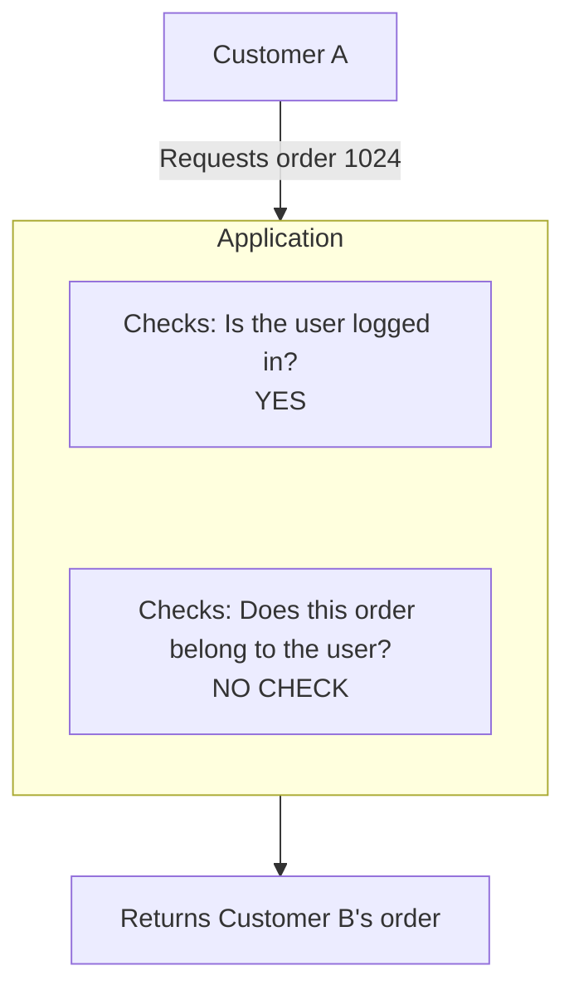

The application authenticated the user but failed to enforce the correct access permissions.

This illustrates an important distinction:

- **Authentication:** Who or what is making the request?
- **Authorization:** Is that identity allowed to perform this action?

Authentication is one security mechanism. It does not solve every security problem.

We will study these concepts separately in Chapters 11.02 and 11.03.

---

## 3. The Three Core Security Goals

A useful foundation is the **CIA triad**: Confidentiality, Integrity, and Availability.

These are three important security goals.

### Confidentiality

Only authorized people and systems should be able to access sensitive information.

Examples:

- Customers cannot read other customers' private orders.
- Password reset tokens are not exposed.
- Database credentials are not publicly accessible.

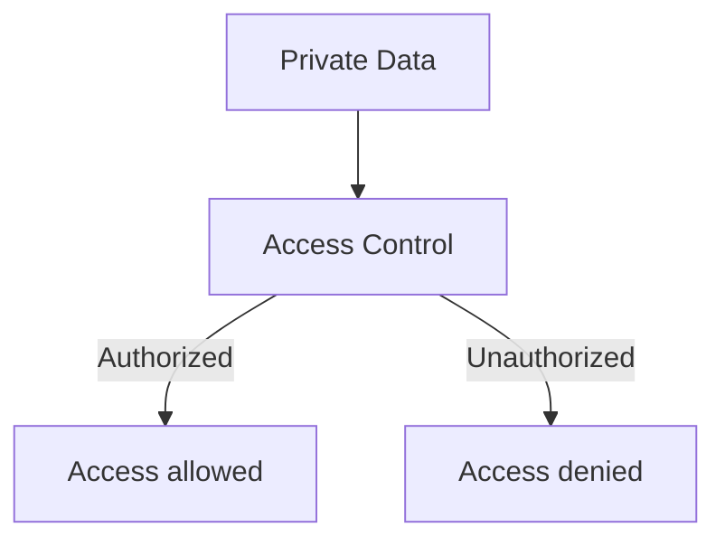

### Integrity

Data and system behavior should not be changed in unauthorized or improper ways.

Examples:

- A customer cannot change an order's price by modifying a request.
- An unauthorized user cannot alter another user's profile.
- An attacker cannot silently modify important records.

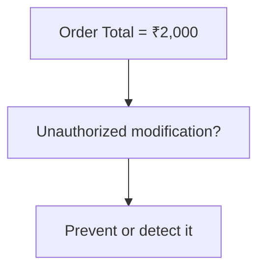

Integrity is not only about preventing changes. Systems may also need to detect changes and preserve trustworthy records.

### Availability

Authorized users should be able to use the system when they need it.

Examples:

- The API remains available during traffic spikes.
- A denial-of-service attack does not easily exhaust all capacity.
- A component failure does not unnecessarily take down the entire service.

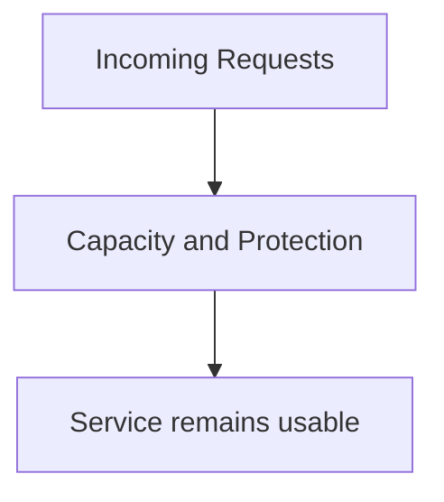

Availability connects security to reliability and resilience.

A system may protect every record from unauthorized access but still fail its users if an attacker can make it unavailable.

### Quick comparison

| Goal | Main question | Example failure |
|---|---|---|
| Confidentiality | Who can see the data? | Private customer data is exposed |
| Integrity | Who can change the data? | An order total is manipulated |
| Availability | Can legitimate users use the service? | An attack exhausts server capacity |

A single incident can affect more than one goal.

---

## 4. Security Starts With Understanding What Matters

Before choosing security controls, identify what needs protection.

These are your **assets**.

For an e-commerce system, assets might include:

- Customer information.
- Passwords and session tokens.
- Orders and payment-related records.
- Product and pricing data.
- API credentials.
- Application source code.
- Cloud infrastructure.
- Service availability.

Different assets require different protections.

For example, public product descriptions do not need the same confidentiality controls as private customer records.

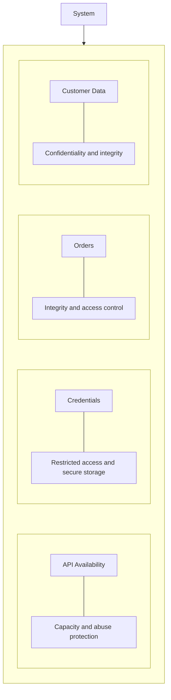

**Security design begins by identifying what could cause harm if it were exposed, modified, lost, or made unavailable.**

---

## 5. Threats, Vulnerabilities, and Risks

These terms are related, but they mean different things.

### Threat

Something that could cause harm.

Examples:

- An attacker attempting to steal customer data.
- A malicious user attempting to access another account.
- An automated bot sending excessive requests.
- An employee accidentally exposing a credential.

A threat does not have to be a person. Events and failures can also create security threats.

### Vulnerability

A weakness that could be exploited or cause harm.

Examples:

- An endpoint does not check ownership of an order.
- A secret is committed to a public repository.
- An application uses an outdated vulnerable dependency.
- A server exposes an unnecessary administrative port.

### Risk

The possibility and potential impact of harm arising from a threat exploiting a vulnerability or from another adverse event.

For example:

```text
Asset:
Customer Orders

Threat:
Unauthorized user

Vulnerability:
Missing order-ownership check

Potential Impact:
Private order information exposed

Risk:
Unauthorized disclosure of customer data
```

A useful simplified model is:

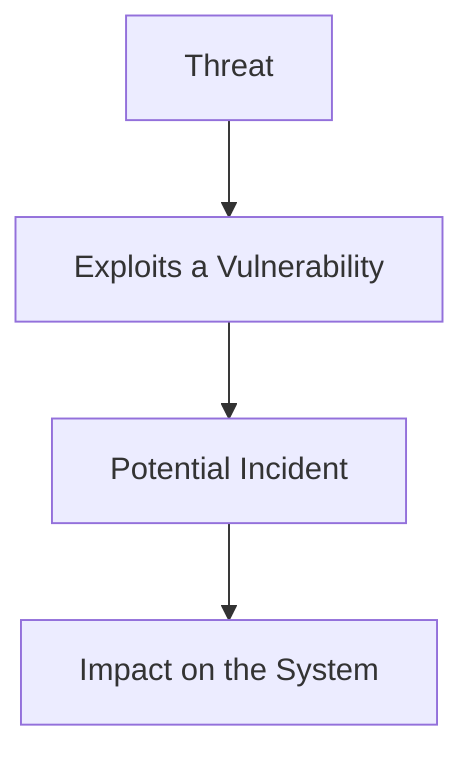

Risk assessment also considers how likely an event is and how serious its consequences would be. Risk is not always calculated using one universal formula.

---

## 6. Security Is an End-to-End Property

A web application is a chain of interacting components.

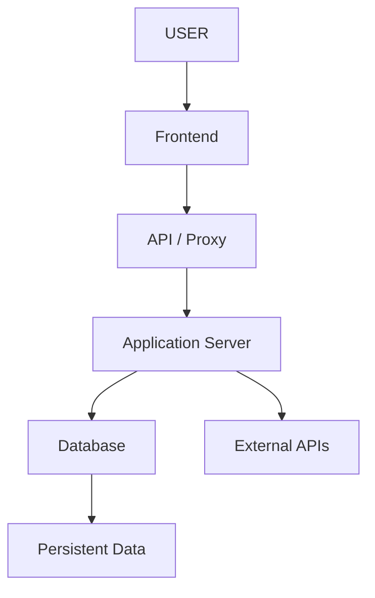

Each boundary creates security considerations.

| Component | Example concern |
|---|---|
| Frontend | Sensitive data accidentally exposed in browser code |
| API or proxy | Excessive requests or incorrectly configured routing |
| Application | Missing authorization checks or unsafe input handling |
| Database | Excessive permissions or exposed records |
| External API | Leaked credentials or untrusted responses |
| Infrastructure | Publicly exposed services or overly broad access |

Securing only one component leaves the rest of the system relevant to the overall risk.

For example, HTTPS protects data in transit between endpoints, but it does not automatically prevent an authenticated user from accessing another customer's order.

Likewise, database encryption does not prevent an application with excessive database privileges from reading data it should never access.

**A security control protects against particular threats under particular conditions. It is not a guarantee that the entire system is secure.**

---

## 7. Defense in Depth

Because no single control is perfect, systems often use multiple layers of protection.

This approach is called **defense in depth**.

Imagine an API that returns private customer data.

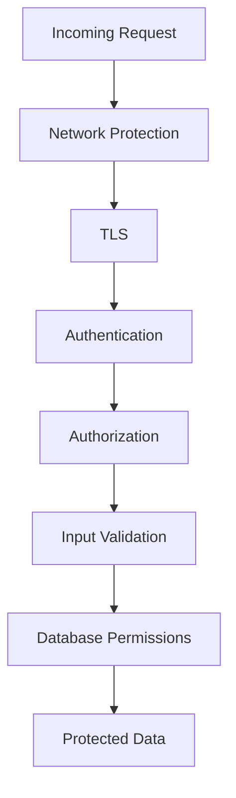

These controls have different purposes:

- Network protection can reduce unwanted traffic.
- TLS protects data in transit against many network-level threats.
- Authentication establishes the caller's identity.
- Authorization checks what the caller may do.
- Input validation checks whether input satisfies expected rules.
- Database permissions restrict what the application can access.

Logging and monitoring can help detect suspicious activity, while backups and recovery procedures help limit some consequences of incidents.

Not every request needs every possible control, and this diagram is illustrative rather than a mandatory processing order. Controls should be selected according to the threat model and architecture.

The important idea is:

> **If one control fails, other independent controls may still reduce the likelihood or impact of an incident.**

Defense in depth does not mean stacking tools randomly. Each layer should address a real risk.

---

## 8. Security Must Be Designed Into Architecture

Consider two designs for a multi-user application.

### Design A: Trust the frontend

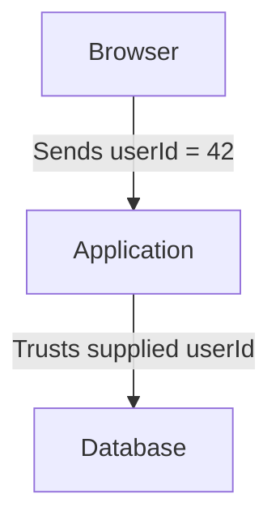

A malicious user can modify the request and submit a different user ID.

If the server trusts the client-provided value without checking authorization, private data may be exposed.

### Design B: Enforce security on the server

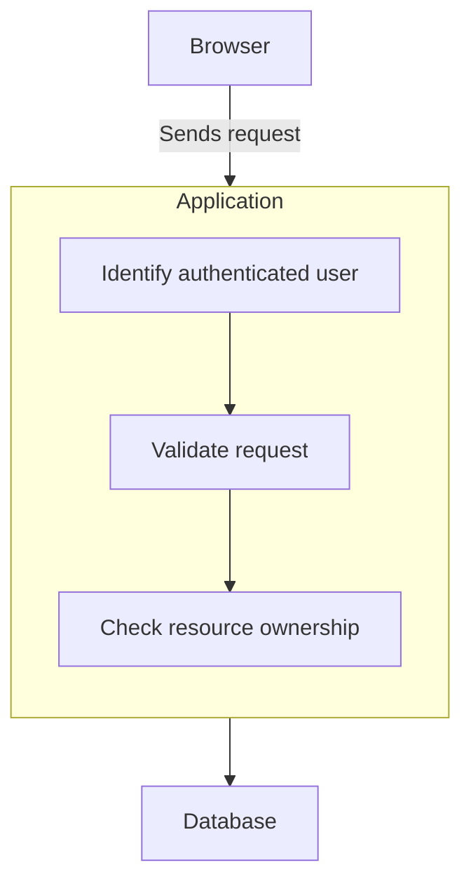

The server makes the authorization decision using trusted identity and appropriate server-side rules.

The frontend can improve user experience, but it cannot be the final authority for access control.

This is an architectural decision, not merely a UI detail.

---

## 9. Security and the Principle of Least Privilege

A component should have only the permissions it needs to perform its job.

Suppose an application only needs to read product information.

It should not automatically receive permission to:

- Delete every database table.
- Create database administrators.
- Read unrelated confidential records.
- Modify security configuration.

Compare:

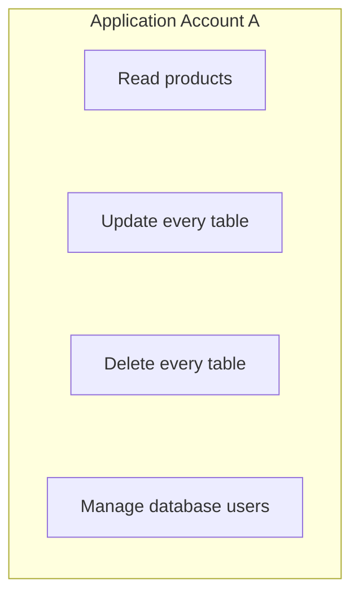

with:

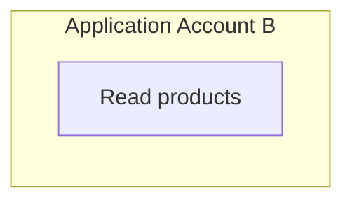

Account B has a smaller set of privileges and therefore a smaller potential impact if compromised.

Least privilege applies to:

- Users.
- Application service accounts.
- Database accounts.
- Cloud identities.
- API credentials.
- Background workers.

We will cover it in detail in Chapter 11.12.

---

## 10. Security Is a Continuous Process

Security is not a one-time task completed before launch.

Systems change:

- New endpoints are added.
- Dependencies are updated.
- Permissions evolve.
- Infrastructure changes.
- New attack techniques emerge.
- Configuration mistakes are introduced.
- Business requirements change.

A sensible security lifecycle is:

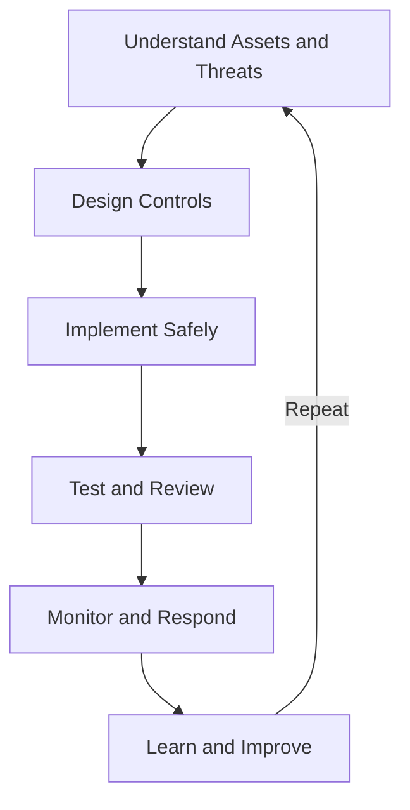

This connects security to the broader Systemly lifecycle:

**Understand → Model → Decide → Build → Measure → Scale → Recover → Evolve**

Security should be considered during design, implementation, deployment, and operation.

---

## 11. Security Has Trade-offs

Security controls can introduce cost and complexity.

Examples include:

- Encryption requires key management.
- Strict authorization adds checks that must be maintained.
- Rate limiting can affect legitimate high-volume clients.
- Short session lifetimes may increase login friction.
- Network segmentation can make operations more complex.
- Detailed audit logging consumes storage and requires access controls.

The goal is not to maximize restrictions without considering the system's purpose.

The goal is to reduce meaningful risks to an acceptable level while meeting product and operational requirements.

| Decision | Security benefit | Possible trade-off |
|---|---|---|
| Shorter session lifetime | Limits some exposure from stolen sessions | More frequent sign-ins |
| Strict rate limits | Reduces some abuse | May restrict legitimate traffic |
| Narrow database permissions | Limits impact of compromise | Requires careful permission design |
| Detailed audit logs | Improves investigation | Storage, privacy, and retention costs |
| Network segmentation | Restricts lateral movement | More configuration and operational work |

A trade-off is not a reason to skip security. It is a reason to make the decision deliberately.

---

## 12. Practical Example: Protecting an Order API

Suppose your application provides:

```http
GET /api/orders/1024
```

The intended rule is:

> A customer may view only their own orders. An authorized support agent may view orders according to their assigned permissions.

A security review should ask:

1. Is the request sent over a protected connection?
2. Is the caller authenticated?
3. Is the caller allowed to access this particular order?
4. Are support-agent permissions limited to their responsibilities?
5. Is the order ID treated as untrusted input?
6. Does the database account have only the required permissions?
7. Are suspicious access attempts logged without exposing sensitive information?
8. Can excessive requests be limited?
9. Are errors handled without revealing secrets or internal details?

A successful login answers only one of these questions.

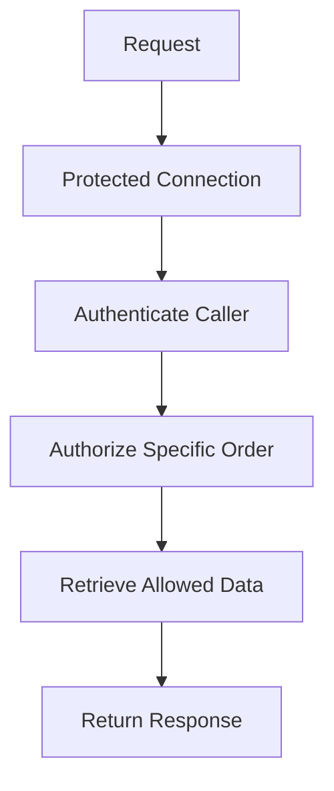

The exact controls depend on the system's requirements and threat model.

---

## 13. Common Mistakes

### Mistake 1: Treating login as complete security

Authentication does not replace authorization, input validation, data protection, or availability controls.

### Mistake 2: Trusting the frontend

Client-side checks can be bypassed. Security-critical decisions must be enforced by trusted server-side components.

### Mistake 3: Assuming encryption solves every problem

Encryption protects data in particular circumstances. It does not automatically prevent misuse by an authorized but overprivileged application.

### Mistake 4: Giving components excessive permissions

A compromised component can cause more damage when it has broad privileges.

### Mistake 5: Adding controls without understanding threats

Security tools should address identified risks rather than merely increase architectural complexity.

### Mistake 6: Treating security as a launch checklist

Security must evolve as the system and its dependencies change.

### Mistake 7: Ignoring availability

A system can protect confidentiality and integrity while still being vulnerable to resource exhaustion or denial of service.

---

## 14. Hands-On Exercise

Use a simple e-commerce application as your example.

Identify at least four assets and one security risk for each.

| Asset | Potential threat or weakness | Possible control |
|---|---|---|
| Customer orders | Missing ownership check | Server-side authorization |
| Database credentials | Secret committed to source control | Secret management and restricted access |
| Public API | Excessive automated requests | Appropriate rate limiting and abuse controls |
| Customer data in transit | Unprotected network connection | TLS |

Now extend the exercise:

1. Choose one asset.
2. Describe a realistic threat.
3. Identify the vulnerability that could make the threat successful.
4. Describe the potential impact.
5. Choose one or more controls.
6. Explain what those controls do **not** protect against.

The final question is important. Every control has limits.

---

## 15. System Design View

When designing a system, security questions belong alongside performance, reliability, and cost.

For each major component, ask:

- What assets does it access?
- Who or what can call it?
- What permissions does it need?
- What happens if it is compromised?
- What data crosses its boundaries?
- Which threats are relevant?
- Which controls reduce those risks?
- How will suspicious behavior be detected?
- How can the system recover from an incident?

A useful design review maps important assets, trust boundaries, permissions, and failure consequences before choosing individual security mechanisms.

This creates the foundation for the rest of Level 11.

---

## 16. Quick Reference

| Term | Meaning |
|---|---|
| Security | Protection of systems, data, and users against relevant threats |
| Confidentiality | Preventing unauthorized disclosure |
| Integrity | Preventing or detecting unauthorized or improper changes |
| Availability | Keeping services usable for legitimate users |
| Asset | Something valuable that needs protection |
| Threat | A potential source or cause of harm |
| Vulnerability | A weakness that could be exploited or cause harm |
| Risk | The possibility and impact of an adverse event |
| Security control | A measure that reduces a particular risk |
| Defense in depth | Using complementary layers of protection |
| Least privilege | Giving identities and components only necessary permissions |
| Trust boundary | A boundary across which trust assumptions or security controls matter |

---

## 17. Knowledge Check

**1. Why is security a system property?**

Because security depends on the behavior and interactions of the entire system, including its components, data flows, permissions, and operational processes.

**2. What are the three goals in the CIA triad?**

Confidentiality, Integrity, and Availability.

**3. Does successful authentication prove that a user may access a resource?**

No. Authorization must determine whether that identity is permitted to access the specific resource or perform the action.

**4. What is the difference between a threat and a vulnerability?**

A threat can cause harm; a vulnerability is a weakness that may enable harm.

**5. Why use defense in depth?**

Complementary controls can reduce the likelihood or impact of an incident when one control is insufficient or fails.

**6. Why should a frontend not make the final authorization decision?**

The client is controlled by the user and can be modified. Trusted server-side components must enforce access rules.

**7. Does encryption make a system secure by itself?**

No. Encryption addresses particular data-protection risks but does not replace access control, secure implementation, availability protection, or monitoring.

**8. Why does security require ongoing review?**

Code, dependencies, configuration, infrastructure, threats, and business requirements change over time.

---

## Remember

Security is not a single feature, library, or infrastructure service.

It is the result of how the whole system is designed, implemented, configured, operated, and maintained.

**Next: 11.02 — Authentication**
