# 11.02 — Authentication

## Learning Objectives

By the end of this chapter, you should be able to:

- Explain authentication and distinguish it from authorization.
- Understand the main authentication factors and methods.
- Trace a typical login flow from request to authenticated session.
- Understand how passwords should be stored and verified.
- Recognize the purpose of multi-factor authentication (MFA).
- Understand common authentication attacks and defenses.
- Explain how authentication affects application architecture and user experience.

---

## 1. What Is Authentication?

**Authentication is the process of verifying the identity of a user, device, service, or other entity.**

Imagine a customer opens your application and enters:

```text
Email: customer@example.com
Password: ********
```

The application must determine whether the submitted credentials are valid.

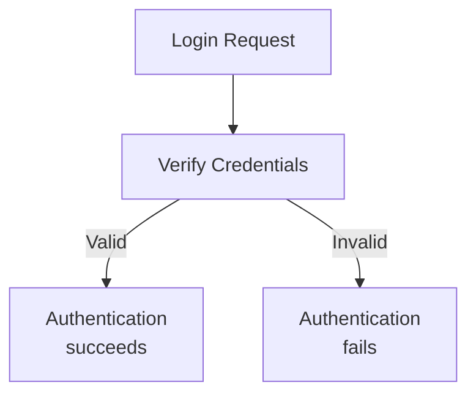

Authentication answers:

> **Who or what is making this request?**

It does not automatically answer:

> What is this identity allowed to do?

That second question belongs to authorization, covered in Chapter 11.03.

## 2. Authentication vs Authorization

These concepts work together but solve different problems.

| Authentication | Authorization |
|---|---|
| Verifies identity. | Checks permissions. |
| Usually happens during login or credential verification. | Happens when access to a resource or action is evaluated. |
| Example: Is this really customer A? | Example: May customer A view order 1024? |

Consider this request:

```http
GET /api/orders/1024
```

A typical flow is:

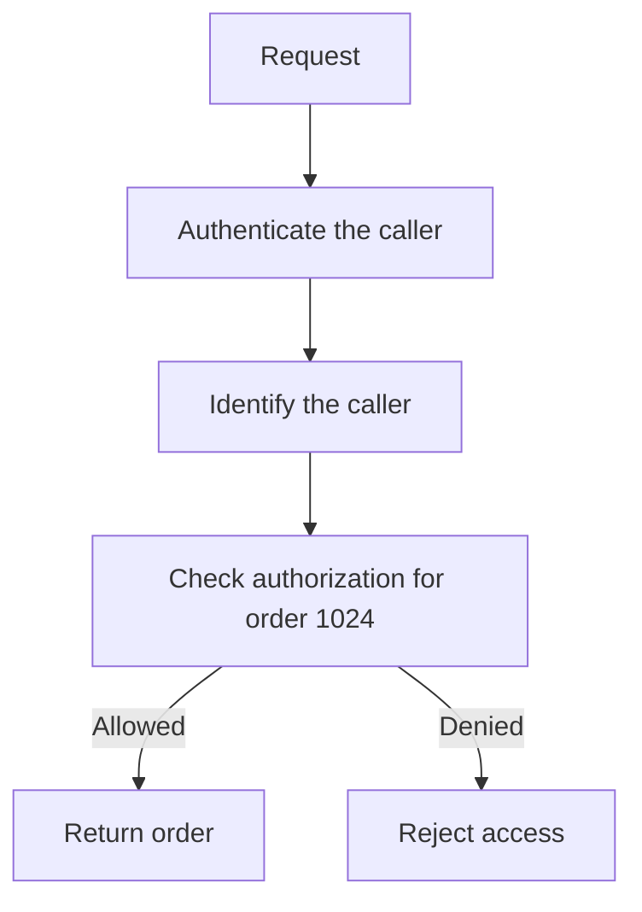

A successfully authenticated user can still be denied access to a particular resource.

**Remember:** Authentication establishes identity; authorization determines permitted actions.

---

## 3. What Can Be Authenticated?

Authentication is not limited to people entering passwords.

Common examples include:

- **Users:** Customers, administrators, employees.
- **Services:** One backend service communicating with another.
- **Devices:** Devices proving possession of an approved credential.
- **Applications:** Software identifying itself to an API.
- **Workloads:** Containers, virtual machines, or cloud applications obtaining an identity.

For example:

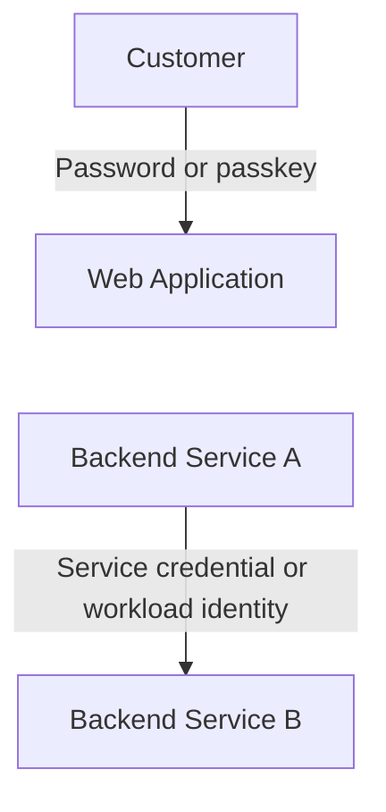

Human login and service-to-service authentication have different requirements, but both establish an identity that the receiving system can evaluate.

---

## 4. Authentication Factors

Authentication methods can be grouped by the type of evidence they use.

### Something you know

Examples:

- Password.
- PIN.
- Passphrase.

### Something you have

Examples:

- A hardware security key.
- An authenticator device.
- A registered device holding a cryptographic credential.

### Something you are

Examples:

- Fingerprint.
- Facial recognition.

Biometric verification often happens locally on a device, which then uses a cryptographic credential or another mechanism to authenticate to a service.

A biometric check by itself does not necessarily mean the remote application receives or verifies the biometric data.

### Why factors matter

If an attacker steals a password, password-only authentication may be compromised.

If an account also requires a separate factor, stealing the password alone may not be sufficient.

This is the idea behind **multi-factor authentication (MFA)**.

Two passwords are still two instances of the same factor category: something you know. MFA requires evidence from at least two different factor categories.

---

## 5. Common Authentication Methods

| Method | How it works | Important consideration |
|---|---|---|
| Password | User submits a secret they know. | Passwords can be guessed, reused, or stolen. |
| Passkey | Uses public-key cryptography, commonly with device-based user verification. | Requires compatible client and relying-party support. |
| One-time code | User submits a short-lived code. | Security depends on the delivery or generation method. |
| Hardware security key | User proves possession of a physical authenticator. | Strong phishing-resistant options are available. |
| Client certificate | A client proves possession of a private key corresponding to a trusted certificate. | Certificate issuance, renewal, and revocation must be managed. |
| Service credential | A workload proves its identity to another system. | Long-lived credentials can be difficult to protect and rotate. |

No single method is ideal for every system.

The right choice depends on risk, user experience, client support, recovery requirements, and operational complexity.

---

## 6. A Typical Password Login Flow

Consider a web application using an email and password.

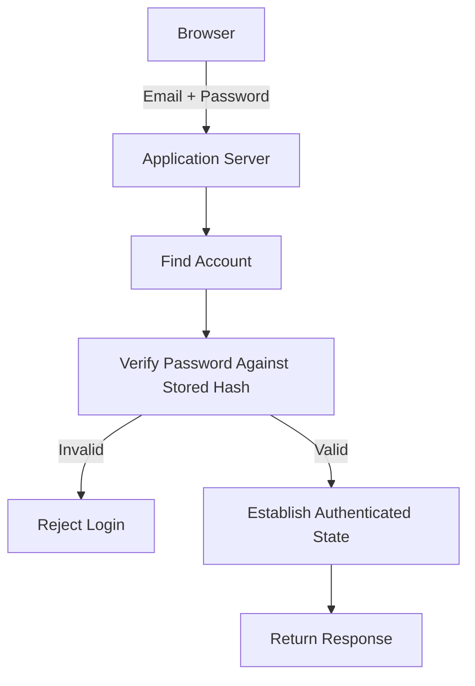

Let's examine the important steps.

1. The user submits credentials over a protected connection.
2. The server validates the request and applies appropriate abuse protections.
3. The server locates the account using a suitable identifier.
4. The server verifies the submitted password against the stored password hash.
5. If verification succeeds, the server establishes authenticated state using an appropriate mechanism.
6. The application returns a response without exposing sensitive credential information.

A successful login does not mean the password should be sent back, logged, or stored in plaintext.

---

## 7. Password Storage: Never Store Plaintext Passwords

Suppose a database stores:

```text
email                    password
------------------------------------------------
user@example.com          mysecret123
```

If an attacker obtains this database, the actual passwords are immediately exposed.

A secure design stores a **password hash** produced by a password-hashing algorithm.

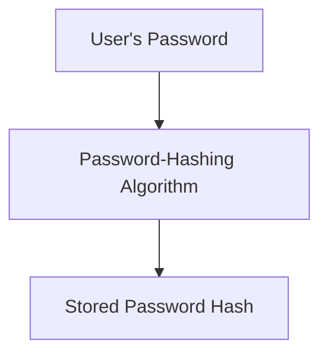

During login:

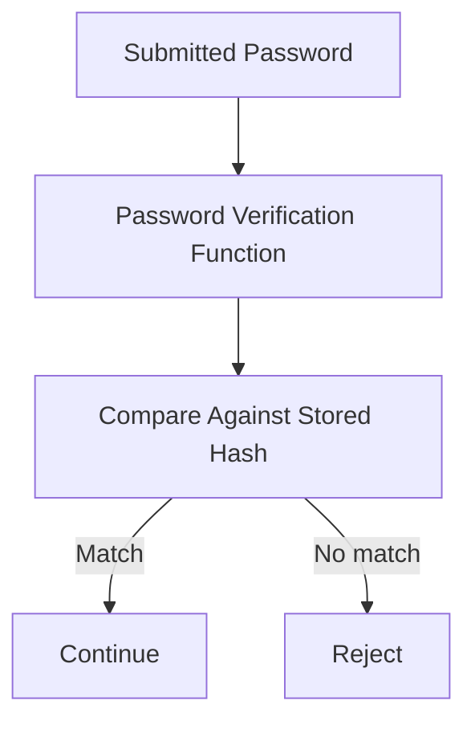

In practice, the application uses the password-hashing library's verification function. It should not invent its own password-storage scheme or manually compare hashes.

### Use password-hashing algorithms

Common choices include:

- **Argon2id**
- **bcrypt**
- **scrypt**
- **PBKDF2**, when appropriately configured for the environment and requirements

These algorithms are designed to make large-scale password guessing more expensive than ordinary fast hashing.

A general-purpose hash such as plain SHA-256 is not an appropriate password-storage method by itself.

### What about salts?

Password-hashing schemes use a **salt**, a value incorporated into the password hash process.

A unique salt helps prevent identical passwords from producing identical stored hashes and makes precomputed attacks less useful.

Established password-hashing libraries normally manage salts and verification details for you.

**Important:** Password hashing is not the same as encryption. A password hash is not intended to be decrypted to recover the original password.

---

## 8. Multi-Factor Authentication (MFA)

MFA requires the user to prove identity using at least two different categories of evidence.

For example:

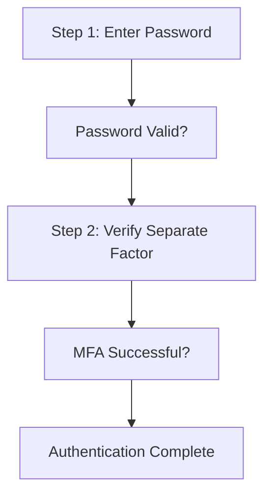

MFA can reduce the risk associated with a stolen password.

However, the protection depends on the factors used and how they are implemented.

For example, phishing-resistant methods such as passkeys or appropriately configured security keys offer stronger protection against phishing than simply relying on a password plus a code that an attacker can trick the user into disclosing.

MFA also needs secure recovery procedures. Otherwise, an attacker may bypass the intended protection by compromising account recovery.

### When should MFA be considered?

It is especially important for:

- Administrative accounts.
- Accounts that can access sensitive information.
- Accounts that can change security settings.
- Privileged operational access.
- Systems with significant financial or business impact.

The exact requirement should reflect the system's threat model and risk.

---

## 9. Common Authentication Attacks

Authentication systems are frequent targets because compromising an identity may grant access to valuable resources.

| Attack | What happens | Common defenses |
|---|---|---|
| Brute-force guessing | Attacker repeatedly guesses credentials. | Rate limits, progressive delays, monitoring, appropriate MFA. |
| Credential stuffing | Attacker tries username/password pairs stolen from other services. | MFA, breached-password screening, rate limits, anomaly detection. |
| Phishing | User is tricked into revealing credentials or approving a malicious login. | Passkeys, phishing-resistant MFA, user education, careful recovery design. |
| Password database theft | Attacker obtains stored password data. | Strong password hashing, restricted database access, incident response. |
| Session theft | Attacker obtains a token or session credential after login. | Secure session handling, protected transport, appropriate token lifecycle controls. |
| Account recovery abuse | Attacker exploits a weak reset or recovery process. | Strong recovery verification, notifications, abuse protection. |

No single defense eliminates all authentication risk.

For example, rate limiting can slow repeated guesses, but it does not make a stolen valid password harmless. MFA can reduce the impact of credential theft, but weak recovery mechanisms may undermine it.

---

## 10. Protect the Login Endpoint

A login endpoint is a public entry point, so it must be designed to handle malicious as well as legitimate requests.

For example:

```http
POST /api/login
```

A basic protection strategy may include:

- Using HTTPS.
- Validating request structure and input size.
- Applying appropriate rate limits and abuse detection.
- Avoiding detailed error messages that reveal whether an account exists, where practical.
- Monitoring unusual authentication patterns.
- Protecting passwords and verification codes from logs.
- Using secure password-verification libraries.
- Applying MFA where justified by risk.

Avoid simplistic rules such as permanently locking an account after a small fixed number of failed attempts. Such a policy can let attackers deliberately deny service to legitimate users.

Instead, design abuse controls that balance security and availability.

---

## 11. What Happens After Authentication?

A server must know how to recognize the authenticated identity on subsequent requests.

For example:

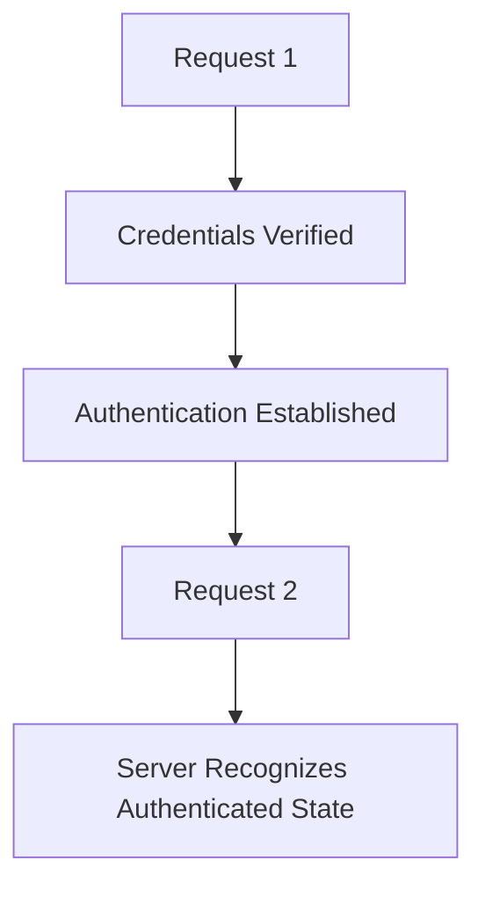

Common approaches include:

- **Server-side sessions:** The server stores session state and the client presents a session identifier.
- **Tokens:** The client presents a credential that the receiving service validates according to the token design.
- **Federated identity:** An application relies on an identity provider to authenticate the user and communicates using an established protocol.

These approaches have different security and operational trade-offs.

They are not interchangeable in every architecture.

We will study sessions in Chapter 11.07, OAuth in Chapter 11.05, and JWT in Chapter 11.06.

For now, remember that authentication does not end at the login form. The system must also securely maintain and verify authenticated state.

---

## 12. Authentication and Service-to-Service Communication

Backend services also need identities.

Imagine:

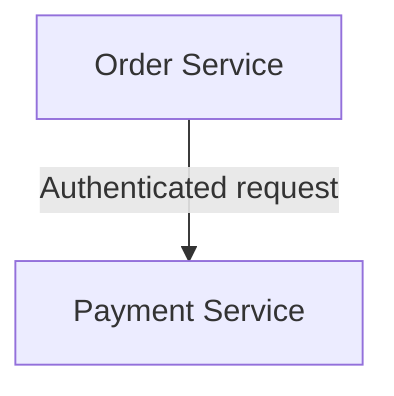

The payment service should not automatically trust every request just because it came from another internal service.

Depending on the architecture, service identity may use:

- Workload identity.
- Mutual TLS.
- Short-lived credentials or tokens.
- Other appropriately managed service credentials.

The receiving service should verify the caller and apply authorization rules.

Internal networks are not a substitute for authentication and access control.

---

## 13. Authentication Failure Is a Normal Outcome

Not every failed login indicates an attack.

A user might:

- Enter the wrong password.
- Use an expired one-time code.
- Lose access to a registered device.
- Attempt to use a revoked credential.
- Experience a temporary identity-provider problem.

A robust system should handle these cases without exposing sensitive details.

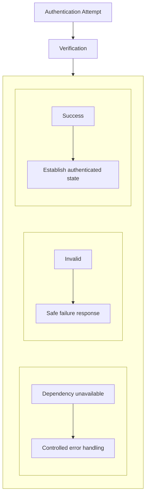

Authentication failure should not accidentally grant access.

If an identity provider is unavailable, the system should not simply skip verification to keep the application working. Any fallback must be explicitly designed and must preserve the required security guarantees.

---

## 14. Trade-offs

| Decision | Benefit | Trade-off |
|---|---|---|
| Stronger password policy | Can reduce some weak-password risks | Excessive complexity rules can frustrate users without ensuring strong passwords |
| MFA | Reduces reliance on a single credential | Adds enrollment, recovery, and sign-in steps |
| Passkeys | Can provide phishing-resistant authentication | Requires compatible clients and thoughtful recovery support |
| Strict login rate limits | Helps slow automated guessing | Poor limits can block legitimate users |
| External identity provider | Reduces the need to build and operate all identity features yourself | Adds a dependency and integration requirements |
| Short-lived credentials | Limits some exposure from stolen credentials | Requires renewal and expiration handling |

A secure authentication design should consider both attacker behavior and the legitimate user's experience.

---

## 15. Hands-On Exercise

Design authentication for a small e-commerce application.

The application has:

- Customers who can log in and view their own orders.
- Support agents who use an administrative interface.
- A backend order service that communicates with a payment service.

Answer these questions:

1. Which authentication method would you choose for customers, and why?
2. Would you require MFA for support agents? Explain your decision.
3. How would passwords be stored?
4. How would the application recognize a user after login?
5. How would the payment service authenticate requests from the order service?
6. What protections would you apply to the login endpoint?
7. What should happen if the identity provider is temporarily unavailable?

For each choice, identify one benefit, one trade-off, and one failure mode to consider.

The goal is not to find a universal answer. It is to justify decisions based on risk, usability, and system requirements.

---

## 16. Common Mistakes

- **Confusing authentication with authorization:** A verified identity does not automatically have permission to access every resource.
- **Storing plaintext passwords:** Store password hashes using an established password-hashing algorithm.
- **Using a fast general-purpose hash for passwords:** Use an appropriate password-hashing scheme instead.
- **Assuming MFA solves everything:** Session theft, weak recovery, and authorization flaws can still compromise an account.
- **Trusting internal requests automatically:** Service-to-service communication also needs appropriate identity verification and authorization.
- **Ignoring recovery flows:** Account recovery can become the weakest part of authentication.
- **Logging credentials:** Passwords, codes, and authentication secrets should not appear in ordinary application logs.
- **Failing open during an outage:** A verification dependency failure should not silently turn an unauthenticated request into an authenticated one.

---

## 17. System Design View

Authentication affects much more than the login screen.

It influences:

- Identity-provider selection.
- Session and token design.
- Database and credential protection.
- API boundaries.
- Service-to-service communication.
- Account recovery.
- Availability and dependency handling.
- Auditability and incident response.

When designing authentication, ask:

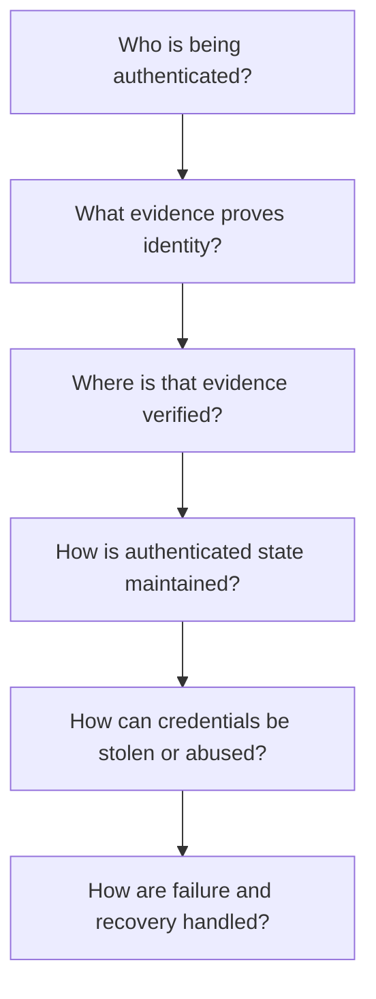

A sound design makes the identity-verification process explicit and ensures that later requests cannot bypass it.

---

## 18. Quick Reference

| Term | Meaning |
|---|---|
| Authentication | Verifying the identity of an entity |
| Authorization | Determining what an identity is allowed to do |
| Authentication factor | A category of evidence used to verify identity |
| MFA | Authentication using at least two different factor categories |
| Password hash | A one-way representation used to verify a password |
| Salt | A value incorporated into password hashing to help defend against precomputed attacks |
| Passkey | A credential based on public-key cryptography, often designed to resist phishing |
| Credential stuffing | Trying stolen username/password pairs against other services |
| Session | A mechanism for maintaining authenticated state across requests |
| Identity provider | A system that authenticates identities and may provide identity assertions to other applications |
| Service identity | An identity used by an application or workload to authenticate to another system |

---

## 19. Knowledge Check

**1. What question does authentication answer?**

Who or what is making the request?

**2. How does authentication differ from authorization?**

Authentication verifies identity; authorization checks whether that identity may perform a particular action.

**3. Why should passwords not be stored in plaintext?**

A database leak would expose the original passwords directly.

**4. Why use a password-hashing algorithm such as Argon2id or bcrypt?**

These algorithms are designed to make large-scale password guessing more expensive than ordinary fast hashing.

**5. What does MFA add?**

It requires evidence from at least two different authentication-factor categories, reducing reliance on one factor alone.

**6. Why is account recovery part of authentication security?**

An attacker may bypass the normal login protections if recovery procedures are weak.

**7. Should an application skip authentication when its identity provider is unavailable?**

No. It should handle the dependency failure safely rather than silently granting access.

**8. Does an authenticated user automatically have access to every API resource?**

No. The application must still enforce authorization for each protected action or resource.

---

## Remember

**Authentication establishes identity; it does not grant unlimited access.**

A robust authentication system verifies credentials safely, protects them from exposure, resists common attacks, handles recovery carefully, and maintains authenticated state without bypassing verification when something goes wrong.

**Next: 11.03 — Authorization**
