# 11.03 — Authorization

## Learning Objectives

By the end of this chapter, you should be able to:

- Explain authorization and distinguish it from authentication.
- Understand how authorization decisions are made for requests and resources.
- Recognize common authorization models.
- Understand resource ownership and object-level access checks.
- Apply server-side authorization to APIs.
- Recognize common authorization vulnerabilities, including IDOR and privilege escalation.
- Understand how deny-by-default and least privilege improve security.

---

## 1. What Is Authorization?

**Authorization determines whether an identity is allowed to perform a particular action on a resource.**

Suppose a customer logs in to an e-commerce application.

The system verifies the customer's identity. Authentication succeeds.

The customer then requests:

```http
GET /api/orders/1024
```

The application must decide whether this customer is allowed to view order `1024`.

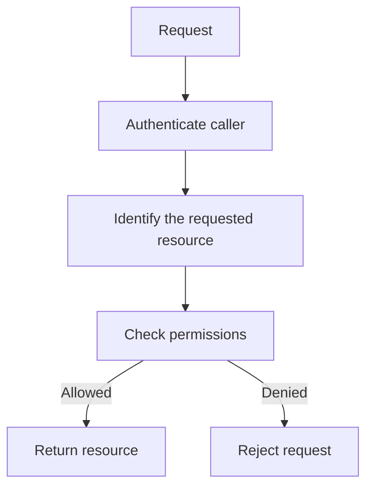

The user being logged in is not enough.

The application must check whether the requested action is permitted.

> **Authentication establishes identity. Authorization enforces permissions.**

---

## 2. Authentication vs Authorization

Consider a building with a security desk.

- Authentication is checking someone's identity.
- Authorization is checking whether that person may enter a particular room.

A person might be a legitimate employee but still have no permission to enter the server room.

The same distinction applies to software.

| Authentication | Authorization |
|---|---|
| Verifies identity. | Checks permissions. |
| Answers “Who are you?” | Answers “What may you do?” |
| Validates credentials or identity evidence. | Evaluates identity, resource, action, and applicable rules. |
| Example: Verify a customer's login. | Example: Allow the customer to view only their own orders. |

A secure application needs both.

---

## 3. Authorization Is About Actions and Resources

Authorization is not merely checking whether someone is an administrator.

It commonly evaluates three things:

1. **Subject** — Who or what is making the request?
2. **Action** — What are they trying to do?
3. **Resource** — What are they trying to access or change?

For example:

```text
Subject: Customer A
Action:  Read
Resource: Order 1024
```

The system evaluates whether Customer A may read Order 1024.

Another request might be:

```text
Subject: Support Agent
Action:  Refund
Resource: Order 1024
```

This is a different authorization decision because the action and potentially the applicable rules are different.

A useful mental model is:

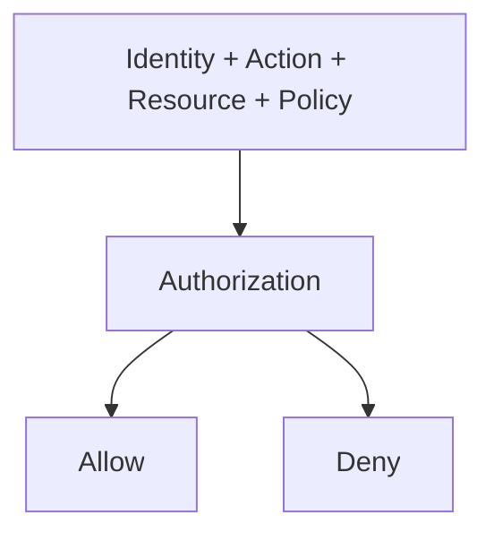

Real policies may also depend on context, such as organization, resource ownership, time, device, or transaction state.

---

## 4. Why Frontend Checks Are Not Enough

Suppose your frontend hides the Delete button from ordinary users.

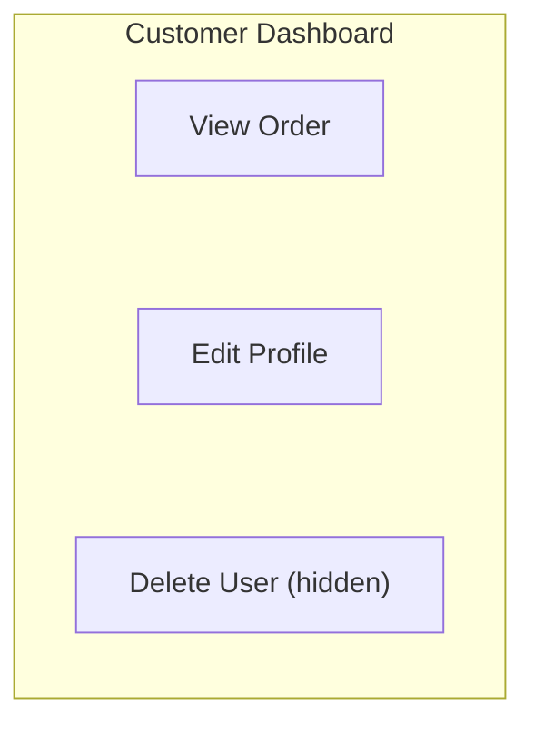

This improves the interface, but it does not enforce security.

A user can send a request directly:

```http
DELETE /api/users/42
```

They do not need to click a button in your interface.

If the backend does not check authorization, the operation might succeed.

The correct design is:

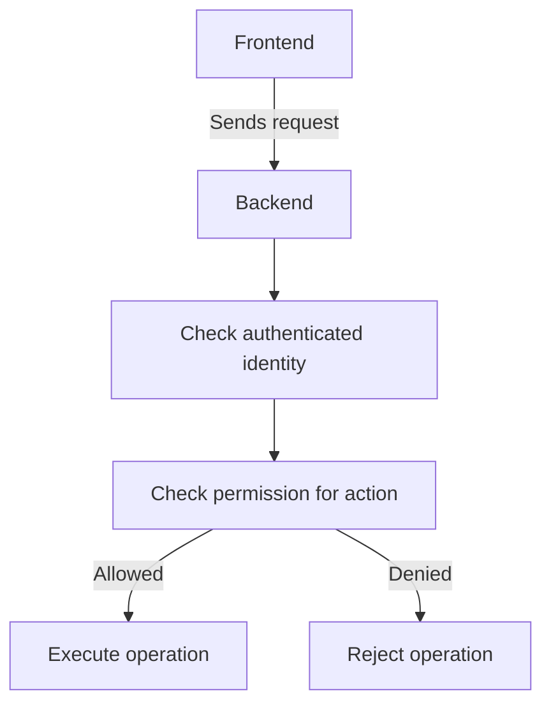

The frontend can hide unavailable actions for usability. The backend must enforce the actual rule.

> **A security decision is not enforced until the trusted component performing the protected operation enforces it.**

---

## 5. Object-Level Authorization

A common mistake is checking whether a user is logged in without checking whether they may access the specific object they requested.

Imagine two customers:

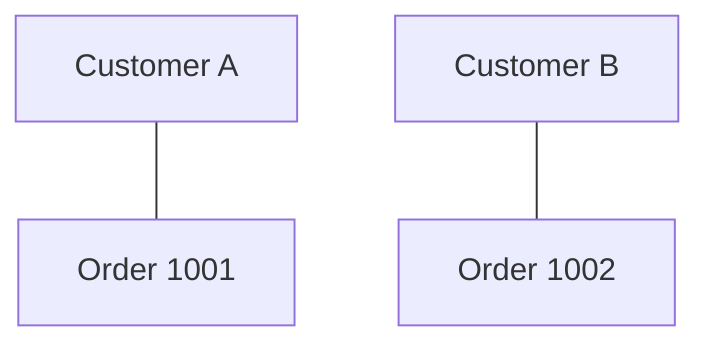

Both customers are authenticated.

Customer A requests:

```http
GET /api/orders/1002
```

If the server checks only that Customer A is logged in, it may return Customer B's order.

A secure implementation checks the relationship between the authenticated identity and the requested resource.

Conceptually:

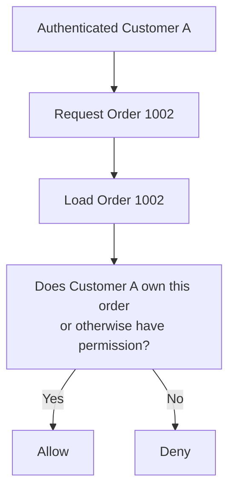

This is **object-level authorization**: checking permission for a particular record or resource.

The resource could be an order, document, invoice, project, file, or account.

---

## 6. IDOR: Insecure Direct Object Reference

An important vulnerability related to object-level authorization is **IDOR**, or Insecure Direct Object Reference.

Suppose an application uses URLs like:

```text
/orders/1001
/orders/1002
/orders/1003
```

A customer changes the URL from:

```text
/orders/1001
```

to:

```text
/orders/1002
```

If the application returns the second customer's order without checking access, it has an authorization vulnerability.

The numeric ID is not necessarily the problem. The missing permission check is.

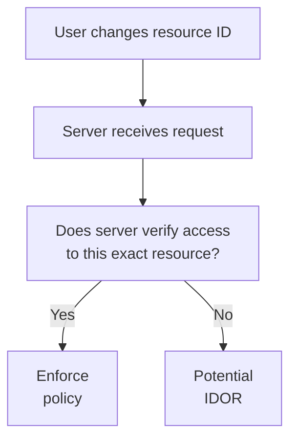

Using random or difficult-to-guess identifiers can make casual enumeration harder, but it does not replace authorization checks.

**The defense is to verify access to every protected object on the server.**

---

## 7. Common Authorization Models

Different systems use different ways to express permissions.

### Access control lists (ACLs)

An ACL associates a resource with identities or groups and their permissions.

Example:

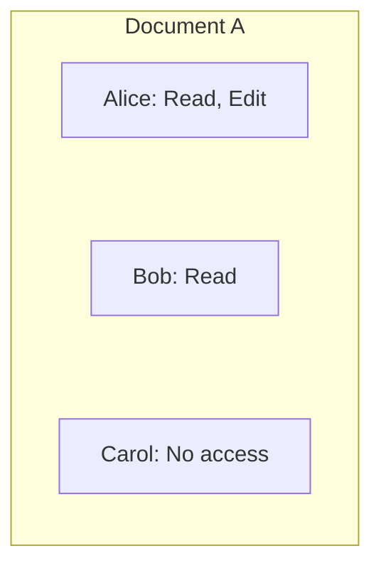

ACLs are useful when permissions are specific to individual resources, although managing many individual grants can become complex.

### Role-based access control (RBAC)

RBAC assigns permissions to roles, then assigns users to those roles.

For example:

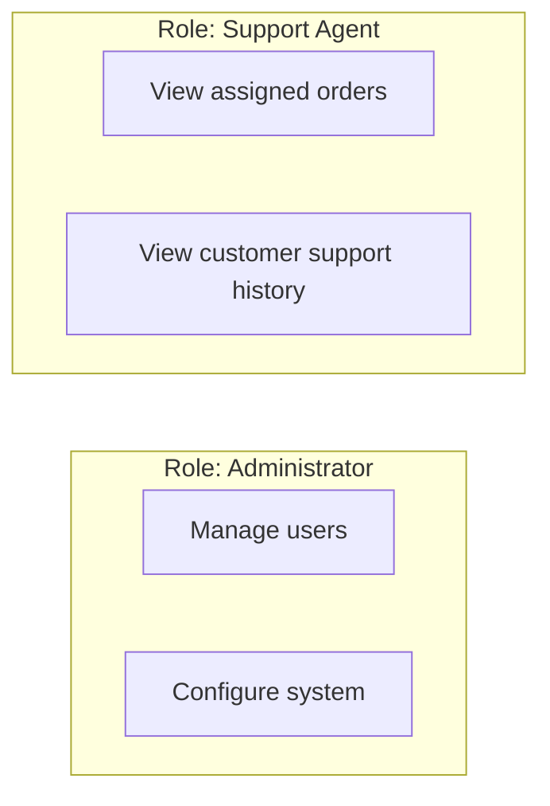

Users receive permissions through their assigned roles.

RBAC is covered in detail in Chapter 11.04.

### Attribute-based access control (ABAC)

ABAC evaluates attributes of the subject, resource, action, and sometimes the environment.

For example:

```text
Allow access when:
- User belongs to the correct organization
- Resource belongs to that organization
- User has the required permission
- Resource is in an allowed state
```

ABAC can express contextual rules but may be harder to design, test, and explain.

These models are not necessarily mutually exclusive. A system can use roles alongside resource attributes and explicit ownership rules.

---

## 8. Authorization Is More Than Roles

Imagine an application has these roles:

```text
Customer
Support Agent
Administrator
```

A role can grant general capabilities, but it may not fully determine access to every resource.

For example, two support agents may have the same role, but each may be assigned to different cases.

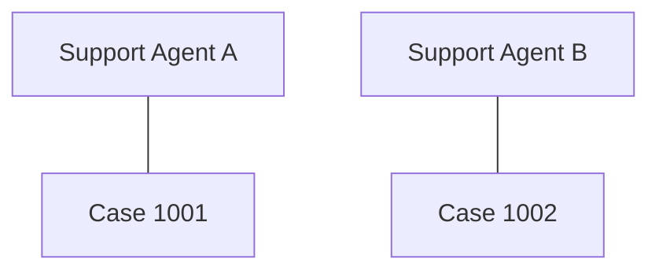

Both have the support-agent role.

But Agent A should not automatically be allowed to view every case assigned to Agent B.

A complete decision may need to check:

- The user's role.
- The requested action.
- The resource's ownership or assignment.
- The organization or tenant.
- Other relevant policy conditions.

Roles provide a useful starting point, not a replacement for resource-specific checks.

---

## 9. Deny by Default

A secure authorization system should generally **deny access unless a rule explicitly permits it**.

Consider two designs.

### Unsafe approach

```text
If explicitly forbidden:
    Deny
Otherwise:
    Allow
```

Anything not covered by a deny rule may accidentally become accessible.

### Safer approach

```text
If explicitly permitted:
    Allow
Otherwise:
    Deny
```

For example:

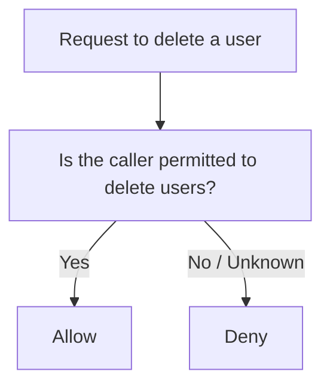

This is called **deny by default** or **default deny**.

It is especially useful when new endpoints or actions are introduced. A new action should not automatically become available simply because nobody wrote a rule to deny it.

---

## 10. Least Privilege

Authorization should grant only the permissions needed for the task.

Suppose a support agent needs to view order status.

They may not need permission to:

- Change product prices.
- Delete customer accounts.
- Modify payment configuration.
- Export the entire customer database.

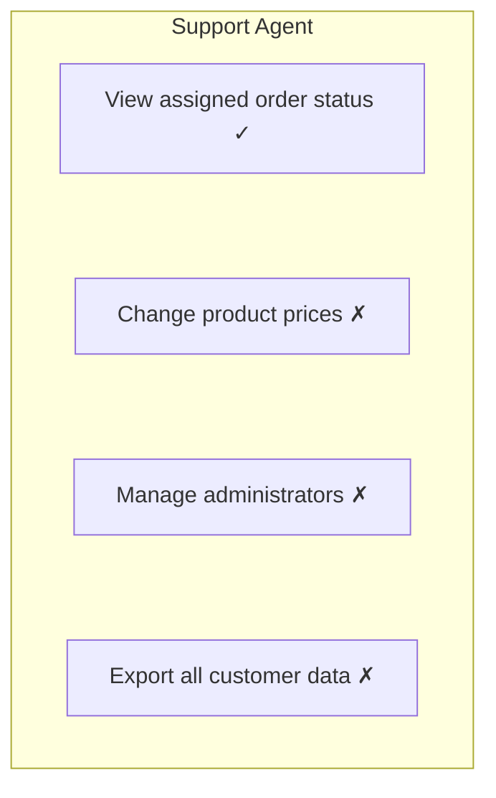

Restricting permissions limits the damage caused by mistakes, compromised accounts, and malicious actions.

This principle also applies to services and database accounts, not just human users.

Least privilege is covered more broadly in Chapter 11.12.

---

## 11. Authorization for APIs

Every protected API operation should have an appropriate authorization policy.

Consider:

```http
GET /api/orders/1024
POST /api/orders/1024/cancel
DELETE /api/users/42
GET /api/admin/reports
```

These operations do not necessarily require the same permissions.

A policy might be:

| Operation | Example policy |
|---|---|
| Read an order | Customer owns it or has an explicitly permitted support role |
| Cancel an order | Customer owns it and the order is in a cancellable state |
| Delete a user | Caller has a specific administrative permission |
| Read admin reports | Caller has access to the relevant reporting scope |

Notice that authorization can depend on the resource's state.

A customer may be allowed to cancel an order that has not shipped but not one that has already been completed.

Authorization is therefore often more specific than a simple role check.

---

## 12. Authorization and Multi-Tenant Systems

In a multi-tenant application, one platform serves multiple organizations or customers.

For example:

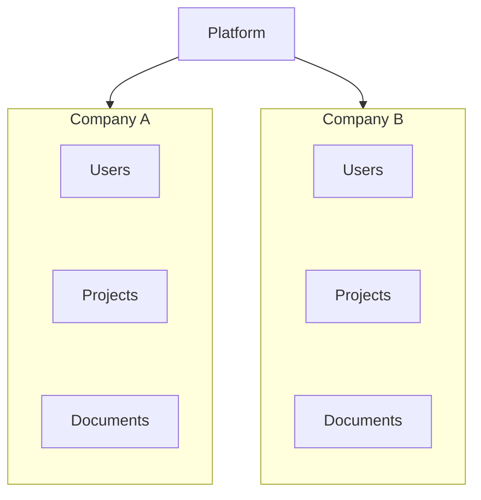

A user from Company A should not automatically access Company B's data.

An application must enforce the tenant boundary on the server.

Conceptually:

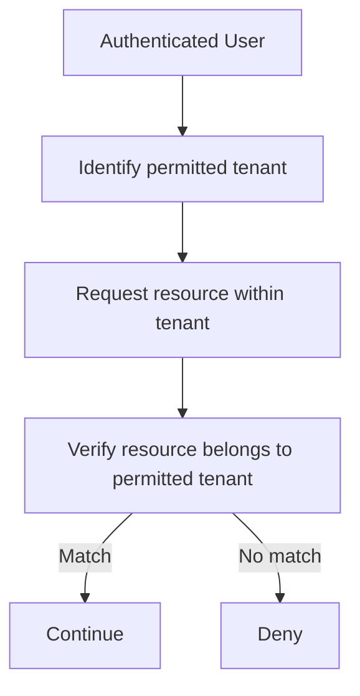

Do not rely solely on a `tenant_id` supplied by the browser. The server must validate it against the authenticated identity and the applicable policy.

Tenant isolation should be considered across API endpoints, database queries, background jobs, exports, and administrative tools.

---

## 13. Authorization and HTTP Status Codes

Applications commonly use HTTP status codes to communicate access outcomes.

| Status | Typical meaning |
|---|---|
| `401 Unauthorized` | Authentication is missing or invalid; despite its name, it usually indicates an authentication problem |
| `403 Forbidden` | The server understands the request but refuses to authorize it |
| `404 Not Found` | The resource does not exist, or the application intentionally avoids revealing its existence |

The correct response depends on the API's design and security requirements.

For example, an application may return `404` for a resource the user is not allowed to see, preventing the response from confirming that the resource exists.

Whichever policy is chosen, it should be applied consistently and should not leak sensitive details through error messages.

---

## 14. Authorization Checks Must Be Consistent

Suppose the application offers several ways to access an order:

```text
GET /api/orders/1024
GET /api/users/42/orders
GET /api/reports/orders
Background order-export job
```

If only the first endpoint checks ownership, another route may expose the same data without the intended restriction.

Authorization needs to cover every path that can access or modify protected resources.

That includes:

- REST and GraphQL endpoints.
- File downloads.
- Bulk exports.
- Administrative operations.
- Background jobs.
- Internal service calls.
- Alternate API versions.

Reusable authorization policies can improve consistency, but they must be applied correctly to each operation and resource.

---

## 15. Common Authorization Vulnerabilities

| Vulnerability | Example | Main defense |
|---|---|---|
| IDOR | Customer reads another customer's order | Check permission for the specific object |
| Privilege escalation | Ordinary user performs an administrator action | Enforce permissions for every protected operation |
| Missing function-level checks | Hidden admin endpoint remains callable | Protect backend routes and operations |
| Broken tenant isolation | Company A accesses Company B's data | Validate tenant and resource boundaries |
| Overly broad permissions | Support agent can delete all users | Apply least privilege |
| Inconsistent checks | API endpoint is protected but export route is not | Centralize policy where appropriate and test all access paths |
| Client-side-only authorization | Frontend hides a button but backend accepts the request | Enforce authorization on the server |

Authorization defects often occur even when login works correctly.

---

## 16. Hands-On Exercise

Design authorization for a simple project-management application.

It has three roles:

- **Member:** Can view and edit projects they belong to.
- **Manager:** Can manage projects within their organization.
- **Administrator:** Can manage users and organization settings.

Consider these requests:

```text
1. Member edits a project in their organization.
2. Member edits a project belonging to another organization.
3. Manager invites a user to their organization.
4. Manager changes another organization's settings.
5. Administrator changes settings for an organization they manage.
```

For each request, answer:

1. Who is the authenticated subject?
2. What action is being requested?
3. What resource is involved?
4. Which role or policy applies?
5. What resource-ownership or tenant check is required?
6. Should the request be allowed or denied?

Then test the design by changing the project ID or organization ID in a request. Verify that changing an identifier does not grant access.

---

## 17. Common Mistakes

- **Checking only whether the user is logged in:** Authentication does not prove permission to access a resource.
- **Trusting frontend restrictions:** A hidden button does not prevent a direct API request.
- **Relying on unguessable IDs:** IDs are not authorization controls.
- **Using roles without resource checks:** A role may not grant access to every object.
- **Forgetting tenant isolation:** Organization boundaries must be enforced consistently.
- **Protecting only the main endpoint:** Exports, background jobs, and alternate routes can expose the same data.
- **Allowing by default:** Unrecognized actions or missing rules should not silently grant access.
- **Returning overly detailed errors:** Error messages should not disclose sensitive resource or policy information.

---

## 18. System Design View

Authorization is a policy-enforcement responsibility that should be considered at each boundary where a component accesses protected data or performs a protected action.

For a typical request:

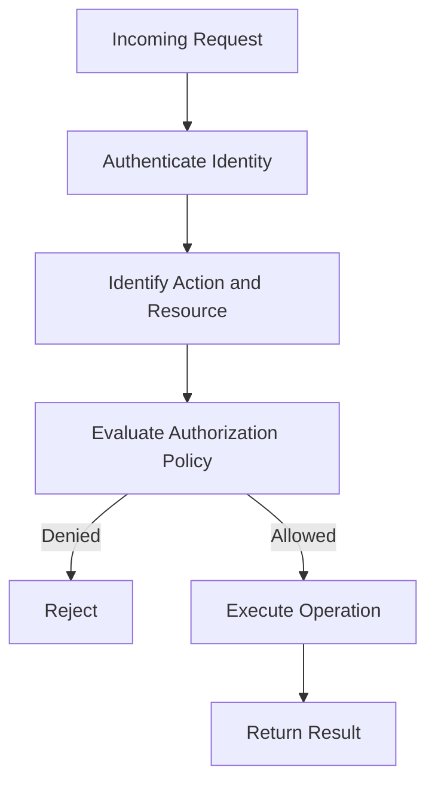

When reviewing an architecture, ask:

- Are authorization rules enforced by trusted components?
- Are object ownership and tenant boundaries checked?
- Do different actions require different permissions?
- Is access denied when a required rule is missing?
- Are permissions limited to what each identity needs?
- Are all API and background access paths covered?
- Can authorization decisions be tested and audited?

A well-designed system makes the access policy explicit instead of scattering assumptions throughout the codebase.

---

## 19. Quick Reference

| Term | Meaning |
|---|---|
| Authorization | Deciding whether an identity may perform an action on a resource |
| Subject | The identity requesting access |
| Resource | The object or data being accessed |
| Policy | Rules used to decide whether an action is permitted |
| ACL | Permissions associated with a resource and identities or groups |
| RBAC | Access control based on assigned roles |
| ABAC | Access control based on attributes and contextual rules |
| IDOR | A vulnerability where direct resource references can be used without proper access checks |
| Deny by default | Reject access unless an applicable rule permits it |
| Least privilege | Grant only the permissions required |
| Tenant isolation | Preventing unauthorized access across tenant boundaries |
| Privilege escalation | Gaining permissions beyond those intended |

---

## 20. Knowledge Check

**1. What does authorization determine?**

Whether an identity is permitted to perform a particular action on a resource.

**2. Why is authentication alone insufficient?**

An authenticated user may still attempt to access another user's data or perform an action they are not allowed to perform.

**3. What causes an IDOR vulnerability?**

A system exposes or accepts a resource reference without correctly checking whether the caller is authorized to access that resource.

**4. Why are unguessable IDs not enough?**

An identifier can be discovered, shared, leaked, or supplied directly. The server must still enforce access rules.

**5. What does deny by default mean?**

Access is rejected unless an applicable policy explicitly permits it.

**6. Why are roles not always sufficient?**

A role may grant a general capability but fail to express resource ownership, tenant boundaries, or state-dependent rules.

**7. Where should authorization be enforced?**

At trusted server-side components that perform protected operations or access protected resources, consistently across all access paths.

**8. Why does multi-tenant software need explicit tenant checks?**

A valid user from one tenant must not gain access to another tenant's resources merely by changing an identifier.

---

## Remember

**Authentication asks who is making the request. Authorization decides what that identity may do.**

A secure application checks permissions for the specific action and resource, enforces tenant boundaries, denies access by default, and applies those rules consistently across every path to protected data.

**Next: 11.04 — RBAC**
