# 11.04 — RBAC (Role-Based Access Control)

## Learning Objectives

By the end of this chapter, you should be able to:

- Explain what RBAC is and why systems use it.
- Distinguish users, roles, permissions, and resources.
- Understand how permissions are assigned through roles.
- Design a basic RBAC model for a real application.
- Understand role hierarchy and separation of duties.
- Recognize RBAC's limitations and common security mistakes.
- Understand how RBAC works alongside resource-level authorization.

---

## 1. The Problem RBAC Solves

Imagine you are building a project-management application.

Initially, there are only three users:

```text
Alice → Manage projects
Bob   → Manage projects
Carol → View projects
```

You could assign permissions individually.

But the application grows to 10,000 users.

Now you must manage who can:

- View projects.
- Create projects.
- Edit tasks.
- Invite members.
- Manage billing.
- Change organization settings.

Managing every permission separately becomes difficult.

**RBAC provides a way to group permissions into roles and assign those roles to users.**

Instead of assigning the same permissions repeatedly, you define a role once.

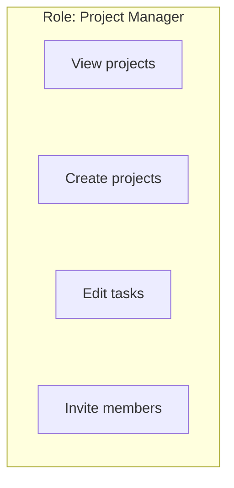

Users assigned this role receive its permissions according to the application's access-control rules.

> **RBAC simplifies authorization by assigning permissions to roles and assigning users to those roles.**

---

## 2. The Four Core Concepts

RBAC has four important building blocks.

### User

The identity that accesses the application.

Examples:

- Alice
- Bob
- A support agent
- An administrator

### Role

A named collection of permissions representing a responsibility.

Examples:

- Customer
- Editor
- Project Manager
- Support Agent
- Administrator

### Permission

An allowed action on a resource or category of resources.

Examples:

- `project.read`
- `project.create`
- `task.update`
- `billing.manage`
- `user.invite`

### Resource

The object or system component the action applies to.

Examples:

- A project.
- A task.
- A user account.
- Billing settings.

The relationship looks like this:

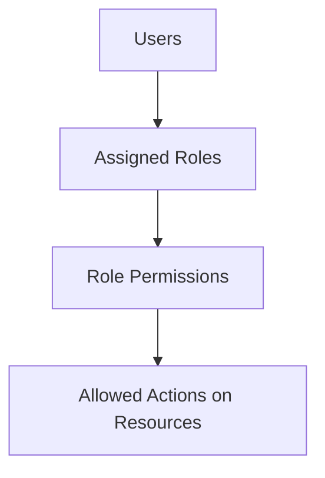

For example:

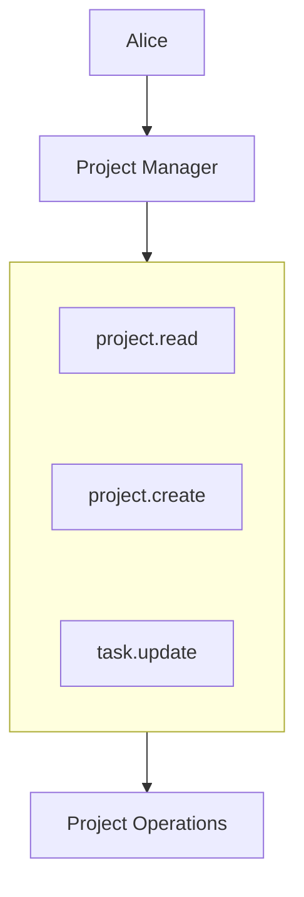

The application still needs to evaluate whether the requested operation is allowed in the particular context.

---

## 3. How RBAC Works

Suppose a user attempts to invite a member.

```http
POST /api/projects/42/members
```

The application can follow this flow:

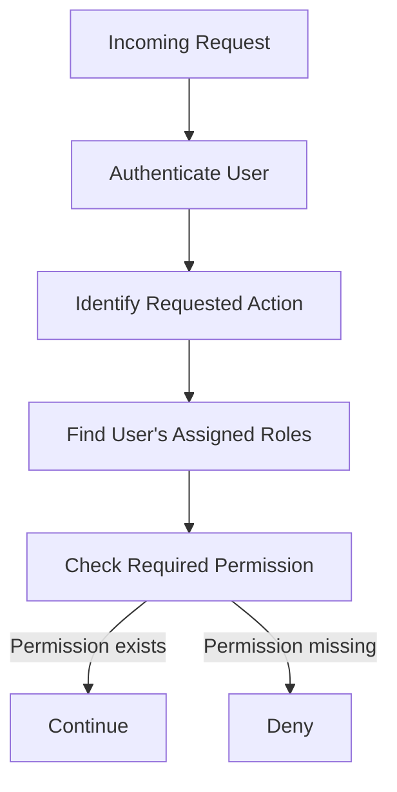

A simplified policy might be:

```text
Action: project.member.invite

Required permission:
project.member.invite

Allowed role:
Project Manager
```

If the user has the required permission, the application can continue to other checks, such as project membership and organization boundaries.

**Having a role is not a universal pass.** Authorization still applies to the particular action and resource.

---

## 4. RBAC Permission Matrix

A permission matrix makes the access policy easier to inspect.

Consider this application:

| Permission | Viewer | Editor | Admin |
|---|---:|---:|---:|
| View projects | Yes | Yes | Yes |
| Create projects | No | Yes | Yes |
| Edit tasks | No | Yes | Yes |
| Invite members | No | No | Yes |
| Manage organization settings | No | No | Yes |

The matrix describes which roles grant which permissions.

For example:

```text
User: Alice
Role: Editor

Can view projects?       Yes
Can create projects?     Yes
Can edit tasks?          Yes
Can invite members?      No
```

The benefit is consistency.

Instead of independently deciding Alice's permissions for every request, the application evaluates the permissions granted by her assigned role.

The matrix should be reviewed as requirements change so that permissions do not silently expand.

---

## 5. A Practical Database Model

A relational database might represent RBAC using these tables:

```text
users
-----
id
email

roles
-----
id
name

permissions
-----------
id
name

user_roles
----------
user_id
role_id

role_permissions
----------------
role_id
permission_id
```

The relationships are:

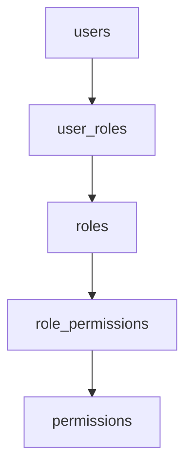

A user can have multiple roles, and a role can contain multiple permissions.

This is a many-to-many relationship between users and roles, and between roles and permissions.

For example:

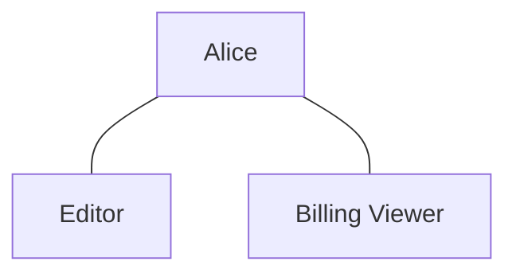

Alice receives the permissions granted by both assigned roles, subject to the application's policy rules.

This is a common relational design, not a mandatory schema. Some systems use identity providers, policy engines, or other representations.

---

## 6. RBAC Is Not the Same as Hardcoding Roles

A beginner implementation might contain logic like:

```javascript
if (user.role === "admin") {
  deleteUser();
}
```

This can work for a small example, but repeating role-name checks throughout an application becomes difficult to maintain.

Problems include:

- Permission rules become scattered.
- Adding a role requires changes in many places.
- Different endpoints may implement different rules.
- Developers may accidentally allow an operation in one location.
- Testing and auditing become harder.

A more maintainable approach checks a named permission through a consistent authorization layer.

Conceptually:

```javascript
if (can(user, "user.delete")) {
  deleteUser();
}
```

The `can()` function here is illustrative pseudocode, not a built-in JavaScript API.

The authorization layer determines whether the user's assigned roles grant the requested permission.

The backend must enforce this decision before performing the protected operation.

---

## 7. RBAC and Resource Ownership

RBAC answers questions such as:

> Does this role have permission to edit projects?

But consider two organizations:

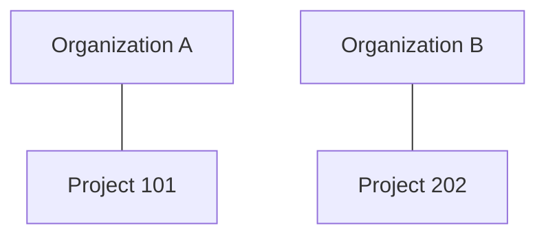

Alice is an Editor in Organization A.

She requests:

```http
PUT /api/projects/202
```

Alice has the general `project.update` permission through her role.

Should the request succeed?

**Not necessarily.**

The application must also check whether Alice is permitted to modify Project 202.

A correct decision might require:

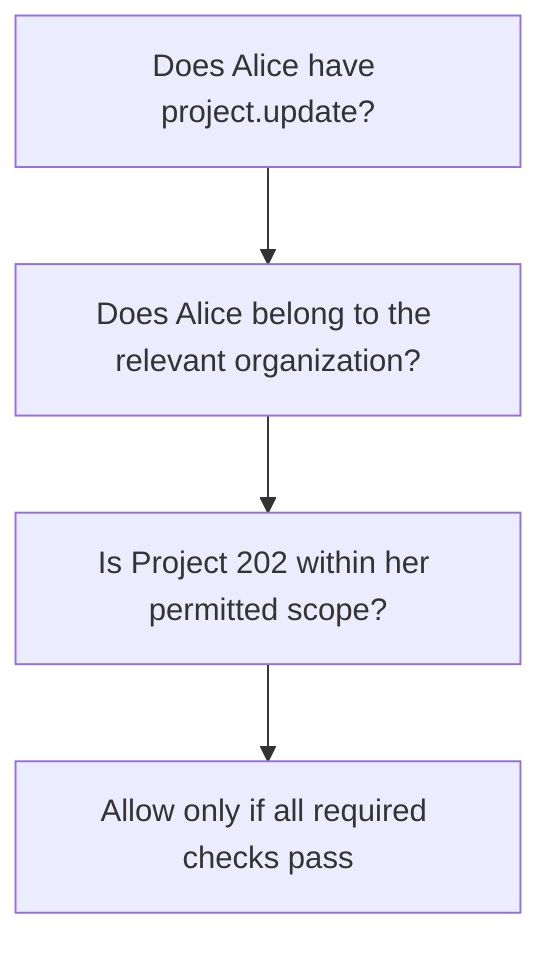

This is the difference between a general permission and permission to act on a particular resource.

A system can combine RBAC with ownership checks, tenant boundaries, or attribute-based policies.

---

## 8. Role Explosion

As applications grow, teams sometimes create too many roles.

For example:

```text
Editor
Editor-East
Editor-West
Editor-East-Billing
Editor-West-Billing
Editor-East-Billing-ReadOnly
...
```

This is called **role explosion**: the number of roles grows excessively as teams attempt to represent every combination of user, location, resource, and responsibility.

The result can be:

- Hard-to-understand policies.
- Duplicate permissions.
- Difficult role assignment.
- More complicated reviews.
- Greater risk of incorrect access.

Instead, keep roles focused on meaningful responsibilities.

Use additional authorization rules for context-specific conditions when appropriate.

For example:

```text
Role: Editor
Permission: project.update

Additional condition:
Project belongs to the user's organization
```

Do not create a new role for every individual project unless the requirements genuinely justify that design.

---

## 9. Role Hierarchy

Some systems define roles in a hierarchy.

For example:

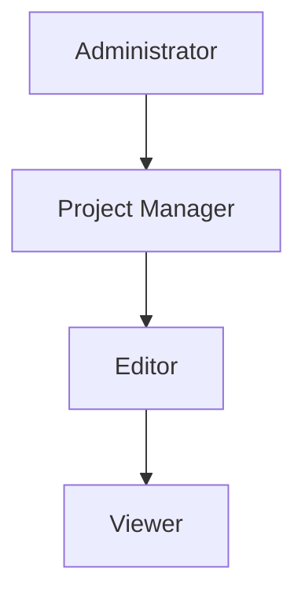

A hierarchical model might allow a higher-level role to inherit permissions from lower-level roles.

For example:

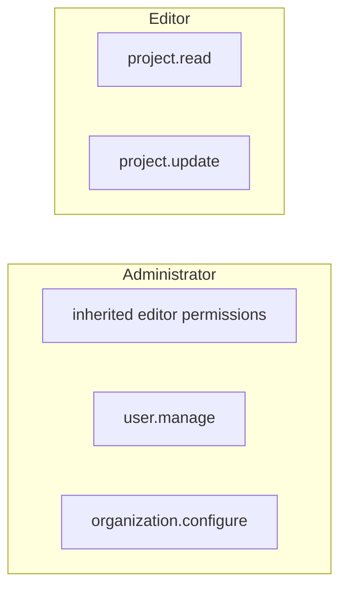

However, this inheritance is not automatic just because the roles have those names.

The application must explicitly define and implement the hierarchy.

Role hierarchies can simplify management, but poorly designed inheritance can grant more access than intended.

Use them only when the permission relationships are clear and testable.

---

## 10. Separation of Duties

Some operations should require distinct responsibilities rather than allowing one identity to perform every step.

For example, in a financial system:

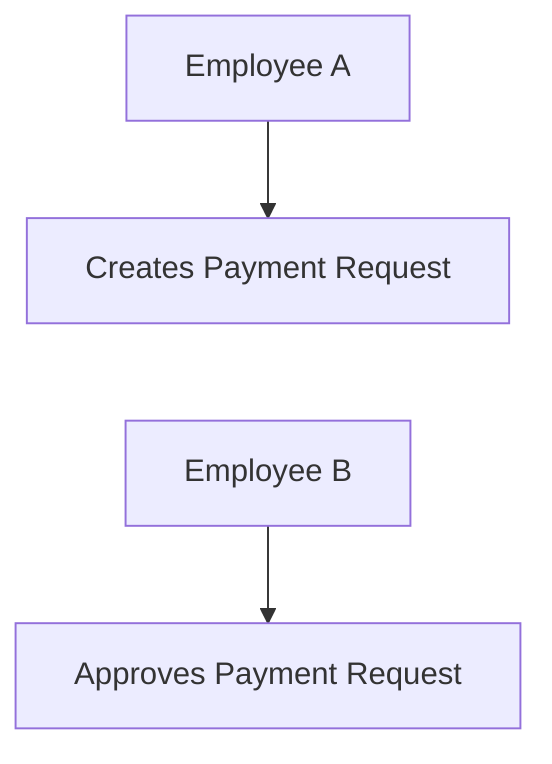

The system may prevent the same person from both creating and approving the transaction.

This is **separation of duties**.

It reduces the risk of fraud, accidental misuse, or a single compromised account controlling an entire sensitive workflow.

RBAC can help implement this by separating responsibilities across roles, but some separation rules depend on the specific transaction or workflow.

A role model alone may not be sufficient to enforce every such condition.

---

## 11. Default Deny and RBAC

A secure RBAC implementation should generally deny an operation if the required permission is missing.

For example:

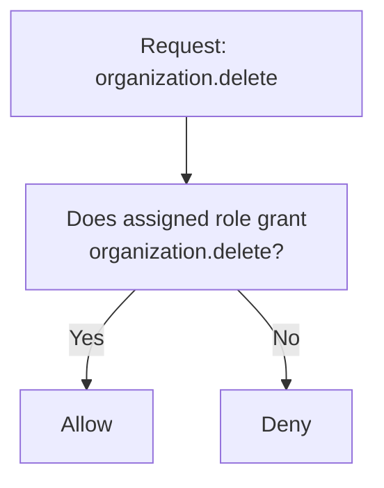

Avoid logic that allows an operation whenever the application fails to find a matching restriction.

Also consider what happens when:

- A role does not exist.
- A permission has not been configured.
- A user's role assignment cannot be loaded.
- An authorization service is unavailable.

For sensitive operations, missing authorization information should not silently become permission to proceed.

---

## 12. Role Changes and Revocation

Suppose Alice is an administrator today.

Tomorrow, she leaves the company and her role is revoked.

The application must stop granting her administrative access.

Potential complications include:

- Cached permissions.
- Long-lived sessions.
- Tokens containing outdated role claims.
- Multiple application instances using stale authorization data.
- Background jobs continuing under an old identity.

A robust design considers how quickly role changes must take effect.

For example:

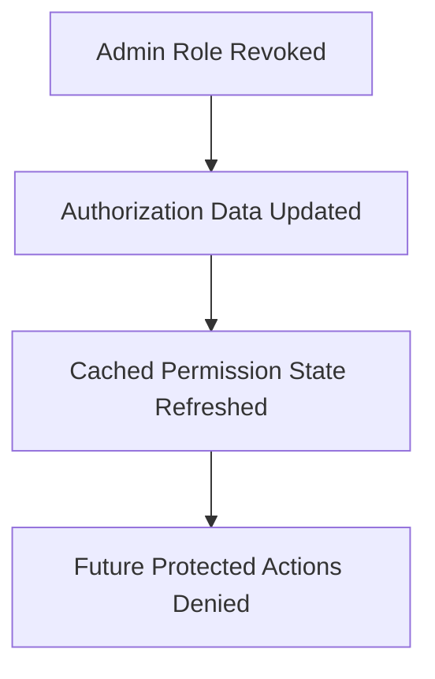

The exact approach depends on the architecture.

A system that embeds permissions in long-lived tokens must account for the fact that those claims may remain unchanged until the token expires or another revocation mechanism takes effect.

This becomes particularly important in distributed systems.

---

## 13. RBAC and API Design

Consider these endpoints:

```http
GET    /api/projects
POST   /api/projects
PUT    /api/projects/42
DELETE /api/projects/42

POST   /api/projects/42/members
PUT    /api/organization/settings
```

The application should define which permissions each operation requires.

For example:

| Operation | Example permission |
|---|---|
| List projects | `project.read` |
| Create project | `project.create` |
| Update project | `project.update` |
| Delete project | `project.delete` |
| Invite member | `project.member.invite` |
| Update organization settings | `organization.settings.update` |

The permission names are illustrative. A real system should choose names that match its domain and policy.

Avoid assuming that all `GET` requests are safe or that every `POST` requires the same role. The business meaning of the operation matters.

A read endpoint can expose highly sensitive information, and an update endpoint may require special restrictions.

---

## 14. RBAC and Microservices

In a system with multiple services, authorization decisions may occur at more than one boundary.

Consider:

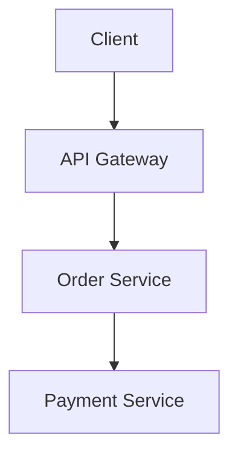

The gateway may authenticate the caller and enforce broad access policies.

But the Order Service still needs to protect its own resources and operations.

The Payment Service must also verify that the calling service is permitted to request the specific payment operation.

Do not assume that passing through the gateway makes every downstream operation safe.

A distributed system needs clear responsibility for:

- Identity verification.
- User permissions.
- Service identity.
- Resource ownership.
- Internal operation permissions.

The precise division depends on the architecture, but authorization must remain enforced at trusted boundaries.

---

## 15. Common RBAC Mistakes

### Mistake 1: Treating role names as sufficient protection

A role should grant defined permissions, and the backend must enforce those permissions.

### Mistake 2: Forgetting resource ownership

An Editor role does not necessarily grant permission to edit every project in the system.

### Mistake 3: Creating too many roles

Use roles for meaningful responsibilities. Avoid encoding every possible context into a separate role.

### Mistake 4: Relying on the frontend

Hiding buttons does not protect backend endpoints.

### Mistake 5: Ignoring role revocation

Outdated sessions, cached permissions, or token claims can preserve access after a role changes.

### Mistake 6: Granting broad administrator permissions unnecessarily

Administrative roles should be limited to identities that genuinely need them.

### Mistake 7: Failing open

If the system cannot establish that an operation is permitted, it should not silently allow the operation.

### Mistake 8: Applying policies inconsistently

Every endpoint, background task, and other path to a protected operation must enforce the intended access rules.

---

## 16. Hands-On Exercise

Design RBAC for a project-management application.

The application has these roles:

- **Viewer:** Can read permitted projects.
- **Editor:** Can read projects and edit tasks.
- **Manager:** Can create projects, manage project members, and edit tasks.
- **Administrator:** Can manage organization settings and user accounts.

### Step 1 — Create a permission matrix

Fill in the permissions for each role.

| Permission | Viewer | Editor | Manager | Administrator |
|---|---|---|---|---|
| `project.read` | Yes | Yes | Yes | Decide |
| `task.update` | No | Yes | Yes | Decide |
| `project.create` | No | No | Yes | Decide |
| `project.member.invite` | No | No | Yes | Decide |
| `organization.settings.update` | No | No | No | Yes |

Make deliberate decisions for the Administrator column. Administrative access should not be assumed to include every permission unless that is part of the defined policy.

### Step 2 — Test resource boundaries

Alice is an Editor in Organization A.

She requests a task belonging to Organization B.

- Does her role grant `task.update`?
- Is the task within her authorized scope?
- Should the operation succeed?

A sound policy must consider both the permission and the resource boundary.

### Step 3 — Test revocation

Alice loses the Editor role while an existing session remains active.

Decide how your application ensures that subsequent protected operations respect the updated permission state.

### Step 4 — Review the design

Ask:

- Are roles understandable?
- Are permissions specific enough?
- Are resource-level checks required?
- Are default-deny rules enforced?
- Can permissions be revoked reliably?
- Are the policies testable?

---

## 17. System Design View

RBAC is an authorization-management model, not a complete security system.

It helps organize permissions, but a complete authorization decision may also require:

- Authenticated identity.
- Resource ownership.
- Tenant boundaries.
- Resource state.
- Context-specific rules.
- Service identity.
- Current permission data.

A useful model is:

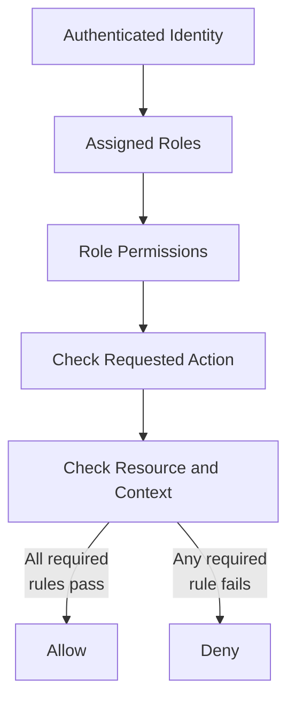

When designing RBAC, aim for roles that reflect real responsibilities, permissions that describe meaningful actions, and resource checks that prevent users from crossing boundaries they are not authorized to cross.

---

## 18. Quick Reference

| Term | Meaning |
|---|---|
| RBAC | Role-Based Access Control |
| User | An identity accessing the application |
| Role | A named set of permissions |
| Permission | Authorization to perform an action on a resource or resource category |
| Permission matrix | A representation of permissions granted to roles |
| Role hierarchy | A defined relationship in which roles may inherit permissions |
| Role explosion | Excessive growth in the number of roles |
| Separation of duties | Dividing sensitive responsibilities to reduce misuse |
| Default deny | Denying access unless applicable rules permit it |
| Permission revocation | Removing previously granted access |
| Resource-level authorization | Checking access to the particular object being requested |

---

## 19. Knowledge Check

**1. What problem does RBAC solve?**

It simplifies permission management by assigning permissions to roles and assigning roles to users.

**2. What is the difference between a role and a permission?**

A role groups permissions; a permission grants a particular capability.

**3. Does having the Editor role mean a user can edit every project?**

No. The application may also need to verify ownership, organization membership, and other resource-specific rules.

**4. What is role explosion?**

It is excessive growth in the number of roles as teams attempt to represent too many combinations of responsibilities and context.

**5. Why must the backend enforce RBAC?**

Users can modify client-side code and send requests directly to protected endpoints.

**6. Why does role revocation matter?**

Cached permissions, existing sessions, or token claims may otherwise allow access to continue after a role is removed.

**7. Can RBAC and attribute-based rules work together?**

Yes. RBAC can provide general permissions while additional rules check ownership, tenant, resource state, or other attributes.

**8. Should an application allow an operation if it cannot determine whether the user has permission?**

For protected operations, no. Missing or unavailable authorization information should not silently grant access.

---

## Remember

**RBAC organizes permissions around roles, but roles do not eliminate the need for resource-level authorization.**

Define clear roles, grant only necessary permissions, enforce policies on the backend, and ensure that ownership, tenant boundaries, and permission changes are handled correctly.

**Next: 11.05 — OAuth**
