# 11.05 — OAuth

## Learning Objectives

By the end of this chapter, you should be able to:

- Explain what OAuth solves and why it exists.
- Distinguish authentication from delegated authorization.
- Understand the roles of the resource owner, client, authorization server, and resource server.
- Trace the Authorization Code flow with PKCE.
- Understand access tokens, scopes, consent, and redirect URIs.
- Recognize common OAuth security mistakes.
- Understand when OAuth is appropriate and when simpler authentication may be sufficient.

---

## 1. The Problem OAuth Solves

Imagine you build a photo-printing application.

A customer wants to print photos stored in their cloud photo account.

Your application needs permission to read selected photos, but it should not ask the customer for their cloud account password.

Without delegated authorization, a poorly designed application might ask:

```text
Enter your cloud account username and password.
```

That creates serious problems:

- The application handles credentials that belong to another service.
- The customer may be giving it much more access than it needs.
- Password changes can break the integration.
- Revoking the application's access becomes difficult.
- The application becomes a tempting target for credential theft.

OAuth provides a standard way for a user to authorize an application to access selected resources without sharing their password with that application.

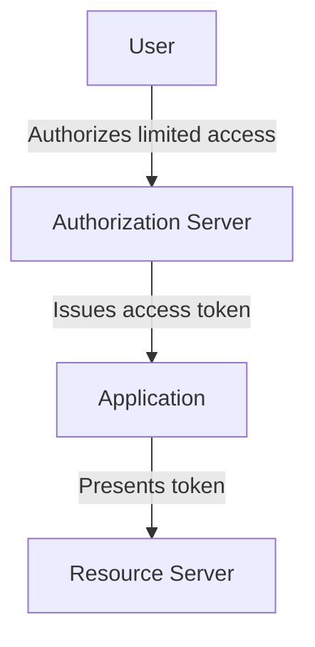

> **OAuth is an authorization framework that enables delegated access to protected resources.**

It allows an application to obtain permission to act within a defined scope without receiving the user's primary password.

---

## 2. OAuth Is Not the Same as Authentication

This is one of the most important distinctions in this chapter.

OAuth primarily addresses **authorization**.

It answers a question like:

> Can this application access these resources with the permissions that were granted?

It does not, by itself, define a standard way for an application to authenticate a user and learn their identity.

Consider two situations.

### Situation A — Delegated access

A user allows a calendar application to read their calendar.

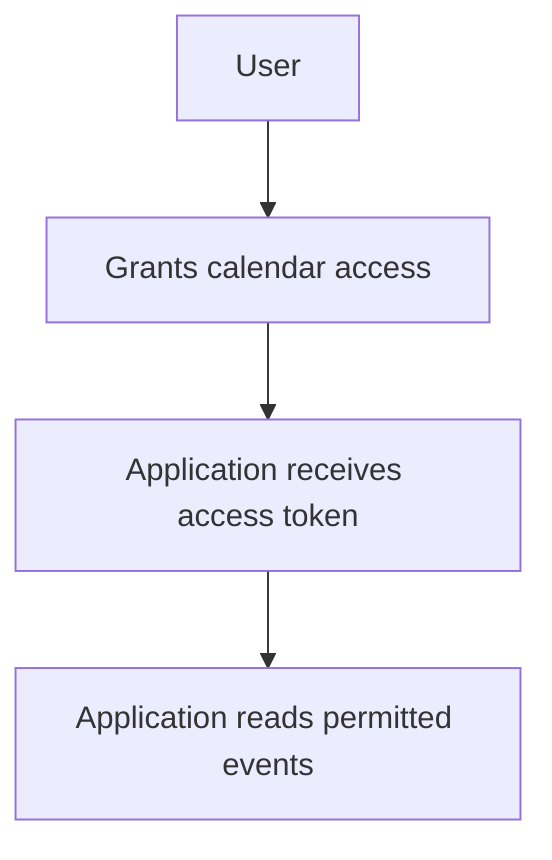

This is an OAuth use case.

### Situation B — Login with an external identity provider

A user clicks:

```text
Continue with Example Identity Provider
```

The application needs to establish who the user is.

OAuth alone is not the complete identity protocol for this purpose. **OpenID Connect (OIDC)** builds on OAuth 2.0 and adds an identity layer, including an ID token and standardized identity information.

Keep the distinction clear:

| Technology | Primary purpose |
|---|---|
| OAuth 2.0 | Delegated authorization |
| OpenID Connect (OIDC) | Authentication and identity information built on OAuth 2.0 |
| JWT | A token format that can carry claims; it is not an authorization protocol by itself |

OAuth access tokens may be opaque strings or structured tokens. They are not necessarily JWTs.

---

## 3. The Four Main OAuth Roles

OAuth defines four key roles.

### 1. Resource Owner

The entity that can grant access to a protected resource. In many common scenarios, this is the user.

Example: A customer who owns a photo library.

### 2. Client

The application requesting access on behalf of the resource owner.

Example: Your photo-printing application.

### 3. Authorization Server

The server that authenticates the resource owner, obtains authorization, and issues tokens according to the authorization flow.

Example: The identity and authorization provider for the photo service.

### 4. Resource Server

The server hosting the protected API or data. It accepts and validates access tokens according to its security requirements.

Example: The API that returns permitted photos.

The relationship looks like this:

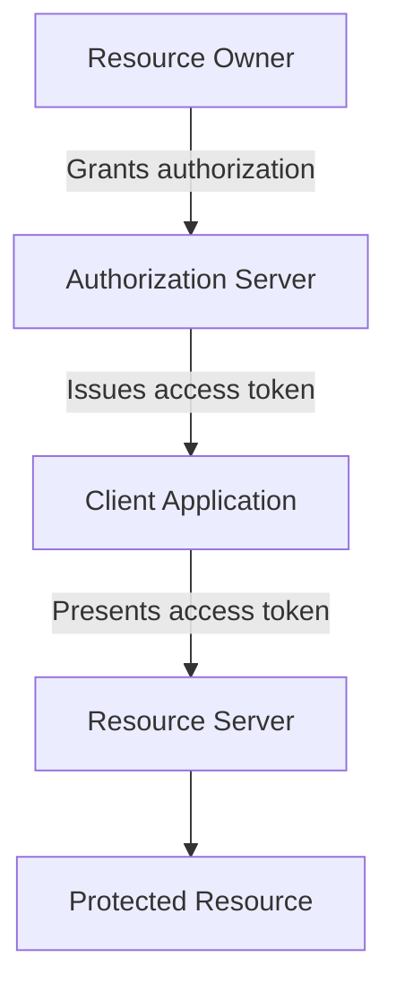

The client does not need to receive the user's primary password to obtain delegated access.

---

## 4. OAuth Access Tokens

An **access token** is a credential used to access protected resources under the permissions represented by that token and the server's applicable policies.

For example, a client may receive an access token after the user authorizes:

```text
Permission:
Read calendar events
```

The client then sends a request:

```http
GET /api/calendar/events
Authorization: Bearer ACCESS_TOKEN
```

The resource server checks the token and decides whether the request is permitted.

Conceptually:

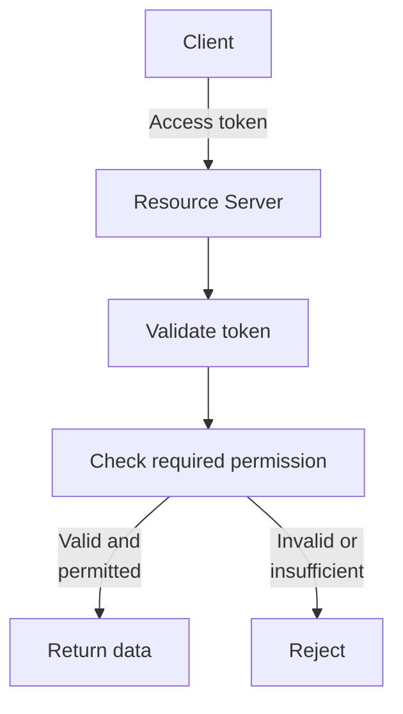

An access token is a **bearer credential** when possession of it is sufficient to present it for access. Anyone who steals such a token may be able to use it within its remaining validity and permissions.

Therefore:

- Protect tokens from exposure.
- Use HTTPS.
- Avoid putting tokens in URLs.
- Do not log tokens.
- Request only necessary permissions.
- Apply appropriate expiration and revocation strategies.

An access token is not the user's password, but it must still be treated as sensitive.

---

## 5. OAuth Scopes

A **scope** represents a category of access that a client requests or receives.

For example:

```text
calendar.read
calendar.write
contacts.read
```

A calendar application that only displays events may need:

```text
calendar.read
```

It may not need permission to modify events or read contacts.

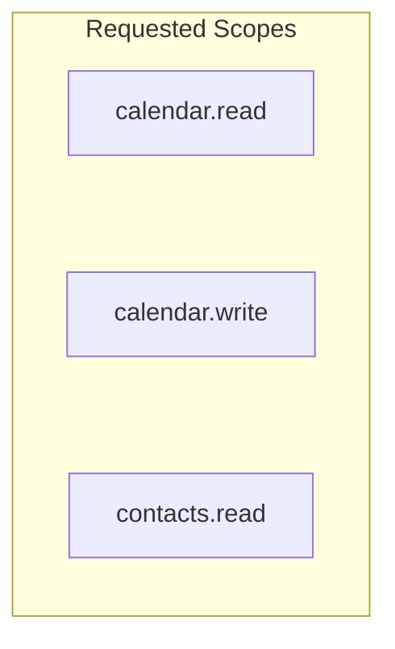

The user or authorization policy may grant only an appropriate subset of the requested access.

The resource server must enforce the permissions associated with the token. A client cannot grant itself extra privileges simply by adding a scope name to a request.

**Principle:** Request the smallest set of scopes needed for the feature.

Scopes are one part of authorization, not a replacement for all resource-level checks. The resource server may still need to check ownership, tenant boundaries, or other policies.

---

## 6. The Authorization Code Flow

For browser-based and mobile applications, a common OAuth flow is the **Authorization Code flow with PKCE**.

PKCE is pronounced “pixie” and stands for Proof Key for Code Exchange.

At a high level:

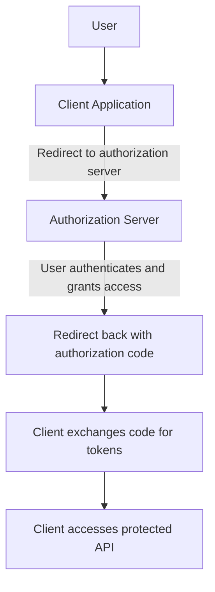

The authorization code is a short-lived intermediary credential. The client exchanges it for tokens through the token endpoint.

A code is not the same as an access token and should not be used directly to access the resource API.

---

## 7. Authorization Code Flow With PKCE — Step by Step

Suppose a user wants to connect their calendar to your application.

### Step 1 — The client prepares the request

The client creates:

- A `code_verifier`: a high-entropy secret used for the exchange.
- A `code_challenge`: a derived value sent in the authorization request.
- A `state` value to help correlate the authorization response with the initiating request and protect against request forgery.
- A registered redirect URI.

The verifier must be retained securely until the token exchange.

### Step 2 — Redirect to the authorization server

The client redirects the user to the authorization endpoint with parameters such as:

```text
response_type=code
client_id=calendar-app
redirect_uri=https://app.example.com/callback
scope=calendar.read
state=RANDOM_STATE
code_challenge=DERIVED_CHALLENGE
code_challenge_method=S256
```

This is illustrative, not a complete production request. Exact parameters depend on the provider and protocol profile.

### Step 3 — The user authenticates and grants access

The authorization server handles user authentication and authorization.

The user may see a consent screen describing the requested access, depending on the provider, prior consent, and applicable policy.

The client should not collect the user's identity-provider password itself.

### Step 4 — The authorization server redirects back

If authorization succeeds, the server redirects to the registered callback with an authorization code and the correlated `state` value.

Conceptually:

```text
https://app.example.com/callback
    ?code=SHORT_LIVED_CODE
    &state=RANDOM_STATE
```

The client verifies the returned state against the original value. It must handle errors and rejected authorization as well.

### Step 5 — The client exchanges the code

The client sends the authorization code, redirect URI, and original `code_verifier` to the token endpoint, along with any required client authentication appropriate to the client type.

The authorization server checks that the verifier corresponds to the original challenge.

If the checks succeed, it can issue an access token and, where appropriate, a refresh token.

### Step 6 — The client calls the resource server

The client presents the access token when calling the protected API.

```http
GET /api/calendar/events
Authorization: Bearer ACCESS_TOKEN
```

The resource server validates the token and enforces the associated permissions.

### Full flow

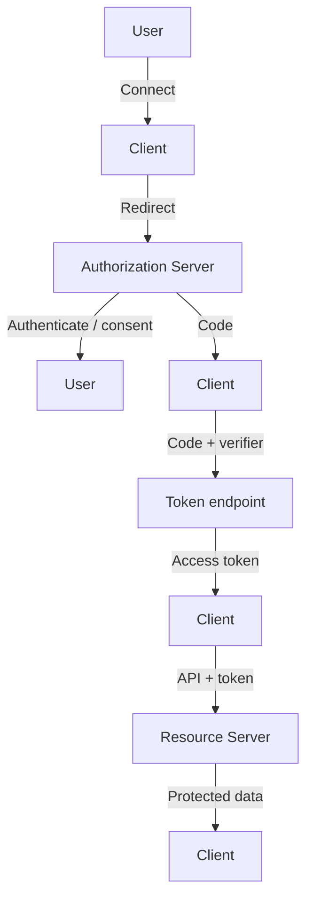

The diagram is simplified: the token exchange is a request to the authorization server's token endpoint, not to the resource server.

---

## 8. What PKCE Protects Against

PKCE binds the authorization-code exchange to the client instance that initiated the flow.

Without adequate protection, an attacker who intercepts an authorization code may attempt to exchange it for tokens.

With PKCE:

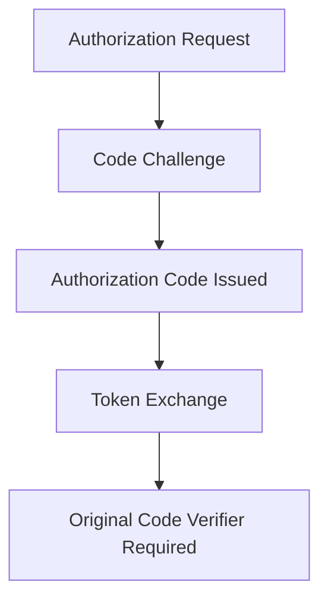

An attacker who obtains only the code should not be able to exchange it without the corresponding verifier.

PKCE is important for public clients such as native mobile applications and browser-based applications. It is also recommended for modern OAuth authorization-code implementations more generally.

PKCE does not protect against every possible attack. For example, malicious code that can steal both the verifier and other sensitive client state may undermine the protection.

---

## 9. Public and Confidential Clients

OAuth clients differ in their ability to keep credentials confidential.

### Confidential client

A client that can protect credentials, typically because it operates in a controlled server environment.

Example:

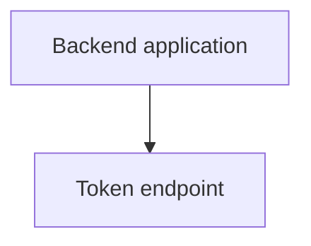

It may authenticate itself to the authorization server using an appropriate client-authentication method.

### Public client

A client that cannot reliably keep a shared secret confidential.

Examples include:

- Native mobile applications.
- Browser-only applications.

A secret embedded in a mobile app or frontend JavaScript can generally be extracted by users or attackers.

Therefore, **a frontend application must not rely on a hardcoded client secret to prove its identity**. Public clients use appropriate flows such as Authorization Code with PKCE.

PKCE does not turn a public client into a confidential client; it protects the authorization-code exchange.

---

## 10. Redirect URIs Matter

The redirect URI is where the authorization server sends the browser after the authorization step.

For example:

```text
https://app.example.com/oauth/callback
```

The authorization server must validate redirect URIs according to the OAuth security requirements.

If an attacker can redirect the response to an untrusted destination, authorization codes or other sensitive information may be exposed.

Good practices include:

- Register exact allowed redirect URIs.
- Avoid broad wildcard matching where it creates risk.
- Use HTTPS for web redirect URIs.
- Validate callback parameters and the `state` value.
- Never accept arbitrary user-provided callback destinations without strict validation.

Redirect URI validation is part of protecting the authorization flow, not merely a configuration detail.

---

## 11. State, CSRF, and Callback Validation

The `state` parameter is a value generated by the client before the authorization redirect and checked when the response returns.

It helps the client confirm that the response corresponds to the authorization request it initiated.

Conceptually:

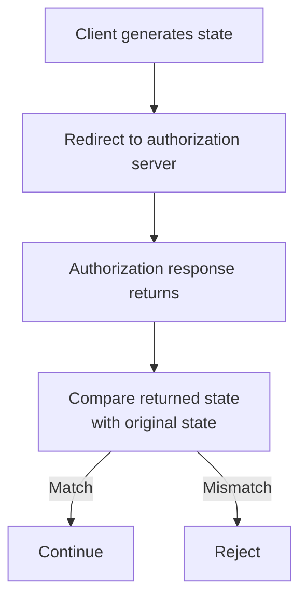

A mismatch should not be ignored.

The client must also handle error responses and validate other relevant flow details. OAuth security is not achieved by checking only one parameter.

In modern OAuth flows, use a maintained library or provider SDK where possible rather than implementing protocol details from scratch.

---

## 12. Refresh Tokens

Access tokens may have limited lifetimes.

When a token expires, the client may need a way to obtain another one without asking the user to authorize the application from scratch every time.

A **refresh token** can be used at the authorization server's token endpoint to obtain a new access token, subject to the provider's policy.

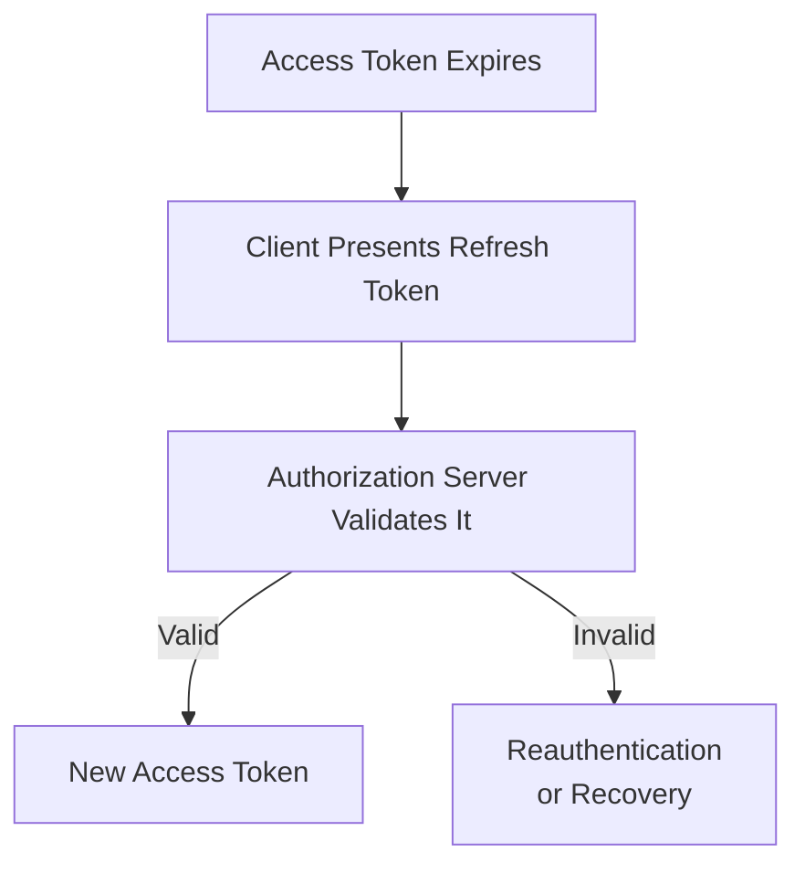

Refresh tokens are highly sensitive credentials because they can allow continued access over a longer period.

Depending on the client and provider, protections may include:

- Secure storage.
- Refresh-token rotation.
- Reuse detection.
- Revocation.
- Appropriate expiration.
- Binding tokens to a client or other security context where supported.

Not every OAuth flow issues refresh tokens, and not every client should store them in the same way.

---

## 13. Token Revocation and Permission Changes

Suppose a user disconnects an application or removes its calendar permission.

The system needs a way to stop further access.

Possible mechanisms include:

- Revoking refresh tokens.
- Revoking access tokens where supported.
- Using short-lived access tokens.
- Requiring the resource server to check token state.
- Updating authorization policy and permissions.

An important design detail is that a self-contained access token may remain usable until it expires if the resource server validates it locally and has no mechanism to learn about revocation.

This creates a trade-off between local validation efficiency and how quickly changes to access must take effect.

Design token lifetime and revocation behavior according to the sensitivity of the resources.

---

## 14. OAuth Security Mistakes

| Mistake | Why it is dangerous | Better approach |
|---|---|---|
| Treating OAuth as a login protocol by itself | Does not provide the standardized identity layer required for sign-in | Use OpenID Connect when authentication and identity claims are needed |
| Using an implicit flow for a new application | Can expose access tokens through browser-facing flows | Prefer Authorization Code with PKCE for suitable modern clients |
| Embedding a client secret in frontend code | Users can extract it | Treat browser and native clients as public clients |
| Skipping `state` validation | Weakens request/response correlation and CSRF defenses | Generate and validate state correctly |
| Accepting arbitrary redirect URIs | Can expose authorization responses | Strictly validate registered redirect URIs |
| Requesting excessive scopes | Grants more access than the feature needs | Apply least privilege to scopes |
| Logging tokens or codes | Exposes bearer credentials | Redact sensitive values from logs |
| Treating access tokens as harmless | Stolen tokens may grant protected access | Protect token storage, transport, and lifecycle |
| Assuming a token automatically authorizes every resource | A token may have limited scopes or context | Enforce permissions at the resource server |

---

## 15. OAuth and Your Own Application

You do not need OAuth merely because your application has a login page.

For a simple application where users register and sign in directly, you may use a conventional authentication system with secure session management.

OAuth becomes especially useful when:

- Your application accesses resources owned by another service.
- Users need to grant your application limited access to their account.
- Your platform provides APIs to third-party applications.
- Multiple services need standardized delegated authorization.
- You integrate with an external identity provider, often using OpenID Connect for login.

Choose the protocol based on the problem you are solving.

Do not introduce OAuth just to make a simple login form more complicated.

---

## 16. Hands-On Exercise

Design a calendar integration.

Your application allows a user to connect an external calendar so it can display upcoming events.

Requirements:

- The application must not collect the calendar provider's password.
- It needs read-only calendar access.
- It should be able to disconnect the integration.
- It should not expose tokens in logs.
- It should handle expired credentials safely.

Answer these questions:

1. Which OAuth roles participate?
2. Which scope should the application request?
3. Why is Authorization Code with PKCE appropriate for a public client?
4. What does the redirect URI do?
5. What is the purpose of `state`?
6. What should happen when the access token expires?
7. How can the user revoke access?
8. What should the application do if the provider denies authorization?

Draw the flow from the user's action through token issuance and the resource API. Identify where each credential is created, transmitted, stored, and validated.

---

## 17. System Design View

OAuth introduces several architectural responsibilities:

- A dependency on an authorization server.
- Redirect and callback handling.
- Token issuance and validation.
- Scope and consent management.
- Token storage and renewal.
- Revocation and permission-change behavior.
- Failure handling when the provider is unavailable.

A design review should ask:

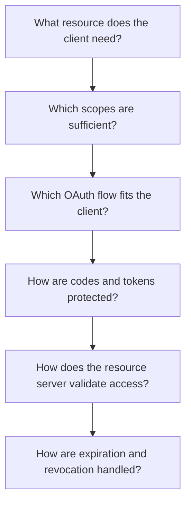

The system should request minimal access, protect credentials, and enforce the intended permissions at the resource server.

---

## 18. Quick Reference

| Term | Meaning |
|---|---|
| OAuth 2.0 | Framework for delegated authorization |
| Resource owner | Entity able to grant access to a protected resource |
| Client | Application requesting access |
| Authorization server | Issues tokens after applying authorization rules |
| Resource server | Hosts protected resources and enforces access |
| Access token | Credential presented to access protected resources |
| Scope | Category of requested or granted access |
| Authorization code | Short-lived code exchanged for tokens |
| PKCE | Binds the authorization-code exchange to a verifier |
| Redirect URI | Destination used for the authorization response |
| `state` | Value used to correlate and validate the authorization response |
| Refresh token | Credential used to obtain new access tokens |
| OIDC | Identity layer built on OAuth 2.0 |
| JWT | Token format, not an OAuth flow or authorization protocol |

---

## 19. Knowledge Check

**1. What problem does OAuth solve?**

It enables an application to obtain delegated access to protected resources without collecting the resource owner's primary password.

**2. Is OAuth by itself the standard protocol for logging in and obtaining user identity?**

No. OpenID Connect builds an identity layer on OAuth 2.0 for authentication and identity information.

**3. What is the difference between an authorization code and an access token?**

The authorization code is an intermediary credential exchanged at the token endpoint. The access token is presented to access protected resources.

**4. Why use scopes?**

Scopes limit the categories of access requested or granted to an application.

**5. What does PKCE protect?**

It helps prevent an intercepted authorization code from being exchanged without the original client's code verifier.

**6. Why should a browser application not contain a client secret?**

Frontend code is visible to users and cannot reliably keep a shared secret confidential.

**7. Why validate redirect URIs and `state`?**

Redirect validation helps prevent authorization responses from being sent to untrusted destinations, while state validation helps correlate the response with the initiating request.

**8. Is an access token necessarily a JWT?**

No. It can be opaque or structured, depending on the authorization server and deployment.

**9. Why must access tokens be protected?**

Possession of a bearer access token may allow someone to access protected resources within its validity and permissions.

---

## Remember

**OAuth lets an application obtain delegated access without asking for the user's primary password.**

Choose the appropriate flow, request minimal scopes, protect codes and tokens, validate callbacks, and enforce permissions at the resource server.

**Next: 11.06 — JWT**
