# 11.06 — JWT (JSON Web Token)

## Learning Objectives

By the end of this chapter, you should be able to:

- Explain what a JWT is and where it fits into authentication and authorization.
- Understand the three parts of a signed JWT.
- Distinguish encoding, signing, and encryption.
- Understand claims such as `sub`, `iss`, `aud`, and `exp`.
- Explain how a server validates a JWT.
- Understand the relationship between JWT, OAuth, and OpenID Connect.
- Recognize JWT security risks, revocation challenges, and key-management requirements.

---

## 1. What Is a JWT?

A **JSON Web Token (JWT)** is a compact format for representing claims—statements about a user, service, or other subject.

A token might carry information such as:

- Who the token represents.
- Which service issued it.
- Which service should accept it.
- When it expires.
- What permissions or other claims it contains.

A JWT commonly looks like a long string:

```text
xxxxx.yyyyy.zzzzz
```

A signed JWT typically has three parts:

```text
Header.Payload.Signature
```

The receiving service can validate the signature and inspect the claims without contacting the issuer for every request, provided it has the required verification key and the token's validation rules are satisfied.

> **A JWT is a token format, not an authentication protocol or an authorization protocol.**

---

## 2. Where Does JWT Fit?

Consider a user signing in to a web application.

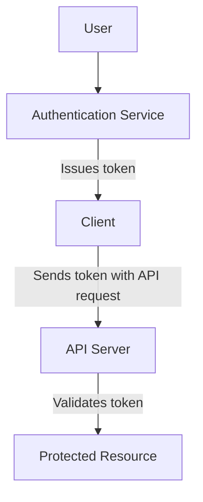

The token helps the API determine whether the request presents acceptable claims.

However, a JWT does not automatically grant access to every resource. The API must still check whether the token is intended for that API and whether the requested action is authorized.

For example, a token identifying a user does not automatically authorize that user to delete another customer's order.

---

## 3. The Three Parts of a JWT

A typical signed JWT has three Base64URL-encoded parts separated by periods.

```text
HEADER.PAYLOAD.SIGNATURE
```

### Part 1 — Header

The header describes the token's metadata, commonly including its type and signing algorithm.

Example:

```json
{
  "typ": "JWT",
  "alg": "RS256",
  "kid": "key-2026-01"
}
```

- `typ` identifies the token type.
- `alg` identifies the signing algorithm.
- `kid` can identify which key should be used for verification.

The server must not blindly trust the algorithm or key information supplied by an incoming token. It should enforce its own allowed algorithms and trusted key configuration.

### Part 2 — Payload

The payload contains **claims**.

Example:

```json
{
  "sub": "user-123",
  "iss": "https://auth.example.com",
  "aud": "orders-api",
  "exp": 1791849600,
  "role": "customer"
}
```

These claims might identify the subject, issuer, intended audience, expiry, and an application-specific role.

The payload is readable by anyone who obtains the token in a typical signed JWT.

**Do not put passwords, private keys, payment details, or other secrets in a signed JWT payload.**

### Part 3 — Signature

The signature allows the recipient to verify that the signed header and payload have not been altered and that the token was signed by an entity holding the corresponding signing key.

Conceptually:

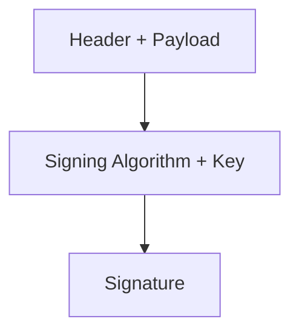

If someone changes the payload without producing a valid new signature, signature verification should fail.

A signature does **not** hide the payload.

---

## 4. Encoding Is Not Encryption

This distinction is essential.

A typical JWT uses **Base64URL encoding** for its header and payload.

Encoding changes how data is represented. It does not make the data secret.

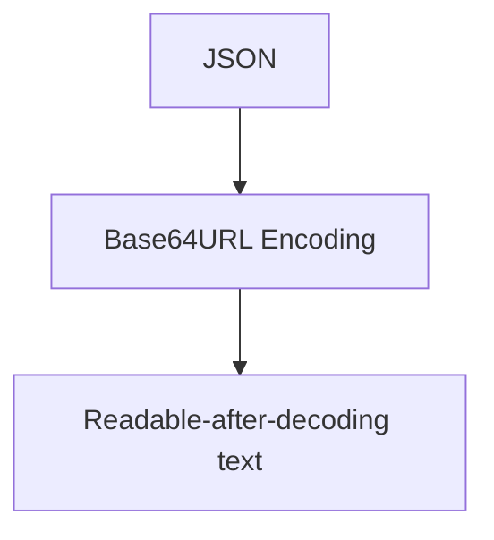

Anyone who obtains the token can usually decode its header and payload.

### Signing vs encryption

| Operation | Purpose |
|---|---|
| Encoding | Changes representation of data |
| Signing | Helps verify integrity and authenticity |
| Encryption | Protects confidentiality by making data unreadable without the required key |

A signed JWT is commonly a **JWS** (JSON Web Signature).

An encrypted JWT uses **JWE** (JSON Web Encryption). JWE has a different structure and protects confidentiality when correctly configured.

For ordinary signed JWTs, assume the payload is public to anyone holding the token.

---

## 5. Understanding Claims

A **claim** is a statement carried in the token.

Claims can be registered, public, or private/application-specific.

### Important registered claims

| Claim | Meaning |
|---|---|
| `iss` | Issuer: who issued the token |
| `sub` | Subject: who or what the token represents |
| `aud` | Audience: intended recipient or recipients |
| `exp` | Expiration time |
| `nbf` | Not valid before this time |
| `iat` | Time the token was issued |
| `jti` | Token identifier, often useful for tracking or revocation designs |

These claims are not all mandatory in every JWT standard or application. Your system's token profile should define which ones are required.

For example:

```json
{
  "iss": "https://auth.example.com",
  "sub": "user-123",
  "aud": "orders-api",
  "iat": 1791846000,
  "exp": 1791849600
}
```

Here, `sub` identifies the subject, while `aud` states that the token is intended for the orders API.

A JWT's claims are only trustworthy **after successful validation**. Decoding a payload does not establish that its claims are genuine.

---

## 6. How Does a Server Validate a JWT?

Suppose a client sends:

```http
GET /api/orders
Authorization: Bearer <token>
```

The API should validate the token before relying on its claims.

A simplified flow:

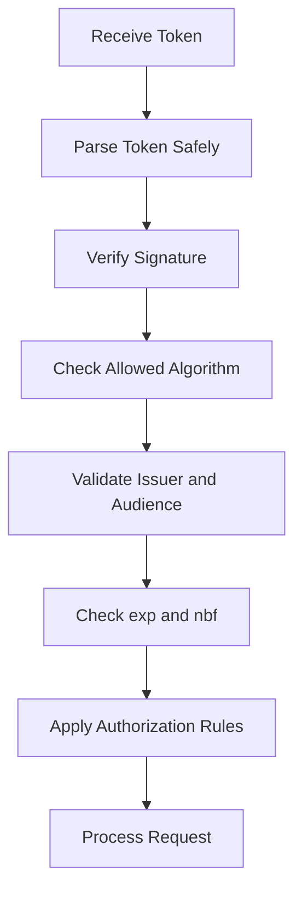

Important checks include:

1. **Signature:** Does the signature verify with a trusted key?
2. **Algorithm:** Is the algorithm explicitly allowed by the server?
3. **Issuer (`iss`):** Did the expected trusted issuer issue it?
4. **Audience (`aud`):** Is this token intended for this API?
5. **Expiration (`exp`):** Has the token expired?
6. **Not-before (`nbf`):** Is the token valid yet, if this claim is used?
7. **Token purpose:** Is this the right kind of token for this endpoint?
8. **Authorization:** Is the requested operation permitted?

Use a maintained JWT library and its secure validation APIs. Do not implement signature verification from scratch.

> **A decodable token is not necessarily a valid token. A valid token is not necessarily authorized for every action.**

---

## 7. JWT, OAuth, and OpenID Connect

These concepts are related, but they are not interchangeable.

| Concept | Main purpose |
|---|---|
| OAuth 2.0 | Delegated authorization |
| OpenID Connect (OIDC) | Identity layer built on OAuth 2.0 |
| JWT | A token format for carrying claims |

OAuth can use JWT access tokens, but it can also use **opaque tokens**—tokens whose contents are not directly readable by the client or API.

Similarly, not every JWT is an OAuth access token.

In OpenID Connect, an **ID token** communicates authentication-related information to the client. An **access token** is used to access a protected resource. These tokens have different purposes and must not be substituted for one another.

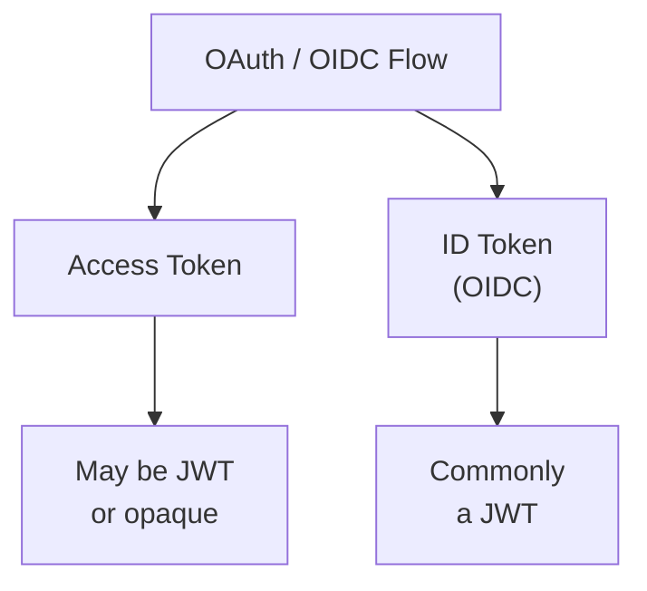

The receiving component must validate the token according to its purpose and the relevant protocol rules.

---

## 8. JWT and Stateless Validation

One reason signed JWTs are popular is that an API can often validate them locally using a trusted verification key.

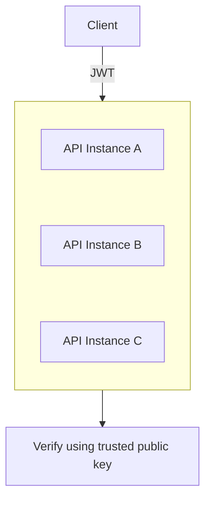

This can reduce the need for a shared session lookup on every request.

But **stateless validation does not mean the whole system is stateless**. The issuer still manages identities and keys, and the application may need database access to check resource ownership or current permissions.

There is also a trade-off: once issued, a JWT may remain usable until expiry unless the system has a mechanism to reject it earlier.

---

## 9. Expiration and Revocation

Suppose a token is valid for one hour.

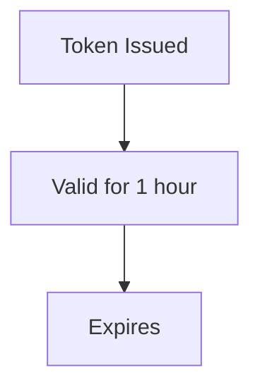

If the user's account is disabled five minutes after issuance, a purely local validator may not know that immediately.

Possible strategies include:

- Use short-lived access tokens.
- Use refresh tokens with appropriate protection and revocation.
- Maintain a denylist for selected tokens when immediate rejection is required.
- Check current account or permission state for sensitive operations.
- Use opaque tokens with server-side validation where that fits the architecture.

Each approach has costs.

| Strategy | Main trade-off |
|---|---|
| Short-lived JWT | Limits exposure window, but may require frequent renewal |
| Denylist | Enables early rejection, but adds shared state and lookup work |
| Current-state lookup | Supports fresher authorization decisions, but adds dependency and latency |
| Opaque token | Allows centralized lookup/introspection, but adds service dependency |

A `jti` claim can help identify a token, but it does not revoke anything by itself. The system must implement the corresponding tracking and rejection mechanism.

---

## 10. Signing Keys and Rotation

JWT security depends on protecting and managing signing keys.

With asymmetric signing, the issuer signs with a private key, and services verify using a corresponding public key.

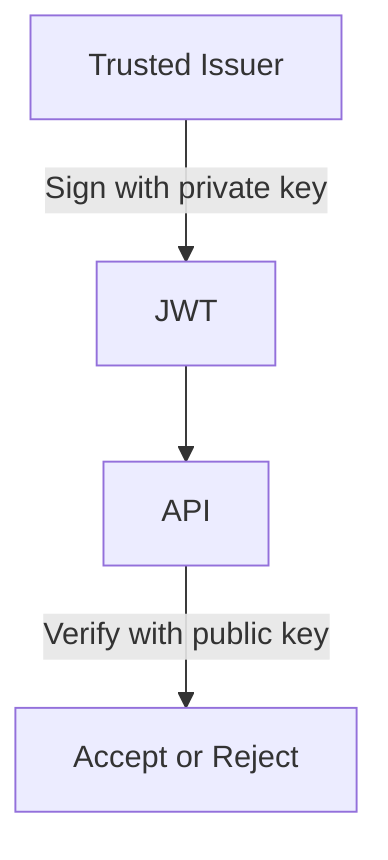

The private signing key must remain protected. Verification keys can be distributed to authorized services.

A `kid` header can help a verifier select a key from a trusted key set, such as a published JWKS endpoint. The verifier must not fetch or trust arbitrary key URLs supplied by an untrusted token.

When rotating keys, systems need a planned overlap: services must learn the new verification key before tokens signed with it are accepted, while old keys may need to remain available until relevant tokens expire.

Never treat a token's `kid` as proof that its key is trustworthy.

---

## 11. Common JWT Security Mistakes

### Mistake 1 — Trusting decoded claims

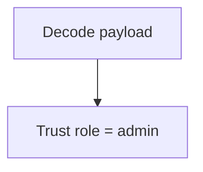

This is unsafe. Validate the signature and required claims before relying on token contents.

### Mistake 2 — Accepting any algorithm

The verifier should enforce an explicit algorithm policy. Do not let an untrusted token dictate a weaker or inappropriate verification method.

### Mistake 3 — Skipping issuer or audience checks

A valid token intended for another service should not automatically be accepted by your API.

### Mistake 4 — Putting secrets in the payload

Signed JWT payloads are normally readable. Signing does not provide confidentiality.

### Mistake 5 — Making tokens valid for too long

Long lifetimes increase the window in which a stolen token may be abused.

### Mistake 6 — Treating JWT as permission by itself

The API must still check the action, resource, ownership, tenant boundary, and current policy where required.

### Mistake 7 — Storing or logging tokens carelessly

Bearer tokens can grant access to whoever possesses them. Avoid leaking them in URLs, analytics, logs, screenshots, or error reports. Choose client-side storage based on the threat model; browser storage options have different XSS and CSRF risks.

---

## 12. Example: Accessing an Order

Imagine a customer requests:

```http
GET /api/orders/order-789
Authorization: Bearer <token>
```

The API first validates the token. Suppose it identifies the subject as:

```text
user-123
```

The API must then check whether `order-789` belongs to `user-123`, or whether the user has another explicit permission to view it.

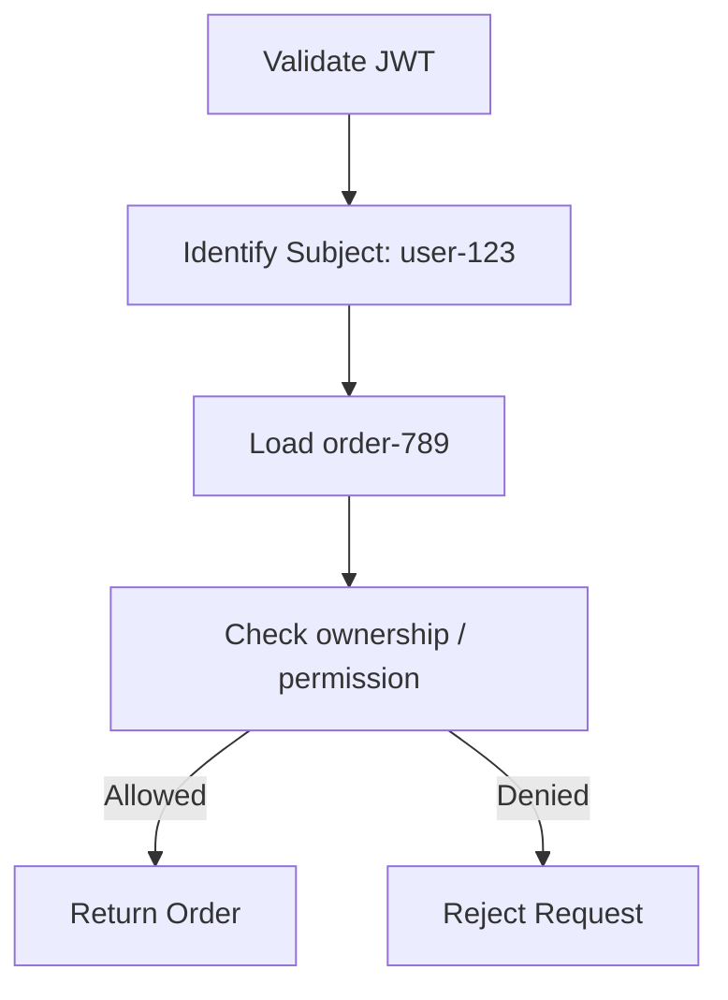

A valid signature does not replace object-level authorization.

---

## 13. Hands-On Exercise

Use a test JWT from a development environment—never paste a real production token into an online decoder.

1. Identify the header, payload, and signature sections.
2. Decode the header and payload locally.
3. Locate `iss`, `sub`, `aud`, and `exp` if present.
4. Explain why the decoded payload is not proof of authenticity.
5. Change one character in the payload and explain why signature validation should fail.
6. List the checks an API should perform before accepting the token.
7. Explain what would happen if a customer's permissions changed before the token expired.

Do not use real access tokens or sensitive data for this exercise.

---

## 14. System Design View

JWT is an architectural choice, not a default requirement.

Use it when locally verifiable claims fit the system's requirements. Consider server-side sessions or opaque tokens when centralized control, early revocation, or frequently changing authorization state is more important.

| Requirement | Design question |
|---|---|
| Multiple API instances | Can they securely share trusted verification keys? |
| Immediate account disablement | How will existing tokens be rejected? |
| Frequent permission changes | Can token claims become stale? |
| Sensitive payload data | Why is that data in a token at all? |
| Key compromise | How can keys be rotated and affected tokens rejected? |
| Multiple APIs | Does each API validate the intended audience? |

Do not choose JWT just because it is popular. Choose a token/session design based on trust boundaries, revocation needs, operational complexity, and security requirements.

---

## 15. Quick Reference

| Term | Meaning |
|---|---|
| JWT | Compact token format for representing claims |
| Header | Metadata such as algorithm and key identifier |
| Payload | Claims carried by the token |
| Signature | Enables integrity and authenticity verification |
| Claim | Statement about a subject or token |
| `iss` | Issuer |
| `sub` | Subject |
| `aud` | Intended audience |
| `exp` | Expiration time |
| JWS | JSON Web Signature; commonly used for signed JWTs |
| JWE | JSON Web Encryption; used for encrypted content |
| Opaque token | Token whose contents are not directly readable by its holder |
| JWKS | JSON Web Key Set, a format for publishing public keys |
| Revocation | Making a token unacceptable before its natural expiry |

---

## 16. Knowledge Check

1. **Is JWT an authentication protocol?**  
   No. JWT is a token format.

2. **Does Base64URL encoding hide a JWT payload?**  
   No. It is encoding, not encryption.

3. **What does a signature provide?**  
   A way to verify integrity and authenticity under the relevant key and algorithm assumptions.

4. **Does every OAuth access token use JWT?**  
   No. Access tokens may be JWTs or opaque tokens.

5. **Why validate `aud`?**  
   To ensure the token is intended for the receiving service.

6. **Does a valid JWT automatically authorize access to any order?**  
   No. The API must apply authorization and resource-level checks.

7. **Why can revocation be difficult with locally validated JWTs?**  
   A token can remain valid until expiry unless the system adds an early-rejection mechanism.

8. **What is the main difference between JWS and JWE?**  
   JWS provides signed integrity/authenticity; JWE provides encryption for confidentiality.

---

## Remember

A JWT is a compact way to carry claims—not a guarantee that those claims are trustworthy or that a request is authorized.

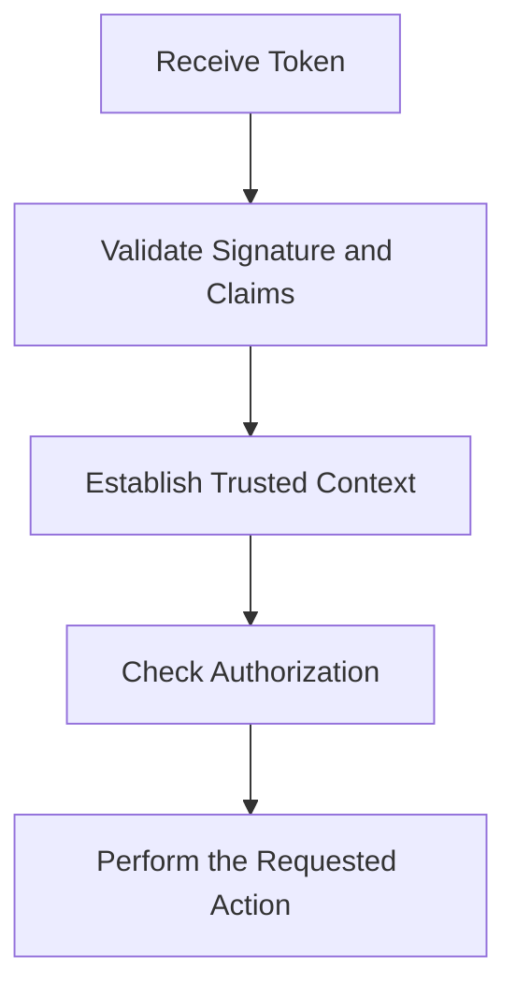

**Next: 11.07 — Sessions**
