# 11.07 — Sessions

## Learning Objectives

By the end of this chapter, you should be able to:

- Explain why web applications need sessions.
- Understand how session IDs connect requests to server-side state.
- Distinguish server-side sessions from JWT-based authentication.
- Understand how cookies carry session identifiers.
- Recognize session fixation, session hijacking, and CSRF risks.
- Design secure login, logout, expiration, and session renewal flows.
- Understand the trade-offs between centralized and distributed session storage.

---

## 1. Why Do We Need Sessions?

HTTP is fundamentally a **stateless protocol**. Each request is handled independently unless the application uses additional mechanisms to connect it to previous activity.

Imagine a user signs in:

```text
POST /login
```

The server verifies the credentials.

The user then requests:

```text
GET /account
```

How does the server know this is the same authenticated user?

Without a mechanism for maintaining state, the server would have to ask the user to authenticate again with every request.

A **session** provides a way to maintain state across multiple requests.

> **A session lets an application associate multiple requests with the same ongoing interaction or authenticated user.**

---

## 2. How Does a Session Work?

A common web architecture stores session data on the server and gives the browser a session ID.

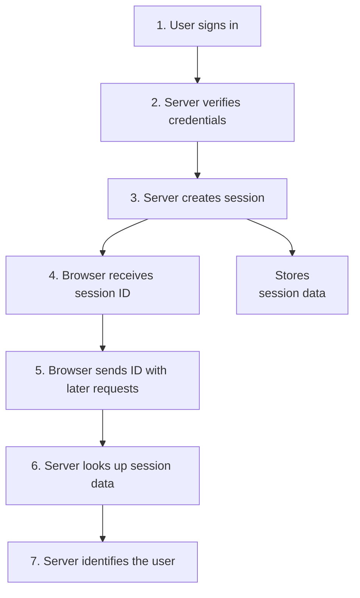

For example, the server might store:

```json
{
  "sessionId": "random-session-identifier",
  "userId": "user-123",
  "createdAt": "2026-10-12T10:00:00Z",
  "expiresAt": "2026-10-12T18:00:00Z"
}
```

This is a conceptual representation. In production, the session ID should be a high-entropy, unpredictable value—not a user ID or sequential number.

The browser normally receives only the session identifier, not the complete server-side session record.

---

## 3. The Session Cookie

A browser commonly carries the session ID in a cookie.

Example response:

```http
Set-Cookie: __Host-session=<random-id>; Path=/; Secure; HttpOnly; SameSite=Lax
```

The browser stores the cookie and automatically sends it on matching requests.

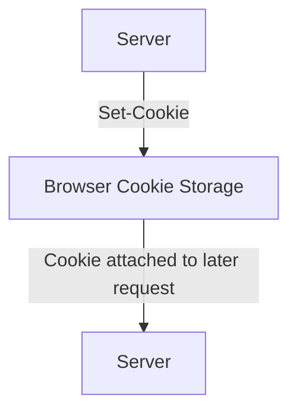

Important cookie attributes:

| Attribute | Purpose |
|---|---|
| `Secure` | Sends the cookie only over HTTPS |
| `HttpOnly` | Prevents ordinary JavaScript from reading the cookie |
| `SameSite` | Controls when the browser sends the cookie in cross-site contexts |
| `Path` | Limits the URL paths for which the cookie is sent |
| `Domain` | Controls the hosts that receive the cookie, when specified |
| `Max-Age` / `Expires` | Controls browser cookie lifetime |

The `__Host-` prefix has additional browser-enforced requirements, including `Secure`, `Path=/`, and no `Domain` attribute. Use it only when those requirements fit the deployment.

`HttpOnly` reduces some token-theft risks but does not stop malicious scripts from making authenticated requests through the victim's browser.

---

## 4. Session ID vs Session Data

These are different things.

**Session ID:** The identifier presented by the client.

**Session data:** The state associated with that identifier, typically stored on the server.

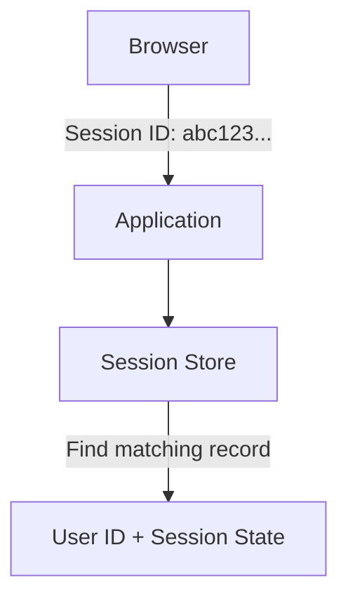

The session ID should not contain predictable information such as:

```text
user-123
```

Instead, use a securely generated, random identifier.

Treat the session ID as a **bearer credential**: anyone who obtains it may be able to use the session until it expires or is invalidated.

---

## 5. Where Is Session Data Stored?

Session state can be stored in several places.

### Option A — Application memory

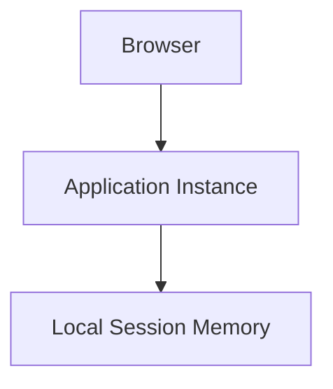

This can be simple for development or a single-instance application.

But if another instance receives the next request, it may not have the session data.

Restarting the application can also erase sessions stored only in memory.

### Option B — Database

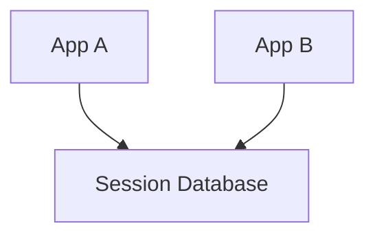

This provides shared storage but adds database work and requires session cleanup and capacity planning.

### Option C — Distributed session store

For example, a shared in-memory data store can hold session records with expiration.

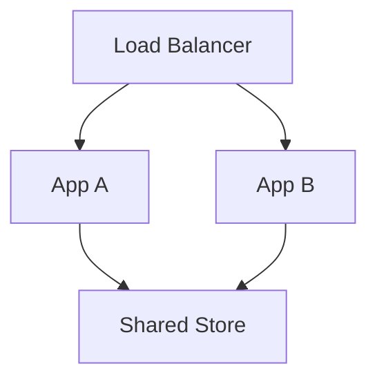

Multiple instances can then access the same session state.

The correct choice depends on scale, durability requirements, latency, operational complexity, and the consequences of losing sessions.

---

## 6. What Happens During Login?

A secure login flow should establish a fresh authenticated session after credentials have been verified.

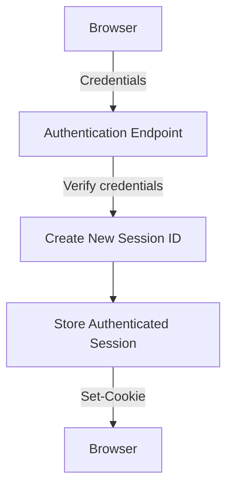

The application should not simply convert an existing anonymous session into an authenticated one while retaining its old identifier.

Instead, it should **rotate the session ID after authentication**.

This helps defend against session fixation.

---

## 7. Session Fixation

Session fixation occurs when an attacker causes a victim to use a session identifier the attacker already knows, and the application later treats that same identifier as authenticated.

Conceptually:

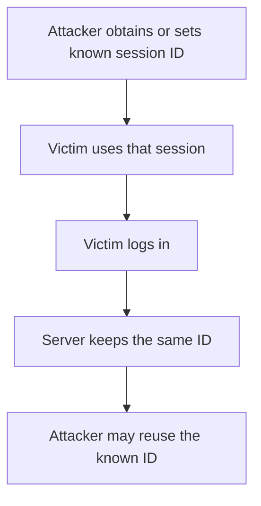

The core defense is to generate a new session identifier after login and after other important privilege changes.

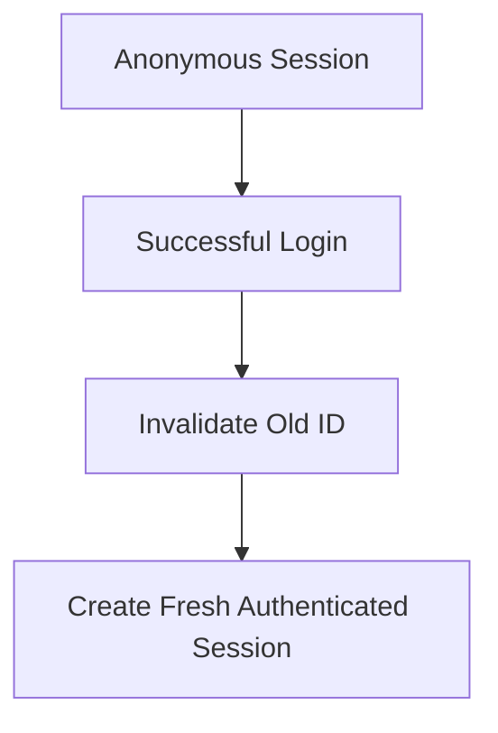

Session IDs should also be unpredictable, and applications should reject attacker-controlled session identifiers where appropriate.

---

## 8. Session Hijacking

Session hijacking happens when an attacker obtains a valid session ID and uses it to impersonate the session holder.

Possible causes include:

- Malware or compromised devices.
- Cross-site scripting (XSS).
- Leaked cookies in logs or debugging tools.
- Insecure network transport.
- Exposed browser profiles or backups.

Important defenses include:

- Use HTTPS everywhere.
- Set session cookies with `Secure` and `HttpOnly`.
- Choose an appropriate `SameSite` policy.
- Prevent XSS and avoid leaking session IDs.
- Use unpredictable session IDs.
- Expire and revoke sessions appropriately.
- Reauthenticate for sensitive actions when needed.

No single cookie attribute solves every session-security problem.

---

## 9. Session Expiration

Sessions should not remain valid forever.

Common policies include:

**Idle timeout:** Expire the session after a period without activity.

**Absolute lifetime:** Expire the session after a maximum total lifetime, even if activity continues.

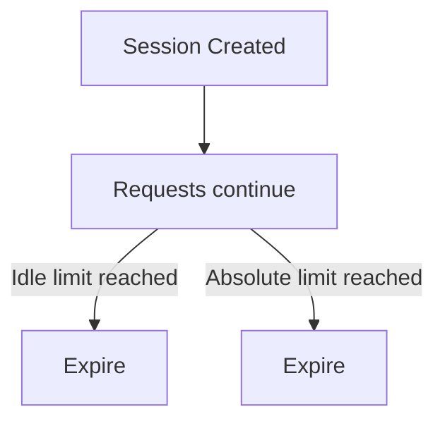

For example, an application might expire a session after 30 minutes of inactivity and require reauthentication after a longer absolute lifetime. Those numbers are illustrative; real values should reflect the application's risk and user experience requirements.

A session store should enforce expiration on the server. Clearing the browser cookie alone does not necessarily invalidate a session record that remains usable elsewhere.

---

## 10. Logout and Session Revocation

A secure logout flow should invalidate the server-side session and clear the browser cookie.

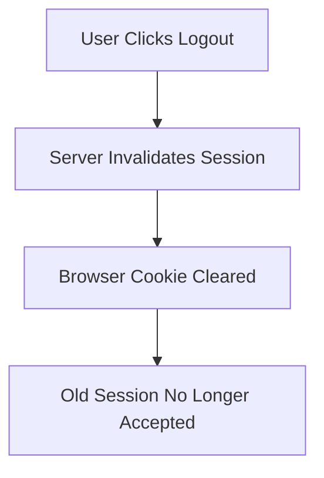

If the server only clears the cookie, a stolen copy may remain usable.

If the server only invalidates the record, the browser may continue sending a useless cookie. Clearing both is the normal approach.

For a system with multiple application instances, invalidation must be visible to all instances that might validate the session.

Sensitive account actions may also require revoking other active sessions or prompting the user to manage signed-in devices.

---

## 11. Sessions vs JWT

Sessions and JWTs are not necessarily competing authentication protocols. They are different ways of representing or maintaining state.

A traditional server-side session stores state on the server and sends the browser a session ID. A JWT carries claims that can often be verified locally.

| Area | Server-side session | Signed JWT |
|---|---|---|
| Client stores | Session ID | Token |
| Main state | Stored server-side | Claims carried in token |
| Request validation | Usually session-store lookup | Can often be local signature and claim validation |
| Immediate revocation | Usually straightforward with shared session state | Requires additional design if tokens must be rejected before expiry |
| Shared infrastructure | Session store may be needed | Trusted key distribution is needed |
| Changing permissions | Can be reflected in stored state | Claims may become stale until expiry or additional checks |
| Token size | Usually small identifier | Often larger |
| Common use | Browser-based web applications | APIs and delegated access flows, among other uses |

JWTs can also be stored in cookies, and sessions can be used by APIs. The choice is not simply “cookies versus JWT”: cookies are a transport/storage mechanism, while JWT is a token format.

---

## 12. Sessions and CSRF

Browsers automatically attach matching cookies to requests. This convenience creates a potential **Cross-Site Request Forgery (CSRF)** risk.

Imagine a user is logged in to a banking site. The browser has a valid session cookie.

If the user visits a malicious site, that site may try to trigger a request to the banking site. Depending on the browser's cookie rules and application design, the browser might attach the session cookie to that request.

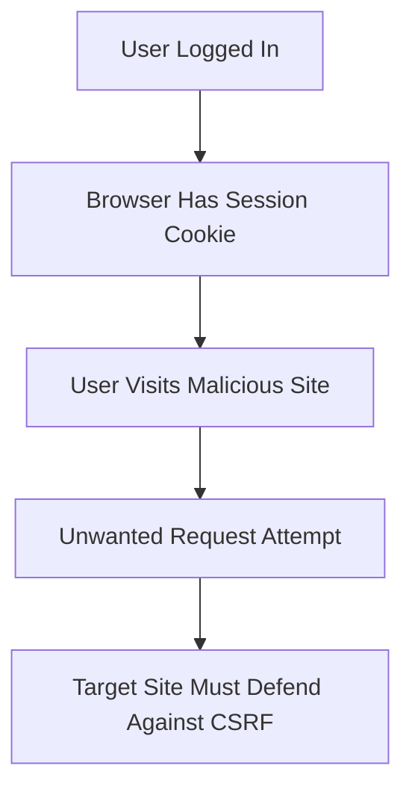

Defenses can include:

- Appropriate `SameSite` cookie settings.
- CSRF tokens.
- Checking `Origin` or, where appropriate, `Referer`.
- Requiring appropriate request methods and validating content types.
- Requiring reauthentication or additional confirmation for sensitive actions.

`SameSite` is useful but should not be treated as a universal replacement for a complete CSRF defense. The right controls depend on the application's cross-site flows and threat model.

Also remember: `HttpOnly` prevents JavaScript from reading a cookie, but it does not prevent the browser from sending that cookie with a request.

---

## 13. Multiple Devices and Sessions

A user may sign in from several devices:

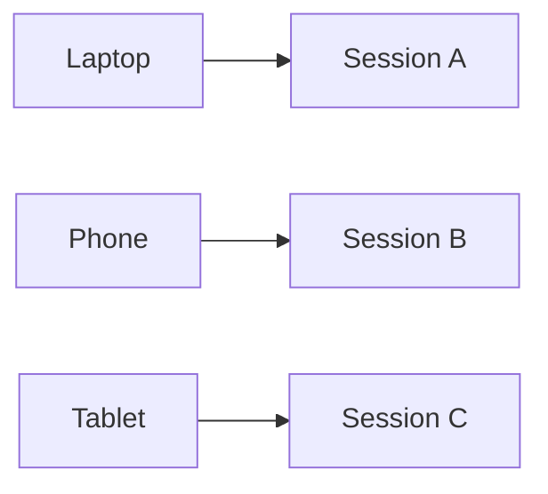

The application can track these as separate sessions.

This enables features such as:

- Sign out from one device.
- Sign out from all devices.
- View active sessions.
- Revoke sessions after a password change.
- Apply different expiration policies to sensitive accounts.

The system needs a clear policy for whether password changes, account suspension, or suspected compromise invalidate one session or all sessions.

---

## 14. Distributed Session Design

Suppose an application has three instances behind a load balancer.

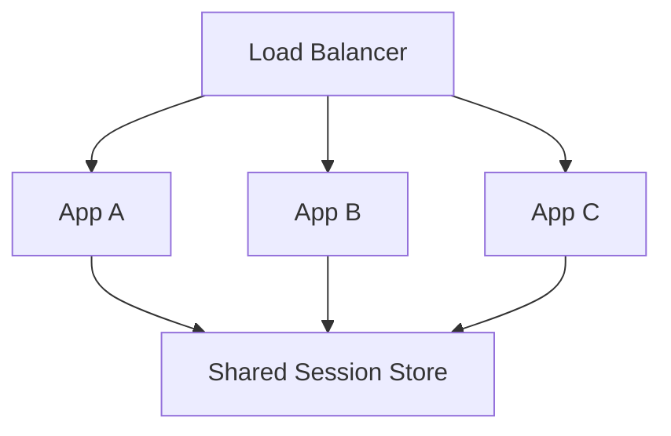

A shared store allows any healthy instance to find the session record.

However, it introduces another dependency:

- What happens if the store is unavailable?
- How many session lookups can it handle?
- How quickly do revocations become visible?
- What happens when records expire?
- Should existing sessions survive a store restart?

Sticky sessions can route a browser repeatedly to the same application instance, but they do not by themselves provide reliable shared state or resilience when that instance fails.

Design session storage according to the failure and availability requirements of the application.

---

## 15. Common Session Mistakes

### Mistake 1 — Using predictable session IDs

Session identifiers must be securely generated and difficult to guess.

### Mistake 2 — Keeping the same ID after login

Rotate the identifier after authentication and privilege changes.

### Mistake 3 — Clearing only the browser cookie on logout

Invalidate the corresponding server-side session too.

### Mistake 4 — Allowing sessions to live forever

Use appropriate idle and absolute expiration policies.

### Mistake 5 — Treating `HttpOnly` as complete XSS protection

It limits cookie reading, but injected scripts may still perform actions as the user.

### Mistake 6 — Ignoring CSRF

Cookie-based authentication requires consideration of cross-site request behavior.

### Mistake 7 — Storing sessions only in local memory without considering scaling

Another instance may not recognize the session, and a restart may erase it.

### Mistake 8 — Assuming a valid session means every action is allowed

Authentication establishes the session's identity; authorization still decides what that identity can do.

---

## 16. Hands-On Exercise

Design a session flow for a small e-commerce application.

1. A user submits login credentials.
2. The server verifies them.
3. The server creates a new unpredictable session ID.
4. The browser receives a secure session cookie.
5. The user views their orders.
6. The server checks the session and verifies that each requested order belongs to the user or is otherwise authorized.
7. The session expires after the chosen idle or absolute limit.
8. On logout, the server invalidates the session and clears the cookie.

Now answer:

- What happens if the user sends an expired session ID?
- What happens if an attacker steals a valid session ID?
- Why must the session ID change after login?
- How will logout work when several application instances are running?
- Which CSRF protections fit your application's request flow?

---

## 17. System Design View

Sessions are a way to maintain authenticated state. Their design affects security, availability, scalability, and user experience.

| Requirement | Design question |
|---|---|
| Multiple application instances | Is session state shared? |
| Account compromise | Can sessions be revoked quickly? |
| Many concurrent users | Can the session store handle the lookup load? |
| Long-running user activity | How should idle and absolute expiration work? |
| Browser-based authentication | Which cookie and CSRF protections are needed? |
| Device management | Can individual sessions be listed and revoked? |
| Store outage | Should requests fail closed, and how will service recover? |

For a typical browser-based application, a well-protected server-side session is often a straightforward choice. A JWT is not automatically more scalable or more secure. Choose based on the actual requirements.

---

## 18. Quick Reference

| Concept | Meaning |
|---|---|
| Session | State connecting related requests |
| Session ID | Unpredictable identifier used to retrieve a session |
| Session Store | System holding server-side session records |
| Session Cookie | Browser cookie carrying the session ID |
| Session Fixation | Attacker causes a victim to use a known session ID |
| Session Hijacking | Attacker obtains and reuses a valid session |
| Idle Timeout | Expiration after inactivity |
| Absolute Lifetime | Maximum session age |
| Session Revocation | Making a session invalid before its natural expiry |
| CSRF | Tricking a browser into sending an unwanted authenticated request |
| Sticky Session | Routing a client repeatedly to a particular application instance |

---

## 19. Knowledge Check

1. **Why do web applications need sessions?**  
   To maintain state or associate multiple requests with the same interaction or authenticated user.

2. **What does the browser normally store?**  
   A session identifier, rather than the full server-side session record.

3. **Why rotate the session ID after login?**  
   To reduce session-fixation risk.

4. **Why is clearing a cookie alone insufficient for secure logout?**  
   A stolen copy of the session ID may remain valid unless the server invalidates the session.

5. **What is the difference between idle timeout and absolute lifetime?**  
   Idle timeout depends on inactivity; absolute lifetime limits the total age of the session.

6. **Does `HttpOnly` prevent CSRF?**  
   No. It limits JavaScript access to the cookie, but the browser may still send the cookie with a request.

7. **Why might a shared session store be needed?**  
   So different application instances can validate the same session.

8. **Are sessions and JWTs mutually exclusive?**  
   No. Sessions are a state-management approach; JWT is a token format. JWTs can also be transported in cookies.

---

## Remember

A session connects requests to server-side state, but its identifier is itself a sensitive credential.

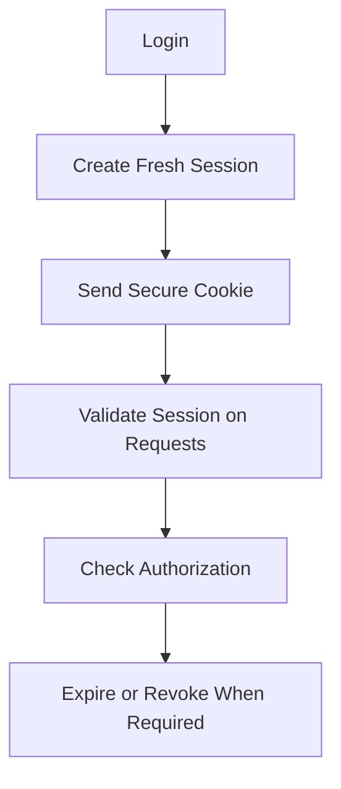

**Next: 11.08 — API Keys**
