# 11.08 — API Keys

## Learning Objectives

By the end of this chapter, you should be able to:

- Explain what an API key is and why APIs use it.
- Distinguish API keys from passwords, sessions, and JWTs.
- Understand how API keys are generated, transmitted, and validated.
- Recognize the limitations of API keys for authentication and authorization.
- Apply restrictions, rate limits, rotation, and revocation.
- Understand how to store API keys securely and prevent accidental exposure.
- Decide when API keys are appropriate for a system.

---

## 1. What Is an API Key?

An **API key** is a credential used to identify an application, client, or integration when it accesses an API.

Imagine a weather application calling a weather provider:

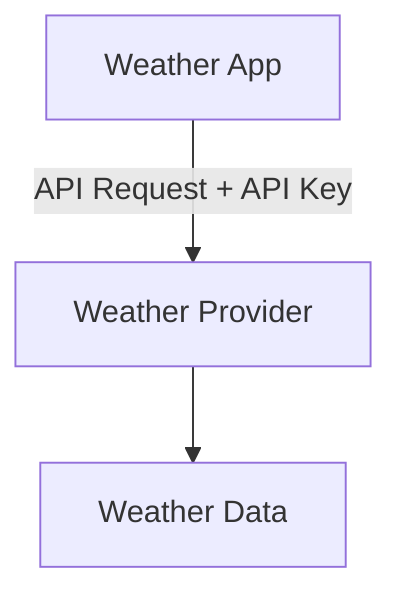

The provider uses the key to recognize the client and apply configured policies, such as quotas, rate limits, or access restrictions.

An API key often looks like a long, random string:

```text
sk_live_a8F...example
```

This is an illustrative format, not a real key.

> **An API key helps a service recognize a client. Possessing a key does not automatically mean the client should have unrestricted access.**

---

## 2. Why Do APIs Use API Keys?

An API provider may need to know:

- Which application is making requests.
- Which quota or rate limit applies.
- Which API products the client may use.
- Whether the credential has been revoked.
- Which client should be associated with usage and billing.

For example, a maps API might assign different keys to:

```text
Website
Mobile App
Backend Service
Development Environment
```

Each key can have its own restrictions and usage limits.

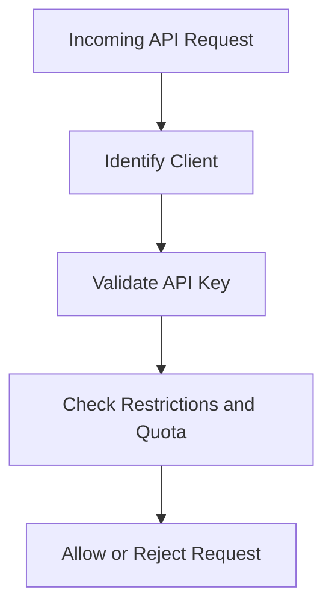

API keys are particularly common in service integrations and APIs that need to identify a calling application.

---

## 3. How Does an API Key Work?

A typical request might look like this:

```http
GET /v1/weather?city=Kolkata HTTP/1.1
Host: api.example.com
X-API-Key: <your-api-key>
```

The API server receives the key and validates it.

A simplified flow:

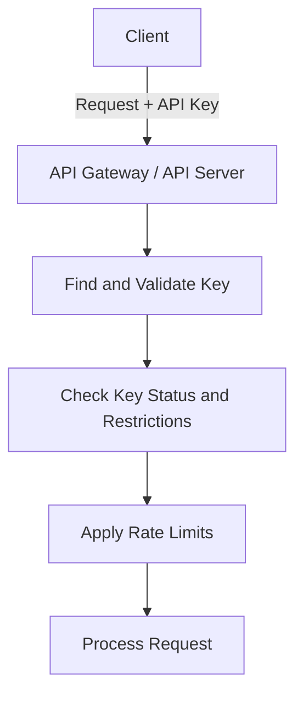

The server may store a record containing:

```text
Key ID
Owning Client
Allowed API Products
Status
Rate Limit
Expiration / Rotation Metadata
```

The actual secret should not be stored in plaintext if the system can instead store a secure verifier, such as a cryptographic hash, and validate presented keys against it.

The exact implementation depends on whether the provider needs to retrieve the original secret or only verify it.

---

## 4. API Key vs User Identity

An API key usually identifies a **client application or integration**, not necessarily the human using it.

Consider an online store:

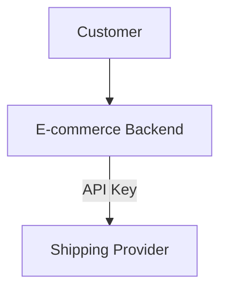

The shipping provider may recognize the e-commerce backend through its API key.

But that key does not necessarily tell the provider which customer initiated the shipment.

The application may need a separate user identity and authorization mechanism for that.

This distinction matters:

| Question | Typical mechanism |
|---|---|
| Which integration is calling? | API key |
| Which user is signed in? | Session, authentication token, or identity system |
| What may this user do? | Authorization policy |
| Which service is calling another service? | Service identity or credential, potentially including an API key |

Some systems use API keys to identify individual users or other principals. The important point is to define clearly what the key represents.

---

## 5. API Keys vs Sessions vs JWT

These mechanisms serve different purposes.

| Feature | API Key | Server-Side Session | JWT |
|---|---|---|---|
| Typical purpose | Identify a client or integration | Maintain authenticated user state | Carry claims in a token |
| Client sends | API key | Session ID | Token |
| Server-side state | Often a key record and policy | Session record | Depends on design |
| Represents a human user? | Not necessarily | Commonly | Can represent a subject |
| Expiration | Depends on implementation | Usually policy-driven | Often includes `exp` |
| Revocation | Usually manageable through key records | Usually manageable through session records | Depends on validation and revocation design |

An API key is not inherently more secure or less secure than a JWT. Security depends on its scope, handling, storage, transport, and validation.

---

## 6. API Keys Are Bearer Credentials

Many API keys operate as **bearer credentials**: whoever possesses the secret can attempt to use it.

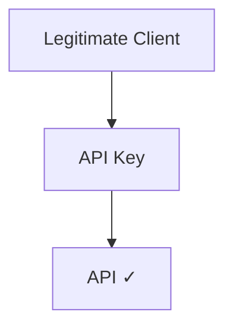

If an attacker steals the same key:

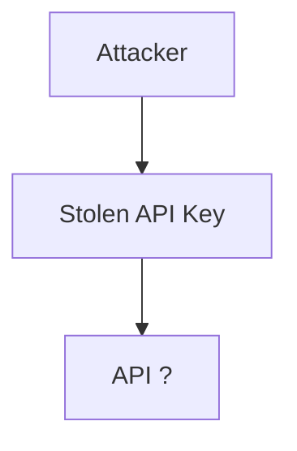

The attacker may be able to use it unless other controls block the request.

This is why API keys should be treated as secrets.

Avoid exposing them through:

- Public source-code repositories.
- Browser JavaScript when the key grants privileged access.
- Mobile application packages when the key is meant to remain confidential.
- URLs and query strings.
- Logs, analytics, screenshots, or support tickets.
- Unprotected configuration files.

**HTTPS is essential** for protecting credentials in transit.

---

## 7. Why Keys in URLs Are Risky

Avoid placing sensitive API keys in URLs:

```http
GET /v1/weather?api_key=secret-value
```

URLs may be recorded in:

- Web server logs.
- Browser history.
- Monitoring systems.
- Proxy logs.
- Analytics systems.
- Error reports.

Prefer a documented header-based mechanism when the API supports it:

```http
X-API-Key: <secret>
```

Some APIs use other header names or authentication schemes. Follow the provider's documented format, and ensure that sensitive headers are not unnecessarily logged.

A header does not make a key safe by itself. It still needs secure transport and careful handling.

---

## 8. Public Keys vs Secret API Keys

The phrase "API key" is sometimes used for credentials that have different security properties.

### Public or restricted client key

A key embedded in a browser application may be visible to every visitor.

It must not be treated as a secret.

It may still be useful for identifying a project or enabling a service when the provider supports strict restrictions, such as:

- Allowed website origins or referrers.
- Allowed API products.
- Usage quotas.
- Domain or application restrictions.

These restrictions reduce misuse but cannot turn a publicly exposed value into a confidential credential.

### Secret server-side key

A secret key should be kept in a trusted backend or secret-management system.

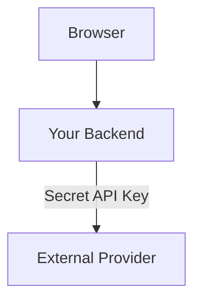

The browser calls your backend. Your backend calls the provider using the secret key.

This prevents ordinary visitors from directly extracting the privileged credential from frontend code.

---

## 9. API Key Restrictions

A key should have only the access it needs.

Possible restrictions include:

- **API restrictions:** Which API operations or products the key can access.
- **Environment restrictions:** Whether it belongs to development, staging, or production.
- **Origin restrictions:** Which websites may use a public client key.
- **Network restrictions:** Which source IP ranges may use a server-side key, where practical.
- **Quota restrictions:** How much usage is allowed.
- **Expiration:** When the key stops working.
- **Ownership:** Which application or team is responsible for it.

For example:

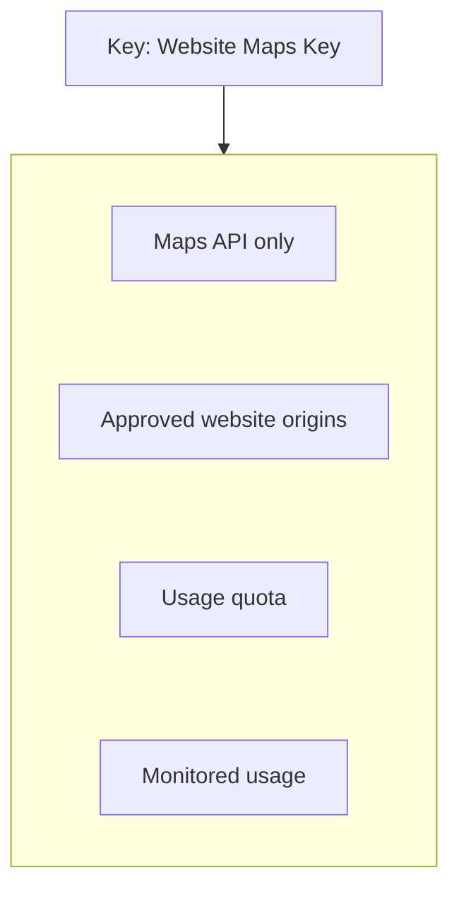

Restrictions are defense in depth. Some can be bypassed in certain environments, and source IPs or browser origins do not prove the identity of a human user.

---

## 10. API Keys and Authorization

An API key can be associated with permissions, but the system must explicitly enforce them.

For example:

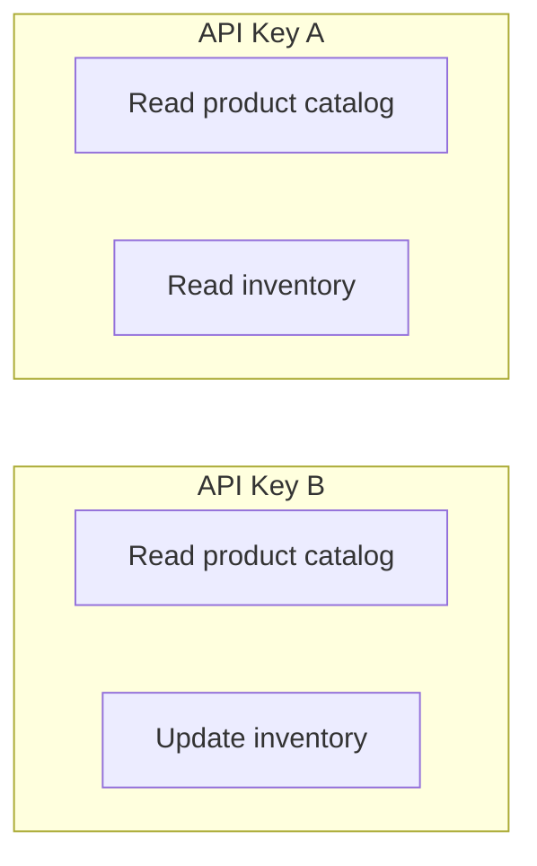

The API should check what the key is allowed to do before executing the operation.

Do not assume:

```text
Valid Key = Full Access
```

Instead:

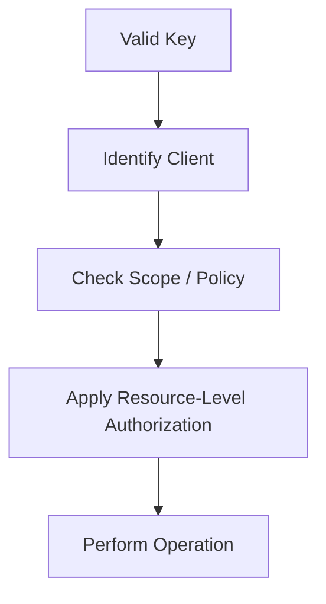

For sensitive user-owned resources, client identification may not be sufficient. The system may also need a user identity, tenant identity, and object-level authorization checks.

---

## 11. Rate Limiting and Quotas

API keys provide a convenient way to associate usage limits with a client.

For example:

```text
Client A → 100 requests/minute
Client B → 1,000 requests/minute
```

A rate limiter can track usage by key or by the client record associated with it.

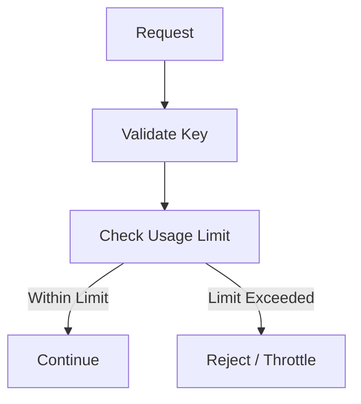

Rate limits help protect service capacity and manage fair usage.

However, if an attacker steals a key, the attacker may consume its quota. Monitoring and revocation are therefore still important.

Rate limiting by API key alone may also be insufficient if anonymous traffic or multiple credential types can reach the same endpoint.

---

## 12. Generating and Storing Keys

API keys should be generated using a cryptographically secure random number generator.

Avoid predictable values such as:

```text
client-001
companyname123
timestamp-based-value
```

These are identifiers, not secure secrets.

A practical design often separates a public identifier from a secret:

```text
Key Prefix / ID + Secret
```

The identifier helps the server locate the key record. The secret proves possession.

For example, the stored record might contain:

```text
Key ID
Client ID
Secret Verifier
Permissions
Status
Created At
Expires At
Last Used At
```

The server can store a cryptographic hash of a high-entropy secret and compare it securely when a key is presented. A standard password-hashing algorithm is usually unnecessary for a truly random, high-entropy API secret, though the right storage method depends on the credential design.

Never store or log plaintext keys unnecessarily.

---

## 13. Key Rotation

Keys should not be treated as permanent credentials.

**Rotation** means replacing an existing key with a new one.

A safe rotation process can be:

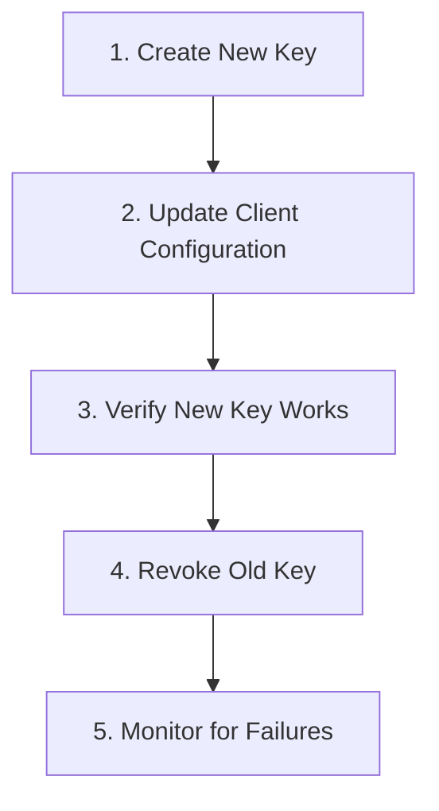

During a planned transition, both keys may temporarily be valid if the security requirements permit it.

The overlap should be limited. If the old key is suspected to be compromised, revoke it promptly rather than preserving a long migration window.

Rotation reduces the time a compromised key can remain useful, but rotation alone does not stop an attacker from using a still-valid stolen key.

---

## 14. Revocation and Expiration

**Revocation** makes a key unacceptable before it would otherwise expire.

**Expiration** makes a key invalid after a defined time.

A key record might have these states:

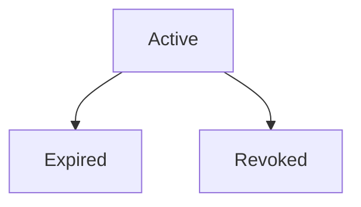

A server should check key status during validation.

Revocation should take effect across all relevant API instances and gateways. Caching key records can improve performance, but it may delay the effect of revocation unless the cache and invalidation design accounts for it.

A useful operational practice is to record the key's owner, creation time, last use, intended purpose, and expiry or rotation policy.

---

## 15. What Happens If a Key Is Leaked?

Suppose a production API key appears in a public repository.

Respond as if it may have been copied.

A practical incident response is:

1. Revoke the exposed key.
2. Create a replacement credential.
3. Update the legitimate client securely.
4. Check usage logs for unexpected activity.
5. Assess possible data access, charges, or other consequences.
6. Remove the exposed secret from source history where appropriate, without assuming deletion makes it safe again.
7. Fix the process that allowed the key to be exposed.

Do not rely only on deleting the visible line from the latest commit. The key may remain in repository history, forks, caches, or copies.

---

## 16. API Keys in a Microservices System

Consider a system with multiple internal services:

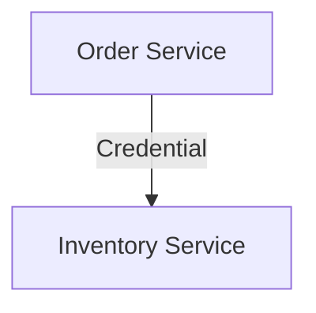

A key may be used to identify a service integration. However, long-lived static keys can become difficult to rotate and govern across many services.

For larger or higher-risk environments, alternatives may include:

- Workload identity.
- Short-lived service credentials.
- Mutual TLS (mTLS).
- OAuth client credentials with access tokens.
- A secrets manager that securely delivers and rotates credentials.

The right choice depends on the infrastructure, trust boundaries, and threat model. API keys can be appropriate for simple integrations, but they should not automatically become the universal identity mechanism for every internal service.

---

## 17. Common API Key Mistakes

### Mistake 1 — Putting a privileged secret in frontend code

Anything shipped to a browser can be inspected. Keep confidential credentials on the server.

### Mistake 2 — Treating a public key as secret

A browser-exposed key must be designed and restricted for public use.

### Mistake 3 — Giving every key full access

Use least privilege and explicit API restrictions.

### Mistake 4 — Never rotating or revoking keys

Define ownership, expiry, rotation, and incident-response procedures.

### Mistake 5 — Logging complete keys

Redact secrets from logs, traces, and error reports.

### Mistake 6 — Assuming a valid key identifies the end user

A key may identify only the calling application. User identity and resource authorization may still be necessary.

### Mistake 7 — Using API keys as the only defense

Use HTTPS, authorization checks, rate limits, monitoring, and other controls appropriate to the system.

---

## 18. Hands-On Exercise

Design API-key access for a product catalog service.

Requirements:

- A public website displays product information.
- A trusted backend imports inventory updates.
- The inventory integration must not be able to manage users.
- The system must support key rotation and detect suspicious usage.

Answer these questions:

1. Should the website receive the inventory integration's secret key?
2. What permissions should the inventory key have?
3. How would you distinguish development and production keys?
4. Where would the backend store the secret?
5. How would you revoke a leaked key?
6. Which requests should be rate-limited?
7. What user-level authorization checks would still be required?

Compare your design against the principle of least privilege.

---

## 19. System Design View

API keys are simple, but their lifecycle is part of the system's security architecture.

| Requirement | Design question |
|---|---|
| Client identification | What entity does the key represent? |
| Least privilege | Which operations can it access? |
| Confidentiality | Where is the secret stored and transmitted? |
| Misuse protection | What rate limits and quotas apply? |
| Rotation | Can the key be replaced without unnecessary downtime? |
| Revocation | How quickly does invalidation reach all instances? |
| Observability | Can usage be traced to a key without logging its secret? |
| Ownership | Who is responsible for each key? |

The goal is not merely to validate a string. It is to manage a credential throughout its lifecycle.

---

## 20. Quick Reference

| Concept | Meaning |
|---|---|
| API Key | Credential used to identify a client or integration |
| Secret Key | Confidential credential that must be protected |
| Public Client Key | Exposed identifier/key designed for restricted public use |
| Scope / Permission | Operations the credential is allowed to access |
| Rate Limit | Restriction on request frequency |
| Quota | Maximum usage over a defined period or budget |
| Rotation | Replacing a credential with a new one |
| Revocation | Making a credential invalid |
| Expiration | Invalidating a credential after a defined time |
| Secret Manager | System for storing and delivering sensitive credentials |
| Workload Identity | Mechanism for identifying a running service or workload |

---

## 21. Knowledge Check

1. **What is an API key primarily used for?**  
   Identifying a client, application, or integration and applying associated policies.

2. **Does an API key necessarily identify a human user?**  
   No. It often identifies the calling application or integration.

3. **Why should a privileged key not be embedded in browser JavaScript?**  
   Browser code is visible to users, so the key can be extracted and reused.

4. **Does a valid key automatically grant full access?**  
   No. The server must enforce restrictions and authorization policies.

5. **Why rotate keys?**  
   To replace credentials periodically or after exposure and reduce the risk of long-term misuse.

6. **Why is HTTPS important?**  
   It protects credentials in transit against network interception and tampering.

7. **What should happen after a key leak?**  
   Revoke it, replace it, investigate usage, and fix the exposure path.

8. **Can an API key replace all service-to-service identity mechanisms?**  
   No. More complex systems may need short-lived credentials, workload identity, mTLS, or OAuth-based approaches.

---

## Remember

An API key identifies a client or integration, but it must be protected and restricted like any other credential.

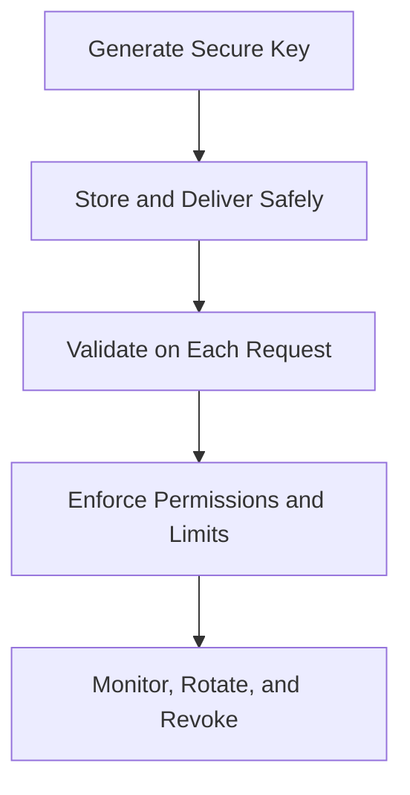

**Next: 11.09 — Encryption**
