# 11.09 — Encryption

## Learning Objectives

By the end of this chapter, you should be able to:

- Explain what encryption protects and when it is needed.
- Distinguish encryption, encoding, hashing, and digital signatures.
- Understand symmetric and asymmetric encryption.
- Understand how encryption protects data in transit and at rest.
- Explain the roles of keys, nonces, and authentication tags.
- Recognize common encryption mistakes and key-management risks.
- Choose an appropriate encryption approach for a basic system-design scenario.

---

## 1. What Is Encryption?

**Encryption transforms readable data into a form that cannot be understood without the required decryption key.**

Suppose an application stores a customer's private document.

Without encryption, someone who gains access to the raw file may be able to read it.

With encryption:

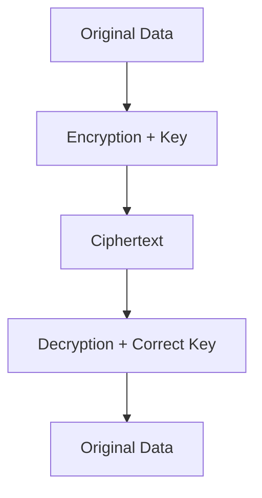

The original readable information is called **plaintext**. The encrypted output is called **ciphertext**.

> **Encryption protects confidentiality. It does not automatically protect every aspect of a system's security.**

For example, encryption does not by itself determine whether a user is authorized to access a document.

---

## 2. Why Do Systems Need Encryption?

Applications handle sensitive information such as:

- Personal information.
- Payment-related data.
- Private documents.
- Authentication credentials.
- Business records.
- Confidential communications.
- Database backups.

Without suitable encryption, someone who gains access to stored data or intercepts network traffic may be able to read it.

Consider a typical web application:

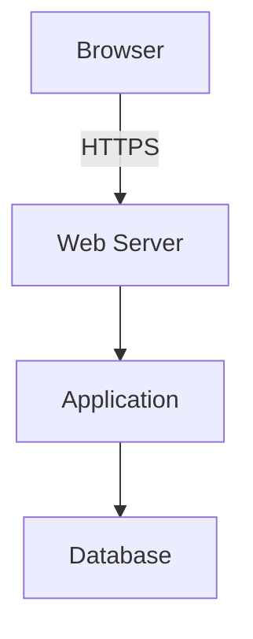

Encryption can protect different parts of this journey:

- **In transit:** Protect data as it travels across a network.
- **At rest:** Protect stored data on disks, databases, backups, or other storage.
- **At the application level:** Protect selected sensitive fields or records, potentially even from some infrastructure operators.

These protections address different threats and may be combined.

---

## 3. Encryption, Encoding, Hashing, and Signing

These terms solve different problems.

| Technique | Main purpose | Reversible with the intended mechanism? |
|---|---|---|
| Encoding | Change data representation | Yes, generally |
| Encryption | Protect confidentiality | Yes, with the required key |
| Hashing | Produce a fixed-size digest | Not designed to be reversed |
| Digital signature | Verify integrity and origin under a trusted key | Verified, not decrypted |

### Encoding

Base64 encoding changes the representation of data. It does not make the data secret.

```text
Hello → SGVsbG8=
```

Anyone can decode it.

### Encryption

Encryption protects data using a cryptographic key.

```text
Plaintext + Key → Ciphertext
```

The intended recipient needs the required key to decrypt it.

### Hashing

A cryptographic hash produces a digest.

```text
Data → Hash Digest
```

Hashing is commonly used for integrity checks and other cryptographic purposes. Password storage requires specialized password-hashing functions, discussed in **11.02 — Authentication**.

### Digital signatures

A digital signature allows a recipient to verify that data was signed using the corresponding private key and has not been altered, assuming the key and algorithm are trusted.

A signature is not encryption.

**Remember:** encryption, hashing, and signing are not interchangeable.

---

## 4. Symmetric Encryption

**Symmetric encryption uses the same secret key to encrypt and decrypt data.**

Conceptually:

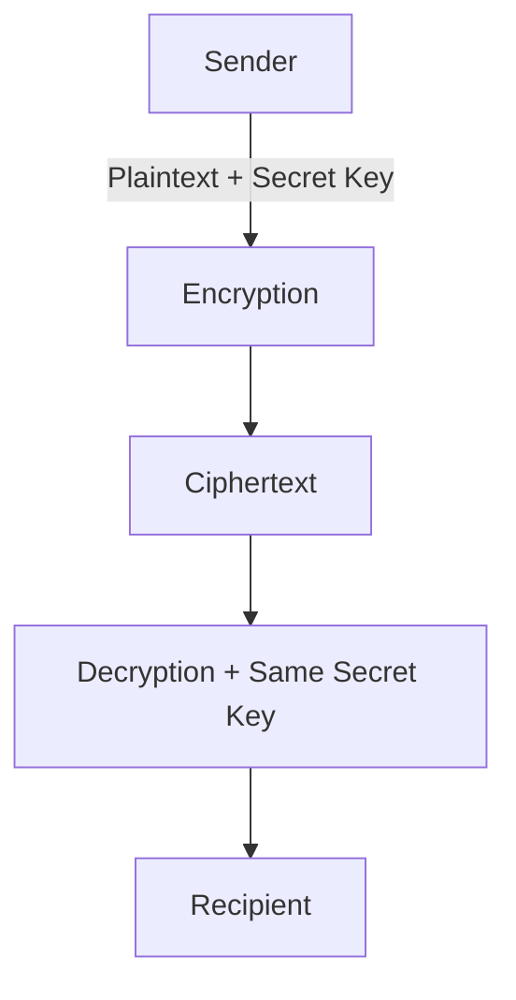

Symmetric encryption is efficient and commonly used to protect large amounts of data.

A widely used algorithm is **AES** (Advanced Encryption Standard).

For many application-level encryption tasks, authenticated encryption such as **AES-GCM** is a suitable choice when used correctly with a trusted library and proper nonce management.

### The key challenge

Both sides need access to the secret key, but an attacker must not obtain it.

If an attacker steals the key, they may be able to decrypt data protected by it.

This leads to a fundamental design question:

> **How will the system generate, store, distribute, rotate, and revoke encryption keys securely?**

---

## 5. Asymmetric Cryptography

Asymmetric cryptography uses a related pair of keys:

- **Public key:** Can be shared according to the cryptographic scheme's rules.
- **Private key:** Must remain protected.

For public-key encryption:

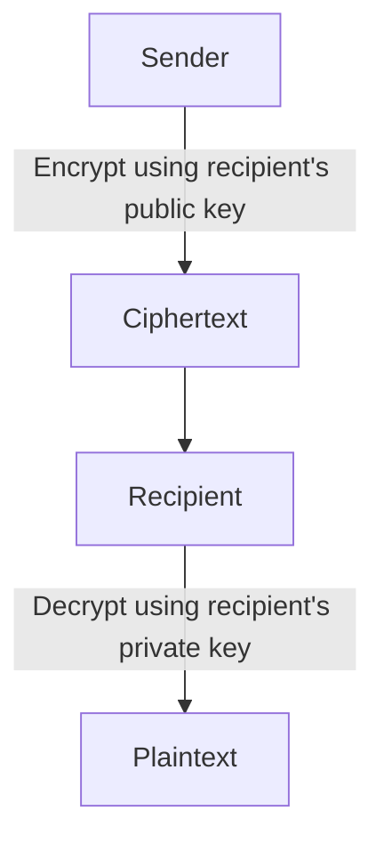

The public key does not need to be secret, but the recipient must be able to trust that it belongs to the intended party.

Asymmetric cryptography is also used for digital signatures, but signing and encryption use different operations and security goals.

For example, RSA supports encryption and signatures through distinct schemes. Elliptic-curve systems are commonly used for key agreement and signatures rather than general-purpose bulk encryption.

### Why not encrypt everything asymmetrically?

Public-key operations are generally more computationally expensive and have different data-size constraints than symmetric encryption.

Real systems often use a **hybrid approach**:

1. Establish or protect a symmetric session key using an appropriate public-key or key-agreement mechanism.
2. Use symmetric authenticated encryption to protect the actual data.

TLS uses this kind of cryptographic combination, although modern TLS versions have specific, carefully defined handshake mechanisms.

---

## 6. What Is a Cryptographic Key?

A **cryptographic key** is a value used by a cryptographic algorithm to perform an operation.

Examples include:

- A symmetric key used to encrypt and decrypt data.
- A private key used to create digital signatures.
- A public key used to verify signatures.
- Key-agreement material used to establish shared secrets.

A key is not the same thing as a password, although a password may be used as part of a carefully designed key-derivation process.

Good key management requires:

- Cryptographically secure generation.
- Protected storage.
- Restricted access.
- Rotation policies.
- Backup and recovery planning where appropriate.
- Revocation or retirement procedures.
- Auditability.

A strong algorithm cannot protect data if the key is exposed.

---

## 7. Authenticated Encryption

Encryption alone does not necessarily tell the recipient whether ciphertext has been maliciously modified.

Many modern applications therefore use **authenticated encryption**, which provides confidentiality and integrity protection together.

A common example is AES-GCM.

Conceptually:

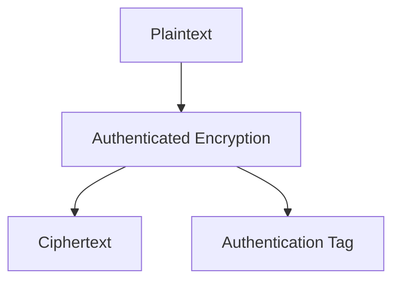

During decryption, the receiver verifies the authentication information. If validation fails, the application must reject the result rather than use potentially altered plaintext.

Some authenticated-encryption schemes also accept **associated data**: information that is authenticated but not encrypted. For example, an application may authenticate a record identifier while encrypting the record's sensitive contents.

### Nonces matter

Many authenticated-encryption schemes require a **nonce** or initialization value. The exact requirements depend on the algorithm.

For AES-GCM, nonce reuse with the same key can seriously compromise security.

Use a trusted library and follow the algorithm's nonce-generation and uniqueness requirements. Do not invent a nonce strategy or assume that a random value is automatically safe in every workload.

---

## 8. Data in Transit

Data in transit is data moving between components.

For example:

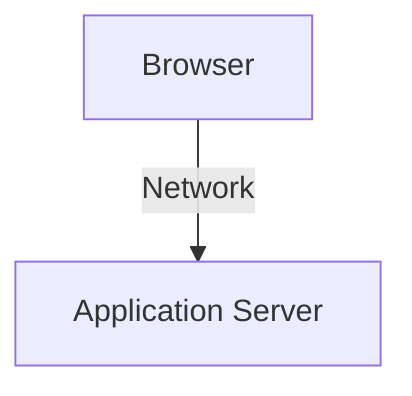

Without transport protection, an attacker who can observe or interfere with the network may be able to read or modify traffic.

HTTPS uses **TLS** to protect HTTP communication.

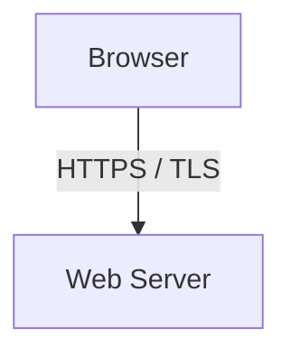

TLS can provide confidentiality, integrity, and authentication of the server when correctly configured and validated. Mutual TLS can additionally authenticate clients using certificates.

Encryption does not remove every network risk. Systems must still handle certificate validation, endpoint identity, secure configuration, and application-level authorization.

A detailed explanation of TLS comes in **11.10 — TLS**.

---

## 9. Data at Rest

Data at rest is data stored on persistent media.

Examples include:

- Database files.
- Disk volumes.
- Object storage.
- Backups.
- Archived records.
- Snapshots.

A common protection is **encryption at rest**, such as encrypted storage volumes or database-managed encryption.

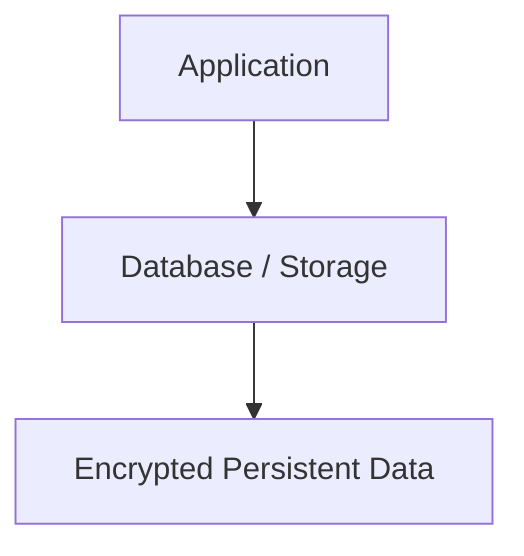

This can help protect data if storage media, backups, or underlying storage infrastructure are exposed.

However, if an application is authorized to retrieve the data and the encryption layer automatically decrypts it, a compromised application account may still be able to access the plaintext.

Encryption at rest is valuable, but it does not replace:

- Access controls.
- Least privilege.
- Secure application design.
- Key protection.
- Monitoring and incident response.

---

## 10. Storage Encryption vs Application-Level Encryption

These approaches protect different boundaries.

### Storage or volume encryption

The storage system encrypts data written to persistent media.

This is useful for protecting disks, snapshots, and similar storage assets against certain forms of physical or infrastructure-level exposure.

### Application-level encryption

The application encrypts selected data before storing it.

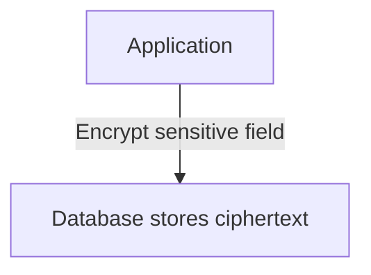

Application-level encryption can reduce the number of components that can access plaintext, depending on where keys are held and where decryption occurs.

But it adds complexity:

- Key access and rotation.
- Data searching and indexing limitations.
- Backup and recovery implications.
- Application changes.
- Performance overhead.
- Risk of losing access if keys are lost.

Choose the protection boundary based on the threat model. Using both layers may be appropriate.

---

## 11. Envelope Encryption

A common key-management pattern is **envelope encryption**.

Instead of using one long-lived key directly for all application data, the system uses a data-encryption key (DEK) and protects that key with a separate key-encryption key (KEK).

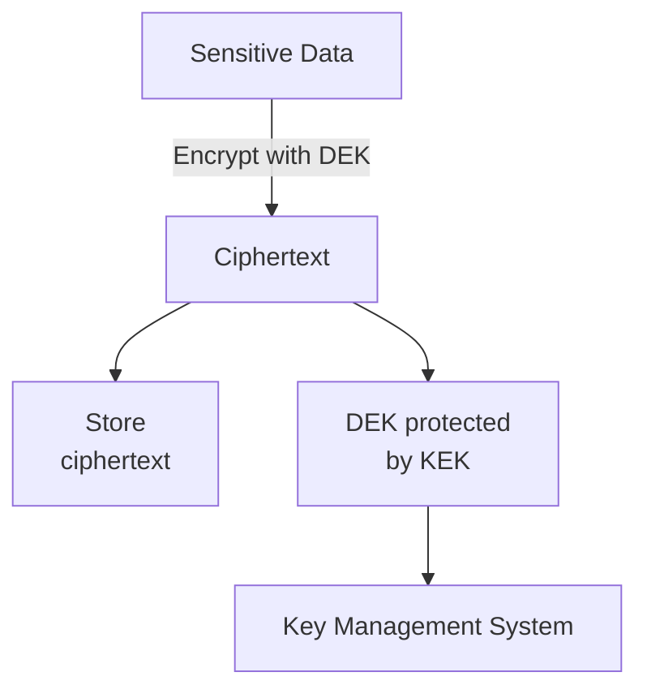

- **DEK:** Encrypts and decrypts the actual data.
- **KEK:** Protects the DEK.
- **Key management system:** Helps control access to key material and may support rotation and auditing.

The application must still ensure that only authorized components can request decryption.

Envelope encryption can simplify key rotation and limit exposure of high-value keys, but it introduces dependencies on key management and recovery procedures.

---

## 12. Key Management Is Often the Hard Part

Encryption is not only about choosing an algorithm.

Imagine a database is encrypted correctly, but the decryption key is stored beside the encrypted backup with the same permissions.

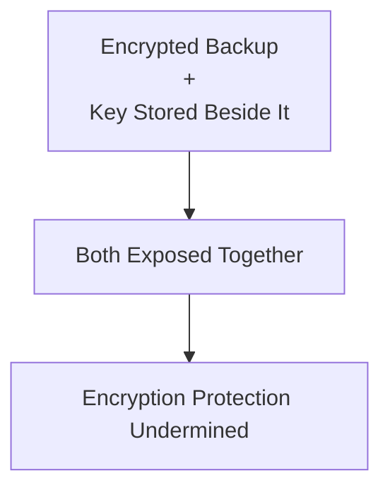

A stronger design separates access to encrypted data from access to its keys.

Common approaches include:

- A dedicated secrets manager or key-management service.
- Hardware-backed key protection where required.
- Strict access policies.
- Separate production and development keys.
- Auditing of sensitive key operations.
- Rotation and recovery procedures.

The appropriate solution depends on the sensitivity of the data and the system's operational requirements.

---

## 13. Encryption and Passwords

Passwords should generally not be stored using reversible encryption.

A login system usually needs to verify that a submitted password matches the stored credential, not recover the original password.

Instead, use a dedicated password-hashing function with appropriate parameters and a unique salt.

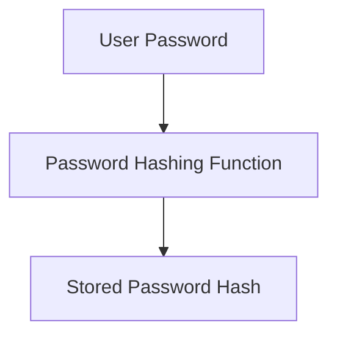

Encryption and password hashing have different purposes.

There are cases where an application must recover a secret, such as a third-party API credential. That secret may need encryption and controlled key access rather than password hashing alone.

Never use ordinary encryption as a substitute for proper password storage.

---

## 14. Common Encryption Mistakes

### Mistake 1 — Inventing your own cryptography

Use established algorithms and maintained libraries. Custom cryptographic designs are easy to get wrong.

### Mistake 2 — Confusing encoding with encryption

Base64 and similar encodings do not protect confidentiality.

### Mistake 3 — Using encryption without integrity protection

Prefer an appropriate authenticated-encryption scheme for application data rather than assuming confidentiality alone is enough.

### Mistake 4 — Reusing nonces incorrectly

Some algorithms, including AES-GCM, have strict nonce requirements. Violating them can seriously weaken security.

### Mistake 5 — Storing keys beside encrypted data without separation

An attacker who obtains both may be able to decrypt the data.

### Mistake 6 — Assuming encryption at rest prevents application compromise

An authorized or compromised application may still access plaintext.

### Mistake 7 — Losing keys

Encrypted data may become unrecoverable if the required keys are lost. Recovery planning must be part of the design.

### Mistake 8 — Using encryption for authorization

Encryption does not determine whether a user should be allowed to perform an action.

### Mistake 9 — Ignoring rotation and revocation

Key lifecycle management is part of the security design, not an optional maintenance task.

---

## 15. Hands-On Exercise

Design protection for a document-management application.

Requirements:

- Users upload confidential documents.
- Documents are stored in object storage.
- Only authorized users should be able to read their documents.
- The system must support backups and key rotation.

Answer these questions:

1. How will data be protected while moving from the browser to the server?
2. What protects documents stored in object storage?
3. Is storage encryption alone enough if the application is compromised?
4. Where should encryption keys be managed?
5. How will the system verify that encrypted data has not been modified?
6. How will authorized users be identified before a document is returned?
7. What happens if a key is rotated or lost?
8. How will backups remain recoverable without exposing keys alongside the data?

The goal is to choose protections based on the threats and trust boundaries—not simply to add as many encryption layers as possible.

---

## 16. System Design View

Encryption affects confidentiality, integrity, performance, operations, and recovery.

| Requirement | Design question |
|---|---|
| Network privacy | Is traffic protected with correctly configured TLS? |
| Storage protection | What happens if disks, snapshots, or backups are exposed? |
| Data integrity | Can the system detect unauthorized modification? |
| Key protection | Who can use or retrieve keys? |
| Key rotation | Can keys be replaced without losing access to existing data? |
| Recovery | Can data be recovered if a key or service is unavailable? |
| Access control | Which identities are permitted to decrypt data? |
| Searchability | Will application-level encryption affect filtering or indexing? |
| Performance | What is the cost of encryption and decryption at expected scale? |

Encryption should fit into the complete security architecture, alongside identity, authorization, secrets management, logging, and incident response.

---

## 17. Quick Reference

| Concept | Meaning |
|---|---|
| Plaintext | Readable, unencrypted data |
| Ciphertext | Encrypted data |
| Symmetric encryption | Uses the same secret key for encryption and decryption |
| Asymmetric cryptography | Uses related public and private keys for supported operations |
| Encryption at rest | Protects stored data |
| Encryption in transit | Protects data moving across a network |
| Authenticated encryption | Provides confidentiality and integrity protection |
| Nonce | Value used by certain cryptographic algorithms under specific uniqueness requirements |
| Authentication tag | Value used to verify integrity and authenticity in supported schemes |
| DEK | Data-encryption key |
| KEK | Key-encryption key |
| Envelope encryption | Protects data keys using another key |
| Key rotation | Replacing or transitioning cryptographic keys |
| TLS | Protocol used to protect network communications |

---

## 18. Knowledge Check

1. **What is encryption primarily intended to protect?**  
   Confidentiality—preventing unauthorized parties from understanding protected data.

2. **Is Base64 encoding encryption?**  
   No. Encoding changes representation but does not make data secret.

3. **What is the difference between symmetric and asymmetric cryptography?**  
   Symmetric encryption uses the same secret key for encryption and decryption; asymmetric cryptography uses related keys for supported operations.

4. **Why use authenticated encryption?**  
   It protects confidentiality while also allowing tampering to be detected.

5. **Does encryption at rest protect data from every compromised application?**  
   No. A compromised application may still access plaintext through its authorized interfaces.

6. **Why is key management essential?**  
   Anyone who obtains the required decryption key may be able to access the protected data.

7. **Should passwords normally be encrypted for storage?**  
   No. Store them using an appropriate password-hashing function.

8. **What is envelope encryption?**  
   A design where a data key encrypts the data and a separate key protects that data key.

---

## Remember

Encryption is only as strong as its algorithms, implementation, key protection, and operational design.

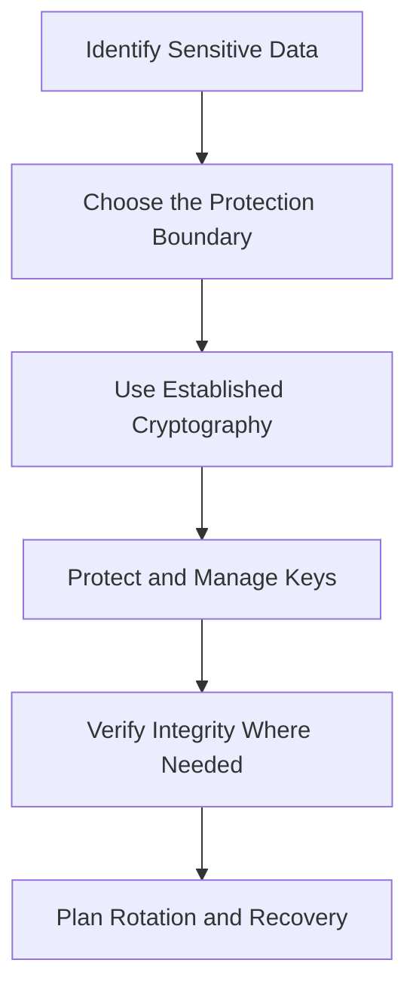

**Next: 11.10 — TLS**
