# 11.10 — TLS (Transport Layer Security)

## Learning Objectives

By the end of this chapter, you should be able to:

- Explain what TLS protects and how it relates to HTTPS.
- Understand confidentiality, integrity, and authentication in network communication.
- Explain the purpose of certificates and certificate authorities.
- Understand the basic TLS handshake.
- Distinguish TLS encryption from application authentication and authorization.
- Recognize common TLS configuration mistakes.
- Understand TLS termination and encryption between internal services.

---

## 1. What Is TLS?

**Transport Layer Security (TLS)** is a cryptographic protocol that protects communication between two endpoints over a network.

It provides three important security properties:

- **Confidentiality:** Others on the network should not be able to read protected traffic.
- **Integrity:** Unauthorized changes to protected traffic should be detected.
- **Authentication:** The communicating parties can verify identity according to the configured authentication model.

TLS is widely used by HTTPS, which is HTTP communication protected by TLS.

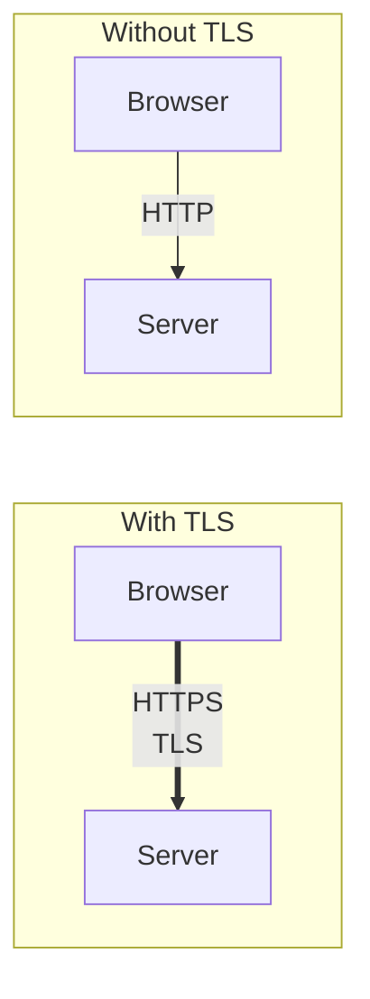

Without suitable transport protection, an attacker who can observe or manipulate the network may be able to read or alter communication.

> **TLS protects communication between endpoints. It does not automatically secure the application running at either endpoint.**

---

## 2. Why Do We Need TLS?

Imagine a customer signs in to an online store.

```http
POST /login
username=customer
password=secret
```

Without TLS, the credentials may travel across the network without cryptographic protection.

An attacker able to intercept that traffic could potentially read the credentials.

With HTTPS:

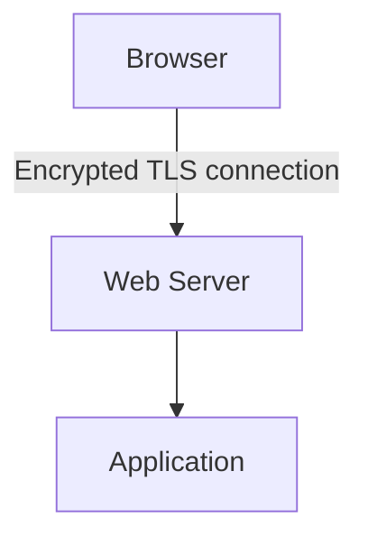

The network observer sees protected traffic rather than the ordinary HTTP request contents.

TLS also helps protect other sensitive information, such as session cookies, API requests, payment-related data, and application responses.

TLS does not protect data before it enters the connection or after it reaches an endpoint. A compromised browser or server may still expose plaintext.

---

## 3. HTTP vs HTTPS

HTTP defines how web requests and responses are represented.

TLS provides a secure communication channel for those HTTP messages.

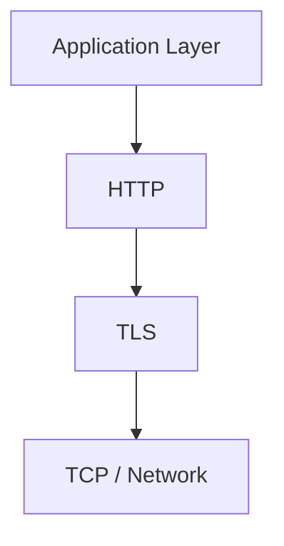

This is a simplified model for common HTTPS deployments. HTTP/3 uses QUIC, which integrates transport and TLS-related mechanisms differently.

The important distinction is:

| HTTP | HTTPS |
|---|---|
| Application protocol for web communication | HTTP protected by TLS |
| Does not itself provide transport encryption | Provides confidentiality and integrity for the protected connection |
| Does not itself authenticate the server cryptographically | Usually authenticates the server using a certificate |
| Sensitive traffic may be exposed without another protection layer | Helps protect traffic against network interception and modification |

HTTPS is not a separate replacement for HTTP's request and response model. It adds transport security.

---

## 4. What Does TLS Actually Protect?

Consider a browser making a request:

```http
GET /account HTTP/1.1
Host: example.com
Cookie: session=secret-value
```

Inside a properly established TLS connection, the HTTP request is protected while travelling across the network.

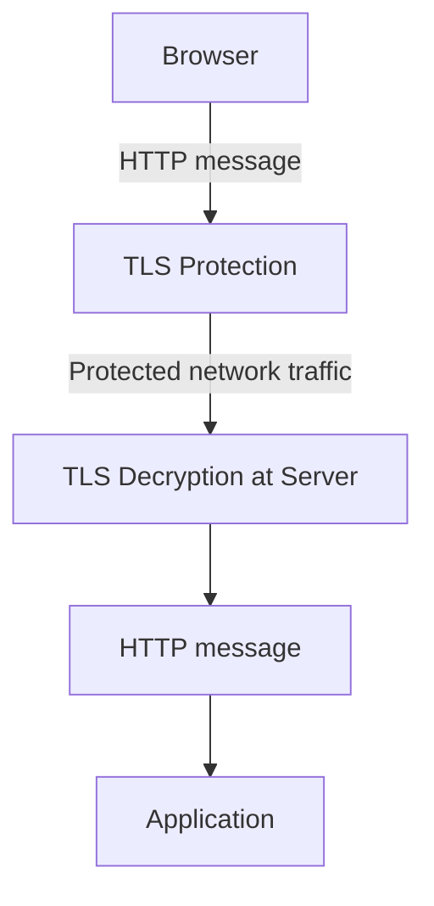

TLS helps protect the message in transit. It does not determine whether the authenticated user is allowed to access `/account`.

It also does not hide every piece of connection metadata. Depending on the network setup and TLS version, information such as IP addresses, traffic timing, traffic volume, and some connection metadata may remain observable.

---

## 5. What Is a TLS Certificate?

A **TLS certificate** is a digitally signed document that binds a public key to an identity, usually a domain name for a website.

A certificate commonly contains information such as:

- The subject or domain names it covers.
- The public key.
- The issuer.
- Validity dates.
- Usage constraints and extensions.
- A digital signature from the issuing authority.

Conceptually:

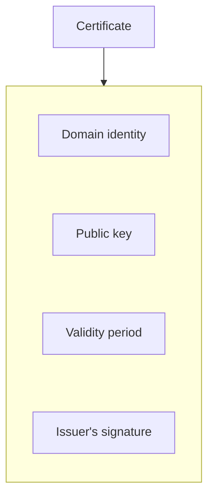

For example, a certificate may be valid for:

```text
www.example.com
```

The browser checks whether the certificate is appropriate for the requested hostname, is within its validity period, and chains to a trusted certificate authority under the browser's validation rules.

A certificate is not the private key. The private key must be protected separately.

---

## 6. What Is a Certificate Authority?

A **Certificate Authority (CA)** is an entity trusted to issue or sign certificates according to its policies.

Browsers and operating systems maintain trusted root certificates. A server commonly provides its certificate along with intermediate certificates so that the client can build and validate a chain to a trusted root.

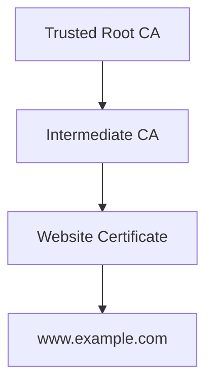

This is a conceptual chain; actual certificate hierarchies vary.

The client verifies the certificate chain and the requested hostname rather than blindly trusting any certificate the server presents.

If a certificate is expired, has the wrong hostname, or cannot be chained to a trusted issuer under the client's rules, the connection may be rejected or produce a security warning.

---

## 7. What Happens During the TLS Handshake?

Before protected application data can flow, the client and server establish the TLS connection.

A simplified modern TLS handshake looks like this:

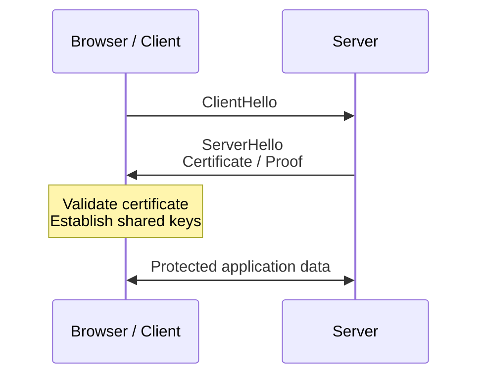

The actual messages and ordering depend on the TLS version and configuration. TLS 1.3 has a more streamlined handshake than older versions.

At a high level, the process involves:

1. **Negotiation:** The endpoints agree on supported protocol parameters and cryptographic choices.
2. **Server authentication:** The client validates the server's certificate and proof of private-key possession.
3. **Key establishment:** The endpoints derive shared traffic keys using the handshake's cryptographic mechanism.
4. **Secure communication:** Application data is protected using the negotiated keys.

TLS 1.3 normally uses ephemeral key agreement for forward secrecy. The certificate's public key is not simply used to encrypt every HTTP request.

---

## 8. Public Keys and Private Keys in TLS

A certificate contains a public key. The server controls the corresponding private key.

In modern TLS, the certificate and its private key commonly authenticate the server during the handshake. The endpoints establish shared traffic keys and then use symmetric authenticated encryption for application data.

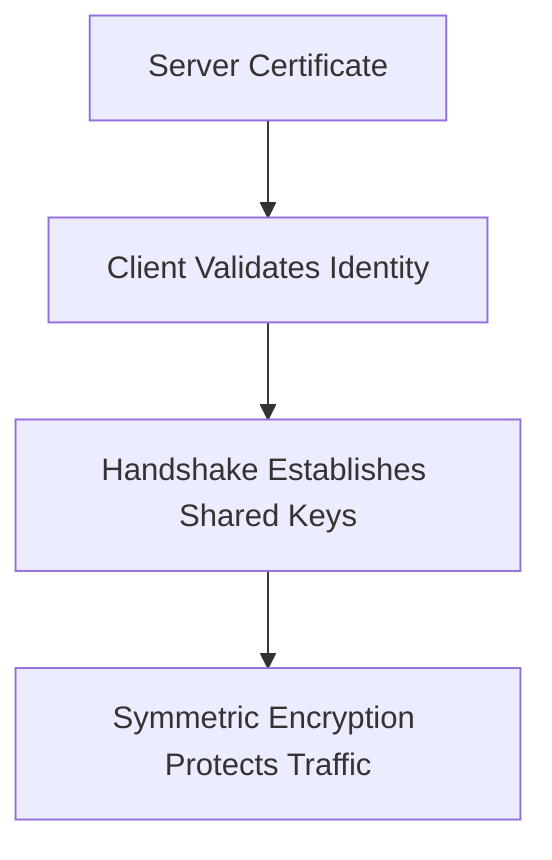

Why use symmetric encryption for the data?

It is efficient for large amounts of communication. Public-key cryptography helps establish or authenticate the connection, while symmetric cryptography protects the ongoing traffic.

This is an example of the hybrid cryptographic design introduced in **11.09 — Encryption**.

---

## 9. What Is HTTPS?

HTTPS means HTTP communicated over TLS.

When a browser opens:

```text
https://example.com
```

it normally attempts to establish a TLS connection with the server before sending HTTP application data.

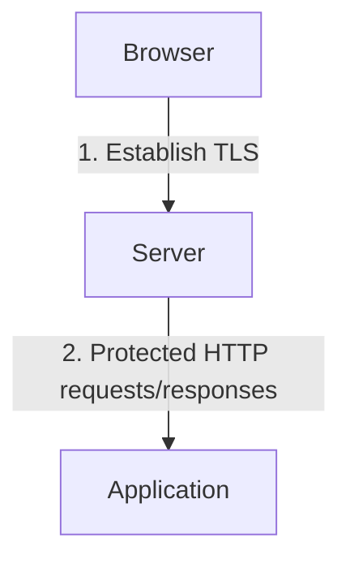

A valid HTTPS connection provides evidence that the browser established a protected connection to the authenticated server identity under its certificate-validation rules.

It does **not** prove that:

- The website is honest.
- The application has no vulnerabilities.
- The user is authorized to perform an action.
- The server will handle personal data responsibly.
- The backend database is encrypted at rest.

TLS solves a specific set of problems. Other security controls are still necessary.

---

## 10. TLS Termination

In many production systems, TLS is terminated at a load balancer, reverse proxy, or API gateway.

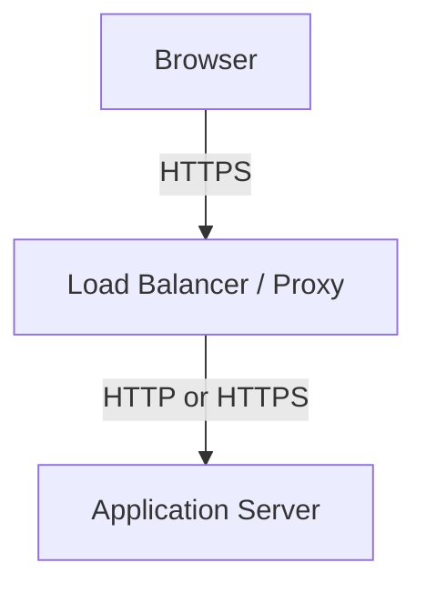

At the termination point, TLS traffic is decrypted and the HTTP request becomes available to that component.

The next connection may use HTTP or TLS, depending on the architecture.

### Option A — TLS terminates at the proxy

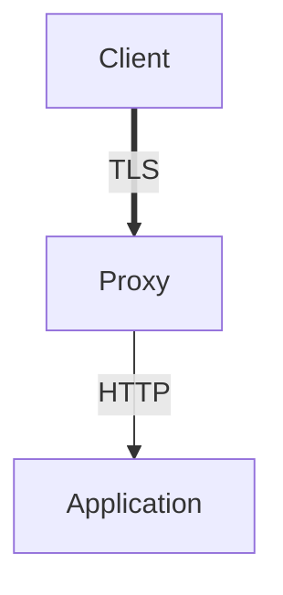

This can simplify certificate management, but traffic between the proxy and application is not encrypted by TLS on that internal segment.

This may be acceptable in a carefully controlled environment with a suitable threat model, but it should not be assumed safe merely because the network is private.

### Option B — TLS on both segments

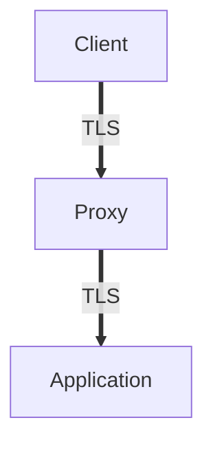

This protects both network segments with TLS.

The proxy must establish and validate the backend connection appropriately. Simply enabling encryption without validating the backend's identity is not enough.

---

## 11. TLS Between Internal Services

A distributed system may contain:

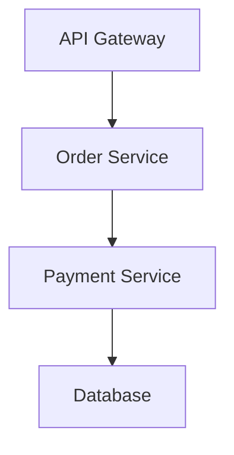

TLS may be required on external connections, internal service connections, and database connections.

Internal networks are not automatically trustworthy. Traffic can cross shared infrastructure, cloud networks, containers, service meshes, or systems managed by different teams.

For higher-security environments, **mutual TLS (mTLS)** can authenticate both the client and the server using certificates.

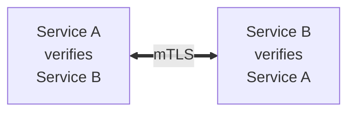

mTLS establishes identities at the transport layer. The application still needs authorization rules to determine which authenticated service may perform which operation.

---

## 12. Certificate Renewal and Expiration

Certificates have validity periods.

If a certificate expires and is not renewed, clients may reject the connection.

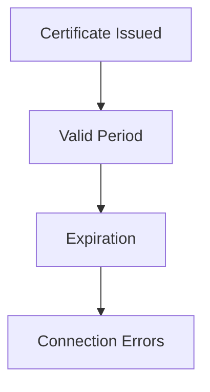

Production systems should automate certificate renewal where possible and monitor certificate expiration.

Operational considerations include:

- Certificate issuance.
- Renewal and deployment.
- Correct hostname coverage.
- Complete certificate chains.
- Private-key protection.
- Monitoring and alerting.
- Recovery when renewal fails.

Certificate automation reduces manual work, but renewal failures still need to be detected.

---

## 13. Common TLS Mistakes

### Mistake 1 — Using HTTP for sensitive production traffic

Use HTTPS for user-facing production communication and other connections that need transport protection.

### Mistake 2 — Ignoring certificate errors

Do not tell users to bypass certificate warnings or disable certificate verification as a routine fix.

### Mistake 3 — Accepting any certificate

Clients must validate the expected server identity and certificate chain. Encryption without identity verification can leave the connection vulnerable to interception.

### Mistake 4 — Forgetting internal network traffic

A secure external connection does not automatically protect the proxy-to-application or service-to-service segments.

### Mistake 5 — Letting certificates expire

Automate renewal and monitor the certificate lifecycle.

### Mistake 6 — Exposing private keys

Restrict access to TLS private keys and protect them using appropriate secret or key-management mechanisms.

### Mistake 7 — Assuming HTTPS makes an application secure

TLS does not replace authentication, authorization, input validation, secure coding, or encryption at rest.

### Mistake 8 — Disabling TLS verification to make an integration work

This removes an important identity check. Fix the certificate, hostname, trust chain, or client configuration instead.

---

## 14. Hands-On Exercise

Design HTTPS for a simple application:

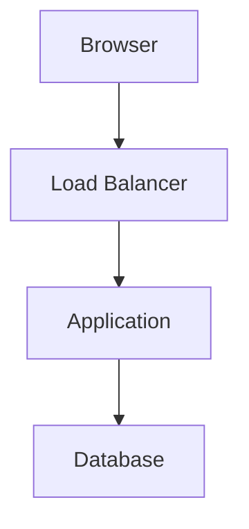

Answer these questions:

1. Where does TLS terminate?
2. Which component owns the public certificate and private key?
3. Is the connection between the load balancer and application encrypted?
4. Does the application validate certificates when calling an external API?
5. How will certificate renewal be handled?
6. What alert should fire before a certificate expires?
7. Does HTTPS alone authorize a user to read another customer's order?
8. Would mTLS be useful for any internal service connection in this architecture?

The goal is to define the protection boundaries, not simply to enable HTTPS at one point and assume the entire system is secure.

---

## 15. System Design View

TLS affects confidentiality, integrity, identity, and operational reliability.

| Requirement | Design question |
|---|---|
| Public website | Is HTTPS correctly configured and enforced? |
| Server identity | Does the client validate the certificate and hostname? |
| Internal communication | Which network segments need TLS? |
| Service identity | Would mTLS or another workload-identity mechanism help? |
| Private-key protection | Who can access the server's private key? |
| Certificate lifecycle | How are issuance, renewal, and expiration monitored? |
| Load balancing | Where does TLS terminate, and what protects the next hop? |
| External API calls | Are certificate validation and hostname checks enabled? |

TLS is one part of a layered security design. It should be combined with secure application behavior, appropriate identity controls, and protected storage.

---

## 16. Quick Reference

| Concept | Meaning |
|---|---|
| TLS | Protocol that protects communication between endpoints |
| HTTPS | HTTP protected by TLS |
| Certificate | Signed document binding a public key to an identity |
| Certificate Authority | Trusted entity that issues or signs certificates |
| TLS Handshake | Process used to negotiate security parameters and establish keys |
| Symmetric Encryption | Efficient protection for ongoing application traffic |
| TLS Termination | Point where a TLS connection ends and traffic is decrypted |
| mTLS | TLS configuration that authenticates both client and server |
| Certificate Chain | Relationship connecting a certificate to a trusted root |
| Private Key | Secret key used for supported authentication or cryptographic operations |
| Certificate Renewal | Replacing or renewing a certificate before it expires |

---

## 17. Knowledge Check

1. **What does TLS primarily protect?**  
   Communication confidentiality and integrity, and endpoint authentication according to the configured TLS model.

2. **What is the relationship between HTTP and HTTPS?**  
   HTTPS is HTTP communication protected by TLS.

3. **What does a TLS certificate do?**  
   It binds a public key to an identity and is validated through a trusted certificate chain.

4. **Does the certificate's public key encrypt every HTTP request?**  
   No. Modern TLS establishes shared traffic keys and uses symmetric authenticated encryption for application data.

5. **What is TLS termination?**  
   The point where a TLS connection ends and the protected traffic becomes available to the terminating component.

6. **Does TLS between a browser and proxy protect the proxy-to-application connection automatically?**  
   No. The next segment needs its own appropriate protection.

7. **What is mTLS?**  
   A TLS configuration in which both sides authenticate using certificates.

8. **Does HTTPS replace application authorization?**  
   No. The application must still decide what the authenticated user or service is allowed to do.

---

## Remember

TLS protects communication between endpoints, but the entire request path must be considered.

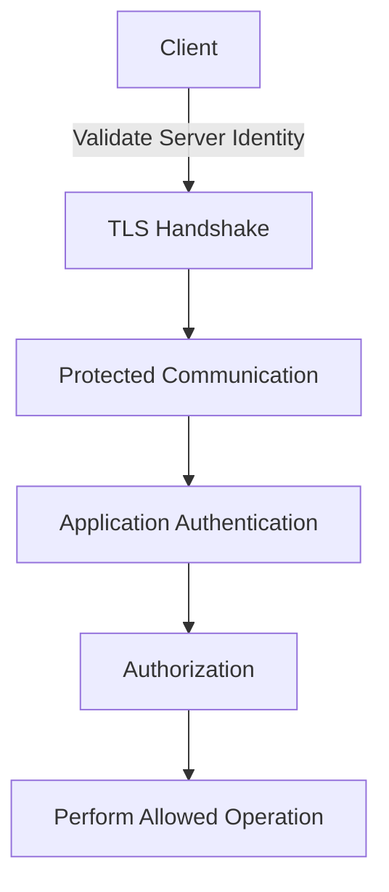

**Next: 11.11 — Secrets**
