# 11.11 — Secrets

## Learning Objectives

By the end of this chapter, you should be able to:

- Explain what a secret is and distinguish it from ordinary configuration.
- Understand why hardcoded credentials are dangerous.
- Explain how a secrets manager protects sensitive values.
- Compare environment variables, mounted files, and runtime secret retrieval.
- Understand secret rotation, revocation, and short-lived credentials.
- Apply least privilege to secret access.
- Recognize common secret leaks and understand how to respond to them.

---

# 1. What Is a Secret?

A **secret** is sensitive information that must be protected because someone who obtains it could gain unauthorized access, impersonate a system, decrypt data, or perform privileged operations.

Common examples include:

- Database passwords
- Third-party API keys
- OAuth client secrets
- JWT signing keys
- Encryption keys
- TLS private keys
- Webhook signing secrets
- Cloud access credentials

For example, an application might need a database password to connect to its database.

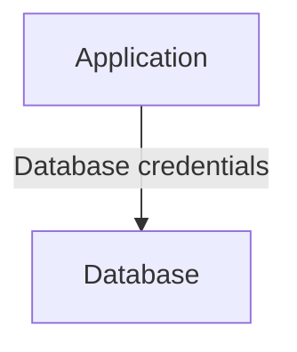

If an attacker obtains those credentials, they may be able to access the database directly, depending on the permissions and network restrictions in place.

> **A secret is not merely a configuration value. It is a value whose exposure can compromise security.**

---

# 2. Secret vs Configuration

Configuration tells an application how it should behave.

Some configuration is not sensitive:

```text
APP_ENV=production
LOG_LEVEL=warning
PUBLIC_API_BASE_URL=https://api.example.com
```

Other configuration contains sensitive values:

```text
DATABASE_PASSWORD=...
PAYMENT_API_KEY=...
JWT_SIGNING_KEY=...
```

These sensitive values are secrets.

| Ordinary configuration | Secret |
|---|---|
| Application environment | Database password |
| Public API endpoint | Private API credential |
| Log level | Signing key |
| Feature flag | Encryption key |

The distinction matters because configuration and secrets may need different access controls, storage mechanisms, and handling rules.

A secret's *name or reference* may be safe to display, while its actual value must remain protected.

For example:

```text
Secret reference:
production/orders/database-password

Secret value:
[protected]
```

The reference identifies which secret to retrieve. It does not need to reveal the value.

---

# 3. Why Hardcoding Secrets Is Dangerous

Consider this code:

```javascript
const dbPassword = "my-production-password";
```

The code may work, but the credential now exists in the source code.

That creates several risks:

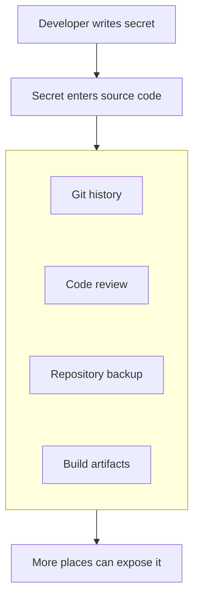

Deleting the line later does not necessarily remove the secret from previous commits, clones, logs, or backups.

The same problem occurs when secrets are placed in:

- Frontend JavaScript bundles
- Public repositories
- Docker images
- Deployment manifests
- Screenshots and documentation
- CI/CD logs
- Error messages

**Important:** A value shipped to a browser is not a secret. Minifying or obfuscating frontend code does not protect it.

---

# 4. What Is a Secrets Manager?

A **secrets manager** is a system designed to store, control access to, and manage sensitive values.

Instead of embedding credentials in application code, the application retrieves them through an approved mechanism.

Conceptually:

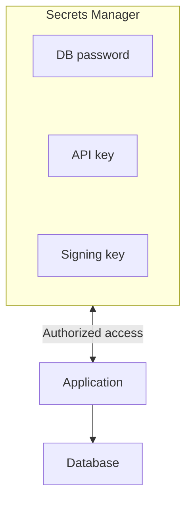

A secrets manager commonly provides capabilities such as:

- Access control
- Encryption at rest and in transit
- Access auditing
- Version management
- Rotation support
- Secret retrieval APIs
- Integration with workload identities

Exact features vary by product.

A secrets manager reduces the risk of uncontrolled secret distribution, but it does not eliminate risk. An attacker who compromises an application with permission to retrieve a secret may still obtain that secret.

---

# 5. How an Application Retrieves a Secret

A simplified production flow looks like this:

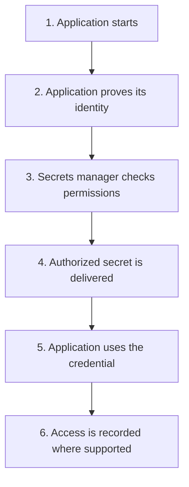

The application should receive only the secrets it actually needs.

For example:

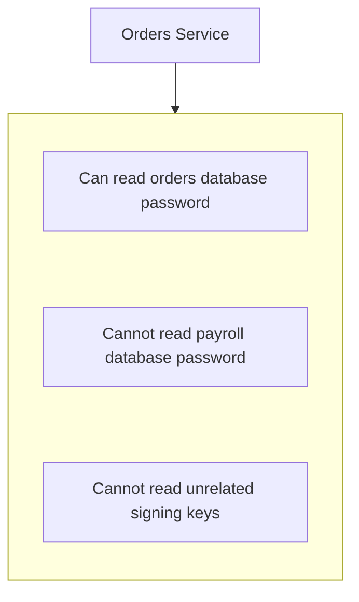

A compromised service should not automatically expose every secret in the organization.

This connects directly to **11.12 — Least Privilege**.

---

# 6. How Should a Workload Prove Its Identity?

A secrets manager needs to know who is requesting a secret.

One option is to give the application a long-lived credential that allows it to authenticate to the secrets manager.

But that creates a bootstrap problem:

> How does the application securely obtain the credential it needs to retrieve other credentials?

A better option, where supported, is often **workload identity**.

The platform provides a verifiable identity to the running application.

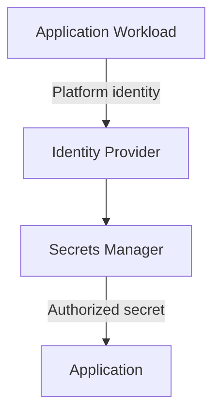

Examples of identity mechanisms include cloud workload identities, managed identities, and platform-issued service credentials.

The goal is to avoid embedding another permanent credential inside the application merely to retrieve its other secrets.

> **Prefer platform-managed or short-lived workload identity over long-lived bootstrap credentials when the environment supports it.**

---

# 7. Where Can Secrets Be Delivered?

Applications commonly receive secrets through several mechanisms.

## Option A — Environment variables

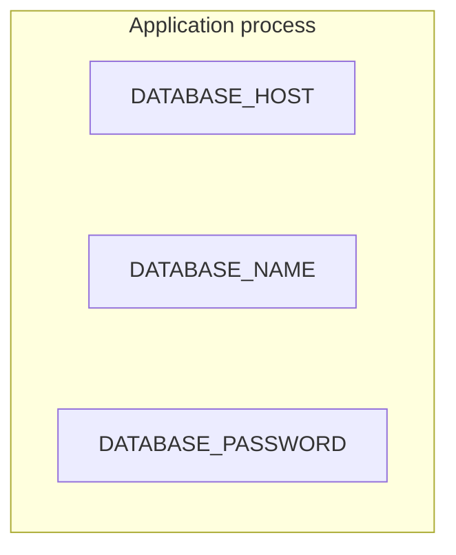

Environment variables are convenient and supported by many platforms.

However, they are not a complete secrets-management solution.

Depending on the environment and permissions, values may be exposed through:

- Process diagnostics
- Debug output
- Crash reports
- Misconfigured monitoring
- Deployment tooling
- Accidental logging

Use them carefully, and do not assume they are automatically safe merely because they are outside the source code.

## Option B — Mounted files

A platform can make a secret available to an application through a protected file.

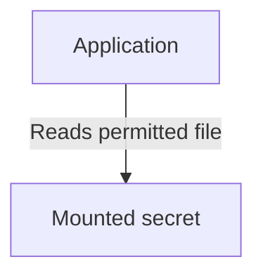

This can separate secret delivery from application code.

The file's permissions, ownership, storage behavior, and update mechanism still need to be configured correctly.

## Option C — Runtime retrieval

The application retrieves a secret directly from a secrets manager when needed.

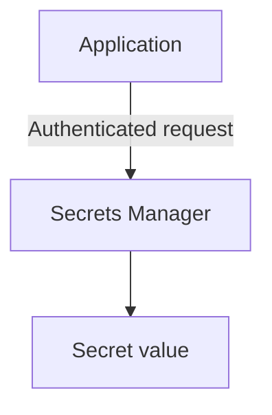

This can support centralized access control, auditing, and rotation.

But it introduces a runtime dependency: if the secrets manager is unavailable, a new retrieval may fail.

Some applications retrieve secrets at startup and keep them in memory; others refresh them periodically or on demand. The appropriate choice depends on the secret's lifecycle and the application's availability requirements.

## Comparison

| Method | Main advantage | Main consideration |
|---|---|---|
| Environment variable | Simple integration | Can leak through process or diagnostic paths |
| Mounted file | Separates secret from code | File permissions and update behavior matter |
| Runtime retrieval | Centralized control and auditing | Adds dependency and refresh complexity |

No delivery mechanism makes a secret safe by itself. Access control and handling still matter.

---

# 8. Secret Scope and Environments

Development, staging, and production should not casually share the same credentials.

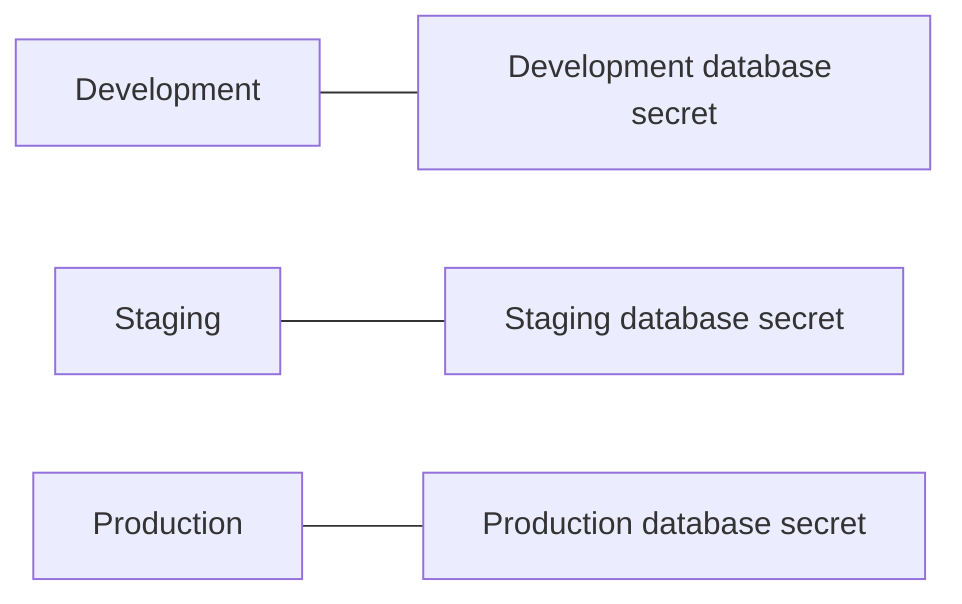

If a development environment is compromised, production should remain protected.

Secrets should also be scoped by service and purpose.

For example:

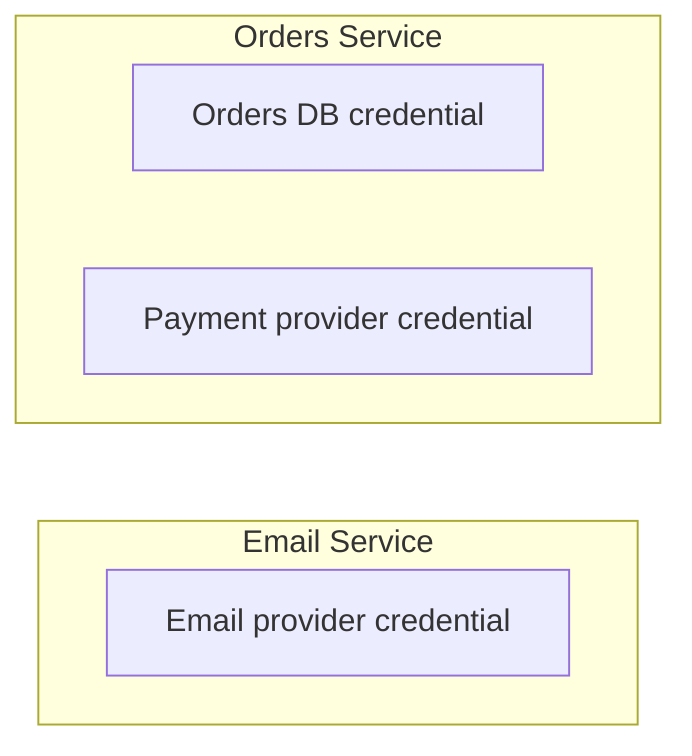

The email service should not need the orders database password simply because both applications belong to the same company.

Separate credentials also make revocation safer: one service can be updated without unnecessarily disrupting unrelated services.

---

# 9. Secret Rotation

**Secret rotation** means replacing an existing secret with a new value and updating the systems that use it.

Why rotate secrets?

- A credential may have been exposed.
- An employee or contractor may leave.
- A security policy may require periodic replacement.
- A credential may have a limited lifetime.
- A system may support automatic rotation.

A simplified rotation process is:

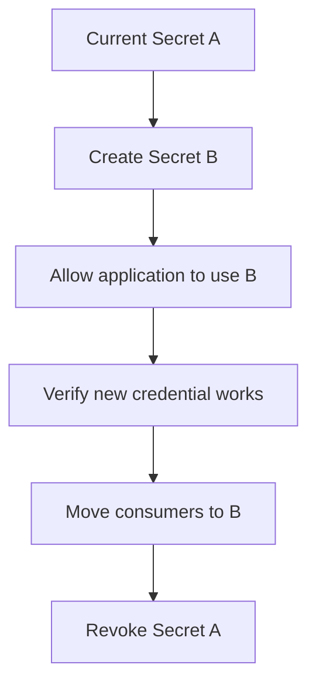

Where possible, use an overlap period so applications can move to the new credential without a sudden outage.

Not every credential supports two simultaneously valid versions. Some rotation procedures require coordinated changes, connection renewal, or a short maintenance window.

### Example: Database password rotation

1. Create or configure a new credential.
2. Update the secret in the approved storage system.
3. Update application instances and refresh existing connections as required.
4. Confirm that new connections succeed.
5. Confirm that old credentials are no longer required.
6. Revoke the old credential.

The exact sequence depends on the database and credential mechanism.

---

# 10. Rotation Is Not the Same as Revocation

These concepts are related but different.

**Rotation** replaces a credential as part of an update process.

**Revocation** makes a credential invalid so it can no longer be used.

For a suspected leak, the response may need to prioritize revocation rather than waiting for a normal rotation schedule.

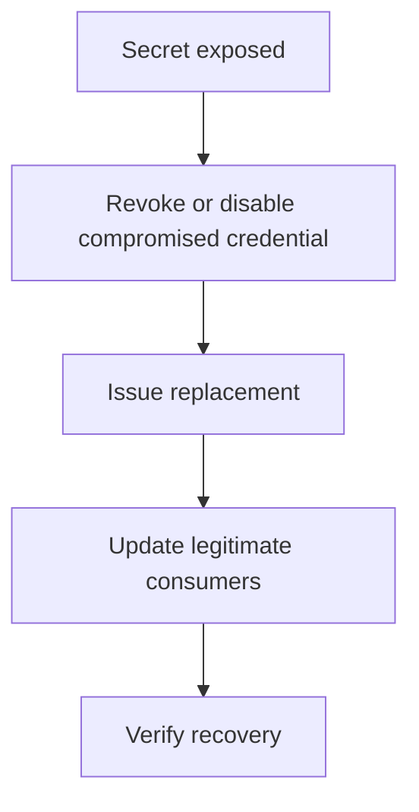

The priority is to stop unauthorized use while restoring legitimate service safely.

Deleting a secret from a file or repository is not enough if the credential remains valid.

---

# 11. Dynamic and Short-Lived Secrets

Some systems can issue credentials that expire automatically or are generated for a specific consumer.

For example:

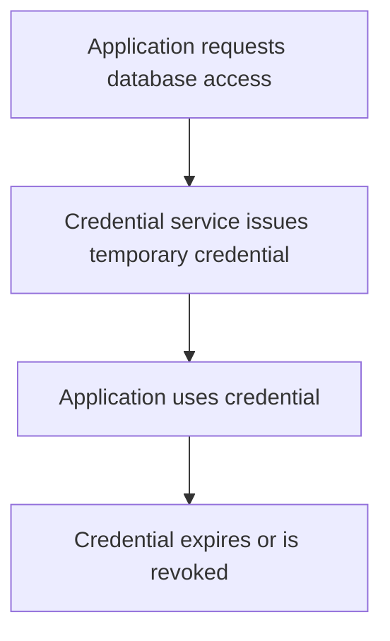

These are often called **dynamic secrets** when they are generated for a request or lease, rather than simply returning one permanent stored value.

Benefits can include:

- Smaller exposure window
- Easier attribution
- Reduced long-term credential reuse
- Automated expiration and revocation

But the application must handle expiration and renewal correctly. If a database connection pool keeps using an expired credential, new connections may fail even though existing connections continue to work.

Short-lived credentials also depend on reliable identity and issuance infrastructure.

---

# 12. Secret Access Must Be Auditable

For sensitive systems, it is useful to know:

- Which workload accessed a secret
- When it accessed it
- Which secret was requested
- Whether access was allowed or denied
- Whether unusual access patterns occurred

Conceptually:

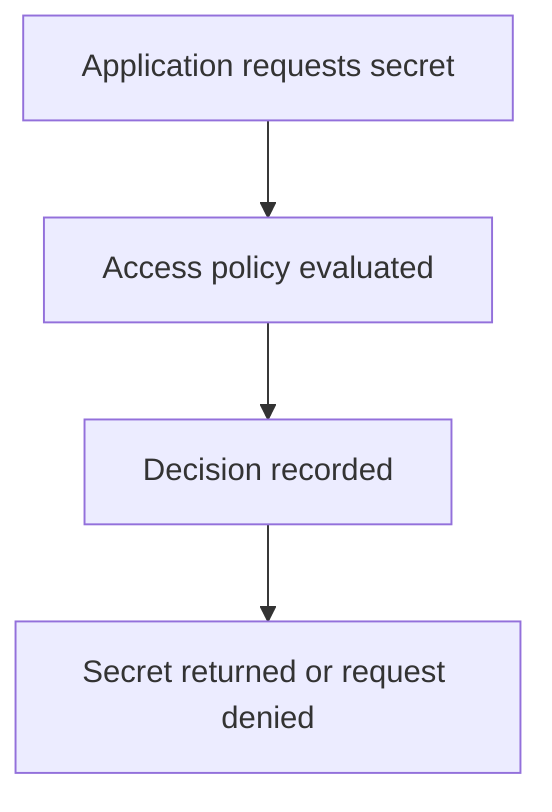

Audit records should identify the event without exposing the secret value itself.

For example, this is useful:

```text
Workload: orders-service
Secret reference: production/orders/database
Action: read
Result: allowed
```

This is dangerous:

```text
Database password: actual-password-value
```

**Never log the secret itself as part of an audit event.**

---

# 13. Secret Leakage: Where to Look

Secrets often leak through ordinary development and operations workflows.

| Leak location | Safer practice |
|---|---|
| Git repository | Keep secret values outside source control |
| Git history | Revoke exposed credentials; removing the latest line is insufficient |
| Frontend bundle | Never place private credentials in browser-delivered code |
| CI/CD logs | Mask sensitive output and avoid printing credentials |
| Docker image | Do not bake production secrets into image layers |
| Error messages | Return safe errors; avoid including credentials |
| Monitoring and tracing | Redact headers and sensitive fields |
| Backups | Protect access and encryption keys |
| Environment dumps | Restrict diagnostics and process access |
| Developer machines | Use approved local secret storage and limited credentials |

A secret can be exposed even if the main application code is secure. Build systems, logs, backups, and debugging tools are part of the security boundary.

---

# 14. What If a Secret Is Leaked?

Suppose a production API key is accidentally committed to a public repository.

Deleting the key from the latest version does not make the old credential safe.

A practical response is:

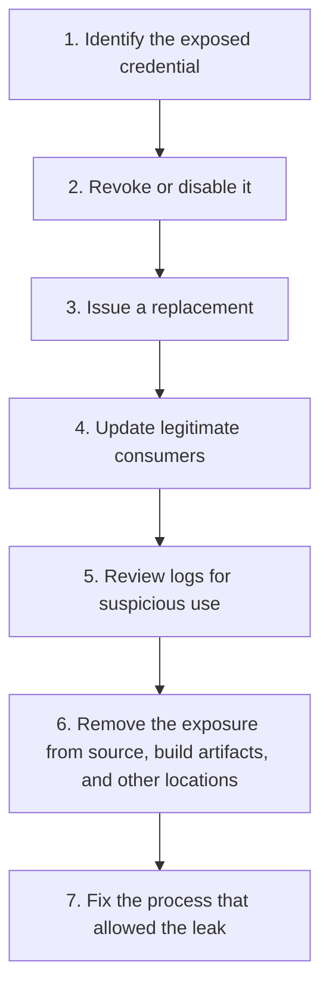

Prioritize revocation and containment. Repository cleanup is still useful, but it does not replace invalidating the exposed credential.

Depending on the incident, also investigate whether the attacker accessed data or used the credential before it was revoked.

---

# 15. Secret Storage and Encryption

Secrets should be protected while stored and while transferred between components.

A secrets manager commonly encrypts stored values and protects communication with authenticated, encrypted transport.

However, encryption alone is not enough.

Consider:

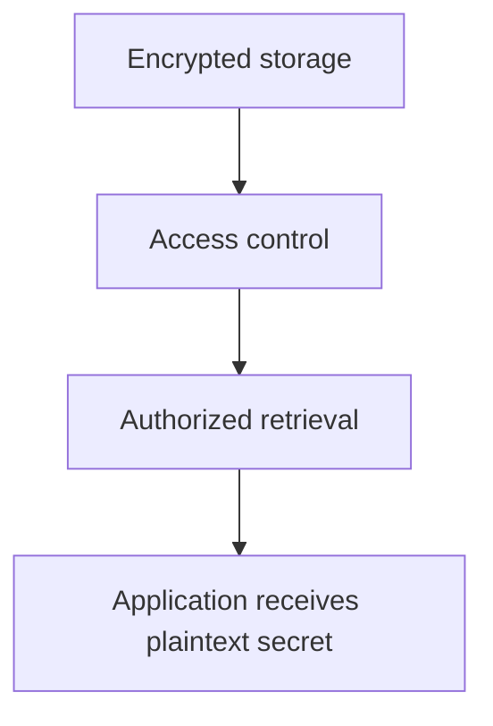

The application usually needs the usable secret value at some point.

If the application itself is compromised, an attacker may be able to retrieve secrets the application is authorized to use.

Security therefore depends on several controls working together:

- Encryption
- Identity verification
- Access policies
- Least privilege
- Auditing
- Rotation and revocation
- Secure application behavior

This connects to **11.09 — Encryption** and **11.10 — TLS**.

---

# 16. Secrets in Memory

After retrieving a secret, an application may keep it in memory for use.

This is often necessary, but it introduces risk: debugging tools, memory dumps, or a compromised process may expose the value.

Avoid copying secrets unnecessarily or including them in exception objects and diagnostic output.

Some languages and runtimes make it difficult to guarantee complete memory wiping because values may be copied, moved, or managed automatically.

Therefore, do not assume that clearing one variable guarantees that every copy of a secret has been erased.

Prefer reducing exposure, restricting process access, and keeping secret lifetimes as short as the application reasonably allows.

---

# 17. Secrets in CI/CD Pipelines

Build and deployment systems often need credentials to publish packages, access cloud resources, or deploy applications.

A pipeline can become a major secret exposure path.

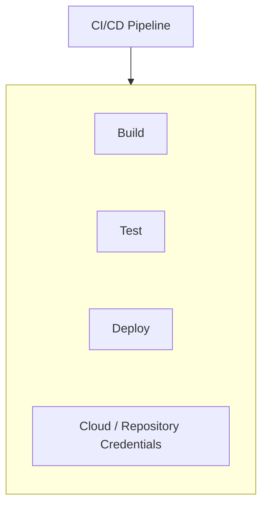

Safer practices include:

- Use the platform's approved secret storage.
- Prefer short-lived workload credentials where supported.
- Restrict which workflows and branches can access production secrets.
- Avoid printing environment variables or credentials.
- Mask sensitive output, but do not rely on masking as the only defense.
- Give build and deployment jobs only the permissions they need.
- Keep untrusted pull-request code away from production credentials.

A pipeline that executes untrusted code with production credentials can expose those credentials even if the application never logs them.

---

# 18. Common Mistakes

### Mistake 1 — Hardcoding credentials

Secrets become part of source code, history, or build artifacts.

### Mistake 2 — Assuming environment variables solve everything

They separate values from source code, but do not provide a complete lifecycle and access-control system by themselves.

### Mistake 3 — Giving every service access to every secret

A compromised service can expose unrelated systems.

### Mistake 4 — Rotating without checking consumers

The new credential may work in one instance while other instances continue using the old value.

### Mistake 5 — Deleting a leaked value without revoking it

An attacker may still use the credential.

### Mistake 6 — Logging credentials for debugging

Logs and observability platforms can become additional secret stores.

### Mistake 7 — Sharing production credentials with development

A weaker environment can become a path into production.

### Mistake 8 — Relying only on periodic rotation

A known compromise requires prompt containment, not waiting for the next scheduled rotation.

### Mistake 9 — Assuming encrypted storage is sufficient

Authorized applications still need access to usable values; their permissions and security matter too.

---

# 19. Hands-On Exercise

Imagine you are designing an online store with these components:

```text
Web Application
Orders Service
Email Service
Payment Integration
Database
```

The system needs:

- A database password
- A payment provider API key
- An email provider credential
- A JWT signing key

Design a basic secret-management plan.

Answer these questions:

1. Which component needs each secret?
2. Where will each secret be stored?
3. How will each component authenticate before retrieving it?
4. Should development and production share credentials?
5. How would you rotate the database password without unnecessarily interrupting service?
6. What would you do if the payment API key appeared in a public Git repository?
7. Which events should be audited, and how will you avoid logging secret values?

A reasonable design should limit each component to the secrets it needs, separate environments, use an approved delivery mechanism, support rotation and revocation, and avoid exposing values in logs or source code.

---

# 20. System Design View

Secrets management is not just a storage decision. It is a lifecycle and access-control decision.

| Design question | Why it matters |
|---|---|
| Who needs the secret? | Defines the access boundary |
| How does the workload authenticate? | Prevents arbitrary secret retrieval |
| Where is the value stored? | Determines storage and access risks |
| How is it delivered? | Affects exposure and runtime dependencies |
| How is it rotated? | Determines how credentials can be replaced safely |
| How is it revoked? | Determines incident response speed |
| Is access audited? | Helps detect misuse and investigate incidents |
| What happens if the secret service is unavailable? | Affects startup, recovery, and availability |

A strong design does not assume that secrets will never leak. It limits their scope, detects suspicious access, and makes replacement and revocation practical.

---

# 21. Key Principle

> **A secret should be stored, delivered, accessed, rotated, and revoked through a controlled lifecycle—not scattered across code, configuration files, logs, and deployment scripts.**

The goal is not simply to hide a password.

The goal is to ensure that:

- Only authorized workloads can obtain it.
- Each workload gets only what it needs.
- Exposure is limited.
- Access can be audited.
- A compromised credential can be replaced or revoked safely.

---

# 22. Quick Reference

| Concept | Meaning |
|---|---|
| Secret | Sensitive value whose exposure can compromise security |
| Secrets manager | System for controlled secret storage, access, and lifecycle management |
| Workload identity | Identity assigned to a running application or service |
| Secret rotation | Replacing an existing credential with a new one |
| Revocation | Making a credential invalid |
| Dynamic secret | Credential generated or issued for a particular consumer or period |
| Secret scope | The services, environments, or operations allowed to use a secret |
| Secret leakage | Unintended exposure of sensitive credential material |
| Bootstrap credential | Credential used to obtain or establish further access |
| Secret reference | Identifier used to locate a secret without revealing its value |

---

# 23. Knowledge Check

### Question 1

What makes a value a secret rather than ordinary configuration?

Its exposure could grant unauthorized access, enable impersonation, decrypt protected data, or otherwise compromise security.

### Question 2

Why is deleting a leaked API key from Git not enough?

The credential may remain in Git history, clones, logs, or other copies. It must be revoked or replaced.

### Question 3

Are environment variables a complete secrets-management system?

No. They are one delivery mechanism, but they do not by themselves provide a complete lifecycle, access policy, audit, rotation, and revocation solution.

### Question 4

Why should different services have different credentials?

It limits the damage if one service or credential is compromised and makes access easier to scope and revoke.

### Question 5

What is the difference between rotation and revocation?

Rotation replaces a credential. Revocation invalidates a credential so it can no longer be used.

### Question 6

Why is workload identity useful?

It can let a running application prove its identity without embedding another long-lived credential merely to retrieve secrets.

### Question 7

What should happen if a production secret is exposed?

Contain the incident, revoke or disable the exposed credential, issue a replacement, update consumers, investigate possible misuse, and fix the source of the leak.

---

# Remember

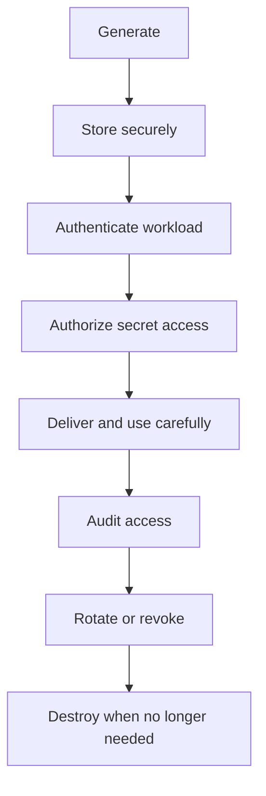

Secrets are powerful because they grant access. Treat them as controlled security assets throughout their entire lifecycle.

**Next: 11.12 — Least Privilege**
