# 11.12 — Least Privilege

## Learning Objectives

By the end of this chapter, you should be able to:

- Explain the principle of least privilege.
- Distinguish authentication, authorization, and privilege.
- Apply least privilege to users, application services, databases, and cloud resources.
- Understand how excessive permissions increase security risk.
- Recognize common privilege-management mistakes.
- Design safer permission boundaries and temporary access.
- Understand how to review, revoke, and audit permissions.

---

# 1. What Is Least Privilege?

The **principle of least privilege** means giving an identity only the permissions it needs to perform its intended tasks—and no unnecessary permissions.

An identity can be:

- A human user
- A backend application
- A background worker
- A database account
- A deployment pipeline
- A cloud service

Imagine an application that only needs to read product information.

It should not automatically receive permission to:

- Delete products
- Modify customer accounts
- Read payroll records
- Change database permissions
- Manage cloud infrastructure

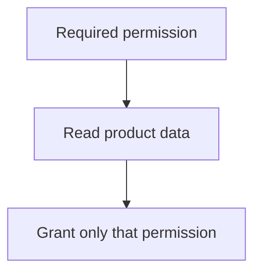

> **Least privilege reduces the damage that can occur when an account, application, or credential is compromised.**

---

# 2. Why Does It Matter?

Suppose an application has a database credential.

In one design, the credential can read and modify every table.

In another, it can read product data and update only the cart records required by the application.

If an attacker steals the credential, the potential damage differs significantly.

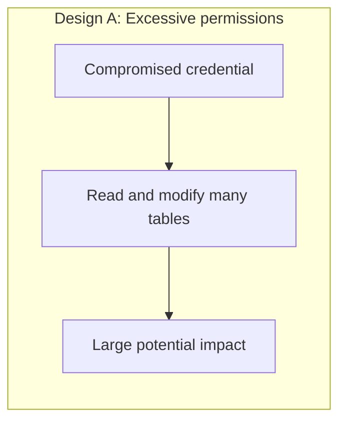

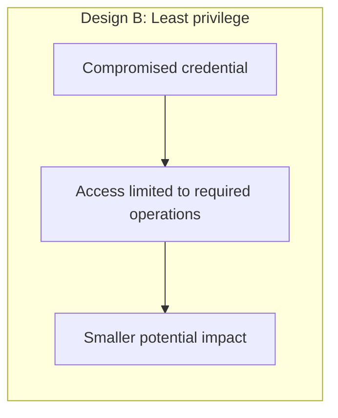

Least privilege cannot prevent every attack. But it limits what an attacker can do after gaining access.

This is called **reducing the blast radius**.

---

# 3. Authentication, Authorization, and Privilege

These concepts are related, but they answer different questions.

| Concept | Question |
|---|---|
| Authentication | Who or what are you? |
| Authorization | What are you allowed to do? |
| Privilege | What level of access or capability have you been granted? |
| Least privilege | Have you been granted only what you need? |

For example:

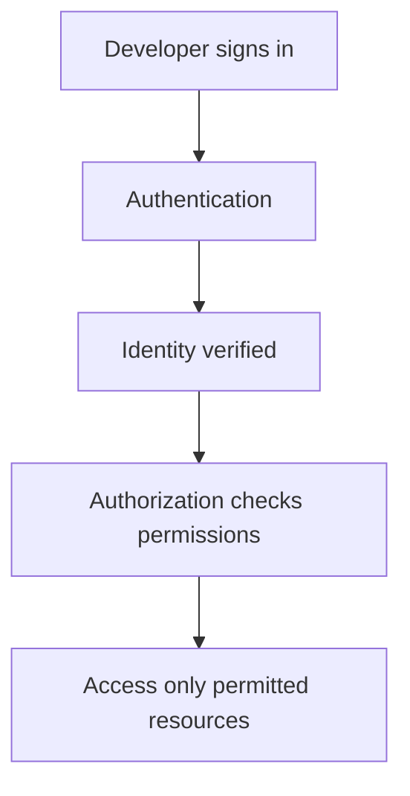

A successfully authenticated user is not automatically entitled to every operation.

Likewise, a service that can authenticate to a database should not automatically receive administrator privileges.

Related chapters:

- 11.02 — Authentication
- 11.03 — Authorization
- 11.04 — RBAC

---

# 4. Human User Example

Imagine an e-commerce administration panel.

Different employees have different responsibilities.

| Role | Appropriate access |
|---|---|
| Customer support | View orders and assist customers |
| Product editor | Update product information |
| Finance staff | Access relevant payment and financial records |
| Administrator | Manage approved system-wide settings |

A support employee does not normally need permission to change cloud infrastructure or export every financial record.

The objective is to match access to responsibilities.

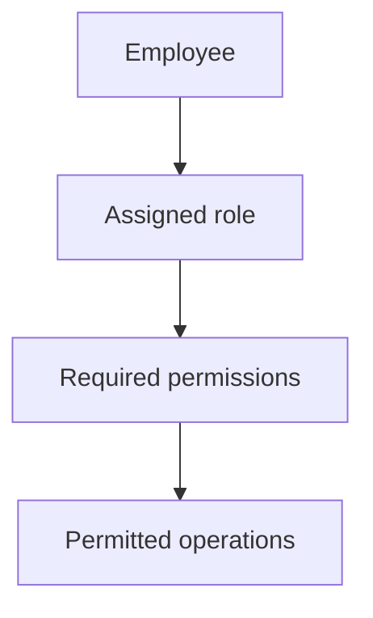

RBAC can help implement this structure, but least privilege is the broader principle used to evaluate whether the granted permissions are appropriate.

---

# 5. Application-to-Database Example

Consider an application with three database operations:

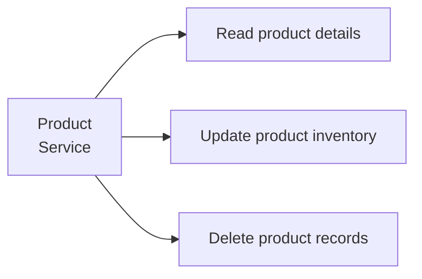

Suppose the public product page only needs to read product details.

Its database account should not automatically be allowed to update inventory or delete records.

A separate inventory worker may need permission to update stock.

A migration process may need broader schema permissions, but only during controlled deployments.

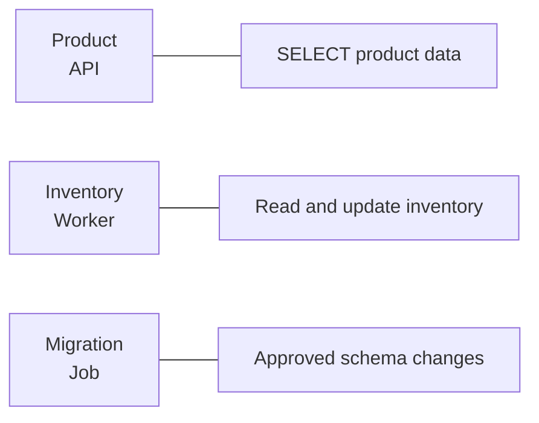

Separating these responsibilities limits the impact of a compromised component.

The exact database grants depend on the database engine and schema design.

---

# 6. Least Privilege Across the System

Permissions exist at many layers.

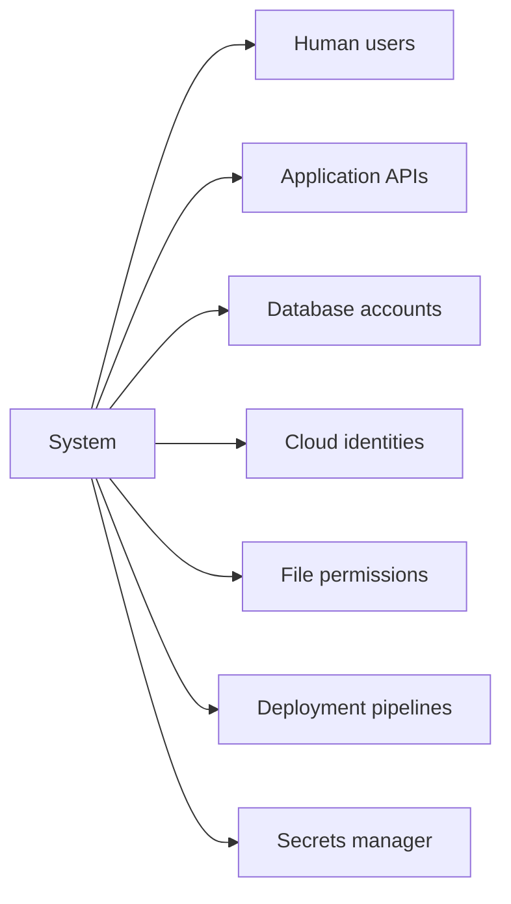

A secure system must consider all of them.

For example, an application might enforce correct API authorization but still run under an operating-system account that can read unrelated files and credentials.

Or a deployment pipeline might have access to production secrets even when most application code does not need them.

Least privilege should be applied at every relevant boundary—not only at the frontend or API layer.

---

# 7. Least Privilege for Secrets

In 11.11, we learned how applications retrieve secrets.

Now consider which secrets each application should be able to retrieve.

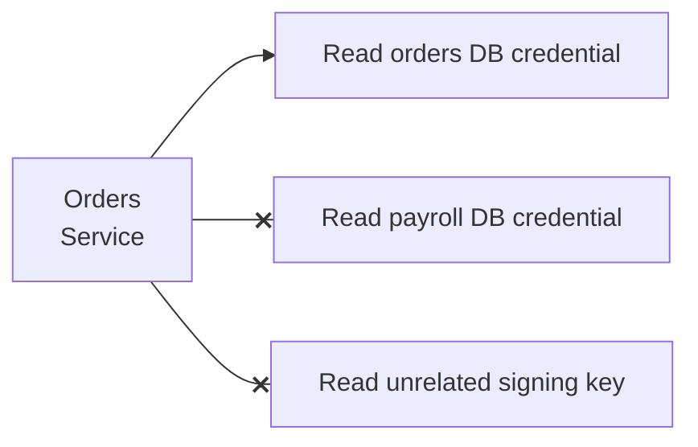

A secrets manager should enforce access policies based on the workload's identity.

Avoid a shared configuration in which every service can retrieve every production secret.

If one service is compromised, its permissions should not automatically expose credentials for unrelated systems.

**Important:** Hiding a secret from source code is not enough. The identity retrieving it must also be restricted.

---

# 8. Least Privilege in Cloud Infrastructure

Cloud platforms expose permissions for actions such as:

- Reading objects from storage
- Writing objects to storage
- Creating virtual machines
- Modifying network rules
- Managing identities
- Deleting resources

Imagine an image-processing worker.

It needs to read uploaded images and write processed images to a particular storage location.

It probably does not need permission to create administrator accounts or delete the entire storage environment.

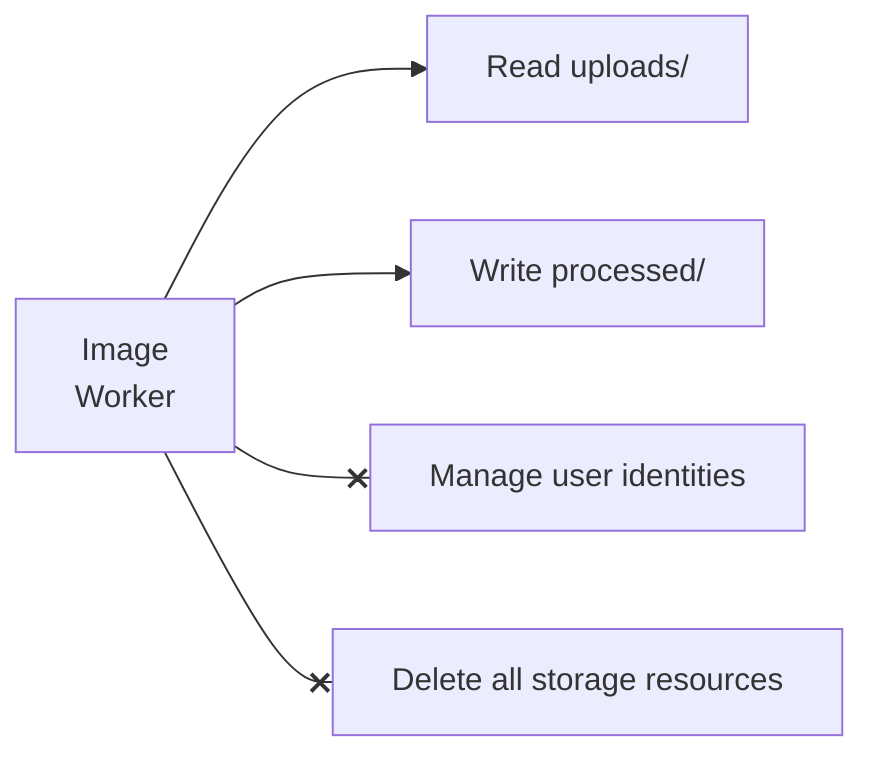

Grant permissions for the required resources and actions, not broad administrator access for convenience.

Cloud IAM policies and resource-level permissions are common mechanisms for implementing this.

---

# 9. Least Privilege and File Permissions

The same principle applies to files and operating-system processes.

Suppose a web application needs to read uploaded images.

It should not automatically have unrestricted access to:

- System configuration
- SSH private keys
- Other applications' files
- Deployment credentials
- Operating-system administrative files

Conceptually:

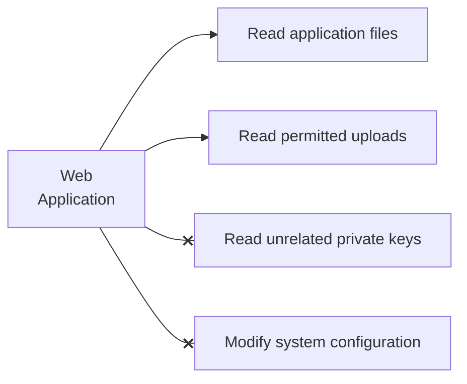

Running every application as an administrator or root user unnecessarily increases the consequences of an application compromise.

Use appropriate process identities and file permissions.

---

# 10. Least Privilege Is More Than Roles

A common misunderstanding is:

> "We use RBAC, so we already have least privilege."

Not necessarily.

Suppose every employee is assigned the `Administrator` role.

RBAC is being used, but access is still excessive.

Least privilege asks whether the permissions themselves are appropriate.

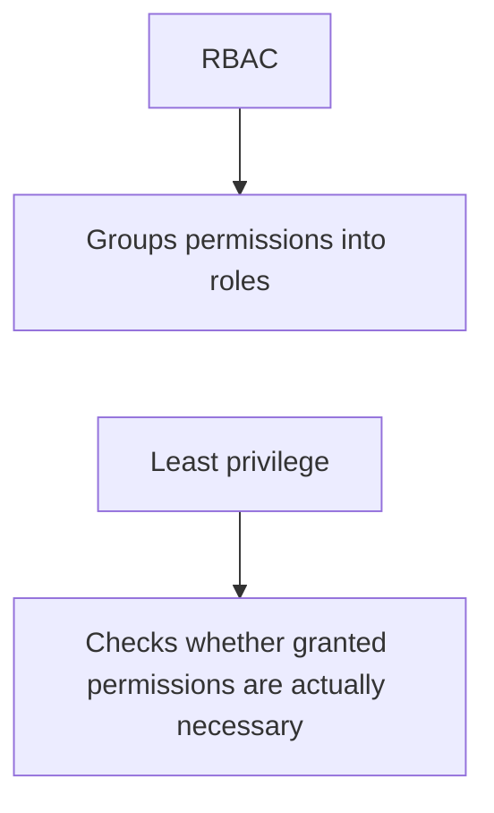

Least privilege can also be implemented using:

- Resource ownership checks
- Attribute-based policies
- Database grants
- Cloud IAM policies
- Filesystem permissions
- Temporary elevated access
- Service-specific identities

---

# 11. Least Privilege Is Not the Same as Denying Everything

A system that denies all access may be secure in one narrow sense, but it cannot perform useful work.

Least privilege means granting the minimum access required for the intended task.

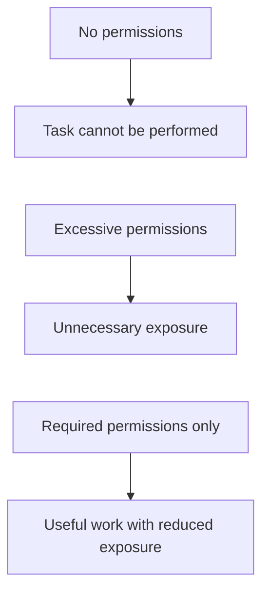

A practical design balances security with operational requirements.

Start with a clearly defined task, identify the necessary operations, and grant the smallest suitable set of permissions.

---

# 12. Default Deny

A useful implementation principle is **default deny**.

If an action has not been explicitly permitted by the applicable policy, the system rejects it.

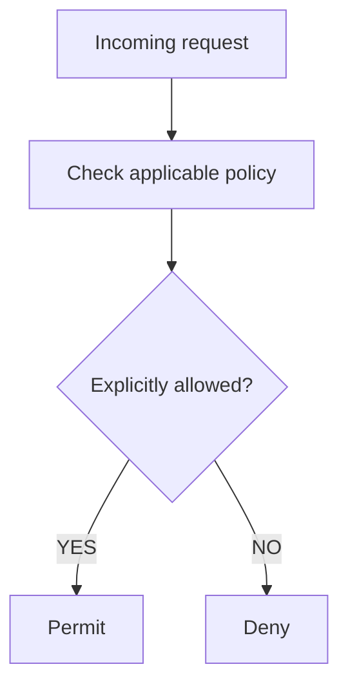

This prevents new endpoints, resources, or operations from becoming accessible simply because nobody wrote a rule to protect them.

However, default deny must be implemented consistently. A policy check in one API endpoint does not automatically protect another endpoint.

---

# 13. Temporary Elevated Access

Some tasks genuinely require broader permissions.

For example:

- Applying a database migration
- Investigating a production incident
- Updating a network policy
- Restoring a backup

The mistake is to grant those permissions permanently when they are needed only occasionally.

A safer approach is **temporary elevation**.

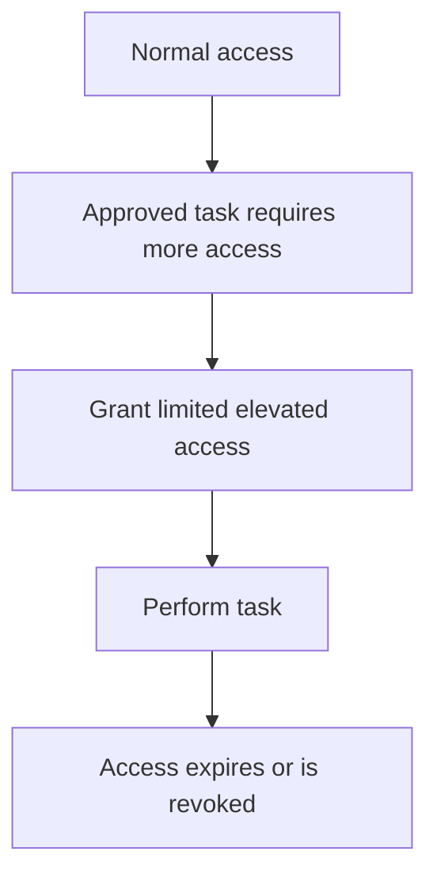

Depending on the environment, this may use approval workflows, time-limited roles, temporary credentials, or privileged-access-management tools.

Temporary access should still be scoped to the task and recorded where appropriate.

---

# 14. Just-in-Time Access

**Just-in-time (JIT) access** is a pattern in which elevated permissions are granted only when needed and usually for a limited period.

For example:

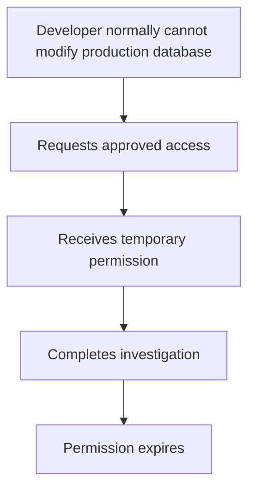

JIT access reduces the time during which powerful permissions are available to an identity.

It is especially useful for production administration and other sensitive operations.

It does not replace authentication, approval, auditing, or careful scoping.

---

# 15. Service-to-Service Permissions

Microservices and background workers often communicate with other services.

For example:

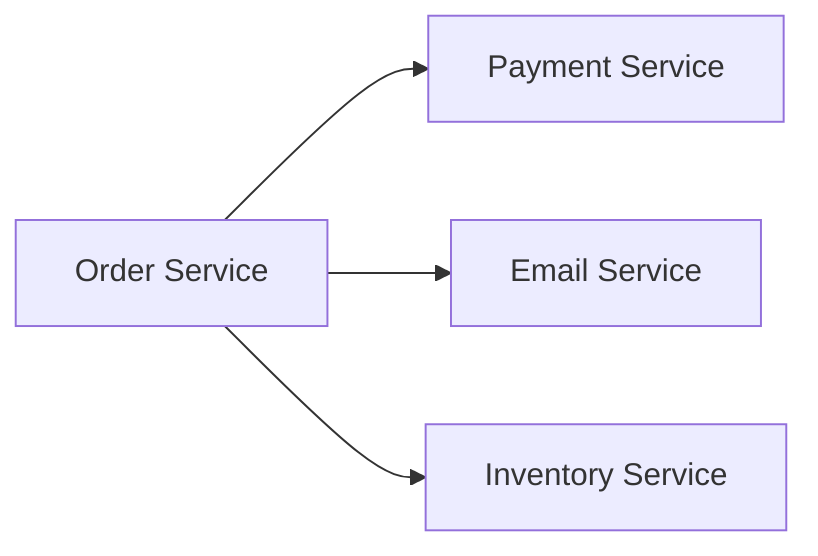

The order service may need permission to request payment processing and reserve inventory.

It does not necessarily need permission to read every customer's private profile or modify email-provider settings.

Each service should have its own identity and an explicit set of permitted operations where the architecture supports it.

Avoid using one all-powerful service credential across the entire application.

A service's identity answers who it is; its authorization policy determines what it may do.

---

# 16. Least Privilege and Blast Radius

The **blast radius** is the extent of damage or disruption that can result from a compromise or failure.

Compare two designs.

### Design A — Broad access

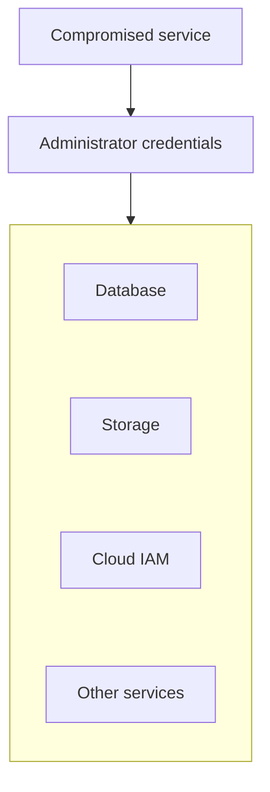

### Design B — Restricted access

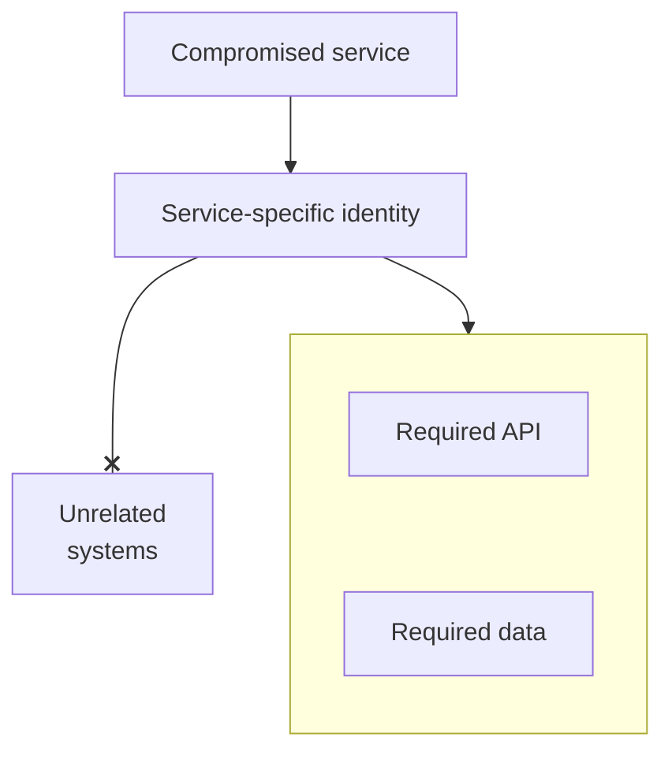

Design B does not prevent the initial compromise. It restricts the compromised identity's capabilities.

This is why least privilege is a core defense-in-depth practice.

---

# 17. Reviewing Permissions

Permissions tend to accumulate as systems evolve.

An employee changes teams. A service gains new features. A temporary migration account remains active.

Over time, an identity may have more access than it needs.

A permission review should ask:

- Is the identity still active?
- Is the permission still required?
- Is the resource scope too broad?
- Is the access permanent when it could be temporary?
- Is the account shared by multiple people or services?
- Can the permission be removed without breaking a legitimate workflow?

A simple lifecycle is:

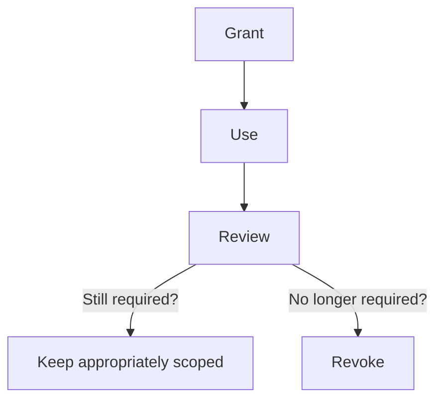

Automated access reviews and policy analysis can help at scale, but the underlying requirement remains the same: permissions must reflect current needs.

---

# 18. Common Mistakes

### Mistake 1 — Giving administrator access for convenience

It makes setup easier but increases the impact of mistakes and compromise.

### Mistake 2 — Sharing one powerful credential

A leak can expose many systems, and attribution becomes harder.

### Mistake 3 — Treating RBAC as proof of least privilege

A role can still contain unnecessary permissions.

### Mistake 4 — Leaving temporary access active

Permissions granted for one incident or deployment may remain long after the task ends.

### Mistake 5 — Applying restrictions only at the frontend

Clients can bypass frontend controls and call APIs directly.

### Mistake 6 — Ignoring non-human identities

Workers, pipelines, scripts, and services also need appropriately scoped permissions.

### Mistake 7 — Never reviewing permissions

Old accounts and obsolete permissions accumulate.

### Mistake 8 — Removing permissions without understanding dependencies

An abrupt change can break production workflows. Review actual requirements and test changes safely.

---

# 19. Hands-On Exercise

Imagine an online store with these identities:

```text
Customer
Support Agent
Product Editor
Orders Service
Email Worker
Deployment Pipeline
```

Assign each identity the minimum reasonable permissions.

Use this checklist:

1. Which resources must it access?
2. Which actions must it perform?
3. Does it need read, write, delete, or administrative access?
4. Can the access be restricted to particular records, tables, folders, or APIs?
5. Should the access be permanent or temporary?
6. What is the likely impact if the identity is compromised?
7. How will you review and revoke the permissions later?

Example:

| Identity | Required access | Access to avoid |
|---|---|---|
| Customer | Read public products; manage own cart and orders | Other customers' private records |
| Support Agent | View permitted customer orders | Cloud administration |
| Product Editor | Create and update product listings | Payment credentials |
| Orders Service | Required order and inventory operations | Unrelated employee data |
| Email Worker | Send approved notifications | Database administrator access |
| Deployment Pipeline | Deploy approved application artifacts | Unrestricted access to all production data |

These are illustrative boundaries. Actual permissions should follow the application's workflows and data model.

---

# 20. System Design View

Least privilege is a design property that should be enforced at multiple boundaries.

| Layer | Least-privilege approach |
|---|---|
| User interface | Show relevant actions, but do not rely on UI restrictions for security |
| API | Authorize every protected operation |
| Data access | Restrict records and database operations |
| Secrets manager | Allow workloads to retrieve only required secrets |
| Cloud infrastructure | Scope actions and resources in IAM policies |
| Operating system | Use non-administrative process identities where appropriate |
| CI/CD | Restrict deployment credentials and production access |
| Operations | Use temporary elevation for sensitive tasks |

The same identity may be constrained by several layers. These controls should reinforce one another rather than relying on a single permission check.

---

# 21. Key Principle

> **Grant the minimum permissions required for the current task, to the correct identity, for the necessary resources and duration. Review and remove access when it is no longer needed.**

Least privilege is not just a rule for employees. It applies to every user, process, application, pipeline, and service that can access a system.

---

# 22. Quick Reference

| Concept | Meaning |
|---|---|
| Least privilege | Grant only the access required for a task |
| Privilege | An allowed capability or level of access |
| Blast radius | Potential scope of damage from a compromise or failure |
| Default deny | Reject access unless policy explicitly permits it |
| Temporary elevation | Grant broader permissions for a limited task or period |
| Just-in-time access | Provide elevated permissions only when needed |
| Service identity | Identity used by an application or workload |
| Permission review | Reassess whether existing access remains necessary |
| Revocation | Remove or invalidate access that is no longer allowed |

---

# 23. Knowledge Check

### Question 1

What is the principle of least privilege?

Give each identity only the permissions needed to perform its intended tasks.

### Question 2

Why does least privilege reduce security risk?

It limits what an attacker can do if an identity or credential is compromised.

### Question 3

Does using RBAC guarantee least privilege?

No. Roles may still grant excessive permissions.

### Question 4

Why should services use separate identities?

Separate identities make it possible to restrict access by service and reduce the blast radius of a compromise.

### Question 5

What is just-in-time access?

A pattern in which elevated permissions are granted only when required, usually for a limited period.

### Question 6

Why is default deny useful?

It prevents access from being granted implicitly when a permission rule is missing.

### Question 7

Why should permissions be reviewed periodically?

Responsibilities and system requirements change, so old permissions may no longer be necessary.

---

# Remember

```mermaid
flowchart TD
  accTitle: Applying least privilege
  accDescr: Identify the task, then Identify the required resources, then Grant the minimum permissions, then Use access safely, then Review permissions, then Revoke unnecessary access.
  N0["Identify the task"] --> N1["Identify the required resources"] --> N2["Grant the minimum permissions"] --> N3["Use access safely"] --> N4["Review permissions"] --> N5["Revoke unnecessary access"]
```

**The goal is not to give every component maximum power. It is to give each component exactly the access it needs to do its job safely.**

**Next: 11.13 — Network Segmentation**
