# 11.13 — Network Segmentation

## Learning Objectives

By the end of this chapter, you should be able to:

- Explain what network segmentation is and why it matters.
- Understand how public, private, and restricted network zones differ.
- Distinguish network segmentation from application authorization.
- Understand firewalls, security groups, and network access rules.
- Design basic network boundaries for a web application.
- Understand microsegmentation and zero-trust networking at a foundational level.
- Recognize common segmentation mistakes and their security consequences.

---

# 1. What Is Network Segmentation?

**Network segmentation** divides a network into separate zones and controls the traffic allowed between them.

Imagine an online store with:

- A public website
- An application server
- A database
- An administrative system

Should every component be able to communicate with every other component?

No.

The public internet may need to reach the website, but it should not directly reach the database.

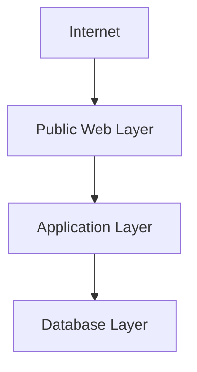

Each boundary limits which connections are permitted.

> **Network segmentation reduces unnecessary connectivity, helping prevent an attack on one component from spreading to others.**

---

# 2. Why Is Segmentation Necessary?

Without segmentation, systems may share a broad network where many machines can communicate freely.

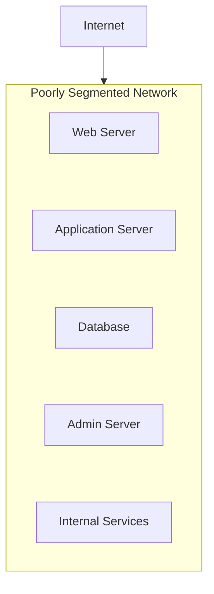

If an attacker compromises one reachable system, they may be able to probe or attack other systems on the same network.

A segmented design restricts those paths.

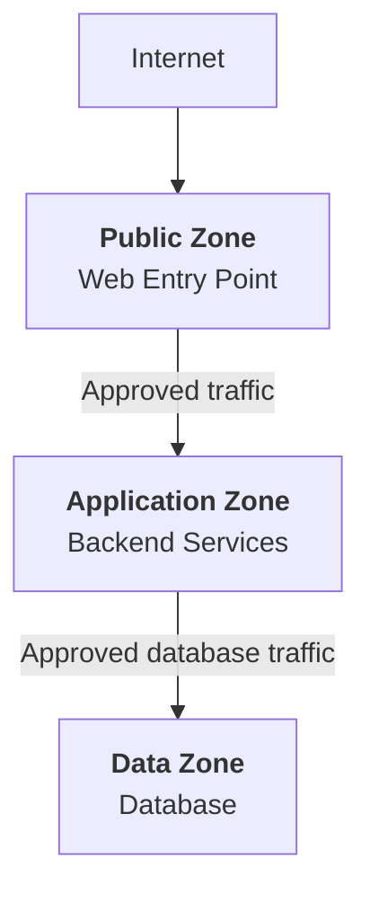

A compromised web server does not automatically gain unrestricted network access to every internal system.

Segmentation does not eliminate compromise, but it can reduce the attacker's reachable systems and available paths.

---

# 3. Network Zones

A **network zone** is a group of systems with similar connectivity and security requirements.

A typical web architecture may use these zones:

| Zone | Typical components | Intended access |
|---|---|---|
| Public edge | Load balancer, public reverse proxy | Receives approved internet traffic |
| Application | Backend services, API servers | Receives traffic from approved entry points |
| Data | Databases, storage services | Receives only required data-layer traffic |
| Management | Administrative endpoints, management tools | Accessible only through approved management paths |
| Restricted services | Highly sensitive systems | Accessible only to specifically authorized workloads |

These are logical boundaries. They do not necessarily require separate physical networks.

A cloud environment can implement zones using virtual networks, subnets, routing tables, firewalls, and security policies.

---

# 4. Public vs Private Networks

A **publicly reachable service** can accept connections from outside the private network, subject to its network rules.

A **private service** is reachable only through permitted private or controlled network paths.

Consider a database.

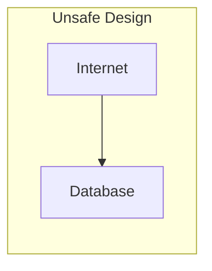

The database is directly reachable from the internet.

Even if the database requires a password, exposing its network endpoint unnecessarily increases risk.

A safer design is:

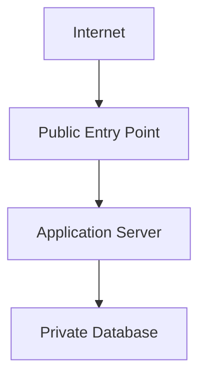

The database accepts connections from the application layer, not arbitrary internet clients.

**Important:** A private IP address alone is not a complete security control. Routing, firewall rules, identity, authentication, and authorization must also be configured correctly.

---

# 5. Firewalls and Network Rules

A **firewall** controls network traffic according to defined rules.

Rules may consider:

- Source address or network
- Destination address or network
- Protocol
- Destination port
- Connection state
- Other policy attributes supported by the platform

For example:

```text
Allow:
Application subnet → Database: TCP 5432

Deny:
Internet → Database: TCP 5432
```

Port `5432` is commonly used by PostgreSQL, but the example assumes that this is the port configured for the database.

The principle is more important than the number:

> **Permit the connections that are required and block unnecessary ones.**

Firewalls can exist at different levels, including cloud network boundaries, host operating systems, and specialized network appliances.

---

# 6. Inbound and Outbound Traffic

Network rules control more than incoming connections.

**Inbound rules** govern traffic entering a system or security boundary.

**Outbound rules** govern traffic leaving it.

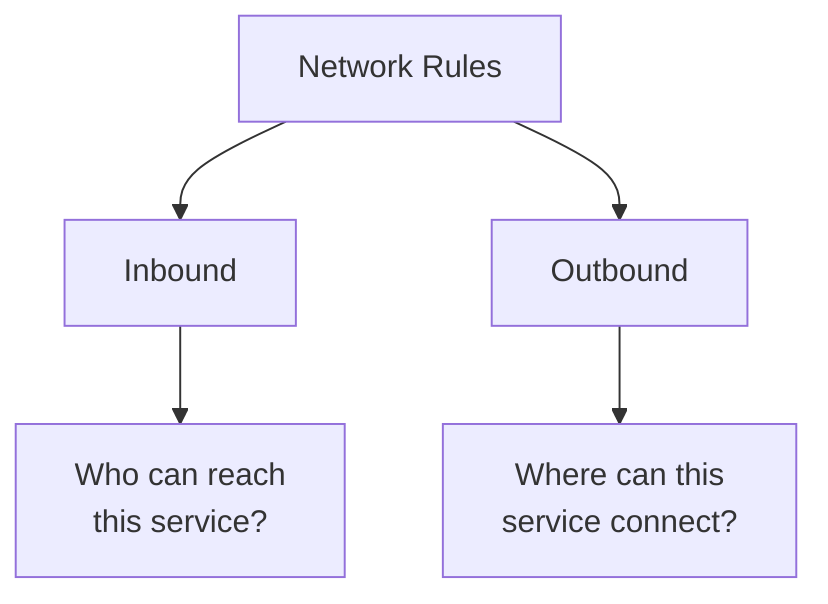

For example, an application server may need to accept HTTP traffic from a load balancer and connect to a database.

It may not need unrestricted outbound access to every destination on the internet.

Restricting unnecessary outbound traffic can make it harder for a compromised application to communicate with attacker-controlled infrastructure or exfiltrate data.

However, outbound restrictions must account for legitimate dependencies such as payment providers, email services, DNS, monitoring, and software updates.

---

# 7. A Practical E-Commerce Example

Suppose an online store uses:

```text
Load Balancer
Application Service
PostgreSQL Database
Email Provider
Administrative Dashboard
```

A simplified network policy could be:

| Source | Destination | Allowed traffic |
|---|---|---|
| Internet | Load balancer | HTTPS |
| Load balancer | Application service | Application traffic |
| Application service | Database | PostgreSQL connection |
| Application service | Email provider | Required outbound API traffic |
| Approved management path | Administrative dashboard | Administrative HTTPS |
| Internet | Database | Denied |
| Email worker | Administrative dashboard | Denied unless explicitly required |

The exact ports, protocols, and paths depend on the implementation.

The key is to describe each required connection explicitly rather than allowing everything by default.

---

# 8. Segmentation Is Not Authentication

Suppose a database is reachable only from the application subnet.

That is useful, but it does not prove that every process in the subnet should be allowed to access it.

Network segmentation answers:

> **Can this system establish a network connection to that destination?**

Authentication answers:

> **What identity is connecting?**

Authorization answers:

> **What is that identity allowed to do?**

These controls complement one another.

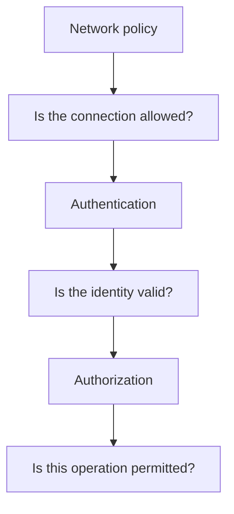

A secure design uses multiple controls instead of assuming one boundary solves every problem.

---

# 9. Network Segmentation and Least Privilege

In 11.12, we applied least privilege to permissions.

Network segmentation applies a related idea to connectivity.

| Least privilege | Network segmentation |
|---|---|
| Limits actions an identity can perform | Limits systems an identity or host can reach |
| Controls access to data and operations | Controls network communication paths |
| Uses roles, policies, and permissions | Uses network rules, firewalls, and routing controls |
| Reduces unauthorized actions | Reduces reachable attack surfaces |

For example, an application service might have permission to read order records but should not have a network path to the payroll database at all.

This creates multiple independent barriers.

---

# 10. Segmentation and Lateral Movement

**Lateral movement** occurs when an attacker who has compromised one system attempts to reach other systems within the environment.

Consider a flat network:

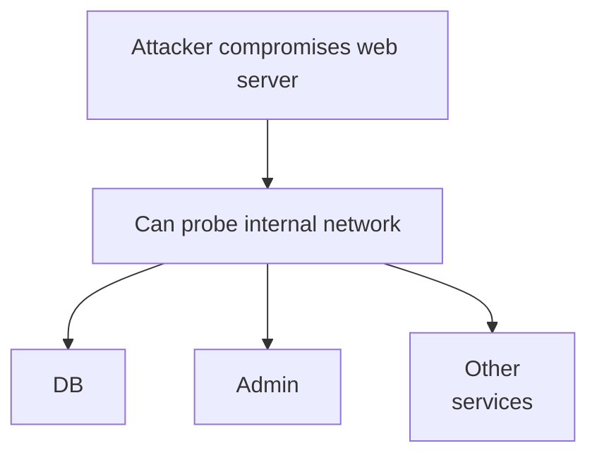

With effective segmentation:

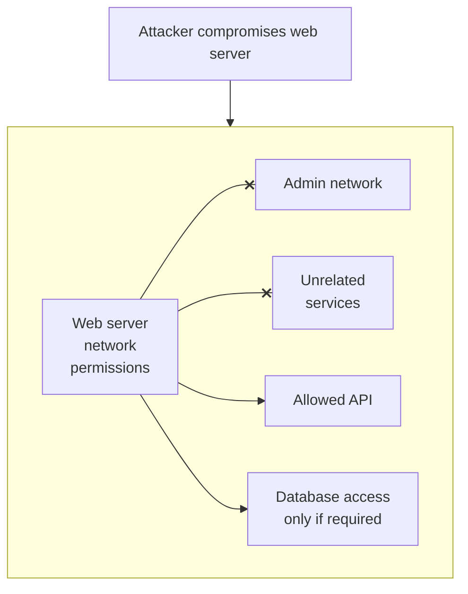

The attacker may still exploit permitted paths, but unnecessary paths are removed.

Segmentation is therefore especially valuable after an initial compromise.

---

# 11. Subnets Are Not Automatically Security Boundaries

A **subnet** divides an IP address range into a smaller network range.

Subnets are often used to organize workloads and apply routing or security rules.

But creating multiple subnets does not automatically guarantee isolation.

For example:

```text
Subnet A
Subnet B
Subnet C
```

If routing and firewall rules allow unrestricted communication between all three, the actual security boundary may be weak.

The protection comes from the combination of:

- Network layout
- Routing
- Firewall or security-group rules
- Host-level controls
- Service identity and authorization

> **Network organization and network isolation are related, but they are not the same thing.**

---

# 12. Security Groups and Network ACLs

Cloud platforms commonly provide network-level policy mechanisms.

Two broad patterns are:

**Security groups:** Rules associated with network interfaces or resources that control permitted traffic. Many implementations are stateful, meaning response traffic for an allowed connection is handled automatically.

**Network ACLs:** Rules applied at a subnet or network boundary. Depending on the platform, they may be stateless and require explicit rules for both directions.

The terminology and behavior vary by cloud provider.

A useful way to reason about them is:

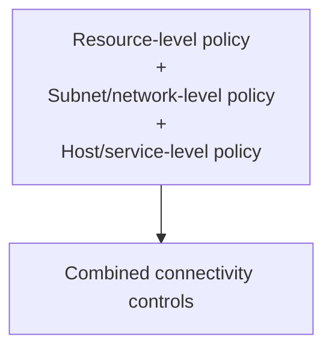

Understand the actual platform semantics before designing rules. Overlapping policies can cause unexpected connection failures if their interactions are misunderstood.

---

# 13. Microsegmentation

Traditional segmentation often groups entire networks or tiers.

**Microsegmentation** applies more granular controls between individual workloads, services, or groups of resources.

For example:

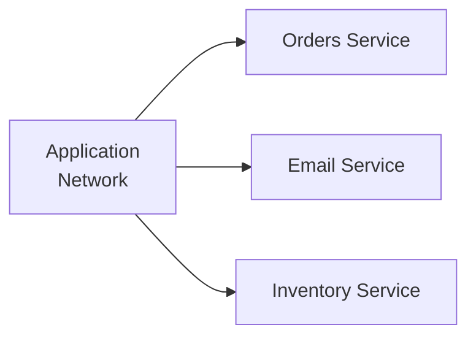

A broad network policy might allow every service to communicate with every other service.

A more granular design permits only required paths:

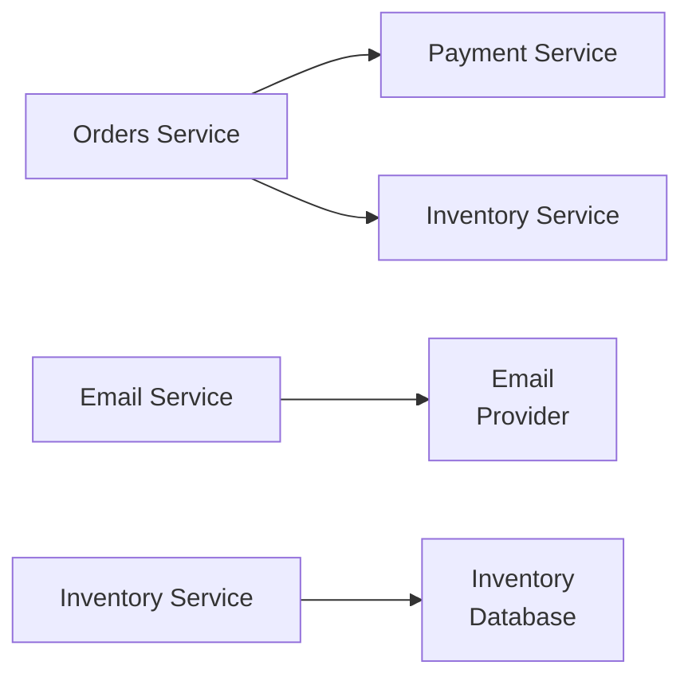

This can reduce unnecessary communication between compromised or misconfigured services.

Microsegmentation may use workload identities, host firewalls, cloud policies, service-mesh policies, or other controls.

It also introduces complexity: policies must reflect real dependencies and be maintained as the system changes.

---

# 14. Network Segmentation and Zero Trust

**Zero trust** is a security approach that avoids assuming a request is safe merely because it originates inside a trusted network.

A request should be evaluated using appropriate identity, authorization, device or workload context, and policy.

Network location may still be useful, but it is not sufficient proof of trust.

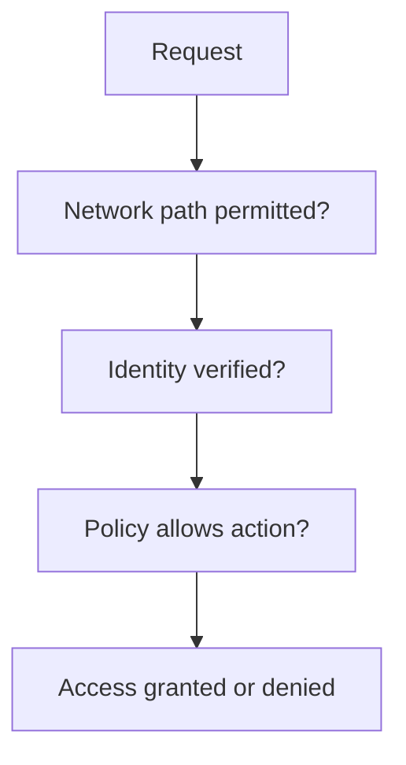

This does not mean every network boundary must be removed.

It means network boundaries should complement identity-based and application-level controls rather than replace them.

---

# 15. Administrative Network Access

Administrative interfaces can be particularly sensitive.

Examples include:

- Cloud management consoles and private endpoints
- Database administration tools
- Internal dashboards
- Deployment management systems
- Server management interfaces

They should not be exposed publicly without a carefully justified design.

Possible access patterns include:

- VPN access
- A controlled bastion host
- Identity-aware access gateways
- Private management networks
- Strong authentication and authorization

For example:

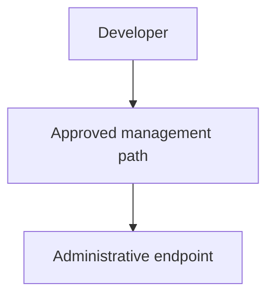

A management network should still enforce identity checks and least privilege. Being able to reach an administrative endpoint should not automatically grant administrative access.

---

# 16. Segmentation Has Operational Trade-offs

Stronger network restrictions can reduce risk, but they also make connectivity more deliberate.

Potential benefits:

- Smaller reachable attack surface
- Reduced lateral movement
- Better separation of sensitive workloads
- Clearer ownership of communication paths

Potential costs:

- More rules to maintain
- Harder troubleshooting
- Risk of blocking legitimate traffic
- More deployment and testing work
- Additional complexity as services evolve

A useful approach is to start with clear architectural boundaries and then apply explicit rules to important communication paths.

Avoid creating hundreds of arbitrary segments without a clear threat model or operational purpose.

---

# 17. Common Mistakes

### Mistake 1 — Exposing a database publicly

A database usually needs to accept connections only from approved application or administrative paths.

### Mistake 2 — Assuming a private IP guarantees security

Private addressing does not replace routing controls, firewall rules, identity, or authorization.

### Mistake 3 — Allowing all internal traffic

An internal network can contain compromised or untrusted workloads.

### Mistake 4 — Restricting inbound traffic but ignoring outbound traffic

Unnecessary outbound access can create additional paths for data exfiltration and command-and-control traffic.

### Mistake 5 — Treating subnet creation as isolation

Actual isolation depends on routing and enforcement policies.

### Mistake 6 — Relying only on network location

A reachable service must still authenticate and authorize requests.

### Mistake 7 — Creating overly complex rules

Rules that nobody understands or reviews can break legitimate traffic and create security gaps.

### Mistake 8 — Forgetting legitimate dependencies

Overly strict rules can interrupt DNS, monitoring, updates, or required third-party API access.

---

# 18. Hands-On Exercise

Design network boundaries for this application:

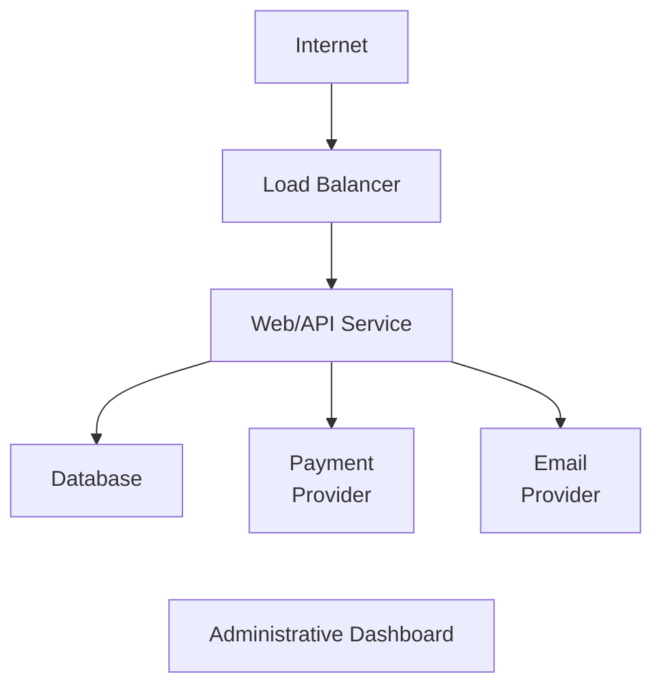

Define the permitted connections.

Use these questions:

1. Which components must accept public connections?
2. Which components should remain private?
3. Which source can connect to the database?
4. Which outbound destinations does the API service actually need?
5. How should administrators reach the dashboard?
6. What traffic should be explicitly denied?
7. How would you test that the intended paths work and the forbidden paths fail?

A reasonable starting policy is:

- Public clients reach the load balancer over HTTPS.
- The load balancer reaches the API service.
- The API service reaches the database on its required port.
- The API service reaches approved payment and email endpoints.
- The database does not accept direct public connections.
- Administrative access uses a controlled path and requires authentication.
- Unrelated service-to-service connections are denied unless justified.

The exercise is complete when the allowed communication paths are explicit and testable.

---

# 19. System Design View

Network segmentation should follow the system's actual communication requirements.

| Design question | Purpose |
|---|---|
| Which components must communicate? | Identifies required paths |
| Which components should be private? | Reduces public exposure |
| Which traffic must be allowed? | Defines explicit connectivity |
| Which traffic must be denied? | Removes unnecessary paths |
| What happens if one service is compromised? | Evaluates lateral-movement risk |
| Are outbound connections restricted? | Reduces unwanted external communication |
| How are policies tested and monitored? | Detects accidental exposure and broken rules |
| Who owns each rule? | Makes changes and troubleshooting manageable |

Do not treat network architecture as a diagram alone. The rules must be enforced by the actual infrastructure and kept aligned with the application's evolving dependencies.

---

# 20. Key Principle

> **Allow only the network communication paths that the system needs, and enforce those boundaries at appropriate points.**

Network segmentation limits reachability. Authentication establishes identity. Authorization limits actions. Least privilege keeps the permissions narrow.

Together, these controls reduce the chance that one compromised component can reach and control the entire system.

---

# 21. Quick Reference

| Concept | Meaning |
|---|---|
| Network segmentation | Dividing a network into zones with controlled communication |
| Network zone | Group of systems with similar connectivity requirements |
| Firewall | Enforces rules controlling network traffic |
| Inbound rule | Controls traffic entering a boundary or resource |
| Outbound rule | Controls traffic leaving a boundary or resource |
| Subnet | A subdivision of an IP address range |
| Lateral movement | An attacker's attempt to move between systems after initial access |
| Microsegmentation | Fine-grained connectivity controls between workloads |
| Zero trust | Security approach that does not automatically trust a request because of its network location |
| Security group | Resource-associated network policy mechanism in many cloud platforms |
| Bastion host | Controlled intermediary used to access private administrative systems |

---

# 22. Knowledge Check

### Question 1

What is network segmentation?

Dividing a network into zones and controlling which connections are allowed between them.

### Question 2

Why should a database usually not be directly reachable from the public internet?

It exposes an unnecessary attack surface and creates additional opportunities for probing and exploitation.

### Question 3

Does a private subnet automatically guarantee security?

No. Routing, firewall rules, identity, authentication, and authorization still matter.

### Question 4

How does segmentation help after a server is compromised?

It can block unnecessary paths to other systems, reducing lateral movement and the potential blast radius.

### Question 5

What is the difference between network segmentation and least privilege?

Segmentation controls which systems can communicate; least privilege limits what an identity can do.

### Question 6

Why does outbound traffic matter?

Unnecessary outbound connectivity can provide paths for data exfiltration or communication with attacker-controlled infrastructure.

### Question 7

Does zero trust mean network segmentation is unnecessary?

No. Segmentation remains useful, but network location alone should not be treated as proof that a request is trustworthy.

---

# Remember

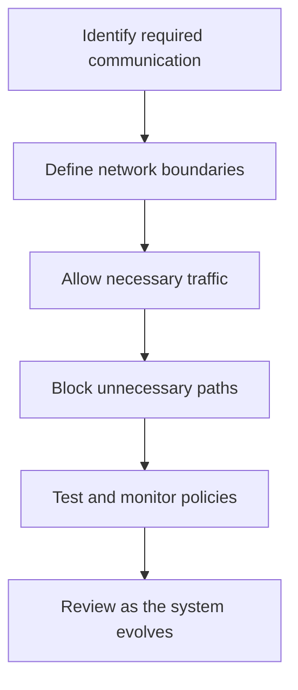

**Next: 11.14 — WAF**
