# 11.14 — WAF (Web Application Firewall)

## Learning Objectives

By the end of this chapter, you should be able to:

- Explain what a Web Application Firewall does.
- Distinguish a WAF from a network firewall and a reverse proxy.
- Understand how WAF rules inspect and filter web requests.
- Recognize common web attacks a WAF can help mitigate.
- Understand managed rules, custom rules, and false positives.
- Identify the limitations of WAF protection.
- Design a basic WAF deployment for a web application.

---

# 1. What Is a WAF?

A **Web Application Firewall (WAF)** is a security control that inspects HTTP/HTTPS traffic and applies rules to decide whether requests should be allowed, blocked, or otherwise handled.

Consider an online store:

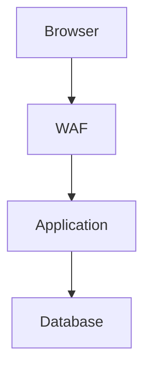

A WAF can inspect requests for suspicious patterns before forwarding them to the application.

For example, it may detect a request that appears to contain a known SQL injection pattern and block it.

> **A WAF helps protect web applications by filtering HTTP traffic according to security rules.**

A WAF is one layer of defense. It does not replace secure application code, authentication, authorization, or database protections.

---

# 2. Why Do We Need a WAF?

A web application receives requests from clients it does not fully control.

A request might contain:

- Unexpected input
- Malicious payloads
- Automated attack traffic
- Attempts to exploit known vulnerabilities
- Requests that violate application-specific security rules

For example:

```http
GET /products?id=42 HTTP/1.1
Host: shop.example.com
```

This is an ordinary-looking request.

But a modified request might contain an input pattern associated with SQL injection:

```http
GET /products?id=42%20OR%201=1 HTTP/1.1
Host: shop.example.com
```

A WAF may recognize and block suspicious patterns like this, depending on its rules and configuration.

The application must still validate input and use safe database operations. Attack patterns vary, and no WAF rule set catches everything.

---

# 3. Where Does a WAF Fit?

A WAF is commonly deployed in front of a web application, often as part of a reverse proxy, edge service, CDN, or cloud security service.

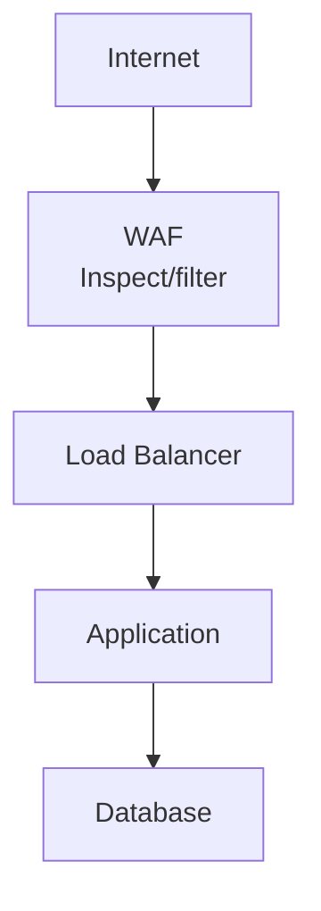

The exact order depends on the platform and architecture. A WAF may be integrated with the load balancer or edge layer rather than operating as a separate box.

The important idea is that the WAF evaluates web traffic before it reaches the protected application endpoint.

---

# 4. WAF vs Network Firewall

These controls protect different things.

| Network firewall | Web Application Firewall |
|---|---|
| Controls network traffic based on network-level rules | Inspects HTTP/HTTPS requests |
| May filter by IP, protocol, port, and connection state | Can inspect URLs, headers, query parameters, and request bodies |
| Helps control which systems can connect | Helps identify suspicious web requests |
| Often protects network boundaries | Protects web-facing application endpoints |

For example:

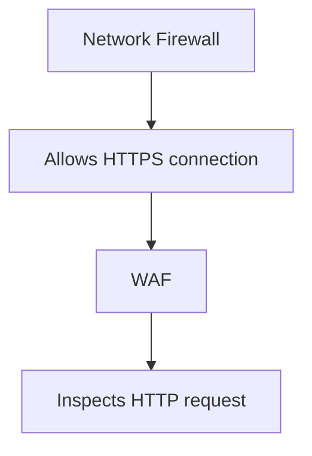

A network firewall may allow a connection to port 443 because HTTPS is permitted.

The WAF can then inspect the HTTP request carried over that connection.

Neither control replaces the other.

---

# 5. WAF vs Reverse Proxy

A reverse proxy receives requests on behalf of backend servers and forwards them to the appropriate destination.

A WAF focuses on applying web security rules.

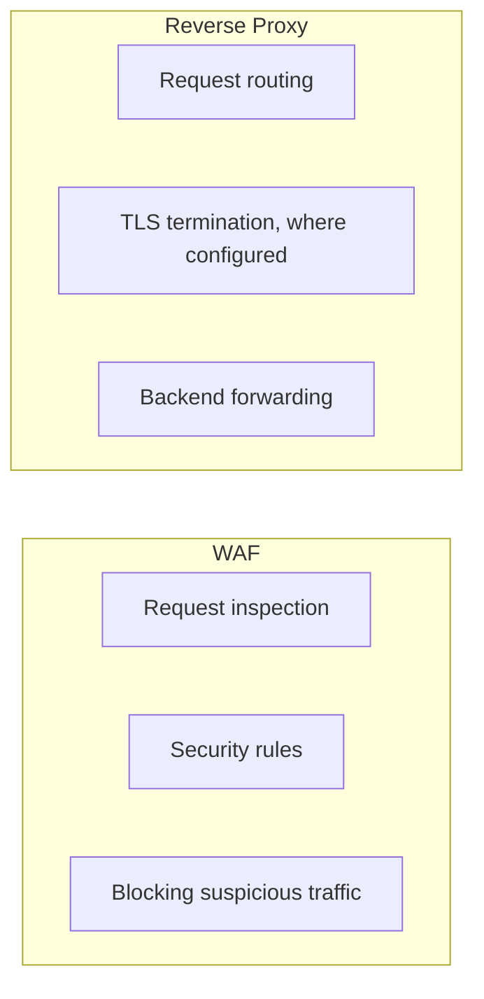

These responsibilities can coexist in the same product.

For example, an edge service may provide reverse proxying, TLS handling, caching, and WAF rules together.

Do not assume every reverse proxy is a WAF or that every WAF performs every reverse-proxy function.

---

# 6. How Does a WAF Work?

A simplified request flow looks like this:

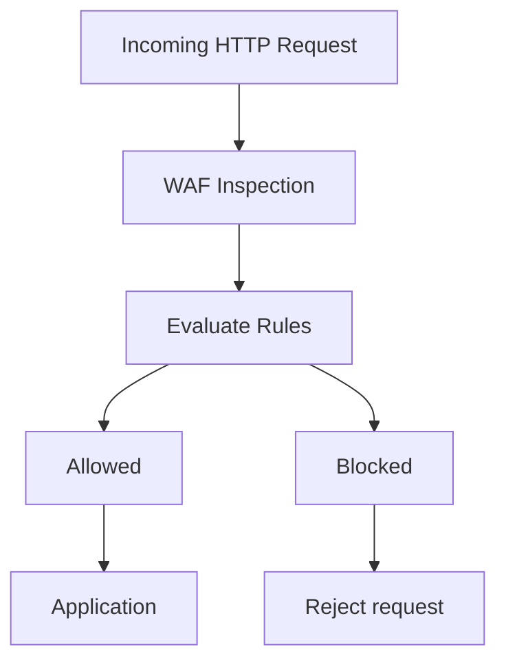

Depending on the product and configuration, the WAF may also:

- Log the request
- Count a rule match without blocking
- Apply a rate-based rule
- Challenge a client
- Forward the request after inspection

The available actions vary by WAF.

A WAF does not necessarily understand the complete business meaning of a request. It evaluates the information available to its rules.

---

# 7. What Can a WAF Inspect?

Depending on the deployment and configuration, a WAF may inspect:

- HTTP methods such as `GET` and `POST`
- URL paths
- Query parameters
- Request headers
- Cookies
- Request body content
- Source IP addresses
- Request frequency
- Other supported request metadata

For example:

```http
POST /api/login HTTP/1.1
Host: shop.example.com
Content-Type: application/json

{
  "username": "customer",
  "password": "..."
}
```

A WAF might evaluate the request path, method, headers, body patterns, or request rate.

**Important:** HTTPS traffic must be decrypted at a point where the WAF can inspect the HTTP content. If the WAF cannot see the request content, its ability to apply content-based rules is limited.

TLS termination and traffic inspection therefore need to be designed together.

---

# 8. Common Attack Categories

A WAF can help mitigate some common web attack patterns.

## SQL injection

An attacker attempts to influence a database query through malicious input.

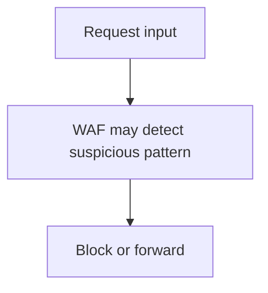

The primary application defense is safe query construction, such as parameterized SQL.

## Cross-site scripting (XSS)

An attacker attempts to make a browser execute unintended script content.

A WAF may detect some suspicious input patterns, but output encoding and context-appropriate handling remain essential.

## Path traversal

An attacker attempts to access files outside the intended directory.

A WAF may recognize known traversal patterns, but the application and operating system must enforce safe file access.

## Protocol or request abuse

A WAF may detect malformed requests, unexpected methods, or requests that violate configured protocol and application policies.

## Known exploit patterns

Managed rule sets may include detections for known vulnerability classes or exploit signatures.

However, a rule match is not proof that an attack would succeed, and the absence of a match does not prove that a request is safe.

---

# 9. Managed Rules

Many WAF platforms provide **managed rule sets** maintained by the vendor or a security provider.

These may cover categories such as:

- Common web vulnerability patterns
- Malformed requests
- Known exploit signatures
- Protocol violations
- Suspicious request behavior

Managed rules can help teams establish a baseline without writing every detection rule themselves.

But they still require testing and monitoring.

A managed rule may block legitimate application input if that input resembles a known attack pattern.

> **Managed rules reduce the burden of writing rules from scratch, but they do not remove the need for configuration and validation.**

---

# 10. Custom Rules

Custom rules express application-specific policies.

For example:

```text
IF request path is /admin
AND source is not an approved management network
THEN block or challenge
```

Another example:

```text
IF method is not supported for this endpoint
THEN reject request
```

A rate-based rule might look conceptually like:

```text
IF a client exceeds a configured request threshold
THEN apply the configured mitigation
```

The actual conditions, actions, and rate-counting behavior depend on the WAF product.

Use custom rules for requirements that can be reliably expressed using the information available at the WAF layer.

Do not use a WAF rule as the only control for permissions that depend on a user's identity, ownership of a record, or complex business logic.

---

# 11. Detection Mode vs Blocking Mode

A WAF may support a mode in which matching requests are recorded but not blocked.

This is often called **detection**, **monitoring**, or **counting** mode, depending on the product.

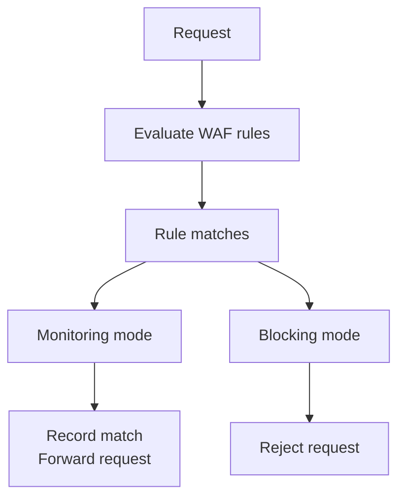

Monitoring mode is useful when introducing rules into an existing production application.

It helps identify false positives before enforcement.

But monitoring mode alone does not block the matching attacks. A staged rollout should include a deliberate decision about when and how to enforce rules.

---

# 12. False Positives and False Negatives

WAF rules are not perfect.

A **false positive** occurs when legitimate traffic is incorrectly identified as malicious.

Example:

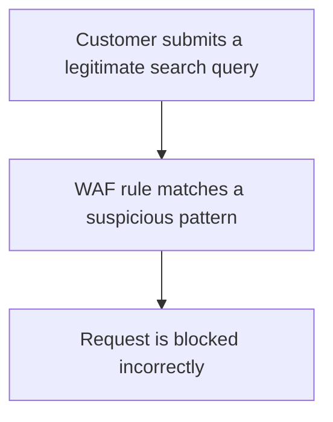

A **false negative** occurs when malicious traffic is allowed through.

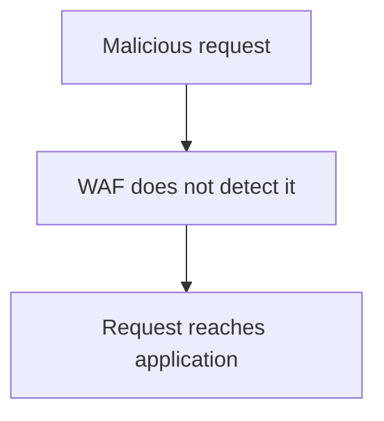

Both matter.

| Problem | Potential consequence |
|---|---|
| False positive | Legitimate users cannot complete an operation |
| False negative | An attack reaches the application |

Tune rules using observed traffic, logs, testing, and the application's actual requirements.

Avoid disabling an entire managed rule group simply because one rule creates a false positive. Where supported, a narrower exception is usually easier to justify and maintain.

---

# 13. WAF and Rate-Based Protection

Some WAFs support rate-based rules that count requests over a configured period and apply a mitigation when a threshold is exceeded.

For example:

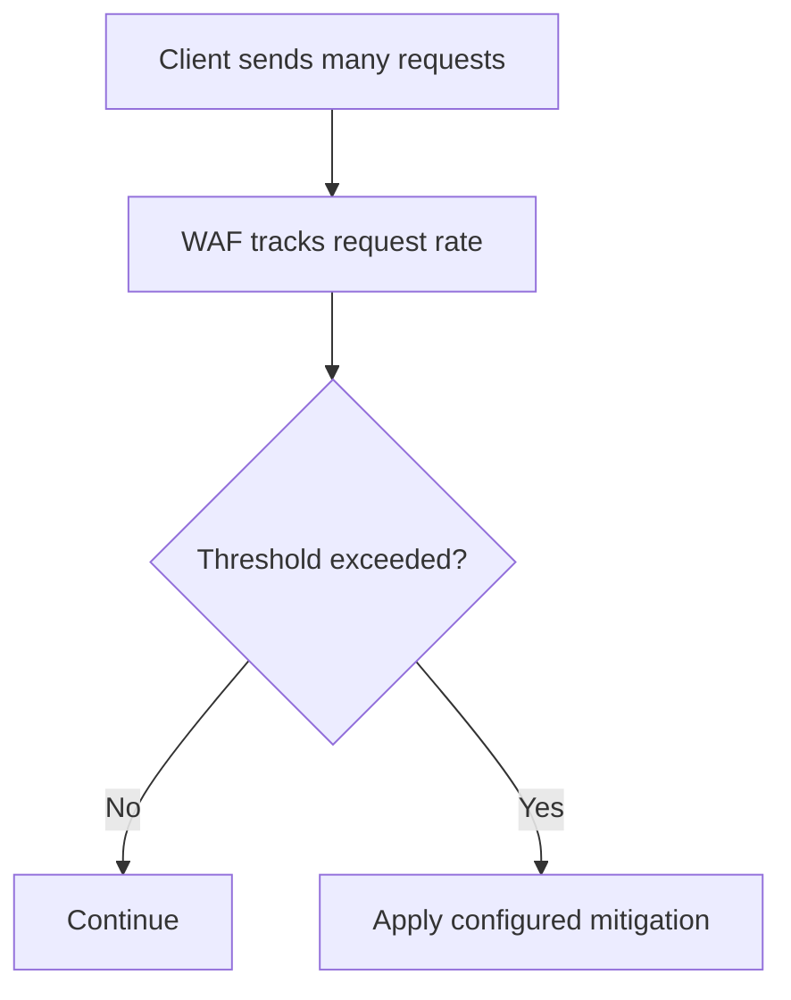

This can help reduce abusive request patterns, including some forms of automated endpoint abuse.

But a rate-based WAF rule is not a complete DDoS defense.

Distributed attacks may originate from many clients, and application-level rate limiting may need identity-aware rules that a WAF cannot reliably implement on its own.

Dedicated DDoS protection is covered in **11.15 — DDoS Protection**.

---

# 14. What a WAF Cannot Reliably Do

A WAF is not a universal security solution.

It generally cannot replace:

- Authentication
- Authorization
- Secure session management
- Parameterized database queries
- Correct output encoding
- Business-rule validation
- Secure file access
- Secrets management
- Application patching
- Internal service security

Consider this request:

```http
GET /api/orders/9002
```

The request may be syntactically valid and contain no suspicious payload.

But if the authenticated customer owns order `9001`, the application must not return another customer's order.

A WAF cannot generally determine that ownership rule from the request alone.

The backend must enforce authorization.

> **A request that looks normal can still be unauthorized.**

---

# 15. WAF and Application Security

A WAF should complement secure coding, not compensate for avoidable application vulnerabilities.

For example, consider a SQL injection risk.

A weak defense is:

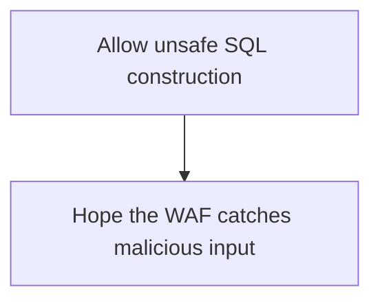

A stronger design is:

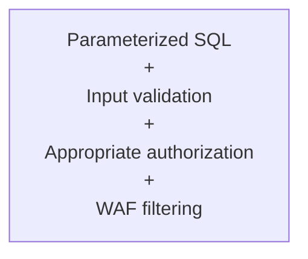

If one layer fails, other layers may still reduce the impact.

This is defense in depth.

---

# 16. Where Should the WAF Be Deployed?

A WAF is often deployed at the edge of the system, close to the public entry point.

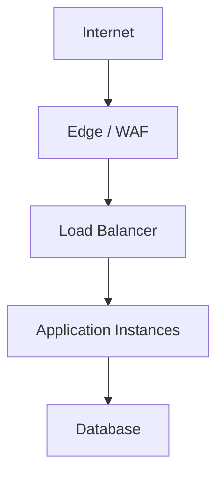

This can help reject suspicious requests before they consume application resources.

However, deployment must prevent attackers from bypassing the WAF and connecting directly to the origin server.

For example:

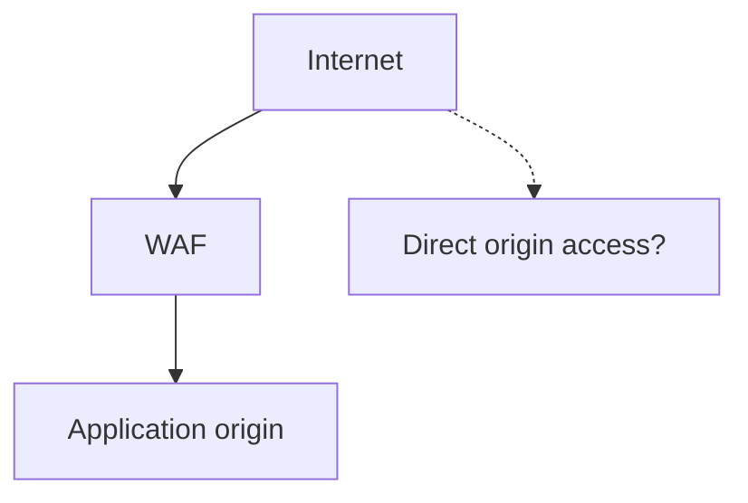

If direct origin access is possible, an attacker may bypass the WAF's filtering.

A common protection is to restrict origin access to the approved edge or proxy path, using the platform's supported network and authentication controls.

The exact method depends on the architecture.

---

# 17. WAF Logging and Monitoring

WAF logs can help answer:

- Which rule matched?
- Which request was affected?
- Was the request blocked or allowed?
- Are legitimate users being blocked?
- Are attacks targeting a particular endpoint?
- Is one rule generating unusually high volumes of matches?

A simplified event might contain:

```text
Timestamp: 10:15:22
Path: /api/login
Rule: configured suspicious-request rule
Action: blocked
```

Avoid logging passwords, session tokens, API keys, or sensitive request bodies.

WAF logging should support security investigation without creating another repository of secrets or personal data.

Correlating WAF events with application logs can help distinguish an attempted attack from an actual application-level impact.

---

# 18. A Safe WAF Rollout

Introducing a WAF to a live application requires care.

A practical rollout is:

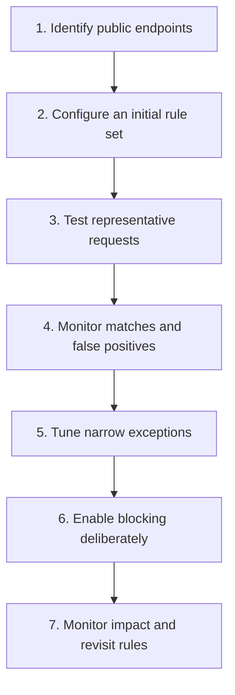

Test both malicious-looking inputs and legitimate application behavior.

For example, an application that accepts rich text, complex search expressions, or structured JSON may produce legitimate requests that generic rules misclassify.

Avoid broad exclusions that silently remove protection from entire endpoints when a narrow exception would suffice.

---

# 19. Common Mistakes

### Mistake 1 — Treating the WAF as a replacement for secure code

WAFs can miss attacks. Applications must still validate input and enforce security rules.

### Mistake 2 — Blocking traffic without testing

False positives can prevent legitimate users from completing important workflows.

### Mistake 3 — Leaving every rule in monitoring mode indefinitely

Detection-only mode records matches but does not enforce blocking for those matches.

### Mistake 4 — Allowing direct origin access

Attackers may bypass the WAF if the origin is independently reachable.

### Mistake 5 — Trusting every request that passes the WAF

A request can pass WAF rules and still violate authentication, authorization, or business requirements.

### Mistake 6 — Logging sensitive request data

Logs can expose credentials, tokens, and personal information.

### Mistake 7 — Assuming a WAF completely prevents DDoS attacks

WAF rate-based rules can help with some abuse patterns, but volumetric and distributed attacks may require additional protection.

### Mistake 8 — Creating overly broad exclusions

Disabling broad rule groups can remove useful protection and hide the actual false-positive problem.

---

# 20. Hands-On Exercise

Design a WAF deployment for this online store:

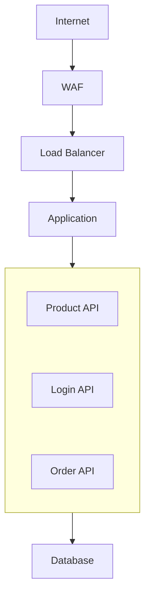

Define a basic protection plan.

Answer these questions:

1. Which public endpoints should the WAF protect?
2. Which managed rule categories are relevant to the application?
3. How would you test rules before enabling blocking?
4. What would you do if a legitimate product search were incorrectly blocked?
5. How would you prevent direct access to the application origin?
6. Which request fields must not appear in logs?
7. Which security requirements must remain enforced by the application?

A reasonable starting plan is to place the WAF at the public edge, test an appropriate managed rule set, monitor false positives, restrict origin access, redact sensitive data, and retain backend validation and authorization.

---

# 21. System Design View

A WAF is most effective when it occupies a clear position in the request path and works with other security controls.

| Design question | Purpose |
|---|---|
| Where does the WAF inspect traffic? | Establishes the protection boundary |
| Can the origin be reached directly? | Identifies possible WAF bypass paths |
| Which rules apply to each endpoint? | Aligns filtering with the application's exposure |
| How are false positives handled? | Protects legitimate functionality |
| Are matching events logged safely? | Supports investigation without leaking secrets |
| Who maintains the rules? | Keeps policies current as the application changes |
| What protections remain in the backend? | Prevents overreliance on the WAF |

The goal is not to block the largest possible number of requests. It is to reject harmful traffic while preserving legitimate behavior and maintaining secure backend controls.

---

# 22. Key Principle

> **A WAF filters suspicious web traffic before it reaches the application, but the application must still enforce identity, authorization, data validation, and business rules.**

Think of the WAF as one defensive layer—not as proof that every request it allows is safe.

---

# 23. Quick Reference

| Concept | Meaning |
|---|---|
| WAF | Security control that inspects and filters web requests |
| Managed rules | Provider-maintained rules for common attack patterns |
| Custom rules | Rules defined for specific application or organizational requirements |
| False positive | Legitimate traffic incorrectly identified as malicious |
| False negative | Malicious traffic not detected by a rule |
| Detection mode | Records or counts matches without necessarily blocking them |
| Blocking mode | Rejects requests that match configured blocking rules |
| Rate-based rule | Applies mitigation based on request frequency |
| Origin bypass | Reaching the application origin without passing through the intended WAF |
| Defense in depth | Using multiple complementary security controls |

---

# 24. Knowledge Check

### Question 1

What does a WAF primarily protect?

It filters HTTP/HTTPS traffic according to security rules to help protect web applications.

### Question 2

How is a WAF different from a network firewall?

A network firewall controls network traffic, while a WAF focuses on inspecting web requests and applying application-layer rules.

### Question 3

Can a WAF replace parameterized SQL queries?

No. Secure query construction is an application-level defense. A WAF is an additional layer.

### Question 4

What is a false positive?

A legitimate request is incorrectly classified as malicious or violates a rule unintentionally.

### Question 5

Why should origin access be restricted?

To prevent attackers from bypassing the WAF and reaching the application directly.

### Question 6

Can a request pass the WAF and still be unauthorized?

Yes. The application must still authenticate the caller and enforce resource-level permissions.

### Question 7

Why is monitoring useful before blocking?

It reveals how rules behave against real application traffic and helps identify false positives before enforcement.

---

# Remember

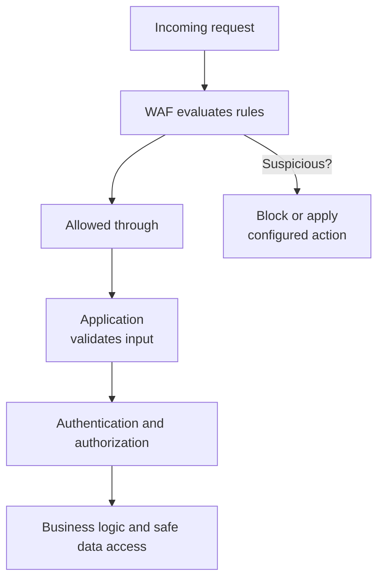

**Next: 11.15 — DDoS Protection**
