# 11.15 — DDoS Protection

## Learning Objectives

By the end of this chapter, you should be able to:

- Explain what a Denial-of-Service (DoS) and Distributed Denial-of-Service (DDoS) attack are.
- Understand volumetric, protocol-level, and application-layer attacks.
- Distinguish DDoS protection from WAF rules and rate limiting.
- Understand how CDNs, edge networks, and traffic scrubbing help absorb attacks.
- Design layered protection for a public web application.
- Recognize common DDoS-related failure modes and trade-offs.
- Understand how to prepare for, detect, and respond to an attack.

---

# 1. What Is a Denial-of-Service Attack?

A **Denial-of-Service (DoS) attack** attempts to make a service unavailable to legitimate users by exhausting resources or disrupting its operation.

An attacker might overwhelm:

- Network bandwidth
- Server connection capacity
- CPU and memory
- Application workers
- Database connections
- Expensive API endpoints

For example, suppose an online store can normally handle 5,000 requests per second.

If it receives far more traffic than it can process, legitimate customers may experience timeouts or errors.

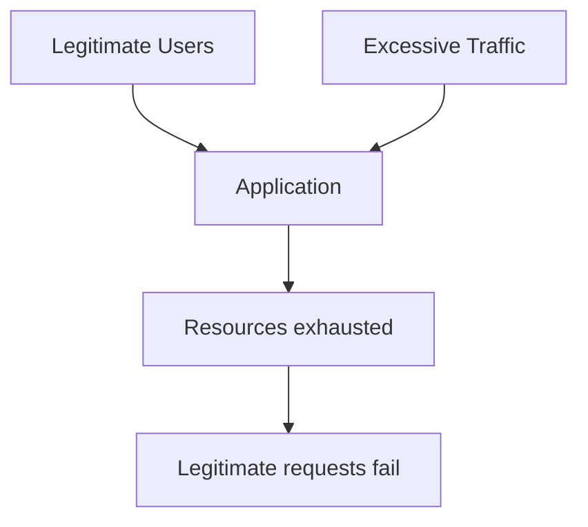

The important point is that the system becomes unavailable even if its application code and data remain intact.

---

# 2. What Is a DDoS Attack?

A **Distributed Denial-of-Service (DDoS)** attack attempts to overwhelm a target using traffic or requests from many distributed sources.

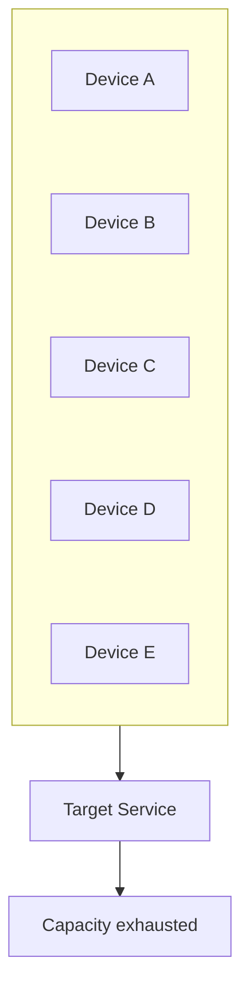

Because the traffic originates from multiple sources, blocking a single IP address may not solve the problem.

Some attacks use compromised devices or botnets. Others exploit distributed infrastructure or legitimate-looking requests.

A DDoS attack may target the network, transport protocols, or application behavior.

> **DDoS protection aims to keep legitimate traffic flowing while absorbing, filtering, or limiting harmful traffic.**

---

# 3. What Resources Can an Attack Exhaust?

Every system has finite capacity.

| Resource | Potential impact |
|---|---|
| Network bandwidth | Incoming traffic saturates available network capacity |
| Connection tracking | Network devices or servers run out of connection state capacity |
| CPU | Packet processing or application computation becomes excessive |
| Memory | Buffers, connection state, or application allocations consume available memory |
| Application workers | Requests occupy workers faster than they finish |
| Database connections | Requests exhaust the connection pool |
| Database CPU or I/O | Expensive queries overwhelm the database |
| Third-party quotas | Requests exhaust an external provider's rate or usage limits |

A key system-design lesson is that an attack does not need to overwhelm every resource. Exhausting one critical dependency can make the entire application unavailable.

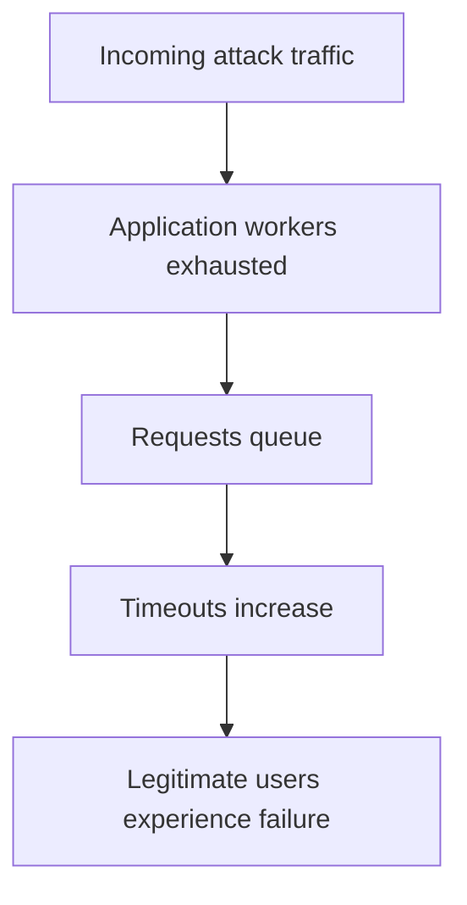

This connects directly to **03.01 — Where Does Performance Go?** and **02.10 — Timeouts**.

---

# 4. Three Broad DDoS Attack Categories

A useful starting point is to group attacks by what they target.

## A. Volumetric attacks

These attempt to consume network bandwidth with large amounts of traffic.

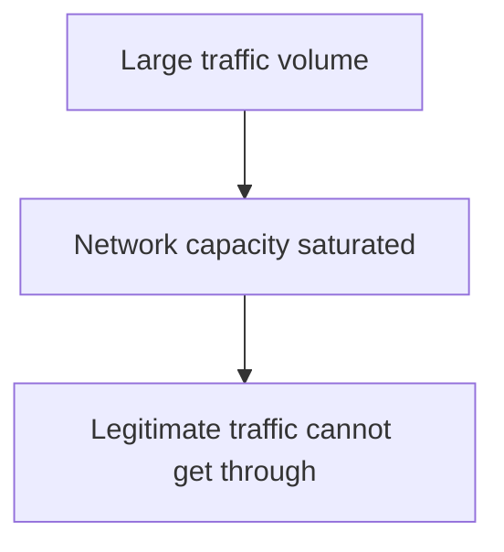

Protection often requires upstream network capacity and filtering, such as provider-level mitigation or a suitably designed edge network.

Adding application servers behind an already saturated network link may not help.

## B. Protocol and infrastructure attacks

These target the capacity or behavior of network protocols and infrastructure components.

They may exhaust connection state, packet-processing resources, or other limited resources in the network path.

Protection can involve provider-level filtering, firewalls, load balancers, and infrastructure-specific mitigation.

## C. Application-layer attacks

These target application endpoints using HTTP/HTTPS requests.

For example, an attacker may repeatedly request an endpoint that performs expensive database queries.

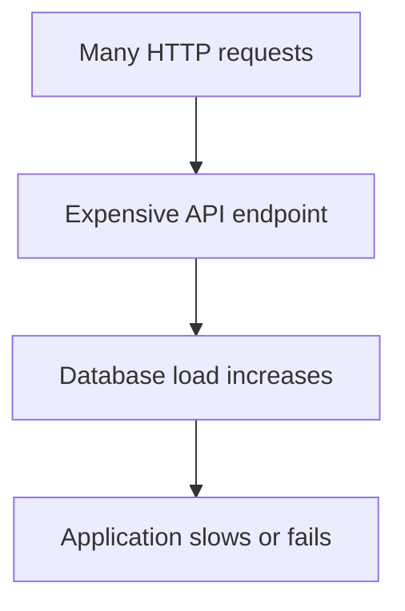

Application-layer attacks may use requests that look legitimate, making simple traffic-volume filtering insufficient.

Protection often requires a combination of WAF rules, rate limiting, caching, application optimization, and capacity controls.

---

# 5. DoS vs DDoS

| DoS | DDoS |
|---|---|
| Attack comes from one source or a limited set of sources | Attack is distributed across many sources |
| Source blocking may sometimes help | Blocking individual sources is often insufficient |
| May target a local resource | May combine network and application targets |
| Can still cause severe disruption | Can be harder to distinguish from legitimate distributed traffic |

The distinction describes how the attack is distributed, not how severe it must be. A single-source attack can still disrupt a poorly protected service.

---

# 6. Where Does DDoS Protection Fit?

DDoS protection should exist across multiple layers.

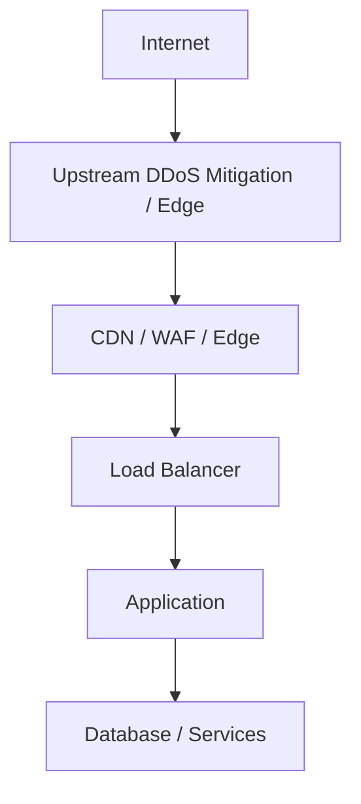

The exact components depend on the architecture.

The key idea is to stop or absorb harmful traffic as early as practical.

If the traffic has already saturated the network connection to the application, an application-level rule cannot recover the bandwidth that is no longer available.

---

# 7. Upstream DDoS Mitigation

For large network-level attacks, mitigation often needs to happen before traffic reaches the target's infrastructure.

A provider may detect attack traffic and filter it through specialized infrastructure.

Conceptually:

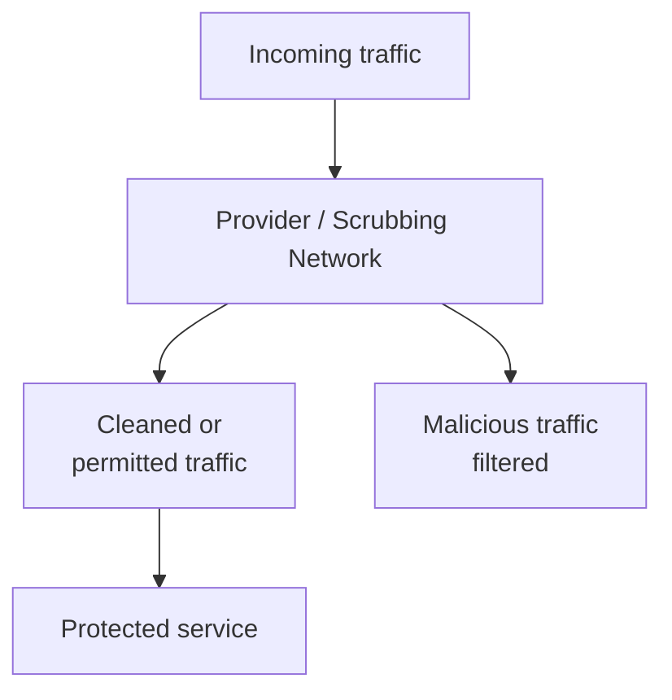

A **scrubbing service** is a system that analyzes traffic and removes traffic identified as malicious before forwarding permitted traffic toward the target.

This requires suitable provider capacity and routing or integration arrangements.

A small application server cannot independently solve an attack that saturates the upstream network path before packets reach it.

---

# 8. CDN as Part of DDoS Protection

A **Content Delivery Network (CDN)** serves content through distributed edge infrastructure.

A CDN can contribute to DDoS resilience by:

- Absorbing some traffic at the edge
- Caching static resources
- Reducing requests reaching the origin
- Applying traffic filtering or rate-based controls when supported
- Integrating with upstream DDoS mitigation

Consider a product page with static images and CSS.

Without effective caching:

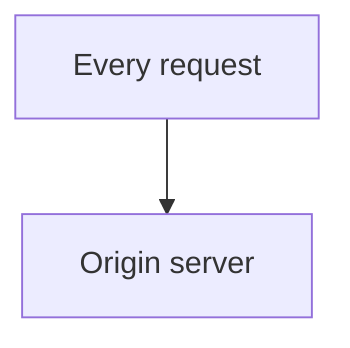

With edge caching:

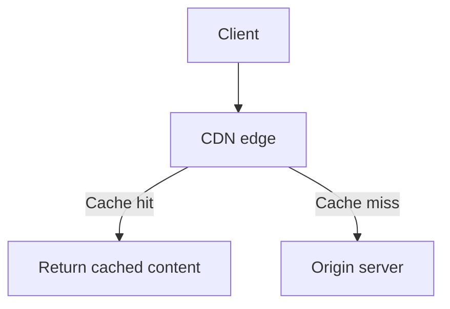

If many requests can be served from the cache, the origin performs less work.

However, a CDN is not a guarantee against every attack. Cache misses, dynamic endpoints, cache-bypass patterns, and attacks against the origin can still create pressure.

The origin must also be configured so attackers cannot simply bypass the CDN and connect directly to it.

---

# 9. WAF vs DDoS Protection

These controls overlap in some products, but they are not interchangeable.

| WAF | DDoS protection |
|---|---|
| Inspects web requests against security rules | Protects capacity and availability against overwhelming traffic |
| Can detect suspicious request patterns | Can mitigate attacks at network, protocol, and application layers |
| Often operates at the HTTP application layer | May operate upstream of the application, at the network edge, or within the application |
| Can block certain malicious payloads | Can absorb, filter, or limit traffic that exceeds safe capacity |

A WAF may block some HTTP floods or abusive request patterns.

But a WAF running on an already overwhelmed server cannot solve every DDoS attack.

Similarly, network-level DDoS protection may absorb traffic volume without understanding whether a valid-looking request is abusive to a particular business endpoint.

**Use the layers together.**

---

# 10. DDoS Protection vs Rate Limiting

Rate limiting controls how much traffic an identity, client, or other key may send within a defined period.

For example:

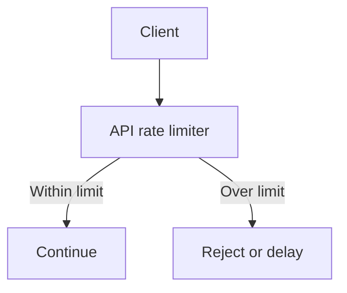

It is useful for:

- Login attempts
- Search endpoints
- Public APIs
- Expensive operations
- Preventing one client from consuming excessive resources

But DDoS traffic can come from many sources. Each source might stay below an individual limit while the combined traffic overwhelms the service.

Therefore, effective protection may need multiple dimensions:

- Per-client limits
- Per-account limits
- Per-endpoint limits
- Global or service-level limits
- Network-level traffic mitigation

The choice of rate-limit key also matters. A limit based only on IP addresses may be less effective when clients share IPs or when attacks are distributed.

Rate limiting is covered in **02.14 — Rate Limiting**.

---

# 11. Protect Expensive Endpoints

Not all HTTP requests cost the same amount.

For example:

```text
GET /images/logo.png
```

may be served cheaply from a CDN cache.

But:

```text
POST /api/reports/generate
```

might trigger complex queries and heavy computation.

An attacker does not always need a huge volume of traffic if each request consumes substantial resources.

A sensible design applies stronger controls to expensive operations.

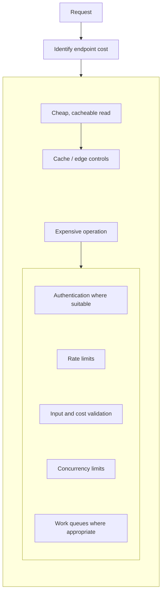

The controls depend on whether the endpoint is public, authenticated, synchronous, or asynchronous.

Do not assume authentication alone prevents abuse: attackers can abuse their own valid accounts or compromised accounts.

---

# 12. Protect the Database from Traffic Spikes

Application-layer attacks can overload the database indirectly.

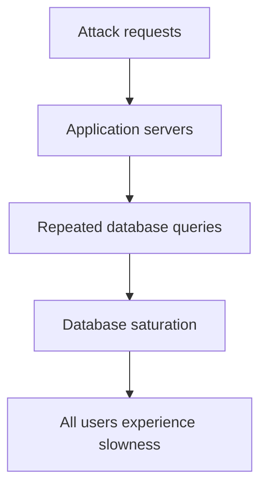

Possible protections include:

- Cache suitable read-heavy data
- Optimize expensive queries
- Limit request concurrency
- Enforce database connection limits
- Use bounded queues for suitable background work
- Reject excess work early
- Apply per-endpoint rate limits
- Avoid uncontrolled retries

The goal is to prevent incoming traffic from multiplying into unbounded downstream work.

A system should have a defined limit on how much work it accepts and how much concurrent work it performs.

---

# 13. Graceful Degradation

When demand exceeds capacity, the system may be unable to serve every request at full quality.

**Graceful degradation** means preserving the most important functionality while reducing optional work.

For example:

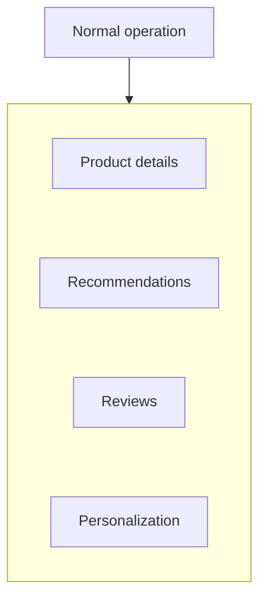

During overload:

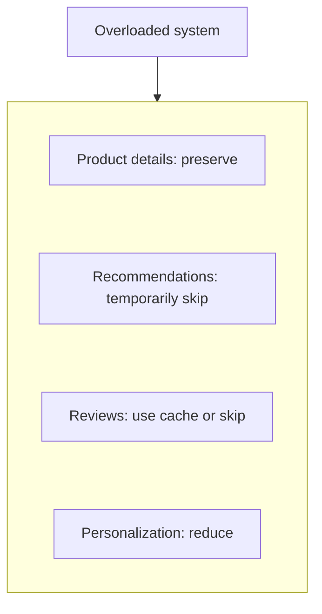

This can free resources for critical operations.

The degradation policy should be designed and tested in advance. Randomly disabling services during an incident can introduce new failures.

Related topic: **09.07 — Graceful Degradation**.

---

# 14. Avoid Amplifying the Attack

An overloaded system can make matters worse through retries and uncontrolled work.

Imagine a request times out, and the caller retries immediately.

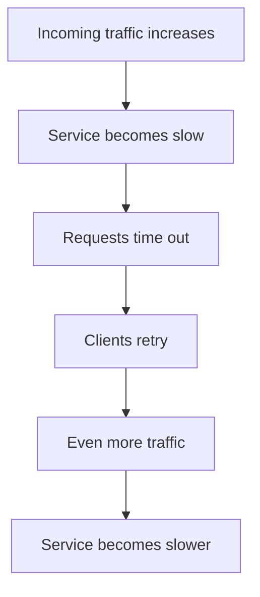

This feedback loop can contribute to a cascading failure.

During overload, a safer design may use:

- Bounded retries
- Exponential backoff and jitter
- Concurrency limits
- Load shedding
- Circuit breakers for failing dependencies
- Explicit overload responses

These mechanisms do not stop the original attack, but they can prevent the system from multiplying its own workload.

---

# 15. Load Shedding

**Load shedding** means rejecting or dropping some work when the system cannot safely process all incoming demand.

Instead of allowing every request to queue indefinitely:

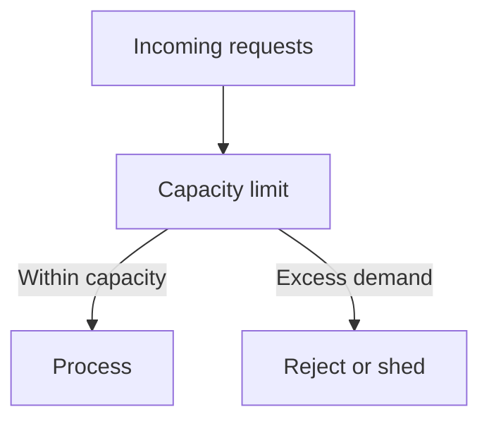

For example, the system might reject excess requests with an appropriate overload response rather than consuming every worker and connection.

This may seem counterintuitive: the service deliberately rejects requests to protect availability.

But controlled rejection can be better than allowing the entire application to collapse.

The policy should prioritize critical work where possible and avoid treating every request as equally important.

---

# 16. Autoscaling Is Not a Complete Solution

A common response to high traffic is:

> "Just add more servers."

Autoscaling can help when demand increases and the required capacity can be provisioned in time.

But it has limitations:

- Provisioning takes time.
- Account or quota limits may restrict capacity.
- The database may remain the bottleneck.
- Each new instance may create more database connections.
- Malicious traffic may increase infrastructure costs.
- Network capacity may already be saturated.
- The attack may scale faster than the application.

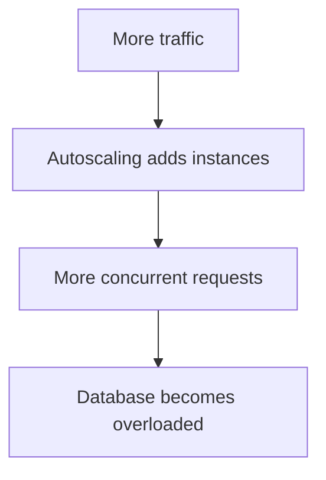

Autoscaling should work alongside filtering, capacity limits, caching, and downstream protection.

It should not be the only DDoS defense.

---

# 17. Origin Protection

If an application uses a CDN or edge proxy, the origin server should normally accept traffic only through the intended protected path, where the platform supports that design.

Otherwise:

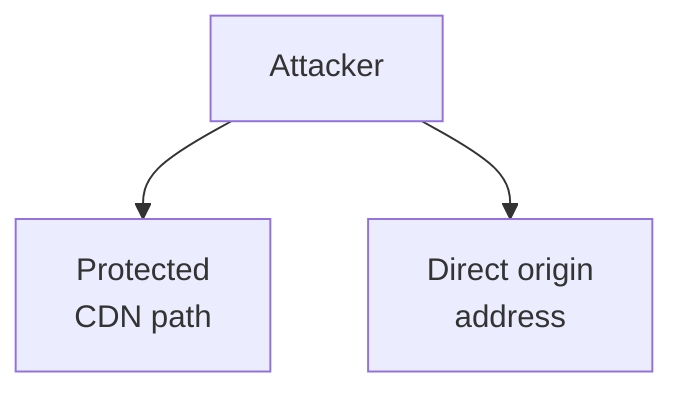

An attacker who knows the origin address may bypass some edge controls by connecting directly.

Possible protections include:

- Restricting origin network access
- Allowing only approved proxy or CDN sources
- Using authenticated origin connections where supported
- Keeping internal services private
- Avoiding public exposure of unnecessary endpoints

Do not rely only on hiding the origin address. Network and identity controls should enforce the intended path.

---

# 18. Monitoring and Detection

DDoS protection depends on recognizing abnormal traffic and understanding its effect on the system.

Useful signals can include:

| Signal | What it may reveal |
|---|---|
| Requests per second | Sudden changes in traffic volume |
| Bandwidth usage | Potential network saturation |
| Connection counts | Excessive connection pressure |
| HTTP status codes | Increased errors or overload responses |
| Latency percentiles | Growing request delays |
| WAF/rate-limit events | Requests matching configured rules |
| CPU and memory | Resource exhaustion |
| Database connections and query load | Downstream pressure |
| Cache hit ratio | Whether cache behavior is reducing origin work |
| Geographic or client distribution | Changes in traffic patterns, though not proof of an attack |

No single metric proves that an attack is occurring.

Traffic spikes can also result from legitimate events, a popular product launch, a marketing campaign, or a software defect.

Correlate network, edge, application, and dependency signals before deciding on mitigation.

---

# 19. Incident Response

A DDoS response should be prepared before an attack happens.

A simplified response flow is:

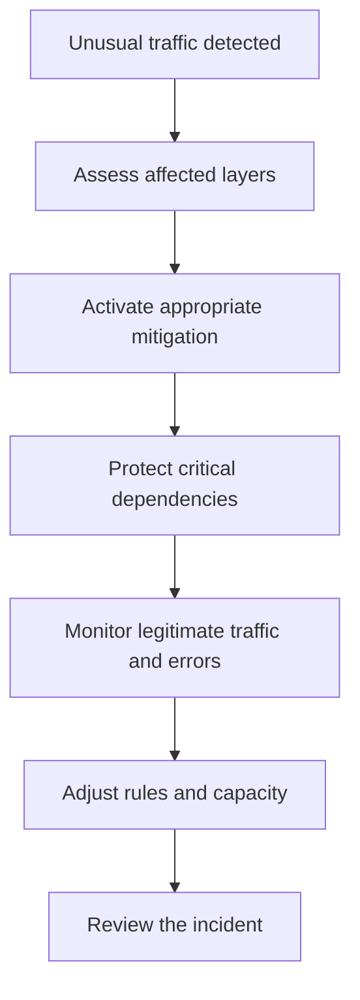

Depending on the attack, the response may involve a network provider, CDN or DDoS service, WAF configuration, application rate limits, or controlled load shedding.

During the incident:

- Preserve critical user journeys where possible.
- Avoid exposing secrets or sensitive data in emergency logs.
- Coordinate with infrastructure and service providers.
- Monitor whether mitigations are blocking legitimate customers.
- Keep a record of changes and their effects.

After recovery, investigate the cause, update protections, and test the revised response process.

---

# 20. Cost and Capacity Trade-offs

DDoS resilience has operational and financial costs.

Potential costs include:

- Edge and mitigation services
- Additional network capacity
- Monitoring and incident-response readiness
- More complex routing and origin controls
- Additional testing and maintenance

A poorly designed architecture may also incur unexpected costs when traffic increases.

For example, autoscaling may add many application instances while every instance creates more database connections or performs repeated expensive operations.

A good design considers both availability and cost.

The appropriate protection depends on the application's public exposure, business impact, expected traffic, dependency limits, and recovery requirements.

---

# 21. Common Mistakes

### Mistake 1 — Assuming a WAF prevents every DDoS attack

WAFs can help with some application-layer attacks, but large network-level attacks may require upstream mitigation.

### Mistake 2 — Blocking only individual IP addresses

Distributed traffic can originate from many addresses, and source addresses may be shared or misleading.

### Mistake 3 — Scaling application servers without protecting dependencies

The database or another downstream service may become overloaded first.

### Mistake 4 — Treating autoscaling as the entire defense

Autoscaling does not guarantee enough network capacity, fast provisioning, or safe downstream load.

### Mistake 5 — Ignoring expensive endpoints

A small number of costly requests can consume significant resources.

### Mistake 6 — Allowing direct origin access

Traffic may bypass the CDN or edge protections.

### Mistake 7 — Retrying every failed request immediately

Retries can multiply the load on an already struggling service.

### Mistake 8 — Never testing the response plan

An untested mitigation may block legitimate users or fail to protect the intended resource.

---

# 22. Hands-On Exercise

Design DDoS protection for this online store:

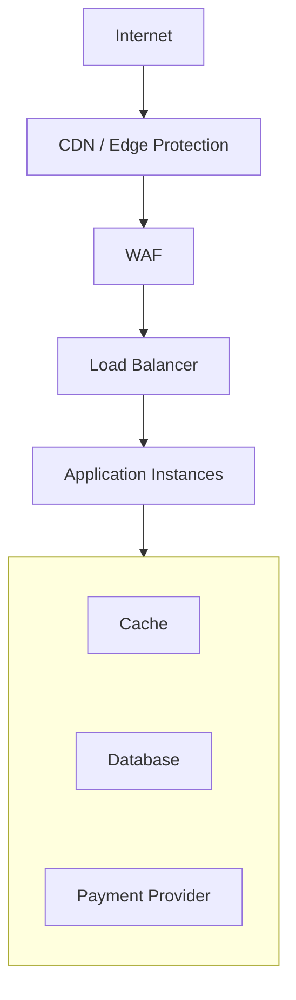

Answer these questions:

1. Which components should absorb or filter traffic before it reaches the application?
2. How will you prevent direct access to the origin?
3. Which endpoints need stricter rate or concurrency limits?
4. How will you protect the database during an HTTP flood?
5. What should happen when application capacity is exhausted?
6. Which optional features can be degraded temporarily?
7. What signals will help distinguish an attack from a legitimate traffic spike?
8. Who will be contacted if upstream network mitigation is required?

A reasonable design combines edge protection, WAF rules, suitable rate limits, origin restrictions, bounded application work, database protection, monitoring, and an incident-response plan.

---

# 23. System Design View

DDoS protection is an availability problem across the complete request path.

| Design question | Purpose |
|---|---|
| Where can traffic be filtered earliest? | Reduces load before it reaches constrained resources |
| What is the available network capacity? | Identifies infrastructure limits |
| Which endpoints are expensive? | Focuses application-layer controls |
| Can the origin bypass edge protection? | Identifies an alternate attack path |
| What is the database's safe capacity? | Prevents downstream exhaustion |
| How does the system behave under overload? | Determines whether it queues, sheds, or degrades work |
| What signals trigger mitigation? | Supports timely response |
| How are mitigations tested? | Reduces the risk of emergency changes causing outages |

The system must be designed to handle excess demand deliberately. It cannot assume every incoming request is legitimate or that capacity can expand without limit.

---

# 24. Key Principle

> **DDoS protection is about preserving availability by absorbing, filtering, limiting, or rejecting harmful traffic before it exhausts critical resources.**

A resilient system combines network-level mitigation, edge protection, application controls, bounded downstream work, monitoring, and a prepared response plan.

---

# 25. Quick Reference

| Concept | Meaning |
|---|---|
| DoS | Attack intended to make a service unavailable |
| DDoS | DoS attack distributed across multiple sources |
| Volumetric attack | Attempts to saturate network bandwidth |
| Protocol attack | Targets network or transport protocol resources |
| Application-layer attack | Overwhelms application processing or endpoints |
| Traffic scrubbing | Filtering attack traffic before forwarding permitted traffic |
| CDN | Distributed content delivery infrastructure that can also contribute to traffic absorption and filtering |
| Rate limiting | Restricts request frequency according to a configured policy |
| Load shedding | Rejects excess work to protect remaining capacity |
| Origin protection | Prevents unintended direct access that bypasses edge controls |
| Graceful degradation | Preserves core functionality by reducing optional work |
| Autoscaling | Adjusts resource capacity in response to workload signals |

---

# 26. Knowledge Check

### Question 1

What is the difference between DoS and DDoS?

A DoS attack comes from one or a limited set of sources, while a DDoS attack distributes the attack across multiple sources.

### Question 2

Why might adding application servers fail to stop a DDoS attack?

The network may already be saturated, or the database and other dependencies may become overloaded as more application instances process traffic.

### Question 3

How do a WAF and DDoS protection differ?

A WAF filters web requests using application-layer rules. DDoS protection can also involve upstream network mitigation and broader traffic-capacity controls.

### Question 4

Why is origin protection important when using a CDN?

It helps prevent attackers from bypassing edge filtering and connecting directly to the origin.

### Question 5

What is load shedding?

Rejecting excess work when the system cannot safely process all incoming demand.

### Question 6

Why can retries worsen an overload incident?

They create additional requests while the service is already struggling, potentially increasing resource exhaustion.

### Question 7

Why should a DDoS response plan be tested?

To confirm that mitigation works, critical functions remain available where possible, and legitimate traffic is not unnecessarily blocked.

---

# Remember

```mermaid
flowchart TD
  accTitle: Layered DDoS defense
  accDescr: Traffic arrives, then Absorb or filter at the edge, then Apply web and rate-based controls, then Protect application and dependencies, then Limit or shed excess work, then Monitor, respond, and recover.
  N0["Traffic arrives"] --> N1["Absorb or filter at the edge"] --> N2["Apply web and rate-based controls"] --> N3["Protect application and dependencies"] --> N4["Limit or shed excess work"] --> N5["Monitor, respond, and recover"]
```

**Next: 11.16 — Audit Logging**
