# 11.16 — Audit Logging

## Learning Objectives

By the end of this chapter, you should be able to:

- Explain what audit logging is and why systems need it.
- Distinguish audit logs from application logs, metrics, and traces.
- Identify which security-relevant events should be recorded.
- Design a useful and safe audit-event structure.
- Understand how to protect audit logs against tampering and unauthorized access.
- Handle missing logs, retention, and logging failures.
- Use audit records to investigate suspicious activity.

---

# 1. What Is Audit Logging?

Imagine an administrator changes a user's role from `customer` to `admin`.

The system should be able to answer:

- Who performed the change?
- What permission or resource changed?
- When did it happen?
- Was the action successful?
- Which account or tenant was affected?
- Was the change authorized?

**Audit logging** records important actions and security decisions so they can be reviewed later.

> **An audit log provides an accountable record of who did what, to which resource, when, and with what result.**

For example:

```text
Actor:       admin-42
Action:      role.changed
Resource:    user-105
Old value:   customer
New value:   manager
Result:      success
Time:        2026-10-13T10:20:00Z
```

The goal is not to record every detail of every request.

The goal is to preserve the events that matter for security, accountability, and investigation.

---

# 2. Why Do Systems Need Audit Logs?

Suppose a customer's private data was exported without permission.

Without useful audit records, an investigation may only establish that the data is missing.

With audit records, the team may be able to determine:

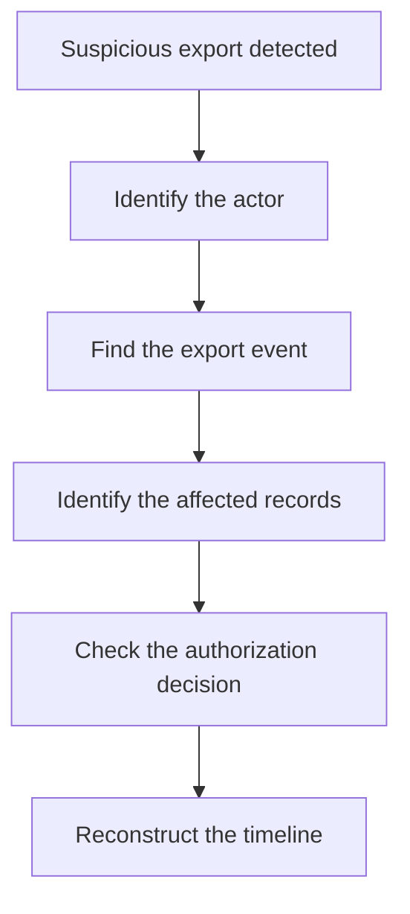

Audit logs help answer questions such as:

- Was an account compromised?
- Who changed a permission?
- Which records were accessed or exported?
- When was an API key created or revoked?
- Did a security control deny a request?
- What happened before and after an incident?

They also support operational reviews and compliance requirements.

However:

> **Logging an action does not make the action secure. It makes the action more traceable.**

Authorization, validation, encryption, and other controls must still work correctly.

---

# 3. Audit Logs vs Other Observability Data

Different kinds of records serve different purposes.

| Data type | Main question | Example |
|---|---|---|
| Audit log | Who performed a significant action, and what happened? | An administrator changed a role. |
| Application log | What happened while the application was running? | A database query failed. |
| Metric | How much or how often? | Failed logins per minute. |
| Distributed trace | Where was time spent across a request path? | A request waited 800 ms for a service. |

Consider a failed login.

An application log might record a technical error. A metric might count the failure. An audit event records the security-relevant authentication outcome.

These records can be correlated, but they are not interchangeable.

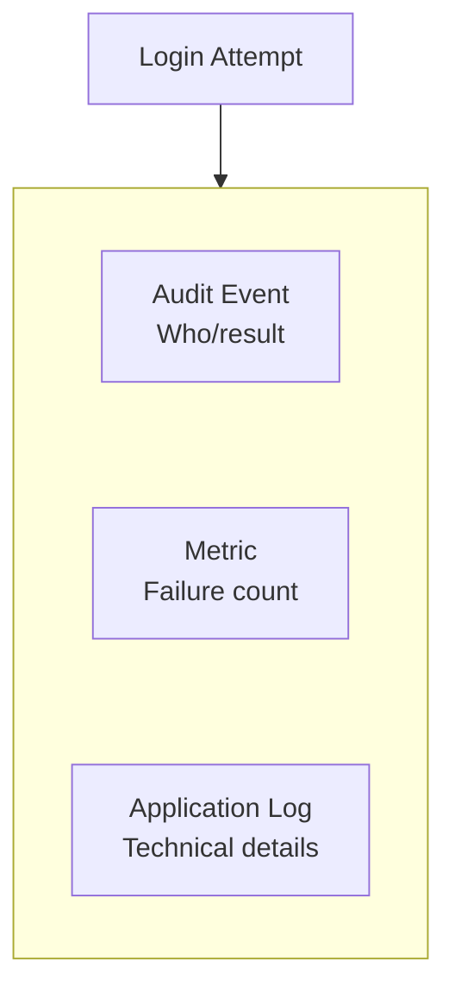

A distributed trace may also help investigate the request path, but it does not replace the audit record.

---

# 4. What Should Be Audited?

Audit important security and administrative actions.

Common examples include:

| Category | Example events |
|---|---|
| Authentication | Successful login, failed login, MFA disabled |
| Account security | Password reset, recovery method changed |
| Authorization | Role changed, permission granted or revoked |
| Sensitive data | Private record accessed, data exported or deleted |
| Credentials | API key created, revoked, or rotated |
| Secrets | Secret retrieved, permission changed, secret rotated |
| Administration | Security policy changed, account suspended |
| Infrastructure | Firewall rule changed, privileged access granted |
| Security decisions | Access denied for a sensitive resource |
| Deployment | Production configuration or security-sensitive setting changed |

Not every ordinary read needs an audit event. The appropriate coverage depends on the sensitivity of the data, the threat model, operational needs, and applicable requirements.

For example, a banking system may need to record access to specific financial records, while a public product catalogue may not need an audit event for every product view.

**Audit what you may need to prove or investigate later.**

---

# 5. What Makes a Useful Audit Event?

An event needs enough context to be meaningful.

A practical event schema may include:

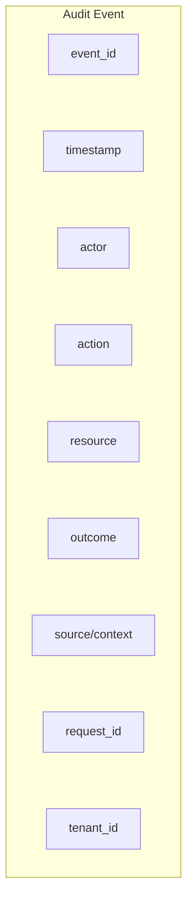

The fields answer different questions:

| Field | Purpose |
|---|---|
| `event_id` | Identifies this specific event |
| `timestamp` | Records when it occurred |
| `actor` | Identifies the user or service responsible |
| `action` | Describes what was attempted or changed |
| `resource` | Identifies the affected account, record, or system |
| `outcome` | Records success, denial, or failure |
| `source` | Provides useful context, such as a trusted client or network identity |
| `request_id` | Helps correlate the event with related records |
| `tenant_id` | Identifies the affected tenant in a multi-tenant system |

For sensitive changes, the event may also include a reason, approval reference, or carefully selected before-and-after values.

Do not automatically include entire request bodies or database records. That can expose passwords, tokens, personal data, or other sensitive information.

---

# 6. Example Audit Event

Suppose an administrator revokes an API key.

A structured audit event could look like this:

```json
{
  "event_id": "evt_8f31",
  "timestamp": "2026-10-13T10:20:00Z",
  "actor": {
    "type": "user",
    "id": "admin-42"
  },
  "action": "api_key.revoked",
  "resource": {
    "type": "api_key",
    "id": "key-731"
  },
  "outcome": "success",
  "tenant_id": "tenant-12",
  "request_id": "req-a91c",
  "reason": "Suspected credential exposure"
}
```

This record explains who revoked which key and why.

Notice what it does **not** contain:

- The API key itself.
- A password.
- An access token.
- A complete authorization header.
- Unnecessary personal information.

The event identifies the credential without revealing the credential.

---

# 7. Record Attempts and Outcomes Clearly

A successful action and a denied attempt are different events.

For example:

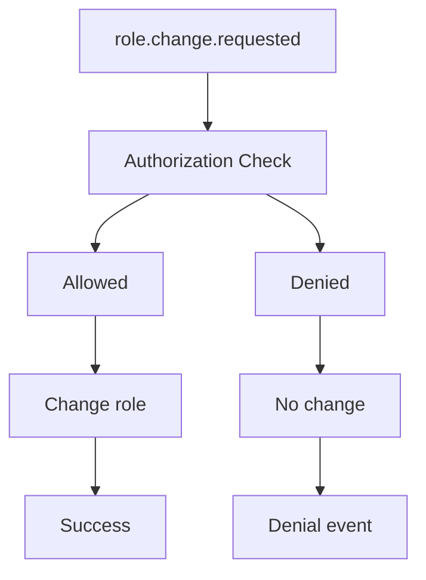

Your audit design should distinguish:

- An action was requested.
- An authorization decision was made.
- A state change was attempted.
- A state change succeeded or failed.

Not every system needs a separate event for each internal step. Avoid excessive duplication, but ensure the final record accurately reflects what happened.

For a sensitive change, recording a successful outcome before the change is committed can create misleading evidence.

---

# 8. Where Should Audit Events Be Generated?

Audit events should be generated by the trusted component that knows the action and its outcome.

For example:

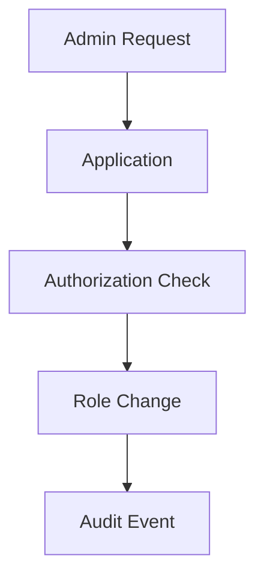

The browser should not be trusted to submit the authoritative audit record.

A malicious client could omit, modify, or fabricate events.

Instead, the backend should determine:

- The authenticated actor.
- The resource being affected.
- The action attempted.
- The authorization result.
- Whether the operation actually succeeded.

For critical state changes, the application must also consider what happens if the state change succeeds but the audit event is lost.

---

# 9. Audit Logging and Database Transactions

Suppose the application changes a user's role in a database.

Two operations need to happen:

```text
1. Update user's role
2. Record the audit event
```

A dangerous outcome would be:

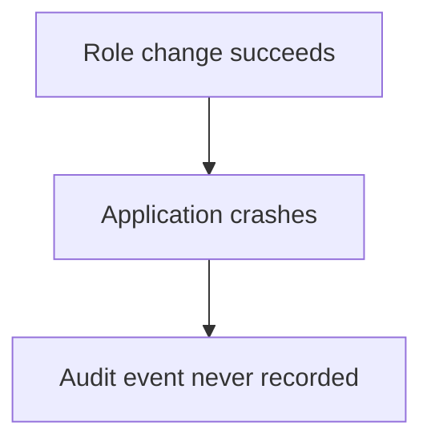

The change happened, but the evidence is missing.

For important events, the system may need a stronger delivery design.

One approach is to write the state change and an audit-event record within the same database transaction:

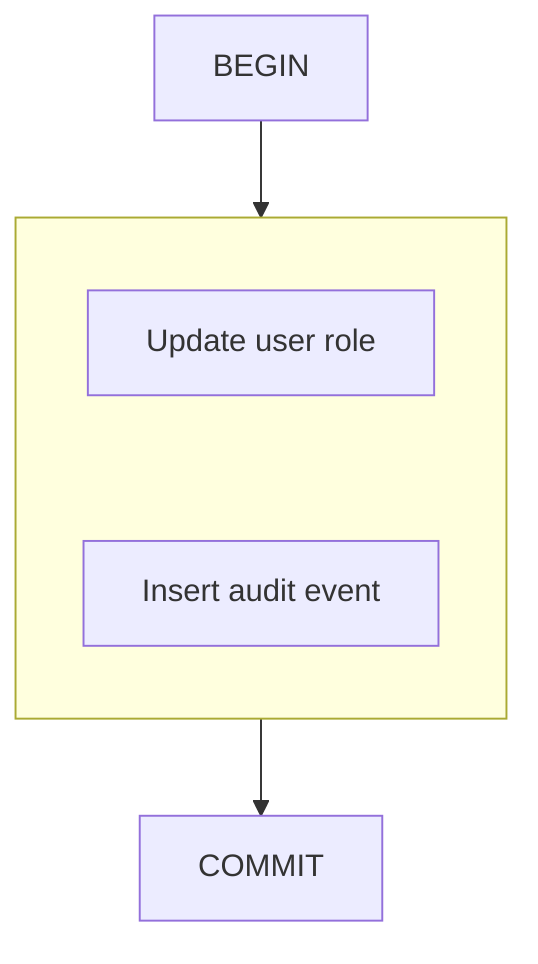

If both writes share the same transactional database, the transaction can ensure they commit or roll back together.

For events sent to a separate logging service, a common pattern is the **transactional outbox**:

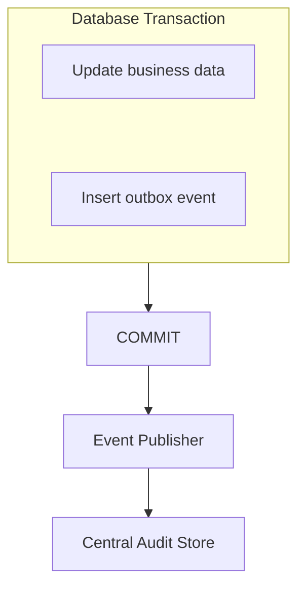

The publisher can retry delivery from the outbox.

This adds complexity, so it is most useful when losing the event would create a serious accountability or investigation gap.

---

# 10. Protect Audit Logs From Tampering

Audit logs lose value if an attacker can silently rewrite or delete the evidence of their own actions.

Consider this unsafe arrangement:

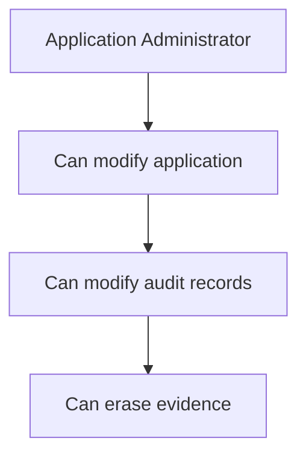

A stronger design separates responsibilities:

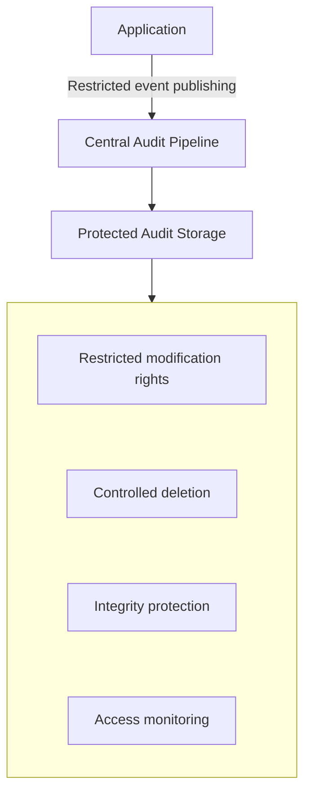

Useful protections include:

- Restricting who can read, modify, and delete audit records.
- Sending records to a separate, centrally managed system.
- Using append-only or immutable storage where appropriate.
- Encrypting logs in transit and at rest.
- Monitoring changes to logging configuration and retention policies.
- Recording access to the audit system itself.
- Using integrity checks or cryptographic mechanisms where the threat model requires them.

Centralization helps, but it does not automatically make logs immutable or trustworthy. The permissions and storage design still matter.

---

# 11. Protect the Logs Themselves

Audit records can contain sensitive information.

Examples include:

- User identifiers.
- IP addresses.
- Administrative activity.
- Sensitive resource identifiers.
- Information about account recovery or security incidents.

Therefore, audit logs are themselves a security-sensitive asset.

Use these principles:

**Minimize:** Record only the fields needed for accountability and investigation.

**Redact:** Remove credentials and sensitive values before events enter the logging pipeline.

**Restrict:** Give investigators access only when their responsibilities require it.

**Encrypt:** Protect logs during transmission and storage.

**Monitor:** Record and review access to the audit system.

**Retain deliberately:** Keep records for an appropriate period rather than indefinitely by default.

Avoid logging passwords, session cookies, access tokens, private keys, or complete secret values.

---

# 12. Time and Correlation

An investigation often needs to reconstruct events across multiple systems.

For example:

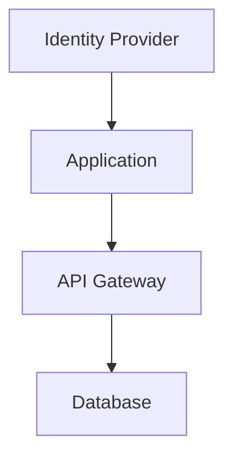

If each component uses different clocks or unrelated identifiers, reconstructing the sequence becomes difficult.

Good practices include:

- Recording timestamps in a consistent format, commonly UTC.
- Keeping system clocks synchronized.
- Assigning stable event identifiers.
- Propagating request or correlation IDs where appropriate.
- Including the authenticated actor and affected resource.
- Recording event-source information so investigators know where the record originated.

A request ID helps connect records, but it is not proof of identity. Treat client-supplied correlation IDs as untrusted input unless the system validates or replaces them.

---

# 13. Retention: How Long Should Logs Be Kept?

Keeping logs forever is not automatically safer.

Long retention increases:

- Storage costs.
- Exposure if the log store is compromised.
- Privacy risk.
- The amount of data that must be protected and governed.

Deleting records too early can make incident investigations impossible or violate applicable obligations.

A retention policy should consider:

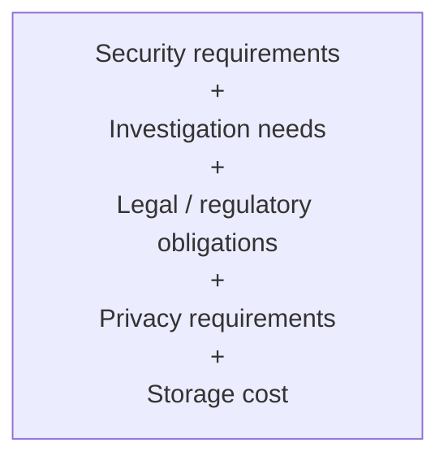

Different event categories may need different retention periods.

For example, high-value administrative events may have different retention needs from short-lived diagnostic records.

Define who can change retention settings and who can authorize deletion. Where records must be preserved for an investigation, follow the relevant evidence-preservation process.

---

# 14. Audit Logging Does Not Automatically Detect Attacks

A system can collect audit records and still fail to notice suspicious behavior.

For example:

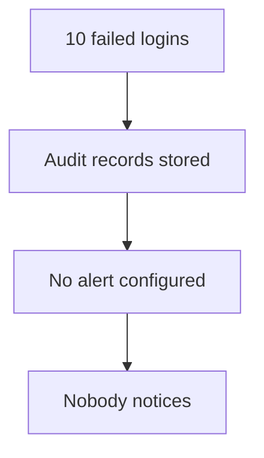

Logging preserves evidence. Detection rules, dashboards, and alerts help people or automated systems act on it.

Useful alerts may include:

- Repeated failed login attempts.
- MFA disabled on a privileged account.
- Unexpected role or permission changes.
- Unusual secret retrieval.
- Large or unusual data exports.
- Repeated access denials against sensitive resources.
- Changes to logging or retention configuration.
- A sudden absence of expected audit events.

Alert thresholds should reflect normal activity and the risk of the action. A single denied request may be routine; repeated denials against many sensitive resources may be suspicious.

---

# 15. Monitor the Logging Pipeline

An audit system can fail even when the application continues working.

Potential problems include:

- The event publisher is unavailable.
- The queue is full.
- The network connection fails.
- Storage is full.
- Credentials used by the publisher expire.
- Events are delayed or dropped.
- A configuration change disables an event source.

A healthy application does not prove that its audit trail is healthy.

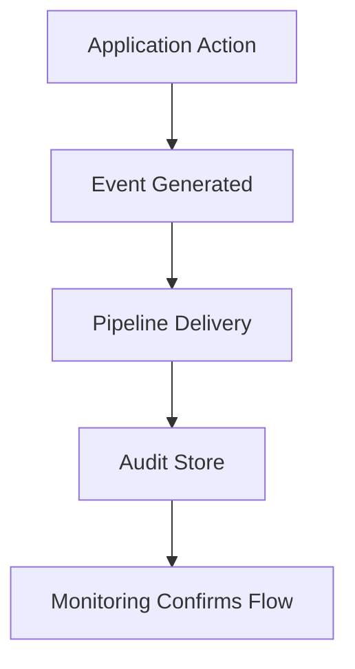

Monitor delivery failures, queue depth, processing delay, storage capacity, and unexpected gaps in event volume.

For high-risk systems, a missing audit stream should itself trigger an alert.

---

# 16. What If Audit Logging Fails?

The correct behavior depends on the risk of the operation.

| Operation | Possible approach |
|---|---|
| Ordinary low-risk activity | Buffer or retry delivery when safe |
| Sensitive administrative change | Require durable audit recording or a reliable transactional event mechanism |
| High-risk financial or security action | Consider denying the action if the required audit guarantee cannot be met |
| Non-critical diagnostic event | Allow the application to continue while reporting the logging failure |

This is the **fail-open vs fail-closed** decision.

- **Fail-open:** The business action can continue even if logging is unavailable.
- **Fail-closed:** The action is blocked when the required audit guarantee cannot be satisfied.

Neither policy is universally correct.

For example, blocking all ordinary reads because a logging service is temporarily unavailable may create an unnecessary outage. Allowing a privileged security-policy change without any reliable audit record may be unacceptable.

Make the decision explicitly for each important class of action.

---

# 17. Audit Logging in a Multi-Tenant System

Suppose a SaaS application serves multiple organizations.

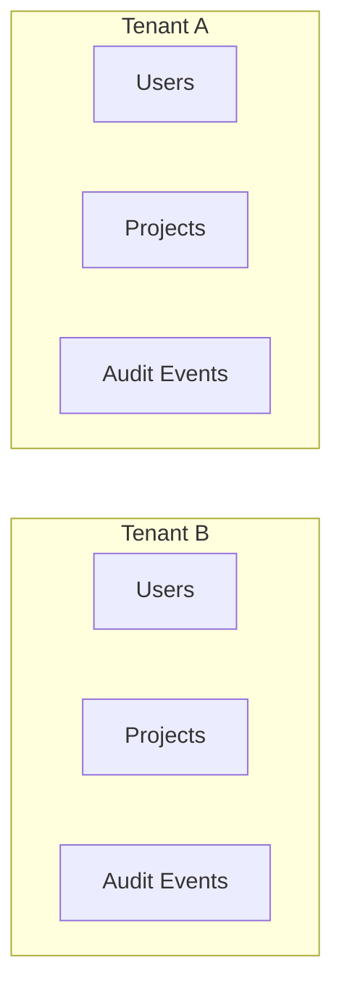

Audit records should preserve tenant context where relevant.

Investigators must be able to answer:

- Which tenant was affected?
- Which actor performed the action?
- Was the actor authorized for that tenant?
- Which resource changed?

Access to audit records must also respect tenant isolation. An administrator for Tenant A should not automatically gain access to Tenant B's audit history.

Platform-wide security teams may require broader access, but it should be explicitly authorized and monitored.

---

# 18. Example: Investigating a Suspicious Role Change

Suppose an account unexpectedly gains administrator privileges.

A useful investigation could follow this path:

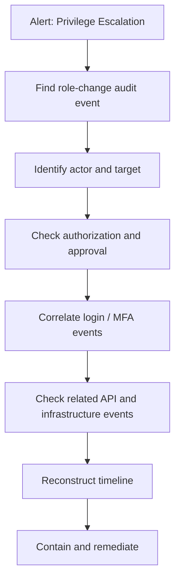

The audit trail may reveal that the role change followed an unusual login or that an API key was created shortly afterward.

The goal is to establish what happened and preserve reliable evidence—not merely to collect a large volume of logs.

---

# 19. Common Mistakes

### Mistake 1 — Treating every debug message as an audit event

Audit events should have clear meaning and accountability.

### Mistake 2 — Logging secrets

A token in an audit record can become another credential leak.

### Mistake 3 — Trusting the frontend to produce authoritative records

Security-relevant facts must be established by trusted backend components.

### Mistake 4 — Allowing the same administrator to erase all evidence

Separate application administration from audit-storage control where appropriate.

### Mistake 5 — Recording that an action succeeded before it actually succeeds

Events must accurately represent the outcome.

### Mistake 6 — Collecting events without monitoring them

Stored records are useful for investigations, but they do not automatically create alerts.

### Mistake 7 — Ignoring logging failures

Missing events can create serious blind spots.

### Mistake 8 — Keeping all records forever

Retention must balance security, investigation needs, privacy, obligations, and cost.

### Mistake 9 — Assuming logs guarantee compliance

Audit logging can support compliance, but the overall system must also meet the applicable controls and requirements.

---

# 20. Hands-On Exercise: Design an Audit Trail

Imagine an e-commerce application with administrators, customers, orders, and API keys.

An administrator can:

- Change a customer's role.
- Export customer records.
- Revoke an API key.
- Change a security setting.

Design an audit trail for these actions.

## Step 1 — Define the events

Start with:

```text
user.role_changed
customer_data.exported
api_key.revoked
security_setting.changed
```

## Step 2 — Define the fields

Each event should include:

```text
event_id
timestamp
actor_id
action
resource_type
resource_id
outcome
tenant_id (when relevant)
request_id
reason / approval reference (when relevant)
```

## Step 3 — Protect sensitive values

Do not include:

```text
API key value
Password
Access token
Full secret
```

## Step 4 — Choose storage and access controls

Decide:

- Where are records stored?
- Who can read them?
- Who can modify or delete them?
- How are changes to the logging configuration audited?
- How long are records retained?

## Step 5 — Define failure behavior

Ask:

- Can an API key be revoked if the audit store is unavailable?
- Can a privileged role change proceed without a durable event?
- Should events be buffered and retried?
- How will missing event delivery be detected?

## Step 6 — Define alerts

Examples:

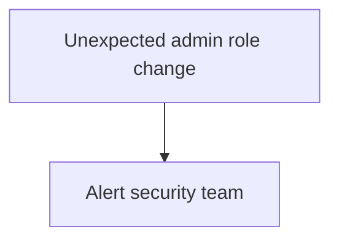

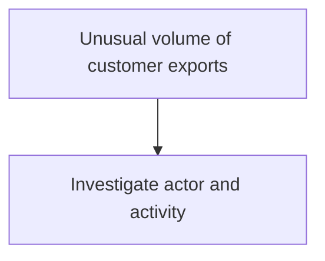

The goal is to design an audit system that preserves trustworthy evidence without leaking the very information it is supposed to protect.

---

# 21. System Design View

Audit logging introduces several architectural decisions.

| Decision | Trade-off |
|---|---|
| Synchronous vs asynchronous delivery | Stronger immediate guarantees vs request latency and availability |
| Local vs centralized storage | Simplicity vs centralized investigation and access control |
| Append-only vs mutable records | Stronger tamper resistance vs operational flexibility |
| Broad vs minimal event coverage | More investigative context vs cost, noise, and privacy exposure |
| Long vs short retention | Longer investigation window vs cost and data exposure |
| Fail-open vs fail-closed | Availability vs assurance that critical actions are recorded |

There is no single configuration that suits every application.

The correct design depends on the sensitivity of the action, the consequences of missing evidence, and the system's availability requirements.

---

# 22. Key Principle

> **Audit logging is about preserving trustworthy evidence of important actions—not collecting the maximum amount of data.**

A useful audit system must answer:

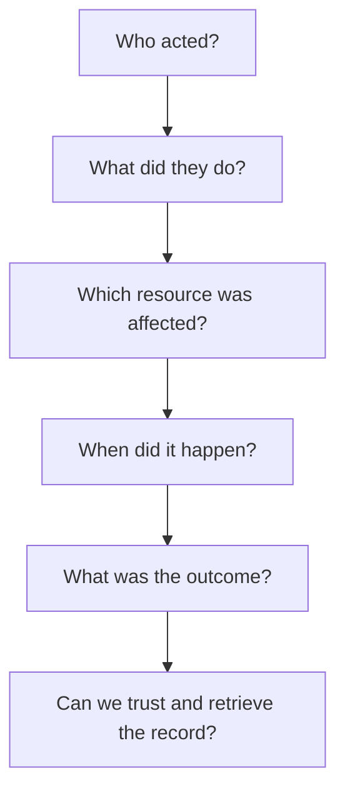

Remember three things:

1. Generate authoritative events in trusted components.
2. Protect audit records against leakage and tampering.
3. Monitor the pipeline so missing events do not go unnoticed.

---

# 23. Quick Reference

| Concept | Meaning |
|---|---|
| Audit log | Record of security-relevant actions and outcomes |
| Actor | User or service responsible for an action |
| Resource | Account, record, credential, or system affected |
| Outcome | Whether an action succeeded, failed, or was denied |
| Correlation ID | Identifier used to connect related records |
| Immutable storage | Storage designed to prevent or restrict alteration and deletion |
| Retention policy | Rules defining how long records are kept |
| Audit pipeline | Components that deliver and store audit events |
| Fail-open | Allow an action to continue despite a dependency failure |
| Fail-closed | Block an action when a required security condition cannot be met |
| Transactional outbox | Pattern for reliably publishing events associated with a database transaction |

---

# 24. Knowledge Check

### Question 1

What is the primary purpose of audit logging?

**Answer:** To preserve trustworthy records of important actions and security decisions for accountability and investigation.

### Question 2

How is an audit log different from an application log?

**Answer:** An audit log records who did what to which resource and with what outcome. Application logs primarily help explain runtime behavior and errors.

### Question 3

Why should audit events be generated by the backend?

**Answer:** The backend can establish the authenticated actor, enforce authorization, and record the actual outcome. Client-generated records are not authoritative.

### Question 4

Why shouldn't audit records contain access tokens or API keys?

**Answer:** Logs can be exposed or accessed by more people than the original credential store. Recording secrets creates another path for credential theft.

### Question 5

Why can a transactional outbox be useful?

**Answer:** It can preserve an event alongside a database state change and allow reliable asynchronous delivery to a separate audit store.

### Question 6

Does collecting audit logs automatically detect an attack?

**Answer:** No. Detection requires suitable analysis, rules, monitoring, and alerting.

### Question 7

Should every operation fail if audit logging is unavailable?

**Answer:** No. The failure policy depends on the operation's risk and the required audit guarantee. Critical privileged actions may need stronger guarantees than ordinary activity.

### Question 8

Why should access to audit logs itself be audited?

**Answer:** Audit records may contain sensitive information, and investigators need to know who accessed or attempted to alter the evidence.

---

# Remember

A reliable audit trail is built from trustworthy events, protected storage, controlled access, appropriate retention, and monitoring for missing data.

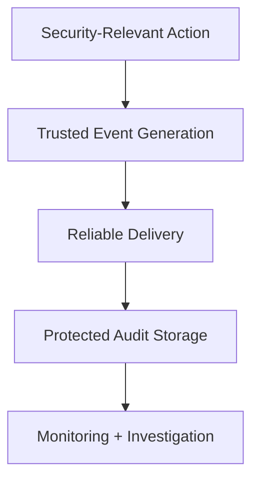

**Next: 11.17 — Threat Modeling**
