# 11.17 — Threat Modeling

## Learning Objectives

By the end of this chapter, you should be able to:

- Explain what threat modeling is and when to use it.
- Identify assets, threat actors, entry points, trust boundaries, and attack paths.
- Apply the STRIDE threat-modeling framework.
- Build a basic threat model for a web application.
- Prioritize threats based on likelihood, impact, and exposure.
- Select security controls that address identified threats.
- Understand why threat modeling must evolve as a system changes.

---

# 1. What Is Threat Modeling?

Imagine you are designing an e-commerce application.

Customers can sign in, place orders, and make payments. Administrators can manage products and access customer information.

Before deploying the application, ask:

- Can someone access another customer's orders?
- Can an attacker steal a session?
- Can a malicious request manipulate a database query?
- Can a compromised administrator account expose customer data?
- Can an attacker overwhelm the application with traffic?

These are not random security questions. They are part of a structured investigation.

**Threat modeling** is the process of identifying what can go wrong in a system, how an attacker might cause it, and what controls can reduce the risk.

The basic process is:

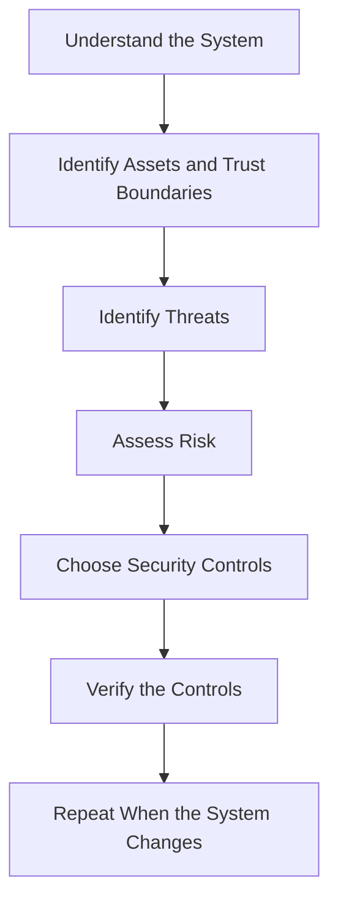

The goal is not to prove that a system is impossible to attack.

The goal is to make important risks visible early enough to address them deliberately.

---

# 2. Why Threat Modeling Matters

Security problems are often expensive to fix after deployment.

Suppose an application stores customer orders and exposes an endpoint:

```http
GET /api/orders/12345
```

The developer checks whether the user is signed in but forgets to verify whether the order belongs to that user.

The endpoint may expose another customer's order.

The missing control is not necessarily a missing firewall or encryption mechanism. It is an authorization check at the resource level.

Threat modeling encourages the team to ask this question before implementation:

> **What could an unauthorized person do through this component, and what must the system verify?**

It helps teams:

- Find design-level security weaknesses.
- Choose controls based on actual risks.
- Avoid relying on a single security layer.
- Reduce expensive redesigns.
- Create testable security requirements.
- Focus limited engineering effort on the most important threats.

---

# 3. Start With the System, Not the Attack List

Before listing threats, understand the system being protected.

For example:

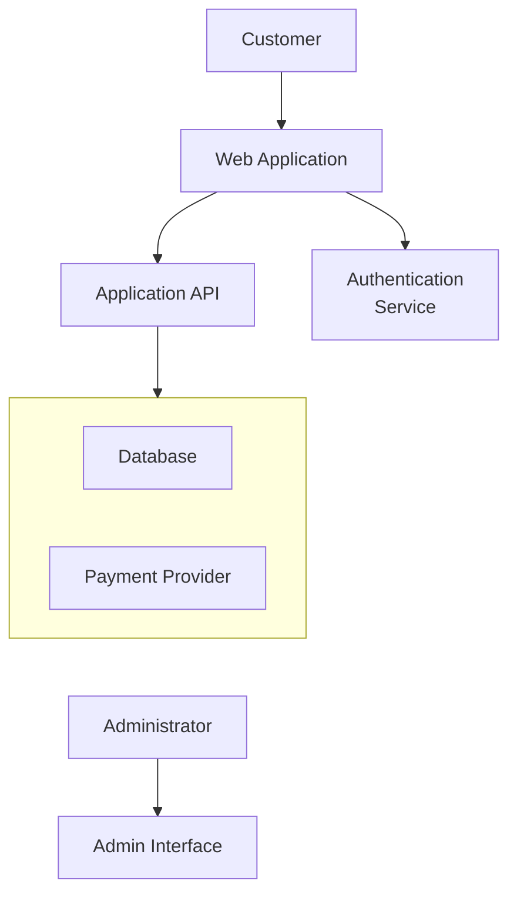

Ask:

- What components exist?
- Which components communicate?
- Where is data stored?
- Which components are exposed to the internet?
- Which components are trusted?
- Where does sensitive information cross a boundary?
- Which identities can perform privileged actions?

A threat model built without understanding the architecture will often miss important risks.

You do not need a perfect architecture diagram. A clear diagram of the important components and data flows is enough to begin.

---

# 4. Identify the Assets

An **asset** is something valuable that needs protection.

Common assets include:

| Asset | Why it matters |
|---|---|
| User credentials | Can enable account takeover |
| Session cookies and tokens | Can grant access as another identity |
| Customer records | May contain private information |
| Payment data | May create financial or regulatory risk |
| API keys and secrets | Can grant access to systems and services |
| Administrative permissions | Can allow powerful changes |
| Order and transaction records | Must remain accurate |
| Service availability | Customers need the system to work |
| Audit logs | May be needed to investigate incidents |

Not every asset has the same security requirements.

For each important asset, ask:

```text
What must remain confidential?
What must remain accurate?
What must remain available?
Who should be allowed to access it?
What happens if it is stolen, changed, or lost?
```

This connects threat modeling to the CIA triad:

- **Confidentiality:** Prevent unauthorized disclosure.
- **Integrity:** Prevent unauthorized or incorrect modification.
- **Availability:** Keep the system usable when needed.

---

# 5. Identify Threat Actors

A **threat actor** is a person, group, or system capable of causing harm.

Possible threat actors include:

- Anonymous internet attackers.
- Malicious or compromised users.
- Attackers using stolen credentials.
- Malicious insiders.
- Compromised third-party services.
- Automated bots.
- Attackers exploiting a vulnerable dependency.

Different actors have different capabilities.

For example:

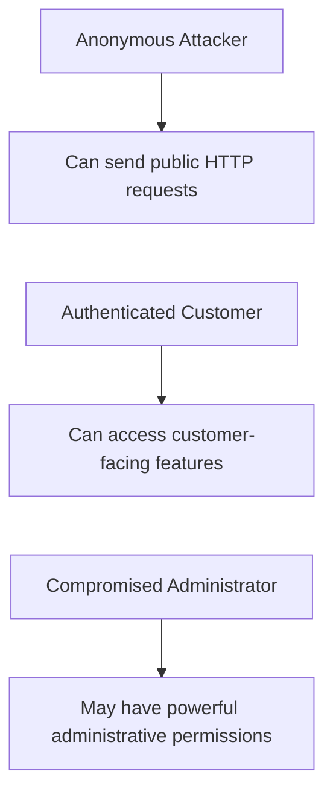

Do not assume that every threat actor is an expert hacker.

A regular customer manipulating an order ID may expose an authorization flaw without using any sophisticated technique.

Also, distinguish malicious activity from accidental misuse. A legitimate administrator can cause damage through a mistake, so some controls should address both deliberate attacks and human error.

---

# 6. Identify Entry Points

An **entry point** is a place where an actor can interact with the system.

Examples include:

- Public API endpoints.
- Login and password-reset forms.
- File uploads.
- Webhooks.
- Administrative interfaces.
- SSH or remote-management access.
- Third-party integrations.
- Message queues accepting external events.

Consider:

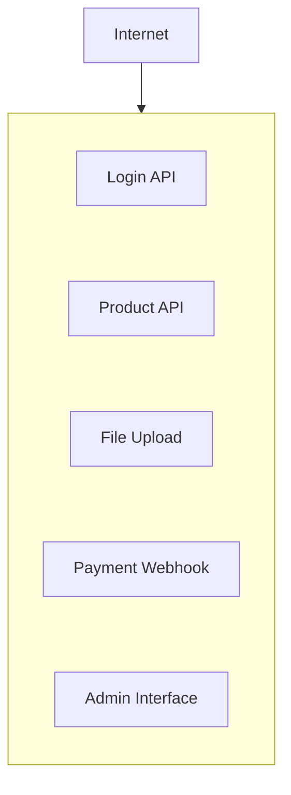

Each entry point introduces different risks.

For example:

- A login endpoint may face credential stuffing.
- A file upload may accept malicious content.
- A webhook may accept forged events.
- An admin interface may expose privileged operations.

A useful question is:

> **Who can reach this entry point, and what can they make the system do?**

---

# 7. Trust Boundaries

A **trust boundary** separates components or environments with different levels of trust.

For example:

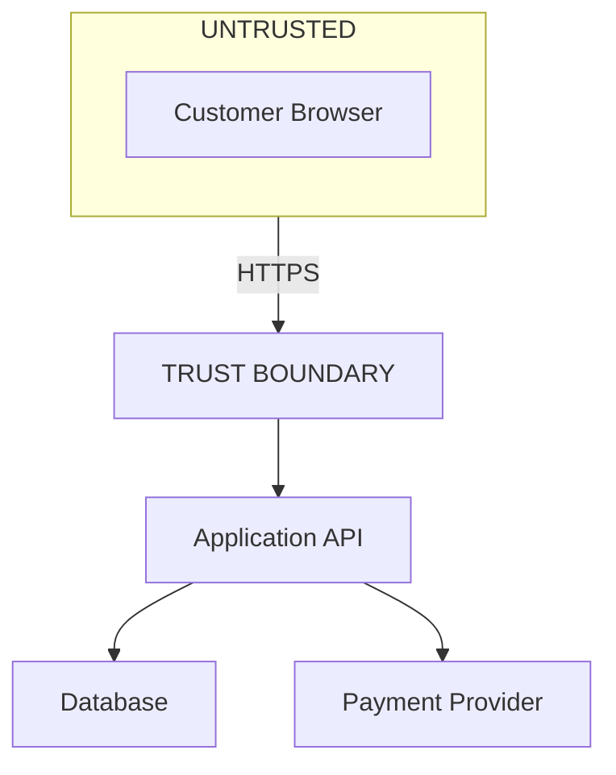

The browser is not trusted to enforce business rules.

Even if the frontend hides an admin button, an attacker may still send the underlying HTTP request manually.

Therefore, the backend must independently verify authentication, authorization, and input validity.

Trust boundaries also exist between:

- Public and private networks.
- Application services and databases.
- Tenants in a multi-tenant application.
- Production and development environments.
- An application and an external provider.
- Regular users and privileged administrators.

At each boundary, ask:

- What data crosses it?
- Who controls that data?
- How is the sender authenticated?
- What authorization checks are required?
- Can the receiving component safely validate the input?

---

# 8. Data Flows and Attack Paths

An **attack path** is a sequence of steps an attacker could use to reach an asset or cause harm.

For example:

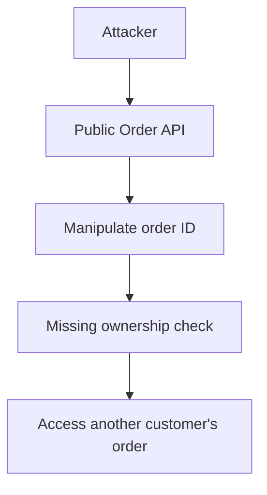

The weakness is not simply that the endpoint is public. Public endpoints are often necessary.

The problem is that the application fails to enforce the correct authorization rule.

A threat model should connect:

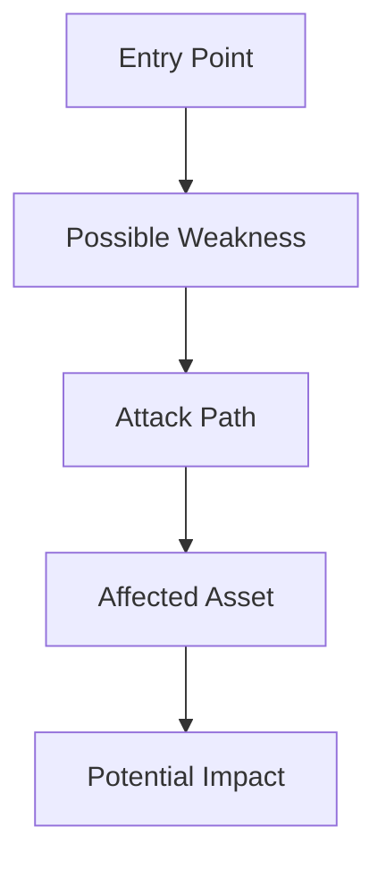

This connection makes the threat actionable.

---

# 9. STRIDE: A Threat Identification Framework

One common framework is **STRIDE**. It provides six categories to help teams identify threats systematically.

| Category | Meaning | Example |
|---|---|---|
| **S — Spoofing** | Pretending to be another identity | Using stolen session credentials |
| **T — Tampering** | Unauthorized modification | Changing an order total |
| **R — Repudiation** | Denying an action when reliable evidence is missing | An administrator denies changing a role |
| **I — Information Disclosure** | Exposing data to unauthorized parties | Reading another user's order |
| **D — Denial of Service** | Preventing legitimate use | Overwhelming an expensive API |
| **E — Elevation of Privilege** | Gaining unauthorized permissions | A customer obtains administrator access |

STRIDE is a checklist for finding possible threats. It is not a complete security solution, and not every category applies equally to every component.

Let's look at each category.

---

# 10. Spoofing

Spoofing means pretending to be another identity or system.

Examples:

- Using a stolen session cookie.
- Using a leaked API key.
- Forging a webhook identity because signatures are not verified.
- Impersonating a service that lacks proper authentication.

Possible controls include:

- Strong authentication.
- Secure session handling.
- Credential rotation and revocation.
- Verifying webhook signatures.
- Mutual TLS where appropriate.
- Protecting secrets and tokens.

**Question to ask:** How does this component establish that the claimed identity is genuine?

---

# 11. Tampering

Tampering means changing data or commands without authorization.

Examples:

- Modifying an order total sent by the browser.
- Changing another user's profile.
- Altering a payment callback.
- Changing production configuration without approval.

Possible controls include:

- Server-side validation.
- Resource-level authorization.
- Database constraints and transactions.
- Cryptographic integrity checks where appropriate.
- Restricted administrative permissions.
- Audit logging of important changes.

**Question to ask:** Who is allowed to change this data, and how does the system enforce that rule?

---

# 12. Repudiation

Repudiation concerns the ability to deny an action when the system cannot produce reliable evidence of what occurred.

For example:

> "I did not change that user's permissions."

If the system records neither the actor nor the outcome of the change, investigating the claim may be difficult.

Possible controls include:

- Reliable audit events.
- Authenticated actor identities.
- Accurate timestamps.
- Protected audit storage.
- Correlation identifiers.
- Restricted access to audit records.

Audit logs help establish evidence, but they do not automatically prove who was operating a compromised account or device. Identity assurance and log integrity also matter.

**Question to ask:** Can we reconstruct the action and its outcome from trustworthy records?

---

# 13. Information Disclosure

Information disclosure occurs when sensitive data reaches an unauthorized party.

Examples:

- An API returns another customer's address.
- An error message reveals database details.
- A log contains an access token.
- A backup is publicly accessible.
- A service exposes internal data to an untrusted network.

Possible controls include:

- Authorization checks.
- Data minimization.
- Encryption.
- Safe error handling.
- Secret redaction.
- Network segmentation.
- Appropriate access controls for backups and logs.

**Question to ask:** What sensitive information could this component reveal, and to whom?

---

# 14. Denial of Service

Denial of Service, or DoS, occurs when an attacker prevents legitimate users from accessing a service.

Examples:

- Sending enormous volumes of requests.
- Triggering expensive database queries.
- Repeatedly starting resource-intensive jobs.
- Exhausting a connection pool.
- Exploiting a slow operation with many concurrent requests.

Possible controls include:

- Rate limiting.
- Request and query timeouts.
- Resource limits.
- DDoS protection.
- Queue limits and load shedding.
- Efficient queries and bounded work.
- Capacity monitoring.

**Question to ask:** Can an attacker consume a limited resource faster than the system can recover it?

---

# 15. Elevation of Privilege

Elevation of privilege means gaining permissions beyond those legitimately granted.

Examples:

- A customer invokes an administrator endpoint.
- A user changes their own role through a modified request.
- A service account can access unrelated databases.
- A compromised process inherits excessive operating-system privileges.

Possible controls include:

- Server-side authorization.
- Role and permission checks.
- Least privilege.
- Separation of duties.
- Strong service identities.
- Network segmentation.
- Monitoring privileged changes.

**Question to ask:** Can this actor reach a capability or resource beyond their intended permissions?

---

# 16. STRIDE in Practice

Suppose an e-commerce application exposes:

```http
POST /api/orders
```

A customer submits an order.

A simple threat analysis might look like this:

| Threat | Possible attack | Control |
|---|---|---|
| Spoofing | Attacker uses a stolen session | Secure session management and revocation |
| Tampering | Client changes the price | Calculate authoritative prices on the server |
| Repudiation | User disputes an order action | Record the authenticated actor and outcome |
| Information disclosure | API returns another customer's order | Check resource ownership |
| Denial of Service | Attacker creates many expensive requests | Rate limits and bounded processing |
| Elevation of Privilege | Customer invokes an admin-only action | Enforce backend permissions |

Notice that the controls are different because the threats are different.

A WAF alone would not fix all six problems.

Security requires multiple controls applied at the correct layer.

---

# 17. Prioritize Threats by Risk

Threat modeling can produce a long list of possible problems.

You need a way to prioritize them.

A practical starting point is:

$$
\text{Risk} \approx \text{Likelihood} \times \text{Impact}
$$

This is a conceptual model, not a universal quantitative formula.

Consider:

| Threat | Likelihood | Impact | Priority |
|---|---|---|---|
| Public exposure of private customer data | Medium | High | High |
| Minor information in an internal error | Medium | Low | Lower |
| Administrator credential compromise | Low to medium | Very high | High |
| Temporary failure of an optional recommendation service | Medium | Low | Lower |

Also consider:

- How exposed is the component?
- How easy is the attack?
- What privileges are needed?
- How many users or tenants could be affected?
- Is the weakness already exploitable?
- Are there compensating controls?
- Can the impact spread to other systems?

Do not treat these ratings as mathematical certainty. Their purpose is to support explicit, consistent decisions.

---

# 18. Prioritize the Attack Path, Not Just the Vulnerability

Imagine an application contains a debug endpoint.

That fact alone does not tell you the full risk.

Ask:

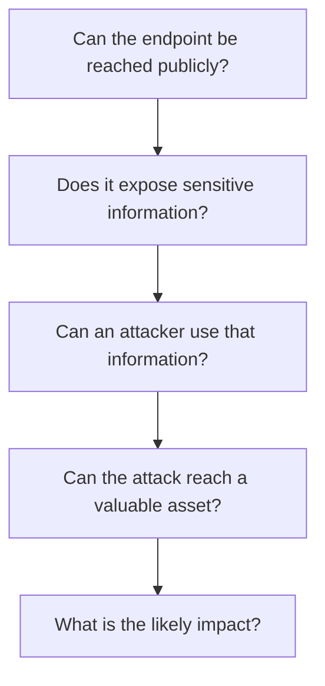

A small weakness may be serious if it opens a path to a critical asset.

Conversely, a theoretical weakness with no realistic attack path may deserve lower priority than an exposed, directly exploitable flaw.

Threat modeling is about understanding how the pieces connect.

---

# 19. Turn Threats Into Security Requirements

A threat model is useful only when its findings influence design, implementation, or operations.

For example:

**Threat:** A customer accesses another customer's order.

**Security requirement:**

> Every order read must verify that the authenticated actor is authorized to access that order.

**Verification:**

- Customer A can access Customer A's order.
- Customer A cannot access Customer B's order by changing the order ID.
- An unauthenticated request is rejected.
- Administrative access follows a separate, explicitly authorized rule.

Another example:

**Threat:** A stolen API key remains usable indefinitely.

**Security requirements:**

- Keys can be revoked.
- Access is restricted to the intended APIs and permissions.
- Key usage is monitored.
- Revocation takes effect within a defined period.

The sequence is:

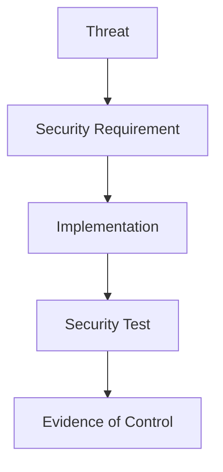

Do not close a threat merely because a control was planned. Verify that it works.

---

# 20. Threat Modeling Across the System Lifecycle

Threat modeling is not a one-time document created before the first release.

The system changes:

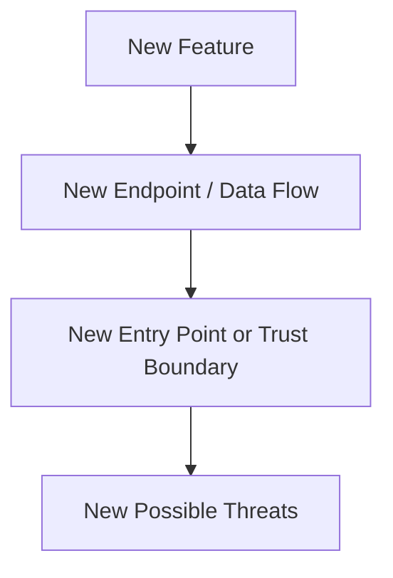

Revisit the threat model when:

- Adding a new public API.
- Introducing a payment or identity provider.
- Changing authentication or authorization.
- Adding file uploads.
- Moving data into a new service.
- Introducing multi-tenancy.
- Changing cloud-network configuration.
- Giving a service new privileges.
- Making sensitive data available through a new interface.

A small feature may require only a brief review. A major architectural change may require a deeper analysis.

---

# 21. Threat Modeling and Existing Security Controls

This level has covered several security controls. Threat modeling helps determine where each one is useful.

| Control | Threats it can help address |
|---|---|
| Authentication | Spoofing and unauthorized identity use |
| Authorization / RBAC | Information disclosure and elevation of privilege |
| JWT/session protection | Credential theft and session misuse |
| Encryption / TLS | Data exposure and some forms of interception or tampering |
| Secrets management | Credential leakage and unauthorized service access |
| Least privilege | Excessive access and blast radius |
| Network segmentation | Unauthorized network paths and lateral movement |
| WAF | Certain HTTP-layer attack patterns |
| DDoS protection | Some availability attacks |
| Audit logging | Investigation and accountability |
| Threat modeling | Identifying which risks and controls matter |

A control's presence does not guarantee protection.

For example, TLS protects data in transit, but it does not prevent an authenticated customer from accessing another customer's record when authorization is broken.

**Choose controls for the threat they actually address.**

---

# 22. Common Threat Modeling Mistakes

### Mistake 1 — Starting with a list of security products

A WAF, firewall, or identity provider is not a substitute for understanding the system's risks.

### Mistake 2 — Focusing only on external attackers

Compromised accounts, malicious insiders, and accidental misuse can also create serious problems.

### Mistake 3 — Ignoring trust boundaries

Data moving between the browser, application, database, and external services deserves deliberate validation and authorization.

### Mistake 4 — Assuming authentication solves authorization

A signed-in user may still be unauthorized to access a particular resource.

### Mistake 5 — Treating every threat as equally important

Prioritize by realistic likelihood, impact, exposure, and attack path.

### Mistake 6 — Writing threats without defining controls

Each important threat should lead to a decision, an owner, or an explicitly accepted risk.

### Mistake 7 — Assuming a control works because it exists

Verify controls with tests, configuration reviews, and operational evidence.

### Mistake 8 — Creating a threat model and never updating it

New features and integrations can create new entry points and trust boundaries.

---

# 23. Hands-On Exercise: Threat Model an E-Commerce API

Consider this architecture:

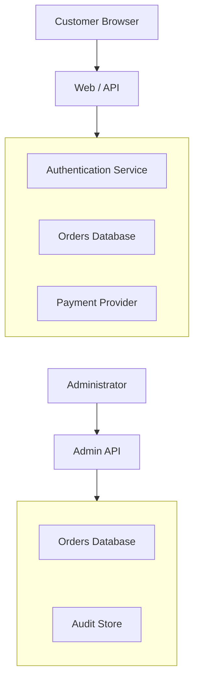

The application supports:

- Customer login.
- Order creation and viewing.
- Payment processing.
- Administrator role changes.
- Customer-data export.

## Step 1 — Identify the assets

Start with:

```text
Customer credentials
Session tokens
Orders
Payment state
Customer personal data
Admin permissions
Audit records
Availability
```

## Step 2 — Identify entry points

Examples:

```text
Login API
Order API
Payment webhook
Admin API
Data-export endpoint
```

## Step 3 — Identify trust boundaries

Examples:

```text
Browser → Backend
Backend → Payment Provider
Admin Interface → Admin API
Application → Database
Application → Audit Store
```

## Step 4 — List plausible threats

Use STRIDE as a checklist.

| Threat | Scenario |
|---|---|
| Spoofing | Stolen session used to access an account |
| Tampering | Client changes an order price |
| Repudiation | Privileged change has no trustworthy audit record |
| Information disclosure | Customer reads another customer's order |
| Denial of Service | Expensive order endpoint is flooded |
| Elevation of privilege | Customer gains an administrator permission |

## Step 5 — Choose and verify controls

For each threat, write:

```text
Threat
Control
Responsible component
Verification test
Remaining risk
```

For example:

```text
Threat:
Customer reads another customer's order.

Control:
Backend checks order ownership on every request.

Verification:
Attempt to access another user's order ID.
Expected result: access is denied.
```

## Step 6 — Prioritize

Start with threats that expose sensitive data, enable privilege escalation, or compromise payments.

Record lower-priority findings too, but do not let minor issues distract from serious, exploitable attack paths.

**Exercise goal:** Produce a small threat model that leads to specific security requirements and tests—not simply a list of scary possibilities.

---

# 24. Quick Reference

| Concept | Meaning |
|---|---|
| Threat modeling | Systematically identifying and assessing possible attacks |
| Asset | Something valuable that needs protection |
| Threat actor | Person, group, or system capable of causing harm |
| Entry point | Place where an actor can interact with the system |
| Trust boundary | Boundary between components with different trust levels |
| Attack path | Sequence of steps that could lead to harm |
| STRIDE | Framework for categorizing six common threat types |
| Risk | Combination of likelihood, impact, and relevant context |
| Security requirement | Specific behavior needed to reduce a threat |
| Control verification | Evidence that a security control works as intended |
| Residual risk | Risk remaining after controls are applied |

---

# 25. Knowledge Check

### Question 1

What is threat modeling?

**Answer:** A structured process for identifying how a system could be attacked, assessing the risks, and selecting appropriate controls.

### Question 2

Why should you draw the architecture before listing threats?

**Answer:** The architecture reveals assets, data flows, entry points, trust boundaries, and possible attack paths.

### Question 3

What does STRIDE stand for?

**Answer:** Spoofing, Tampering, Repudiation, Information Disclosure, Denial of Service, and Elevation of Privilege.

### Question 4

Why is a logged-in customer still a possible threat to another customer's data?

**Answer:** Authentication establishes identity, but authorization must separately verify access to the specific resource.

### Question 5

How should threats be prioritized?

**Answer:** Consider likelihood, impact, exposure, exploitability, affected assets, and existing controls.

### Question 6

Is adding a WAF enough to address every threat?

**Answer:** No. A WAF helps with certain HTTP-layer threats but does not replace application authorization, secure session handling, least privilege, or other controls.

### Question 7

When should a threat model be updated?

**Answer:** When meaningful changes introduce new assets, data flows, entry points, trust boundaries, permissions, or attack paths.

### Question 8

When can a threat be considered addressed?

**Answer:** When an appropriate control has been implemented and its effectiveness verified, with any remaining risk understood and explicitly managed.

---

# Remember

Threat modeling changes security from a collection of products and best practices into a deliberate engineering process.

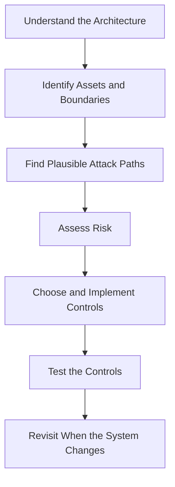

The most important question is not:

> "Which security tool should we add?"

It is:

> **"What are we protecting, how could it be compromised, and what evidence will show that our controls work?"**

**Next: Level 11 complete.**
