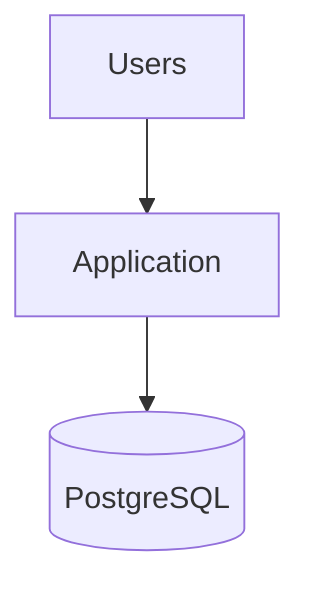
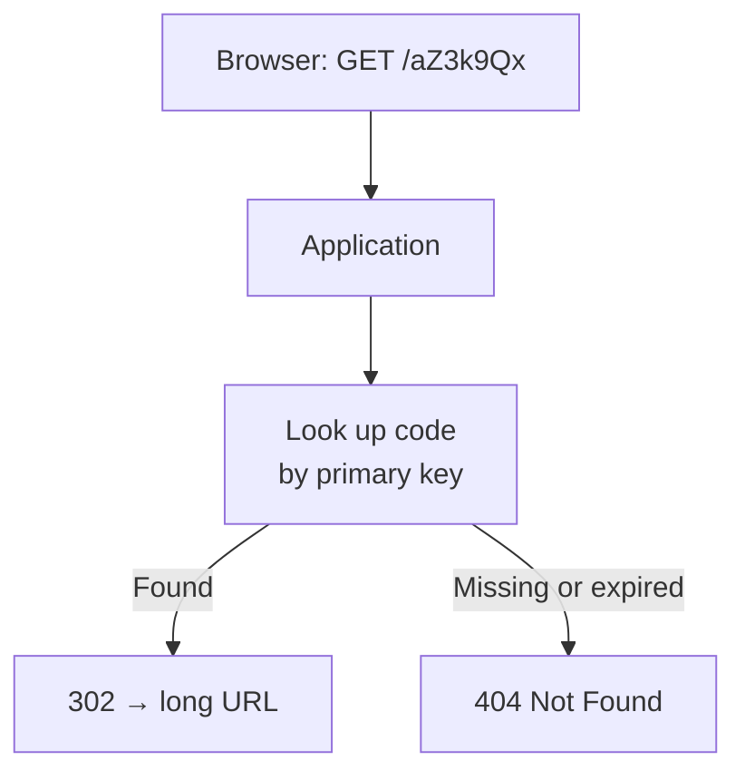
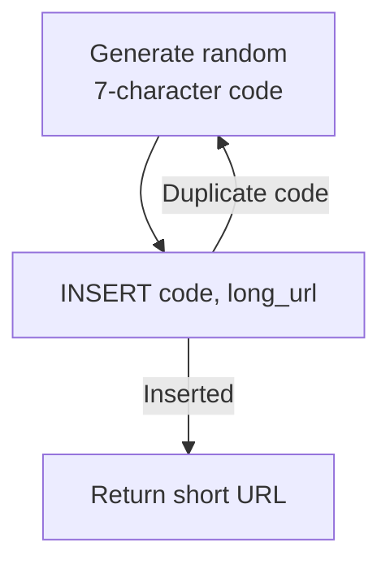
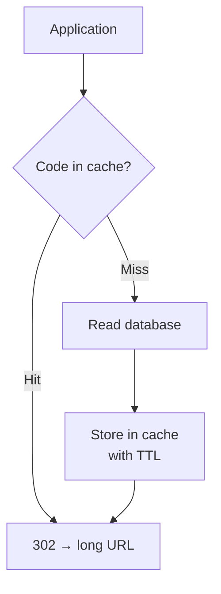
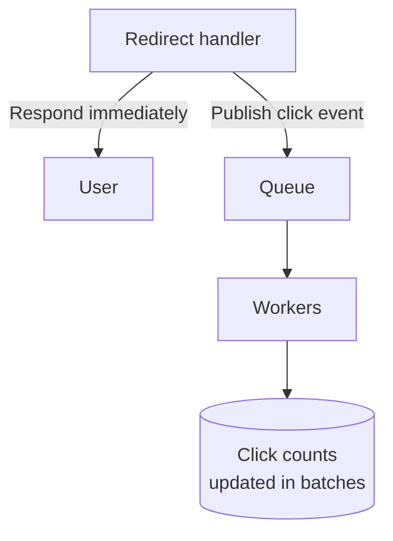
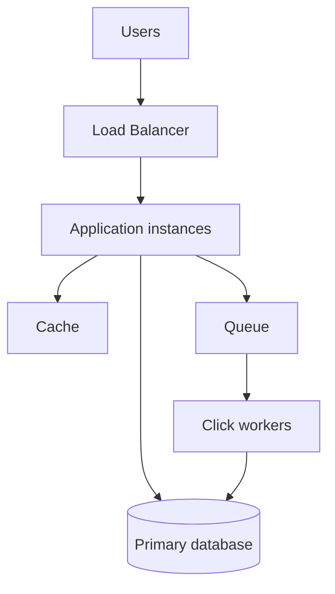
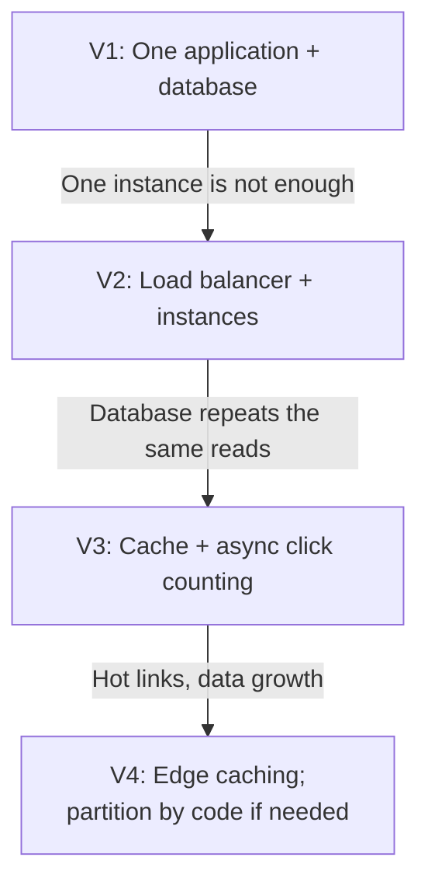

# 12.01 — URL Shortener

## Learning Objectives

By the end of this chapter, you should be able to:

- Turn a product description into functional and non-functional requirements.
- Estimate traffic, storage, and cache size from a few stated assumptions.
- Design a simple first architecture and explain why it is enough.
- Compare ways of generating short codes and choose one deliberately.
- Explain how the choice between `301` and `302` redirects affects load and analytics.
- Identify the bottlenecks that appear as traffic grows, and the change that addresses each one.
- Describe what fails, what users notice, and how the system recovers.

---

## 1. The Problem

A URL shortener turns a long URL into a short one:

```text
https://example.com/products/2026/autumn/running-shoes?campaign=newsletter&ref=email-42
                                      ↓
                          https://sho.rt/aZ3k9Qx
```

When someone opens the short URL, the service looks up the original URL and redirects the browser to it.

The product is small, which makes it a good first case study. Almost every decision is visible:

- One table holds the core data.
- One request type dominates traffic.
- Reads outnumber writes by a large margin.
- A short code, once published, can never be changed.

The last point matters more than it first appears. Short URLs are printed on posters, embedded in emails, and saved in documents. The service is making a promise that each code will keep working for years.

> [!MENTAL-MODEL]
> A URL shortener is a very large, read-heavy, permanent key-value lookup with a redirect in front of it.

---

## 2. Requirements

Requirements come first because every later number depends on them.

### Functional requirements

1. A user can submit a long URL and receive a short URL.
2. Opening a short URL redirects to the original URL.
3. A user can optionally choose a custom alias, such as `sho.rt/spring-sale`.
4. A link can optionally expire at a given time.
5. The owner of a link can see how many times it was opened.

### Non-functional requirements

| Requirement | Target | Why it matters |
|---|---|---|
| Redirect latency | p99 under 100 ms at the server | A redirect sits in front of every visit; users notice delay. |
| Redirect availability | 99.99% | A broken short link breaks every page, email, and poster that uses it. |
| Durability | Created links must not be lost | Losing a mapping breaks a published link permanently. |
| Code length | As short as practical | Shortness is the product. |
| Predictability | Codes should not be easy to enumerate | Sequential codes let anyone walk through every link. |

### Out of scope

- Editing the destination of an existing link.
- User accounts beyond what is needed to own links.
- Detailed click analytics such as geography or device breakdowns.

Stating what is out of scope is part of the design. Each item above would add data, endpoints, and failure modes.

> [!NOTE]
> Redirect availability and link-creation availability are different requirements. If creation is unavailable for a few minutes, users retry. If redirects are unavailable, published links stop working everywhere at once.

---

## 3. Constraints and Assumptions

Estimation needs assumptions. Write them down so they can be challenged.

| Assumption | Value |
|---|---|
| New short URLs | 100 million per month |
| Read:write ratio | 100 redirects for every link created |
| Peak traffic | 3× the daily average |
| Retention | Links are kept for 5 years |
| Average stored record | About 500 bytes, including indexes and metadata |

These are illustrative values for a large public service. A company-internal shortener might create a thousand links a month. The method stays the same; the conclusions change.

---

## 4. Traffic Estimation

A month has about 2.6 million seconds ($30 \times 86{,}400 = 2{,}592{,}000$).

**Writes (link creation):**

$$
\frac{100{,}000{,}000}{2{,}592{,}000} \approx 38.6 \text{ writes per second}
$$

**Reads (redirects):**

$$
38.6 \times 100 \approx 3{,}860 \text{ redirects per second on average}
$$

**Peak redirects:**

$$
3{,}860 \times 3 \approx 11{,}600 \text{ redirects per second}
$$

```calculator
title: Redirect Traffic Estimator
description: Adjust the assumptions to see the peak redirect rate.
inputs:
  - id: links
    label: New short URLs per month
    unit: million
    min: 1
    max: 1000
    step: 1
    value: 100
    divisor: 2.592
  - id: ratio
    label: Redirects per link created
    unit: ×
    min: 1
    max: 500
    step: 1
    value: 100
  - id: peak
    label: Peak-to-average factor
    unit: ×
    min: 1
    max: 10
    step: 0.5
    value: 3
result:
  label: Peak redirects per second
  operation: product
  digits: 0
formula: "{links} million ÷ 2.592 million seconds × {ratio} × {peak}"
caption: An average monthly rate hides daily and seasonal peaks. Size for the peak, then confirm with real traffic.
```

What these numbers tell us:

- **39 writes per second is small.** A single relational database handles this comfortably.
- **Thousands of reads per second is the real workload.** The design should be optimized for the redirect path.
- **The read path is a lookup by key.** There are no joins, no searches, and no aggregation on the hot path.

Bandwidth is not a concern at this scale. A redirect response is a few hundred bytes. At 11,600 responses per second, that is roughly 6 MB/s.

---

## 5. Data Estimation

**Records over five years:**

$$
100 \text{ million} \times 12 \times 5 = 6 \text{ billion links}
$$

**Storage:**

$$
6 \times 10^9 \times 500 \text{ bytes} = 3 \text{ TB}
$$

Three terabytes is large but not extreme. It fits on a single modern database server, although backups, restores, and index maintenance become slower as it grows.

**Short-code length:**

A code made from letters and digits (`a–z`, `A–Z`, `0–9`) uses 62 characters, an encoding called **base62**.

| Length | Possible codes |
|---|---|
| 6 | $62^6 \approx 56.8$ billion |
| 7 | $62^7 \approx 3.5$ trillion |

Six characters would cover 6 billion links, but the space would be about 10% used after five years. Random codes collide more often as the space fills, and growth assumptions are often wrong. Seven characters leave roughly 580 times more room than needed.

**Cache size:**

Link popularity is uneven. A small fraction of links receives most of the clicks. If the 10 million most active links are cached:

$$
10{,}000{,}000 \times 500 \text{ bytes} = 5 \text{ GB}
$$

That fits in memory on a single cache node.

> [!TIP]
> Estimates are for choosing the shape of the system, not for ordering hardware. Being within a factor of two or three is enough to decide whether something fits on one machine.

---

## 6. API Design

Two endpoints carry almost all of the traffic.

**Create a short URL:**

```http
POST /api/links
Content-Type: application/json

{
  "url": "https://example.com/products/2026/autumn/running-shoes",
  "alias": "autumn-shoes",
  "expiresAt": "2027-01-01T00:00:00Z"
}
```

```http
201 Created

{
  "code": "autumn-shoes",
  "shortUrl": "https://sho.rt/autumn-shoes"
}
```

**Follow a short URL:**

```http
GET /aZ3k9Qx
```

```http
302 Found
Location: https://example.com/products/2026/autumn/running-shoes
```

Supporting endpoints, such as reading click counts or deleting a link, receive far less traffic.

The creation endpoint should require authentication or strict rate limiting. An open endpoint that stores arbitrary URLs is quickly used to hide spam and phishing links.

---

## 7. Data Model

The core table is simple:

| Column | Type | Notes |
|---|---|---|
| `code` | varchar(16) | Primary key; the short code or custom alias |
| `long_url` | text | The destination |
| `owner_id` | bigint | Who created it |
| `created_at` | timestamp | |
| `expires_at` | timestamp, nullable | |

Clicks are stored separately:

| Column | Type | Notes |
|---|---|---|
| `code` | varchar(16) | Which link |
| `day` | date | Aggregation bucket |
| `count` | bigint | Clicks on that day |

Keeping clicks out of the `links` row is deliberate. A popular link might be opened thousands of times per second. Updating a counter in the same row as the mapping would turn every redirect into a write on a hot row.

**Which database?**

The access pattern is a key-value lookup, so both a relational database and a key-value store fit.

- **A relational database** (for example PostgreSQL) gives a unique constraint on `code`, transactions, familiar tooling, and easy reporting queries. It is the simpler starting point for most teams.
- **A managed key-value store** scales the lookup horizontally with little operational work, but reporting queries and secondary access patterns become harder.

Start with what the team can operate well. Section 14 discusses how hard this choice is to reverse.

---

## 8. Initial Architecture

At launch, traffic is far below the estimates. The first version should be the smallest design that meets the requirements.



The redirect path:



Why this is enough at first:

- A primary-key lookup takes well under a millisecond when the row is in memory.
- One database server can serve thousands of such lookups per second.
- The application holds no state, so a second instance can be added without redesign.

> [!TRADE-OFF]
> V1 has no redundancy. If the application or the database fails, every link stops working. That is acceptable only while the service is small and the cost of downtime is low. The 99.99% requirement is a later target, not a launch requirement.

---

## 9. Generating Short Codes

This is the most interesting design decision in the system, because the codes are permanent.

### Option A — Hash the long URL

Hash the URL (for example with SHA-256), encode it in base62, and keep the first 7 characters.

- Same long URL always produces the same code, which deduplicates repeated submissions.
- Different URLs can produce the same 7-character prefix, so collisions still have to be detected and resolved.
- Two different users shortening the same URL receive the same code, which complicates ownership, expiration, and click counts.

### Option B — Counter encoded in base62

Use an auto-incrementing number and encode it: `1 → 1`, `1000 → g8`, `56,800,235,584 → 1000000`.

- Unique by construction, with no collision checks.
- Codes are sequential, so anyone can enumerate every link by counting.
- A single counter becomes a coordination point when several database nodes issue codes. Allocating ranges of numbers to each node solves this, at the cost of more moving parts.

### Option C — Random code with a uniqueness check

Generate 7 random base62 characters and insert them. The unique constraint on `code` rejects duplicates; on a conflict, generate a new code and retry.

- Codes are not enumerable.
- No coordination between application instances.
- Collisions are rare. With 6 billion links in a space of 3.5 trillion codes, a new random code collides with an existing one about 0.17% of the time. One retry almost always succeeds.



### Decision

Use **Option C**. It satisfies the predictability requirement, needs no coordination, and relies on a database guarantee (the unique constraint) instead of application logic.

Custom aliases use the same table and the same constraint. If the alias already exists, the request fails with `409 Conflict` instead of retrying.

> [!WARNING]
> Never check "does this code exist?" and then insert in a separate step. Two requests can pass the check at the same moment. Let the unique constraint decide, and handle the conflict.

The retry must be bounded. If several retries in a row collide, something is wrong (a bug in the random generator, or a nearly full code space), and the request should fail loudly instead of looping.

---

## 10. Redirects: 301 or 302?

The redirect status code decides who remembers the mapping.

| Status | Meaning | Effect |
|---|---|---|
| `301 Moved Permanently` | The browser may cache the redirect indefinitely | Repeat visits from the same browser never reach the service |
| `302 Found` | Temporary redirect | Every visit reaches the service |

`301` reduces load, but:

- Click counts miss repeat visits, because they never arrive.
- Expiration and deletion stop working for anyone whose browser cached the redirect.
- A cached mistake cannot be corrected from the server.

The requirements include click counts and expiration, so this design uses **`302`**. A `Cache-Control` header with a short lifetime is a middle ground if load becomes a problem, at the cost of less exact counts.

> [!TRADE-OFF]
> `301` trades control and measurement for less traffic. `302` keeps control and measurement at the price of serving every click.

---

## 11. Bottlenecks

Traffic grows toward the estimates. Measure before changing anything; the symptoms point to the bottleneck.

| Symptom | Likely bottleneck |
|---|---|
| Application CPU is high on every instance | Not enough application capacity |
| Database CPU and read I/O climb with traffic | Repeated lookups of the same popular codes |
| One link goes viral and latency rises for everyone | A hot key concentrated on one cache or database node |
| Redirect latency rises when click counts are written | Writes on the hot path |
| Database backups and restores take hours | Data size on one node |

The first bottleneck in a read-heavy system is almost always repeated reads. Most redirects ask for a small set of popular codes.

---

## 12. Architectural Decisions

Each change below addresses one measured problem.

### Decision 1 — Run several application instances behind a load balancer

**Problem:** One instance cannot handle peak traffic, and its failure takes the service down.

The application is stateless, so adding instances is straightforward. The load balancer removes unhealthy instances using health checks.

### Decision 2 — Cache the redirect lookup

**Problem:** The database repeats the same lookups for popular links.

Use cache-aside with an in-memory store such as Redis:



Mappings never change after creation, so the cache rarely serves stale data. The exceptions are expiration and deletion:

- Store the expiry time in the cached value and check it before redirecting.
- On deletion, delete the cache entry after updating the database.
- Keep a TTL (for example 24 hours) as a safety net for any entry that is missed.

Cache "not found" results briefly too. Otherwise, requests for nonexistent codes, often from bots, always fall through to the database.

### Decision 3 — Move click counting off the redirect path

**Problem:** Writing a counter during every redirect adds latency and creates write contention on popular links.



The redirect no longer waits for a write. Workers aggregate events and update each `(code, day)` row once per batch instead of once per click.

Click counts become **eventually consistent**: a click may take seconds to appear. That is acceptable for this product, and the requirement should say so explicitly.

### Decision 4 — Add read replicas only if the cache is not enough

With a high cache hit rate, the database sees mostly cache misses and writes. Read replicas help when misses alone exceed what the primary can serve, or when reporting queries compete with redirects.

> [!NOTE]
> Replicas lag behind the primary. A link created a moment ago may not exist on a replica yet. Read new links from the primary, or retry a replica miss on the primary before returning `404`.

---

## 13. Scaling the System

The architecture after the first three decisions:



### Hot links

A link shared by a celebrity might receive tens of thousands of requests per second. In a cache cluster, one key lives on one node, so that node becomes the bottleneck.

Options, in order of complexity:

1. **Short in-process cache** on each application instance (a few seconds of TTL). Each instance answers the hot key from local memory.
2. **CDN or edge caching** of the redirect response with a short `Cache-Control` lifetime. The edge absorbs repeated requests close to users.
3. **Key replication** across several cache nodes, with readers choosing one at random.

Option 1 is usually enough and adds no new infrastructure.

### Storage growth

At 3 TB over five years, a single well-provisioned database can still hold the data. Partitioning becomes worth its cost when:

- Backups or restores no longer fit the recovery-time objective.
- Write volume or storage outgrows the largest practical instance.
- Index maintenance starts affecting latency.

If that happens, partition by `code`. Every redirect looks up exactly one code, so each request touches exactly one partition. Random codes spread evenly, so no partition becomes hot because of the key distribution.

> [!EVOLUTION]
> Sharding is not part of this design yet. The estimates show it may never be needed. Write down the signal that would justify it, and revisit when the signal appears.

---

## 14. Failure Scenarios

| Failure | What users notice | Mitigation |
|---|---|---|
| One application instance crashes | Nothing, if health checks remove it quickly | Several instances; load-balancer health checks |
| Cache cluster is unavailable | Slower redirects; possible database overload | Fall back to the database with a concurrency limit; serve hot links from the in-process cache |
| Cache restarts empty | A burst of misses hits the database | Request coalescing so one miss per key reaches the database; warm the most popular keys |
| Primary database fails | Link creation fails; redirects continue for cached links | Automatic failover to a replica; creation degrades gracefully |
| Queue is slow or unavailable | Click counts fall behind; redirects are unaffected | Buffer locally for a short time, then drop and record the loss |
| A link is reported as malicious | Users are sent to a harmful site | Block-list check on creation and redirect; ability to disable a code immediately |
| Code generator bug produces repeats | Creation retries fail | Bounded retries, alerting on retry rate |

Notice which requirement each mitigation protects. Redirects are protected aggressively. Click counts are allowed to fall behind.

> [!FAILURE] When the cache disappears at peak
> At 11,600 redirects per second and a 95% hit rate, the database normally sees about 580 lookups per second. With no cache, it suddenly sees all 11,600. Without a limit on concurrent database queries, the database slows, every request waits, and the application exhausts its connection pool. Limit concurrency and shed load before the database fails.

---

## 15. Recovery

**Link data** is the asset that cannot be recreated. A lost mapping is a permanently broken link.

- Replicate the primary database and take regular backups with point-in-time recovery.
- Choose a recovery-point objective close to zero for links. Synchronous replication to at least one replica is one way to achieve it.
- Test restores. A backup that has never been restored is an assumption, not a recovery plan.

**The cache** holds nothing that cannot be rebuilt. After an outage, it refills from the database as requests arrive.

**Click events** can be replayed if the queue retains them. Workers must be idempotent: processing the same event twice must not count the click twice. Giving each event an ID and recording processed IDs per batch is one way to achieve this.

---

## 16. Evolution



Each step is justified by a measurement, not by the expectation of scale. A service that never reaches V4 has not failed; it has avoided unnecessary complexity.

---

## 17. Trade-offs

| Decision | Benefit | Cost |
|---|---|---|
| Random 7-character codes | Not enumerable; no coordination | Rare collisions; retries on insert |
| `302` redirects | Accurate counts; expiration works | Every click reaches the service |
| Cache-aside | Database protected from repeated reads | Another component to operate; cold-start risk |
| Asynchronous click counting | Fast redirects; no hot-row writes | Counts are delayed and can be lost if the queue fails |
| Relational database | Unique constraint, transactions, familiar tools | Eventually needs partitioning at very large scale |
| No sharding at launch | Simple operations | A migration later if growth exceeds one node |

> [!LOCK-IN]
> The hardest decision to reverse is not the database or the cache. It is the **public URL format**: the domain, the code alphabet, and the code length. Once links are printed and shared, they must keep working. The domain must be renewed indefinitely, and any future system must still resolve every old code.

Other decisions are easier to change:

- **Cache technology** sits behind a small interface (get, set, delete) and can be replaced.
- **Database engine** is harder: moving 3 TB of live mappings requires dual writes or a backfill, followed by a verified cut-over.
- **Managed key-value stores** bind the data model and access patterns to one provider's API. Keeping the lookup behind a repository interface reduces that coupling.

---

## 18. Common Mistakes

- **Optimizing for writes:** At 100 reads per write, the redirect path is the system.
- **Counting clicks synchronously:** It slows every redirect and creates hot rows.
- **Using sequential codes when privacy matters:** Anyone can enumerate every link.
- **Check-then-insert for uniqueness:** Two concurrent requests can both pass the check.
- **Choosing `301` without considering analytics and expiration:** Cached redirects cannot be counted or revoked.
- **Sharding on day one:** The estimates show a single database is enough for years.
- **Leaving creation unauthenticated and unlimited:** The service becomes a tool for hiding malicious links.
- **Ignoring the cache-failure case:** A cache that protects the database also hides how much load the database would receive without it.

---

## 19. Hands-On Exercise

Redesign the shortener for a different set of requirements.

A company wants an **internal** URL shortener:

- 5,000 employees.
- About 2,000 new links per month.
- Links must be human-readable aliases (`go/payroll`, `go/oncall`).
- Destinations may be edited, because internal pages move.
- Only employees can create or follow links.

Answer:

1. Estimate writes per second and redirects per second.
2. Which components from V3 are unnecessary? Why?
3. How does editable destinations change the `301` vs `302` decision?
4. How does it change the caching strategy?
5. What is now the most important non-functional requirement?
6. Which decision would be hardest to reverse?

Then compare your design with V1 and V3. The goal is to see how requirements, not the product category, determine the architecture.

---

## 20. Quick Reference

| Topic | Decision in this design |
|---|---|
| Workload | Read-heavy key-value lookups (100:1) |
| Peak traffic | About 11,600 redirects/s; about 120 writes/s |
| Storage | About 6 billion links, 3 TB over 5 years |
| Code | 7 random base62 characters, unique constraint, bounded retry |
| Redirect | `302 Found` to keep counts and expiration |
| Cache | Cache-aside, TTL safety net, negative caching |
| Clicks | Queue + workers, aggregated per day, eventually consistent |
| Hot links | In-process cache, then edge caching |
| Partitioning | Only if size or writes outgrow one node; key is `code` |
| Hardest to reverse | The public domain and code format |

---

## 21. Knowledge Check

**1. Why is the redirect path the focus of the design?**

Redirects outnumber link creation by about 100 to 1, and every published link depends on them.

**2. Why are clicks stored separately from the link mapping?**

Updating a counter in the mapping row would turn every redirect into a write and create contention on popular links.

**3. Why use random codes instead of a counter?**

Counter-based codes are sequential and can be enumerated. Random codes are not, and they need no coordination between instances.

**4. How are random-code collisions handled?**

The database's unique constraint rejects duplicates, and the application retries with a new code a bounded number of times.

**5. Why does this design use `302` instead of `301`?**

Browsers may cache `301` indefinitely, so repeat visits would not be counted and expiration or deletion would not take effect.

**6. What happens to redirects if the cache fails?**

They fall back to the database, which must be protected with concurrency limits so it is not overwhelmed.

**7. When would partitioning become worthwhile?**

When storage, write volume, backups, or index maintenance outgrow a single database node. Partition by `code` so each lookup touches one partition.

**8. Which decision is hardest to reverse?**

The public URL format: the domain, alphabet, and code length, because published links must keep working.

---

## Remember

**Design for the workload you measured, not the one you imagine.**

A URL shortener is mostly a cached key-value lookup. Keep the redirect path short, move everything else off it, protect the data that cannot be recreated, and treat every published code as a permanent promise.

**Next: 12.02 — E-Commerce Platform**
