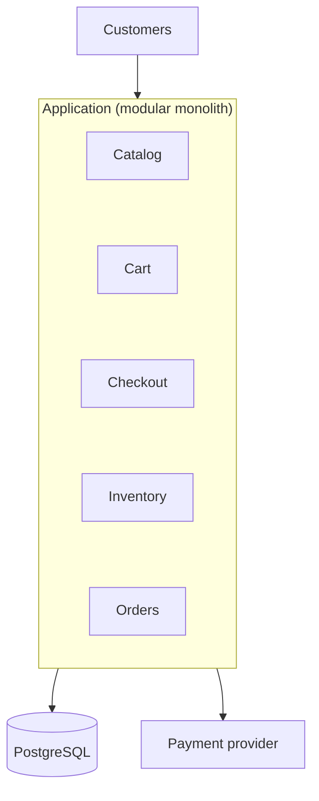
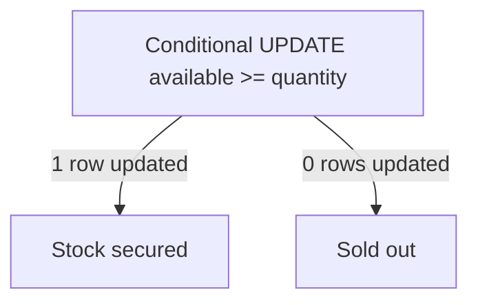
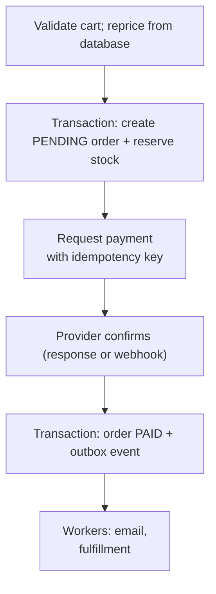
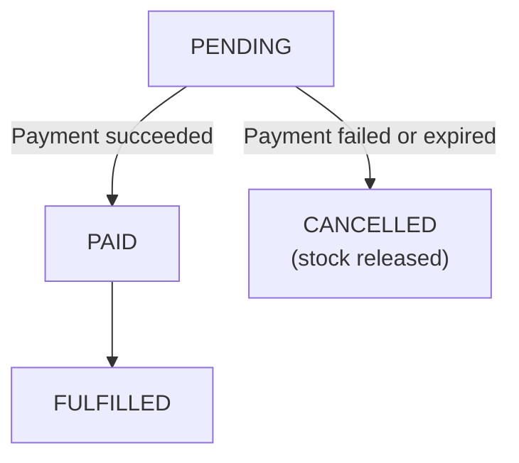
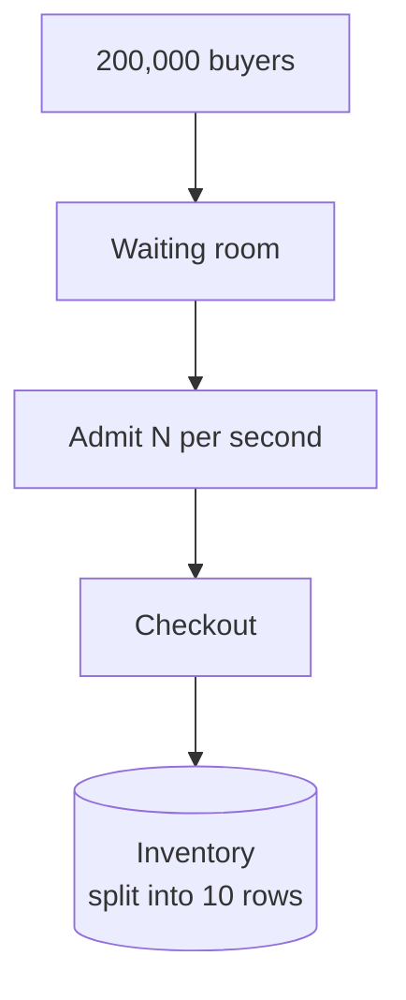
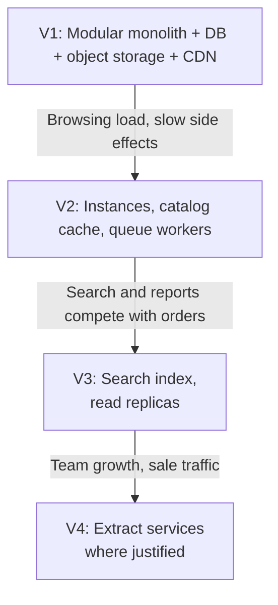

# 12.02 — E-Commerce Platform

## Learning Objectives

By the end of this chapter, you should be able to:

- Separate the read-heavy browsing workload from the correctness-critical ordering workload.
- Estimate page traffic, order volume, and storage for an online store.
- Prevent overselling with atomic inventory updates and time-limited reservations.
- Design a checkout that survives payment timeouts, duplicate requests, and partial failures.
- Explain why a modular monolith is a sensible starting architecture.
- Handle a flash sale without letting one product take down the whole store.
- Identify which parts of the system can be eventually consistent and which cannot.

---

## 1. The Problem

An online store lets customers browse products, add them to a cart, and pay for an order.

The product looks like one application, but it contains two very different workloads:

| Workload | Examples | Volume | What matters most |
|---|---|---|---|
| Browsing | Home page, product pages, search, images | Very high | Speed |
| Ordering | Cart, checkout, payment, stock | Low | Correctness |

A product page that is a few seconds out of date is harmless. An order that charges a customer for an item that is out of stock, or charges them twice, is not.

> [!MENTAL-MODEL]
> An e-commerce platform is a fast, cacheable catalog in front of a small, strict transaction system. Design them differently.

---

## 2. Requirements

### Functional requirements

1. Customers can browse and search a product catalog.
2. Customers can add products to a cart, including before signing in.
3. Customers can check out and pay with an external payment provider.
4. The system never sells more units than are in stock.
5. Customers receive an order confirmation and can see their order status.
6. Staff can add products and update prices and stock.

### Non-functional requirements

| Requirement | Target | Why it matters |
|---|---|---|
| Product page latency | p95 under 300 ms | Slow pages reduce sales |
| Checkout availability | 99.95% | Checkout downtime is lost revenue |
| Order correctness | No overselling; no double charging | Mistakes cost money and trust |
| Peak handling | 5× normal traffic; 20× orders during sales | Sales events concentrate demand |
| Price accuracy | The customer pays the price shown at checkout | A legal and trust requirement |

### Out of scope

- Marketplace features (third-party sellers).
- Recommendations and personalization.
- Warehouse management and shipping logistics.
- Multi-currency and tax calculation details.

---

## 3. Constraints and Assumptions

| Assumption | Value |
|---|---|
| Daily active users | 5 million |
| Pages viewed per user per day | 20 |
| Conversion rate | 2% of daily users place an order |
| Products | 1 million |
| Product record | About 10 KB including descriptions and attributes |
| Images | About 10 per product, 200 KB each |
| Order record | About 2 KB including line items |
| Normal peak | 5× the daily average |
| Sale peak for orders | 20× the daily average |

The team has eight engineers. That constraint matters as much as the traffic numbers.

---

## 4. Traffic Estimation

A day has 86,400 seconds.

**Page views:**

$$
\frac{5{,}000{,}000 \times 20}{86{,}400} \approx 1{,}160 \text{ page views per second on average}
$$

$$
1{,}160 \times 5 \approx 5{,}800 \text{ page views per second at peak}
$$

```calculator
title: Peak Browsing Traffic
description: Adjust the assumptions to estimate peak page views per second.
inputs:
  - id: dau
    label: Daily active users
    unit: million
    min: 0.1
    max: 50
    step: 0.1
    value: 5
    divisor: 0.0864
  - id: pages
    label: Pages per user per day
    unit: pages
    min: 1
    max: 100
    step: 1
    value: 20
  - id: peak
    label: Peak-to-average factor
    unit: ×
    min: 1
    max: 20
    step: 0.5
    value: 5
result:
  label: Peak page views per second
  operation: product
  digits: 0
formula: "{dau} million ÷ 86,400 seconds × {pages} × {peak}"
caption: Each page view may trigger several API calls and many image requests, most of which a CDN can serve.
```

**Orders:**

$$
5{,}000{,}000 \times 2\% = 100{,}000 \text{ orders per day} \approx 1.2 \text{ per second}
$$

During a sale, 20× the average is about **23 orders per second**.

**Cart updates:** if each user changes a cart about three times a day, that is around 170 writes per second on average and about 870 at peak.

What these numbers tell us:

- Browsing traffic is thousands of requests per second and mostly repeated reads of the same products.
- Order traffic is tiny by comparison. One database handles 23 orders per second easily.
- **The difficulty of checkout is correctness under concurrency, not throughput.**

---

## 5. Data Estimation

| Data | Calculation | Size |
|---|---|---|
| Catalog | 1 million × 10 KB | About 10 GB |
| Product images | 1 million × 10 × 200 KB | About 2 TB |
| Orders per year | 100,000 × 365 × 2 KB | About 73 GB |

The structured data is small. The whole catalog fits in memory on one server, and a year of orders fits comfortably in one database.

Images are the large part, and they belong in object storage behind a CDN, not in the database.

---

## 6. Data Model

The core tables:

| Table | Key columns | Purpose |
|---|---|---|
| `products` | `id`, `name`, `description`, `price` | The catalog |
| `inventory` | `sku`, `available`, `reserved` | Stock per sellable item |
| `carts` / `cart_items` | `cart_id`, `sku`, `quantity` | Items a customer intends to buy |
| `orders` | `id`, `customer_id`, `status`, `total` | One row per order |
| `order_items` | `order_id`, `sku`, `quantity`, `unit_price` | What was bought, at what price |
| `payments` | `order_id`, `provider_ref`, `status`, `idempotency_key` | Payment attempts |

Two details prevent common bugs:

- **`order_items.unit_price` copies the price at checkout.** If the product price changes tomorrow, the order still shows what the customer paid.
- **`inventory` is separate from `products`.** Product details are read constantly and change rarely. Stock changes with every order. Keeping them apart lets the catalog be cached aggressively while stock is always read from the database.

A relational database fits well: orders, payments, and inventory need transactions and constraints.

---

## 7. Initial Architecture

With eight engineers and modest order volume, start with a **modular monolith**: one deployable application with clear internal modules.



Images are uploaded to object storage and served through a CDN from the start. This costs little and removes the largest source of bytes from the application.

Why not microservices?

- The team is small. Separate services would multiply deployments, monitoring, and on-call work.
- Checkout needs to update orders and inventory together. In one database, that is one transaction. Across services, it becomes a distributed workflow.
- Module boundaries inside the monolith keep the option to extract a service later.

> [!TRADE-OFF]
> A modular monolith keeps transactions simple and operations cheap. The cost is that every module scales and deploys together, and the boundaries are only as strong as the team's discipline.

---

## 8. Preventing Overselling

Two customers try to buy the last unit at the same moment.

A naive implementation reads, checks, and writes:

```text
Customer A reads available = 1
Customer B reads available = 1
Customer A writes available = 0   → order placed
Customer B writes available = 0   → order placed
```

Both orders succeed. One customer will not receive the item.

The fix is to let the database perform the check and the update as one atomic statement:

```sql
UPDATE inventory
SET available = available - 1
WHERE sku = 'SHOE-42' AND available >= 1;
```

If the statement updates one row, the unit is secured. If it updates zero rows, the item is sold out. Two concurrent statements cannot both succeed for the last unit, because the database applies them one at a time to that row.



> [!WARNING]
> Checking stock in application code and then updating it in a separate statement is a race condition. Raising the isolation level or adding locks can also work, but a single conditional update is the simplest correct solution.

### Reservations

Payment takes time. Between "Place order" and "Payment confirmed", the stock must be held for this customer, but not forever.

A **reservation** moves units from `available` to `reserved` with an expiry time. It uses the same conditional update, with `reserved = reserved + 1` added to the `SET` clause and a reservation row recording who holds the units and until when:

1. At checkout, reserve the items for 15 minutes.
2. If payment succeeds, convert the reservation into a sale.
3. If payment fails or the reservation expires, return the units to `available`.

A background job releases expired reservations. Without it, abandoned checkouts would slowly make in-stock items appear sold out.

---

## 9. Checkout

Checkout touches the order, the inventory, and an external payment provider. The external call cannot be part of a database transaction, so the flow is a sequence of steps with a recorded state.



The order moves through explicit states:



Key points:

- **Reprice at checkout.** Prices in the cart or a cache may be stale. The total is calculated from the database inside the checkout.
- **Use an idempotency key for payment.** If the request times out and is retried, the provider recognizes the key and does not charge again.
- **Treat a timeout as "unknown", not "failed".** The payment may have succeeded. Query the provider or wait for its webhook before cancelling.
- **Handle webhooks idempotently.** Providers may deliver the same notification more than once.
- **Use the outbox pattern for side effects.** The order update and the "order paid" event are written in the same transaction; a worker publishes the event afterwards. A crash cannot leave a paid order without a confirmation email or fulfillment request.

> [!FAILURE] The payment timeout
> The application asks the provider to charge the customer and waits 10 seconds. No response arrives. Marking the order failed and releasing the stock may leave a customer charged for an item that has been sold to someone else. Marking it paid may ship an item that was never paid for. The correct state is "payment pending": keep the reservation, then resolve it from the provider's record.

---

## 10. Bottlenecks

| Symptom | Likely bottleneck |
|---|---|
| Product pages slow down as traffic grows; database CPU rises | Repeated catalog reads |
| Search queries are slow and consume database CPU | `LIKE` queries over product text |
| Checkout latency spikes during a sale on one product | Contention on one inventory row |
| Confirmation emails slow down checkout | Side effects on the request path |
| Application CPU is high on all instances | Not enough application capacity |

---

## 11. Architectural Decisions

### Decision 1 — Cache the catalog

**Problem:** Product pages read the same rows repeatedly.

Cache product details and category listings (cache-aside with a TTL of minutes), and let the CDN cache public, anonymous pages for a short time.

Price and stock are the exception:

- Pages may show a cached price, but checkout always reprices from the database.
- Stock shown on product pages can be approximate ("In stock", "Only a few left"). The reservation step is the source of truth.

### Decision 2 — Add a search index

**Problem:** Text search, filters, and sorting across a million products are slow in the transactional database.

Copy product data into a search engine and keep it updated from product-change events. The search index is **eventually consistent**: a new product may take seconds to appear in results. That is acceptable for browsing, and it never affects whether an order is accepted.

Chapter 12.08 designs the search system in detail.

### Decision 3 — Move side effects to queues

**Problem:** Emails, invoices, analytics, and fulfillment requests slow checkout and fail independently.

Checkout records the outcome and an outbox event. Workers do the rest. If the email service is down, orders still complete, and emails are sent when it recovers.

### Decision 4 — Scale the application horizontally

**Problem:** One instance cannot serve peak browsing traffic.

Keep the application stateless. Store carts in the database (or in a cache with persistence) keyed by customer or by an anonymous cart ID, not in instance memory.

### Decision 5 — Add read replicas for reporting

**Problem:** Staff reports and exports compete with customer traffic.

Send reporting queries to a replica. Checkout and inventory always use the primary.

---

## 12. Scaling: The Flash Sale

A limited-edition product goes on sale at 10:00. Two hundred thousand people press "Buy" in the first minute for 5,000 units.

Every request tries to update the same inventory row. The database serializes them, lock waits grow, connection pools fill, and checkout slows down for every product, not only the sale item.

Options, from simplest:

1. **Rate-limit checkout for the sale item.** Reject or queue excess requests early, before they reach the database.
2. **Admit buyers through a waiting room.** A queue in front of checkout admits a controlled number of customers per second. Customers see their position instead of errors.
3. **Split the stock.** Divide the 5,000 units into, for example, 10 inventory rows of 500. Each request picks a row with stock. Contention drops by roughly the number of rows, at the cost of more complex "sold out" detection.
4. **Isolate the sale.** Run the sale's checkout on separate capacity so that its load cannot exhaust resources used by the rest of the store.



> [!TRADE-OFF]
> A waiting room protects the store and gives a fair order, but it adds a component, a user-visible delay, and a new failure mode. It is worth building only if the business actually runs sales of this kind.

---

## 13. Failure Scenarios

| Failure | What customers notice | Mitigation |
|---|---|---|
| Payment provider times out | Checkout appears stuck | Keep the order pending; resolve with the provider; idempotent retries |
| Payment webhook delivered twice | Nothing, if handled idempotently | Record processed webhook IDs; state transitions only move forward |
| Customer double-clicks "Pay" | Possible duplicate order | Idempotency key per checkout attempt |
| Catalog cache is unavailable | Slower pages | Fall back to the database with concurrency limits; CDN keeps serving cached pages |
| Search engine is down | Search fails; browsing by category still works | Degrade search; keep checkout independent of search |
| Email provider is down | Late confirmation emails | Outbox and queue; retry later |
| Reservation cleanup job stops | Items appear sold out | Monitor reserved-but-expired stock; alert |
| Primary database fails | Checkout unavailable | Automatic failover to a synchronous replica; short RTO |

The theme is isolation: browsing, search, and notifications may degrade, but checkout must stay correct.

---

## 14. Recovery

- **Orders and payments** cannot be recreated. Use synchronous replication and point-in-time recovery, with a recovery-point objective near zero.
- **Reconcile payments daily.** Compare the provider's settlement records with the `payments` table. Every mismatch is either a bug or a missed webhook.
- **The search index and caches** can be rebuilt from the database.
- **Outbox events** remain in the database until published, so a broker outage delays side effects without losing them.

---

## 15. Evolution



Extract a service when there is a concrete reason:

- **Search** has different scaling, data, and failure characteristics from checkout.
- **A flash-sale checkout** may need isolated capacity.
- **A separate team** may need to deploy independently.

Extracting inventory or orders is the most expensive move, because checkout then spans services and needs a saga instead of a transaction.

---

## 16. Trade-offs

| Decision | Benefit | Cost |
|---|---|---|
| Modular monolith | One transaction for checkout; simple operations | Shared deployment and scaling |
| Conditional stock update | Prevents overselling without complex locking | Hot rows under extreme concurrency |
| Time-limited reservations | Stock held fairly during payment | Cleanup job; expired holds can look like sold-out stock |
| Cached catalog with repricing at checkout | Fast pages; correct totals | Displayed prices can be briefly stale |
| Eventually consistent search | Fast, flexible search | New products appear with a delay |
| Outbox + queues for side effects | Checkout is fast and reliable | Side effects happen later; more components |
| Waiting room for sales | Store survives demand spikes | Added delay and complexity |

> [!LOCK-IN]
> The payment provider is the most coupled dependency: its API, webhooks, saved cards, and refunds shape the checkout code, and stored payment methods usually cannot be moved to another provider. Keep provider calls behind a small payment interface, store your own order and payment states, and treat the provider's identifiers as references, not as your primary data.

---

## 17. Common Mistakes

- **Designing one architecture for both workloads:** Browsing needs caching; ordering needs transactions.
- **Read-then-write stock checks:** Concurrent checkouts oversell.
- **Trusting the cart or cache for prices:** Recalculate the total at checkout.
- **Treating a payment timeout as a failure:** The charge may have succeeded.
- **Non-idempotent payment requests and webhooks:** Retries and duplicate deliveries cause double charges or double processing.
- **Sending emails inside the checkout transaction:** Slow or failing providers block orders.
- **Starting with microservices:** Checkout becomes a distributed transaction before the business needs it.
- **Letting one hot product affect the whole store:** Isolate and limit sale traffic.

---

## 18. Hands-On Exercise

A store sells concert tickets with assigned seats.

- 50,000 seats per concert.
- Up to 500,000 people try to buy in the first five minutes.
- A customer selects specific seats and has 10 minutes to pay.
- A seat can never be sold twice.

Answer:

1. How is a seat different from a unit of generic stock? How does that change the data model?
2. Write the atomic statement that reserves a seat.
3. How long should a reservation last, and what releases it?
4. Where do you put the waiting room, and how many buyers do you admit per second?
5. What happens if the payment provider becomes slow during the sale?
6. Which parts of the system can be eventually consistent? Which cannot?

---

## 19. Quick Reference

| Topic | Decision in this design |
|---|---|
| Workloads | Read-heavy catalog; low-volume, strict ordering |
| Peak traffic | About 5,800 page views/s; about 23 orders/s during sales |
| Data | Catalog about 10 GB; images about 2 TB; orders about 73 GB/year |
| Starting architecture | Modular monolith, PostgreSQL, object storage + CDN |
| Overselling | Atomic conditional update; time-limited reservations |
| Checkout | Pending order, idempotent payment, webhook, outbox |
| Catalog | Cache + CDN; reprice at checkout |
| Search | Separate index, eventually consistent |
| Flash sale | Rate limit, waiting room, split stock, isolation |
| Hardest to reverse | Payment provider integration; service boundaries around orders and inventory |

---

## 20. Knowledge Check

**1. Why should browsing and ordering be designed differently?**

Browsing is high-volume and tolerates slightly stale data; ordering is low-volume and must be exactly correct.

**2. How does a conditional `UPDATE` prevent overselling?**

The database checks and decrements stock in one atomic step, so two concurrent requests cannot both take the last unit.

**3. Why are reservations time-limited?**

Payment takes time, but abandoned checkouts must not hold stock forever.

**4. Why reprice the cart at checkout?**

Cached or stored prices may be stale; the customer must pay the current, authoritative price.

**5. What should happen when a payment request times out?**

The order stays pending and the outcome is resolved with the provider, because the charge may have succeeded.

**6. Why use the outbox pattern for order events?**

It writes the order change and the event atomically, so a crash cannot leave a paid order without its follow-up actions.

**7. Why does a flash sale slow down unrelated products?**

Contention on one inventory row fills connection pools and database capacity shared by every checkout.

**8. Why start with a modular monolith?**

It keeps checkout in one transaction and suits a small team, while module boundaries preserve the option to extract services later.

---

## Remember

**Cache what customers browse. Protect what customers buy.**

Most traffic is reading a catalog that can be slightly stale. The small amount of traffic that moves money and stock must be atomic, idempotent, and recoverable, and must keep working when everything else degrades.

**Next: 12.03 — Social Feed**
