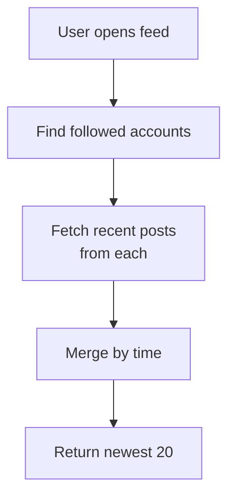
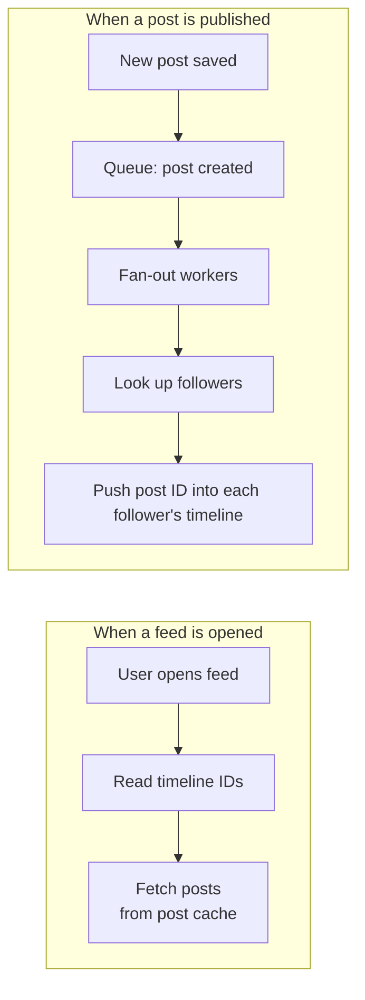
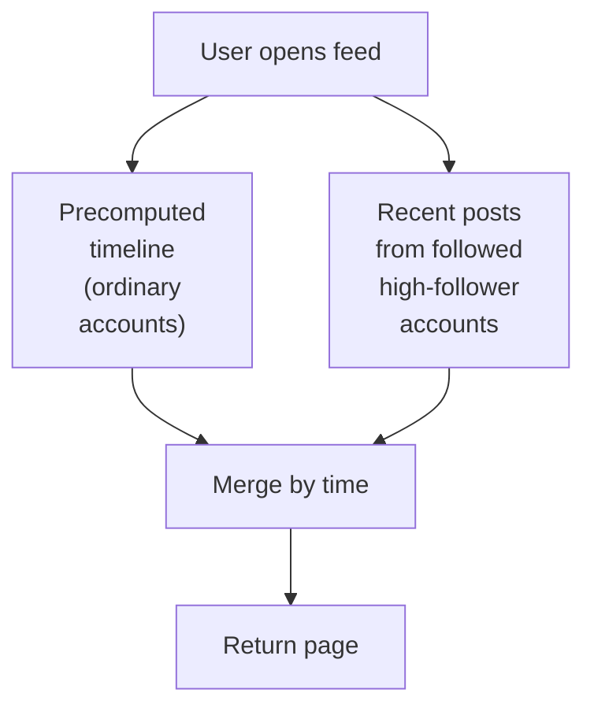
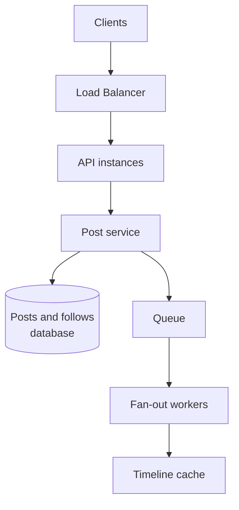
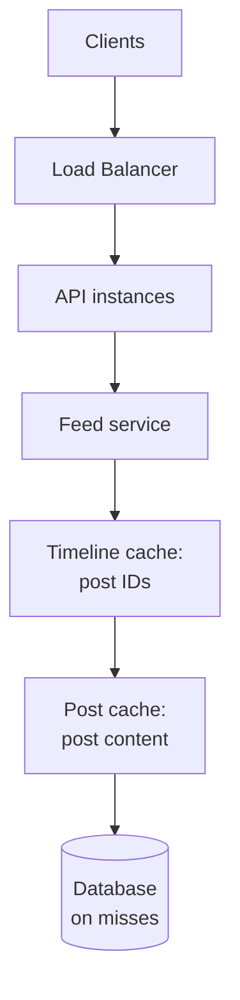
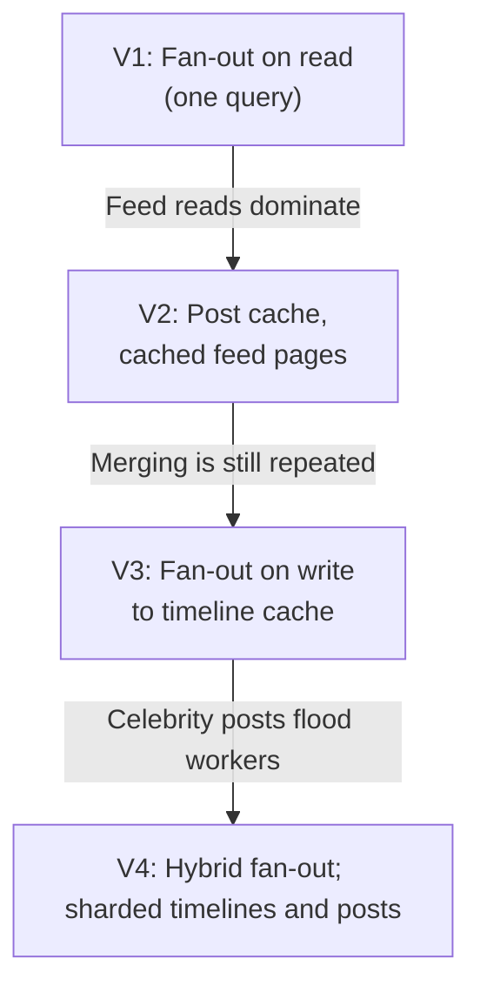

# 12.03 — Social Feed

## Learning Objectives

By the end of this chapter, you should be able to:

- Estimate feed reads, post writes, and fan-out work for a social application.
- Explain fan-out on read and fan-out on write, and the cost of each.
- Handle accounts with millions of followers using a hybrid approach.
- Store timelines as lists of post IDs and assemble feeds efficiently.
- Paginate a constantly changing feed with cursors.
- Decide where eventual consistency is acceptable and where users will notice it.

---

## 1. The Problem

A social feed shows each user recent posts from the accounts they follow, newest first.

The rules are simple. The difficulty comes from the shape of the data:

- Each user follows hundreds of accounts.
- Some accounts are followed by millions of users.
- Users open their feed far more often than they post.
- Every user's feed is different, so one cached page cannot serve everyone.

The central question of this case study is **when to do the work of building a feed**: when a post is written, or when a feed is read.

> [!MENTAL-MODEL]
> A feed is a per-user merge of many small streams. You either merge at read time, or pre-merge at write time and store the result.

---

## 2. Requirements

### Functional requirements

1. A user can publish a post with text and optional images.
2. A user can follow and unfollow other users.
3. A user sees a feed of posts from followed accounts, newest first.
4. A user can scroll back through older posts in the feed.
5. A user can like posts and see like counts.
6. A user can delete their own post.

### Non-functional requirements

| Requirement | Target | Why it matters |
|---|---|---|
| Feed latency | p95 under 200 ms | The feed is the first screen users see |
| Post visibility | In followers' feeds within a few seconds (normally) | Users expect posts to appear quickly, but not instantly |
| Availability | 99.9% for reading feeds | Reading is the core activity |
| Deletion | Deleted posts disappear from feeds promptly | Privacy and safety |
| Scale | Accounts with tens of millions of followers | Popular accounts drive most engagement |

### Out of scope

- Ranking by relevance (this design is chronological).
- Comments, sharing, and direct messages.
- Content moderation pipelines.
- Notifications (covered in Chapter 12.05).

---

## 3. Constraints and Assumptions

| Assumption | Value |
|---|---|
| Daily active users | 50 million |
| Feed opens per user per day | 10 |
| Users who post on a given day | 10%, one post each |
| Average followers per poster | 200 |
| Largest accounts | 50 million followers |
| Post size (text and metadata) | About 1 KB; images stored separately |
| Feed page | 20 posts |
| Peak factor | 3× the daily average |

---

## 4. Traffic Estimation

**Feed reads:**

$$
\frac{50{,}000{,}000 \times 10}{86{,}400} \approx 5{,}800 \text{ feed requests per second}
$$

At 3× peak, about **17,400 feed requests per second**.

**Post writes:**

$$
50{,}000{,}000 \times 10\% = 5{,}000{,}000 \text{ posts per day} \approx 58 \text{ per second}
$$

Posts are rare compared with reads, but each post must reach every follower's feed.

**Fan-out:** if every post is copied into each follower's timeline:

$$
5{,}000{,}000 \times 200 = 1 \text{ billion timeline inserts per day} \approx 11{,}600 \text{ per second}
$$

```calculator
title: Fan-Out Write Load
description: Estimate timeline inserts per second if every post is copied to every follower.
inputs:
  - id: posts
    label: Posts per day
    unit: million
    min: 0.1
    max: 100
    step: 0.1
    value: 5
    divisor: 0.0864
  - id: followers
    label: Average followers per poster
    unit: followers
    min: 10
    max: 2000
    step: 10
    value: 200
result:
  label: Timeline inserts per second (average)
  operation: product
  digits: 0
formula: "{posts} million ÷ 86,400 seconds × {followers}"
caption: The average hides the outliers. One post from an account with 50 million followers is 50 million inserts on its own.
```

What these numbers tell us:

- Reads are about 100 times more frequent than posts.
- Fan-out turns 58 posts per second into about 11,600 writes per second.
- A single popular account can create more fan-out work than all ordinary users combined.

---

## 5. Data Estimation

| Data | Calculation | Size |
|---|---|---|
| Posts | 5 million × 1 KB per day | About 5 GB/day, 1.8 TB/year |
| Follow graph | 50 million users × 200 follows × about 16 bytes | About 160 GB |
| Timelines (precomputed) | 50 million users × 500 post IDs × 8 bytes | About 200 GB before overhead |
| Images | Depends on upload rate | Object storage behind a CDN |

A timeline does not store posts. It stores **post IDs**. The feed service then fetches the posts themselves, usually from a cache.

Keeping only the most recent 500 IDs per user bounds timeline storage. Older posts are fetched differently (Section 9).

---

## 6. Data Model

| Table | Key | Purpose |
|---|---|---|
| `users` | `id` | Profiles |
| `posts` | `id` (time-ordered) | Post content and author |
| `follows` | `(follower_id, followee_id)` | Who follows whom |
| `timelines` | `user_id` → list of post IDs | Precomputed feeds (cache) |
| `likes` | `(post_id, user_id)` | Who liked what |

Two indexes on `follows` serve the two questions the system asks:

- "Who does user X follow?" — index on `follower_id`.
- "Who follows user Y?" — index on `followee_id`.

**Post IDs should sort by time.** IDs that embed a timestamp (for example, a 64-bit ID with the creation time in its high bits) let timelines be sorted and paginated by ID alone, without fetching each post's timestamp.

---

## 7. Initial Architecture: Fan-Out on Read

The simplest feed is a query:

```sql
SELECT p.*
FROM posts p
JOIN follows f ON f.followee_id = p.author_id
WHERE f.follower_id = :me
ORDER BY p.id DESC
LIMIT 20;
```



This is the right first version:

- Posting is one insert.
- Follows, unfollows, and deletions take effect immediately.
- There is no extra storage.

It works while users follow few accounts and traffic is low. With a good index on `(author_id, id)`, each followed account costs one short index scan.

> [!TRADE-OFF]
> Fan-out on read makes writes cheap and reads expensive. Every feed open repeats the merge, even when nothing has changed.

---

## 8. The Bottleneck

At 17,400 feed requests per second, each merging posts from 200 followed accounts, the database performs millions of index lookups per second to build feeds that are mostly identical to the last time they were built.

| Symptom | Cause |
|---|---|
| Feed latency grows with the number of followed accounts | Each followed account adds lookups |
| Database CPU rises with feed opens, not with posts | Repeated merging at read time |
| Users who follow thousands of accounts see the slowest feeds | Merge cost grows with follow count |

The work is done at the wrong time. Reads are 100 times more frequent than writes, so moving work to write time pays off.

---

## 9. Fan-Out on Write

When a post is published, copy its ID into the timeline of every follower. Reading a feed becomes a single lookup.



Implementation details:

- **Timelines live in an in-memory store** (for example, a Redis sorted set or list per user), trimmed to the latest 500 IDs.
- **Fan-out runs asynchronously.** The author gets a response as soon as the post is saved. Followers see it seconds later.
- **Posts are fetched by ID from a post cache.** A popular post is cached once and shared by every timeline that references it.
- **Only active users need timelines.** Users who have not opened the app for weeks can have their timeline rebuilt on their next visit using fan-out on read.

Older posts beyond the 500 stored IDs are served by falling back to the fan-out-on-read query for that page.

> [!TRADE-OFF]
> Fan-out on write makes reads cheap and writes expensive. It also means unfollows, deletions, and privacy changes must remove IDs from many timelines, or be filtered at read time.

---

## 10. The Celebrity Problem

An account with 50 million followers publishes a post.

With fan-out on write, that one post creates 50 million timeline inserts. At 10,000 inserts per second, a worker pool needs more than an hour to deliver it. Meanwhile, ordinary posts queue behind it.

The solution is a **hybrid**:

- **Ordinary accounts** use fan-out on write.
- **Accounts above a follower threshold** (for example, 100,000 followers) are not fanned out. Their posts are fetched at read time and merged into the precomputed timeline.



A user typically follows only a handful of very large accounts, and those accounts' recent posts are heavily cached, so the read-time merge is cheap.

> [!EVOLUTION]
> Neither pure approach survives at scale. Fan-out on read fails because of read volume; fan-out on write fails because of follower skew. The hybrid uses each where it is cheap.

---

## 11. Pagination

Offset pagination (`LIMIT 20 OFFSET 40`) breaks on a feed that changes while the user scrolls: new posts shift every page, so users see duplicates or miss posts.

Use a **cursor** instead. The client sends the ID of the last post it received, and the server returns the next posts older than that ID:

```http
GET /api/feed?before=1840392844830179328&limit=20
```

Because post IDs are time-ordered, "older than this ID" is a simple range query on both the timeline and the posts table.

---

## 12. Likes and Counters

A popular post may receive thousands of likes per second. Updating one `like_count` column for every like creates contention on a single row.

Common approach:

- Record each like in `likes` (needed to show "you liked this" and to prevent double likes).
- Increment counters in memory or in a cache, and write aggregated counts to the database periodically.
- Show approximate counts on very popular posts ("12.4K"). Exact numbers matter only to the author, and only eventually.

---

## 13. Architectural Decisions

| Decision | Problem it solves |
|---|---|
| Fan-out on write for ordinary accounts | Feed reads are frequent and repetitive |
| Fan-out on read for high-follower accounts | One post would otherwise create millions of writes |
| Timelines of post IDs in memory | Feed reads become one lookup |
| Separate post cache | Popular posts are stored once and shared |
| Asynchronous fan-out via a queue | Posting stays fast; spikes are absorbed |
| Time-ordered IDs and cursors | Stable pagination without timestamps |
| Images in object storage + CDN | Media bytes never touch the feed service |

The architecture after these decisions has two paths. The write path:



The read path:



---

## 14. Scaling

- **Shard timelines by user ID.** Each feed read touches one shard.
- **Shard posts by post ID** (or by author ID if most queries are per author). Time-ordered IDs keep recent posts together, so the newest data is the hottest.
- **Partition the fan-out queue** so a large backlog for one author does not block others. Process high-volume authors in separate worker pools.
- **Apply backpressure to fan-out.** During spikes, delay fan-out rather than overload the timeline store. Users see posts a little later, which is acceptable.

---

## 15. Failure Scenarios

| Failure | What users notice | Mitigation |
|---|---|---|
| Fan-out workers fall behind | New posts appear late | Autoscale workers; monitor queue age; prioritize recent posts |
| Timeline cache node fails | Some users get slower feeds | Rebuild timelines on demand using fan-out on read |
| Post cache is cold after restart | Slow feeds and database load spike | Coalesce misses per post; warm popular posts |
| A deleted post remains in timelines | Deleted content visible | Filter deleted IDs at read time; remove asynchronously |
| User unfollows an account | Old posts still appear | Filter by current follows at read time, or accept a short delay |
| Database primary fails | Posting fails; feeds still served from caches | Failover; feeds degrade gracefully to cached content |

> [!FAILURE] Read-time filtering is the safety net
> Asynchronous removal of deleted or private posts can fail or lag. Checking visibility when assembling the feed (Is the post deleted? Is the author blocked? Is the account still followed?) ensures correctness even when the precomputed timeline is wrong.

---

## 16. Recovery

- **Posts and follows** are the source of truth and need replication and backups.
- **Timelines are derived data.** They can always be rebuilt from posts and follows, so they can live in a cache without durable storage.
- After a large outage, rebuild timelines lazily: on each user's next feed open, run fan-out on read and store the result.

The ability to rebuild derived data is what makes it safe to keep it only in memory.

---

## 17. Evolution



---

## 18. Trade-offs

| Decision | Benefit | Cost |
|---|---|---|
| Fan-out on read | Cheap writes; always consistent | Expensive, repeated reads |
| Fan-out on write | Cheap, fast reads | Write amplification; delayed visibility; cleanup on delete/unfollow |
| Hybrid | Handles follower skew | Two code paths; a threshold to tune |
| Timelines in memory only | Fast and cheap to update | Rebuild work after failures |
| Approximate like counts | No hot-row contention | Counts lag behind |
| Chronological order | Simple, predictable | Users may miss important posts; ranking is a later project |

> [!LOCK-IN]
> The ID format is hard to change: clients store cursors, timelines store IDs, and other systems reference posts by ID. Choose a time-ordered, globally unique 64-bit format early. Timeline storage, in contrast, is easy to replace because it is derived data that can be rebuilt.

---

## 19. Common Mistakes

- **Choosing fan-out on write for everyone:** One celebrity post floods the system.
- **Storing full posts in every timeline:** Storage multiplies and edits become impossible.
- **Using offset pagination:** Users see duplicates and gaps as new posts arrive.
- **Relying only on asynchronous cleanup for deletions:** Deleted content stays visible when cleanup lags.
- **Counting likes with a single row update:** Popular posts create write contention.
- **Treating timelines as primary data:** They are derived; design them to be rebuilt.
- **Building ranking first:** A chronological feed is simpler and may be enough.

---

## 20. Hands-On Exercise

Design the feed for a professional network:

- 10 million daily active users.
- Users follow companies as well as people. Some companies have 5 million followers.
- Posts are shown in rough chronological order, but posts from direct connections should appear before posts from followed companies.
- A user who has not visited for a month should still see a sensible feed when they return.

Answer:

1. Estimate feed reads and fan-out inserts per second.
2. Which accounts would you fan out on write? Where is the threshold?
3. How do you combine connection posts and company posts in one feed?
4. How do you build a feed for a returning inactive user?
5. What happens when a user disconnects from someone?

---

## 21. Quick Reference

| Topic | Decision in this design |
|---|---|
| Workload | About 17,400 feed reads/s at peak; about 58 posts/s |
| Fan-out cost | About 11,600 timeline inserts/s on average; spikes from large accounts |
| Starting point | Fan-out on read with indexed queries |
| Scaled design | Hybrid: fan-out on write for most, read-time merge for large accounts |
| Timelines | Post IDs in memory, latest 500, sharded by user |
| Pagination | Cursor on time-ordered post IDs |
| Counters | Aggregated asynchronously, approximate for popular posts |
| Correctness safety net | Visibility filtering at read time |
| Hardest to reverse | The post ID format |

---

## 22. Knowledge Check

**1. What is the difference between fan-out on read and fan-out on write?**

Fan-out on read assembles each feed when it is requested. Fan-out on write copies each new post into followers' timelines when it is published.

**2. Why does fan-out on write help this workload?**

Feed reads are far more frequent than posts, so doing the merge once per post is cheaper than doing it on every feed open.

**3. What is the celebrity problem?**

An account with millions of followers turns one post into millions of timeline writes, delaying delivery for everyone.

**4. How does the hybrid approach solve it?**

High-follower accounts are not fanned out; their recent posts are fetched and merged at read time.

**5. Why store post IDs in timelines instead of full posts?**

IDs are small, posts are cached once and shared, and edits or deletions affect one record.

**6. Why use cursor pagination?**

Offsets shift as new posts arrive; a cursor anchored to a post ID returns a stable next page.

**7. Why can timelines live only in memory?**

They are derived from posts and follows and can be rebuilt after a failure.

**8. How are deleted posts kept out of feeds?**

They are removed asynchronously and also filtered at read time, which guarantees correctness if cleanup lags.

---

## Remember

**Decide when to do the work: at write time, at read time, or a mix.**

Feeds are cheap to read when they are precomputed, and cheap to write when they are not. Measure the read-to-write ratio and the follower distribution, precompute what is read often, and keep a read-time path for the cases where precomputing is too expensive.

**Next: 12.04 — Chat System**
