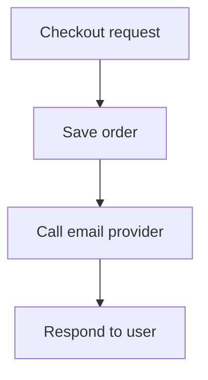
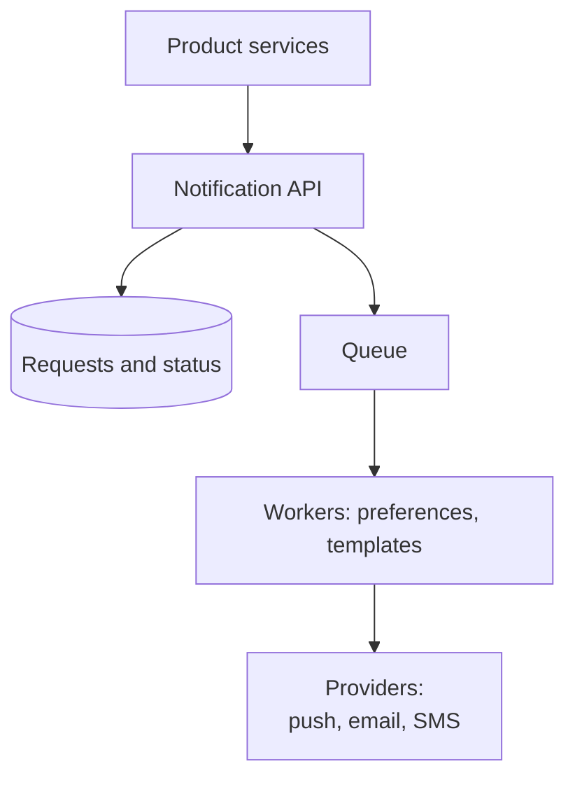
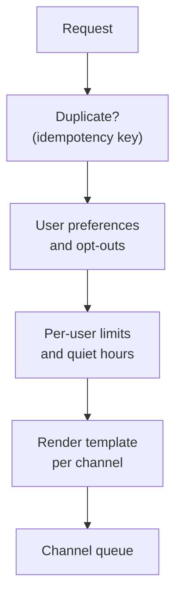
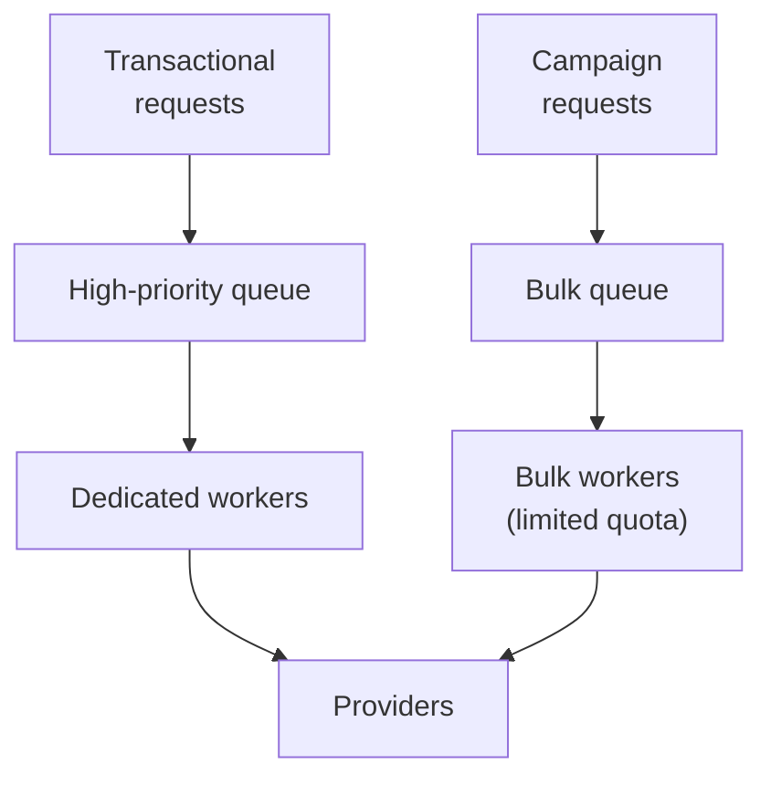
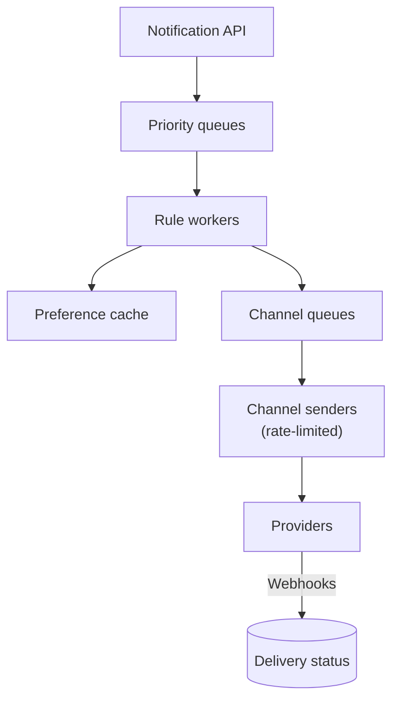
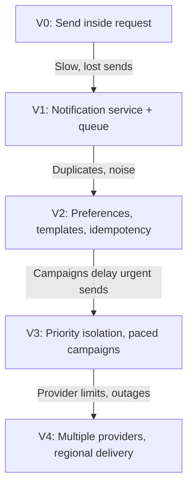

# 12.05 — Notification System

## Learning Objectives

By the end of this chapter, you should be able to:

- Design one notification pipeline that serves push, email, SMS, and in-app channels.
- Separate urgent transactional messages from bulk marketing messages.
- Apply user preferences, quiet hours, and per-user limits before sending.
- Prevent duplicate notifications with idempotency keys.
- Work within external provider rate limits and survive provider outages.
- Send a campaign to millions of users without delaying urgent messages.

---

## 1. The Problem

Most products notify users: an order shipped, a password was changed, someone replied, a sale starts tomorrow.

At first, each feature sends its own email by calling a provider directly. Over time this produces:

- Users receiving the same notification twice, or five notifications in a minute.
- Marketing emails sent at 3 a.m. local time.
- A slow email provider making checkout slow.
- No single place to answer "Did this user receive the password-reset email?"

A notification system centralizes these concerns. Product features say **what happened and to whom**. The notification system decides **whether, when, how, and through which channel** to tell the user.

> [!MENTAL-MODEL]
> A notification system is a set of queues with rules in front of them and unreliable external providers behind them.

---

## 2. Requirements

### Functional requirements

1. Services can request a notification for a user by event type (for example `order.shipped`).
2. Notifications can be delivered by mobile push, email, SMS, and an in-app inbox.
3. Users can choose which notification types they receive on which channels.
4. Marketing teams can send a campaign to a segment of users.
5. Notifications can be scheduled and can respect the user's time zone and quiet hours.
6. Delivery status is recorded and queryable.

### Non-functional requirements

| Requirement | Target | Why it matters |
|---|---|---|
| Transactional latency | Most sent within 30 seconds | Password resets and security alerts are urgent |
| Isolation | Campaigns never delay transactional messages | A sale email must not block a login code |
| No duplicates | One logical notification is sent at most once per channel | Duplicates annoy users and cost money (SMS) |
| Durability | Accepted requests are not lost | Some notifications are legally or operationally required |
| Respect preferences | Opt-outs are honoured | User trust and legal requirements |

### Out of scope

- Writing message content and designing templates.
- Building push, email, or SMS delivery infrastructure (external providers are used).
- Campaign analytics beyond delivery status.

---

## 3. Constraints and Assumptions

| Assumption | Value |
|---|---|
| Registered users | 50 million |
| Transactional notifications | 20 million per day |
| Marketing campaigns | 2 per day, each to 10 million users |
| Campaign delivery window | Within 1 hour of start |
| In-app inbox retention | 90 days |
| Stored notification record | About 500 bytes |
| SMS provider throughput limit | 100 messages per second per account (illustrative) |

External providers impose limits on throughput, payload size, and retries. Their limits are part of the design, not an afterthought.

---

## 4. Traffic Estimation

**Daily volume:**

$$
20 \text{ million} + 2 \times 10 \text{ million} = 40 \text{ million notifications per day}
$$

On average that is only about **460 per second**. The average is misleading.

**Campaign burst:** one campaign to 10 million users within an hour:

$$
\frac{10{,}000{,}000}{3{,}600} \approx 2{,}800 \text{ notifications per second}
$$

That is six times the daily average, concentrated in one hour, on top of transactional traffic.

```calculator
title: Notification Rate Estimator
description: Estimate the peak notification rate from daily volume.
inputs:
  - id: users
    label: Registered users
    unit: million
    min: 1
    max: 500
    step: 1
    value: 50
    divisor: 0.0864
  - id: per-user
    label: Notifications per user per day
    unit: per day
    min: 0.1
    max: 10
    step: 0.1
    value: 0.8
  - id: peak
    label: Peak-to-average factor
    unit: ×
    min: 1
    max: 20
    step: 0.5
    value: 6
result:
  label: Peak notifications per second
  operation: product
  digits: 0
formula: "{users} million ÷ 86,400 seconds × {per-user} × {peak}"
caption: Campaigns, not daily averages, set the peak. Size workers and provider limits for the largest planned send.
```

**SMS limit:** at 100 SMS per second, a 1-million-recipient SMS campaign takes about **2.8 hours**. Throughput limits outside the system can dominate delivery time.

---

## 5. Data Estimation

| Data | Calculation | Size |
|---|---|---|
| Notification records | 40 million × 500 bytes per day | About 20 GB/day |
| In-app inbox (90 days) | 20 GB × 90 | About 1.8 TB |
| User preferences | 50 million × a few hundred bytes | Tens of GB |
| Device push tokens | Several per user | Tens of GB |

Delivery logs grow quickly but are rarely read after a few weeks. They can expire or move to cheaper storage.

---

## 6. API Design

Product services send intent, not content:

```http
POST /notifications
Idempotency-Key: order-81231-shipped

{
  "userId": "u_4821",
  "type": "order.shipped",
  "data": { "orderId": "81231", "carrier": "DHL" },
  "priority": "transactional"
}
```

```http
202 Accepted

{ "notificationId": "n_93f1c2" }
```

- `202 Accepted` means the request is stored and will be processed. It does not mean the user has been notified.
- The **idempotency key** comes from the business event. If the order service retries, the notification system recognizes the key and does not send again.
- The caller does not choose channels or write text. Preferences and templates decide that, in one place.

---

## 7. Initial Architecture

The simplest version is a function in the application that calls a provider:



Problems appear quickly:

- If the provider is slow, checkout is slow.
- If the provider fails, the email is lost or the checkout fails.
- Each feature reimplements preferences, retries, and templates.

The first real version moves notifications behind a queue:



The checkout now only waits for a database insert and an enqueue. To avoid losing a notification between saving the order and calling the notification API, the order service can use the outbox pattern.

---

## 8. Processing a Notification

Each request passes through the same steps:



**Preferences.** Store per-user, per-type, per-channel settings. Some types, such as security alerts, cannot be disabled, and the rules should say so explicitly.

**Per-user limits.** A user who receives five "someone liked your post" pushes in a minute should get one. Limits and **digests** ("You have 5 new likes") protect users from noisy features.

**Quiet hours and time zones.** A marketing push scheduled for 10:00 is sent at 10:00 in each user's time zone. Non-urgent messages that would arrive during quiet hours are delayed, not dropped.

**Templates.** Text lives in versioned templates per channel and language. A push is a short sentence; an email is a full document; an SMS has strict length limits.

---

## 9. Priority and Isolation

Transactional and marketing notifications must never share a queue.



- Separate queues mean a backlog of 10 million campaign messages cannot sit in front of a password-reset code.
- Separate worker pools mean bulk processing cannot consume all workers.
- **Separate provider quotas** matter too. If a campaign uses the entire SMS rate limit, login codes wait. Reserve part of each provider's capacity, or use separate provider accounts, for transactional traffic.

> [!TRADE-OFF]
> Reserved capacity for urgent messages is idle most of the time. That idle capacity is the price of guaranteeing that a campaign can never delay a security alert.

---

## 10. Sending Campaigns

A campaign to 10 million users is not 10 million API calls from the marketing tool. It is a batch job:

1. Resolve the segment into user IDs in pages (for example, 10,000 at a time).
2. For each page, create notification requests with idempotency keys of the form `campaign-123:user-456`.
3. Enqueue them into the bulk queue at a controlled rate.
4. Bulk workers apply the same preference, limit, and quiet-hour rules as any other notification.

If the job crashes halfway, rerunning it is safe: the idempotency keys prevent anyone from receiving the campaign twice.

Pacing protects both the system and the providers. Sending as fast as possible would hit provider limits, cause throttling errors, and trigger retries that slow everything further.

---

## 11. Talking to Providers

External providers are the least reliable part of the system.

| Problem | Response |
|---|---|
| Provider returns a rate-limit error | Slow down; respect `Retry-After` headers; token-bucket limit per provider |
| Provider times out | Retry with exponential backoff and jitter; the outcome may be unknown |
| Provider is down | Circuit breaker; fail over to a secondary provider for critical channels |
| Permanent error (invalid email, unregistered device) | Do not retry; mark the address or token as invalid |
| Repeated failure after retries | Move to a dead-letter queue for inspection |

**Duplicates at the provider boundary.** If a provider accepts a message but the response is lost, a retry sends it again. Some providers accept an idempotency key; where they do not, the system can only reduce duplicates (short timeouts, careful retries), not eliminate them. This is why exactly-once delivery to a user's device cannot be fully guaranteed.

**Delivery receipts.** Providers report delivery, bounces, and opens through webhooks. Store them against the notification ID. Repeated bounces should disable the address.

---

## 12. In-App Notifications

The in-app inbox is a channel the system fully controls:

- Store each notification in an inbox table keyed by `(user_id, created_at)`.
- When the user is online, push a small "new notification" signal over an existing real-time connection (Chapter 12.04).
- Count unread notifications with a stored counter rather than counting rows on every page load.
- Expire inbox entries after 90 days.

Because there is no external provider, the in-app channel is the most reliable place to record that something happened.

---

## 13. Bottlenecks

| Symptom | Likely bottleneck |
|---|---|
| Transactional latency rises during campaigns | Shared queues or worker pools |
| Many retries and throttling errors | Sending faster than provider limits |
| Preference lookups dominate processing time | Database reads for every notification |
| Campaign jobs take hours to start | Segment resolution with large queries |
| Duplicate notifications reported by users | Missing or inconsistent idempotency keys |

Cache user preferences (they change rarely), page through segments with indexed queries, and pace sending to provider limits.

---

## 14. Scaling



- **Rule workers and channel senders scale independently.** Rendering is CPU work; sending is mostly waiting on providers.
- **Partition queues by channel and priority.** An email provider outage should not stop push notifications.
- **Shard the inbox and delivery logs by user ID.**
- **Add provider accounts or regions** when a single account's rate limit becomes the ceiling.

---

## 15. Failure Scenarios

| Failure | What users notice | Mitigation |
|---|---|---|
| Email provider outage | Late emails | Circuit breaker, queue backlog, secondary provider for critical email |
| Campaign floods the system | Nothing, if isolated | Separate queues, workers, and quotas |
| Worker crashes mid-batch | Nothing | Messages return to the queue; idempotency prevents duplicates |
| Preference cache is stale | A user gets a type they just disabled | Short TTL; invalidate on preference change |
| Duplicate requests from a service | Nothing, if keys are used | Idempotency keys derived from business events |
| Invalid device tokens accumulate | Wasted sends, provider penalties | Remove tokens on permanent errors |
| Bad template deployed | Broken messages to many users | Template versioning, preview, gradual rollout, quick rollback |

> [!FAILURE] The retry storm against a provider
> A provider slows down. Workers time out and retry immediately. The retries add load, the provider throttles harder, and the backlog grows. Exponential backoff with jitter, per-provider rate limits, and a circuit breaker turn this into a controlled delay instead of an outage.

---

## 16. Recovery

- **Accepted requests** are stored before they are acknowledged, so a crash loses nothing that the caller was told was accepted.
- **Queues** can be replayed. Idempotency keys make replay safe.
- **Dead-letter queues** hold messages that failed repeatedly. Fix the cause, then redrive them, unless they are too old to be useful. A two-day-old login code should be dropped, not delivered.
- **Delivery status** answers support questions after an incident: who was affected, and which notifications need to be resent.

Every notification type should define how long it stays relevant. Recovery for a sale announcement and for a security alert is different.

---

## 17. Evolution



---

## 18. Trade-offs

| Decision | Benefit | Cost |
|---|---|---|
| Asynchronous sending | Callers stay fast; providers can fail | Notifications are delayed, not instant |
| Central preferences and templates | Consistent behaviour; one place to change rules | A shared dependency for every feature |
| Idempotency keys | No duplicate sends on retries | Key storage; callers must supply good keys |
| Separate priority queues | Urgent messages are never blocked | Idle reserved capacity |
| Paced campaigns | Providers are not overwhelmed | Campaigns take longer to reach everyone |
| Secondary providers | Survive provider outages | Two integrations to maintain; different behaviour |
| Digests and per-user limits | Less noise | Some individual events are not shown in real time |

> [!LOCK-IN]
> Provider-specific features (template languages, audience segmentation, analytics) are convenient and make switching providers expensive. Keep templates, preferences, and delivery records in your own system, and use providers only as delivery pipes behind a small interface per channel.

---

## 19. Common Mistakes

- **Sending notifications inside user requests:** Provider latency becomes user latency.
- **One queue for everything:** Campaigns delay password resets.
- **No idempotency:** Retries send duplicates; SMS duplicates cost money.
- **Ignoring provider rate limits:** Throttling and retries make delivery slower.
- **Retrying permanent errors:** Invalid addresses are retried forever.
- **Letting every feature notify freely:** Users disable notifications entirely.
- **Redriving stale notifications:** Expired codes and outdated alerts confuse users.
- **Ignoring time zones:** Marketing messages arrive at night.

---

## 20. Hands-On Exercise

Design notifications for a banking app:

- Transaction alerts must arrive within 10 seconds.
- One-time login codes are sent by SMS and expire after 5 minutes.
- Monthly statements are emailed to 8 million customers on the first day of the month.
- Regulations require proof that certain notices were sent.

Answer:

1. How do you keep statement emails from delaying login codes?
2. What should happen to a login-code SMS that is still queued after 5 minutes?
3. How do you prove that a regulatory notice was sent, and what counts as "sent"?
4. Which notifications can a user disable? Which cannot?
5. What do you do when the SMS provider is down?

---

## 21. Quick Reference

| Topic | Decision in this design |
|---|---|
| Volume | About 40 million/day; about 2,800/s during campaigns |
| Entry point | API accepts intent with an idempotency key; returns `202` |
| Rules | Preferences, opt-outs, per-user limits, digests, quiet hours |
| Isolation | Separate queues, workers, and provider quotas by priority |
| Campaigns | Paged batch job, deterministic keys, paced enqueueing |
| Providers | Rate limits, backoff, circuit breakers, secondary providers |
| Failures | Dead-letter queues; redrive only what is still relevant |
| In-app | Inbox table + real-time signal |
| Hardest to reverse | Dependence on provider-specific templates and segmentation |

---

## 22. Knowledge Check

**1. Why should product services not call email or SMS providers directly?**

Provider latency and failures would affect user requests, and preferences, retries, and templates would be reimplemented in every feature.

**2. What does `202 Accepted` mean for a notification request?**

The request is stored and will be processed; the user has not necessarily been notified yet.

**3. Why do transactional and marketing notifications need separate queues?**

A large campaign backlog would otherwise delay urgent messages such as login codes.

**4. How do idempotency keys make campaigns safe to restart?**

Each user-campaign pair has a deterministic key, so reprocessing does not send a second notification.

**5. Why can duplicate delivery not be eliminated completely?**

If a provider accepts a message but the response is lost, a retry may send it again unless the provider supports idempotency.

**6. Why reserve provider quota for transactional traffic?**

Bulk sending could otherwise consume the entire rate limit, blocking urgent messages.

**7. Why should some dead-lettered notifications be dropped instead of redriven?**

They may no longer be relevant, such as an expired login code.

**8. Why keep templates and preferences outside the provider?**

It keeps behaviour consistent across channels and reduces the cost of switching providers.

---

## Remember

**Decide whether, when, and how to notify in one place, then hand delivery to providers you do not trust.**

Queues absorb bursts, priorities protect urgent messages, idempotency prevents duplicates, and pacing respects limits you do not control. Users judge the system by the notifications they did not want as much as by the ones they did.

**Next: 12.06 — File Storage System**
