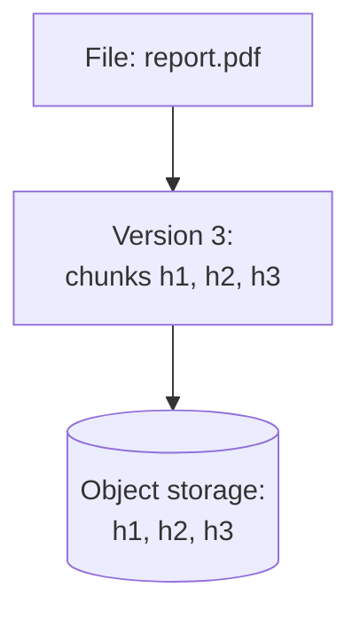
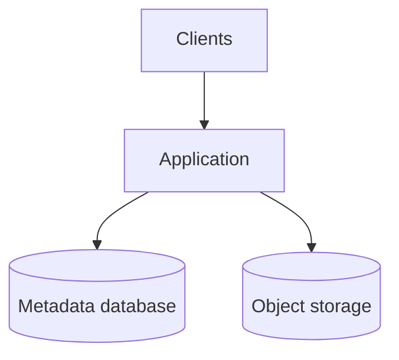
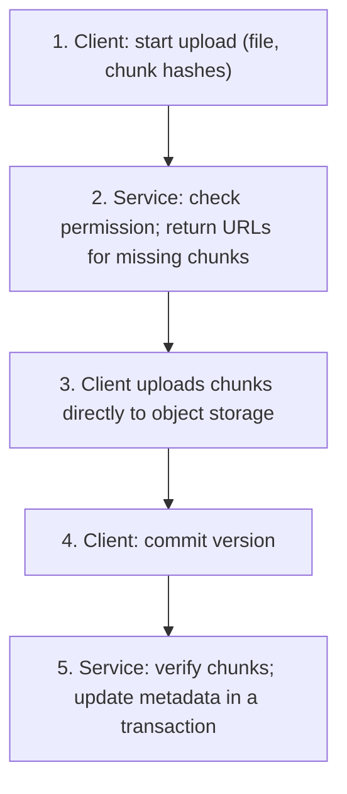
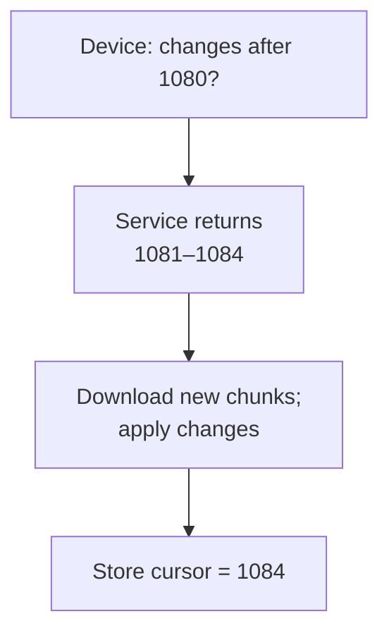
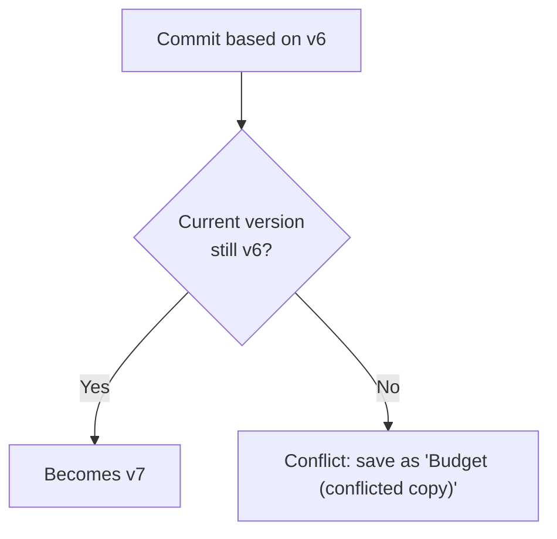
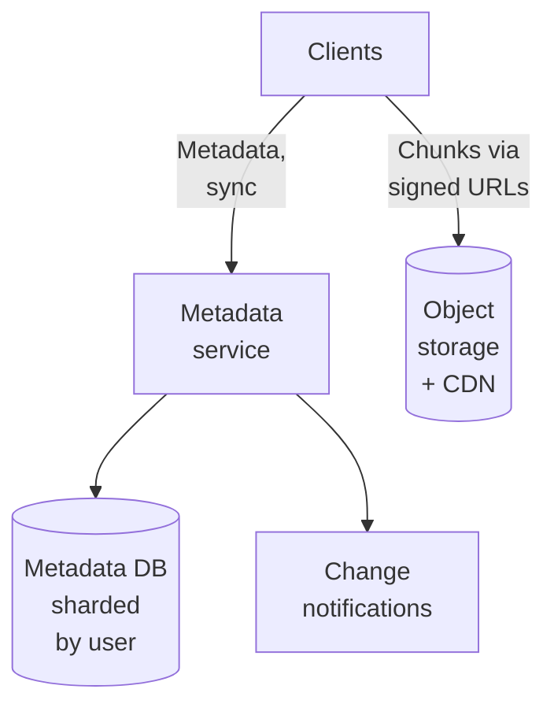
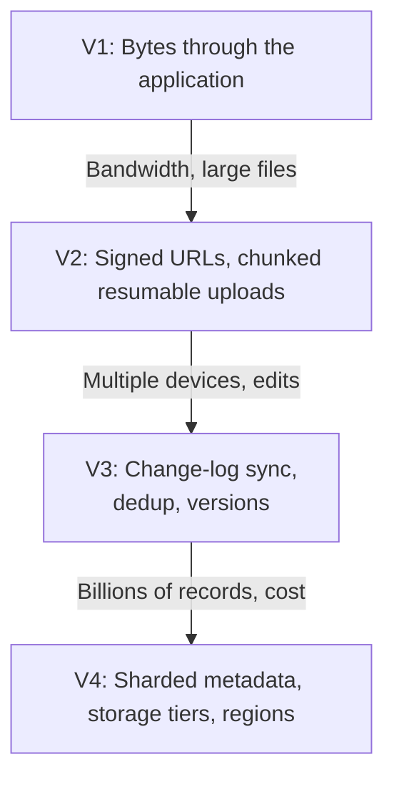

# 12.06 — File Storage System

## Learning Objectives

By the end of this chapter, you should be able to:

- Separate file metadata from file content and explain why they need different storage.
- Estimate upload bandwidth, stored bytes, and metadata size for a file service.
- Upload large files reliably with chunking, resumable uploads, and direct-to-storage URLs.
- Synchronize files across devices using a change log and cursors.
- Handle conflicting edits without silently losing data.
- Explain deduplication, versioning, and their effect on deletion and cost.

---

## 1. The Problem

A file storage service lets users upload files, see them on every device, share them, and restore earlier versions. Examples include cloud drives and document storage in business applications.

Two kinds of data with very different properties live side by side:

| Data | Examples | Size | Access pattern |
|---|---|---|---|
| Metadata | Names, folders, owners, versions, permissions | Small records, billions of them | Frequent queries and updates; needs consistency |
| Content | The bytes of each file | Kilobytes to gigabytes | Written once, read occasionally; needs durability and bandwidth |

Most of the design follows from keeping these apart.

> [!MENTAL-MODEL]
> A file storage system is a transactional database of names and versions pointing into a huge, cheap, immutable store of bytes.

---

## 2. Requirements

### Functional requirements

1. Users can upload and download files up to 50 GB.
2. Users can organize files in folders and rename or move them.
3. Changes made on one device appear on the user's other devices.
4. Users can share files and folders with other users (view or edit).
5. Previous versions are kept for 30 days and can be restored.
6. Deleted files can be restored from a trash folder for 30 days.

### Non-functional requirements

| Requirement | Target | Why it matters |
|---|---|---|
| Durability | No acknowledged file is ever lost | Users store irreplaceable data |
| Upload reliability | Interrupted uploads resume, not restart | Large files on mobile networks fail often |
| Sync latency | Changes visible on other devices within seconds when online | Users switch devices constantly |
| Consistency of metadata | A folder never shows a half-moved file | Users must trust what they see |
| Cost | Storage cost per user stays low | Storage is the dominant expense |

### Out of scope

- Real-time collaborative editing inside documents.
- Full-text search of file contents.
- Previews and thumbnails (a background job, briefly mentioned).

---

## 3. Constraints and Assumptions

| Assumption | Value |
|---|---|
| Registered users | 10 million |
| Daily active users | 2 million |
| Average stored data per user | 2 GB |
| Files uploaded per active user per day | 10 |
| Average file size | 2 MB (most files are small; a few are very large) |
| Files per user | About 2,000 |
| Metadata record per file | About 500 bytes |
| Downloads | About twice the upload volume |

---

## 4. Traffic Estimation

**Upload count:**

$$
2{,}000{,}000 \times 10 = 20 \text{ million files per day} \approx 230 \text{ uploads per second}
$$

**Upload bandwidth:**

$$
20{,}000{,}000 \times 2 \text{ MB} = 40 \text{ TB per day} \approx 463 \text{ MB/s} \approx 3.7 \text{ Gbit/s}
$$

```calculator
title: Upload Bandwidth Estimator
description: Estimate average upload bandwidth from user activity.
inputs:
  - id: dau
    label: Daily active users
    unit: million
    min: 0.1
    max: 50
    step: 0.1
    value: 2
    divisor: 0.0864
  - id: files
    label: Files uploaded per user per day
    unit: files
    min: 1
    max: 100
    step: 1
    value: 10
  - id: size
    label: Average file size
    unit: MB
    min: 0.1
    max: 50
    step: 0.1
    value: 2
result:
  label: Average upload bandwidth
  operation: product
  digits: 0
  unit: MB/s
formula: "{dau} million ÷ 86,400 seconds × {files} × {size} MB"
caption: Multiply by 8 for bits per second. Downloads are about twice this, and peaks are higher than the average.
```

Downloads at about twice that volume add roughly 7 Gbit/s.

What these numbers tell us:

- **Request rates are modest.** A few hundred uploads per second is easy for an API.
- **Bandwidth is large.** Streaming several gigabits per second through application servers wastes their capacity. File bytes should bypass the application.

---

## 5. Data Estimation

| Data | Calculation | Size |
|---|---|---|
| File content | 10 million users × 2 GB | About 20 PB |
| New content per day | 40 TB | About 14 PB per year before deduplication and deletion |
| Metadata | 10 million users × 2,000 files × 500 bytes | About 10 TB (20 billion records) |

Twenty petabytes is far beyond any single server. It belongs in **object storage**, which is built for durability and capacity at low cost per byte.

Ten terabytes of metadata in 20 billion records is large for one relational database, but it partitions naturally: almost every query is about one user's files.

---

## 6. Metadata and Content

| Table | Key | Purpose |
|---|---|---|
| `files` | `file_id` | Name, parent folder, owner, current version, deleted flag |
| `versions` | `(file_id, version)` | Size, content hash, list of chunks, created time |
| `chunks` | `chunk_hash` | Location in object storage, reference count |
| `shares` | `(file_id, user_id)` | Who has which permission |
| `changes` | `(user_id, change_seq)` | Ordered log of changes for sync |

Content is split into **chunks** (for example 4 MB). Each chunk is stored in object storage under its content hash, such as SHA-256. A file version is an ordered list of chunk hashes.



Chunks are **immutable**. Changing a file creates a new version with a new chunk list. Unchanged chunks are reused.

---

## 7. Initial Architecture



At small scale, routing bytes through the application is acceptable and keeps authorization in one place.

As traffic grows, the application spends most of its time copying bytes:

- Large uploads hold connections and memory for minutes.
- Bandwidth costs are paid twice (client to application, application to storage).
- A slow mobile upload occupies a server thread.

---

## 8. Direct Uploads with Signed URLs

Remove the application from the data path. It authorizes the operation and returns **pre-signed URLs**: time-limited URLs that let the client read or write one specific object directly in object storage.



- **Authorization stays in the service.** Each URL is valid for one object, one method, and a few minutes.
- **The service never handles file bytes.** It handles small JSON requests.
- **The commit is a metadata transaction.** Until it succeeds, other devices do not see the new version.

Downloads work the same way: the service checks permission and returns a short-lived signed URL, which can also be served through a CDN.

---

## 9. Chunking, Resumable Uploads, and Deduplication

Splitting files into chunks solves several problems at once:

- **Resumable uploads.** If a 5 GB upload fails at 80%, the client uploads only the remaining chunks.
- **Parallel transfers.** Several chunks upload at the same time.
- **Efficient edits.** Changing one page of a large document re-uploads only the affected chunks.
- **Deduplication.** If a chunk with the same hash already exists, it is not uploaded or stored again.

In step 1 above, the client sends the hashes of all its chunks. The service replies with URLs only for chunks it does not already have.

> [!TRADE-OFF]
> Deduplication saves storage and bandwidth, but chunks become shared between files and users. Deleting a file no longer means deleting its chunks; a chunk can be removed only when no version references it. That requires reference counting or periodic garbage collection.

Cross-user deduplication also reveals information: if an upload completes instantly, the uploader learns that someone else already stored that exact file. Many systems therefore deduplicate only within one user's or one organization's data, or encrypt chunks per user.

---

## 10. Synchronization

Each device must learn what changed since it last synced, without listing every file.

Every metadata change appends an entry to the user's **change log** with an increasing sequence number:

```text
change_seq 1081  create   /Photos/beach.jpg   version 1
change_seq 1082  rename   /Notes.txt → /Notes-2026.txt
change_seq 1083  update   /Budget.xlsx        version 7
change_seq 1084  delete   /Old draft.docx
```

Each device stores the last `change_seq` it applied. Sync is:



To make changes appear within seconds, the service notifies online devices ("something changed") over a long-lived connection. The device then runs the same sync. As in the chat system, the notification is a hint; the cursor is the guarantee.

Shared folders appear in several users' change logs. Writing the change to each member's log is fan-out on write; for folders shared with thousands of users, a per-folder log that members read is cheaper.

---

## 11. Conflicts

A user edits `Budget.xlsx` on a laptop while offline, and also on a phone. Both devices upload new versions based on version 6.

If the service accepts the later upload as the current version, the other edit is silently lost.

Use **optimistic concurrency**: each commit states the version it was based on.



A general file service cannot merge arbitrary file formats, so it keeps both versions and lets the user decide. That is less convenient than an automatic merge, but it never loses work.

> [!WARNING]
> "Last write wins" is simple and loses data whenever two devices edit the same file. For user files, a visible conflict copy is better than an invisible loss.

---

## 12. Sharing and Permissions

Permissions are checked on every metadata operation and before issuing every signed URL.

- Store shares on files and folders; permissions on a folder apply to everything inside it.
- Resolving inherited permissions by walking up the folder tree on every request is slow for deep trees. Cache the effective permissions per user and folder, and invalidate them when shares change.
- Signed URLs are short-lived because they cannot be revoked once issued. A user whose access is removed may keep using an already-issued URL until it expires.

---

## 13. Versions, Trash, and Deletion

- **Versions** are rows in `versions`. Keeping them is cheap when versions share most chunks.
- **Trash** is a flag on the file plus a deletion date. Restoring clears the flag.
- **Permanent deletion** happens after 30 days: remove the metadata, decrement chunk reference counts, and let a garbage collector delete chunks that reach zero.

Garbage collection must be conservative. A chunk referenced by an upload that has not been committed yet, or by a version that is being restored, must not be deleted. A safety delay (for example, only collect chunks unreferenced for several days) protects against races.

---

## 14. Bottlenecks

| Symptom | Likely bottleneck |
|---|---|
| Application servers saturated during large uploads | File bytes flowing through the application |
| Uploads restart from zero on mobile | No chunking or resumable uploads |
| Metadata database grows slow on listing and sync queries | One database holding 20 billion records |
| Storage costs grow faster than active usage | Old versions, deleted files, and rarely accessed data on expensive storage tiers |
| Popular shared files cause slow downloads | Repeated downloads from object storage across regions |

---

## 15. Architectural Decisions and Scaling

| Decision | Problem it solves |
|---|---|
| Pre-signed URLs for direct transfer | Application servers no longer carry file bytes |
| Content-addressed chunks | Resumable uploads, partial updates, deduplication |
| Metadata commit as a transaction | Devices never see half-uploaded versions |
| Per-user change log with cursors | Efficient, reliable sync |
| Optimistic concurrency on commit | Conflicting edits are detected, not lost |
| Shard metadata by user (or organization) | Each request touches one shard |
| Storage tiers by age and access | Lower cost for cold data |
| CDN for downloads of shared files | Popular files served close to users |



Sharding by user keeps a user's files, versions, and change log together. Shared folders across shards are the hard case: a shared folder belongs to its owner's shard, and other users' views reference it.

---

## 16. Failure Scenarios

| Failure | What users notice | Mitigation |
|---|---|---|
| Upload interrupted | Upload pauses | Resume with missing chunks only |
| Client crashes after uploading chunks, before commit | Nothing visible; orphan chunks | Garbage-collect uncommitted chunks after a delay |
| Two devices edit offline | A conflicted copy appears | Optimistic concurrency on commit |
| Notification service down | Sync is slower | Devices poll the change log periodically |
| Metadata shard unavailable | Some users cannot list or change files | Replication and failover per shard |
| Object storage region outage | Downloads fail for affected data | Cross-region replication for content |
| Garbage collector bug | Possible data loss | Reference checks, safety delays, soft deletion of chunks before purge |

> [!FAILURE] The dangerous component is the one that deletes
> Uploads that fail can be retried. A garbage collector that deletes a referenced chunk destroys data permanently. Run deletion with multiple safeguards: reference counts, a delay before purging, a separate verification pass, and storage-level versioning or a recycle period.

---

## 17. Recovery

- **Content** in object storage is replicated by the provider across devices and facilities. Replicating to a second region protects against regional loss and accidental deletion when combined with object versioning.
- **Metadata** is the map to the content; without it, chunks are unreadable bytes. Back it up with point-in-time recovery and a recovery-point objective near zero.
- **The change log** lets devices reconcile after an incident: if metadata is restored to an earlier point, devices whose cursors are ahead must resync from a full listing.

Test restores of metadata together with content. A metadata backup that references chunks the garbage collector has already deleted is not a working backup.

---

## 18. Evolution



---

## 19. Trade-offs

| Decision | Benefit | Cost |
|---|---|---|
| Separate metadata and content | Each uses the right storage | Two systems to keep consistent |
| Signed URLs | No bytes through the application | URLs cannot be revoked before they expire |
| Chunking | Resume, partial updates, dedup | Chunk bookkeeping and garbage collection |
| Cross-user deduplication | Less storage | Privacy leak; complex deletion |
| Conflicted copies | No silent data loss | Users resolve conflicts manually |
| Versioning | Users can undo mistakes | More metadata; storage for changed chunks |
| Storage tiers | Lower cost | Slower and sometimes more expensive retrieval of cold data |

> [!LOCK-IN]
> Twenty petabytes is expensive and slow to move. Transferring it to another provider can take months and incur large egress charges. Keep chunk addressing (content hashes) independent of any provider's object keys, and keep metadata in your own database, so that content can be migrated gradually or stored with more than one provider.

---

## 20. Common Mistakes

- **Storing file bytes in the database:** Backups, replication, and queries all slow down.
- **Streaming all bytes through application servers:** Bandwidth and connections are wasted.
- **Uploading whole files without chunking:** Large uploads fail and restart.
- **Last write wins for user files:** Concurrent edits silently disappear.
- **Deleting chunks without reference checks:** Shared or versioned data is destroyed.
- **Long-lived signed URLs:** Access continues after permissions are revoked.
- **Polling the full file list to sync:** Cost grows with the number of files, not the number of changes.

---

## 21. Hands-On Exercise

Design document storage for a law firm:

- 2,000 employees, 50 TB of documents.
- Documents belong to client matters; access is restricted per matter.
- Every version must be kept for 7 years, and deletion must be impossible before then.
- Every download must be logged for audit.

Answer:

1. Which parts of the design in this chapter are unnecessary at this scale?
2. How do retention requirements change deletion and garbage collection?
3. How do you log every download if clients use signed URLs?
4. Would you deduplicate across matters? Why or why not?
5. Which failure would be most damaging, and how do you prevent it?

---

## 22. Quick Reference

| Topic | Decision in this design |
|---|---|
| Volume | About 230 uploads/s; about 3.7 Gbit/s uploads |
| Storage | About 20 PB content; about 10 TB metadata |
| Data split | Metadata in a database; immutable chunks in object storage |
| Transfers | Pre-signed URLs, chunked and resumable |
| Dedup | By content hash, with reference counting |
| Sync | Per-user change log, cursors, change notifications as hints |
| Conflicts | Optimistic concurrency; conflicted copies |
| Deletion | Trash → metadata removal → conservative garbage collection |
| Scaling | Shard metadata by user; tier and replicate content |
| Hardest to reverse | Where the petabytes live |

---

## 23. Knowledge Check

**1. Why are metadata and file content stored separately?**

Metadata is small, frequently queried, and needs transactions; content is large, immutable, and needs cheap, durable capacity.

**2. What do pre-signed URLs achieve?**

They let clients transfer bytes directly to object storage while the service still authorizes each operation.

**3. How does chunking make uploads resumable?**

Each chunk is uploaded and stored independently, so a retry sends only the chunks that are missing.

**4. Why does deduplication complicate deletion?**

A chunk may be shared by many versions or users, so it can be removed only when nothing references it.

**5. How does a device find out what changed?**

It requests entries from its user's change log after its last applied sequence number.

**6. How are conflicting edits handled?**

Commits state their base version; if it is no longer current, the commit is saved as a conflicted copy instead of overwriting.

**7. Why must the garbage collector be conservative?**

Deleting a referenced chunk causes permanent data loss, while delaying deletion only costs storage.

**8. Which decision is hardest to reverse?**

The storage provider for petabytes of content, because moving it is slow and expensive.

---

## Remember

**Keep the names in a database and the bytes in object storage, and never let the bytes flow through code that does not need them.**

Chunks make transfers resumable and storage efficient, a change log makes sync reliable, and explicit versions make conflicts visible. The riskiest code in the system is the code that deletes.

**Next: 12.07 — Video Platform**
