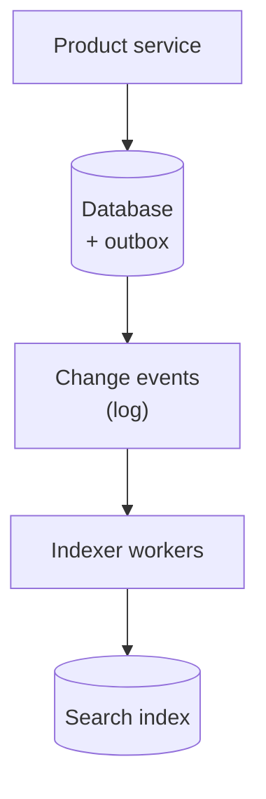
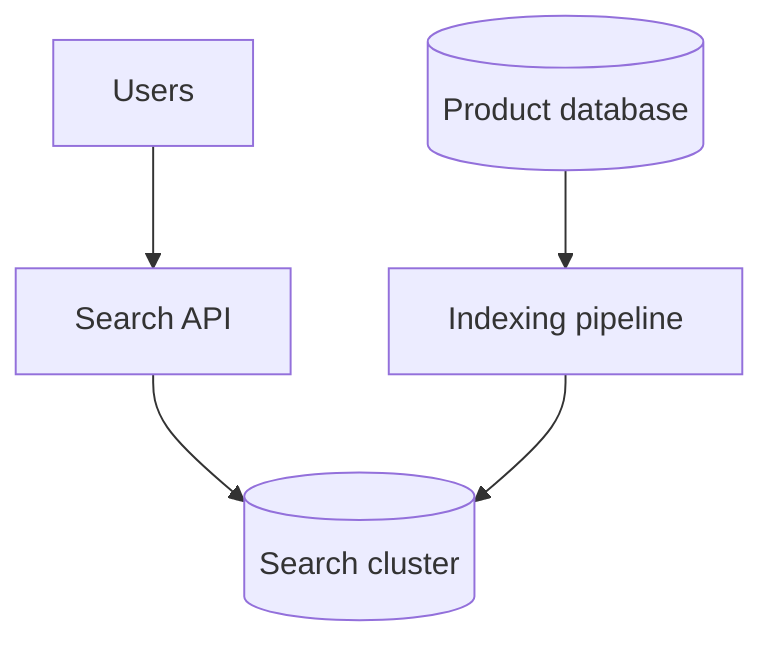
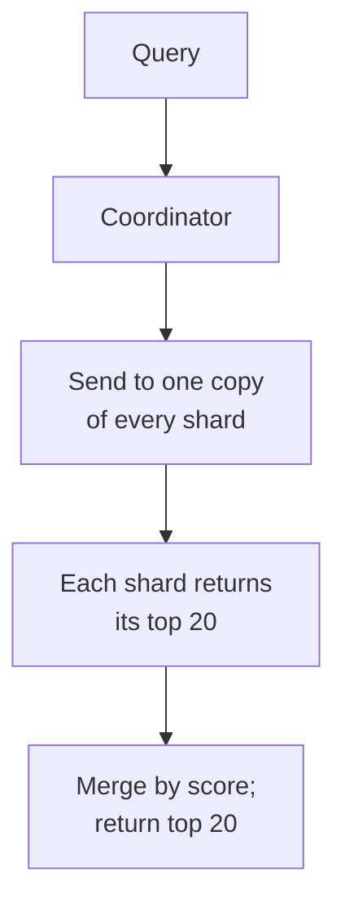
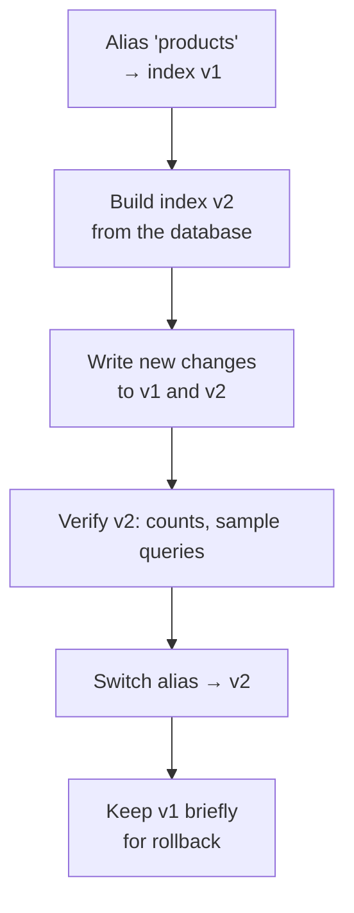
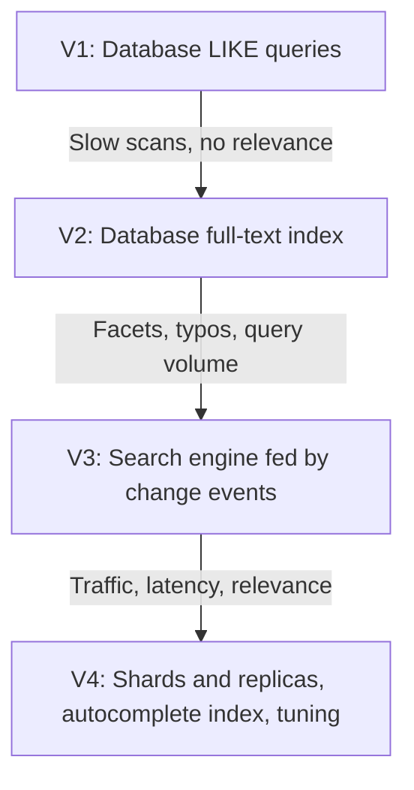

# 12.08 — Search System

## Learning Objectives

By the end of this chapter, you should be able to:

- Explain why a transactional database is a poor engine for full-text search.
- Describe how an inverted index answers a query.
- Keep a search index in sync with the source of truth, and explain the consistency cost.
- Scale search with shards for data size and replicas for query throughput.
- Design autocomplete separately from full search.
- Rebuild an index without downtime.

---

## 1. The Problem

Users type a few words and expect the most relevant results in a fraction of a second:

```text
"waterproof running shoes size 42"
```

The query is not an exact match on one column. It involves several words, partial matches ("running" should match "run"), filters (size, price, in stock), and an ordering by relevance.

This case study designs product search for a marketplace like the store in Chapter 12.02. The same ideas apply to searching documents, messages, or videos.

> [!MENTAL-MODEL]
> A search engine is a read-optimized copy of your data, reorganized from "document → words" into "word → documents", and kept up to date asynchronously.

---

## 2. Requirements

### Functional requirements

1. Users search products by free text across title, description, and brand.
2. Results can be filtered (category, price range, size, in stock) and sorted (relevance, price, newest).
3. The results page shows counts per filter value (facets), such as "Nike (132)".
4. A search box suggests completions while the user types.
5. Minor spelling mistakes still find results.

### Non-functional requirements

| Requirement | Target | Why it matters |
|---|---|---|
| Search latency | p99 under 200 ms | Search is a core navigation path |
| Autocomplete latency | p99 under 50 ms | Suggestions must keep up with typing |
| Freshness | Product changes searchable within about a minute | Sellers expect new listings to appear |
| Availability | Search degrades but never takes down checkout | Search is important but not critical for orders |

### Out of scope

- Personalized ranking and machine-learned relevance models.
- Searching images or using semantic embeddings.
- Advertising and sponsored results.

---

## 3. Constraints and Assumptions

| Assumption | Value |
|---|---|
| Searchable products | 50 million |
| Average product document | About 2 KB of searchable text and attributes |
| Daily active users | 20 million |
| Searches per user per day | 5 |
| Autocomplete requests per search | About 5 (one per few keystrokes) |
| Product changes | About 5 million per day (prices, stock, new listings) |
| Peak factor | 3× |

---

## 4. Traffic Estimation

**Searches:**

$$
\frac{20{,}000{,}000 \times 5}{86{,}400} \approx 1{,}160 \text{ searches per second}
$$

At 3× peak, about **3,500 searches per second**.

```calculator
title: Peak Search Load
description: Estimate peak full-text searches per second.
inputs:
  - id: dau
    label: Daily active users
    unit: million
    min: 0.1
    max: 200
    step: 0.1
    value: 20
    divisor: 0.0864
  - id: searches
    label: Searches per user per day
    unit: searches
    min: 1
    max: 50
    step: 1
    value: 5
  - id: peak
    label: Peak-to-average factor
    unit: ×
    min: 1
    max: 10
    step: 0.5
    value: 3
result:
  label: Peak searches per second
  operation: product
  digits: 0
formula: "{dau} million ÷ 86,400 seconds × {searches} × {peak}"
caption: Autocomplete multiplies this by the number of suggestion requests per search.
```

**Autocomplete:** about 5 requests per search gives roughly **17,000 requests per second** at peak. Autocomplete is the higher-volume workload, with a stricter latency target.

**Index updates:** 5 million changes per day is about 58 per second on average.

---

## 5. Data Estimation

$$
50{,}000{,}000 \times 2 \text{ KB} = 100 \text{ GB of source text}
$$

The index adds term dictionaries, posting lists, and stored fields. A rough planning figure is **about 150 GB per full copy of the index**. Replicas multiply that.

The index fits on a few servers. Size is not the main challenge; query throughput, latency, and freshness are.

---

## 6. Why Not the Database?

The first version is often a query on the product table:

```sql
SELECT * FROM products
WHERE title ILIKE '%running shoes%'
ORDER BY created_at DESC
LIMIT 20;
```

It works with thousands of products, then fails:

- A leading wildcard (`%running`) cannot use an ordinary B-tree index, so the database scans every row.
- It does not match variations ("run", "Running", "running-shoe").
- It has no notion of relevance; results are in date order.
- Search queries compete with checkout for the same database.

Relational databases offer full-text indexes that solve some of this and are a reasonable intermediate step. A dedicated search engine is justified when relevance, facets, typo tolerance, or query volume exceed what the database's full-text features handle well.

---

## 7. The Inverted Index

A database row maps a document to its words. An inverted index maps each word to the documents that contain it.

```text
Documents:
  1: "Trail running shoes, waterproof"
  2: "Road running shoes"
  3: "Waterproof hiking boots"

Inverted index (after lowercasing and stemming):
  run         → 1, 2
  shoe        → 1, 2
  trail       → 1
  road        → 2
  waterproof  → 1, 3
  hike        → 3
  boot        → 3
```

A query for "waterproof running shoes" looks up three short lists and intersects or scores them. Document 1 matches all three terms and ranks first.

**Text analysis** turns raw text into index terms, and the same analysis is applied to queries:

- Lowercasing: `Running` → `running`.
- Tokenizing: splitting on spaces and punctuation.
- Stemming: `running`, `runs` → `run`.
- Removing very common words, if useful for the language.
- Synonyms: `sneakers` ↔ `trainers`.

**Ranking** commonly starts from a term-statistics score such as BM25: a term counts more if it is rare across all documents and frequent in this one. Business signals (sales, ratings, stock) are then blended in.

**Filters** (price, size, in stock) are applied using separate structures for exact values and ranges, and facets count matching documents per value.

---

## 8. Keeping the Index in Sync

The database remains the source of truth. The search index is a derived copy, updated asynchronously.



Design points:

- **Capture every change.** Use the outbox pattern or the database's change data capture (CDC), not "also update the index" calls scattered through the code, which miss changes when they fail.
- **Index the current state, not the event.** The indexer reads the latest product record (or uses a version number) when it builds the document. Out-of-order or repeated events then cannot overwrite newer data with older data.
- **Batch writes.** Search engines index more efficiently in bulk.
- **Accept a refresh delay.** Most engines make new documents searchable after a short refresh interval, often around a second, so search is **near real time**, not immediate.

> [!TRADE-OFF]
> A separate index gives fast, flexible search and protects the database. The cost is eventual consistency: a price changed a moment ago may still show the old value in results. Checkout must therefore always read prices and stock from the database, never from search results.

---

## 9. Architecture With a Search Engine



The search API is a thin layer that:

- Translates user input into an engine query (fields, boosts, filters).
- Enforces limits: maximum page depth, maximum filters, timeouts.
- Hides the engine's query language from the rest of the system.

---

## 10. Scaling: Shards and Replicas

Two different pressures drive scaling:

| Pressure | Solution |
|---|---|
| Index too large for one node, or indexing too slow | **Shards**: split documents across several partitions |
| Too many queries per second | **Replicas**: more copies of each shard to serve reads |

Search engines usually **partition by document**: each shard holds a subset of products and a complete index for them. A query must go to every shard, and the results are merged.



Consequences:

- **The slowest shard sets the latency.** With five shards, a query waits for all five. Tail latency matters more as shard count grows.
- **More shards are not free.** Each adds per-query work and coordination. Choose shard sizes in the tens of gigabytes, not as many shards as possible.
- **Replicas add throughput.** If one copy of a shard handles about 500 queries per second, 3,500 queries per second needs about 7 copies of each shard, plus headroom for failures.

> [!WARNING]
> Deep pagination is expensive. Returning page 500 of 20 results means every shard must find its top 10,000 matches so the coordinator can merge them. Limit page depth, or use a cursor ("search after this result") for scrolling.

---

## 11. Autocomplete

Autocomplete has a different shape from full search: very short inputs, very high volume, and a tighter latency budget.

Common approach:

- Build a **separate suggestion index** of popular queries and product names, keyed by prefix.
- Rank suggestions by popularity (how often the completed query was searched and clicked).
- Precompute the top suggestions for short prefixes and **cache** them; "ru" has the same suggestions for everyone.
- Debounce in the client: send a request after a short pause in typing, not on every keystroke.

Popular prefixes are answered from cache; only rare, longer prefixes reach the suggestion index.

---

## 12. Typo Tolerance and Relevance

- **Fuzzy matching** finds terms within a small edit distance ("waterprof" → "waterproof"). It is more expensive than exact matching, so engines usually apply it only to longer terms and limit the distance.
- **Relevance tuning** is an ongoing process: boost title over description, favour in-stock items, demote low-rated products. Track click-through and "no result" rates to measure it.
- **Zero-result queries** are a product signal. Log them and use them to add synonyms or fix analysis.

---

## 13. Bottlenecks

| Symptom | Likely bottleneck |
|---|---|
| p99 latency rises while p50 stays flat | One slow shard or replica in scatter-gather |
| Latency rises with traffic on all nodes | Not enough replicas |
| Indexing lag grows during bulk price updates | Indexer throughput or too-frequent refreshes |
| Certain queries are always slow | Expensive features (deep pages, wildcards, large facet lists) |
| Autocomplete is slow at peak | Suggestions computed per request instead of cached |

---

## 14. Rebuilding the Index Without Downtime

Changing analysis rules, adding a field type, or fixing a bug often requires reindexing everything.

Use **aliases** (or an equivalent pointer) so the API queries a name, not a physical index:



Because the database is the source of truth, the index can always be rebuilt. This is what makes it safe to treat the search cluster as replaceable infrastructure.

---

## 15. Failure Scenarios

| Failure | What users notice | Mitigation |
|---|---|---|
| A search node fails | Nothing, or slightly slower queries | Replicas on other nodes; automatic shard reallocation |
| Indexing pipeline stops | New products and price changes missing from results | Monitor index lag; alert; replay events from the log |
| Expensive query pattern from a bot | Search slows for everyone | Query timeouts, rate limits, rejecting unbounded queries |
| Search cluster overloaded | Slow or failed searches | Shed load, serve cached popular queries, keep category browsing working |
| Mapping or analysis bug deployed | Poor or missing results | Reindex into a new index; switch alias back |
| Search cluster completely down | Search unavailable | Fall back to category pages and a basic database query for exact matches |

> [!FAILURE] Search must fail separately from checkout
> If the product page or checkout calls the search cluster for data, a search outage becomes an ordering outage. Search results link to product pages; product pages and checkout read from the database. The search cluster stays on the browsing path only.

---

## 16. Recovery

- The search index is **derived data**. Recovery is a rebuild from the database plus replay of recent change events, not a restore of the only copy.
- Index snapshots can shorten recovery, because a full rebuild of 50 million documents may take hours.
- The change log should retain events long enough to cover the time from the last snapshot to now.

---

## 17. Evolution



The intermediate full-text step is often skipped, but it is worth considering. It avoids running a second data system until the requirements demand one.

---

## 18. Trade-offs

| Decision | Benefit | Cost |
|---|---|---|
| Dedicated search engine | Relevance, facets, typos, scale | Another cluster to operate; eventual consistency |
| Asynchronous indexing | Database and writes unaffected | Results lag behind changes |
| Document-partitioned shards | Simple indexing; each shard independent | Every query touches every shard |
| Replicas | Query throughput and availability | More storage and indexing work per change |
| Separate autocomplete index | Very fast suggestions | Another index to build and update |
| Limits on page depth and query features | Predictable latency | Some queries are not allowed |

> [!LOCK-IN]
> Query languages, analyzers, and relevance settings are engine-specific, and they tend to spread into application code. Keep a search API that accepts your own query model (text, filters, sort, page) and translates it in one place. Because the index is rebuildable from the database, the data itself is not locked in; the query logic is.

---

## 19. Common Mistakes

- **Searching with `LIKE '%term%'` at scale:** Full scans and no relevance.
- **Treating the search index as the source of truth:** It cannot be rebuilt if it is the only copy.
- **Updating the index directly from scattered application code:** Changes are missed on failure.
- **Reading prices or stock from search results at checkout:** Search data can be stale.
- **Too many small shards:** Every query pays for every shard.
- **Allowing unlimited page depth:** Deep pages are expensive on every shard.
- **Computing autocomplete per keystroke without caching:** The busiest workload gets the least optimization.

---

## 20. Hands-On Exercise

Design search for a company's internal documents:

- 5 million documents across 300 teams.
- Users may only see documents they have permission to read; permissions change frequently.
- 2,000 employees search about 20 times a day.
- New documents should be searchable within 10 seconds.

Answer:

1. Estimate peak query rate and index size. Do you need more than one shard?
2. How do you enforce permissions: filter at query time, or index permissions with each document? What happens when a permission changes?
3. What freshness can the indexing pipeline realistically provide?
4. Would the database's full-text search be enough? What would make you change your answer?

---

## 21. Quick Reference

| Topic | Decision in this design |
|---|---|
| Load | About 3,500 searches/s and 17,000 autocomplete requests/s at peak |
| Index | About 150 GB per copy for 50 million products |
| Core structure | Inverted index with text analysis and BM25-style ranking |
| Sync | Outbox or CDC → change log → indexer; near real time |
| Scaling | Document-partitioned shards; replicas for throughput |
| Queries | Scatter-gather; limited depth; timeouts |
| Autocomplete | Separate prefix index; cached popular prefixes; client debounce |
| Reindexing | Build a new index, switch an alias |
| Hardest to reverse | Engine-specific query logic spread through the code |

---

## 22. Knowledge Check

**1. Why is `LIKE '%term%'` unsuitable for search at scale?**

It cannot use an ordinary index, scans every row, and has no relevance ranking or word variations.

**2. What does an inverted index store?**

For each term, the list of documents that contain it.

**3. Why must queries and documents use the same text analysis?**

Otherwise query terms will not match index terms; for example, "Running" would not match the stemmed "run".

**4. Why is the search index eventually consistent with the database?**

It is updated asynchronously from change events, and new documents become searchable after a refresh interval.

**5. What is the difference between shards and replicas in search?**

Shards split the documents to handle size; replicas copy shards to handle query throughput and failures.

**6. Why does deep pagination become expensive?**

Every shard must find and return enough top results for the coordinator to merge up to the requested page.

**7. How is autocomplete made fast?**

With a separate prefix-based suggestion index, cached results for popular prefixes, and client-side debouncing.

**8. How do you change analysis rules without downtime?**

Build a new index, verify it, and switch an alias from the old index to the new one.

---

## Remember

**Search is a rebuildable, read-optimized copy of your data. Keep the truth in the database.**

Reorganize data for queries, accept a small freshness delay, scale reads with replicas and size with shards, and design every part of the system so that search can fail or be rebuilt without affecting orders.

**Next: 12.09 — Payment System**
