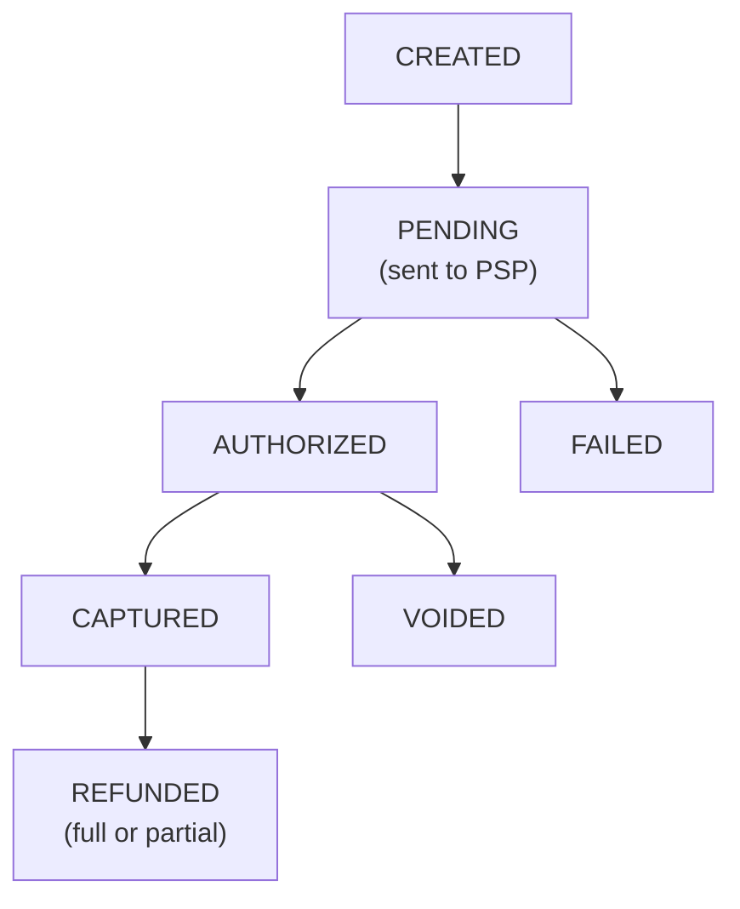
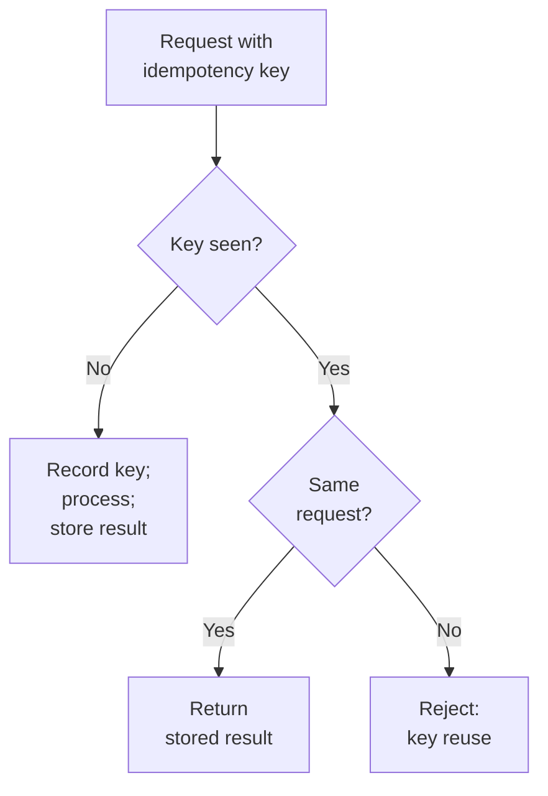
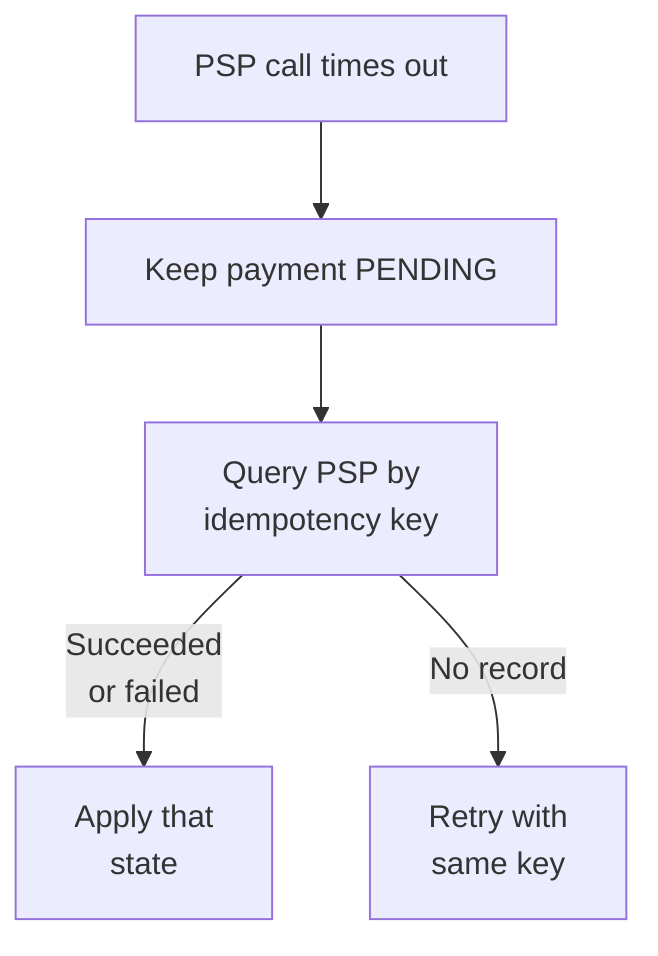
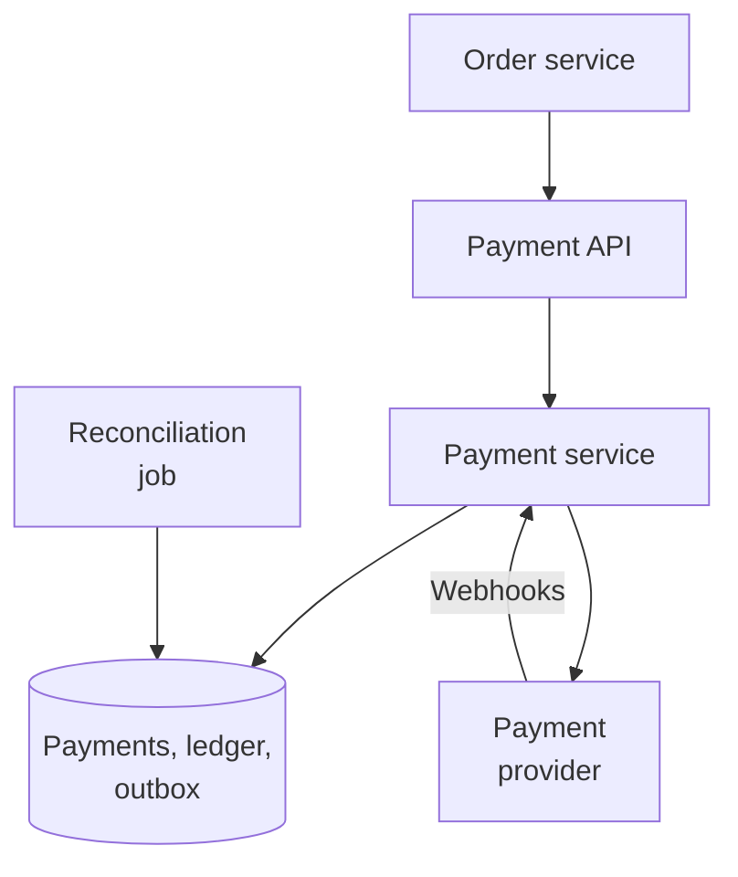
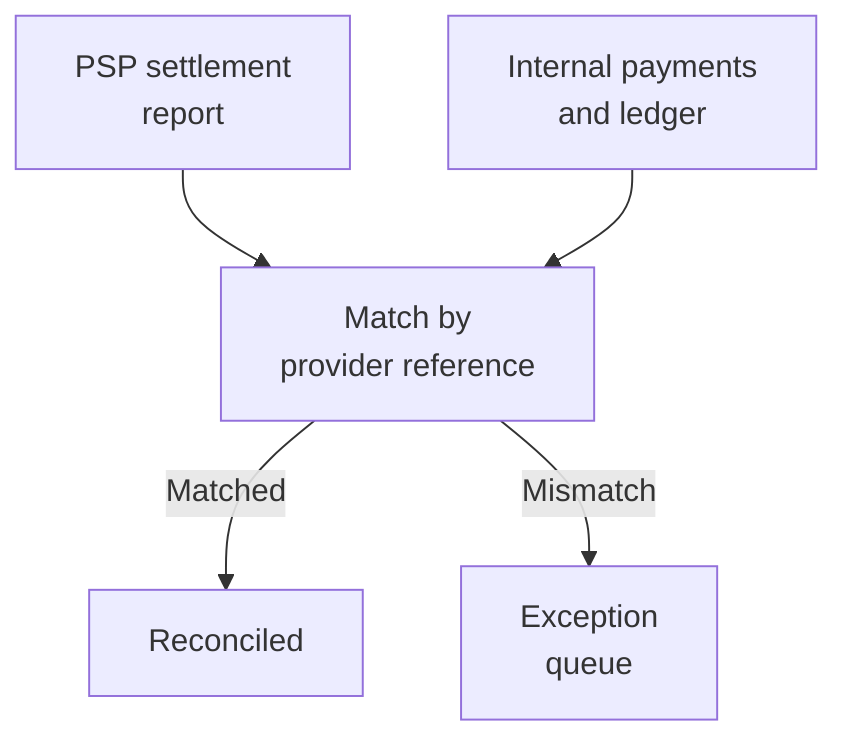
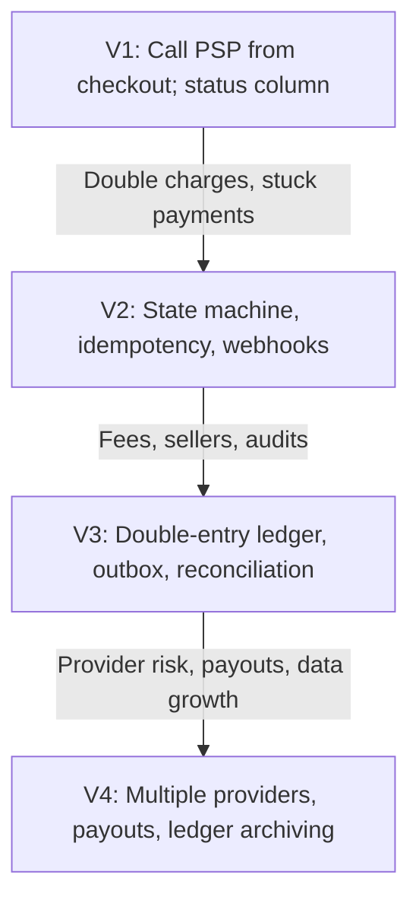

# 12.09 — Payment System

## Learning Objectives

By the end of this chapter, you should be able to:

- Explain why correctness, not throughput, drives the design of a payment system.
- Model money movements with a double-entry ledger.
- Make every payment operation idempotent across retries, timeouts, and duplicate webhooks.
- Handle payments whose outcome is unknown.
- Reconcile internal records with payment providers and banks.
- Reduce security and compliance scope by never storing card numbers.

---

## 1. The Problem

A payment system moves money between parties and keeps a record that everyone can trust.

This case study designs the payment service for a marketplace: customers pay for orders, the marketplace keeps a fee, and sellers are paid later. Card processing itself is handled by an external **payment service provider (PSP)**.

The rest of Level 12 has mostly asked "how do we serve more requests?" Here the questions are different:

- Can a customer be charged twice?
- Can money disappear between two accounts?
- After a crash, can we tell exactly what happened?
- Do our numbers match the provider's and the bank's?

> [!MENTAL-MODEL]
> A payment system is a state machine for each payment, plus an append-only ledger that records every movement of money, plus a process that proves both agree with the outside world.

---

## 2. Requirements

### Functional requirements

1. Charge a customer for an order using a card or other method via a PSP.
2. Support authorization now and capture later (for example, when the order ships).
3. Refund all or part of a payment.
4. Record the marketplace fee and each seller's balance.
5. Show customers, sellers, and finance staff the status and history of every payment.

### Non-functional requirements

| Requirement | Target | Why it matters |
|---|---|---|
| No double charges | Every operation is idempotent | Duplicate charges cost money and trust |
| No lost money | Every movement balances | Finance and regulators require it |
| Auditability | Complete, immutable history | Disputes and audits look back years |
| Durability | No acknowledged payment record is ever lost | Money already moved in the real world |
| Availability | 99.95% for accepting payments | Downtime is lost sales |
| Security | No raw card numbers stored | Reduces breach impact and compliance scope |

### Out of scope

- Building card-network connectivity (the PSP does this).
- Fraud detection models (an important input, but a separate system).
- Tax calculation and multi-currency conversion details.

---

## 3. Constraints and Assumptions

| Assumption | Value |
|---|---|
| Payments | 10 million per day |
| Peak factor | 10× during sales events |
| Ledger entries per payment | About 4 (charge, fee, seller credit, provider cost) |
| Ledger entry size | About 1 KB including indexes |
| Record retention | At least 7 years |
| PSP response time | Usually under 2 seconds; sometimes much longer |

---

## 4. Traffic Estimation

$$
\frac{10{,}000{,}000}{86{,}400} \approx 116 \text{ payments per second on average}
$$

At 10× during sales, about **1,160 payments per second**.

```calculator
title: Peak Payment Rate
description: Estimate peak payments per second.
inputs:
  - id: payments
    label: Payments per day
    unit: million
    min: 0.1
    max: 100
    step: 0.1
    value: 10
    divisor: 0.0864
  - id: peak
    label: Peak-to-average factor
    unit: ×
    min: 1
    max: 30
    step: 1
    value: 10
result:
  label: Peak payments per second
  operation: product
  digits: 0
formula: "{payments} million ÷ 86,400 seconds × {peak}"
caption: Each payment involves several database writes and at least one call to an external provider.
```

This is modest for a database. The difficulty is that each payment involves an **external call that can be slow, fail, or succeed without telling you**.

---

## 5. Data Estimation

$$
10 \text{ million} \times 4 \text{ entries} \times 1 \text{ KB} = 40 \text{ GB per day}
$$

That is about **15 TB per year**, or about 100 TB over a seven-year retention period. Ledger data is never updated or deleted during that period, which simplifies storage: recent data stays on fast storage; older periods can move to cheaper, read-only storage.

---

## 6. Representing Money

Small decisions here prevent large errors:

- **Store amounts as integers in the smallest currency unit** (cents, paise): `amount = 12999`, `currency = "EUR"`. Floating-point numbers cannot represent most decimal amounts exactly.
- **Always store the currency with the amount.** An amount without a currency is not a value.
- **Round explicitly**, and decide who receives a remainder when splitting (for example, a 3-way split of 100 cents).

---

## 7. The Payment State Machine

Each payment moves through explicit states, recorded in the database:



Rules:

- **Transitions only move forward**, and only along allowed edges. A payment cannot go from `FAILED` to `CAPTURED`.
- **Each transition is a conditional update**: `UPDATE payments SET status = 'AUTHORIZED' WHERE id = ? AND status = 'PENDING'`. If zero rows change, another process already moved it, and this event is a duplicate or arrived late.
- **Every transition is recorded with a timestamp and reason**, so the history can be reconstructed.

Authorization reserves funds on the customer's card; capture actually takes them. Separating the two lets the marketplace charge only when the order ships, and void the authorization if it is cancelled.

---

## 8. The Double-Entry Ledger

The payment's status says what happened with the provider. The **ledger** says where the money is.

In double-entry bookkeeping, every movement is recorded as entries in at least two accounts, and the entries of each transaction sum to zero.

A €100.00 order with a 10% marketplace fee and a €2.00 provider cost:

| Transaction | Account | Amount |
|---|---|---|
| T-881 | Customer payments receivable | +10000 |
| T-881 | Seller 42 payable | −8800 |
| T-881 | Marketplace fee revenue | −1000 |
| T-881 | PSP fees | −200 |
| | **Sum** | **0** |

(The sign convention is a choice; the rule that each transaction sums to zero is not.)

Properties that make this useful:

- **Append-only.** Entries are never updated or deleted. A mistake is corrected by a new reversing transaction.
- **Balanced by construction.** A transaction that does not sum to zero is rejected. Money cannot be created or lost by a bug in one code path.
- **Balances are derived.** A seller's balance is the sum of their account's entries, which can be cached but always recomputed.
- **Written atomically.** All entries of a transaction are written in one database transaction.

> [!TRADE-OFF]
> A ledger is more work than a `balance` column that code increments and decrements. In return, every balance can be explained entry by entry, and errors show up as an imbalance instead of silently.

---

## 9. Idempotency Everywhere

Payments are retried constantly: clients retry on timeouts, workers retry failed jobs, providers redeliver webhooks. Each retry must have no additional effect.



Where idempotency is needed:

| Boundary | Key |
|---|---|
| Client → payment API | Key supplied by the caller, such as `order-81231-charge` |
| Payment service → PSP | Key sent to the provider, derived from the payment ID and operation |
| PSP webhook → payment service | Provider's event ID, stored as processed |
| Ledger posting | Transaction ID derived from the payment and transition |

The key must be recorded **before** the side effect, in the same transaction that creates the payment record. Otherwise a crash between "charge succeeded" and "key stored" lets a retry charge again.

---

## 10. Calling the Provider: Unknown Outcomes

The payment service sends "authorize €100" to the PSP and waits. Three things can happen:

1. A clear success.
2. A clear failure (for example, insufficient funds).
3. **No answer**: a timeout, a dropped connection, or a 5xx error after the request was sent.

The third case is the important one. The customer may or may not have been charged.



- **Never mark a timed-out payment as failed** and let the customer try again with a new key. That is how double charges happen.
- **Retry with the same idempotency key**, so the provider deduplicates.
- **Resolve stuck payments** with a background job that queries the provider for anything pending longer than a few minutes.
- **Webhooks** from the provider may resolve the state first. Whichever arrives first wins, and the conditional state transition makes the second a no-op.

> [!FAILURE] The double charge
> The checkout times out after 30 seconds. The application marks the payment failed, and the customer presses "Pay" again, generating a new payment with a new key. Both authorizations succeed at the provider. The fix is not a shorter timeout; it is never treating "no answer" as "no".

---

## 11. Architecture



Design points:

- **One strongly consistent database** for payments, ledger, idempotency keys, and outbox. At about 1,000 payments per second this is well within a single primary with synchronous replicas. Splitting it would trade correctness for scale the system does not need.
- **State changes, ledger entries, and outbox events are written in one transaction.** Other services (orders, notifications, seller payouts) learn about payments from outbox events.
- **The provider is called outside the database transaction.** The payment is first recorded as `PENDING`, then the provider is called, then the result is applied in a new transaction.
- **A circuit breaker** stops sending to a provider that is failing, and a second provider can be used for new payments if the business has one.

---

## 12. Reconciliation

The internal records can disagree with reality: a webhook was never delivered, a refund was issued in the provider's dashboard, a bug skipped a ledger entry.

**Reconciliation** compares records with external sources, every day:



Typical exceptions and corrections:

| Exception | Likely cause | Correction |
|---|---|---|
| Provider shows a capture we recorded as pending | Missed webhook | Apply the state; post ledger entries |
| We recorded a refund the provider does not show | Failed refund call treated as success | Retry or reverse the ledger entry |
| Amounts differ | Currency rounding or fee changes | Post an adjustment transaction |

Corrections are new ledger transactions, never edits. Reconciliation is how a payment system proves it is correct, rather than assuming it.

---

## 13. Security and Compliance

- **Never store raw card numbers.** Use the provider's hosted payment fields or SDK so card data goes directly from the customer's browser to the provider. The system receives a **token** that can be charged but is useless elsewhere. This keeps most of the system out of the strictest card-data compliance scope (PCI DSS).
- **Encrypt sensitive data** at rest and in transit, and keep provider API keys in a secrets manager.
- **Restrict who can move money.** Refunds and manual adjustments require specific permissions and, for large amounts, a second approver.
- **Log every action** that changes payment state or posts ledger entries, with who did it and why.

---

## 14. Bottlenecks

| Symptom | Likely bottleneck |
|---|---|
| Checkout latency follows the provider's latency | Synchronous provider calls on the request path |
| Many payments stuck in `PENDING` | Missing resolution job or webhook delivery problems |
| Hot rows when updating balances | Balance columns updated per payment |
| Reconciliation runs take hours | Matching large reports without indexes on provider references |
| Database CPU rises during sales | Many writes per payment; long transactions |

Derive balances from the ledger and cache them per account (updated by a single writer per account or in batches), rather than updating one balance row from many concurrent transactions.

---

## 15. Failure Scenarios

| Failure | What users notice | Mitigation |
|---|---|---|
| Provider timeout | "Payment processing" message | Keep pending; query provider; retry with same key |
| Duplicate client request | Nothing | Idempotency key returns the original result |
| Duplicate or late webhook | Nothing | Processed-event IDs; forward-only conditional transitions |
| Provider outage | Payments fail or are delayed | Circuit breaker; secondary provider; queue captures for later |
| Payment service crashes mid-flow | Payment shows pending briefly | Durable state; resolution job resumes from the recorded state |
| Bug posts unbalanced entries | Transaction rejected | Balance check enforced on every ledger transaction |
| Primary database fails | Payments paused briefly | Synchronous replica failover; RPO of zero |

---

## 16. Recovery

- **Recovery-point objective: zero.** Losing an acknowledged payment record means money moved in the real world without a record. Use synchronous replication to another failure domain.
- **The ledger can rebuild every balance.** Caches and summaries are disposable.
- **The provider is an external source of truth.** After an incident, reconciliation against provider records identifies anything the system missed.
- **Never "fix" data by editing rows.** Post correcting transactions so the history shows what went wrong and how it was fixed.

---

## 17. Evolution



Unlike the earlier case studies, evolution here is driven mostly by correctness and business needs, not by traffic.

---

## 18. Trade-offs

| Decision | Benefit | Cost |
|---|---|---|
| Single strongly consistent database | Simple, atomic writes for payments and ledger | Vertical scaling limit (far above current needs) |
| Double-entry ledger | Every cent is explainable; errors are visible | More rows and more design effort than a balance column |
| Idempotency at every boundary | No duplicates from retries | Key storage and careful design of key scope |
| Pending state for unknown outcomes | No double charges | Customers sometimes wait for resolution |
| Authorization then capture | Charge only when fulfilled | Authorizations expire; more states to handle |
| Daily reconciliation | Proven correctness | Operational process and exception handling |
| Hosted card fields and tokens | Smaller compliance scope | Dependence on the provider's UI and tokens |

> [!LOCK-IN]
> Card tokens and saved payment methods belong to the provider and usually cannot be exported to a competitor without a formal migration process. Subscriptions and stored cards are therefore the strongest lock-in in the system. Keep provider identifiers as references in your own records, keep the ledger provider-neutral, and design the payment service so that new payments can be routed to a second provider.

---

## 19. Common Mistakes

- **Using floating-point numbers for money:** Rounding errors accumulate.
- **Updating balance columns instead of keeping a ledger:** Errors are invisible and unexplainable.
- **Treating a timeout as a failure:** Customers are charged twice.
- **Storing the idempotency key after the side effect:** A crash in between allows duplicates.
- **Trusting webhooks to arrive exactly once and in order:** They may be duplicated, delayed, or missing.
- **Editing or deleting ledger entries:** The audit trail is destroyed.
- **Skipping reconciliation:** Mismatches are found by customers or auditors instead.
- **Storing card numbers:** Breach impact and compliance scope grow enormously.

---

## 20. Hands-On Exercise

Design payments for a subscription software company:

- 2 million customers on monthly or annual plans.
- Cards are charged on each customer's renewal date.
- Failed renewals are retried several times over two weeks before the subscription is cancelled.
- Customers can upgrade mid-month and pay a prorated amount.

Answer:

1. Estimate renewal charges per day. When do peaks occur?
2. What idempotency key prevents a renewal from being charged twice?
3. Draw the state machine for a renewal, including retries and cancellation.
4. Write the ledger entries for a prorated upgrade.
5. How does reconciliation detect a renewal that succeeded at the provider but was recorded as failed?

---

## 21. Quick Reference

| Topic | Decision in this design |
|---|---|
| Volume | About 116 payments/s; about 1,160/s during sales |
| Storage | About 40 GB/day of ledger entries; 7-year retention |
| Amounts | Integers in minor units with currency |
| Payment lifecycle | Forward-only state machine; conditional transitions |
| Money movements | Append-only double-entry ledger; each transaction sums to zero |
| Duplicates | Idempotency keys at every boundary |
| Unknown outcomes | Stay pending; query provider; retry with the same key |
| Correctness check | Daily reconciliation with provider settlement reports |
| Security | Hosted card fields, tokens, least privilege for refunds |
| Hardest to reverse | Provider-held card tokens and saved payment methods |

---

## 22. Knowledge Check

**1. Why is a payment system designed around correctness rather than throughput?**

The request rate is modest, but every error moves real money, and external calls can fail in ambiguous ways.

**2. What does double-entry bookkeeping guarantee?**

Each transaction's entries sum to zero, so money cannot be created or lost by recording only one side.

**3. Why is the ledger append-only?**

Corrections are new transactions, preserving a complete, auditable history.

**4. What should happen when a provider call times out?**

The payment stays pending; the system queries the provider and retries only with the same idempotency key.

**5. Why must the idempotency key be stored before calling the provider?**

If the system crashes after the charge but before storing the key, a retry would not be recognized and would charge again.

**6. How are duplicate webhooks handled?**

Processed event IDs are recorded, and state transitions are conditional, so repeated events have no effect.

**7. What does reconciliation do?**

It compares internal records with provider settlement reports and turns every mismatch into an investigated exception.

**8. How does tokenization reduce risk?**

Card numbers never reach the system; it stores tokens that are useless outside the provider.

---

## Remember

**Never guess about money. Record every state, make every operation repeatable, and prove your records against the outside world.**

A payment system is small in traffic and large in consequences. A forward-only state machine, an append-only ledger, idempotency at every boundary, and daily reconciliation turn ambiguous failures into recoverable, explainable events.

**Next: 12.10 — Analytics System**
