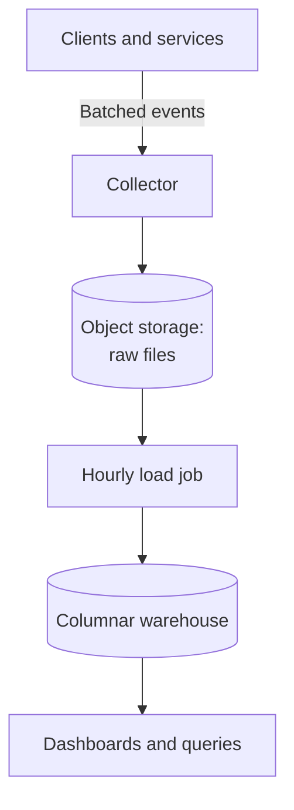
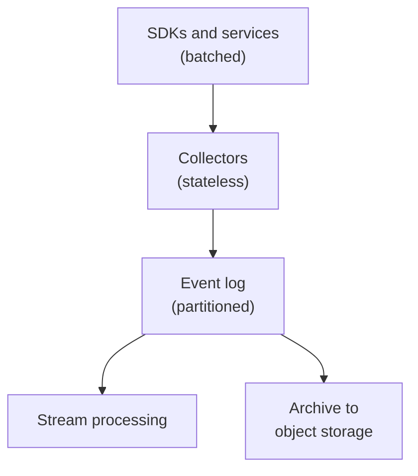
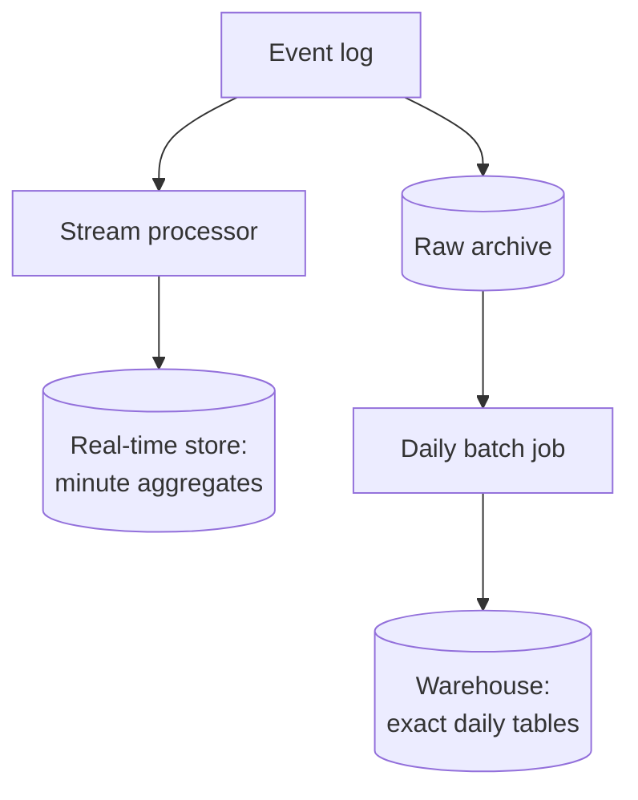
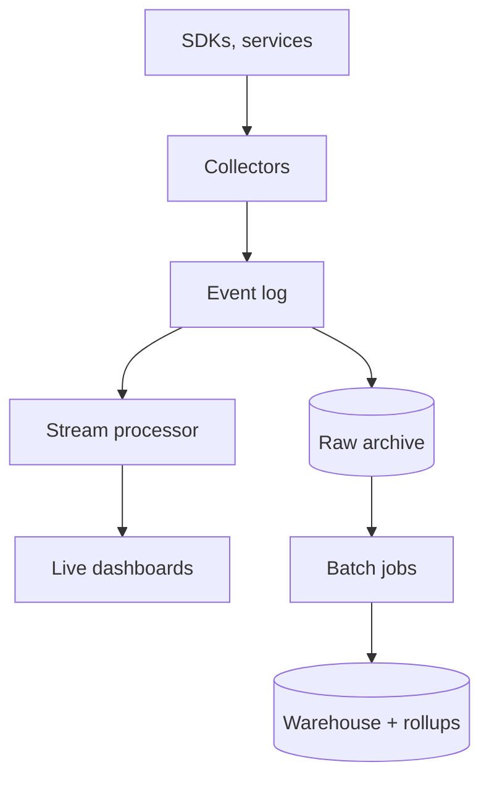
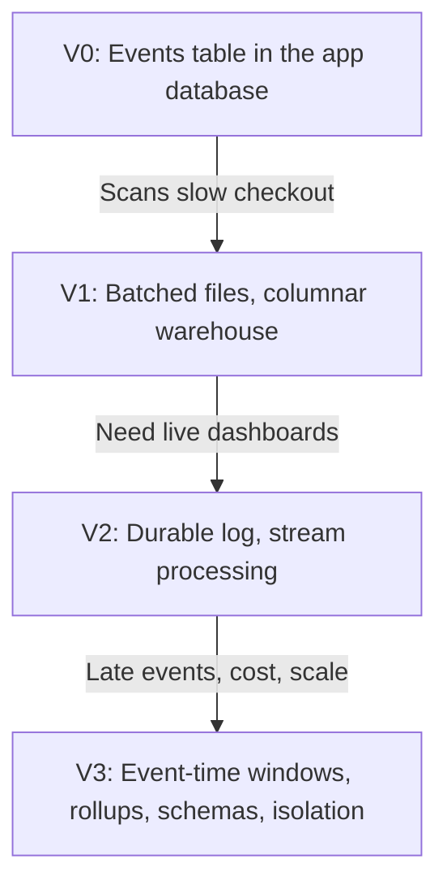

# 12.10 — Analytics System

## Learning Objectives

By the end of this chapter, you should be able to:

- Explain why analytical queries need different storage from transactional queries.
- Estimate event volume, ingestion bandwidth, and storage for an analytics pipeline.
- Ingest events reliably with batching, a durable log, and deduplication.
- Choose between stream processing and batch processing for a given metric.
- Handle late and duplicate events.
- Make queries fast with columnar storage, partitioning, and pre-aggregation.

---

## 1. The Problem

Product teams want to know how people use the product: how many users opened the app today, which features they use, where they abandon a checkout, how a change affected conversion.

The data comes from **events**: small records describing something that happened.

```json
{
  "event_id": "4c0f8a2e-91c3-4e3b-a1d7-5f2c9e0b7a11",
  "event": "checkout_started",
  "user_id": "u_4821",
  "timestamp": "2026-10-12T09:14:03.214Z",
  "properties": { "cart_value": 12999, "items": 3, "platform": "ios" }
}
```

Analytics differs from every earlier case study:

- **Writes are enormous and append-only.** Billions of events per day, never updated.
- **Reads are few but scan a lot.** A dashboard query may read a billion rows to produce ten numbers.
- **Exactness is negotiable.** "About 4.2 million daily users" is usually as useful as "4,213,877".

> [!MENTAL-MODEL]
> An analytics system is a durable, append-only event log, plus processing that turns raw events into small summaries that answer questions quickly.

---

## 2. Requirements

### Functional requirements

1. Web and mobile clients and backend services send events.
2. Teams see near-real-time dashboards (active users, events per minute, errors).
3. Analysts run ad-hoc queries over months of history (funnels, retention, segments).
4. Daily reports are exact enough for business decisions.
5. Event definitions can evolve without breaking pipelines.

### Non-functional requirements

| Requirement | Target | Why it matters |
|---|---|---|
| Ingestion availability | Accept events even when downstream processing is slow | Lost events cannot be recovered |
| Real-time freshness | Dashboards within about 1 minute | Teams watch launches and incidents |
| Query latency | Common dashboards in seconds; ad-hoc queries in under a minute | Interactive analysis |
| Correctness | Daily figures stable after late data arrives | Reports drive decisions |
| Cost | Storage and compute grow slower than event volume | Analytics should not cost more than it is worth |
| Privacy | Personal data minimized and deletable | Legal requirements |

### Out of scope

- Machine-learning pipelines.
- Visualization tool design.
- Advertising attribution.

---

## 3. Constraints and Assumptions

| Assumption | Value |
|---|---|
| Daily active users | 50 million |
| Events per user per day | 100 |
| Average raw event size | About 500 bytes (JSON) |
| Compression in columnar storage | About 10× |
| Peak factor | 3× |
| Raw retention | 2 years; aggregates kept longer |

---

## 4. Traffic Estimation

$$
50{,}000{,}000 \times 100 = 5 \text{ billion events per day} \approx 58{,}000 \text{ per second}
$$

At 3× peak, about **174,000 events per second**.

```calculator
title: Event Ingestion Rate
description: Estimate peak events per second from user activity.
inputs:
  - id: dau
    label: Daily active users
    unit: million
    min: 0.1
    max: 500
    step: 0.1
    value: 50
    divisor: 0.0864
  - id: events
    label: Events per user per day
    unit: events
    min: 1
    max: 1000
    step: 1
    value: 100
  - id: peak
    label: Peak-to-average factor
    unit: ×
    min: 1
    max: 10
    step: 0.5
    value: 3
result:
  label: Peak events per second
  operation: product
  digits: 0
formula: "{dau} million ÷ 86,400 seconds × {events} × {peak}"
caption: Instrumentation decisions move this number more than user growth does. Every new event type adds load for every user.
```

**Ingestion bandwidth at peak:**

$$
174{,}000 \times 500 \text{ bytes} \approx 87 \text{ MB/s}
$$

What these numbers tell us:

- **No single database row-insert path should receive this.** Events must be batched.
- **The write path must be simple and highly available**, because an event that is not accepted is lost.
- **Queries scan; they do not look up.** The storage must be optimized for scanning a few columns over billions of rows.

---

## 5. Data Estimation

| Data | Calculation | Size |
|---|---|---|
| Raw events | 5 billion × 500 bytes | About 2.5 TB/day |
| Columnar, compressed | 2.5 TB ÷ 10 | About 250 GB/day, 91 TB/year |
| Daily aggregates | Thousands of rows per metric per day | Small |

Storing raw events in object storage is cheap. Querying them directly is slow and expensive. Aggregates are tiny and fast. The design keeps all three and uses each for what it is good at.

---

## 6. Why Not the Application Database?

The first instinct is an `events` table in the production database:

```sql
INSERT INTO events (user_id, event, properties, created_at) VALUES (...);
```

It fails for analytics because:

- **Row-oriented storage reads whole rows.** "Count `checkout_started` events per day" reads every column of every row.
- **Indexes do not help scans of most of the table.**
- **Analytical queries compete with customer traffic.** A long report slows checkout.
- **High insert rates** bloat indexes and replication.

Analytics needs **columnar storage**: each column is stored separately and compressed. A query that uses three columns reads only those three, and similar values compress very well.

> [!TRADE-OFF]
> Columnar stores are excellent at scanning and aggregating, and poor at updating single rows. That matches events, which are never updated, and does not match orders or payments, which are.

---

## 7. Initial Architecture

At small scale, the simplest correct design is:



This is batch analytics: data is about an hour old, which suits daily reports and many dashboards. It is a reasonable place to stop if nobody needs fresher data.

---

## 8. Ingestion

**Clients batch.** SDKs collect events in memory and on disk and send them every few seconds or every few dozen events. That reduces request count by one or two orders of magnitude and survives brief offline periods.

**Collectors are thin.** They authenticate the source, validate basic structure, add server-side fields (receive time, IP-derived region), and append to a durable log. They do no heavy processing, so they rarely fail and scale horizontally.

**A durable log decouples ingestion from processing.** A partitioned log such as Kafka retains events for days. If processing is slow or broken, events wait in the log instead of being dropped.



**Duplicates are normal.** A client that times out resends its batch. Every event carries a client-generated `event_id`, and downstream processing deduplicates on it within a time window.

**Schemas evolve.** Define each event type with a versioned schema, validate at the collector or in processing, and route invalid events to a quarantine location rather than dropping them silently.

---

## 9. Stream and Batch Processing

Two kinds of processing read the same log:

| | Stream processing | Batch processing |
|---|---|---|
| Freshness | Seconds to a minute | Hours |
| Input | Events as they arrive | Complete files for a period |
| Strength | Live dashboards, alerting | Exact, reproducible daily figures |
| Difficulty | Late events, state management | Latency |

**Stream processing** keeps running aggregates in time windows: events per minute, active users in the last 5 minutes, error rate. Results go to a fast store that dashboards read.

**Batch processing** recomputes a day's figures from the complete raw data once late events have arrived. Its results replace the streaming estimates for that day.

Many systems run both: stream for "now", batch for "official". A simpler alternative is to process everything as a stream and reprocess from the log when logic changes. Both are valid; the choice depends on the team's tools and how often logic changes.



---

## 10. Time, Late Events, and Windows

Each event has two times:

- **Event time:** when it happened on the device.
- **Processing time:** when the pipeline saw it.

A phone that was offline on a plane may send yesterday's events this morning. If dashboards group by processing time, yesterday's numbers are too low and today's are too high.

Group by event time, and decide how long to wait:

- A **watermark** is the pipeline's estimate that "events before time T have probably all arrived".
- A window is finalized when the watermark passes its end, plus an allowed lateness.
- Events that arrive after that are either added to a correction or handled by the next batch recomputation.

> [!NOTE]
> Device clocks can be wrong. Pipelines usually trust device time only within limits (for example, not in the future and not older than a few days) and fall back to receive time otherwise.

---

## 11. Making Queries Fast

**Partition by time.** Store data in daily (or hourly) partitions. A query for last week reads 7 partitions, not two years.

**Cluster or sort within partitions** by commonly filtered fields, such as event name, so queries skip blocks that cannot match.

**Pre-aggregate common questions.** Most dashboards ask the same questions repeatedly. A rollup table such as:

| day | event | platform | count | unique users (approx.) |
|---|---|---|---|---|

turns a scan of billions of events into a scan of thousands of rows.

**Approximate distinct counts.** Counting unique users exactly requires remembering every user ID. A sketch such as HyperLogLog estimates distinct counts with about 1% error in a few kilobytes, and sketches from different days can be merged to get weekly uniques. Exact unique counts are reserved for the cases that need them.

**Separate workloads.** Ad-hoc queries by analysts should not slow dashboards. Use separate compute pools or query queues, and set limits on query cost.

---

## 12. Bottlenecks

| Symptom | Likely bottleneck |
|---|---|
| Collectors reject events at peak | Too few collectors, or synchronous work in the collector |
| Consumer lag on the log grows | Stream processors cannot keep up; partitions too few or uneven |
| One partition of the log is far behind | A hot key (for example, partitioning by event type) |
| Dashboards slow down over time | Queries scan raw events instead of rollups; missing time partitions |
| Daily numbers change for days | Late events with no defined allowed lateness |
| Storage costs grow faster than usage | Raw data kept on expensive storage; no retention policy |

Partition the event log by a well-distributed key such as `user_id` (which also keeps one user's events in order), not by event type, which concentrates the most common events on one partition.

---

## 13. Architectural Decisions

| Decision | Problem it solves |
|---|---|
| Client batching | Request overhead; offline periods |
| Thin, stateless collectors + durable log | Ingestion stays available when processing fails |
| `event_id` deduplication | Client retries create duplicates |
| Versioned schemas with quarantine | Bad events do not break pipelines or vanish |
| Stream for freshness, batch for exactness | Live dashboards and stable reports |
| Event-time windows with watermarks | Late events counted in the right period |
| Columnar storage partitioned by time | Fast scans over the needed range and columns |
| Rollups and approximate uniques | Dashboards read small tables |



---

## 14. Failure Scenarios

| Failure | What users notice | Mitigation |
|---|---|---|
| Stream processor crashes | Live dashboards pause | Restart from the last committed log offset; state from checkpoints |
| Processing bug produces wrong numbers | Incorrect dashboards | Fix and reprocess from the log or raw archive |
| Log outage | Collectors cannot write | Collectors buffer to local disk briefly; clients keep batches |
| A release floods a new event type | Ingestion and cost spike | Per-source quotas; sampling of high-volume debug events |
| Malformed events after an app release | Missing data for that version | Schema validation, quarantine, alerting on rejection rate |
| Expensive ad-hoc query | Dashboards slow | Separate compute; query cost limits |

> [!FAILURE] The silent gap
> An app release renames an event from `checkout_started` to `checkoutStarted`. Nothing fails. The checkout funnel simply drops to zero for new app versions, and nobody notices for a week. Schema validation, alerts on sudden drops in event volume per type, and treating event names as a contract prevent this.

---

## 15. Recovery

- **Raw events are the source of truth.** Keep them in durable, cheap object storage. Every aggregate can be recomputed from them.
- **The log's retention** (for example, 7 days) is the window for replaying recent data into stream processing after a bug.
- **Backfills** recompute historical aggregates after logic changes. Make jobs idempotent (overwrite a partition rather than append to it) so they can be rerun safely.
- **Lost events are unrecoverable.** This is why the ingestion path is the most protected part of the system.

---

## 16. Privacy and Retention

Analytics systems accumulate personal data easily.

- Collect only what questions require. Avoid free-text fields that can contain personal data.
- Pseudonymize identifiers where possible.
- Support deletion requests: deleting one user's events from immutable columnar files usually means rewriting affected partitions, so plan for it (for example, by keeping a deletion list applied during compaction).
- Expire raw events after the retention period; keep aggregates that no longer identify individuals.

---

## 17. Evolution



Many products are well served by V1 for a long time. Real-time processing is worth its complexity only when someone acts on data within minutes.

---

## 18. Trade-offs

| Decision | Benefit | Cost |
|---|---|---|
| Columnar warehouse | Fast scans and compression | Poor for updates and point lookups |
| Durable log | Ingestion survives processing failures; replay | Another system to operate |
| Stream + batch | Fresh and exact | Two pipelines to keep consistent |
| Stream only with reprocessing | One code path | Reprocessing large histories is slow |
| Approximate distinct counts | Small, mergeable, fast | About 1% error |
| Rollups | Fast dashboards | Only answer predefined questions |
| Long raw retention | Re-answer new questions about old data | Storage cost; privacy obligations |

> [!LOCK-IN]
> Event names and schemas become a contract with every dashboard, report, and model built on them, and with app versions that remain installed for years. Changing them is harder than changing the warehouse. Treat event definitions as a versioned API. Raw events in an open file format in your own object storage keep the data itself portable across query engines.

---

## 19. Common Mistakes

- **Writing analytics events into the production database:** Scans compete with customers.
- **Doing heavy work in collectors:** Ingestion fails when processing fails.
- **Sending one request per event from clients:** Request overhead and battery drain.
- **Grouping by processing time:** Late events distort daily numbers.
- **Partitioning the log by event type:** The most common event becomes a hot partition.
- **Exact distinct counts everywhere:** Memory and time grow with users.
- **No schema validation:** Renamed events silently break funnels.
- **Building real-time pipelines nobody needs:** Complexity without decisions that depend on it.

---

## 20. Hands-On Exercise

Design analytics for a mobile game:

- 5 million daily players.
- The game sends an event every time a level starts, ends, or a purchase is made (about 300 events per player per day).
- Designers want to see level completion rates within 10 minutes of releasing a new level.
- Finance needs exact daily revenue from purchases.

Answer:

1. Estimate peak events per second and daily storage after compression.
2. Which metrics need stream processing, and which can be batch?
3. Purchases also exist in the payment system. Should finance use analytics events or payment records for revenue? Why?
4. How do you handle events from players who were offline for two days?
5. Which events would you sample, and which must never be sampled?

---

## 21. Quick Reference

| Topic | Decision in this design |
|---|---|
| Volume | About 5 billion events/day; about 174,000/s at peak |
| Storage | About 2.5 TB/day raw; about 250 GB/day columnar |
| Ingestion | Client batching → thin collectors → durable partitioned log |
| Duplicates | `event_id` deduplication within a window |
| Processing | Stream for live dashboards; batch for exact daily tables |
| Time | Event time, watermarks, allowed lateness |
| Storage layout | Columnar, partitioned by date, clustered by event |
| Fast queries | Rollups and approximate distinct counts |
| Recovery | Recompute from raw events; idempotent partition overwrites |
| Hardest to reverse | Event names and schemas used by every consumer |

---

## 22. Knowledge Check

**1. Why do analytical queries need columnar storage?**

They scan a few columns across many rows; columnar storage reads only those columns and compresses them well.

**2. Why should collectors do as little as possible?**

Ingestion must stay available; any work that can fail belongs downstream of the durable log.

**3. What does the durable log provide?**

It decouples ingestion from processing, buffers during failures, and allows replay after bugs.

**4. When is stream processing worth it?**

When someone needs to act on data within minutes, such as live dashboards or alerts.

**5. What is the difference between event time and processing time?**

Event time is when something happened; processing time is when the pipeline saw it. Grouping by event time counts late events in the correct period.

**6. Why use approximate distinct counts?**

They estimate unique users with small, mergeable sketches instead of storing every ID.

**7. Why make batch jobs overwrite partitions?**

So reruns and backfills are idempotent and never double-count.

**8. Why are event schemas a lock-in risk?**

Every dashboard, report, and installed app version depends on them, so changing them breaks consumers.

---

## Remember

**Accept every event, keep the raw truth cheaply, and answer questions from small summaries.**

Analytics trades exactness and freshness against cost. Protect the ingestion path, process by event time, pre-aggregate what is asked often, and keep the raw events so any number can be recomputed when the logic or the question changes.

**Next: 12.11 — SaaS Platform**
