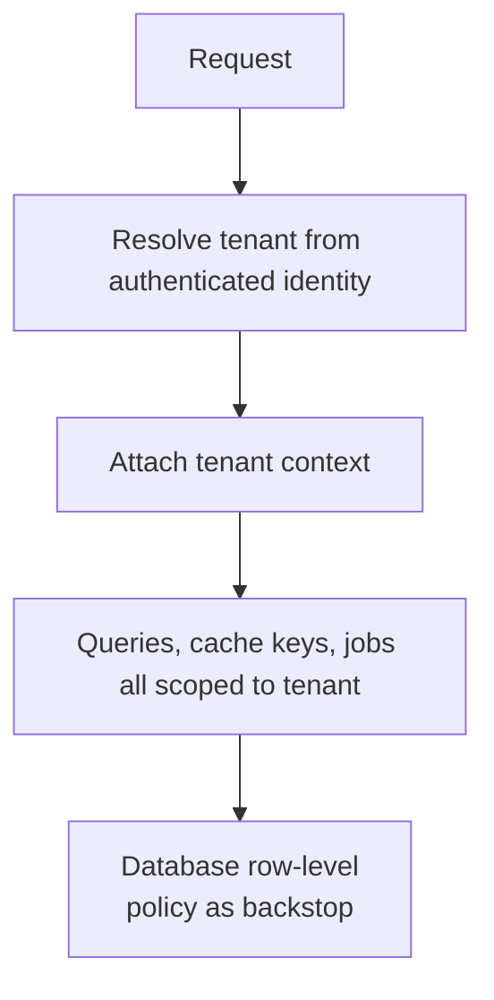
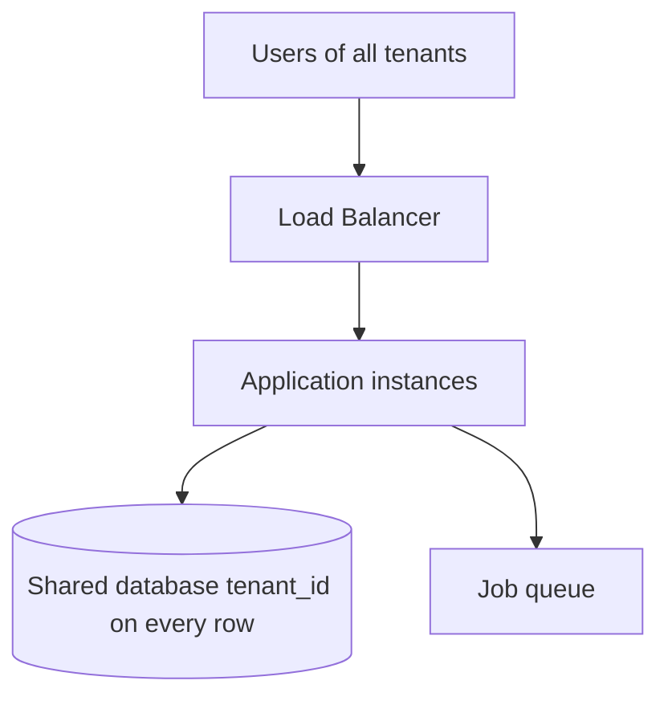
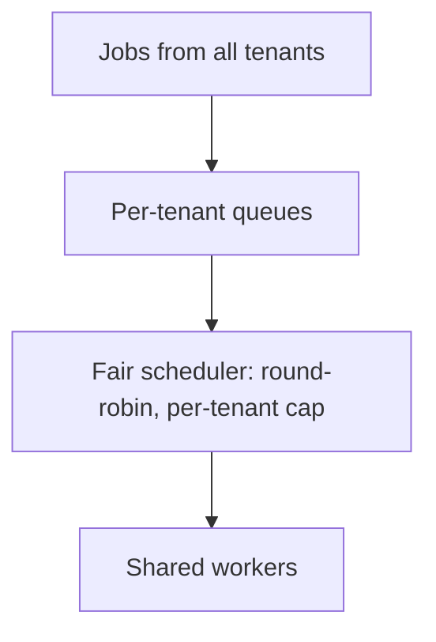
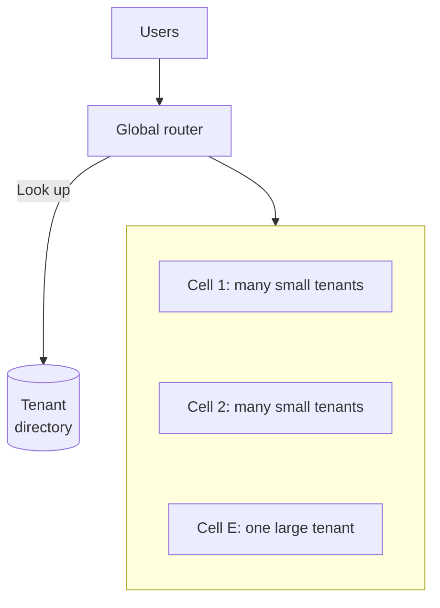
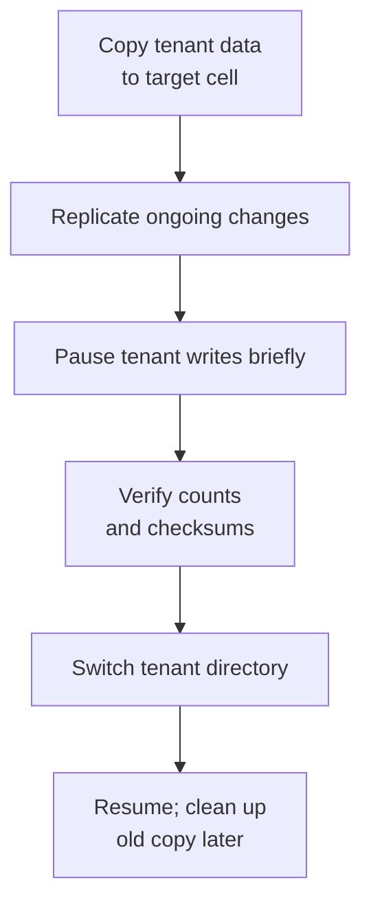
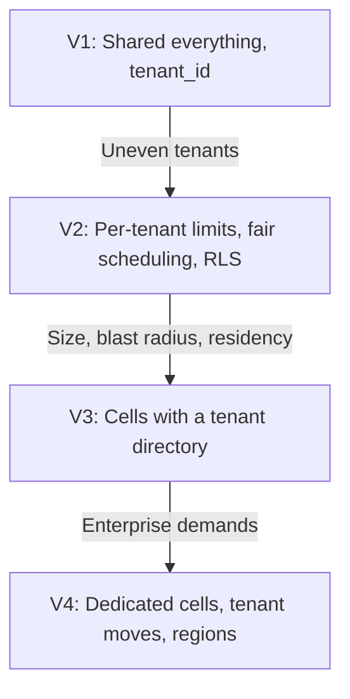

# 12.11 — SaaS Platform

## Learning Objectives

By the end of this chapter, you should be able to:

- Compare shared, schema-per-tenant, and database-per-tenant models.
- Enforce tenant isolation so one customer can never see another's data.
- Protect tenants from each other's load (the noisy-neighbour problem).
- Estimate load when a few large tenants dominate traffic.
- Scale with cells and move tenants between them.
- Run schema changes, backups, and restores across thousands of tenants.

---

## 1. The Problem

A **software-as-a-service (SaaS)** platform runs one product for many customer organizations. Each organization is a **tenant**: a company using a project-management tool, a clinic using a scheduling system, a store using an inventory service.

Running every customer on shared infrastructure is what makes SaaS economical. It also creates problems that single-customer systems do not have:

- **Isolation:** a bug must never show Tenant A's data to Tenant B.
- **Fairness:** one tenant's bulk import must not slow everyone else.
- **Variety:** a 5-person startup and a 50,000-person enterprise use the same product with very different needs.
- **Operations:** a schema change must be applied to every tenant's data safely.

> [!MENTAL-MODEL]
> A SaaS platform is one system that must behave like many separate systems: shared for cost, isolated for safety, and fair under uneven load.

---

## 2. Requirements

### Functional requirements

1. Organizations sign up and get a working workspace immediately.
2. Each tenant has users, roles, and its own data.
3. Enterprise tenants can use single sign-on (SSO) with their identity provider.
4. Tenants can configure features and limits according to their plan.
5. Usage is measured for billing.
6. Some enterprise tenants require their data to stay in a specific region.

### Non-functional requirements

| Requirement | Target | Why it matters |
|---|---|---|
| Isolation | No cross-tenant data access, ever | A single leak can end customer trust |
| Fairness | One tenant cannot degrade others | Shared infrastructure must be predictable |
| Availability | 99.9% standard; 99.95% for enterprise plans | Contracts and SLAs differ by plan |
| Blast radius | A failure affects a fraction of tenants | Outages should not be global |
| Onboarding | New tenants provisioned in seconds | Self-service sign-up |
| Data residency | Region-pinned tenants stay in their region | Legal and contractual requirements |

### Out of scope

- The product's own features.
- Pricing strategy.
- Marketplace of third-party integrations.

---

## 3. Constraints and Assumptions

| Assumption | Value |
|---|---|
| Tenants | 20,000 organizations |
| Daily active users per tenant | 15 on average (very uneven) |
| Requests per active user per day | 500 |
| Peak factor | 4× (traffic concentrates in business hours) |
| Data per tenant | 5 GB on average; the largest tenant has 2 TB |
| Load distribution | The largest 1% of tenants (200) generate about half of the load |

The last row matters most. Tenant size typically follows a long-tail distribution: thousands of small tenants and a few very large ones.

---

## 4. Traffic Estimation

$$
\frac{20{,}000 \times 15 \times 500}{86{,}400} \approx 1{,}740 \text{ requests per second on average}
$$

At 4× peak, about **6,900 requests per second**.

```calculator
title: SaaS Peak Request Rate
description: Estimate peak requests per second across all tenants.
inputs:
  - id: tenants
    label: Tenants
    unit: thousand
    min: 0.1
    max: 500
    step: 0.1
    value: 20
    divisor: 86.4
  - id: users
    label: Daily active users per tenant
    unit: users
    min: 1
    max: 500
    step: 1
    value: 15
  - id: requests
    label: Requests per user per day
    unit: requests
    min: 10
    max: 5000
    step: 10
    value: 500
  - id: peak
    label: Peak-to-average factor
    unit: ×
    min: 1
    max: 10
    step: 0.5
    value: 4
result:
  label: Peak requests per second
  operation: product
  digits: 0
formula: "{tenants} thousand × {users} × {requests} ÷ 86,400 seconds × {peak}"
caption: Averages per tenant hide the distribution. Size shared infrastructure for the sum, and isolation for the largest tenants.
```

**Data:**

$$
20{,}000 \times 5 \text{ GB} = 100 \text{ TB}
$$

The total is not extreme, but it does not fit comfortably in one database, and one tenant alone holds 2 TB.

What these numbers tell us:

- The total load is moderate; **the distribution is the problem**. A few tenants can saturate shared resources.
- Data must be partitioned, and the natural partition key is the tenant.

---

## 5. Tenancy Models

There are three common ways to store tenant data:

| Model | How it works | Isolation | Cost per tenant | Operations |
|---|---|---|---|---|
| **Shared schema** | All tenants in the same tables, with a `tenant_id` column | Logical (enforced by code and policies) | Lowest | One schema to migrate |
| **Schema per tenant** | Same database, a separate schema for each tenant | Stronger (separate tables) | Medium | Thousands of schemas to migrate |
| **Database per tenant** | A separate database for each tenant | Strongest (separate resources) | Highest | Thousands of databases to operate |

Most platforms use a **hybrid**:

- **Shared schema** for the long tail of small tenants.
- **Dedicated databases or dedicated cells** for the largest tenants, those with strict compliance needs, or those paying for isolation.

> [!TRADE-OFF]
> Stronger isolation costs more money and operational effort per tenant. Weaker isolation is cheap, but every query, cache key, and background job must carry the tenant correctly.

---

## 6. Enforcing Isolation in a Shared Schema

Every request runs in the context of exactly one tenant.



Layers of protection:

1. **Resolve the tenant from the authenticated identity**, never from a request parameter the user can change.
2. **Scope every data access in one place.** A data-access layer that adds `WHERE tenant_id = ?` automatically is safer than relying on every developer to remember it.
3. **Database row-level security** as a second line of defence: the database rejects rows from other tenants even if application code forgets the filter.
4. **Tenant-scoped cache keys** (`tenant:42:project:7`), file paths, search indexes, and queue messages.
5. **Tests that try cross-tenant access** on every endpoint.

Composite primary keys such as `(tenant_id, id)` and indexes that start with `tenant_id` make tenant-scoped queries efficient and make cross-tenant joins harder to write by accident.

> [!WARNING]
> Background jobs, exports, admin tools, and analytics are where tenant filters are most often forgotten, because they do not start from a user request. Give them an explicit tenant context too.

---

## 7. Initial Architecture

A new SaaS product should start simple:



- One deployment, one database, shared schema.
- Tenant context enforced in the data layer and by row-level security.
- Plans and limits stored as tenant configuration.

This serves thousands of small tenants cheaply. It is the right default until the numbers, or a specific customer requirement, say otherwise.

---

## 8. The Noisy Neighbour

A large tenant starts importing 2 million records, or runs a report over three years of data. Shared database CPU rises, connection pools fill, and every other tenant's requests slow down.

Protections, from cheapest to most expensive:

| Protection | What it limits |
|---|---|
| **Per-tenant rate limits** on the API | Request bursts from one tenant |
| **Per-tenant concurrency limits** (connections, running queries, workers) | Resource hogging by heavy operations |
| **Per-tenant job queues or fair scheduling** | Bulk jobs starving others' jobs |
| **Query timeouts and limits** on exports and reports | Runaway queries |
| **Moving the tenant to a separate cell or database** | Everything, at higher cost |



Limits should follow the plan: an enterprise tenant pays for higher limits, but still has limits.

---

## 9. Bottlenecks

| Symptom | Likely bottleneck |
|---|---|
| Latency spikes for everyone when one tenant is busy | Shared database or workers without per-tenant limits |
| Shared database approaching storage or write limits | All tenants in one database |
| Schema migrations take hours and lock tables | Large shared tables |
| An enterprise prospect requires EU-only data storage | Single-region deployment |
| A bad deployment affects all customers at once | One shared deployment for everyone |

---

## 10. Scaling with Cells

When one shared database and deployment are no longer enough, split the platform into **cells**: complete, independent copies of the stack, each serving a subset of tenants.



Properties of cells:

- **Each cell is a full stack** with its own application, database, cache, and queues, sized for a known maximum.
- **Tenants are assigned to cells** in a tenant directory. The router uses it on every request.
- **Blast radius is bounded.** A database failure or bad deployment in one cell affects only that cell's tenants.
- **Deployments roll out cell by cell**, starting with a cell of internal or low-risk tenants.
- **Data residency** is a placement rule: EU tenants are assigned to cells in the EU.
- **Large tenants get dedicated cells**, which also gives them stronger isolation.

> [!EVOLUTION]
> Cells are sharding applied to the whole stack, not only the database. They are a significant operational investment: more environments to deploy, monitor, and upgrade. Introduce them when blast radius, residency, or data size requires it, not on day one.

---

## 11. Moving Tenants

Tenants grow, and cells fill unevenly. Moving a tenant from one cell to another must be routine:



This is only practical if:

- **Every row is identifiable by tenant**, so one tenant's data can be extracted.
- **IDs are globally unique**, not per-database sequences that would collide in the new cell.
- **No cross-tenant references exist** in the data model.

Designing for these properties from the start costs little. Retrofitting them later is a large project.

---

## 12. Operations Across Thousands of Tenants

**Schema migrations.** Use expand-and-contract changes (add the new column, backfill, switch code, remove the old column) so old and new code both work during rollout. In cells or per-tenant databases, migrations run per cell or per tenant, with tracking of which have completed.

**Configuration and feature flags.** Plans, limits, and features are tenant configuration. Roll out new features to selected tenants first.

**Backups and restores.** Backing up a shared database is easy. Restoring **one** tenant's data after they deleted something by mistake is not: it means extracting that tenant's rows from a backup into a temporary database and copying them back. Build and test this procedure before a customer needs it.

**Metering.** Record usage (seats, API calls, storage) per tenant as events, and aggregate them for billing, as in Chapter 12.10.

**Identity.** Enterprise tenants bring their own identity providers through SSO (SAML or OpenID Connect). The platform maps external identities to tenant users and roles.

---

## 13. Failure Scenarios

| Failure | What tenants notice | Mitigation |
|---|---|---|
| Missing tenant filter in a new query | Possible data leak | Data-layer scoping, row-level security, cross-tenant tests |
| One tenant overloads shared resources | Slowness for many tenants | Per-tenant limits; fair scheduling; move to dedicated cell |
| Bad deployment | Errors for tenants in the first cell | Cell-by-cell rollout; automatic rollback |
| A cell's database fails | Outage for that cell's tenants only | Replicas and failover within the cell |
| Tenant directory unavailable | Routing fails everywhere | Cache tenant-to-cell mapping at the router; replicate the directory |
| Tenant deletes data by mistake | Data loss for that tenant | Soft delete, per-tenant restore procedure |
| Migration fails halfway in some cells | Mixed schema versions | Expand-and-contract; per-cell migration tracking |

> [!FAILURE] The leak is the worst outage
> A slow page affects users for minutes. A query that returns another tenant's data affects the business permanently and may trigger legal obligations. Treat tenant isolation failures as the highest-severity incidents, and defend against them in more than one layer.

---

## 14. Recovery

- **Per-cell backups** with point-in-time recovery; restore a cell independently of others.
- **Per-tenant restore** from those backups, practised regularly.
- **The tenant directory** is small and critical; replicate it and keep routers' cached copies usable if it is briefly unavailable.
- **Region-pinned tenants** must also have backups stored in their region.

---

## 15. Evolution



---

## 16. Trade-offs

| Decision | Benefit | Cost |
|---|---|---|
| Shared schema | Lowest cost; one schema | Isolation depends on correct scoping everywhere |
| Database per tenant | Strong isolation; easy per-tenant restore | High cost and operational load for thousands of tenants |
| Hybrid tenancy | Cost-efficient small tenants; isolated large ones | Two operating models |
| Per-tenant limits | Fairness and predictability | Large tenants occasionally hit limits |
| Cells | Bounded blast radius; residency; horizontal scale | Many environments to operate |
| Tenant directory | Flexible placement and moves | A critical, global dependency |
| Global IDs and tenant-scoped keys | Tenants can move between cells | Slightly larger keys and indexes |

> [!LOCK-IN]
> The tenancy model is the hardest decision to change. Moving from a shared schema to per-tenant databases, or splitting into cells, touches every table, query, job, and operational procedure. Make the tenant explicit in every key and every data access from day one, even while everything is shared. That single habit keeps every later option open.

---

## 17. Common Mistakes

- **Reading the tenant ID from a request parameter:** Users can change it.
- **Relying on developers to add tenant filters manually:** One forgotten filter is a leak.
- **Forgetting background jobs, caches, and exports:** Isolation must cover every path.
- **No per-tenant limits:** The largest tenant sets everyone's latency.
- **Per-database sequential IDs:** Tenants cannot move between databases without renumbering.
- **Database per tenant for thousands of tiny tenants:** Operational cost dominates.
- **Never practising a single-tenant restore:** The first attempt happens during a customer emergency.
- **Global deployments with no staged rollout:** Every bug reaches every customer.

---

## 18. Hands-On Exercise

Design a SaaS platform for medical clinics:

- 3,000 clinics, from single doctors to hospital groups with 2,000 staff.
- Patient data is highly sensitive; some customers require their own encryption keys.
- Clinics in two countries require data to stay within the country.
- Appointment booking spikes every weekday at 8:00 local time.

Answer:

1. Which tenancy model would you use for small clinics, and which for hospital groups?
2. How do you guarantee one clinic can never read another clinic's patients?
3. How do per-tenant encryption keys change backups and restores?
4. How do you meet the residency requirement?
5. How do you prevent the 8:00 spike from one large hospital group affecting small clinics?

---

## 19. Quick Reference

| Topic | Decision in this design |
|---|---|
| Load | About 6,900 requests/s at peak; dominated by a few large tenants |
| Data | About 100 TB; largest tenant 2 TB |
| Tenancy | Shared schema for small tenants; dedicated cells for large or regulated ones |
| Isolation | Tenant from identity, scoped data layer, row-level security, tests |
| Fairness | Rate limits, concurrency caps, fair job scheduling |
| Scaling | Cells with a tenant directory; tenant moves |
| Operations | Expand-and-contract migrations, staged rollouts, per-tenant restore |
| Hardest to reverse | The tenancy model and the shape of keys |

---

## 20. Knowledge Check

**1. What is a tenant?**

One customer organization whose users and data are logically separate from every other organization on the platform.

**2. What are the main tenancy models?**

Shared schema with a tenant column, schema per tenant, and database per tenant.

**3. Where should the tenant ID come from?**

From the authenticated identity, never from a parameter the user controls.

**4. Why add row-level security when the application already filters by tenant?**

It is a second layer that blocks cross-tenant access if application code forgets a filter.

**5. What is the noisy-neighbour problem?**

One tenant's heavy usage consumes shared resources and degrades service for other tenants.

**6. What is a cell?**

An independent copy of the full stack serving a subset of tenants, which bounds the blast radius of failures and deployments.

**7. What makes moving a tenant between cells possible?**

Every row identifies its tenant, IDs are globally unique, and there are no cross-tenant references.

**8. Why is restoring a single tenant harder than restoring a database?**

In a shared database, the tenant's rows must be extracted from a backup and merged back without affecting other tenants.

---

## Remember

**Share infrastructure, never data. Make the tenant explicit everywhere, and limit what any one tenant can consume.**

Start with one shared stack and strict tenant scoping. Add per-tenant limits when tenants grow unevenly, and cells when blast radius, size, or residency demand it. The tenant ID in every key is what keeps those future steps possible.

**Next: 12.12 — Food Delivery System**
