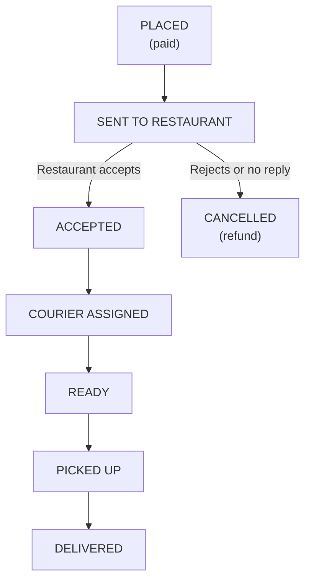
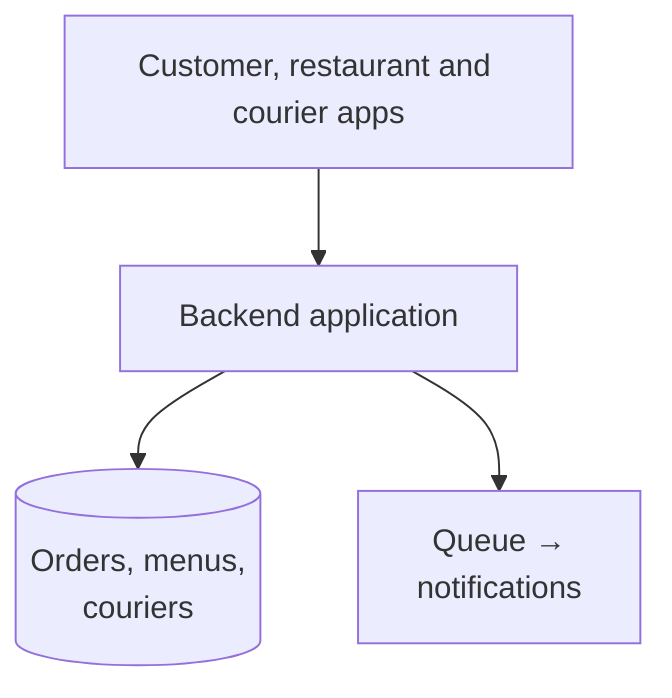
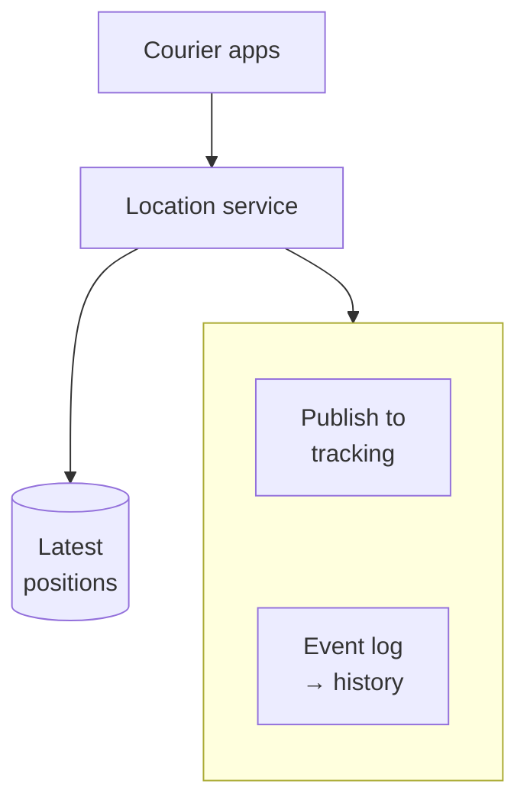
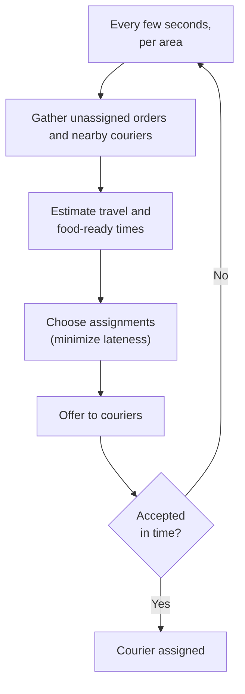
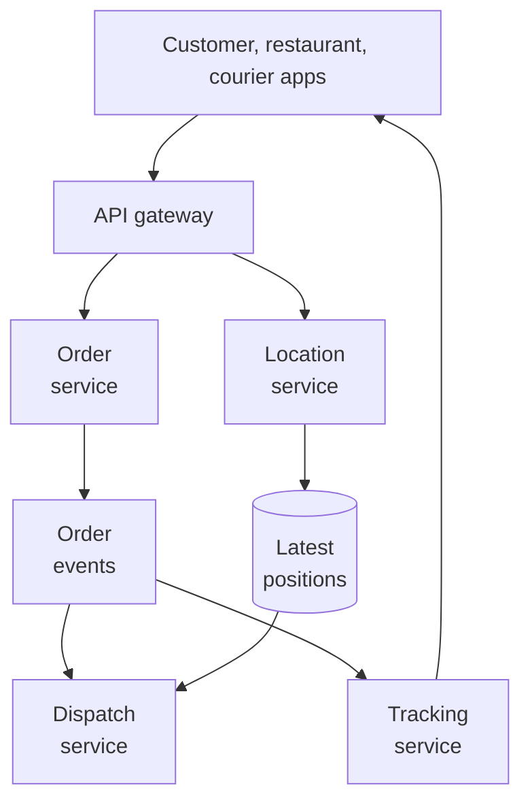
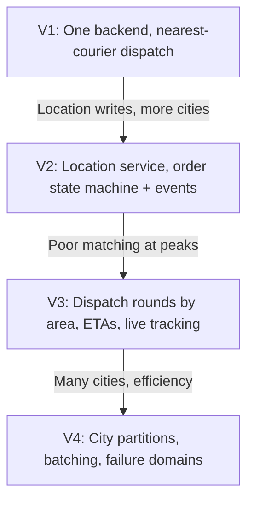

# 12.12 — Food Delivery System

## Learning Objectives

By the end of this chapter, you should be able to:

- Model an order that passes through customers, restaurants, and couriers as an explicit state machine.
- Estimate order rates, courier location updates, and live-tracking traffic at dinner peaks.
- Separate durable order data from high-volume, short-lived location data.
- Design a dispatch process that assigns couriers within time limits.
- Estimate delivery times and explain where estimates go wrong.
- Contain failures by city and handle restaurants and couriers that go offline.

---

## 1. The Problem

A food delivery platform connects three groups:

- **Customers** browse restaurants, order, pay, and track the delivery.
- **Restaurants** accept orders and prepare food.
- **Couriers** pick up food and deliver it.

Each order is a small, time-critical workflow involving all three. Food cools down, restaurants get busy, couriers go offline, and customers want to see where their meal is.

Earlier case studies reappear here: the catalog and checkout from 12.02, payments from 12.09, notifications from 12.05, and real-time push from 12.04. This chapter focuses on what is new: **coordinating three parties in real time, under time pressure, in a physical world**.

> [!MENTAL-MODEL]
> A food delivery system is a state machine per order, driven by events from three independent parties, plus a dispatcher that repeatedly matches orders to nearby couriers before time runs out.

---

## 2. Requirements

### Functional requirements

1. Customers see nearby restaurants, their menus, and an estimated delivery time.
2. Customers place and pay for an order.
3. The restaurant accepts or rejects the order and marks it ready.
4. The system assigns a courier, who accepts the job, picks up, and delivers.
5. Customers track the order status and the courier's location live.
6. All parties are notified of relevant changes.

### Non-functional requirements

| Requirement | Target | Why it matters |
|---|---|---|
| Ordering availability | 99.95%, especially at meal times | Dinner is most of the revenue |
| Dispatch time | Courier assigned within about 2 minutes of the restaurant accepting | Food waits otherwise |
| Tracking freshness | Courier position updated every few seconds | Customers watch the map |
| Order correctness | No lost, duplicated, or stuck orders | Each failure means a hungry customer and a refund |
| Failure isolation | A problem in one city does not affect others | Operations are city-by-city |

### Out of scope

- Restaurant onboarding and menu management tools.
- Courier payments and incentives.
- Advanced geospatial indexing at very large scale (developed in Chapter 12.13).

---

## 3. Constraints and Assumptions

| Assumption | Value |
|---|---|
| Orders per day | 2 million across 50 cities |
| Dinner peak | 20% of daily orders in one hour |
| Average order duration | About 40 minutes from placement to delivery |
| Couriers online at peak | 150,000 |
| Courier location update interval | Every 5 seconds |
| Live tracking update to customers | Every 5 seconds per active order |

---

## 4. Traffic Estimation

**Orders at peak:**

$$
\frac{2{,}000{,}000 \times 20\%}{3{,}600} \approx 111 \text{ orders per second}
$$

The daily average is only about 23 per second. Meal times concentrate demand about five-fold.

**Active orders at peak:** with orders lasting about 40 minutes,

$$
111 \times 2{,}400 \text{ s} \approx 267{,}000 \text{ orders in progress at once}
$$

**Courier location updates:**

$$
150{,}000 \div 5 \text{ s} = 30{,}000 \text{ updates per second}
$$

```calculator
title: Courier Location Update Rate
description: Estimate location updates per second from online couriers.
inputs:
  - id: couriers
    label: Couriers online
    unit: thousand
    min: 1
    max: 1000
    step: 1
    value: 150
    divisor: 0.06
  - id: per-minute
    label: Updates per courier per minute
    unit: per min
    min: 1
    max: 60
    step: 1
    value: 12
result:
  label: Location updates per second
  operation: product
  digits: 0
formula: "{couriers} thousand × {per-minute} updates ÷ 60 seconds"
caption: Updating less often reduces load but makes the map jumpier and dispatch decisions less accurate.
```

**Live tracking:** pushing the courier's position to each of 267,000 active customers every 5 seconds is about **53,000 messages per second**.

What these numbers tell us:

- **Order traffic is modest.** A well-designed relational database handles 111 orders per second.
- **Location traffic is 270 times larger than order traffic**, but each update is only useful for a few seconds.
- These two kinds of data should be stored and processed differently.

---

## 5. Data Estimation

| Data | Characteristics | Storage |
|---|---|---|
| Orders, items, payments | About 2 million per day; must be durable for years | Relational database |
| Order events (state changes) | About 10 per order; audit and analytics | Database and event log |
| Latest courier location | 150,000 entries, overwritten every 5 seconds | In-memory store |
| Location history | About 260 GB/day at 100 bytes per update | Event log → object storage; sampled |
| Menus and restaurant data | Read-heavy, changes occasionally | Database + cache |

Keeping every location update in the order database would add 30,000 writes per second of data that is irrelevant within a minute.

---

## 6. The Order State Machine

Every order follows explicit states. Each transition is triggered by one party and recorded with a timestamp.



Rules from earlier chapters apply directly:

- **Transitions are conditional updates** (`... WHERE status = 'ACCEPTED'`), so duplicate or late events have no effect.
- **Every party's action is idempotent.** A courier tapping "Picked up" twice, or a restaurant tablet retrying a request, does not create a second transition.
- **Each transition publishes an event** through an outbox. Notifications, tracking, dispatch, and analytics react to events instead of being called directly.
- **Timeouts are transitions too.** If the restaurant does not respond within, say, 3 minutes, the order moves to a cancellation or escalation state. Nothing should wait forever.

Some steps happen in parallel. A courier can be assigned while the food is being prepared, so `READY` and `COURIER ASSIGNED` may occur in either order. The state model must allow both orders, or track them as separate fields (`food_status`, `courier_status`).

---

## 7. Initial Architecture



At launch in one or two cities, this is enough. Couriers send locations to the same API, which stores the latest position in a table, and dispatch is a simple rule: offer the order to the nearest available courier.

As cities and couriers grow:

- Location updates dominate database writes.
- Dispatch queries ("nearest available couriers") scan too much data.
- Dinner peaks in one large city slow every city.

---

## 8. Courier Locations

Location data needs a different path from order data.



- **Latest position only.** The in-memory store keeps one entry per courier, overwritten on each update and expired if the courier stops sending. Losing it means waiting a few seconds for the next update.
- **Indexed by area.** Positions are grouped by a grid cell or geohash so dispatch can ask "couriers in this cell and its neighbours" without scanning a whole city. Chapter 12.13 covers spatial indexing in detail.
- **History goes to a log**, sampled if needed, for analytics, disputes, and ETA models.
- **Clients send less when it matters less.** An idle courier waiting for orders can update every 15–30 seconds; a courier on a delivery updates every few seconds.

---

## 9. Dispatch

Dispatch decides which courier delivers which order. It is the core of the business: good dispatch means hot food and busy couriers; poor dispatch means cold food and idle couriers.

A simple approach works at first: when a restaurant accepts an order, offer it to the nearest available courier, then the next if they decline.

At scale, assigning orders one at a time, greedily, makes poor overall choices: the nearest courier for one order may be the only courier who could reach another order in time. Most platforms therefore dispatch in **short rounds**:



Design points:

- **Time the pickup with the food.** Sending a courier too early wastes their time at the restaurant; too late cools the food. Dispatch uses the restaurant's estimated preparation time, not only distance.
- **Offers expire.** A courier who does not respond within, say, 30 seconds loses the offer, and the order returns to the next round.
- **Batching.** One courier can carry two orders from the same restaurant or along the same route, if both still arrive on time.
- **Dispatch is partitioned by city or area.** Each dispatcher instance owns a set of areas, so the problem stays small and one city's load does not affect another.
- **One owner per order.** An order must never be offered to two couriers at the same time by two dispatcher instances. Partitioning by area, plus a conditional update when assigning, ensures this.

> [!TRADE-OFF]
> Waiting a few seconds to dispatch in rounds produces better assignments than dispatching instantly, at the cost of slightly later offers. Longer rounds improve matching further but delay every order. The round length is a tunable business parameter, not a fixed technical constant.

---

## 10. Delivery Time Estimates

The customer sees an estimate before ordering and updates afterwards. The estimate combines:

- Restaurant preparation time (from history, adjusted for current load).
- Time to assign a courier (from current supply and demand in the area).
- Courier travel to the restaurant and then to the customer (routing, traffic, vehicle type).

Estimates are predictions from historical data and live signals. Two practices matter more than the model:

- **Measure the error**, as a distribution (for example, p50 and p90 lateness), and show customers a range when uncertainty is high.
- **Update estimates as events happen.** Once the food is picked up, only travel time remains, and the estimate becomes much more accurate.

---

## 11. Live Tracking

Customers watch order status and the courier's position. Rather than polling, the customer app keeps a real-time connection (as in Chapter 12.04) and subscribes to its order.

- Status changes come from order events.
- Position updates come from the location stream, forwarded only for couriers on an active delivery, and only to that order's customer.
- Sending every 5 seconds is enough. The app can animate smoothly between updates.

If the tracking connection drops, the app falls back to polling the order status. Tracking is helpful but not essential; the order still completes without it.

---

## 12. Bottlenecks

| Symptom | Likely bottleneck |
|---|---|
| Database write load dominated by location updates | Locations stored in the order database |
| Dispatch slows at dinner in large cities | Global or city-wide scans for nearby couriers |
| Orders wait for couriers while couriers wait for orders nearby | Greedy one-by-one assignment; poor timing with food readiness |
| Restaurant tablets miss orders | Unreliable connections without acknowledgement and retry |
| One city's surge slows all cities | Shared dispatch and queues without partitioning |

---

## 13. Architectural Decisions and Scaling

| Decision | Problem it solves |
|---|---|
| Explicit order state machine with conditional transitions | Correct, auditable, idempotent progress across three parties |
| Events via outbox | Notifications, tracking, dispatch react without tight coupling |
| Separate location service with in-memory latest positions | 30,000 updates/s without loading the order database |
| Spatial grouping of couriers | Fast "nearby couriers" queries |
| Dispatch in rounds, partitioned by area | Better assignments; isolated load |
| Real-time tracking subscriptions | Live updates without polling |
| City-based partitioning of services and data | Failures and surges contained per city |



**Partitioning by city** works especially well here. Orders, couriers, and restaurants rarely interact across cities, so each city (or group of cities) can have its own dispatch partition, location store, and even database shard. A large city may be split further by area.

---

## 14. Failure Scenarios

| Failure | What users notice | Mitigation |
|---|---|---|
| Restaurant tablet offline | Order not accepted | Acknowledgement required; retry; phone call fallback; auto-cancel after timeout |
| Courier app loses connection mid-delivery | Courier position freezes | Last known position shown; delivery continues; actions queued on the device |
| No couriers available | Order waits | Show realistic estimates; pause ordering in the area; widen the search radius |
| Dispatch service crashes | Assignment pauses | Stateless rounds restart from current state; assignments are conditional updates |
| Location store loses data | Couriers temporarily "disappear" | Repopulates from the next updates within seconds |
| Payment provider slow at dinner | Checkout delays | Timeouts; pending state; idempotent retries (Chapter 12.09) |
| Regional cloud outage | Cities in that region affected | Cities spread across failure domains; failover for the order service |

> [!FAILURE] The stuck order
> An order sits in `ACCEPTED` for an hour because the courier assignment event was lost and nothing was waiting for it. Every state needs a deadline and a watchdog that finds orders stuck past it and acts: re-dispatch, escalate to support, or cancel with a refund.

---

## 15. Recovery

- **Orders and their event history** are the durable record; replicate and back them up.
- **Positions and dispatch state** are rebuilt from fresh updates and current order states within seconds.
- **Watchdogs** find orders that stalled during an incident and move them forward.
- **Customer compensation** (credits, refunds) is part of recovery in a business with physical consequences; the order history provides the evidence.

---

## 16. Evolution



---

## 17. Trade-offs

| Decision | Benefit | Cost |
|---|---|---|
| Explicit state machine | Clear progress; easy recovery | Every new step means a state-model change |
| In-memory latest positions | Cheap, fast updates | Lost on failure; rebuilt from new updates |
| Frequent location updates | Accurate map and dispatch | Battery, data, and server load |
| Dispatch rounds | Better global assignments | A few seconds of delay per order |
| Delivery batching | Efficient couriers | Slightly later second delivery |
| City partitioning | Contained failures; simple scaling | Cross-city features are harder |
| Event-driven services | Loose coupling | Eventual consistency between views |

> [!LOCK-IN]
> Maps, routing, and geocoding providers are deeply embedded: addresses, travel-time estimates, and courier navigation all depend on them, and their pricing grows with every location request. Store your own normalized addresses and coordinates, wrap routing behind an internal service, and record travel-time outcomes so estimates do not depend entirely on one provider.

---

## 18. Common Mistakes

- **Storing every location update in the order database:** High write load for data that expires in seconds.
- **Implicit order status:** Without an explicit state machine, orders get stuck or skip steps.
- **No timeouts on waiting states:** Orders wait forever for a restaurant or courier.
- **Greedy one-by-one dispatch at scale:** Locally good, globally poor assignments.
- **Ignoring food preparation time:** Couriers wait at restaurants or food goes cold.
- **One global dispatcher:** One city's surge affects all cities.
- **Treating tracking as critical:** A tracking outage should not stop deliveries.

---

## 19. Hands-On Exercise

Design a grocery delivery service:

- Orders contain 30–60 items picked by shoppers inside stores.
- Items may be out of stock; shoppers propose substitutions that customers approve in the app.
- Customers choose a 1-hour delivery window up to two days ahead.
- One van delivers about 15 orders per trip.

Answer:

1. How does the order state machine differ from food delivery? Add the substitution steps.
2. How does scheduled delivery change dispatch compared with on-demand rounds?
3. How often do vans need to send locations?
4. What happens if a customer does not respond to a substitution request?
5. Which parts of the food delivery architecture are unnecessary here?

---

## 20. Quick Reference

| Topic | Decision in this design |
|---|---|
| Load | About 111 orders/s at dinner peak; 30,000 location updates/s |
| Active orders | About 267,000 at peak |
| Orders | Explicit state machine; conditional, idempotent transitions; deadlines |
| Integration | Outbox events to dispatch, tracking, notifications |
| Locations | Latest position in memory, grouped by area; history in a log |
| Dispatch | Rounds per area; timing with food readiness; expiring offers |
| Estimates | Prep + assignment + travel; measured error; updated per event |
| Tracking | Real-time subscription per order; polling fallback |
| Partitioning | By city (and area within large cities) |
| Hardest to reverse | Maps and routing provider dependence |

---

## 21. Knowledge Check

**1. Why model a food order as an explicit state machine?**

Three parties act on it independently; explicit, conditional transitions keep progress correct, idempotent, and recoverable.

**2. Why are courier locations stored separately from orders?**

They arrive at a much higher rate and are only useful for seconds, so a fast, overwritten in-memory store fits better than the durable order database.

**3. What does dispatching in rounds improve?**

It considers several orders and couriers together, producing better overall assignments than greedy one-at-a-time choices.

**4. Why does dispatch consider food preparation time?**

Couriers should arrive when food is ready, not wait at the restaurant or arrive after it has cooled.

**5. How do you prevent an order from being assigned to two couriers?**

One dispatcher owns each area, and assignment is a conditional update that succeeds only if the order is still unassigned.

**6. What is a watchdog for in this system?**

It finds orders stuck in a state past their deadline and re-dispatches, escalates, or cancels them.

**7. Why partition by city?**

Cities rarely interact, so partitioning keeps problems small and contains surges and failures.

**8. Why should tracking failures not stop deliveries?**

Tracking improves the experience but is not required to complete the order; the order workflow must not depend on it.

---

## Remember

**Make every order's progress explicit, and keep fast-changing location data out of the durable path.**

A food delivery platform coordinates three parties under time pressure. A state machine with deadlines keeps orders moving, an in-memory location layer absorbs constant updates, and dispatch in rounds, partitioned by area, makes good decisions quickly without letting one city's dinner rush affect another.

**Next: 12.13 — Ride-Hailing System**
