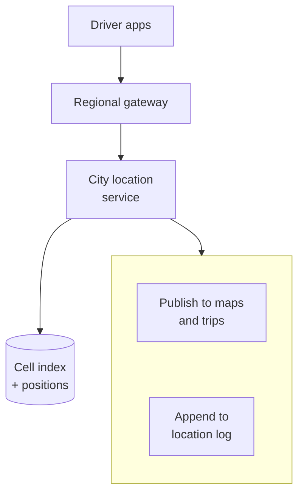
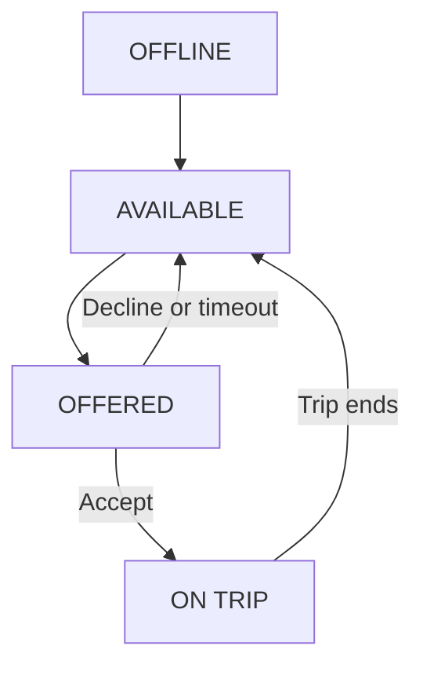
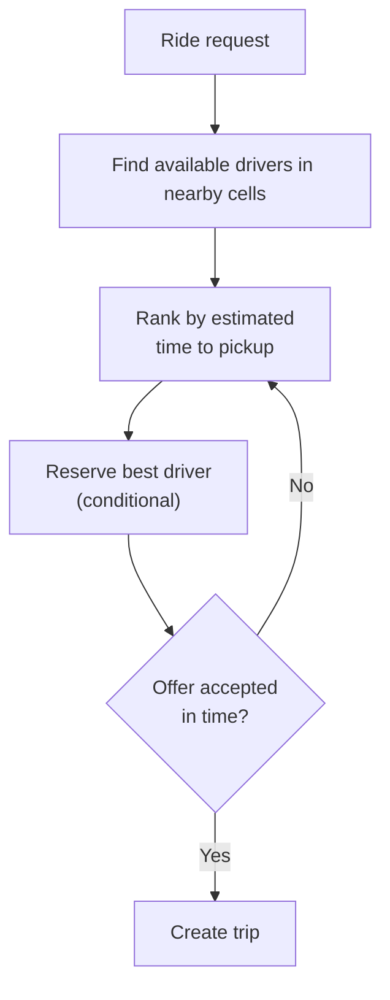
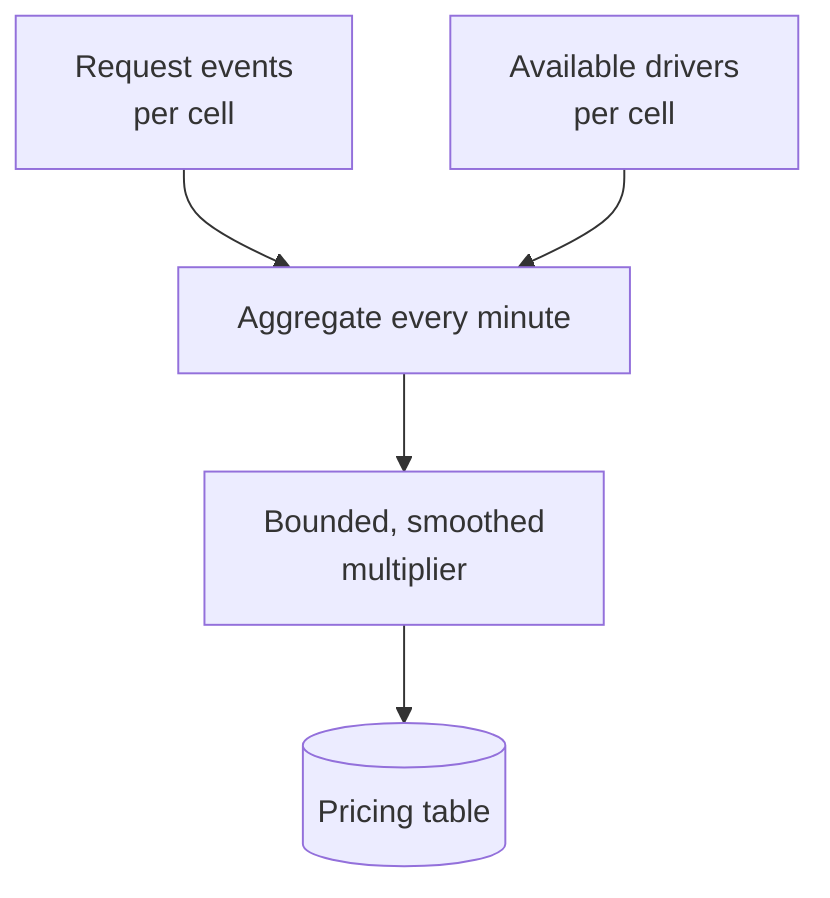
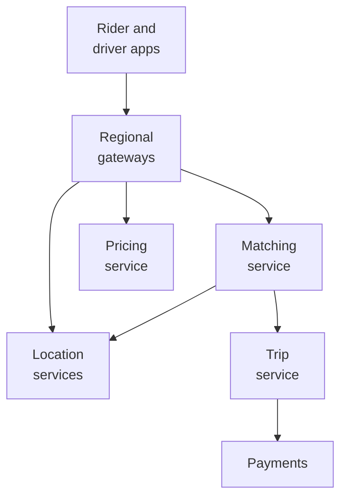
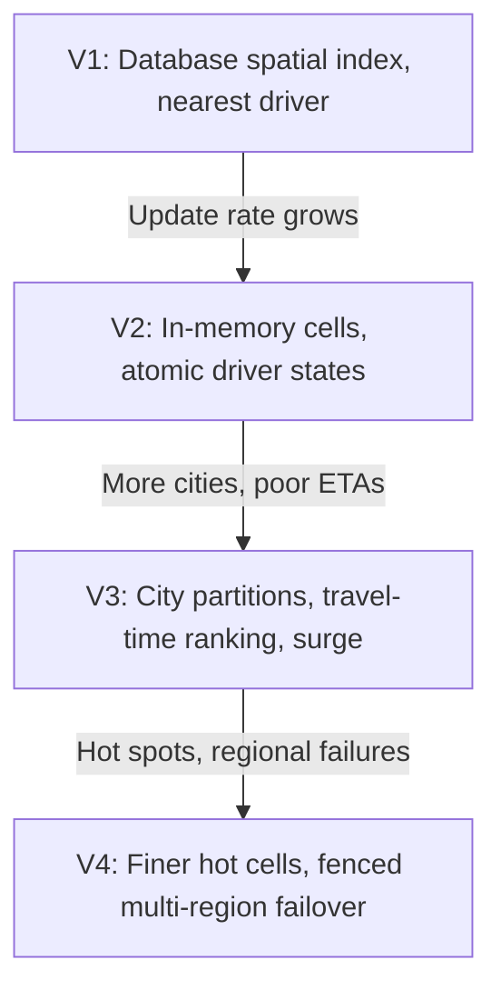

# 12.13 — Ride-Hailing System

## Learning Objectives

By the end of this chapter, you should be able to:

- Estimate driver location traffic and ride-request load for a ride-hailing service.
- Explain why ordinary database indexes cannot answer "nearest drivers" efficiently.
- Index moving objects with grid cells and search outward from a point.
- Match riders to drivers without offering one driver two rides.
- Compute surge pricing from supply and demand per area.
- Partition the system by geography and handle hot spots such as airports and stadiums.

---

## 1. The Problem

A rider requests a ride. Within seconds, the system must find an available driver nearby, offer the trip, and, once accepted, track both until the trip ends and payment completes.

The food delivery platform in Chapter 12.12 introduced courier locations and dispatch. Ride-hailing pushes the same ideas further:

- **The match must happen in seconds**, while the rider waits on the screen.
- **Every driver moves constantly**, and there are many more of them sending updates.
- **Distance on a map is not travel time.** The closest driver across a river may be the farthest by road.
- **Supply and demand change minute by minute**, and prices respond to them.

> [!MENTAL-MODEL]
> A ride-hailing system is a constantly changing map of available drivers, indexed by location, and a matcher that turns a rider's request into one exclusive offer as quickly as possible.

---

## 2. Requirements

### Functional requirements

1. Riders see nearby available cars and a price estimate before requesting.
2. A rider requests a ride; the system finds and offers it to a suitable driver.
3. The driver accepts or declines; declined or expired offers move to another driver.
4. Rider and driver see each other's location during pickup and the trip.
5. The fare is calculated and charged at the end of the trip.
6. Prices increase when demand exceeds supply in an area (surge pricing).

### Non-functional requirements

| Requirement | Target | Why it matters |
|---|---|---|
| Matching time | Driver found in under about 10 seconds in most areas | Riders cancel if they wait |
| Exclusive offers | A driver never receives two trips at once | Double booking strands a rider |
| Location freshness | Driver positions a few seconds old at most | Matching and maps depend on them |
| Availability | 99.99% for requesting and matching | Riders depend on it, sometimes for safety |
| Isolation | A failure in one city does not affect others | Operations are local |

### Out of scope

- Turn-by-turn navigation (provided by a maps service).
- Driver onboarding, background checks, and payouts.
- Shared rides and route pooling.
- Fraud detection.

---

## 3. Constraints and Assumptions

| Assumption | Value |
|---|---|
| Drivers online at peak (worldwide) | 1 million |
| Location update interval | Every 4 seconds |
| Trips per day | 20 million |
| Peak factor | 3× |
| Price quotes per trip | About 10 (riders check prices before requesting) |
| Largest city | About 10% of all online drivers |

---

## 4. Traffic Estimation

**Driver location updates:**

$$
1{,}000{,}000 \div 4 \text{ s} = 250{,}000 \text{ updates per second}
$$

```calculator
title: Driver Location Update Rate
description: Estimate location updates per second from online drivers.
inputs:
  - id: drivers
    label: Drivers online
    unit: thousand
    min: 1
    max: 5000
    step: 1
    value: 1000
    divisor: 0.06
  - id: per-minute
    label: Updates per driver per minute
    unit: per min
    min: 1
    max: 60
    step: 1
    value: 15
result:
  label: Location updates per second
  operation: product
  digits: 0
formula: "{drivers} thousand × {per-minute} updates ÷ 60 seconds"
caption: The largest city alone receives a tenth of this. Location ingestion must be partitioned by geography.
```

**Trips:**

$$
\frac{20{,}000{,}000}{86{,}400} \approx 230 \text{ trips per second} \quad (\approx 700 \text{ at peak})
$$

**Price quotes and nearby-car queries:** about 10 per trip gives roughly **7,000 per second at peak**, each needing a nearby-driver lookup.

What these numbers tell us:

- **Location writes dominate everything**, at hundreds of thousands per second, and each is obsolete four seconds later.
- **Nearby-driver queries are frequent** and must answer in milliseconds.
- **Trips are few** compared with locations, but each one is a transaction involving money.

---

## 5. Data Estimation

| Data | Size | Storage |
|---|---|---|
| Latest driver positions | 1 million × about 100 bytes = about 100 MB | In memory |
| Driver state (available, offered, on trip) | 1 million small records | In memory, with durable backup of trip assignments |
| Trips | 20 million per day | Durable database, partitioned by city and time |
| Location history | About 250,000 × 100 bytes/s ≈ 2 TB/day | Event log → object storage, for fares, disputes, and models |

The working set for matching is small enough to fit in memory several times over. The difficulty is not size; it is the rate of change and the type of query.

---

## 6. Why Ordinary Indexes Fail

A first attempt stores driver positions in a table:

```sql
SELECT driver_id FROM drivers
WHERE status = 'available'
  AND lat BETWEEN :lat - 0.02 AND :lat + 0.02
  AND lng BETWEEN :lng - 0.02 AND :lng + 0.02;
```

Problems:

- A B-tree index on `lat` narrows the search to a horizontal band crossing the whole city, then filters by `lng` row by row. Two one-dimensional indexes do not make a two-dimensional one.
- Every location update is an index update. At 25,000 updates per second in one city, the index churns constantly.
- The result is a box, not "nearest first", and says nothing about travel time.

Databases offer spatial indexes (R-trees, geospatial extensions) that solve the query part and are a reasonable choice at moderate scale. At hundreds of thousands of updates per second, most systems use a simpler structure in memory: **grid cells**.

---

## 7. Grid Cells

Divide the map into cells, and give each cell an ID. Common schemes include geohashes (rectangular cells encoded as strings, where a shared prefix means nearby) and hierarchical hexagonal grids.

```text
+------+------+------+
| c1   | c2   | c3   |
+------+------+------+
| c4   | c5 R | c6   |      R = rider in cell c5
+------+------+------+
| c7   | c8   | c9   |
+------+------+------+
```

The index is a map from cell ID to the drivers currently inside it:

```text
c5 → { d17, d42 }
c6 → { d03 }
c8 → { d91, d55, d12 }
```

- **An update** computes the driver's cell. If it changed, the driver is removed from the old cell's set and added to the new one. Most updates do not change cells, so most are a simple position overwrite.
- **A query** looks at the rider's cell and its neighbours (c1–c9), then expands to the next ring if it finds too few drivers.
- **Cell size is a trade-off.** Small cells mean fewer drivers to filter, but more cells to check; large cells mean the opposite. A cell roughly the size of a few city blocks is a common starting point, with finer cells in dense areas.

> [!TRADE-OFF]
> Grid cells are simple, fast to update, and easy to shard. They return candidates by straight-line proximity only; ranking by actual travel time is a second step.

---

## 8. Location Ingestion



- **Partition by city** (and by area within very large cities). Each partition owns the cell index for its area in memory.
- **Updates are fire-and-forget.** If one is lost, the next arrives in four seconds. No acknowledgement or retry is needed.
- **Drivers near a partition boundary** may need to appear in two partitions' queries. Overlapping boundaries, or querying the neighbouring partition, handles this.
- **Expire silent drivers.** A driver whose last update is older than, say, 30 seconds is removed from the index, even if their app never said goodbye.

---

## 9. Driver State and Exclusive Offers

Each driver has a state that matching depends on:



The critical rule: **a driver can be in `OFFERED` for only one request at a time.** Two riders requesting at the same moment may find the same nearest driver.

Make the transition an atomic, conditional operation in the partition that owns the driver:

```text
set state = OFFERED(request 881)  only if state = AVAILABLE
```

If it fails, the matcher moves on to the next candidate. Because each driver belongs to exactly one partition, this check is local and fast, without a distributed lock across the system.

Offers expire (for example, after 15 seconds). The expiry returns the driver to `AVAILABLE` even if their phone never responds.

---

## 10. Matching



- **Rank by time, not distance.** Straight-line distance finds candidates; a routing estimate (road network, traffic, one-way streets) ranks them.
- **Limit the candidate set.** Compute travel estimates for the closest 10–20 drivers, not everyone in a large radius; routing calls are relatively expensive.
- **Reserve before offering.** The conditional `AVAILABLE → OFFERED` change happens before the driver's phone is notified.
- **Create the trip durably.** When the driver accepts, the trip is written to the trips database with an idempotency key from the request, and the driver moves to `ON TRIP`.

Like food dispatch, matching can also run in short rounds that consider several requests together. Ride-hailing usually favours speed: riders are waiting on the screen.

---

## 11. Surge Pricing

When requests in an area exceed available drivers, prices rise. That reduces demand and attracts drivers to the area.

A simple, explainable approach:

1. Every minute, for each cell (or group of cells), count recent requests and available drivers.
2. Compute a multiplier from the ratio, bounded by a maximum.
3. Smooth changes over time and across neighbouring cells to avoid sharp jumps at cell borders.
4. **Store the quoted price with the request**, so the rider pays what they agreed to even if the multiplier changes a moment later.



Surge is computed asynchronously from streams of events; quotes read the latest table. A delay of a minute is acceptable; reading a stale multiplier is better than blocking quotes.

---

## 12. Bottlenecks

| Symptom | Likely bottleneck |
|---|---|
| Location ingestion lags in the largest city | One partition for the whole city |
| Nearby-driver queries slow downtown | Cells too large in dense areas; too many candidates per query |
| Matching slow despite fast lookups | Routing estimates computed for too many candidates |
| Same driver offered two trips | Non-atomic state change, or a driver owned by two partitions |
| Airport or stadium area overloaded after events | Hot cells: many riders and drivers in one small area |

**Hot cells** are the geographic version of hot partitions. An airport may have hundreds of drivers waiting in one cell. Options include finer cells in known hot spots, a dedicated queue for airport pickups (drivers wait in order), and spreading a hot area's work across several workers.

---

## 13. Architectural Decisions and Scaling

| Decision | Problem it solves |
|---|---|
| In-memory grid-cell index per city partition | Fast updates and nearby queries at high write rates |
| Fire-and-forget location updates | No retries for data that expires in seconds |
| Driver state owned by one partition, with conditional changes | Exclusive offers without global locks |
| Candidate search, then travel-time ranking | Fast and accurate matching |
| Durable trips with idempotent creation | Correct records for fares and disputes |
| Asynchronous surge computation | Responsive pricing without blocking quotes |
| Geographic partitioning across failure domains | City-level isolation |



**Partition by geography.** A city, or an area of a large city, is the natural unit: riders are matched only with nearby drivers, so almost all work stays within one partition. Partitions are assigned to servers in a region close to the city, which also reduces latency for the apps.

---

## 14. Failure Scenarios

| Failure | What users notice | Mitigation |
|---|---|---|
| Location partition crashes | Drivers in that area briefly invisible | Rebuild the index from the next round of updates (seconds); standby replica |
| Driver's phone loses signal | Driver frozen on the map | Expire stale drivers from matching; resume when updates return |
| Offer sent but no response | Rider waits | Offer timeout returns the driver to available; next candidate |
| Driver state lost during failover | Risk of double offers | Recover in-flight states from the trips database and recent offers; short fencing period |
| Routing service slow | Slower matching | Fall back to straight-line estimates with a correction factor |
| Pricing job stops | Prices stop adjusting | Use last known multipliers; cap age; default to no surge |
| Region outage | Cities in that region affected | Fail over city partitions to another region; trips in progress resume from durable records |

> [!FAILURE] The double booking after failover
> A location partition fails over to a standby. For a few seconds, the old primary is still running and both believe they own the same drivers. Two riders are matched to one driver. Ownership changes need fencing: the new owner gets a higher epoch number, and state changes carrying an older epoch are rejected.

---

## 15. Recovery

- **Positions and the cell index are soft state.** They rebuild from new updates within seconds.
- **Driver state needs care.** "On trip" can be reconstructed from the trips database; "offered" is short-lived and can safely be expired after a failover.
- **Trips, fares, and payments** are durable records with point-in-time recovery, as in Chapter 12.09.
- **Location history** in the log supports fare recalculation and dispute resolution after incidents.

---

## 16. Evolution



---

## 17. Trade-offs

| Decision | Benefit | Cost |
|---|---|---|
| In-memory cell index | Very fast updates and queries | Lost on failure; rebuilt from updates |
| Smaller cells | Fewer candidates per query | More cells to search and maintain |
| Frequent location updates | Accurate maps and matching | Battery, bandwidth, and ingestion load |
| Travel-time ranking | Better pickups | Routing cost and latency |
| Partition-local driver ownership | Exclusive offers without global locks | Careful handling at boundaries and failover |
| Asynchronous surge | Quotes never wait | Prices lag demand by about a minute |
| City partitioning | Isolation and locality | Cross-city trips and boundaries need special handling |

> [!LOCK-IN]
> The choice of grid system shapes stored data, pricing areas, analytics, and operations dashboards; changing it means re-mapping years of history and every area-based rule. Routing and maps providers are a second dependency, as in Chapter 12.12. Keep cell IDs behind a small geospatial library of your own, store raw coordinates as well as cell IDs, and record actual travel times so you are not dependent on one provider's estimates.

---

## 18. Common Mistakes

- **Using separate latitude and longitude indexes for proximity:** Two 1-D indexes are not a 2-D index.
- **Persisting every location update durably:** High cost for data obsolete in seconds.
- **Ranking candidates by straight-line distance:** Rivers, highways, and one-way streets change the answer.
- **Offering a driver without reserving them atomically:** Double booking.
- **No offer expiry:** Drivers stay "offered" forever when phones go silent.
- **One global partition:** Every city shares one failure and one bottleneck.
- **Changing a quoted price after the rider accepts:** Trust and legal problems.
- **Ignoring fencing on failover:** Two owners briefly act on the same drivers.

---

## 19. Hands-On Exercise

Design a scooter-sharing service:

- 200,000 scooters in 30 cities report their location every 30 seconds while parked and every 5 seconds while ridden.
- Riders find and unlock the nearest scooter themselves; there is no driver to offer a trip to.
- Scooters must be parked in allowed zones; riding into some areas reduces speed automatically.
- Batteries are swapped by staff, who need lists of low-battery scooters by area.

Answer:

1. Estimate location updates per second.
2. Which parts of the ride-hailing design are unnecessary? Which are still needed?
3. How do you prevent two riders from unlocking the same scooter?
4. How would you represent allowed parking zones and slow zones? Are grid cells enough?
5. What happens if a scooter loses connectivity during a ride?

---

## 20. Quick Reference

| Topic | Decision in this design |
|---|---|
| Load | About 250,000 location updates/s; about 700 trips/s and 7,000 quotes/s at peak |
| Positions | About 100 MB, in memory, per city partition |
| Spatial index | Grid cells; search the rider's cell and neighbours, expand outward |
| Updates | Fire-and-forget; stale drivers expire |
| Exclusivity | Driver state owned by one partition; conditional `AVAILABLE → OFFERED` |
| Matching | Candidates by proximity, ranked by travel time; offers expire |
| Pricing | Per-cell multipliers every minute; price fixed at quote |
| Partitioning | By city or area; hot cells refined |
| Failover | Fencing with epochs; soft state rebuilt from updates |
| Hardest to reverse | The grid system and maps/routing provider |

---

## 21. Knowledge Check

**1. Why do separate indexes on latitude and longitude perform poorly for nearby searches?**

Each narrows only one dimension, so the database still filters a large band of rows for the other.

**2. How does a grid-cell index answer "drivers near this point"?**

It looks up the drivers in the point's cell and neighbouring cells, expanding outward if too few are found.

**3. Why are location updates not retried?**

A newer update arrives within seconds, so a lost update matters less than the cost of guaranteeing delivery.

**4. How is a driver prevented from receiving two offers at once?**

The partition that owns the driver changes their state from available to offered with a conditional operation; a second attempt fails.

**5. Why rank candidates by travel time rather than distance?**

The road network, traffic, and obstacles mean the closest driver in a straight line may not arrive soonest.

**6. How does surge pricing avoid blocking quotes?**

Multipliers are computed asynchronously per area and stored; quotes read the latest value.

**7. What is a hot cell, and how is it handled?**

A small area with very high activity, such as an airport; finer cells, dedicated queues, and spreading work help.

**8. Why does failover require fencing?**

Without it, an old and a new owner may both act on the same drivers briefly and create double bookings.

---

## Remember

**Index where things are, not just what they are, and make every claim on a driver exclusive.**

Ride-hailing keeps a fast-changing, in-memory map of drivers per city, finds candidates by proximity, ranks them by travel time, and reserves them atomically before offering. Durable records are kept for what involves money and accountability; everything else is rebuilt from the next update.

---

## Level 12 Complete

Every case study in this level followed the same path: requirements, estimates, the simplest working design, the bottleneck that appears first, one deliberate change, and the trade-off that change introduces.

The systems were different, but the questions were the same:

- What is the dominant workload, and what does it cost?
- Which data is the source of truth, and which can be rebuilt?
- Where must the system be exactly correct, and where is "eventually" good enough?
- What fails, who notices, and how does it recover?
- Which decision would be hardest to reverse?

Use these questions on systems that are not in this course. They are the method; the case studies are examples of it.
