# 12.01 — Cloud Engineering: From Architecture to Implementation

## Learning Objectives

By the end of this chapter, you should be able to:

- Explain the difference between cloud architecture and cloud engineering.
- Understand how an application becomes a running cloud system.
- Identify the major components required to deploy a web application.
- Distinguish local development from cloud deployment.
- Understand the basic AWS resource and account model.
- Recognize the importance of identity, networking, configuration, and cost controls.
- Prepare for a local-first, AWS-second learning workflow.

---

# 1. What Is Cloud Engineering?

Imagine you have built a web application on your computer.

It works locally:

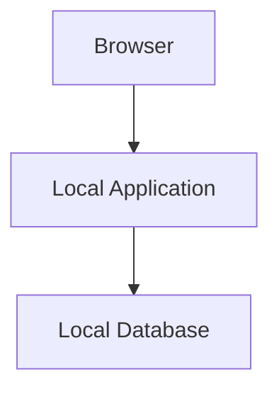

Now you want real users to access it over the internet.

You need to answer new questions:

- Where will the application run?
- How will users reach it?
- Where will its data be stored?
- How will it authenticate to other services?
- How will secrets be protected?
- How will deployments happen?
- How will you detect failures?
- How much will it cost?

These are cloud engineering concerns.

**Cloud engineering is the practice of building, configuring, deploying, securing, and operating systems using cloud infrastructure and services.**

Cloud engineering turns an architecture into a working, maintainable system.

---

# 2. Cloud Architecture vs Cloud Engineering

These disciplines are related, but they emphasize different questions.

| Cloud architecture | Cloud engineering |
|---|---|
| What components should the system use? | How do we configure and deploy them? |
| Where should data live? | How do we provision and protect the database? |
| How should the system scale? | How do we configure and verify scaling? |
| How should failures be handled? | How do we configure health checks and recovery? |
| How should services communicate? | How do we implement network routes, permissions, and connectivity? |
| What reliability is required? | How do we monitor, test, and operate the deployed system? |

Consider a decision to use a managed relational database.

The architecture decision is:

> Use a managed database rather than operate the database server ourselves.

The engineering work includes:

- Creating the database resource.
- Choosing its network placement.
- Configuring credentials and permissions.
- Connecting the application.
- Enabling appropriate backups.
- Monitoring its health and cost.

**Architecture decides what the system needs. Engineering makes those decisions work in practice.**

---

# 3. The Cloud Is Someone Else's Infrastructure — Not Someone Else's Responsibility

Cloud providers operate physical infrastructure and offer services you can provision through APIs, consoles, and automation tools.

For example, AWS provides:

- Compute services.
- Virtual networks.
- Object storage.
- Managed databases.
- Identity and access management.
- Monitoring and deployment services.

You choose which services to use and configure them for your application.

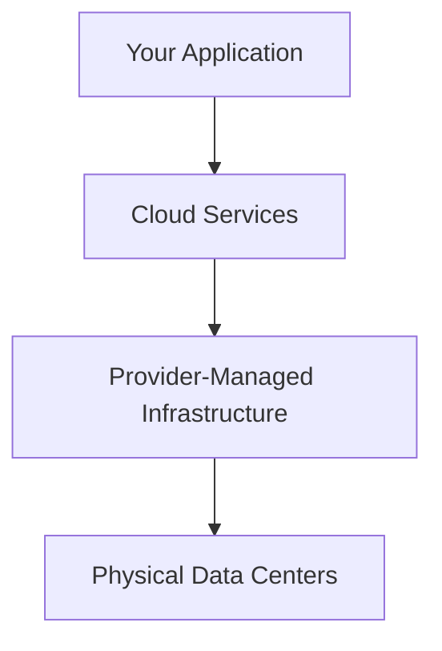

The provider manages different parts of the stack depending on the service.

For example:

- With a virtual machine, you manage the operating system and much of its configuration.
- With a managed database, the provider manages more of the underlying database infrastructure.
- With a serverless function, the provider manages the underlying server provisioning.

But managed does not mean risk-free.

You remain responsible for the parts you configure and the security of your application, identities, data, and access policies.

This is the foundation of the **shared responsibility model**, which will become more important throughout this level.

---

# 4. A Web Application Needs More Than Compute

Suppose you want to deploy a simple full-stack application.

It has:

- A frontend.
- A backend API.
- A database.

A naive architecture might be:

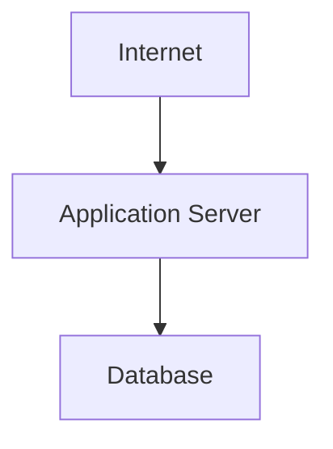

But a practical deployment needs additional decisions.

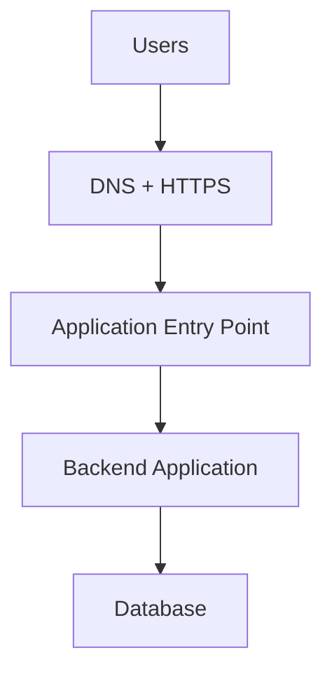

You must also consider:

```text
Identity and permissions
Networking and access rules
Secrets and configuration
Logging and monitoring
Backups and recovery
Deployment automation
Cost controls
```

These are not unrelated extras. They determine whether the application can operate safely and reliably.

---

# 5. The Main Cloud Building Blocks

For this curriculum, think of cloud infrastructure in these broad categories.

| Building block | Purpose | AWS examples |
|---|---|---|
| Identity | Determine who or what can access resources | IAM |
| Compute | Execute application code | EC2, ECS, Lambda |
| Networking | Connect components and control traffic | VPC, subnets, security groups |
| Storage | Store files and objects | S3 |
| Database | Store structured application data | RDS |
| Entry and routing | Direct users and requests | Route 53, Elastic Load Balancing, API Gateway |
| Security | Protect data and access | IAM, KMS, Secrets Manager |
| Observability | Understand system behavior | CloudWatch |
| Automation | Provision and deploy consistently | Terraform, CI/CD pipelines |
| Cost management | Track and control spending | AWS Budgets, billing tools |

These services are examples, not a list of services every application must use.

A static website may not need an application server or relational database at all.

A small API may not need a load balancer.

A good engineer starts with the application's actual requirements.

---

# 6. Local Development vs Cloud Deployment

Local development and cloud deployment solve different problems.

## Local development

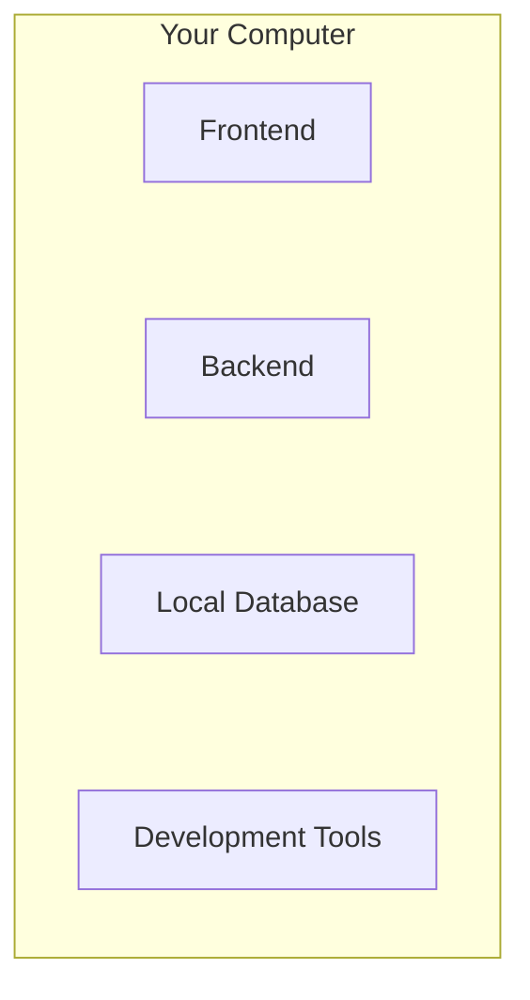

Advantages:

- Fast feedback.
- Easy debugging.
- No cloud deployment required for every change.
- Usually no additional cloud infrastructure cost.

Limitations:

- Your machine is not a production environment.
- Other users cannot necessarily reach the application.
- Local networking and permissions may differ from production.
- It does not automatically provide production availability or backups.

## Cloud deployment

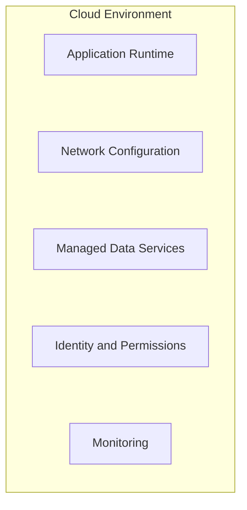

Advantages:

- Public or controlled remote access.
- Managed infrastructure options.
- Integration with production deployment and monitoring.
- Ability to use cloud-specific scaling and recovery capabilities.

Trade-offs:

- Additional configuration.
- Security responsibilities.
- Potential cost.
- Network and service dependencies.
- More operational complexity.

The goal is not to move everything to the cloud immediately.

The goal is to use the cloud when its capabilities serve the application's needs.

---

# 7. Our Learning Strategy: Local First, AWS When Needed

This curriculum uses a hybrid approach.

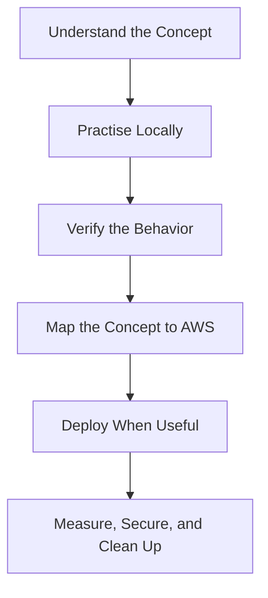

For example, before learning AWS networking, you can first understand:

- IP addresses.
- Ports.
- Client-server communication.
- Public versus private access.
- Firewalls and connection rules.

Then, when you work with an AWS VPC, you can connect those concepts to actual subnets, routes, and security groups.

Similarly, you can containerize an application locally before deciding how to run that container on AWS.

This prevents cloud-specific terminology from hiding the underlying engineering concepts.

---

# 8. What Is an AWS Resource?

An **AWS resource** is an entity you create or manage through AWS.

Examples include:

- An EC2 instance.
- An S3 bucket.
- A VPC.
- A database instance.
- An IAM role.
- A load balancer.

Conceptually:

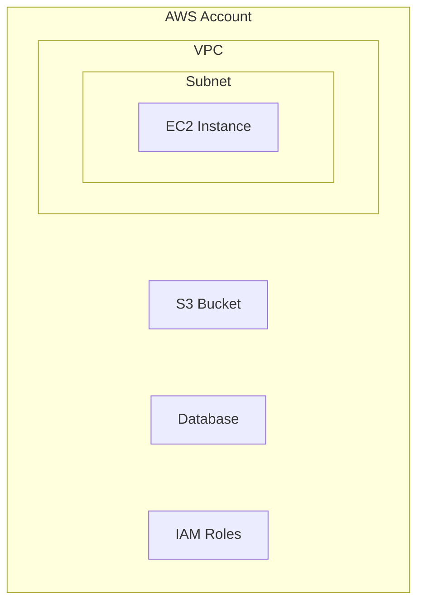

Resources have configurations and permissions.

Some resources also depend on other resources.

For example, an EC2 instance may require:

- A suitable network.
- A subnet.
- An access policy or instance role.
- Security-group rules.
- A supported machine image.

You will learn these relationships gradually rather than configuring everything at once.

---

# 9. AWS Is an API-Driven Platform

You can manage AWS in several ways.

## AWS Management Console

A graphical interface for creating and inspecting resources.

Useful for:

- Learning where settings live.
- Exploring resource details.
- Inspecting errors.
- Understanding service relationships.

## AWS CLI

A command-line interface for interacting with AWS services.

Conceptually:

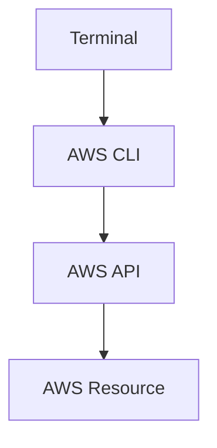

## SDKs

Software development kits allow application code to call AWS APIs.

For example, a backend application might use an AWS SDK to interact with S3.

## Infrastructure as Code

Tools such as Terraform let you describe infrastructure in configuration files and manage it repeatably.

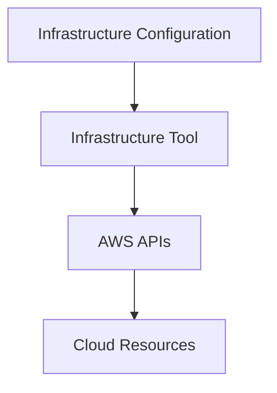

These methods are different interfaces to infrastructure management.

The underlying resource and its permissions still matter regardless of which interface you use.

---

# 10. Identity Comes Before Infrastructure

Before creating cloud resources, understand who is performing the action.

Consider:

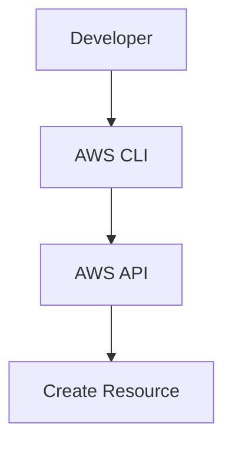

AWS needs to determine:

1. Who or what is making the request?
2. Is the request authenticated?
3. Is that identity authorized to perform the action?
4. Which resource is affected?

This connects directly to Level 11:

- Authentication establishes identity.
- Authorization determines allowed actions.
- Least privilege limits permissions.
- Audit logging records important actions.

For applications running on AWS, prefer suitable workload identities and roles over embedding long-lived credentials in source code.

Never commit AWS access keys or other cloud credentials to Git.

The details of AWS accounts, billing, and IAM come in the next chapters.

---

# 11. Every Cloud Resource Has a Cost and a Lifecycle

A cloud resource is not just a configuration entry.

It may continue to consume money while it exists.

For example:

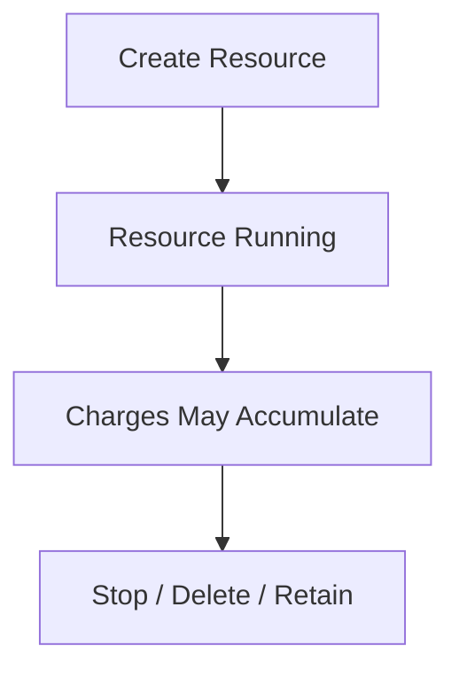

The billing behavior depends on the service and configuration.

Some services charge for time or capacity. Others charge for requests, storage, data transfer, or combinations of these.

Stopping a resource does not always stop all related charges. Storage, reserved capacity, public IPv4 addresses, snapshots, and other associated resources may have separate billing rules.

Therefore, every hands-on cloud exercise should include:

- What resources will be created?
- What might they cost?
- How will they be monitored?
- Which resources must be retained?
- How will temporary resources be cleaned up?

**Never assume that a learning lab is free simply because it is small.**

---

# 12. Security and Cost Are Design Constraints

Imagine a developer wants to make an application reachable from the internet.

The quickest approach might be to open broad network access and use powerful credentials everywhere.

That may make the demo work, but it creates unnecessary risk.

A better design asks:

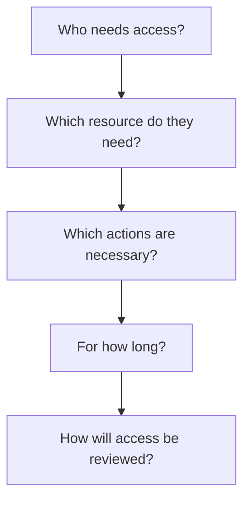

The same applies to cost:

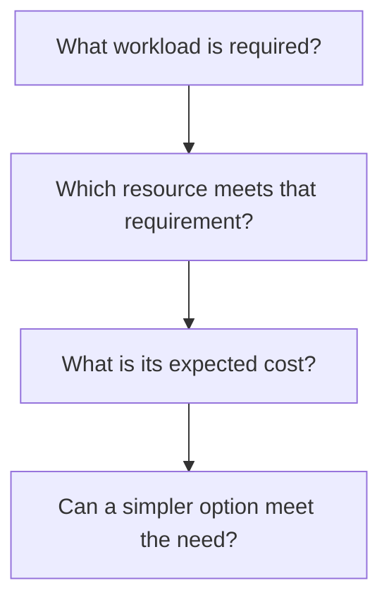

A good cloud engineer balances functionality, security, reliability, complexity, and cost.

---

# 13. Example: Deploying a Small Full-Stack Application

Suppose you have a React frontend, a Node.js API, and a PostgreSQL database.

At first, you might run all three locally:

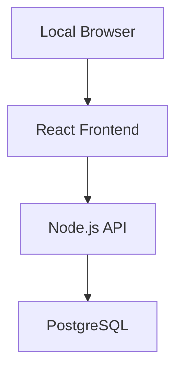

A possible cloud design could be:

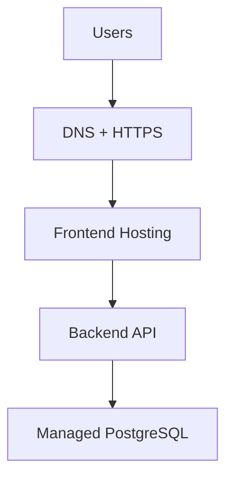

The implementation then involves several separate tasks:

1. Build the frontend.
2. Deploy its static assets or frontend runtime.
3. Deploy the backend API.
4. Configure the database and network access.
5. Provide credentials and configuration securely.
6. Connect the frontend to the correct API endpoint.
7. Configure the domain and HTTPS.
8. Add logs, health checks, and monitoring.
9. Verify backup and recovery requirements.
10. Check costs and remove unused resources.

The best AWS service for each component depends on the application's requirements and the level of operational control you need.

We will make those choices in the relevant chapters rather than selecting services prematurely.

---

# 14. Common Mistakes

### Mistake 1 — Choosing services before understanding the requirements

Start with what the application needs to do, not with a list of AWS products.

### Mistake 2 — Treating the cloud as automatically secure

Security depends on identity, permissions, configuration, data handling, and operational practices.

### Mistake 3 — Deploying everything to AWS immediately

Learn the underlying concepts locally where possible, then practise the cloud-specific behavior.

### Mistake 4 — Ignoring billing

Resources and related services can continue to incur charges.

### Mistake 5 — Using administrator credentials for everything

Use appropriate identities and narrowly scoped permissions.

### Mistake 6 — Assuming managed services remove all operational work

Managed services reduce some responsibilities but do not eliminate configuration, security, monitoring, capacity planning, or cost management.

### Mistake 7 — Creating resources without a cleanup plan

Every temporary lab should have a clear end state.

---

# 15. Hands-On Exercise: Map Your Application to the Cloud

Use any small application you already understand. A simple frontend, backend API, and database are enough.

You do not need an AWS account for this first exercise.

## Step 1 — Draw the local architecture

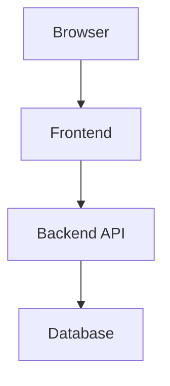

## Step 2 — Identify the responsibilities

Write down:

- Where frontend files are served.
- Where backend code executes.
- Where persistent data lives.
- Which configuration values are required.
- Which credentials the application needs.

## Step 3 — Map responsibilities to cloud capabilities

| Requirement | Cloud capability |
|---|---|
| Serve frontend | Static hosting or frontend runtime |
| Run backend | Compute |
| Store persistent data | Database service |
| Resolve a domain | DNS |
| Secure web traffic | TLS |
| Control access | Identity and permissions |
| Store credentials | Secret-management mechanism |
| Diagnose failures | Logging and monitoring |
| Recover data | Backup and recovery mechanism |

Do not choose an AWS service for every row yet.

## Step 4 — Identify risks

Answer:

- Which component needs public access?
- Which component should remain private?
- What sensitive information must be protected?
- What happens if the database becomes unavailable?
- Which resources might incur charges?

## Step 5 — Define success

Your mapping is complete when you can explain the role of each component, its access requirements, and its main risks.

**Exercise outcome:** You have converted an application you understand into a first-pass cloud deployment plan without prematurely creating infrastructure.

---

# 16. Quick Reference

| Concept | Meaning |
|---|---|
| Cloud engineering | Building, deploying, securing, and operating cloud-based systems |
| Cloud architecture | Choosing the system structure and major design decisions |
| AWS resource | A cloud entity created or managed through AWS |
| AWS account | A security and resource-management boundary within AWS |
| AWS Console | Graphical interface for managing AWS resources |
| AWS CLI | Command-line interface to AWS APIs |
| SDK | Library for calling cloud services from application code |
| Infrastructure as Code | Describing and managing infrastructure through configuration |
| Workload identity | Identity assigned to an application or service |
| Shared responsibility | Division of security responsibilities between provider and customer |
| Resource lifecycle | Creation, operation, modification, and deletion or retention of a resource |

---

# 17. Knowledge Check

### Question 1

What is the difference between cloud architecture and cloud engineering?

**Answer:** Architecture defines the system's structure and decisions. Engineering implements, configures, deploys, secures, and operates those decisions.

### Question 2

Does using a managed cloud service eliminate security responsibilities?

**Answer:** No. The provider manages some underlying infrastructure, but the customer remains responsible for appropriate configuration, identities, data, and application security.

### Question 3

Why are we using local-first practice?

**Answer:** It helps establish the underlying concepts before introducing cloud-specific configuration, costs, and operational complexity.

### Question 4

What is an AWS resource?

**Answer:** An entity managed through AWS, such as a virtual machine, storage bucket, network, database, or IAM role.

### Question 5

Why should identity be considered before provisioning infrastructure?

**Answer:** Cloud operations must be authenticated and authorized. Excessive or exposed credentials can allow unauthorized resource changes.

### Question 6

Does stopping a cloud resource guarantee that all charges stop?

**Answer:** No. Related storage, addresses, snapshots, or other resources may continue to incur charges.

### Question 7

Should every application use a load balancer, containers, and a managed database?

**Answer:** No. Choose components based on actual requirements, expected workload, operational needs, and cost.

---

# Remember

Cloud engineering is not about collecting cloud services. It is about implementing a system that meets its requirements and can be operated responsibly.

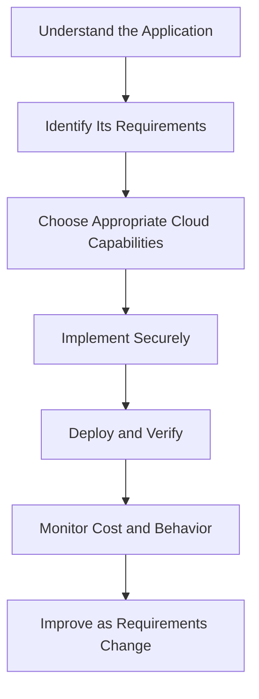

**Next: 12.02 — AWS Accounts, Billing & Cost Guardrails**
