# 12.02 — AWS Accounts, Billing & Cost Guardrails

## Learning Objectives

By the end of this chapter, you should be able to:

- Understand what an AWS account represents.
- Distinguish an AWS account from an IAM user or role.
- Understand the basics of AWS billing and resource charges.
- Set up practical cost guardrails before deploying infrastructure.
- Explain the difference between a budget, an alert, and a spending limit.
- Recognize why deleting one resource may not remove all related costs.
- Prepare a safer AWS learning environment.

---

# 1. Why Start With Billing and Account Safety?

Imagine you are learning AWS and create a virtual machine for a simple experiment.

You finish the experiment, close your laptop, and return a week later.

The virtual machine or its associated resources may still exist. Depending on the services and configuration, charges may continue to accumulate.

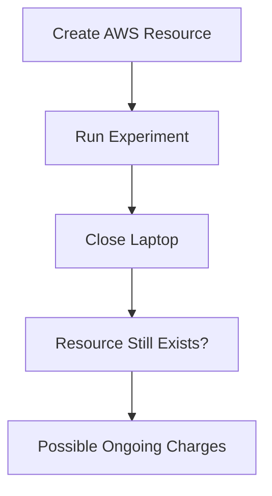

Cloud infrastructure is usually provisioned on demand, but that does not mean it is automatically removed when you stop using it.

Before creating resources, establish three things:

1. **An appropriate account and access model.**
2. **Visibility into spending.**
3. **A cleanup plan for temporary infrastructure.**

The objective is not to avoid AWS. It is to learn AWS without unnecessary financial or security surprises.

---

# 2. What Is an AWS Account?

An AWS account is a fundamental boundary for organizing resources, access, and billing.

It contains resources such as:

- Virtual machines.
- Storage buckets.
- Databases.
- Networks.
- Identity and access configurations.
- Monitoring resources.

Conceptually:

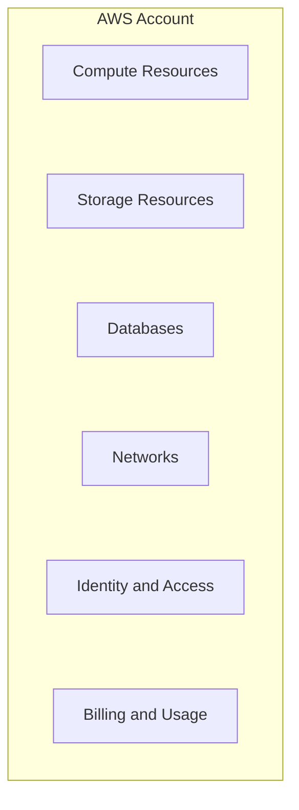

An account is not the same as a server or a login.

One account can contain many resources across multiple AWS Regions.

A resource's configuration, permissions, and location determine how it operates within that account.

---

# 3. AWS Account vs IAM Identity

These concepts are easy to confuse.

| Concept | Meaning |
|---|---|
| AWS account | Boundary that contains and organizes AWS resources |
| Root user | Identity associated with creating the AWS account |
| IAM user | An identity defined within AWS IAM |
| IAM role | An identity with permissions that can be assumed by an authorized principal |
| IAM policy | Rules describing which actions are allowed or denied |
| AWS resource | An object or service managed through AWS |

Think of the relationship like this:

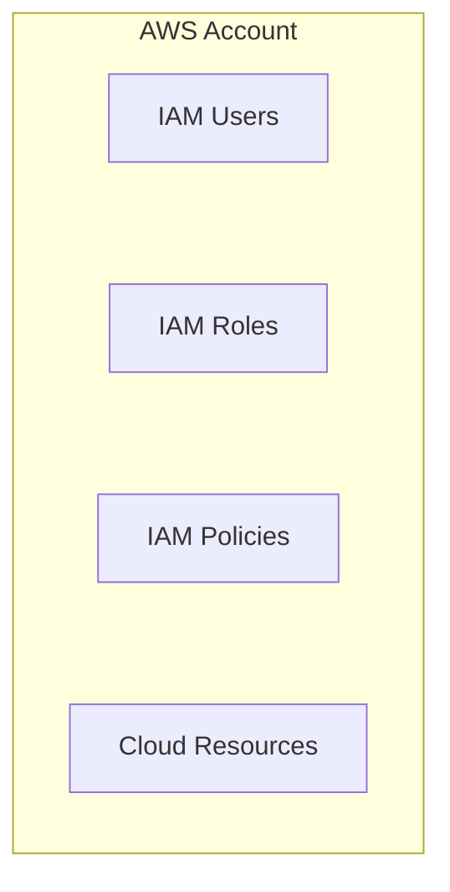

An IAM identity does not automatically have permission to do everything in the account.

Its effective permissions depend on the applicable authorization rules.

You studied authentication, authorization, roles, and least privilege in Level 11. AWS IAM applies those concepts to cloud infrastructure.

---

# 4. The Root User Is Special

The AWS root user is associated with the email address used to create the account.

It has extensive privileges and should not be used for routine development work.

A safer starting point is:

- Protect the root user's credentials.
- Enable multi-factor authentication (MFA).
- Avoid creating root access keys for everyday use.
- Use an appropriately authorized IAM identity or role for normal tasks.
- Restrict who can access account-management and billing functions.

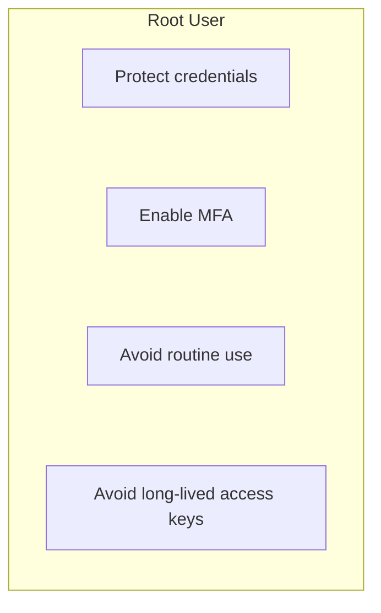

**Important:** An account administrator and the root user are not interchangeable concepts. An IAM identity may have broad administrative permissions without being the root user.

The goal is to minimize routine use of the most powerful identity.

---

# 5. One Account or Multiple Accounts?

For a beginner, a single dedicated learning account can be sufficient.

Larger organizations may separate environments using multiple accounts.

For example:

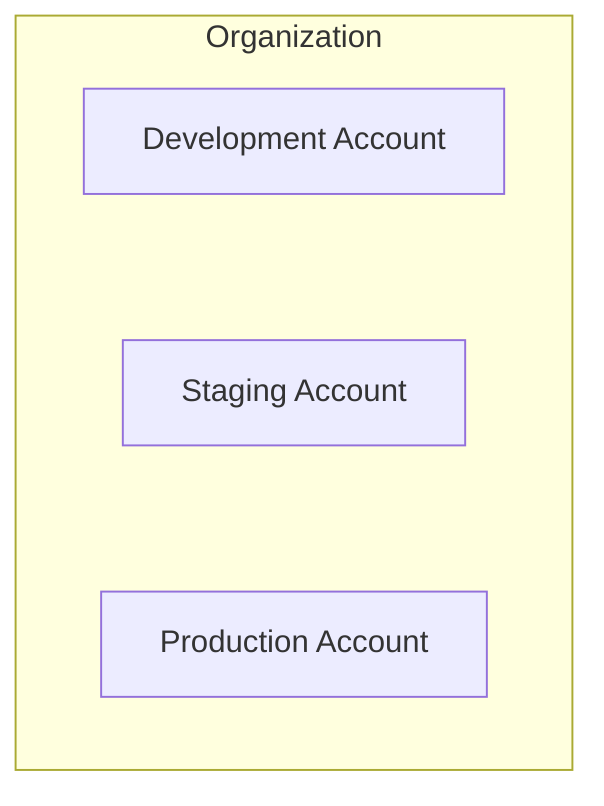

This can help isolate:

- Permissions.
- Resources.
- Workloads.
- Billing visibility.
- Security policies.
- Operational mistakes.

However, multiple accounts introduce additional management overhead.

For learning, do not create a complex multi-account organization unless you have a real need to practise that architecture.

**Start with the simplest account structure that provides adequate isolation and control.**

---

# 6. How AWS Billing Works

AWS charges according to the pricing model of each service.

Depending on the service, charges may involve:

- Time or capacity consumed.
- Storage used.
- Number of requests.
- Data transferred.
- Database capacity.
- Addresses, snapshots, or other associated resources.
- Optional service features.

A simplified model is:

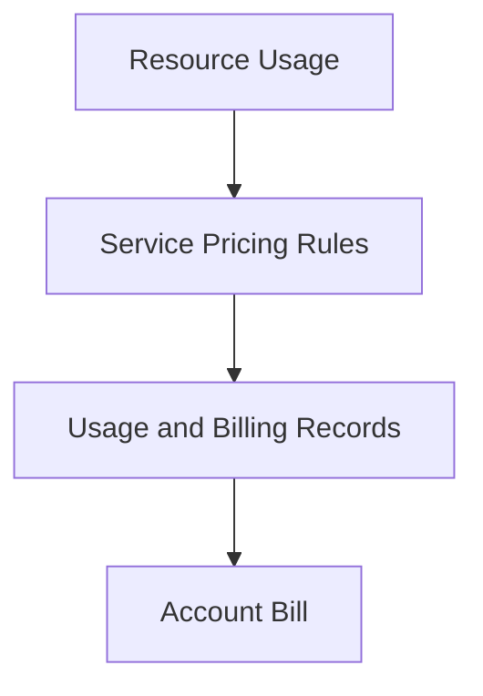

Different services use different billing units. A running virtual machine, an object-storage bucket, and a managed database do not necessarily incur costs in the same way.

Some services offer free usage allowances, but eligibility and limits vary by account, service, and date.

**Never assume that a resource is free just because it is small or used for learning.**

Check the current pricing and applicable free-tier terms before provisioning it.

---

# 7. Stopping a Resource Is Not Always Enough

Suppose you create a virtual machine with attached storage.

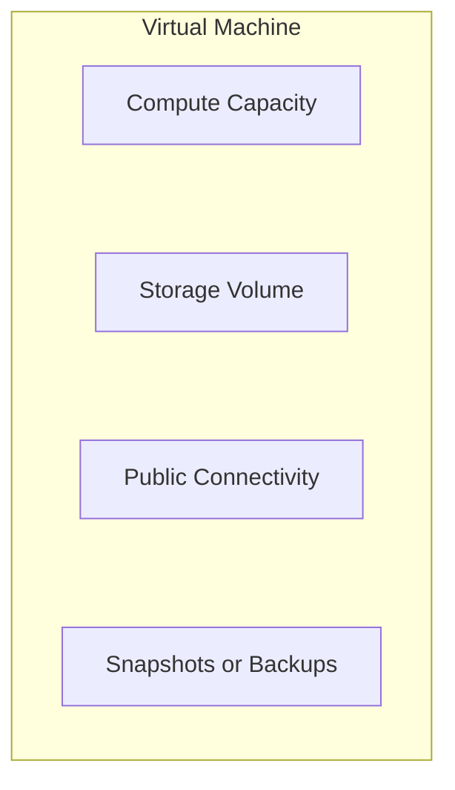

Stopping the virtual machine may stop some compute charges, but other resources may continue to incur charges depending on their configuration and the current pricing rules.

For example:

| Resource or component | What to check |
|---|---|
| Virtual machine | Whether compute charges stop when stopped |
| Attached storage | Whether storage remains billable |
| Snapshots and backups | Whether retained data continues to incur charges |
| Public IP address | Whether the address has a charge under its current configuration |
| Load balancer | Whether it remains provisioned |
| Managed database | Whether stopping is supported and what charges remain |
| Data transfer | Whether applicable transfer charges have been incurred |

The exact result depends on the service and its current pricing model.

The practical lesson is:

> **Stopping compute and removing all billable resources are different operations.**

A cleanup checklist must include the resources surrounding the main service.

---

# 8. What Are Cost Guardrails?

A **cost guardrail** is a control or practice designed to prevent, detect, or limit unexpected spending.

Cost guardrails can be grouped into three categories.

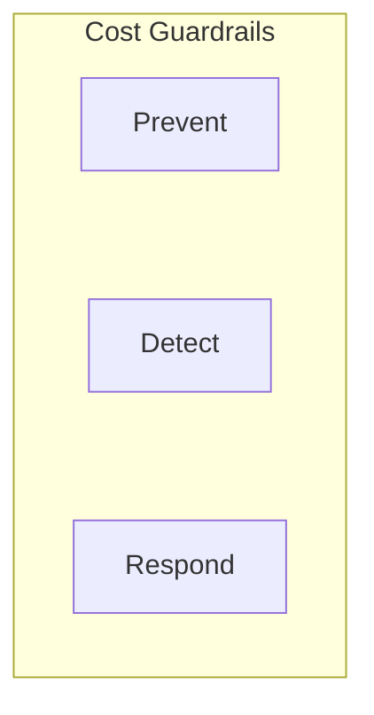

### Prevent

Reduce the chance of unnecessary spending.

Examples:

- Choose small, appropriate resources.
- Avoid provisioning services you do not need.
- Use least-privilege access.
- Set up infrastructure with explicit configuration.
- Clean up temporary resources.

### Detect

Identify spending or usage that deserves attention.

Examples:

- AWS Budgets.
- Billing alerts.
- Cost Explorer.
- Usage monitoring.

### Respond

Take action when spending or usage exceeds expectations.

Examples:

- Investigate the resource responsible.
- Stop or delete unneeded resources.
- Reduce capacity.
- Adjust permissions or automation to prevent recurrence.

Not every guardrail automatically stops spending. Some only notify you.

---

# 9. Budgets, Alerts, and Spending Limits

These are different concepts.

| Mechanism | Purpose | Automatically stops all spending? |
|---|---|---|
| AWS Budget | Defines a spending or usage threshold to monitor | No |
| Budget alert | Notifies you when a configured condition is met | No |
| Billing notification | Provides information about billing or usage conditions | Not by itself |
| Resource deletion | Removes a particular resource | Only affects charges related to that resource, subject to remaining resources and billing rules |
| Preventive policy or automation | Restricts or responds to specific actions | Only within its defined scope |

For example, suppose you configure a budget threshold of ₹500 equivalent in your billing currency.

That does **not** mean AWS will necessarily stop all resources when spending reaches that amount.

A budget is primarily a monitoring and notification mechanism.

You should not treat it as a hard spending cap.

---

# 10. AWS Budgets

AWS Budgets lets you define cost or usage targets and monitor progress against them.

A budget may be configured around a period and threshold, with alerts when specified conditions are met.

Conceptually:

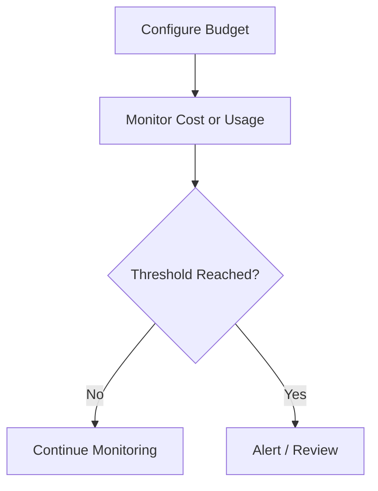

For a learning account, a useful approach is to create a monthly cost budget with alerts at multiple thresholds.

For example:

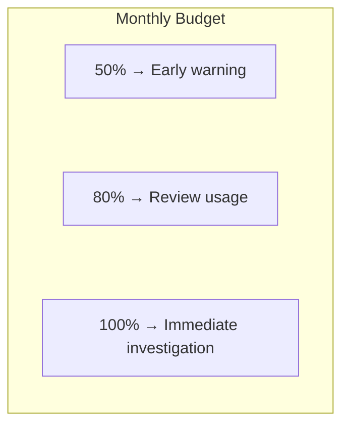

These are illustrative thresholds, not universal recommendations.

Choose values that suit your intended workload and financial tolerance.

Budget creation and some advanced features may themselves be subject to AWS service terms or charges. Verify current details before enabling them.

---

# 11. Billing Alerts and Notification Delivery

An alert is useful only if it reaches a place where you will notice it.

Before relying on a billing notification:

1. Configure the appropriate budget or billing alert.
2. Specify a destination supported by the chosen notification mechanism.
3. Confirm that the destination is valid.
4. Verify any required subscription or confirmation.
5. Check that the alert configuration is active.
6. Understand that cost data and notifications may be delayed.

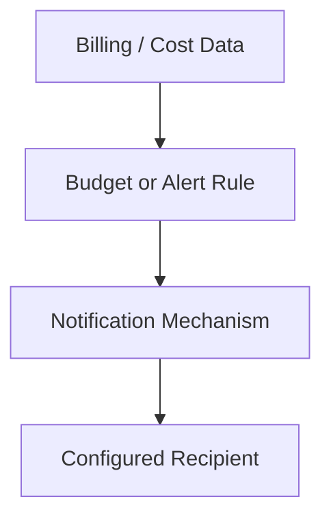

Do not assume every AWS billing alert uses the same notification path. Available options and configuration requirements vary.

Most importantly, **an alert is not a real-time guarantee that spending cannot exceed your budget**.

---

# 12. Cost Explorer: Understanding Where Money Goes

A budget can tell you that spending is approaching a threshold.

You also need a way to investigate the source of the spending.

AWS Cost Explorer provides views of cost and usage data that help you examine patterns.

Conceptually:

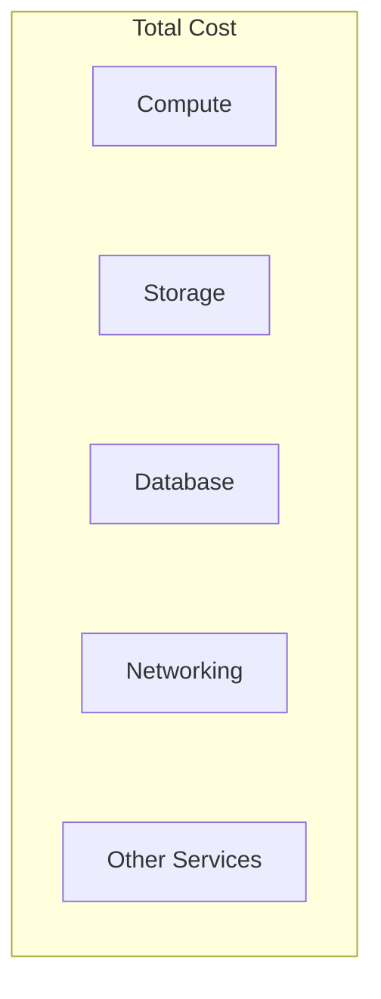

The actual categories depend on your account's usage.

When investigating an unexpected increase, ask:

- Which service is responsible?
- Which Region is involved?
- When did the increase begin?
- Is usage higher than expected?
- Is a resource still running?
- Is the cost associated with storage, requests, or data transfer?
- Was a resource created by a lab or deployment?

Cost Explorer's data may not be instantaneous. Allow for reporting delays when investigating recent usage.

---

# 13. Tags Help Organize Resources

A **tag** is a key-value label attached to a supported resource.

For example:

```text
Project = Systemly
Environment = Learning
Owner = Developer
Purpose = Chapter-Lab
```

Tags help you identify why a resource exists and who is responsible for it.

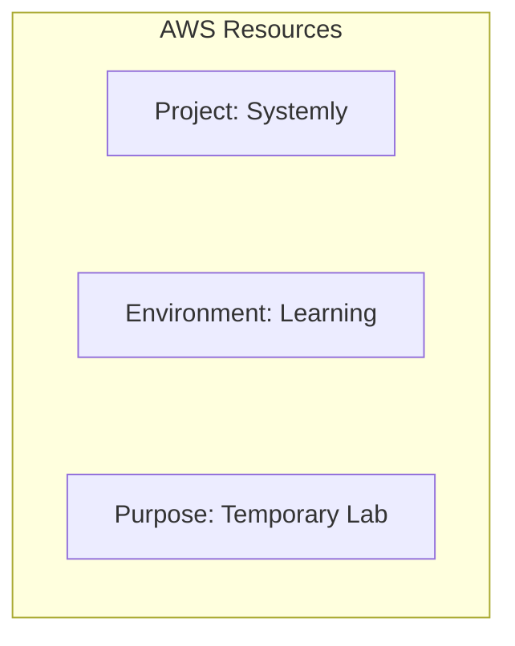

Useful tags can support:

- Resource inventory.
- Cost allocation and reporting.
- Cleanup workflows.
- Ownership.
- Environment separation.

Tags do not automatically reduce charges or delete resources.

Their effectiveness depends on consistent use and on whether the relevant service supports the required tagging and reporting behavior.

---

# 14. A Safer AWS Learning Workflow

Before starting a lab, answer these questions.

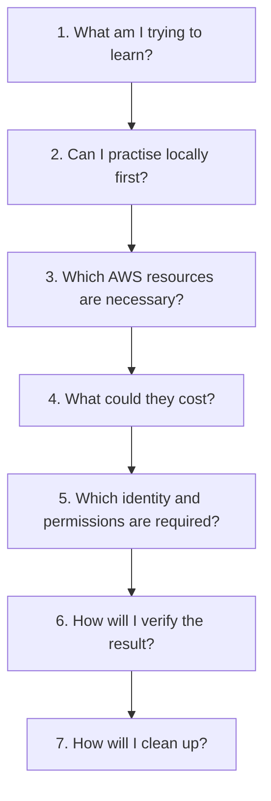

This process keeps infrastructure aligned with the learning objective.

For example, if your goal is to understand HTTP routing, you may not need a managed database, load balancer, and multiple virtual machines.

Provision only what the exercise requires.

---

# 15. Practical Exercise: Prepare a Cost-Safe Learning Account

This exercise involves account preparation. It does not require launching a virtual machine or database.

## Step 1 — Review account security

If you have an AWS account:

- Confirm that the root user is protected.
- Enable MFA for the root user.
- Avoid using root credentials for everyday development.
- Review which identity you will use for future labs.
- Do not place credentials in source code or a public repository.

If you do not have an account, you can complete the remaining planning steps without creating one.

## Step 2 — Review billing visibility

Locate the AWS billing and cost-management area in the console.

Confirm that you understand where to find:

- Current billing information.
- Cost and usage views.
- Budget configuration.
- Notification settings.

Access to billing information can depend on account settings and IAM permissions.

## Step 3 — Define a learning budget

Write down a maximum monthly amount you are comfortable spending.

Then choose alert thresholds, for example:

```text
Budget: Your chosen monthly amount

50% → Review
80% → Investigate
100% → Immediate action
```

These thresholds are illustrative.

## Step 4 — Plan resource tags

Use a consistent scheme for future learning resources.

For example:

```text
Project = Systemly
Environment = Learning
Purpose = Chapter-Lab
```

## Step 5 — Create a cleanup checklist

Before launching any resource in a later chapter, record:

- Resource name.
- Region.
- Purpose.
- Possible billing components.
- How to stop it.
- How to delete it.
- Which associated resources might remain.

## Step 6 — Verify your guardrails

Your preparation is complete when you can answer:

- Where can I inspect current costs?
- How will I receive budget alerts?
- What is my monthly spending tolerance?
- Which identity will I use?
- How will I identify and remove temporary resources?

**Expected result:** A documented, cost-aware workflow for future AWS labs.

---

# 16. Cleanup Is Part of the Lab

A cloud lab should have a defined lifecycle.

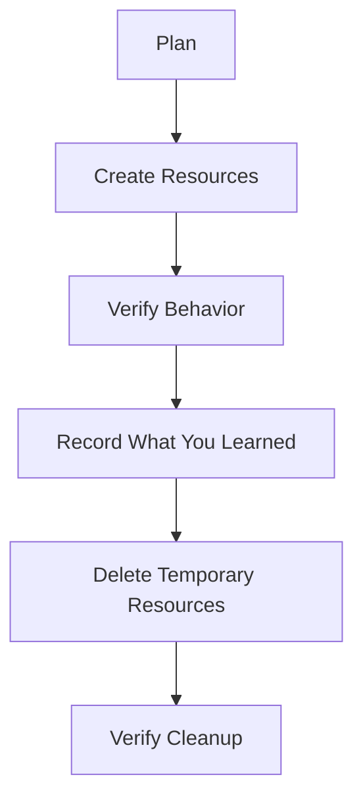

Cleanup requires more than deleting the resource you remember creating.

Check for related resources, such as:

- Attached storage.
- Snapshots.
- Public addresses.
- Load balancers.
- Database backups.
- Logs and retained objects.
- Networking components created specifically for the lab.

Some resources should be retained when required by the exercise, and some retained data may continue to incur charges.

Before deleting anything, verify that it is not shared with another application or needed for recovery.

---

# 17. Common Mistakes

### Mistake 1 — Assuming a budget is a hard spending limit

Budgets and alerts generally notify you; they do not automatically prevent every charge.

### Mistake 2 — Treating a stopped resource as fully cost-free

Associated storage, addresses, backups, or other components may remain billable.

### Mistake 3 — Using root credentials for routine work

Use an appropriately authorized identity and protect the root user.

### Mistake 4 — Ignoring notification configuration

An alert that is not correctly configured or delivered may not help you in time.

### Mistake 5 — Creating resources without tracking them

Use consistent names, tags, and a resource inventory.

### Mistake 6 — Deleting resources without checking dependencies

A resource may be shared, or it may contain data you need.

### Mistake 7 — Assuming every lab is free

Check current pricing, eligibility, usage limits, and related charges before provisioning resources.

---

# 18. Quick Reference

| Concept | Meaning |
|---|---|
| AWS account | Boundary for AWS resources, access, and billing |
| Root user | Highly privileged identity associated with account creation |
| IAM user | Identity defined in AWS IAM |
| IAM role | Identity with permissions that can be assumed by an authorized principal |
| AWS Budget | Configured cost or usage target used for monitoring |
| Budget alert | Notification triggered by a configured budget condition |
| Cost Explorer | Tool for examining cost and usage patterns |
| Resource tag | Key-value label used to organize and identify resources |
| Cost guardrail | Practice or control that prevents, detects, or responds to unexpected spending |
| Cleanup | Removing unneeded resources and verifying what remains |
| Billing delay | Gap between resource usage and the availability of reported cost data |

---

# 19. Knowledge Check

### Question 1

What is an AWS account?

**Answer:** A boundary for organizing cloud resources, access, and billing.

### Question 2

Should the root user be used for routine development?

**Answer:** No. Protect it with MFA and use an appropriately authorized identity for everyday work.

### Question 3

Does an AWS Budget automatically stop spending at its configured threshold?

**Answer:** No. A budget primarily monitors cost or usage and can notify you when configured conditions are met.

### Question 4

Why might charges continue after a virtual machine is stopped?

**Answer:** Associated storage, addresses, snapshots, or other resources may remain billable.

### Question 5

How do resource tags help?

**Answer:** They make resources easier to identify, organize, attribute, and clean up. They do not automatically reduce costs.

### Question 6

What should every temporary cloud lab include?

**Answer:** A resource inventory, a cost check, a verification step, and an explicit cleanup plan.

### Question 7

Why should you check current AWS pricing before provisioning?

**Answer:** Pricing, free-tier eligibility, service features, and billing behavior can vary by service, configuration, and account.

---

# Remember

A cloud account is not a blank workspace where resources are harmless to create and forget.

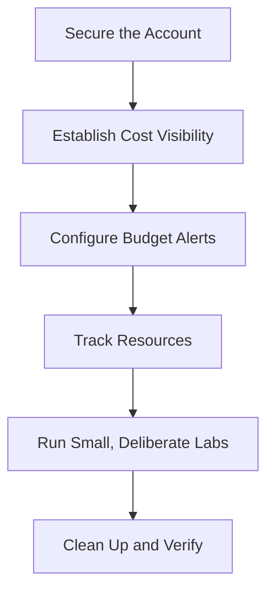

**Next: 12.03 — Regions, Availability Zones & Cloud Resources**
