# 12.03 — Regions, Availability Zones & Cloud Resources

## Learning Objectives

By the end of this chapter, you should be able to:

- Explain what an AWS Region is.
- Distinguish a Region from an Availability Zone and an edge location.
- Understand how resource location affects latency, reliability, and cost.
- Identify regional and zonal resource behavior.
- Understand why placing resources in multiple Availability Zones can improve resilience.
- Choose an appropriate Region for a basic application.
- Recognize common mistakes when creating and locating cloud resources.

---

# 1. Why Does Cloud Resource Location Matter?

Imagine your application serves users in India.

Your backend runs in one part of the world, while your users are somewhere else.

Every network request must travel between them.

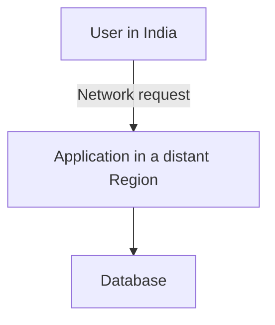

The physical distance and network path can affect latency.

Location can also affect:

- Service availability.
- Data residency requirements.
- Disaster recovery.
- Service pricing.
- Data-transfer charges.
- Compliance obligations.

Cloud infrastructure is not located in one giant, interchangeable place.

AWS divides its global infrastructure into geographic and operational boundaries.

Understanding these boundaries helps you make better deployment decisions.

---

# 2. What Is an AWS Region?

An **AWS Region** is a separate geographic area in which AWS operates cloud infrastructure.

Examples include Regions in Mumbai, Singapore, Tokyo, London, and Northern Virginia.

Each Region has its own identifier, such as:

```text
ap-south-1       Mumbai
ap-southeast-1   Singapore
ap-northeast-1   Tokyo
eu-west-2        London
us-east-1        Northern Virginia
```

These are illustrative examples of commonly used Region identifiers. Check the current AWS Region list before selecting one for a deployment.

Conceptually:

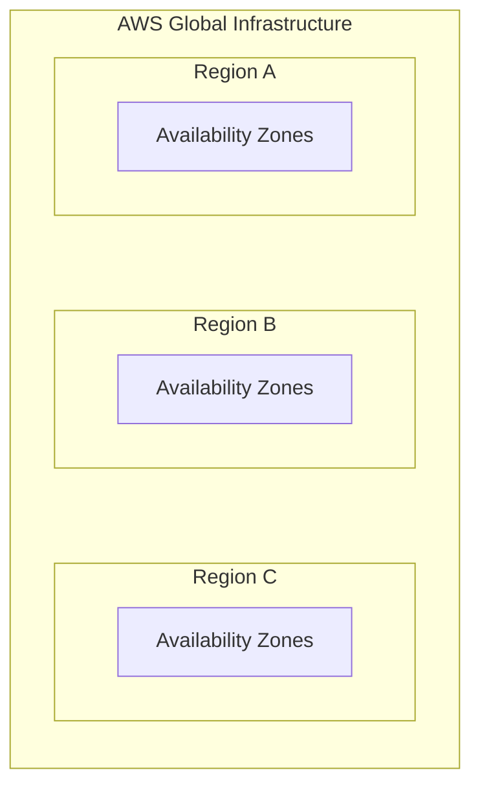

A Region is a major deployment boundary.

Resources created in one Region are not automatically available in another.

For example, an EC2 instance in Mumbai does not automatically appear in Singapore.

---

# 3. What Is an Availability Zone?

An **Availability Zone (AZ)** is an isolated location within an AWS Region, designed to reduce the impact of certain infrastructure failures.

A Region contains multiple Availability Zones.

Conceptually:

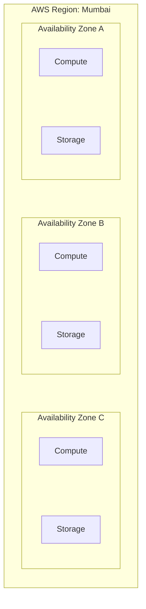

This diagram is conceptual; it does not represent the exact number or layout of Availability Zones in a specific Region.

Availability Zones have independent infrastructure and are connected through high-bandwidth, low-latency networking.

The design goal is to reduce the likelihood that a failure affecting one zone will also affect every other zone in the Region.

However, multiple AZs do not protect you from every possible failure. A Region-wide problem, application bug, shared dependency, or incorrect deployment can still affect multiple zones.

---

# 4. Region vs Availability Zone

The distinction is fundamental.

| Region | Availability Zone |
|---|---|
| A geographic AWS area | An isolated location within a Region |
| Contains multiple AZs | Belongs to one Region |
| Useful for geographic placement and regional disaster recovery | Useful for improving resilience within a Region |
| Resources may need separate deployment in another Region | Resources may be distributed across AZs where supported |
| Often influences data residency and regional pricing | Often influences placement and some network/data-transfer costs |

Think of a Region as a geographic deployment area and an AZ as an isolated infrastructure location within that area.

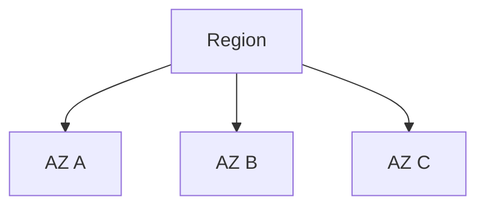

**Multiple AZs improve availability within a Region. Multiple Regions can help with regional disaster recovery. They solve different problems.**

---

# 5. What Is an Edge Location?

AWS also operates edge infrastructure used by services that deliver content or handle requests closer to users.

For example, Amazon CloudFront uses a global network of edge locations to cache and deliver content.

Conceptually:

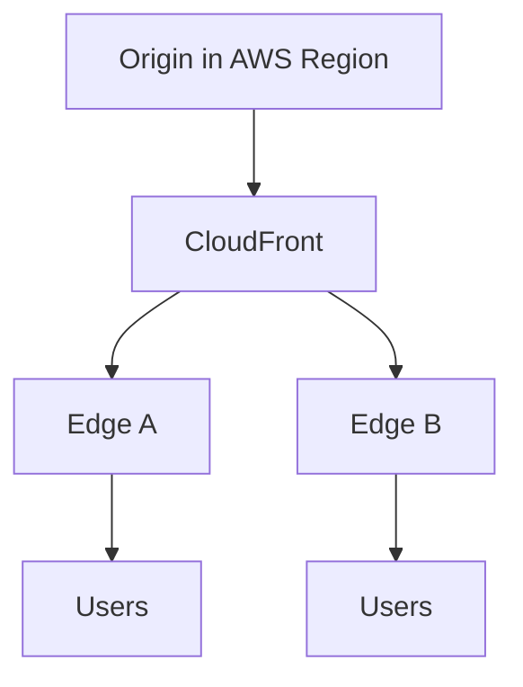

An edge location is not simply another Availability Zone.

The concepts serve different purposes:

- **Region:** A major geographic area for deploying AWS resources.
- **Availability Zone:** An isolated infrastructure location within a Region.
- **Edge location:** An edge-network location used by supported services to serve or process requests closer to users.

You will explore content delivery networks in the performance curriculum.

---

# 6. Choosing a Region

Do not choose a Region merely because its name sounds familiar.

Evaluate the requirements first.

| Consideration | Question to ask |
|---|---|
| Latency | Where are the application's users? |
| Service availability | Does the Region offer the AWS services and features you need? |
| Data residency | Are there legal or contractual requirements for data location? |
| Reliability | What are the application's availability and recovery requirements? |
| Cost | How do relevant service and data-transfer prices compare? |
| Connectivity | Can the application reach its users and dependencies effectively? |
| Operations | Which Region can your team support and monitor appropriately? |

For an application primarily serving users in India, Mumbai may be a reasonable starting candidate.

But it is not automatically the best choice for every application. Service availability, compliance, connectivity, and cost may lead to a different decision.

**Choose a Region based on requirements, then verify the details.**

---

# 7. Latency and Geographic Distance

Latency is the time required for an operation or request to complete.

Geographic distance can affect network latency because data must travel through physical networks.

For example:

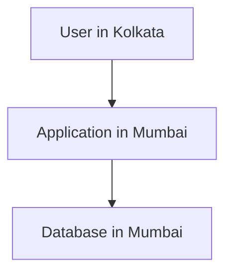

Compare that with a user reaching an application in a much more distant Region.

The distant path may introduce additional network delay.

However, geographic distance is not the only factor. Routing, network congestion, application processing, and dependency latency also matter.

A useful starting principle is:

> **Place the application near its users when user-facing latency is important, while keeping its dependent resources appropriately close and connected.**

---

# 8. Keep Related Resources Close Together

Suppose your application runs in Mumbai but its database is in another Region.

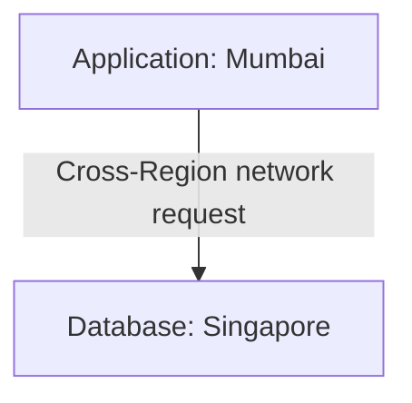

This can introduce:

- Additional latency.
- Cross-Region data-transfer costs.
- More complicated failure handling.
- Greater dependence on inter-Region connectivity.

For many applications, keeping the backend and database in the same Region is a sensible default.

The application can still use multiple AZs within that Region.

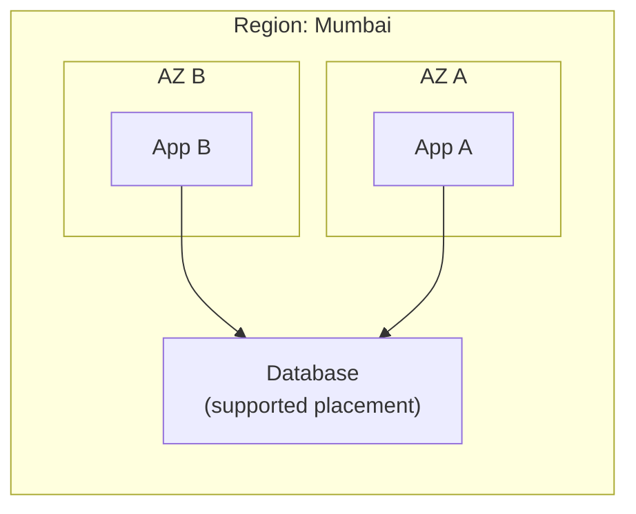

The actual placement depends on the service. A managed database may use its own Multi-AZ architecture rather than simply running as a single instance in the same way as the application.

---

# 9. Regional Resources vs Zonal Resources

Not all AWS resources have the same geographic scope.

Some are regional. Others are associated with a specific Availability Zone. Some resources have global or service-specific scopes.

Examples of common patterns:

| Resource | Typical scope or behavior |
|---|---|
| VPC | Regional |
| Subnet | Associated with one AZ |
| EC2 instance | Runs in a specific AZ |
| S3 bucket | Created in a chosen Region |
| IAM | Generally managed as a global service |
| CloudFront distribution | Global service |
| Regional managed database | Depends on the selected database configuration and deployment mode |

These are general patterns, not a complete specification for every service or feature.

Always verify the scope of the specific resource you are creating.

This matters because you cannot assume every resource can be moved or referenced across Regions in the same way.

---

# 10. Resource Scope Changes How You Design

Consider a VPC and a subnet.

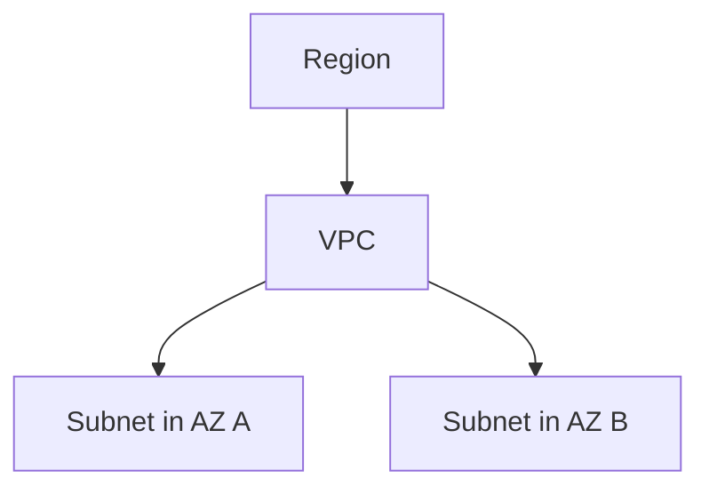

The VPC is regional, while each subnet is associated with one AZ.

You can use multiple subnets in different AZs to design an application with more than one placement location.

But a subnet does not automatically make an application highly available. You still need suitable application instances, routing, health checks, data handling, and failure behavior.

This is a recurring system-design principle:

> **Infrastructure capability does not automatically guarantee application resilience.**

---

# 11. Multi-AZ Architecture

A Multi-AZ architecture distributes suitable resources across multiple Availability Zones.

Consider a web application with two application instances.

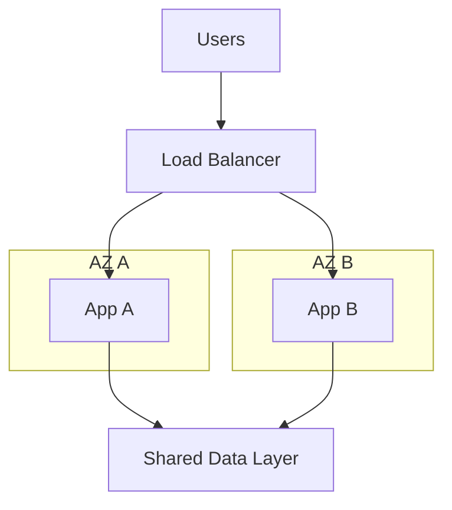

If AZ A becomes unavailable, the system may continue serving requests through AZ B, provided that:

- The remaining instance is healthy.
- The load balancer can route traffic appropriately.
- The application has enough remaining capacity.
- Required data and dependencies remain available.
- The failure does not affect shared components.

Multi-AZ is a resilience design, not a guarantee that every failure is handled automatically.

The actual implementation depends on the services involved.

---

# 12. Multi-AZ Is Not the Same as Multi-Region

These architectures protect against different failure scopes.

### Multi-AZ

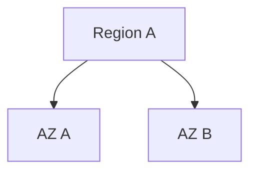

Useful for reducing the impact of certain infrastructure failures within a Region.

### Multi-Region

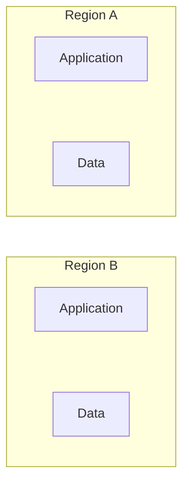

Potentially useful for regional disaster recovery, geographic requirements, or serving users in multiple parts of the world.

Multi-Region architectures are more complex. They require decisions about:

- Data replication.
- Consistency.
- Traffic routing.
- Failover.
- Recovery objectives.
- Operational coordination.
- Additional cost.

Do not adopt multi-Region architecture merely because it sounds more reliable.

Start with the failure scenarios and recovery requirements you actually need to address.

---

# 13. Resource Creation and the Region Selector

The AWS Management Console often lets you select a Region.

That selection affects the regional resources shown and the resources you create.

For example:

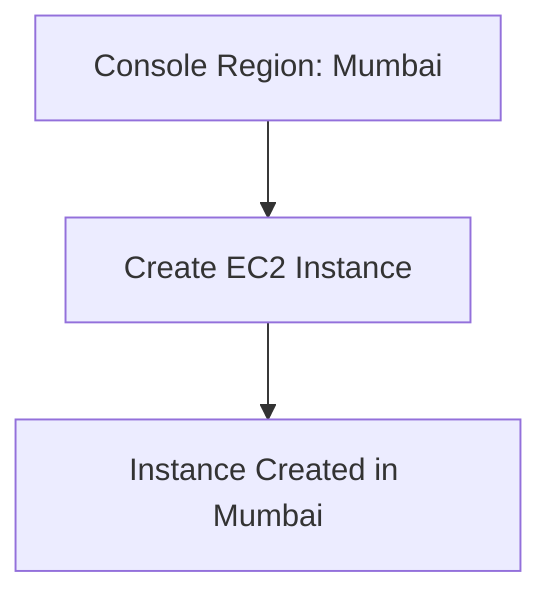

If you switch the console to Singapore, the Mumbai instance does not move.

You are viewing a different regional context.

A common source of confusion is believing that a resource has disappeared when you are simply viewing another Region.

Before troubleshooting a missing resource, check:

1. Which AWS account are you using?
2. Which Region is selected?
3. Does the service use a regional, global, or other scope?
4. Do your permissions allow you to view the resource?

---

# 14. AWS CLI and Regions

The AWS CLI also uses Region configuration.

A command may use a Region configured in your profile or explicitly provided as an option.

For example, a command to inspect EC2 instances can specify a Region:

```bash
aws ec2 describe-instances --region ap-south-1
```

This requests EC2 information for the Mumbai Region.

The command does not move resources between Regions.

For another Region, specify its identifier:

```bash
aws ec2 describe-instances --region ap-southeast-1
```

The command requires suitable AWS credentials and permissions. The results depend on the resources available in the selected Region.

You will learn the CLI and its configuration in a later chapter.

---

# 15. Region Selection and Cost

AWS prices can differ by Region and service.

Data transfer between Regions may also incur charges.

For example:

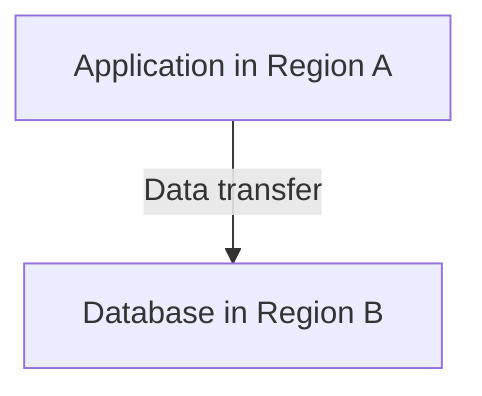

This design may cost more than expected and add latency.

When comparing Regions, consider the total architecture rather than a single service price.

Check current AWS pricing for the actual configuration you plan to use. Do not rely on remembered prices or assume that all Regions cost the same.

For a learning environment, also avoid creating duplicate resources in several Regions unless the exercise requires them.

---

# 16. Data Residency and Compliance

Some applications have requirements about where data is stored or processed.

For example, a business may have contractual or legal obligations concerning customer information.

Region selection can help address data-residency requirements, but choosing a Region alone does not establish compliance.

You must also consider:

- Backups and replicas.
- Logs and telemetry.
- Data transferred to other services.
- Support and access arrangements.
- Encryption and access controls.
- The requirements that apply to the particular application.

**Region choice is one part of compliance, not a substitute for a compliance assessment.**

---

# 17. Hands-On Exercise: Plan a Regional Deployment

This exercise requires no AWS resources and therefore creates no new infrastructure charges.

Imagine you are deploying a small application for users primarily located in India.

The application has:

- A frontend.
- A backend API.
- A relational database.

## Step 1 — Choose a candidate Region

Choose an AWS Region that could reasonably serve your users.

Write down why you chose it.

## Step 2 — Place related resources

Sketch a possible deployment:

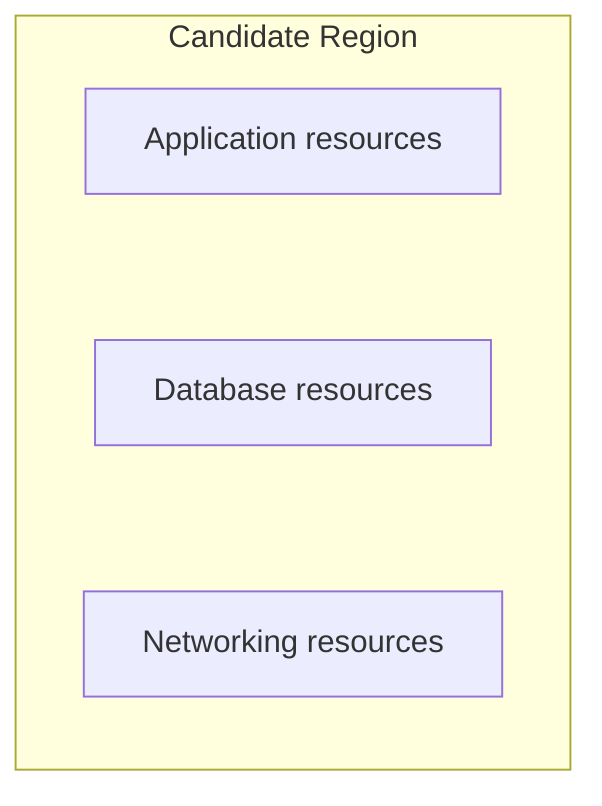

Keep the application and database in the same Region unless you have a reason to separate them.

## Step 3 — Consider availability

Ask:

- Does the application need to survive an AZ failure?
- Would multiple application instances help?
- How should database availability be handled?
- What should happen if the entire Region becomes unavailable?

Do not add Multi-AZ or Multi-Region complexity without a requirement.

## Step 4 — Review trade-offs

Record the likely implications of your choice:

| Area | Your decision |
|---|---|
| User latency | Why this Region is suitable |
| Service availability | Which services must be available |
| Data residency | Which requirements apply |
| Cost | Which service and transfer costs need checking |
| Recovery | What failure scope must be handled |

## Step 5 — Verify the design

You should be able to explain:

- Why you chose the Region.
- Which resources belong there.
- Whether multiple AZs are required.
- What the design does not protect against.
- What additional information you need before deployment.

**Expected outcome:** A regional deployment plan grounded in requirements rather than guesswork.

---

# 18. Common Mistakes

### Mistake 1 — Treating all Regions as interchangeable

Resources, service availability, prices, and configuration can differ by Region.

### Mistake 2 — Confusing Regions with Availability Zones

A Region is a geographic area; an AZ is an isolated infrastructure location within it.

### Mistake 3 — Assuming Multi-AZ means automatic recovery from every failure

The application and its dependencies must be designed to handle the failure.

### Mistake 4 — Using multiple Regions without a recovery requirement

Multi-Region designs add cost and operational complexity.

### Mistake 5 — Forgetting the console's selected Region

A resource may appear missing because you are viewing the wrong Region.

### Mistake 6 — Separating tightly coupled resources without considering latency

Cross-Region calls can increase latency and transfer costs.

### Mistake 7 — Assuming Region choice alone ensures compliance

Data movement, backups, logging, and access patterns also matter.

---

# 19. Quick Reference

| Concept | Meaning |
|---|---|
| AWS Region | Geographic area containing AWS infrastructure |
| Availability Zone | Isolated infrastructure location within a Region |
| Edge location | Edge-network location used by supported services |
| Regional resource | Resource managed within a particular Region |
| Zonal resource | Resource associated with a specific AZ |
| Multi-AZ | Architecture distributing supported resources across AZs |
| Multi-Region | Architecture using resources in multiple Regions |
| Data residency | Requirements concerning where data is stored or processed |
| Latency | Time taken for an operation or request to complete |
| Region selector | Console setting that determines the regional context |
| Cross-Region transfer | Data movement between Regions that may incur cost and latency |

---

# 20. Knowledge Check

### Question 1

What is an AWS Region?

**Answer:** A geographic area in which AWS operates cloud infrastructure.

### Question 2

What is an Availability Zone?

**Answer:** An isolated infrastructure location within an AWS Region.

### Question 3

What is the main difference between Multi-AZ and Multi-Region?

**Answer:** Multi-AZ addresses certain failures within a Region; Multi-Region can address regional failure scenarios or geographic needs but introduces additional complexity.

### Question 4

Does switching the console's Region move your resources?

**Answer:** No. It changes the regional context you are viewing.

### Question 5

Why might an application and database usually be placed in the same Region?

**Answer:** To reduce unnecessary network latency, cross-Region dependencies, and possible data-transfer costs.

### Question 6

Does using multiple AZs guarantee that an application will remain available?

**Answer:** No. The application, data layer, routing, capacity, and dependencies must also be designed to handle failures.

### Question 7

Does selecting a Region automatically ensure compliance with data-residency requirements?

**Answer:** No. Data movement, backups, logs, access, and applicable legal requirements must also be considered.

---

# Remember

Region and Availability Zone selection should follow the application's requirements.

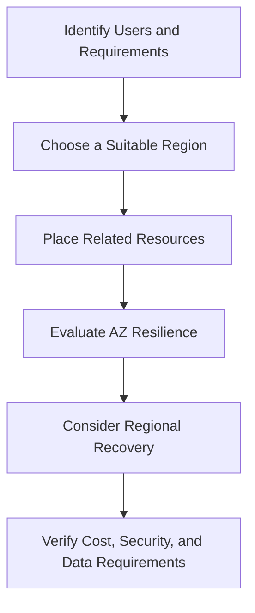

**Next: 12.04 — AWS IAM: Users, Roles, Policies & Workload Identity**
