# 12.04 — AWS IAM: Users, Roles, Policies & Workload Identity

## Learning Objectives

By the end of this chapter, you should be able to:

- Explain the purpose of AWS Identity and Access Management (IAM).
- Distinguish IAM users, groups, roles, and policies.
- Understand how AWS evaluates permissions.
- Apply the principle of least privilege to AWS resources.
- Explain why applications should not contain long-lived cloud credentials.
- Understand how workload identity allows applications to access AWS services securely.
- Recognize common IAM misconfigurations and their risks.

---

# 1. Why Does AWS Need IAM?

Imagine you have an AWS account containing:

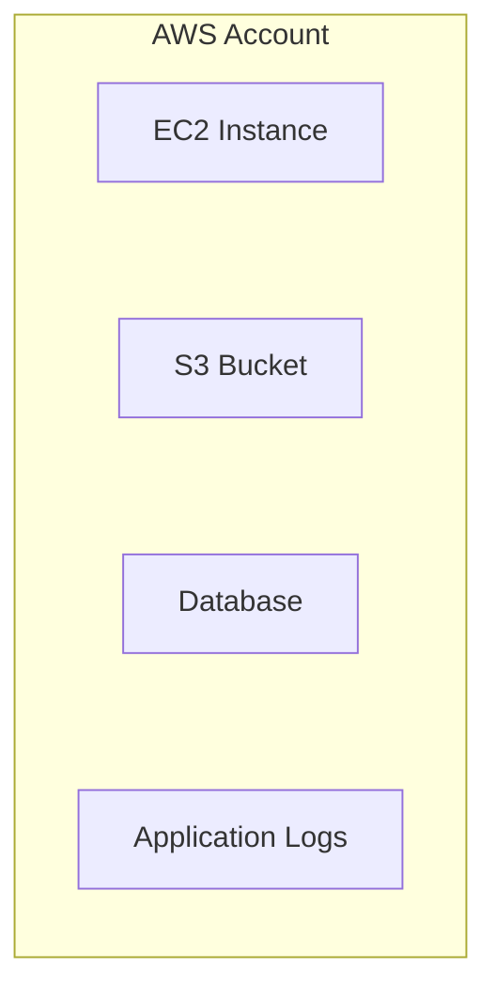

You have two requirements:

1. A developer should be able to inspect application logs.
2. The backend application should be able to upload files to a specific S3 bucket.

Should both receive unrestricted access to the entire account?

No.

The developer and the application have different responsibilities. Their permissions should reflect those responsibilities.

**AWS IAM controls who can access AWS resources and which actions they can perform.**

Conceptually:

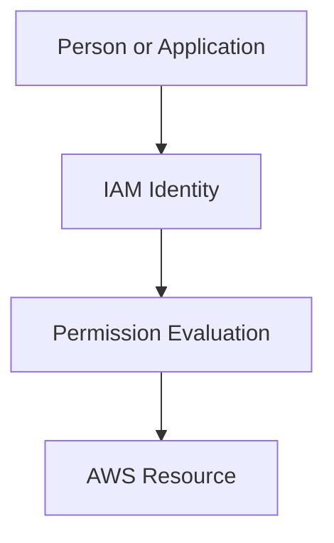

IAM connects authentication and authorization to AWS operations.

---

# 2. Identity vs Permission

These are two separate concepts.

**Identity:** Who or what is making the request?

**Permission:** What is that identity allowed to do?

For example:

```text
Identity:
Backend Application

Requested Action:
Upload a file to S3

Permission:
Allow uploading to a specific bucket
```

An identity can be valid but still lack permission for a particular operation.

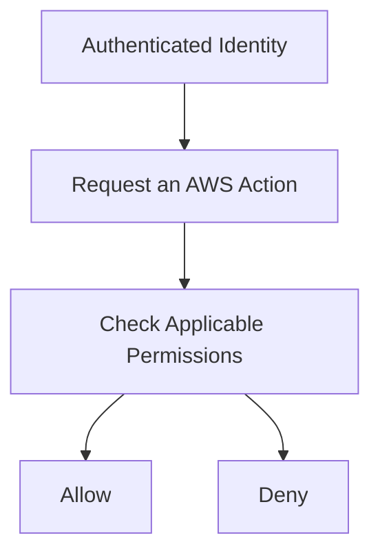

Authentication does not automatically grant authorization.

This connects directly to Level 11:

- Authentication establishes identity.
- Authorization determines allowed actions.
- Least privilege limits access to what is necessary.

---

# 3. The Four Core IAM Concepts

AWS IAM commonly involves four important concepts.

| Concept | Purpose |
|---|---|
| IAM user | Represents an identity with long-term credentials, when that identity type is appropriate |
| IAM group | Organizes IAM users so permissions can be managed collectively |
| IAM role | Provides an identity with permissions that an authorized principal can assume |
| IAM policy | Defines permissions through rules describing allowed or denied actions |

Conceptually:

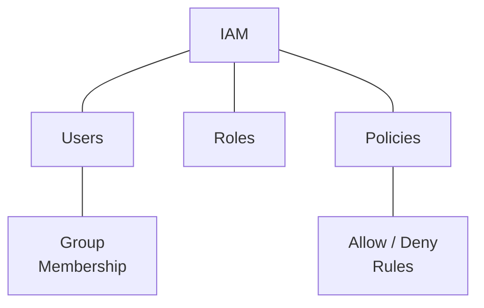

These concepts are related but not interchangeable.

A policy is not a person.

A role is not a server.

A group is not a permission rule by itself.

Each plays a different part in the authorization model.

---

# 4. IAM Users

An IAM user is an identity created within an AWS account.

Depending on its configuration, an IAM user may have credentials used to access AWS.

Historically, IAM users have often been used for people and automation. However, modern AWS access patterns generally favor federation and temporary credentials where suitable.

For human access, consider an appropriate federation or workforce identity approach instead of creating long-lived credentials unnecessarily.

For applications running on AWS, prefer roles and temporary credentials rather than embedding IAM user access keys.

Example:

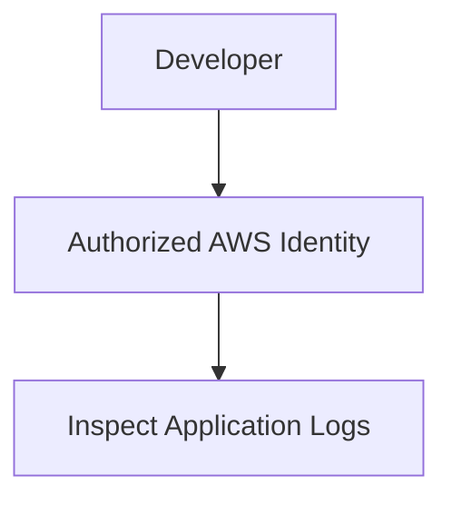

The identity should receive only the permissions needed for the developer's tasks.

**Important:** Creating an IAM user does not automatically grant access to AWS resources. Applicable permissions are still required.

---

# 5. IAM Groups

An IAM group is a collection of IAM users.

Groups make it easier to manage permissions for multiple users with similar responsibilities.

For example:

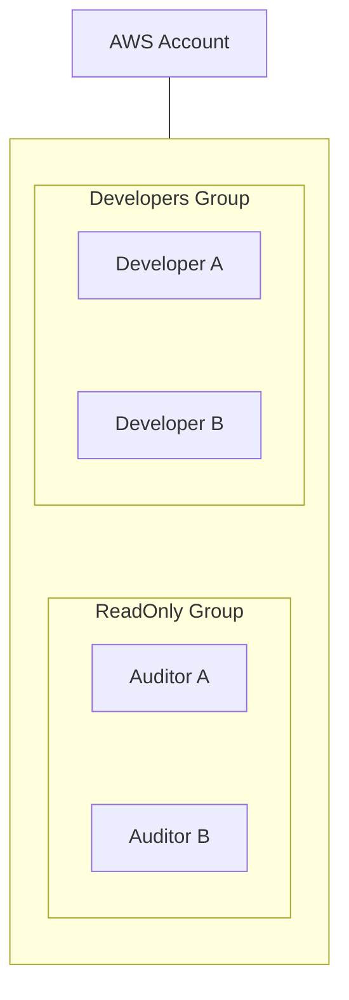

A policy attached to a group can provide permissions to its users, subject to the overall IAM authorization rules.

Groups are useful for organizing IAM users. They are not a general-purpose way to group IAM roles or every possible AWS identity.

For organizations using federated workforce access, permission sets and role-based access patterns may be more appropriate.

---

# 6. IAM Roles

An **IAM role** is an identity with a set of permissions that an authorized principal can assume.

Unlike a traditional IAM user with long-term credentials, a role is commonly used with temporary credentials.

Roles are important for:

- Applications running on AWS.
- AWS services accessing other AWS services.
- Cross-account access.
- Federated human access.
- Automation and deployment pipelines.

Example:

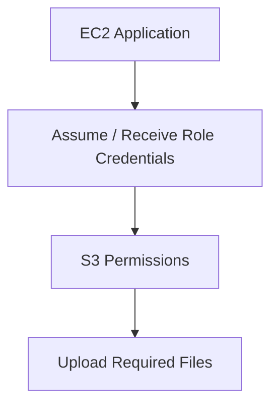

The role defines the permissions available to the application.

The application does not need an access key permanently embedded in its source code.

---

# 7. Identity Policy vs Trust Policy

An IAM role has two distinct questions to answer.

### Question 1 — Who can assume this role?

This is controlled by the role's **trust policy**.

### Question 2 — What can the role do after it is assumed?

This is controlled by its permissions policies and the other applicable authorization rules.

Conceptually:

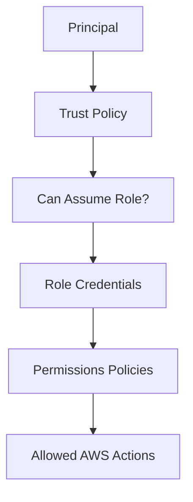

A role can have perfectly reasonable permissions but still be insecure if the wrong principals are allowed to assume it.

Likewise, a restrictive trust policy does not make the role safe if its permissions are excessively broad.

**Trust and permissions solve different problems. Both matter.**

---

# 8. IAM Policies

An IAM policy is a set of rules describing access.

Policies commonly specify:

- `Effect`: whether the statement allows or denies an action.
- `Action`: which operation is involved.
- `Resource`: which resource the rule applies to.
- `Condition`: circumstances under which the rule applies.

A simplified example:

```json
{
  "Version": "2012-10-17",
  "Statement": [
    {
      "Effect": "Allow",
      "Action": "s3:ListBucket",
      "Resource": "arn:aws:s3:::systemly-learning-bucket"
    }
  ]
}
```

This policy statement allows the `s3:ListBucket` action on the specified bucket, subject to the rest of the authorization context.

It does not automatically grant permission to upload, download, or delete objects.

Those operations use different actions and may require additional permissions.

The bucket name here is an illustrative placeholder. Replace it with a real resource identifier only when configuring an actual environment.

---

# 9. Understand Actions and Resources

Consider an S3 bucket.

Different actions represent different operations.

| Action | General purpose |
|---|---|
| `s3:ListBucket` | List objects in a bucket |
| `s3:GetObject` | Read an object |
| `s3:PutObject` | Upload or write an object |
| `s3:DeleteObject` | Delete an object |

These actions are not equivalent.

A backend that only uploads files may not need permission to delete them.

A reporting application that only reads objects may not need write access.

Conceptually:

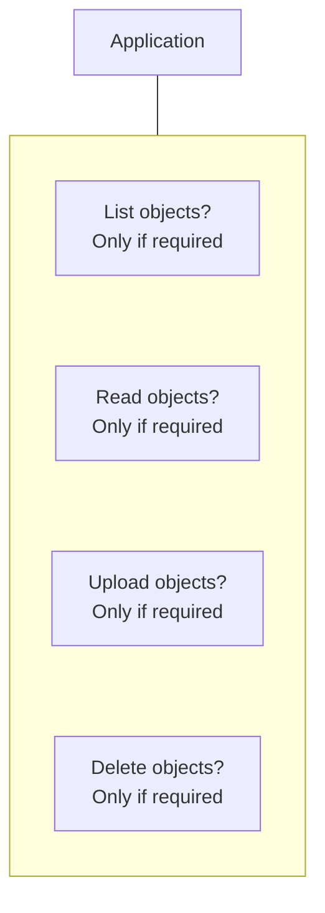

The policy should reflect the actual operations the application needs.

This is the practical meaning of least privilege.

---

# 10. The Principle of Least Privilege

You learned least privilege in Level 11.

AWS IAM provides a way to apply it to cloud operations.

Suppose an application only needs to upload generated reports to one bucket.

A broad policy such as:

```text
Allow all S3 actions on all resources
```

gives the application more access than its task requires.

A narrower policy would restrict access to the necessary actions and resource scope.

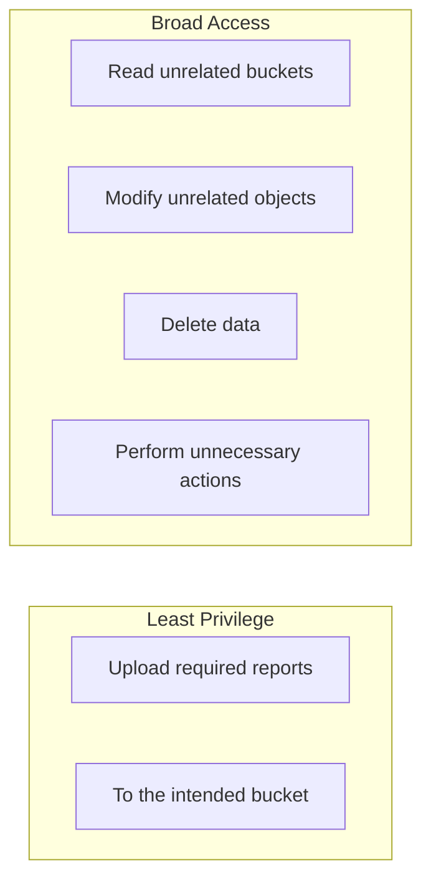

Least privilege reduces the potential impact of compromised credentials, application bugs, or unintended actions.

A practical process is:

1. Identify the task.
2. List the required AWS actions.
3. Identify the required resources.
4. Add appropriate conditions where useful.
5. Test the application.
6. Remove unnecessary permissions.
7. Review the policy as the application changes.

---

# 11. How AWS Evaluates Permissions

A useful starting model is:

- An applicable explicit **Deny** overrides an Allow.
- An applicable Allow may grant access.
- If no applicable Allow grants the requested access, the request is generally denied.

Conceptually:

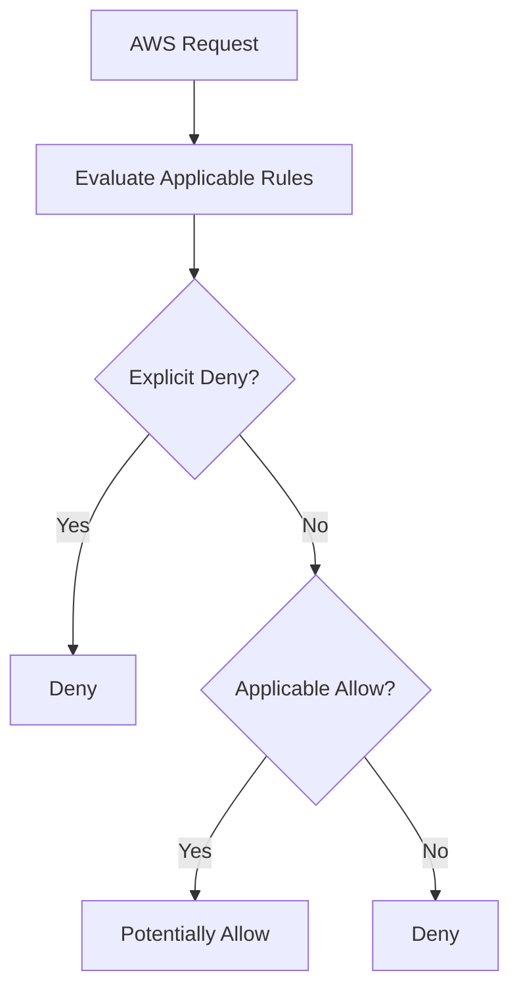

This is a simplified model.

Actual authorization can involve multiple policy types and controls, including:

- Identity-based policies.
- Resource-based policies.
- Permissions boundaries.
- Service control policies.
- Session policies.
- Trust policies for role assumption.
- Resource-specific rules and conditions.

The applicable rules depend on the requested action, principal, resource, and account configuration.

Do not assume that attaching one Allow policy guarantees access in every context.

---

# 12. Temporary Credentials

Traditional access keys can remain valid until they are disabled, deleted, or otherwise invalidated.

If a long-lived key is leaked, an attacker may be able to use it until the credential is invalidated or blocked by other controls.

Temporary credentials are designed to expire.

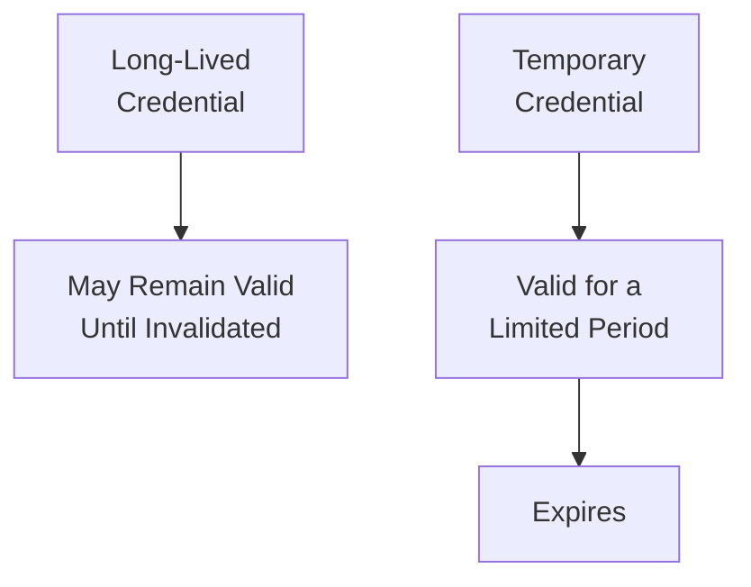

Temporary credentials can reduce the period during which stolen credentials remain usable.

They do not eliminate the need for secure storage, permissions, monitoring, or incident response.

AWS roles commonly provide temporary credentials through supported identity mechanisms.

---

# 13. What Is Workload Identity?

A **workload** is a running application, service, job, or automation process.

A workload needs an identity when it interacts with protected resources.

For example:

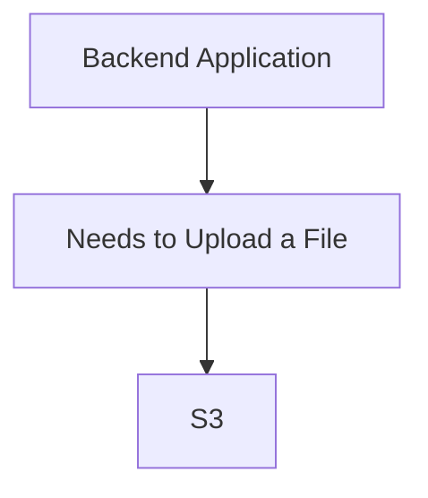

The question is:

> How does the application prove which identity it represents?

**Workload identity** is the mechanism by which an application or automated process receives an identity that can be used to authorize its actions.

In AWS, this commonly involves IAM roles and temporary credentials.

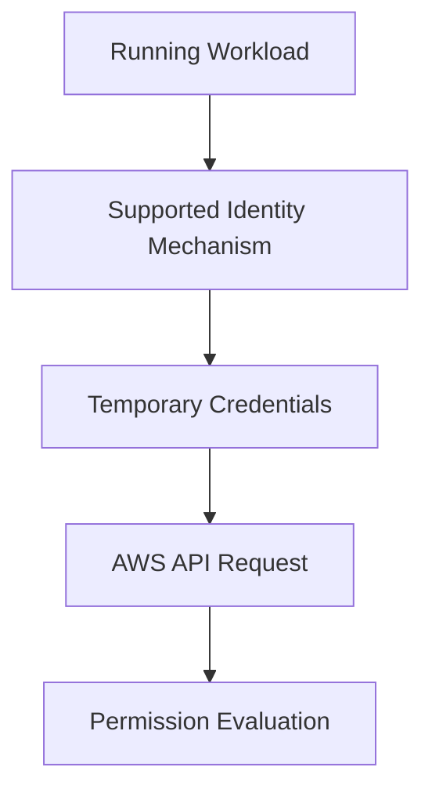

The exact identity mechanism depends on where the workload runs.

---

# 14. Workload Identity on AWS

Different execution environments provide different ways to associate a workload with an IAM role.

| Workload | Common AWS identity approach |
|---|---|
| EC2 application | IAM role through an instance profile |
| AWS Lambda function | Execution role |
| Amazon ECS task | Task role |
| Application outside AWS | Federation or another supported credential mechanism, depending on the environment |

These mechanisms help applications obtain credentials without embedding permanent access keys in source code.

For example, an EC2 application can use an associated role to request temporary credentials through the supported instance metadata mechanism.

The AWS SDK can then use those credentials to sign API requests.

You will learn EC2, ECS, Lambda, and AWS SDKs in later chapters.

For now, understand the shared principle:

**Assign an appropriate identity to the workload and give that identity only the permissions the workload requires.**

---

# 15. Why Hardcoded Access Keys Are Dangerous

Consider this application configuration:

```javascript
const accessKeyId = "AKIA_EXAMPLE";
const secretAccessKey = "EXAMPLE_SECRET";
```

These values are illustrative and are not valid credentials.

Embedding real long-lived credentials in application source code creates serious risks.

For example:

- The code may be committed to Git.
- A repository may become public.
- Logs or error messages may expose the values.
- Developers may copy the credentials into other systems.
- Rotating the credentials may require application changes.

A safer AWS-hosted design is generally:

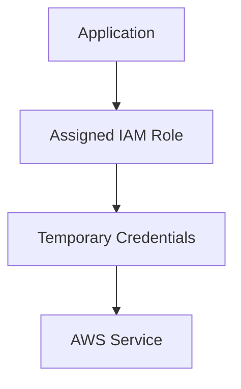

Use the identity mechanism supported by the runtime and AWS SDK.

For local development, use an appropriate local credential profile or supported federation method. Do not copy production secrets into your repository.

---

# 16. Role-Based Access for Different Workloads

Imagine an application with two components:

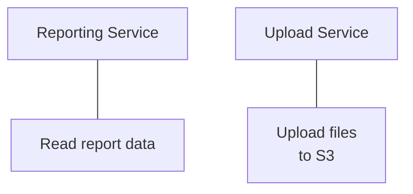

Should both use the same role with identical permissions?

Not necessarily.

A better approach may be:

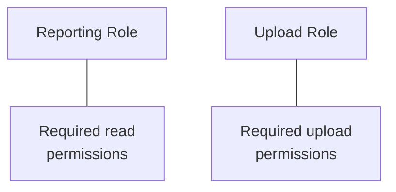

Separating identities limits the impact of a compromised component.

However, too many narrowly divided roles can also increase management complexity.

Use separation when it creates a meaningful security boundary or clarifies responsibilities.

---

# 17. IAM and Cross-Account Access

An AWS organization may use separate accounts for development and production.

Sometimes a principal in one account needs access to a resource in another.

Conceptually:

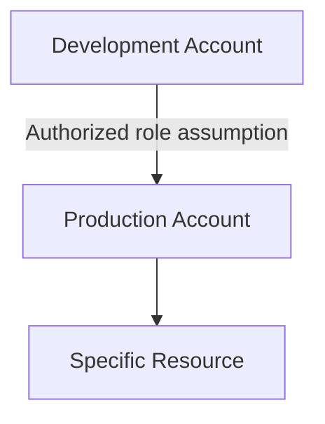

Cross-account access typically requires the target role's trust policy and the appropriate permissions on the requesting side.

Other applicable organization and resource policies may also affect the result.

Do not grant broad cross-account access simply to make a deployment easier.

Define:

- Which account is requesting access.
- Which role can be assumed.
- Which resources can be accessed.
- Which actions are permitted.
- Under what conditions access is allowed.

Cross-account access is powerful, so it should be designed deliberately.

---

# 18. Common IAM Failure Scenarios

| Failure | Likely area to investigate |
|---|---|
| `AccessDenied` from an AWS API | Effective permissions, explicit Deny, resource policy, conditions |
| Application cannot assume a role | Trust policy, identity configuration, role-assumption permissions |
| Application has an expired credential | Credential refresh or identity mechanism |
| EC2 application cannot access S3 | Instance role, policy actions, resource scope, bucket policy |
| Developer cannot view billing information | Billing access settings and identity permissions |
| Application can modify unrelated resources | Overly broad permissions or incorrect role assignment |

An access-denied error does not automatically mean the IAM role is missing.

The request may be blocked by another applicable policy or condition.

Investigate the actual identity, requested action, target resource, and authorization context.

---

# 19. Hands-On Exercise: Design a Least-Privilege Workload Role

This exercise is a policy-design exercise. You do not need to create AWS resources or access keys.

Imagine a backend application uploads generated reports to one S3 bucket.

Its requirements are:

- Upload report objects to the designated bucket.
- Do not delete objects.
- Do not access unrelated buckets.
- Do not administer IAM.
- Do not create or modify compute resources.

## Step 1 — Identify the workload

```text
Backend Report Service
```

## Step 2 — Identify the required action

The core write operation is:

```text
s3:PutObject
```

## Step 3 — Identify the resource scope

The intended target is a specific bucket's object resources.

An object-level ARN typically includes the bucket name and an object path, conceptually:

```text
arn:aws:s3:::example-bucket/reports/*
```

This is a placeholder pattern, not a real resource.

## Step 4 — Identify unnecessary actions

The workload does not inherently require:

```text
s3:DeleteObject
iam:*
ec2:*
```

Do not grant these actions merely because the application uses AWS.

## Step 5 — Design the access flow

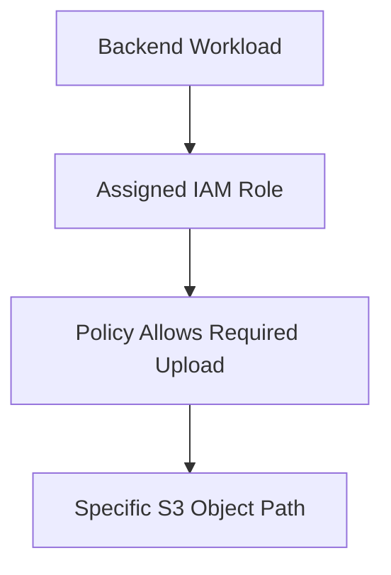

## Step 6 — Review the design

Answer:

- Who is allowed to assume the role?
- Which object paths can the application write to?
- Does the application actually need to list the bucket?
- Does it need to read uploaded objects?
- How will credentials be obtained and refreshed?
- How will unexpected access be investigated?

**Expected result:** A clear identity and permission design that can be implemented in a later AWS deployment chapter.

---

# 20. Common Mistakes

### Mistake 1 — Giving every workload administrator permissions

This increases the potential impact of compromised credentials or application bugs.

### Mistake 2 — Confusing a role with a policy

The role is an identity; policies describe permissions.

### Mistake 3 — Ignoring trust policies

A role's permissions do not answer who is allowed to assume it.

### Mistake 4 — Hardcoding long-lived access keys

Use supported identity mechanisms and temporary credentials wherever appropriate.

### Mistake 5 — Assuming authentication means authorization

An authenticated identity can still be denied an action.

### Mistake 6 — Granting permissions to all resources when one is sufficient

Narrow the action and resource scope where practical.

### Mistake 7 — Treating an access-denied error as proof that no Allow policy exists

Another applicable rule or condition may be blocking the request.

### Mistake 8 — Sharing one powerful role across unrelated workloads

Separate identities when their responsibilities and security boundaries differ.

---

# 21. Quick Reference

| Concept | Meaning |
|---|---|
| IAM | AWS service for managing identities and access |
| IAM user | Identity with credentials, when appropriate |
| IAM group | Collection of IAM users |
| IAM role | Identity that an authorized principal can assume |
| IAM policy | Rules describing allowed and denied actions |
| Trust policy | Controls which principals may assume a role |
| Permissions policy | Defines actions an identity may perform, subject to other applicable controls |
| Least privilege | Grant only the access required for the task |
| Temporary credentials | Credentials valid for a limited period |
| Workload identity | Identity assigned to an application or automated process |
| Instance profile | Mechanism used to associate an IAM role with an EC2 instance |
| Execution role | IAM role used by a supported service, such as Lambda, to perform authorized operations |
| Explicit Deny | Applicable policy statement that overrides an Allow |
| Cross-account access | Authorized access between separate AWS accounts |

---

# 22. Knowledge Check

### Question 1

What does AWS IAM control?

**Answer:** Which identities can access AWS resources and which actions they can perform.

### Question 2

What is the difference between a role and a policy?

**Answer:** A role is an identity that can be assumed by an authorized principal. A policy defines permissions.

### Question 3

What is the purpose of a trust policy?

**Answer:** It determines which principals are allowed to assume a role.

### Question 4

Why should applications avoid hardcoded long-lived access keys?

**Answer:** Keys can leak through source code, repositories, logs, or copied configuration and may remain usable until invalidated.

### Question 5

What is workload identity?

**Answer:** An identity mechanism that allows an application or automated workload to authenticate and receive authorized access.

### Question 6

Does an IAM Allow policy guarantee access?

**Answer:** No. Other applicable policies, explicit Deny statements, trust requirements, conditions, or resource rules can affect the result.

### Question 7

How should you approach an `AccessDenied` error?

**Answer:** Identify the principal, action, resource, and relevant authorization rules, then investigate the actual denial.

---

# Remember

IAM is not simply about creating users. It is about establishing the right identity, granting the right permissions, and ensuring that only the intended principals can perform the intended actions.

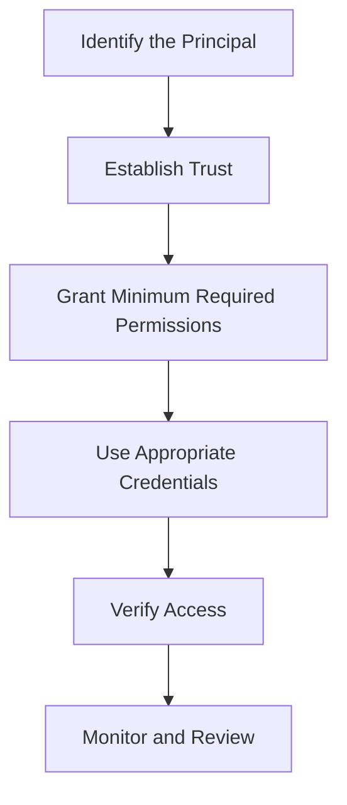

**Next: 12.05 — AWS CLI, SDKs & Local Development**
