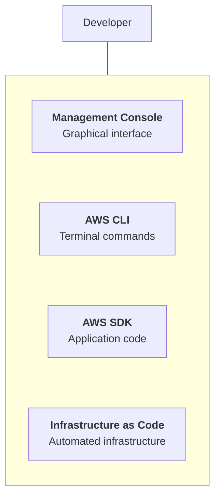
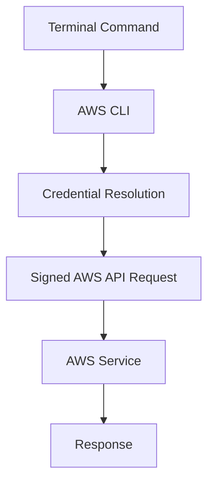
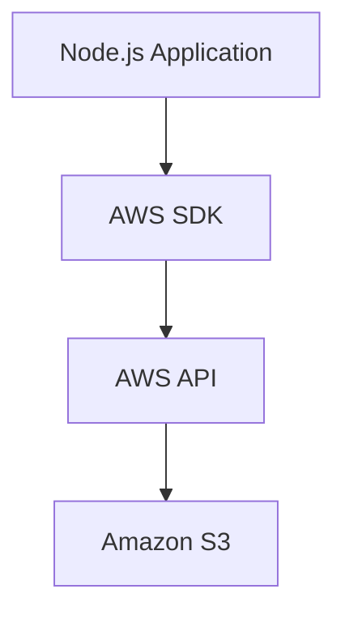
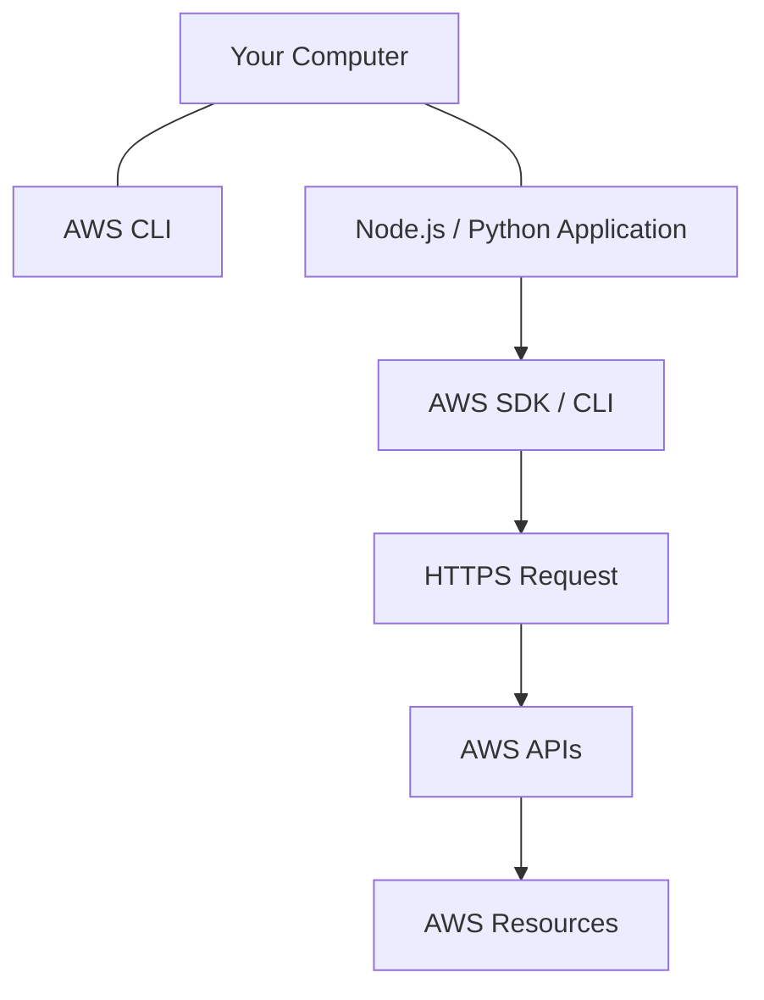
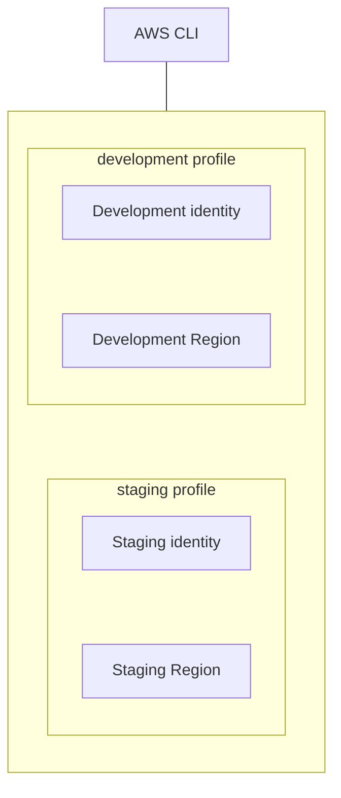
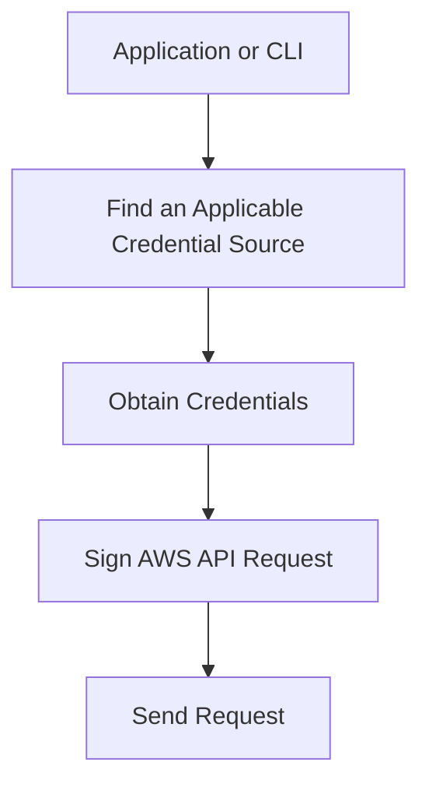
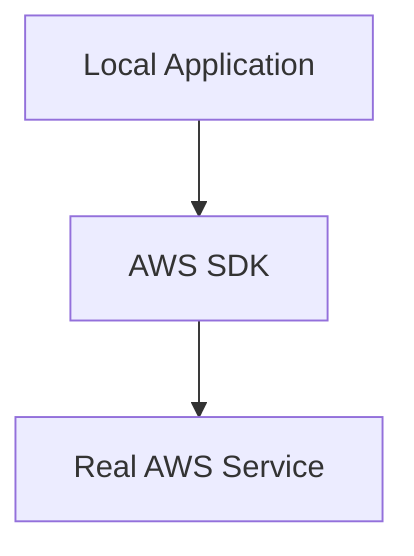
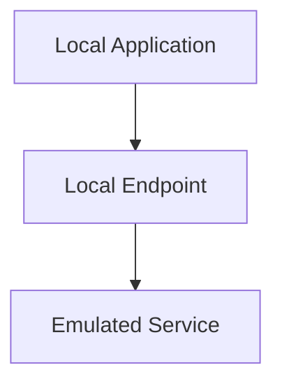
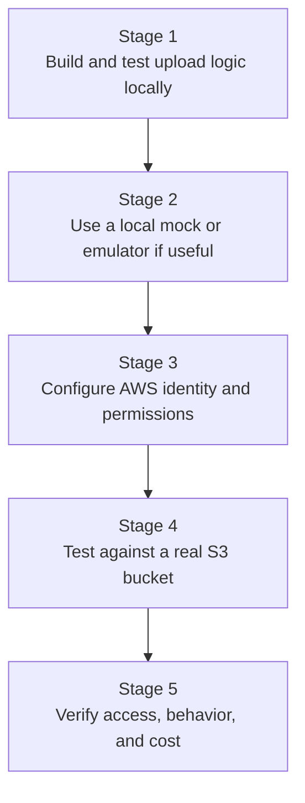
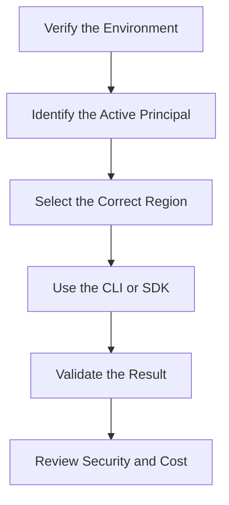

# 12.05 — AWS CLI, SDKs & Local Development

## Learning Objectives

By the end of this chapter, you should be able to:

- Explain the difference between the AWS Management Console, CLI, and SDKs.
- Understand how local tools communicate with AWS APIs.
- Configure the AWS CLI for a development environment.
- Understand AWS profiles, Regions, and credential resolution.
- Use temporary credentials and IAM roles safely.
- Distinguish local development from local AWS-service emulation.
- Diagnose common authentication and authorization errors.
- Avoid exposing credentials in source code or Git repositories.

---

# 1. Why Do We Need AWS Development Tools?

Imagine you want a backend application to upload a report to Amazon S3.

You could open the AWS Management Console and upload the file manually.

But what if your application needs to upload thousands of files automatically?

You need a way for software to communicate with AWS services.

AWS provides tools for different purposes:



All of these can interact with AWS, but they serve different workflows.

**The key idea is that developers do not need to manage every AWS operation manually through a browser.**

---

# 2. AWS Console vs CLI vs SDK

| Tool | Main purpose | Example |
|---|---|---|
| AWS Management Console | Manage resources through a graphical interface | Inspect an S3 bucket |
| AWS CLI | Run AWS operations from a terminal | List S3 buckets |
| AWS SDK | Call AWS services from application code | Upload a report from Node.js |
| Infrastructure as Code | Define and manage infrastructure through configuration | Create a VPC using Terraform |

Think of the difference this way:

```text
Console:
Human → Browser → AWS

CLI:
Human / Script → Terminal → AWS CLI → AWS

SDK:
Application Code → SDK → AWS API
```

The tools can perform overlapping operations, but the interaction model differs.

---

# 3. What Is the AWS CLI?

The **AWS Command Line Interface (CLI)** is a tool that lets you interact with AWS services using terminal commands.

For example:

```bash
aws sts get-caller-identity
```

This command asks AWS Security Token Service to identify the AWS principal associated with the credentials being used.

A successful response typically includes an account identifier, an ARN, and a user or role identifier.

The command does not create a resource. It helps verify which identity is active.

Another example:

```bash
aws s3 ls
```

This requests a list of S3 buckets visible to the active identity, assuming the required permissions are available.

Conceptually:



The CLI handles much of the request construction, signing, and response formatting for you.

---

# 4. What Is an AWS SDK?

An **AWS Software Development Kit (SDK)** is a library that lets application code interact with AWS services.

For example, a Node.js backend may need to upload a generated file to S3.

Instead of manually constructing and signing every HTTP request, the application uses an AWS SDK.



SDKs are available for multiple programming languages, including JavaScript/TypeScript, Python, Java, and .NET.

The exact package and API depend on the language and SDK version.

The important distinction:

- The CLI is primarily for interactive commands and scripts.
- The SDK is primarily for integrating AWS operations into application code.

Both still require suitable credentials and permissions.

---

# 5. How Local Tools Reach AWS

Your computer does not need to be inside AWS to call AWS APIs.

A local development machine can communicate with AWS over the network.



For example, a local script may upload a file to an S3 bucket hosted in an AWS Region.

Your script executes locally, but the S3 operation happens in AWS.

This is different from running an application on an EC2 instance, where the application itself executes on cloud infrastructure.

**Local code can control cloud resources without running inside the cloud.**

---

# 6. Install the AWS CLI

Before using the CLI, install a supported version on your development machine.

AWS provides installation instructions for Windows, macOS, and Linux. Use the official AWS CLI installation documentation to choose the appropriate installer for your operating system.

After installation, open a new terminal and run:

```bash
aws --version
```

A successful installation prints the CLI version and related build information.

For example, the output may begin with:

```text
aws-cli/2.x.x
```

The exact version will vary.

If the command is not recognized:

1. Confirm that the installation completed.
2. Open a new terminal.
3. Check that the CLI executable is available on your `PATH`.
4. Follow the official installation troubleshooting instructions.

Do not download CLI installers from untrusted sources.

---

# 7. Configure Credentials Safely

The AWS CLI needs an identity to make authenticated requests.

There are multiple ways to provide credentials, including:

- An AWS CLI profile.
- An approved federation or single sign-on workflow.
- Temporary credentials.
- An assigned role when running on supported AWS infrastructure.
- Environment variables, where appropriate for the workflow.

For local development, choose an authentication method suitable for your account and organizational setup.

Do not assume every developer should create a permanent IAM user with access keys.

For workforce access, AWS IAM Identity Center or another supported federation method may be more appropriate.

For applications running on AWS, use the appropriate workload identity mechanism whenever possible.

---

# 8. AWS CLI Profiles

A **profile** stores configuration associated with a named CLI context.

For example, you might use separate profiles for different environments:

```text
default
development
staging
```

Profiles can specify configuration such as:

- The Region.
- Output format.
- Credential-provider settings.
- Role-assumption settings.
- Other supported CLI configuration.

Conceptually:



Profiles help prevent accidental use of the wrong account or environment.

They do not automatically isolate resources or grant permissions.

The identity and permissions associated with each profile still matter.

---

# 9. Configure a Profile

If your organization uses an approved access-key workflow, the CLI supports commands such as:

```bash
aws configure --profile development
```

The command prompts for configuration values appropriate to that workflow.

However, **do not create long-lived access keys solely because this command exists**.

If your environment uses AWS IAM Identity Center, configure the appropriate SSO profile using the current AWS CLI workflow instead.

For an IAM Identity Center profile, the process commonly includes:

```bash
aws configure sso --profile development
```

Follow the prompts and your organization's authentication requirements. The exact steps depend on the Identity Center setup.

After configuring a profile, you can explicitly select it for a command:

```bash
aws sts get-caller-identity --profile development
```

This helps verify the identity associated with that profile.

---

# 10. Credential Resolution

The CLI and supported SDKs can obtain credentials from several sources.

Common sources include:

- Explicitly configured profiles.
- Supported single sign-on or federation mechanisms.
- Environment variables.
- Web identity credentials.
- IAM role credentials provided by supported AWS runtimes.
- Other credential providers supported by the particular tool or SDK.

The exact provider chain and precedence can differ by SDK, configuration, and version.

Conceptually:



If the tool finds credentials from an unexpected source, it may use a different identity than you intended.

That is why verifying the active identity is important.

For AWS CLI troubleshooting, inspect the selected profile and relevant environment variables before changing permissions.

---

# 11. Verify the Active Identity

Before running a command that creates, modifies, or deletes resources, verify which identity is active.

Use:

```bash
aws sts get-caller-identity
```

With a named profile:

```bash
aws sts get-caller-identity --profile development
```

Review the returned information.

```text
Account → Which AWS account?
Arn     → Which principal?
UserId  → Which identity identifier?
```

This command does not require you to create an EC2 instance, S3 bucket, or database.

It is a useful safety check before cloud operations.

**Do not rely only on the profile name. Verify the identity that AWS actually recognizes.**

---

# 12. Region Configuration

AWS services operate within specific scopes.

As covered in 12.03, many resources belong to a particular Region.

The CLI can use a configured default Region or an explicit Region option.

For example:

```bash
aws s3api list-buckets --region ap-south-1
```

This command requests the account's S3 bucket listing through the specified Region parameter, although S3 bucket listing has global-account semantics and bucket locations must be inspected separately.

For a clearly regional example, consider EC2:

```bash
aws ec2 describe-instances --region ap-south-1
```

This queries EC2 in the Mumbai Region.

To inspect a different Region:

```bash
aws ec2 describe-instances --region ap-southeast-1
```

A resource that does not appear in one Region may exist in another.

Always verify the Region before assuming that a resource is missing.

---

# 13. Use the CLI to Inspect Before Changing

A safe workflow starts with inspection.

For example, to identify the active identity:

```bash
aws sts get-caller-identity
```

To list accessible S3 buckets:

```bash
aws s3 ls
```

To inspect EC2 instances in a specific Region:

```bash
aws ec2 describe-instances --region ap-south-1
```

These commands require suitable permissions.

A command that returns no resources does not necessarily indicate an error. It may mean there are no matching resources in that scope.

Before creating infrastructure, make sure you understand:

- Which account is active.
- Which Region is selected.
- Which resources already exist.
- Which resources may incur charges.
- Which permissions the command requires.

Read-only commands are useful for learning, but they can still expose sensitive account or resource metadata in their output.

---

# 14. AWS SDK Example: Node.js

Suppose your Node.js application needs to list objects in an S3 bucket.

A modern AWS SDK for JavaScript v3 example looks like this:

```javascript
import {
  S3Client,
  ListObjectsV2Command,
} from "@aws-sdk/client-s3";

const s3 = new S3Client({
  region: "ap-south-1",
});

const response = await s3.send(
  new ListObjectsV2Command({
    Bucket: "your-example-bucket",
  })
);

console.log(response.Contents);
```

The bucket name is a placeholder. Replace it with a bucket you are authorized to access before running the code.

The SDK:

1. Creates an S3 client.
2. Uses the configured Region.
3. Resolves credentials through supported credential providers.
4. Signs and sends the API request.
5. Returns the response to your application.

The code does not embed access keys.

That is intentional.

The runtime must still have an appropriate credential source and permissions, including the relevant S3 listing permission.

For a local development environment, configure your approved AWS profile or identity mechanism before running the code.

---

# 15. SDK Credential Configuration

The SDK can use supported credential providers to obtain credentials.

For example, the JavaScript SDK commonly supports the default credential provider chain.

A client can often be created without explicitly passing credentials:

```javascript
import { S3Client } from "@aws-sdk/client-s3";

const s3 = new S3Client({
  region: "ap-south-1",
});
```

The SDK attempts to resolve credentials through supported providers.

The exact behavior depends on the SDK version and environment.

This is preferable to writing permanent access keys directly into application code.

If the SDK cannot find suitable credentials, the request will fail before successful authorization can occur.

---

# 16. Local Environment Variables

Environment variables are often used to configure an application.

For example:

```text
APP_ENV=development
AWS_REGION=ap-south-1
```

These values are illustrative configuration examples.

They can help distinguish local development from staging or production.

However, environment variables are not automatically secure.

Sensitive values can be exposed through:

- Debug output.
- Process inspection.
- Logs.
- Misconfigured deployment settings.
- Accidentally committed environment files.

Avoid storing permanent AWS access keys in source code or committing secret-bearing `.env` files to Git.

Use supported identity mechanisms for AWS credentials and appropriate secret-management practices for application secrets.

---

# 17. Local Development vs Local AWS Emulation

There are two different ideas.

### Local development

Your application runs locally but calls real AWS services.



For example, a local Node.js application uploads a file to a real S3 bucket.

This may incur charges and modifies actual cloud resources.

### Local AWS-service emulation

A local tool attempts to simulate selected AWS services on your machine.



This can be useful for development and testing.

However, emulators may not reproduce every AWS feature, permission behavior, or operational characteristic.

**A local emulator is not automatically an exact replacement for testing against AWS.**

Choose the approach based on what you need to validate.

---

# 18. Why Local-First Development Helps

Suppose you are building a file-upload feature.

You can separate the learning into stages.



This reduces unnecessary cloud usage during ordinary development.

It also makes failures easier to isolate.

For example, if the application cannot process a file locally, the problem is probably not an AWS IAM permission.

If the local application works but its real S3 request returns `AccessDenied`, investigate the identity, action, resource, and applicable policies.

---

# 19. Common Errors

| Error or symptom | Possible cause |
|---|---|
| `Unable to locate credentials` | No usable credential source was found |
| `ExpiredToken` | A temporary credential has expired |
| `AccessDenied` | The request is not authorized under the applicable rules |
| `InvalidClientTokenId` | The supplied credential identifier may be invalid or unrecognized |
| Resource not found | Wrong Region, wrong identifier, missing resource, or insufficient visibility |
| Command not recognized | CLI installation or `PATH` issue |
| SDK cannot connect | Network, endpoint, proxy, DNS, or configuration issue |

These are starting points for investigation, not definitive diagnoses.

For example, `AccessDenied` does not necessarily mean that the identity has no policy attached. An explicit Deny, resource policy, condition, or other authorization control may be responsible.

---

# 20. Hands-On Exercise: Verify Your Local AWS Setup

This exercise begins with read-only verification. It does not require creating a new cloud resource.

## Step 1 — Check the CLI

```bash
aws --version
```

Expected result: the installed CLI version is printed.

If the command fails, resolve the installation or `PATH` issue first.

## Step 2 — Verify your identity

```bash
aws sts get-caller-identity
```

Expected result: AWS returns the account and principal associated with the active credentials.

If you have not configured an approved credential source, the command may fail. Do not solve this by creating unnecessarily powerful credentials.

## Step 3 — Verify a named profile

If you have a configured development profile:

```bash
aws sts get-caller-identity --profile development
```

Compare the returned account and principal with your intended environment.

## Step 4 — Inspect a Region

```bash
aws ec2 describe-instances --region ap-south-1
```

This inspects EC2 in Mumbai. It requires appropriate permissions and may return no instances if none exist or are visible.

The command does not create a resource.

## Step 5 — Review your configuration

Record:

```text
Active account:
Active identity:
Credential method:
Default Region:
Named profiles:
```

Do not include secret values in your notes.

## Step 6 — Understand the safety boundary

Before moving to a write operation, answer:

- Which account will receive the resource?
- Which Region will contain it?
- Which permissions will the operation require?
- Could the resource incur charges?
- How will it be removed afterward?

**Expected result:** You can verify your AWS identity and Region context before performing infrastructure operations.

---

# 21. Common Mistakes

### Mistake 1 — Treating the CLI and SDK as different permission systems

They are different tools, but both ultimately depend on AWS identity and authorization.

### Mistake 2 — Assuming a profile name proves which account is active

Verify the actual identity using STS.

### Mistake 3 — Hardcoding AWS access keys in application code

Use supported credential providers and appropriate identity mechanisms.

### Mistake 4 — Assuming the CLI's default Region is always correct

Check the selected Region or specify it explicitly.

### Mistake 5 — Running write commands before inspecting the environment

Verify the account, Region, permissions, and possible charges first.

### Mistake 6 — Assuming a local emulator reproduces all AWS behavior

Validate real AWS integration when the feature depends on actual AWS behavior.

### Mistake 7 — Treating environment variables as a complete security solution

Environment variables are configuration mechanisms, not a guarantee that secrets are protected.

### Mistake 8 — Fixing every error by granting administrator permissions

Identify the exact action and resource required instead of broadening permissions unnecessarily.

---

# 22. Quick Reference

| Concept | Meaning |
|---|---|
| AWS CLI | Terminal tool for invoking AWS operations |
| AWS SDK | Library for calling AWS services from application code |
| AWS API | Interface through which supported tools and applications request service operations |
| AWS profile | Named CLI configuration and credential context |
| Credential provider | Mechanism for obtaining credentials |
| Temporary credentials | Time-limited credentials used to authenticate requests |
| Region | Geographic AWS deployment area |
| `sts get-caller-identity` | Command for inspecting the active AWS principal |
| Local development | Running application code on your own machine |
| AWS emulation | Local simulation of selected AWS-service behavior |
| `AccessDenied` | Authorization failure requiring policy and request investigation |

---

# 23. Knowledge Check

### Question 1

What is the difference between the AWS CLI and an AWS SDK?

**Answer:** The CLI is a terminal tool for AWS operations; an SDK lets application code call AWS services.

### Question 2

Why should you run `aws sts get-caller-identity` before creating resources?

**Answer:** It helps verify the actual AWS account and principal associated with the active credentials.

### Question 3

Does a CLI profile automatically grant permissions?

**Answer:** No. A profile selects configuration and credential context; AWS still evaluates the identity's permissions.

### Question 4

Why should applications avoid embedding permanent access keys?

**Answer:** Credentials can leak through source control, logs, or configuration, creating unauthorized access risks.

### Question 5

What is the difference between local development and AWS emulation?

**Answer:** Local development may call real AWS services. Emulation attempts to reproduce selected AWS behavior locally.

### Question 6

What should you investigate when an SDK returns `AccessDenied`?

**Answer:** The active identity, requested action, target resource, trust requirements where relevant, and applicable authorization rules.

### Question 7

Does a read-only AWS command guarantee that no sensitive information is exposed?

**Answer:** No. Read-only responses can still contain account, resource, or configuration metadata.

---

# Remember

The CLI and SDK are tools for interacting with AWS, not replacements for identity, permissions, or cost awareness.



**Next: 12.06 — VPC, Subnets, Routes & Network Security**
