# 12.06 — VPC, Subnets, Routes & Network Security

## Learning Objectives

By the end of this chapter, you should be able to:

- Explain what an AWS Virtual Private Cloud (VPC) is.
- Understand subnets, IP addresses, and Availability Zones.
- Trace how network routes direct traffic.
- Distinguish public subnets from private subnets.
- Understand route tables, Internet Gateways, and NAT Gateways.
- Use Security Groups and Network ACLs to control traffic.
- Design a basic network for a web application.
- Recognize common networking mistakes and cost risks.

---

## 1. Why Cloud Networking Matters

Suppose you deploy a web application to AWS.

It contains:

- A web server.
- An application runtime.
- A database.

You need to answer some important questions:

- How can users reach the web application?
- Should the database be accessible directly from the internet?
- How can the application server reach the database?
- How can private resources download updates?
- Which network connections should be allowed?

These are cloud networking questions.

AWS provides networking components that let you define where resources communicate and which traffic is allowed.

> **Cloud networking defines how resources are connected, how traffic travels, and which communication paths are permitted.**

---

## 2. What Is a VPC?

A **Virtual Private Cloud (VPC)** is a logically isolated network that you create inside AWS.

Think of it as the network boundary for a group of cloud resources.

For example:

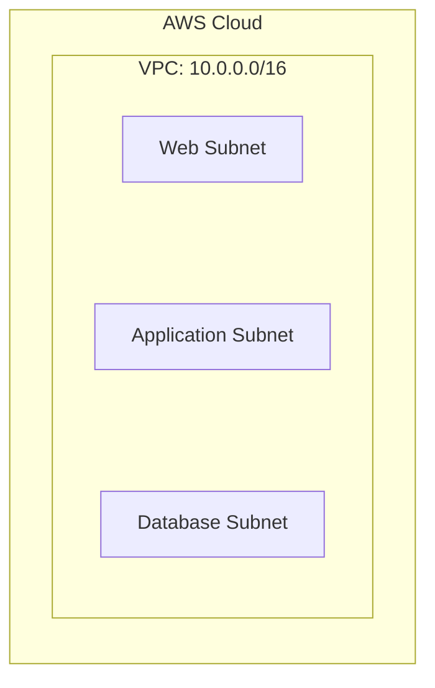

Inside a VPC, you can define:

- IP address ranges.
- Subnets.
- Route tables.
- Network gateways.
- Security rules.

Resources such as EC2 instances and certain managed services can use this network to communicate.

A VPC is not a physical network cable or a single server. It is a software-defined networking environment managed by AWS.

### Mental model

Imagine an office building:

- **VPC:** the overall building and its network boundary.
- **Subnet:** a section of the building's network.
- **Route table:** directions for where traffic should go.
- **Security rules:** controls on who can communicate.

This analogy is useful, but real networking has more details than a building.

---

## 3. IP Addresses and CIDR

Every resource that communicates over an IP network needs an appropriate IP addressing arrangement.

An IPv4 address looks like:

```text
10.0.1.25
```

A VPC needs an IP address range. AWS commonly expresses that range using **CIDR notation**.

For example:

```text
10.0.0.0/16
```

The `/16` indicates how many leading bits identify the network portion of the address.

A smaller prefix number generally represents a larger IPv4 address range.

| CIDR | Total IPv4 addresses |
|---|---:|
| `10.0.0.0/16` | 65,536 |
| `10.0.1.0/24` | 256 |
| `10.0.1.0/28` | 16 |

These are total address counts, not necessarily the number of addresses available to AWS resources. AWS reserves some IPv4 addresses in each subnet.

### How the ranges fit together

```text
VPC: 10.0.0.0/16
│
├── Subnet A: 10.0.1.0/24
├── Subnet B: 10.0.2.0/24
└── Subnet C: 10.0.3.0/24
```

Each subnet's range must fit within the VPC's address range, and subnet CIDRs within a VPC must not overlap.

### Why address planning matters

If the network is too small, you may run out of addresses.

If ranges overlap with another network you later need to connect, routing becomes difficult or impossible without redesign.

**Practical rule:** plan IP ranges before deploying resources, especially when you expect multiple environments or network connections.

---

## 4. What Is a Subnet?

A **subnet** is a smaller IP address range within a VPC.

For example:

```text
VPC: 10.0.0.0/16

├── Subnet A: 10.0.1.0/24
├── Subnet B: 10.0.2.0/24
└── Subnet C: 10.0.3.0/24
```

Subnets help organize resources according to their role and network requirements.

For example:

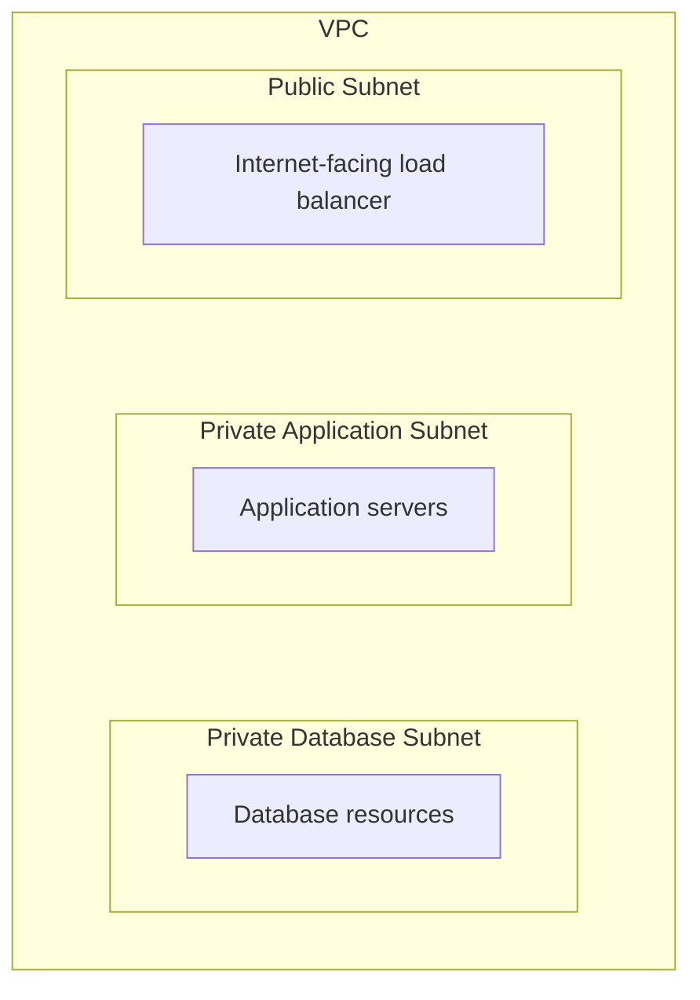

This arrangement separates resources that need different levels of exposure.

### Subnets and Availability Zones

In AWS, each subnet belongs to **one Availability Zone (AZ)**.

A subnet does not span multiple AZs.

For example:

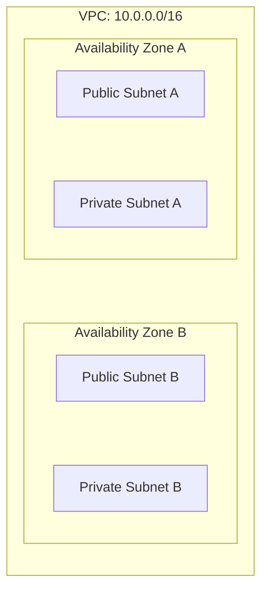

Using multiple AZs can help an application continue operating when one AZ experiences a problem.

The exact resilience depends on how the application and its dependencies are deployed.

---

## 5. Public vs Private Subnets

A common beginner misconception is that a subnet is public simply because it contains a resource with a public IP address.

That is not the main distinction.

A subnet is commonly described as **public** when its associated route table has a route that directs internet-bound traffic through an Internet Gateway.

A subnet is commonly described as **private** when it does not have that direct Internet Gateway route.

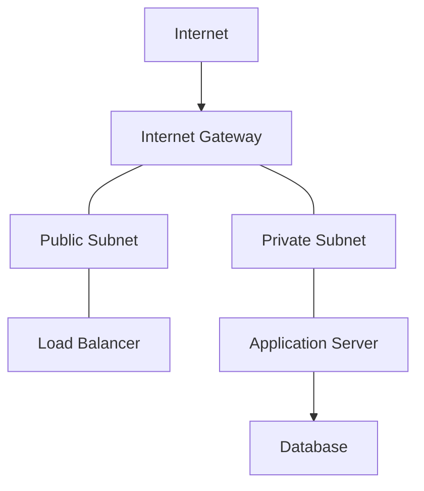

This is a conceptual diagram. Actual communication also depends on IP addressing, security rules, resource configuration, and return routes.

### Important distinction

- A **public subnet** provides a route to the Internet Gateway.
- A **public IP address** gives a resource an internet-routable IPv4 address.
- A **security rule** determines whether particular traffic is permitted.

These are related but different concepts.

A resource in a public subnet is not automatically reachable from the internet. It also needs appropriate addressing and security configuration.

Similarly, placing a resource in a private subnet does not automatically guarantee that every possible network path to it is blocked. Other routes and network connections must be considered.

---

## 6. Route Tables: Where Should Traffic Go?

A **route table** contains rules that determine where network traffic should be directed.

Each route has a destination and a target.

For example:

```text
Destination       Target
────────────────────────────
10.0.0.0/16       Local
0.0.0.0/0         Internet Gateway
```

The first route allows traffic within the VPC's IPv4 range to use the VPC's local routing.

The second route sends traffic for other IPv4 destinations through the Internet Gateway.

`0.0.0.0/0` means all IPv4 destinations.

### How routing works

Suppose a resource sends a packet to an address.

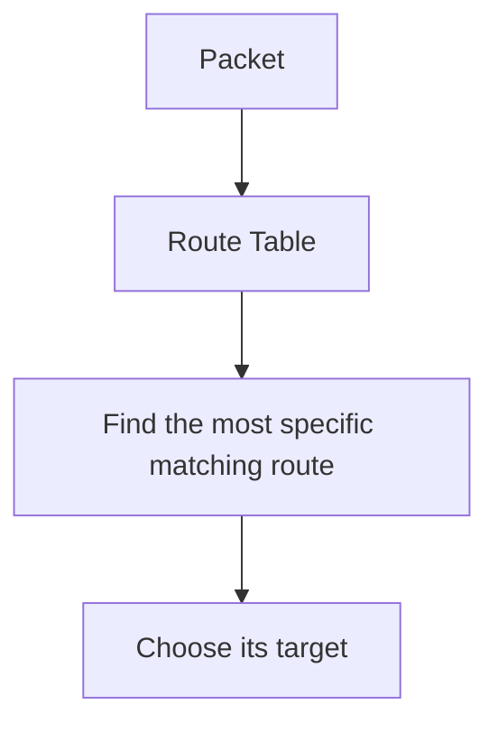

When multiple routes match, routing generally uses the most specific matching destination prefix, known as **longest-prefix matching**.

The route table does not itself grant permission to communicate. Security rules and other network controls still apply.

### Example: public subnet route table

```text
Destination       Target
──────────────────────────────
10.0.0.0/16       Local
0.0.0.0/0         Internet Gateway
```

### Example: private subnet route table

```text
Destination       Target
──────────────────────────────
10.0.0.0/16       Local
0.0.0.0/0         NAT Gateway
```

The private subnet's default route sends eligible internet-bound IPv4 traffic through a NAT Gateway instead of directly through an Internet Gateway.

A NAT Gateway does not make the private resource directly reachable from the public internet.

---

## 7. Internet Gateway (IGW)

An **Internet Gateway** enables communication between a VPC and the internet when the necessary routes, addresses, and security configuration are in place.

For an internet-facing IPv4 resource, the common arrangement is:

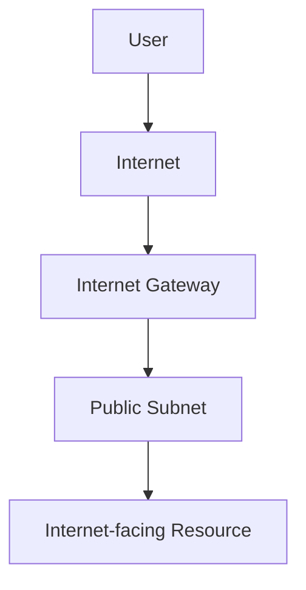

A VPC generally needs an Internet Gateway attached to it before its resources can use that gateway for internet connectivity.

But attaching an Internet Gateway alone is not enough.

For inbound IPv4 connectivity, the resource typically also needs:

- An appropriate public IPv4 address or other suitable public addressing.
- A route through the Internet Gateway.
- Security rules that permit the intended traffic.
- A service that is listening and correctly configured.

### Example

An internet-facing load balancer may accept HTTPS traffic on port `443`.

Its subnet route table directs internet-bound traffic through an Internet Gateway, while its security configuration allows the intended HTTPS connections.

The application servers behind it can remain private.

---

## 8. NAT Gateway: Outbound Access for Private Resources

Private resources sometimes need to initiate connections to the internet.

For example, an application server might need to download an update or call an external API.

You may not want that server to accept direct inbound internet connections.

A **Network Address Translation (NAT) Gateway** supports a common solution for outbound IPv4 connectivity from private subnets.

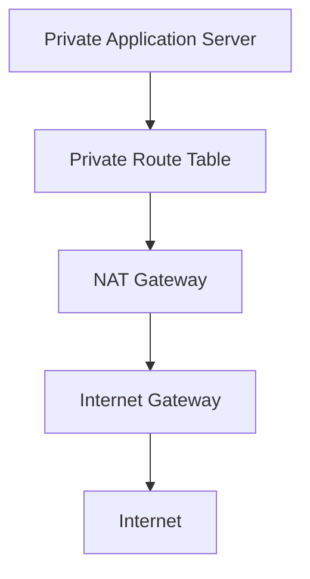

The NAT Gateway is typically placed in a public subnet. The private subnet's route table directs appropriate internet-bound IPv4 traffic to it.

### What a NAT Gateway does

It allows supported outbound connections from private resources and handles the corresponding return traffic.

It does not provide general unsolicited inbound access from the internet to those private resources.

### Important: NAT Gateway cost

AWS NAT Gateways incur charges, including usage-related costs. The exact pricing depends on the region and current AWS pricing model.

For learning, avoid creating a NAT Gateway just to experiment unless you understand the charges and have a cleanup plan.

If private resources do not need general internet access, a NAT Gateway may not be necessary. Depending on the service, private connectivity options such as VPC endpoints may be a better fit.

---

## 9. Security Groups

A **Security Group** acts as a virtual firewall associated with supported network resources, such as EC2 network interfaces.

It controls permitted inbound and outbound traffic.

Security Groups are **stateful**. When a connection is permitted, response traffic for that connection is automatically allowed by the stateful behavior.

For example, an application server's security group might allow inbound traffic from a load balancer's security group on port `8080`.

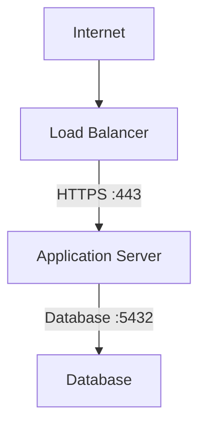

The security relationships could be:

```text
Load Balancer SG
  Inbound:
    HTTPS (443) from intended clients

Application SG
  Inbound:
    TCP (8080) from Load Balancer SG

Database SG
  Inbound:
    TCP (5432) from Application SG
```

The ports shown are examples. Use the actual ports and protocols for your application and database.

### Prefer security-group references

Where supported, referencing another security group is often safer and easier to maintain than allowing broad IP ranges.

For example:

```text
Allow database port
FROM Application Security Group
```

is generally preferable to:

```text
Allow database port
FROM 0.0.0.0/0
```

The second rule exposes the port to all IPv4 source addresses at the security-group layer. It is not an appropriate default for a private database.

### Least privilege applies to networking

Allow only the traffic required for the resource's role.

Do not open every port simply to make a connection work.

---

## 10. Network ACLs (NACLs)

A **Network Access Control List (Network ACL or NACL)** is an optional subnet-level traffic control mechanism.

Unlike Security Groups, Network ACLs are **stateless**. Inbound and outbound rules must be considered separately, including return traffic.

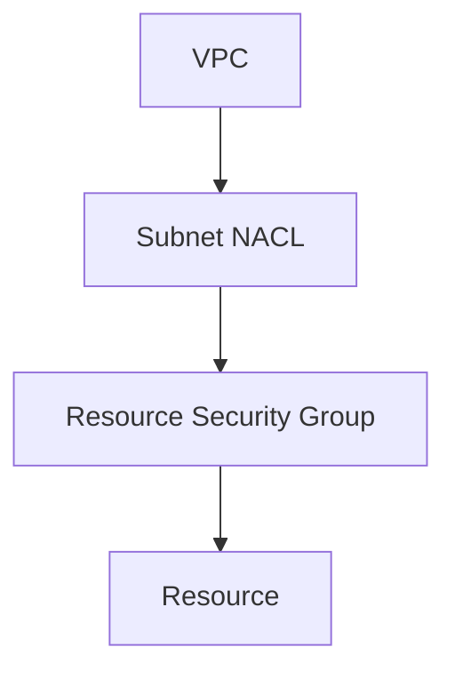

The NACL and Security Group operate at different levels.

| Feature | Security Group | Network ACL |
|---|---|---|
| Scope | Network interface/resource association | Subnet |
| State | Stateful | Stateless |
| Rules | Allow rules | Allow and deny rules |
| Return traffic | Automatically tracked for permitted connections | Must be permitted by applicable rules |
| Typical use | Resource-level traffic control | Additional subnet-level traffic controls |

For many ordinary application networks, carefully designed Security Groups are the primary control. NACLs can add another layer when subnet-level rules are needed.

Do not add complicated NACL rules without understanding their impact on both directions of traffic.

---

## 11. Putting the Components Together

Consider a typical three-tier web application:

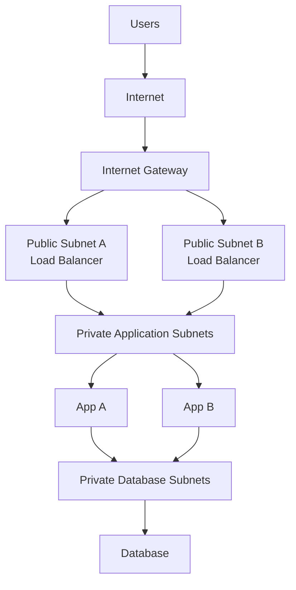

This diagram illustrates logical roles. A real AWS deployment may use a managed load balancer spanning multiple public subnets and a managed database configured for private connectivity across multiple AZs.

### Traffic path

1. A user sends an HTTPS request.
2. The load balancer receives it through the public network path.
3. The load balancer forwards the request to an application server.
4. The application server connects to the database.
5. The database security group allows the required database connection from the application tier.
6. The response returns through the established connections.

The database is not directly exposed to public internet traffic.

### Why this design is useful

- The internet-facing entry point is limited.
- Application servers can remain private.
- Database access is restricted to authorized sources.
- Application resources can be distributed across AZs.
- Network rules reflect the role of each component.

This is a common pattern, not a universal requirement for every application.

---

## 12. Route Tables and Security Rules Solve Different Problems

This distinction is essential.

A **route table** answers:

> Where should this traffic go?

A **Security Group** answers:

> Is this traffic allowed for this resource?

For example, a route might direct traffic to a database's network, but the database's Security Group can still reject the connection.

Conversely, a Security Group can permit a connection, but without a valid network route the packets may not reach the destination.

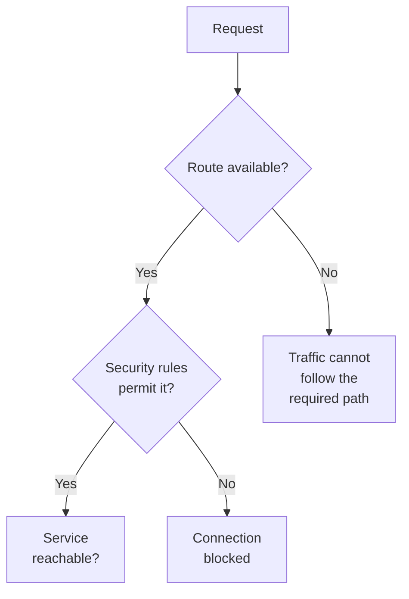

A working connection depends on the full path, not just one setting.

---

## 13. Common Network Failures

When a connection fails, investigate systematically.

| Symptom | Possible cause |
|---|---|
| Public web server is unreachable | Missing public IP, Internet Gateway route, or inbound rule |
| Application cannot reach database | Wrong endpoint/port, Security Group rule, routing, or database availability |
| Private server cannot access the internet | Missing NAT path, route, or suitable outbound configuration |
| Connection times out | Network path, security rules, unavailable service, or other connectivity issue |
| Connection is refused | Destination is reachable, but the service may not be listening or may reject the connection |
| Traffic works in one direction only | Missing route or stateless NACL return-traffic rule |
| Resource runs out of addresses | Subnet CIDR is too small or available addresses are consumed |

These are diagnostic starting points, not definitive conclusions. A timeout or connection error can have several causes.

### A practical troubleshooting sequence

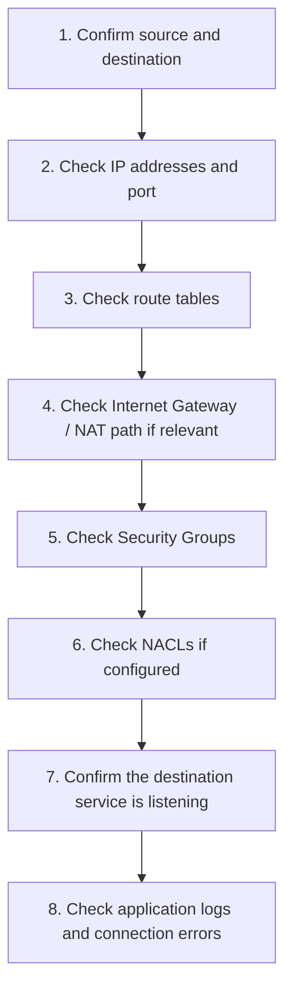

Avoid randomly opening ports. Change one relevant setting at a time and verify the result.

---

## 14. IPv4 and IPv6: A Practical Warning

Most examples in this chapter use IPv4.

IPv4 rules commonly use:

```text
0.0.0.0/0
```

For IPv6, the equivalent all-addresses range is:

```text
::/0
```

IPv4 and IPv6 connectivity require appropriate addressing, routing, and security configuration. A rule that covers IPv4 does not automatically cover IPv6.

If a resource has IPv6 connectivity, review its IPv6 routes and security rules too. Do not assume that restricting IPv4 alone secures every network path.

---

## 15. Cost and Safety Considerations

Some networking resources can incur ongoing charges even when the application is not receiving much traffic.

Pay particular attention to:

- NAT Gateways.
- Public IPv4 addresses.
- Data transfer.
- Other managed networking resources.

Pricing and billing treatment can change, so check the current AWS pricing for the selected region before deploying resources.

For a safe learning workflow:

1. Design the network on paper first.
2. Use local tools to understand IP ranges and routing concepts.
3. Deploy only the AWS resources required for the exercise.
4. Check billing and cost information.
5. Remove temporary resources when finished.
6. Verify that no chargeable resources remain.

Deleting an EC2 instance does not necessarily delete every related networking resource. Review the resources you created, including gateways, addresses, load balancers, and other dependencies.

---

## 16. Hands-On Exercise: Design a Secure Web Network

Before creating resources in AWS, design this network on paper or in a diagramming tool.

### Requirements

You need to host a web application with:

- An internet-facing load balancer.
- Two application instances across two AZs.
- A private database.
- Restricted database access.
- Optional outbound internet access for application instances.

### Step 1 — Choose an IP range

Example:

```text
VPC: 10.0.0.0/16
```

Create non-overlapping subnet ranges within it.

### Step 2 — Choose subnet roles

Plan for:

```text
Public:
  Load balancer subnets

Private:
  Application subnets
  Database subnets
```

For high availability, place corresponding subnets in at least two AZs where the chosen services and deployment support it.

### Step 3 — Define routes

Public subnet route table:

```text
10.0.0.0/16 → Local
0.0.0.0/0   → Internet Gateway
```

Private application subnet route table, if general outbound IPv4 internet access is required:

```text
10.0.0.0/16 → Local
0.0.0.0/0   → NAT Gateway
```

The database subnets do not automatically need a NAT Gateway. Give them only the connectivity their operational requirements justify.

### Step 4 — Define Security Groups

```text
Load Balancer:
  Allow HTTPS from intended clients

Application:
  Allow application port from Load Balancer SG

Database:
  Allow database port from Application SG
```

Do not allow unrestricted internet access to the database.

### Step 5 — Review the design

Ask:

- Can users reach the load balancer?
- Can users directly reach the application instances?
- Can the application reach the database?
- Can unrelated internet hosts reach the database?
- Do the private instances really need outbound internet access?
- What happens if one AZ becomes unavailable?
- Which resources could create ongoing charges?

### Success criteria

Your design should provide the intended traffic paths without exposing internal resources unnecessarily.

**Do not deploy this full design just to complete the exercise.** It is valid to complete the network design on paper. If you later build it in AWS, use the smallest appropriate deployment and clean up all chargeable resources.

---

## 17. Common Mistakes

- **Assuming public subnet means public access.** Routes, addressing, security rules, and service configuration all matter.
- **Opening the database to `0.0.0.0/0`.** Restrict access to the application tier or other explicitly authorized sources.
- **Confusing routing with permission.** A route does not override a Security Group.
- **Adding NAT without a requirement.** NAT Gateways have cost implications.
- **Ignoring AZ boundaries.** A subnet belongs to one AZ.
- **Ignoring IPv6.** IPv4 and IPv6 need appropriate, separately considered configuration.
- **Using overlapping CIDR ranges.** This can complicate future network connections.
- **Assuming a failed connection is always a firewall issue.** The service, route, address, and destination port may also be wrong.
- **Leaving resources running after a lab.** Review the complete resource list and billing impact.

---

## 18. System Design View

Cloud networking is part of architecture, not just infrastructure setup.

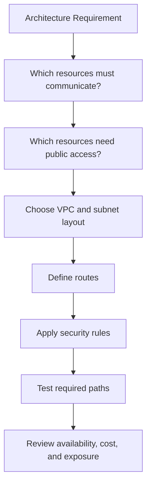

The design should follow the application's actual communication needs.

A database that only serves an application tier usually does not need the same exposure as a public web entry point.

A workload that never needs general outbound internet access may not need a NAT Gateway.

A single-AZ lab may be sufficient for learning, while a production service with availability requirements may need a multi-AZ design.

**Architecture should follow requirements—not the number of AWS services you can deploy.**

---

## 19. Quick Reference

| Component | Responsibility |
|---|---|
| VPC | Defines an isolated virtual network |
| CIDR | Represents an IP address range |
| Subnet | Divides a VPC address range within one AZ |
| Route table | Determines the next hop for matching traffic |
| Internet Gateway | Enables supported internet connectivity for a VPC |
| NAT Gateway | Enables outbound IPv4 connectivity for private resources |
| Security Group | Stateful traffic control associated with supported resources |
| Network ACL | Stateless traffic control at the subnet boundary |
| Public subnet | Subnet with a route to an Internet Gateway |
| Private subnet | Subnet without a direct Internet Gateway route |
| Availability Zone | An isolated location within an AWS Region |

### Remember these distinctions

```text
VPC          → Where the network exists
Subnet       → Where an IP range belongs
Route table  → Where traffic should go
Security Group → Which traffic is allowed at a resource
NACL         → Which traffic is allowed at a subnet boundary
```

---

## 20. Knowledge Check

1. What is a VPC?
2. Why must subnet CIDR ranges be planned carefully?
3. What makes a subnet public in the common AWS IPv4 design?
4. Does an Internet Gateway alone make an EC2 instance reachable from the internet?
5. What is the difference between a route table and a Security Group?
6. Why might a private application server need a NAT Gateway?
7. Why is a NAT Gateway not a general inbound gateway to private instances?
8. What is the key difference between Security Groups and Network ACLs?
9. Why should database access normally be restricted to the application tier?
10. Which networking resources should you review before considering an AWS lab finished?

### Answers

1. A logically isolated virtual network inside AWS.
2. Subnets must fit within the VPC range without overlapping; poor planning can exhaust addresses or complicate later network connections.
3. It has a route directing internet-bound traffic through an Internet Gateway.
4. No. Appropriate addressing, routes, security rules, and a correctly configured listening service are also required.
5. A route table chooses where traffic goes; a Security Group controls permitted traffic for associated resources.
6. It may need to initiate outbound connections to external services without being directly reachable from the internet.
7. NAT supports outbound connections and their return traffic; it does not generally permit unsolicited inbound connections to private resources.
8. Security Groups are stateful and associated with resources; NACLs are stateless and apply at the subnet level.
9. To reduce unnecessary exposure and limit who can connect to sensitive data services.
10. Review gateways, public IP addresses, load balancers, instances, and any other resources created by the lab, including their potential ongoing charges.

---

## Final Mental Model

A secure cloud network is not created by making everything reachable.

It is created by deliberately defining the paths that should work—and limiting the paths that should not.

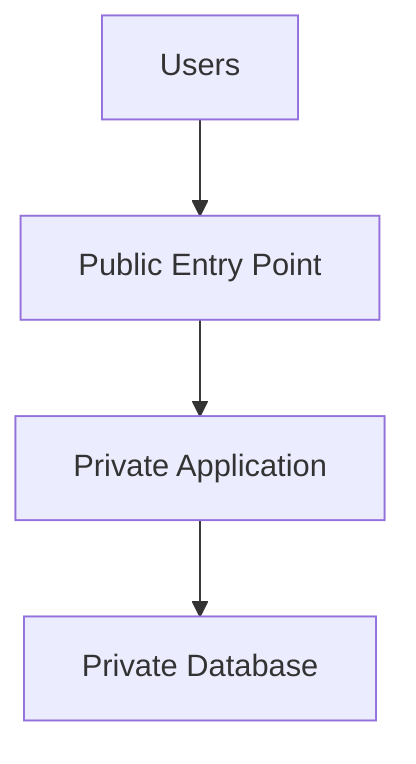

For every connection, ask:

1. **Should this communication exist?**
2. **What route makes it possible?**
3. **What security rule permits it?**
4. **What is the cost and failure impact?**

**Next: 12.07 — EC2: Virtual Machines & Application Deployment**
