# 12.07 — EC2: Virtual Machines & Application Deployment

## Learning Objectives

By the end of this chapter, you should be able to:

- Explain what Amazon EC2 is and when to use it.
- Understand instances, AMIs, instance types, key pairs, and storage.
- Launch and connect to a virtual machine safely.
- Understand how an application runs on an EC2 instance.
- Deploy a basic web application and make it reachable through HTTP or HTTPS.
- Distinguish server access, application access, and AWS management permissions.
- Recognize common deployment failures, security risks, and cost traps.

---

## 1. What Is Amazon EC2?

**Amazon Elastic Compute Cloud (EC2)** provides virtual servers in AWS.

An EC2 instance gives you computing resources such as:

- CPU.
- Memory.
- Network connectivity.
- Operating system.
- Storage options.

You can install software, configure the environment, and run your own application.

For example:

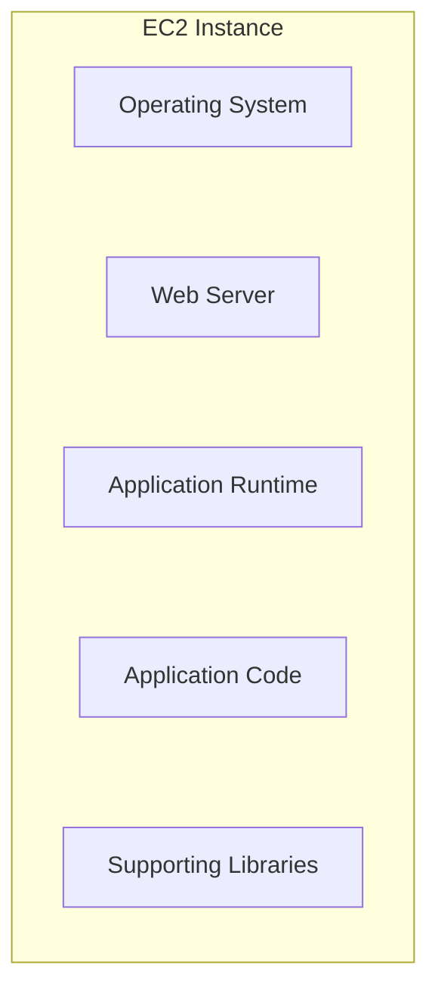

You might use EC2 to host:

- A Node.js API.
- A PHP application.
- A Python backend.
- A custom background worker.
- Software that requires operating-system-level control.

### Mental model

Think of EC2 as renting a computer in AWS's data center.

You do not manage the physical hardware, but you are responsible for much of the software configuration inside the virtual machine.

> **EC2 gives you control over a virtual server; that control also brings operational responsibility.**

---

## 2. Where EC2 Fits in the Architecture

Consider a basic web application:

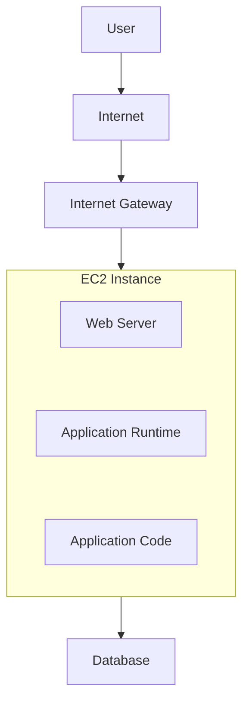

For a small learning project, the web server and application runtime might run on the same instance.

A more production-oriented design may separate responsibilities:

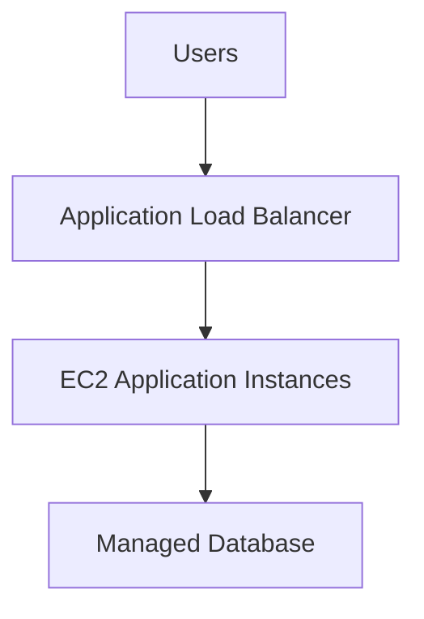

The second design offers more flexibility for scaling and availability, but it also introduces additional services and cost.

Start with the simplest architecture that meets the requirements.

---

## 3. What Is an EC2 Instance?

An **instance** is a running virtual machine.

For example:

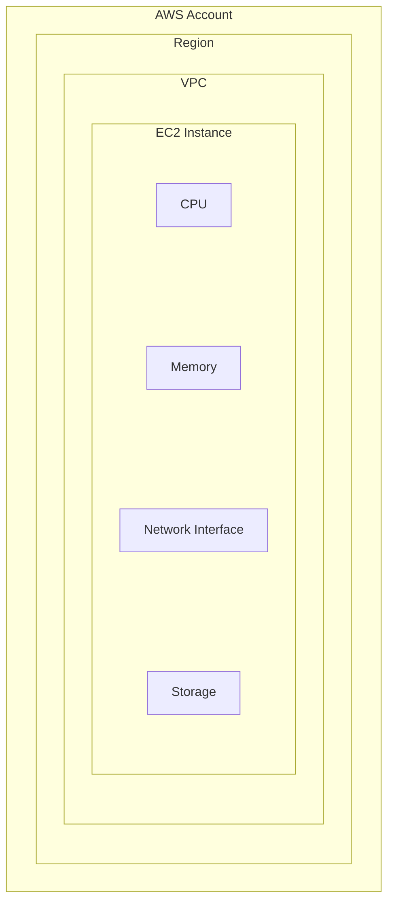

An instance has a lifecycle.

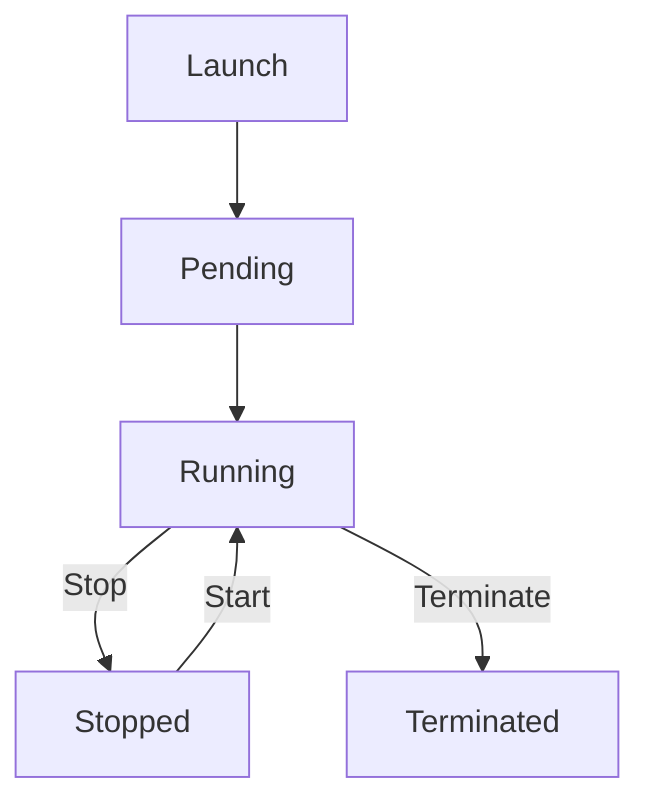

The exact states and transitions include additional details, but this is enough to understand the basic lifecycle.

### Stop vs terminate

- **Stop:** shuts down the instance. It can generally be started again. Some charges, such as charges for attached storage or certain associated resources, may continue.
- **Terminate:** permanently removes the instance. Its compute capacity is released, and instance recovery is not normally possible. Storage deletion depends on its configuration.

Stopping is not the same as deleting every resource associated with the instance.

Before ending a lab, check attached volumes, public IP addresses, snapshots, and any other resources that might continue to incur charges.

---

## 4. AMIs: The Starting Template

An **Amazon Machine Image (AMI)** is a template used to launch an EC2 instance.

It provides the information needed to initialize the instance, including the operating system and other image contents.

Examples include:

- Amazon Linux.
- Ubuntu Server.
- Windows Server.
- Custom images prepared for a specific workload.

Conceptually:

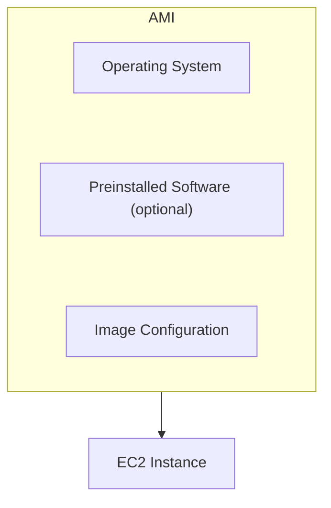

Think of an AMI as a reusable starting image.

Two instances launched from the same AMI can still become different over time because of their configuration, installed updates, application versions, and runtime data.

### Choosing an AMI

Consider:

- Whether the operating system is supported.
- Whether it receives security updates.
- Whether the required software is compatible.
- Whether the image comes from a trusted source.
- Whether the image is available in the selected Region.

For a beginner lab, use a current, supported image from a trusted publisher.

Avoid launching an unknown image simply because its name looks familiar.

---

## 5. Instance Types: CPU and Memory Choices

An **instance type** determines the general computing resources allocated to an instance.

Different families are designed for different workloads.

| Workload | Typical consideration |
|---|---|
| Small learning server | Low-cost, modest CPU and memory |
| General web application | Balanced CPU and memory |
| CPU-heavy processing | Compute-optimized capacity |
| Memory-intensive workload | Memory-optimized capacity |
| Specialized acceleration | GPU or other accelerated compute |

An instance type is not just a size label. It affects cost, performance, networking capabilities, and sometimes available storage options.

### Choosing an instance

Ask:

1. How much memory does the application need?
2. Is the workload CPU-intensive?
3. How much network traffic is expected?
4. What performance is required?
5. What is the acceptable cost?

For a learning exercise, choose an eligible low-cost option that fits the workload and current AWS account restrictions. Instance availability, free-tier eligibility, and prices vary by Region, account, and date.

> **Do not choose a large instance just because it sounds more powerful. Match capacity to the workload.**

---

## 6. Storage: What Persists?

An EC2 instance can use different types of storage.

One common option is **Amazon Elastic Block Store (EBS)**, which provides block storage volumes that can be attached to EC2 instances.

Conceptually:

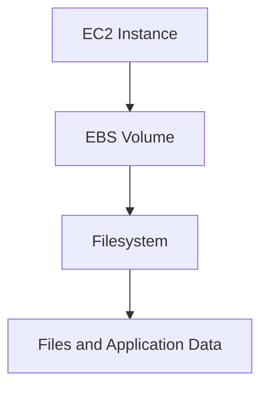

Storage configuration matters because instance lifecycle operations do not necessarily remove every attached resource.

For example, an EBS volume can be configured to persist after instance termination. Its deletion behavior depends on the volume's configuration and how it is managed.

### Ephemeral vs persistent data

Do not assume that files stored on a server are automatically backed up.

A robust application should distinguish between:

- Application code that can be redeployed.
- Temporary files that can be recreated.
- User uploads that must be preserved.
- Database data that requires its own persistence and backup strategy.
- Configuration and secrets that must be managed safely.

For a production application, do not rely on one EC2 instance's local filesystem as the only copy of important user data.

---

## 7. Networking an EC2 Instance

An EC2 instance is launched into a VPC subnet.

Its connectivity depends on the network configuration you learned in **12.06 — VPC, Subnets, Routes & Network Security**.

For example:

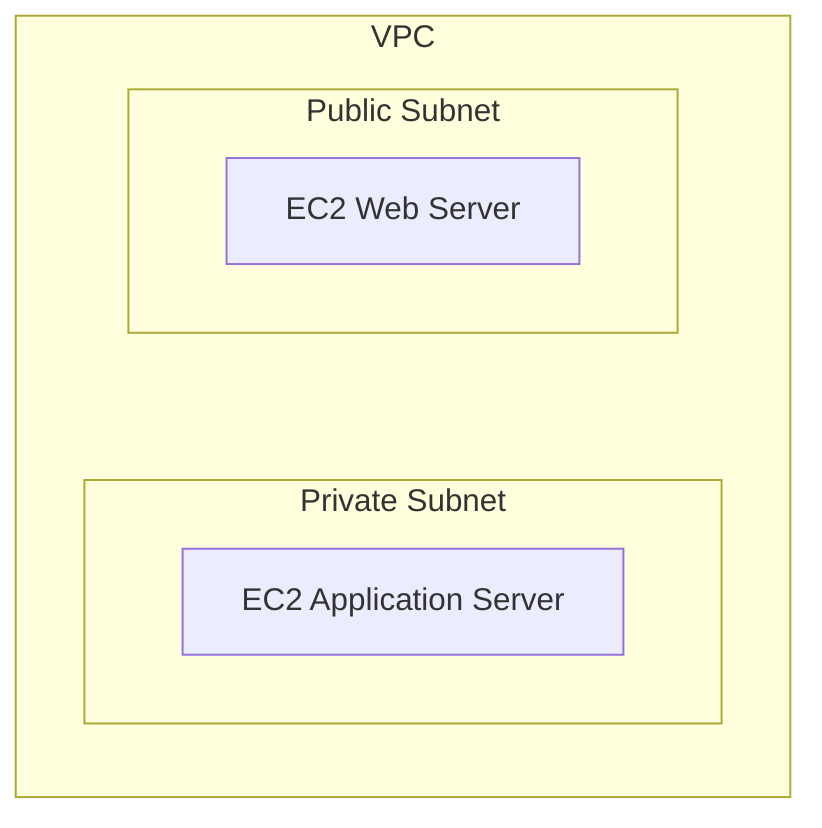

The instance's network interface, IP addresses, subnet routes, and security rules all influence what it can reach and who can reach it.

### Private vs public instances

A public-facing EC2 instance may use a public IPv4 address and a route through an Internet Gateway.

A private instance can be reached through approved private network paths, a bastion or managed access service, or other controlled connectivity.

**Do not assign public access to every instance by default.**

An application server behind a load balancer often does not need to accept direct connections from arbitrary internet hosts.

---

## 8. Security Groups for EC2

A Security Group controls permitted inbound and outbound traffic for the instance's network interface.

For a public web server, an illustrative configuration might be:

```text
Inbound:
  TCP 80  → HTTP
  TCP 443 → HTTPS
  SSH 22  → Only an explicitly authorized source, if needed
```

However, ports should be opened only when the corresponding service is required.

For example:

- If HTTPS terminates at a load balancer, the EC2 instance may need to accept application traffic only from the load balancer's Security Group.
- If the instance is managed through AWS Systems Manager and has the required configuration, you may not need inbound SSH at all.
- If a server does not provide public HTTP access, opening port 80 to the internet is unnecessary.

### Dangerous configuration

```text
SSH (22)
Source: 0.0.0.0/0
```

This permits SSH connection attempts from any IPv4 source address at the Security Group layer.

Avoid it as a default. Prefer Systems Manager Session Manager where appropriate, or tightly restrict SSH to a trusted source and use secure key management.

Remember that a permitted network connection does not guarantee successful access. The operating system, authentication, and destination service must also be configured correctly.

---

## 9. Connecting to an EC2 Instance

You need a controlled way to administer the virtual machine.

Common options include:

- SSH for Linux instances.
- Remote Desktop Protocol (RDP) for Windows instances.
- AWS Systems Manager Session Manager for supported and configured instances.

### SSH

SSH is commonly used to administer Linux servers.

A connection command might look like:

```bash
ssh -i /path/to/private-key.pem ec2-user@SERVER_ADDRESS
```

The username depends on the AMI. For example, Amazon Linux commonly uses `ec2-user`, while Ubuntu images commonly use `ubuntu`.

The address must be reachable through the configured network path.

The private key must be protected and have appropriate local file permissions.

### Systems Manager Session Manager

Session Manager can provide managed shell access without requiring an inbound SSH port, when the instance, identity permissions, agent, and connectivity are configured correctly.

This can reduce exposure and simplify access management.

It is not automatic: the instance needs the required configuration and a valid way to communicate with the Systems Manager service.

### Three different kinds of access

Do not confuse:

1. **AWS API access:** permissions to manage AWS resources through IAM.
2. **Server administration access:** permission to log into the operating system.
3. **Application access:** permission to use the deployed application.

These are separate security boundaries.

---

## 10. How an Application Runs on EC2

EC2 provides the virtual machine. It does not automatically configure your application.

Suppose you want to deploy a Node.js application.

The instance might contain:

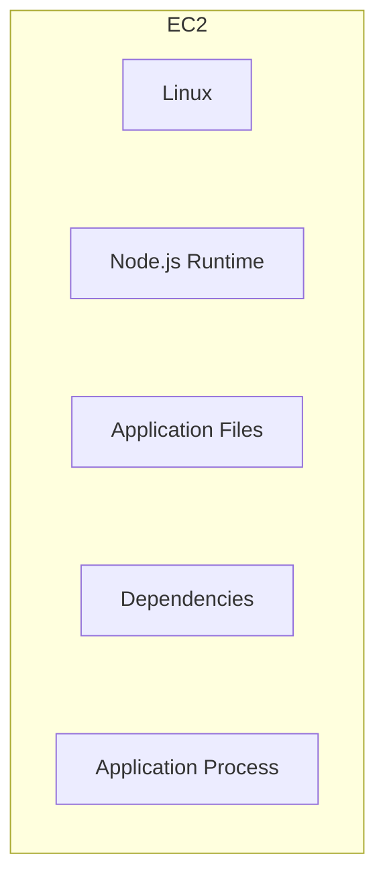

A typical request path could be:

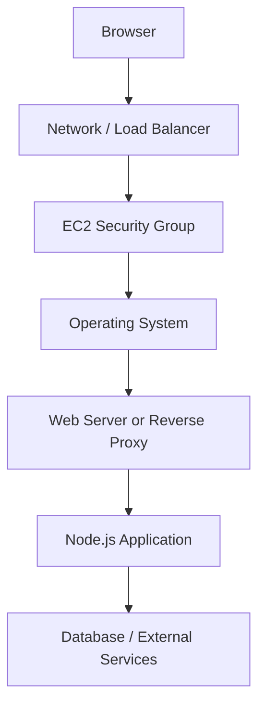

For PHP, Python, or another runtime, the installed software and process model will differ.

The important idea is that **EC2 supplies compute capacity; you still need to install, configure, deploy, and operate the software that runs on it.**

---

## 11. A Basic Deployment Workflow

A straightforward manual deployment often follows this sequence:

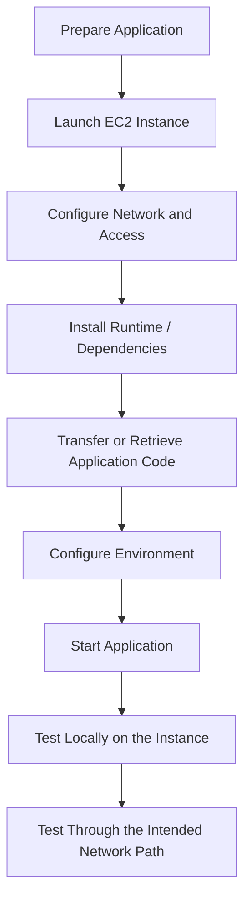

This approach is useful for learning because each step is visible.

But it has limitations:

- Manual steps are easy to forget.
- Two servers may be configured differently.
- Reproducing a deployment can be difficult.
- Updates can cause downtime.
- Rollback may be complicated.
- Secrets may accidentally be stored in files or shell history.

Later chapters introduce automation and other deployment approaches.

---

## 12. Hands-On Lab: Deploy a Minimal Web Server

This lab demonstrates the relationship between EC2, the operating system, the application process, and networking.

It uses a simple web server rather than a full production application.

### Before you begin

AWS resources can incur charges. Check current pricing and your account's available low-cost options before launching anything.

For this lab:

- Use a supported Linux AMI.
- Choose an eligible small instance type.
- Use a dedicated Security Group.
- Allow HTTP only if you intend to serve a public HTTP test page.
- Avoid opening SSH to the entire internet.
- Plan to terminate the instance and remove any related resources afterward.

For production, use HTTPS rather than serving sensitive traffic over plain HTTP.

### Step 1 — Launch the instance

In the AWS Console:

1. Open EC2 in the Region you intend to use.
2. Choose **Launch instance**.
3. Give the instance a descriptive name, such as `systemly-web-lab`.
4. Select a supported Linux AMI.
5. Select an eligible small instance type.
6. Configure the key pair or approved managed-access method.
7. Choose the VPC and subnet.
8. Configure the Security Group.
9. Review storage and estimated charges.
10. Launch the instance.

Console labels and available choices may change over time.

### Step 2 — Connect to the instance

Use the access method you configured.

For SSH, confirm:

- The correct private key is available.
- The username matches the selected AMI.
- The Security Group allows SSH only from the intended source.
- The instance has a reachable address and route.

If you use Session Manager, verify the required instance configuration and IAM permissions.

### Step 3 — Install a simple web server

On a suitable Amazon Linux image, Nginx can be installed with the distribution's package manager. Commands differ across operating systems.

For an Amazon Linux image that supports `dnf`, the following is an illustrative example:

```bash
sudo dnf install nginx -y
sudo systemctl enable --now nginx
```

Check the service:

```bash
sudo systemctl status nginx
```

If your selected image uses another package manager, consult its official instructions instead of assuming these commands will work unchanged.

### Step 4 — Test on the instance

Use:

```bash
curl http://localhost
```

If Nginx is running and configured correctly, you should receive an HTTP response from the local web server.

This test checks the service locally. It does **not** prove that the instance is reachable from the internet.

### Step 5 — Test the intended network path

If this is a public HTTP lab, verify that the instance has the required public addressing, subnet route, Internet Gateway path, and inbound HTTP rule.

Then request:

```text
http://YOUR_PUBLIC_ADDRESS
```

Replace the example text with the actual address assigned to your instance.

If the request fails, check the network path, Security Group, operating-system firewall if configured, and web server status. Do not solve the problem by opening every port.

### Step 6 — Clean up

When you have finished:

1. Terminate the EC2 instance if you no longer need it.
2. Check whether its EBS volumes were deleted or retained.
3. Remove unused public IP address allocations, if any.
4. Remove temporary resources you created specifically for the lab.
5. Check the AWS console and billing information for remaining resources.

A lab is not complete until you have checked its cleanup requirements.

---

## 13. Deploying a Real Application

A minimal web server proves connectivity, but a real application needs more planning.

Consider a full-stack application with a frontend, backend API, and database.

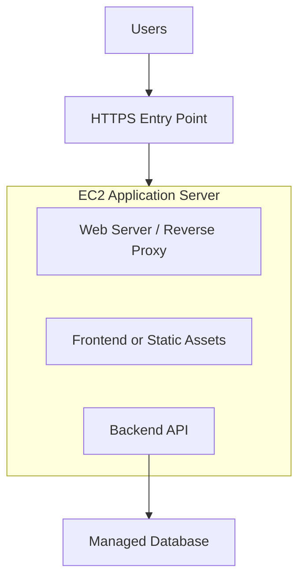

For a small prototype, some of these components may run together.

For a production-oriented application, consider:

- Using a load balancer when multiple instances or managed health checks are needed.
- Keeping the database in private subnets.
- Storing secrets outside source control.
- Running the application as a managed service or supervised process.
- Applying operating-system and runtime security updates.
- Collecting application logs and system metrics.
- Using a repeatable deployment and rollback process.
- Backing up important data.
- Defining health checks and recovery behavior.

A single EC2 instance is a reasonable way to learn deployment, but it is also a potential single point of failure.

---

## 14. Keep the Application Running

Starting an application in an interactive shell is not the same as operating it reliably.

For example:

```bash
node server.js
```

may start a Node.js process in the current terminal session.

If that session ends or the process crashes, the application may stop.

A more reliable deployment uses an appropriate process supervisor or service manager, such as `systemd`, or a managed runtime platform.

Conceptually:

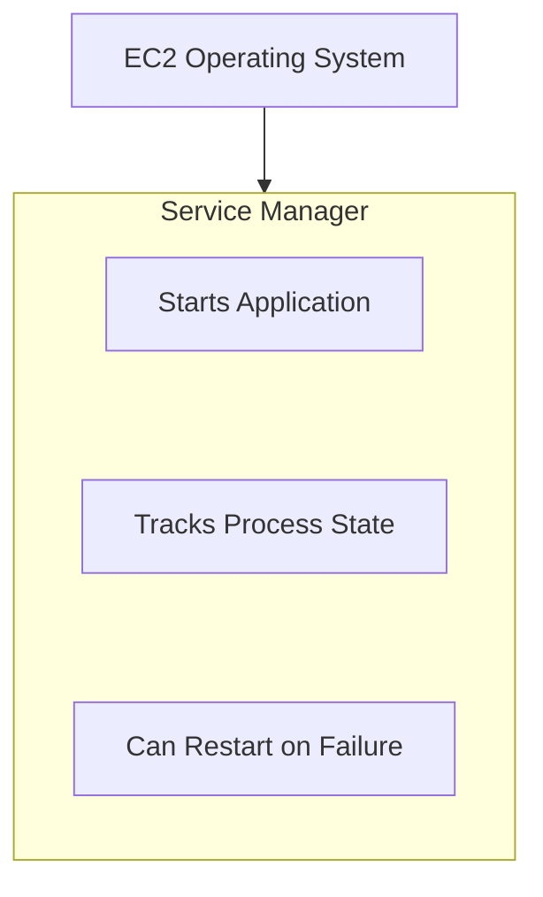

The exact configuration depends on the runtime and application.

Process supervision helps with local process lifecycle, but it does not make the whole service highly available. An instance failure still requires an appropriate recovery or replacement strategy.

---

## 15. EC2 vs Managed Compute

EC2 is not always the best place to run every application.

| Option | Best fit |
|---|---|
| EC2 | You need control over the virtual machine, operating system, or runtime environment |
| Container platform | You want to package applications into containers and manage their deployment |
| Serverless functions | You want event-driven execution without managing application servers directly |
| Managed application platform | You want to deploy applications with less infrastructure administration |

These options have different costs, operational responsibilities, limits, and deployment models.

### The decision

Choose EC2 when the control it provides is valuable enough to justify the work of maintaining the server.

If your application only needs a managed runtime, using a virtual machine may introduce unnecessary maintenance.

> **More infrastructure control means more responsibility—not automatically more reliability.**

---

## 16. Common EC2 Failure Scenarios

| Symptom | Possible cause |
|---|---|
| Instance is running, but the website is unreachable | Route, public address, Security Group, firewall, or web server configuration |
| SSH fails | Incorrect key or username, network path, or SSH rule |
| Website works locally but not remotely | The service may listen only on loopback, or network rules may block access |
| Application stops after logout | It may have been started only in an interactive session |
| Instance runs out of memory | Workload exceeds available memory or has a memory leak |
| Deployment works on one instance but not another | Manual configuration differences or missing dependencies |
| Database connection fails | Incorrect endpoint, port, credentials, routing, or database security rules |
| Unexpected AWS charges appear | Compute, storage, public IPv4, data transfer, or other associated resources remain active |

Treat these as starting points for diagnosis, not guaranteed causes.

---

## 17. Cost, Security, and Operations Checklist

Before considering an EC2 deployment ready, check:

### Compute and cost

- Is the instance type appropriate for the workload?
- Is the instance needed continuously?
- What storage volumes and public IP resources are attached?
- What charges continue if the instance is stopped?
- Is there a clear cleanup or shutdown plan?

### Networking

- Does the instance really need a public IP?
- Are only necessary ports allowed?
- Can private resources be reached only through approved paths?
- Are the routes and Security Groups consistent with the intended design?

### Access

- Are SSH keys protected?
- Can managed access replace inbound SSH where appropriate?
- Are AWS IAM permissions limited to the required actions?
- Are application credentials kept out of source control?

### Application operations

- Does the application start reliably?
- Are logs available for troubleshooting?
- Are updates and deployments repeatable?
- Can the application recover after a process failure?
- Is important data stored and backed up appropriately?

---

## 18. Key Principle

> **EC2 provides a virtual machine, not a finished production application.**

You are responsible for configuring the operating system, deploying the code, securing access, managing the application process, and planning for updates, failures, and costs.

The basic workflow is:

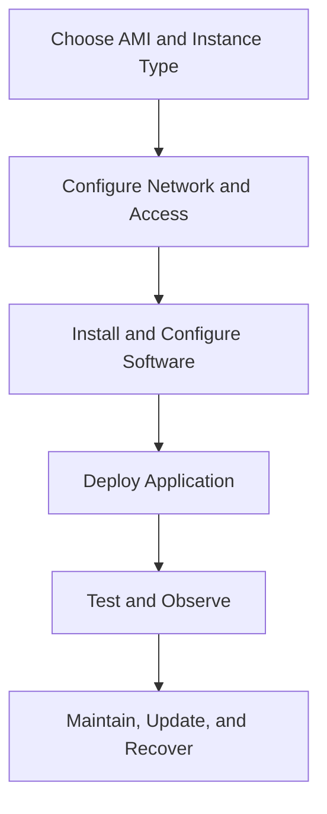

Use EC2 when its flexibility is useful—and remember that flexibility comes with operational responsibility.

---

## Quick Reference

| Concept | Meaning |
|---|---|
| EC2 | AWS virtual compute service |
| Instance | Running virtual machine |
| AMI | Template used to launch an instance |
| Instance type | Defines general CPU, memory, and other capacity characteristics |
| EBS | Persistent block storage service for supported workloads |
| Security Group | Stateful traffic control associated with network resources |
| SSH | Secure remote administration protocol commonly used with Linux |
| Session Manager | Managed access option for supported and configured instances |
| Process supervisor | Keeps application process lifecycle under control |
| Public IP | Internet-routable address, subject to network and security configuration |
| Termination | Removes the instance; related resources may remain depending on configuration |

---

## Knowledge Check

1. What does EC2 provide, and what remains your responsibility?
2. What is an AMI?
3. How is stopping an instance different from terminating it?
4. Why doesn't a running EC2 instance guarantee that its website is reachable?
5. What is the difference between AWS API permissions and operating-system login access?
6. Why should SSH not be opened to every IPv4 address by default?
7. Why is starting an application in an interactive shell not a complete production deployment?
8. What should you check after terminating a learning instance?
9. When might a managed compute service be a better choice than EC2?

### Answers

1. EC2 provides virtual compute capacity; you still configure, deploy, secure, and operate the software running on it.
2. An image template used to launch an instance.
3. Stopping shuts down an instance that can generally be started again; termination removes it, though related resources may persist.
4. Networking, addressing, security rules, and the application service must all be configured correctly.
5. AWS IAM controls actions against AWS resources; operating-system access controls entry to the server itself.
6. It increases exposure to unauthorized connection attempts. Prefer managed access or narrowly restricted SSH.
7. The process may stop when the session ends or when the process crashes; reliable deployment needs appropriate process supervision and recovery.
8. Check retained EBS volumes, public IP allocations, gateways, and other resources that may continue to incur charges.
9. When the application does not need full virtual-machine control and a managed platform can reduce operational work.

---

## Remember

A successful EC2 deployment is more than an instance in the `Running` state.

It means the application is deployed correctly, reachable through the intended network path, protected by appropriate access controls, observable when something goes wrong, and safe to operate within your budget.

**Next: 12.08 — S3: Object Storage, Permissions & Static Hosting**
