# 12.08 — S3: Object Storage, Permissions & Static Hosting

## Learning Objectives

By the end of this chapter, you should be able to:

- Explain what Amazon S3 is and when to use it.
- Understand buckets, objects, keys, and storage classes.
- Distinguish object storage from block storage and file storage.
- Understand how IAM policies, bucket policies, and Block Public Access control access.
- Upload, retrieve, and organize objects safely.
- Understand how S3 can store static website assets.
- Recognize the difference between S3 static website hosting and HTTPS delivery through CloudFront.
- Identify common S3 security, availability, and cost mistakes.

---

## 1. What Is Amazon S3?

**Amazon Simple Storage Service (S3)** is an object storage service.

It stores data as objects inside buckets. Objects can include:

- Images and videos.
- PDFs and other documents.
- Application uploads.
- Backups and exports.
- Static website files.
- Logs and data files.

For example, a web application may store user-uploaded images in S3 instead of storing every image on its EC2 instance.

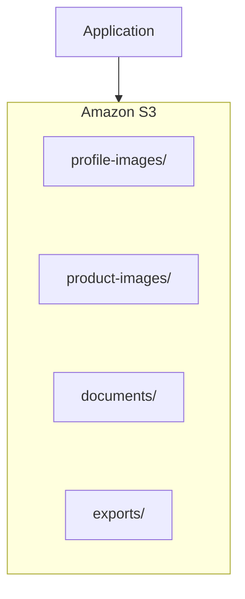

S3 is designed to store and retrieve objects without requiring you to manage the underlying storage servers.

> **S3 stores objects; your application decides how those objects are organized, accessed, and used.**

---

## 2. Buckets and Objects

S3 has two fundamental concepts: **buckets** and **objects**.

### Bucket

A bucket is a container for objects.

Example:

```text
systemly-assets
```

### Object

An object is an individual item stored in a bucket.

For example:

```text
systemly-assets
├── images/logo.png
├── images/banner.webp
├── documents/guide.pdf
└── exports/report.csv
```

Each object has data and associated metadata. Depending on the operation and configuration, objects can also have properties such as content type, encryption settings, and version information.

### Object key

The **object key** identifies an object within a bucket.

For example:

```text
images/logo.png
```

A complete conceptual reference is:

```text
Bucket: systemly-assets
Key:    images/logo.png
```

The key is not necessarily a real filesystem path. S3 is object storage, not a traditional folder-based filesystem.

The `/` characters in keys are commonly used to create a folder-like organization in tools and the console.

---

## 3. S3 Is Not a Traditional Filesystem

Consider:

```text
images/products/keyboard.webp
```

In a conventional filesystem, this might represent directories and a file.

In S3, it is generally one object key:

```text
images/products/keyboard.webp
```

The console may display `images/` and `products/` as folders, but those are usually inferred from the object-key prefix.

This distinction matters when designing applications.

S3 is not intended to behave exactly like a local disk where applications freely modify arbitrary byte ranges within a file. Objects are generally uploaded or replaced as whole objects, with specific APIs and features available for multipart uploads and related operations.

### Why use S3?

- You do not need to manage a storage server.
- Objects can be accessed through AWS APIs.
- Access can be controlled with AWS permissions.
- Storage can be organized by prefixes and metadata.
- It can integrate with other AWS services.

---

## 4. Object Storage vs Block Storage vs File Storage

These storage types solve different problems.

| Storage type | Basic model | Common use |
|---|---|---|
| Object storage | Store and retrieve complete objects | Uploads, media, backups, static assets |
| Block storage | Present storage as addressable blocks or volumes | Operating systems, databases, application disks |
| File storage | Present data through a shared filesystem and directory structure | Shared files, application content, team directories |

Examples in AWS:

```text
Object Storage → Amazon S3
Block Storage  → Amazon EBS
File Storage   → Amazon EFS
```

### How they differ

An EC2 instance commonly uses EBS for its operating system and disk.

An application may use S3 for user-uploaded images.

Multiple compute resources may use a shared filesystem such as EFS when that access model is appropriate.

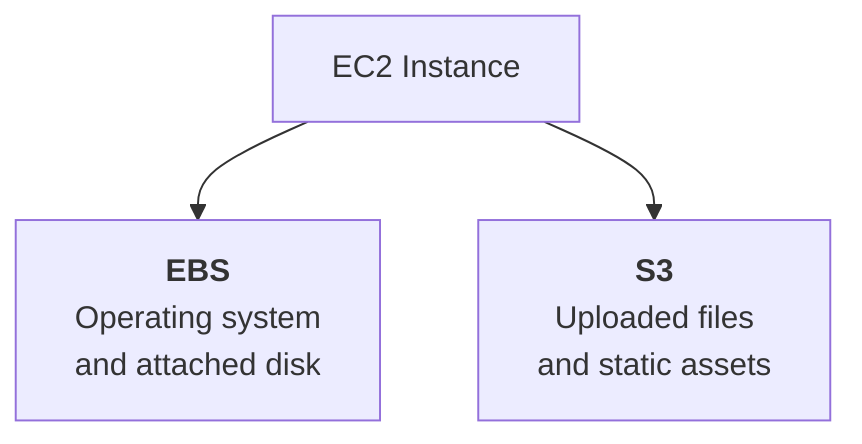

Choose storage based on how the application needs to read, write, share, and retain data.

---

## 5. Bucket Names and Regions

Buckets are created in an AWS Region.

A bucket name must be unique within the applicable AWS partition's global bucket namespace, not merely unique inside your own account.

For example, names such as:

```text
systemly-assets
systemly-assets-dev
systemly-assets-prod
```

may be useful naming patterns, but their availability must be checked.

A bucket name does not grant access. Knowing the name of a bucket is not the same as having permission to read its objects.

### Plan bucket organization

You might use separate buckets for:

```text
Development
Production
Public static assets
Private user uploads
Backups
```

The exact structure depends on access boundaries, retention needs, deployment workflows, and operational requirements.

Do not create many buckets without a reason. Use clear names and separate environments when doing so improves isolation and management.

---

## 6. Uploading and Retrieving Objects

Applications can interact with S3 through:

- AWS Console.
- AWS CLI.
- AWS SDKs.
- Direct service integrations.

For example, with the AWS CLI:

```bash
aws s3 cp ./logo.png s3://YOUR_BUCKET/images/logo.png
```

This uploads a local file to the specified object key.

To download it:

```bash
aws s3 cp s3://YOUR_BUCKET/images/logo.png ./logo.png
```

Replace `YOUR_BUCKET` with your actual bucket name.

These commands require the CLI to be configured with credentials and permissions that authorize the operations.

### Important distinction

The ability to upload an object does not automatically mean that everyone can download it.

Access permissions determine who can perform each operation.

---

## 7. S3 Permissions: Who Can Access an Object?

S3 permissions are part of AWS security design.

An object may be accessed by an application or user only when the applicable authorization rules allow the operation.

Important access-control mechanisms include:

- IAM identity-based policies.
- S3 bucket policies.
- S3 Block Public Access settings.
- Object Ownership settings.
- Access points and other specialized controls, where appropriate.

A simplified model:

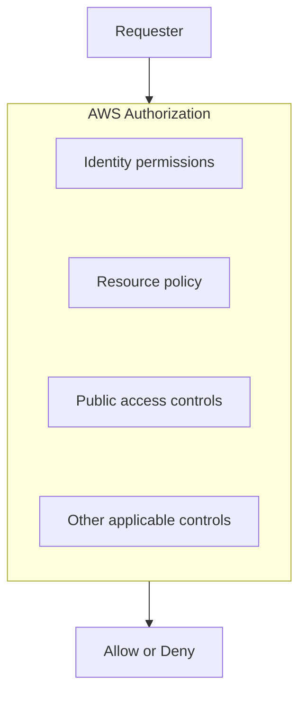

Actual authorization depends on the requester, the action, the resource, the applicable policies, and any explicit denies or organization-level restrictions.

> **A bucket name or object URL is not a permission. Authorization must allow the requested operation.**

---

## 8. IAM Policies vs Bucket Policies

These policies can both affect access, but they are attached in different ways.

### IAM identity-based policy

An IAM policy can grant an identity—such as a user or role—permission to perform actions.

For example, an application role might be permitted to read objects from a specific bucket.

Conceptually:

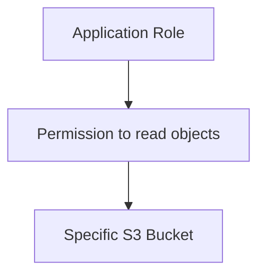

### Bucket policy

A bucket policy is a resource-based policy attached to an S3 bucket.

It can define which principals may perform specified actions on that bucket or its objects, subject to AWS authorization rules.

For example, a bucket policy may allow a designated CloudFront origin access identity mechanism to read objects.

### Least privilege

Avoid broad permissions such as unrestricted access to every S3 bucket when an application only needs one bucket.

Prefer permissions scoped to the specific resources and actions required.

For example, an upload service may need to write objects to a designated prefix without needing permission to delete every object in the account.

---

## 9. Block Public Access

One of the most important S3 security features is **S3 Block Public Access**.

It helps prevent accidental public exposure through certain bucket and account configurations.

For private application uploads and sensitive files, public access should normally remain blocked.

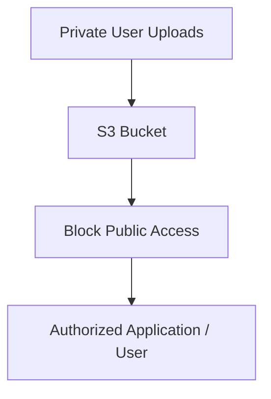

A bucket can be intentionally configured for public content, but that should be a deliberate architectural decision.

### Common mistake

A developer uploads a file and then makes the entire bucket public just to display one image.

This can expose unrelated objects.

A better design is to decide which content is public and which content must remain private.

For private files, the application can authorize the requester and provide a short-lived presigned URL when appropriate.

---

## 10. Public Content vs Private Content

Not all objects have the same access requirements.

### Public content

Examples:

- Public logos.
- Public product images.
- Static assets intended for every visitor.

### Private content

Examples:

- User documents.
- Private reports.
- Identity documents.
- Confidential exports.
- Internal backups.

A typical separation might look like:

```text
S3
├── Public Assets
│   ├── logo.png
│   └── product-images/
│
└── Private Uploads
    ├── user-1001/
    └── user-1002/
```

The prefixes illustrate organization; they do not automatically enforce different permissions.

Use appropriate policies and application authorization to protect private objects.

**Never treat an obscure object key as a substitute for access control.**

---

## 11. Presigned URLs

A **presigned URL** allows a requester to perform a specific S3 operation for a limited time, using authorization generated by a principal that has the required permission.

For example:

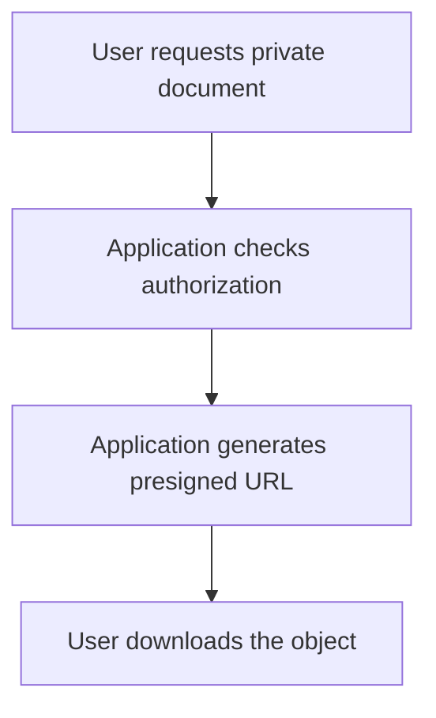

A presigned URL can be useful for:

- Temporary downloads.
- Direct uploads from a browser.
- Sharing a specific private object for a limited period.

### Important properties

- It is time-limited.
- It is associated with a particular operation and object.
- It does not make the entire bucket public.
- Anyone who obtains the URL may be able to use it until it expires or becomes invalid under the applicable conditions.

Treat presigned URLs like temporary bearer credentials. Do not expose them unnecessarily in logs, analytics, or public pages.

---

## 12. Object Versioning

S3 Versioning can preserve multiple versions of an object when the feature is enabled.

Suppose:

```text
documents/report.pdf
```

is uploaded again with changed contents.

Without versioning, a normal replacement may overwrite the current object contents.

With versioning enabled, S3 can retain previous object versions.

Conceptually:

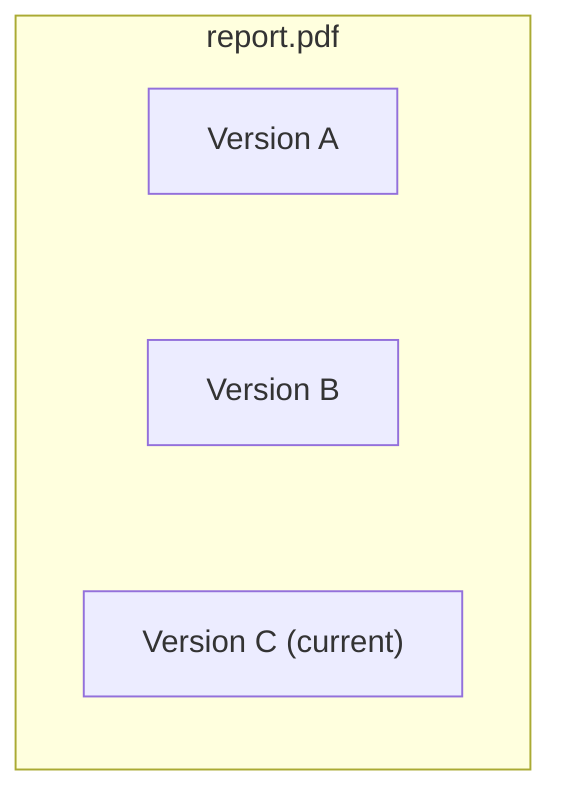

Versioning can help recover from accidental overwrites or deletions, but it is not a complete backup strategy by itself.

Old versions consume storage and can create ongoing charges. Lifecycle policies and retention requirements should be considered.

---

## 13. Durability, Availability, and Backups

These terms describe different properties.

- **Durability:** how well data is protected against loss.
- **Availability:** whether the data or service can be accessed when needed.
- **Backup and recovery:** how you restore data or recover from an unwanted change or incident.

S3 is designed for high durability, but that does not mean every accidental deletion, overwrite, or compromised credential is automatically reversible.

For important data, consider suitable controls such as:

- Versioning.
- Lifecycle policies.
- Restricted deletion permissions.
- Replication when justified.
- Backup and recovery procedures.
- Monitoring and testing recovery.

The correct combination depends on the importance of the data and the recovery requirements.

---

## 14. S3 Storage Classes

S3 offers different storage classes for different access patterns.

At a high level:

| Storage need | Possible direction |
|---|---|
| Frequently accessed objects | A class designed for frequent access |
| Automatically changing access patterns | An intelligent-tiering option may fit |
| Rarely accessed data | An infrequent-access class may fit |
| Long-term archival data | An archival class may fit |

Storage classes differ in pricing, retrieval characteristics, minimum storage durations, and other requirements.

Do not select an archival class simply because its storage price appears lower. Retrieval delay and retrieval costs may make it unsuitable for data that must be available immediately.

For a beginner static website, start with the storage class appropriate for the site's access pattern and current pricing. Optimize after understanding actual usage.

---

## 15. Lifecycle Policies

A **lifecycle policy** can automate actions as objects age.

For example:

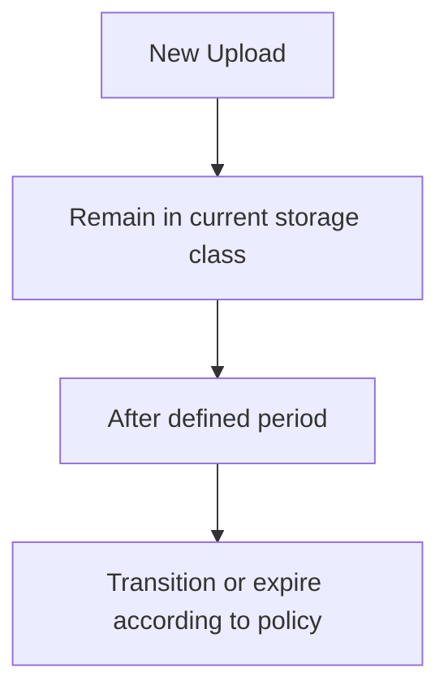

Lifecycle policies can help:

- Transition older objects to another storage class.
- Expire temporary files.
- Manage old versions.
- Reduce unnecessary long-term storage.

But lifecycle rules must reflect business and retention requirements.

An expiration rule that deletes files too early can cause data loss.

For important data, understand the policy and test it before applying it broadly.

---

## 16. Static Website Hosting with S3

A **static website** consists of files that can be delivered without running server-side application code for each request.

Examples include:

- HTML pages.
- CSS.
- JavaScript.
- Images.
- Fonts.
- Other static assets.

A basic site might look like:

```text
website/
├── index.html
├── about.html
├── styles.css
├── app.js
└── images/
    └── logo.png
```

These files can be uploaded to S3.

Conceptually:

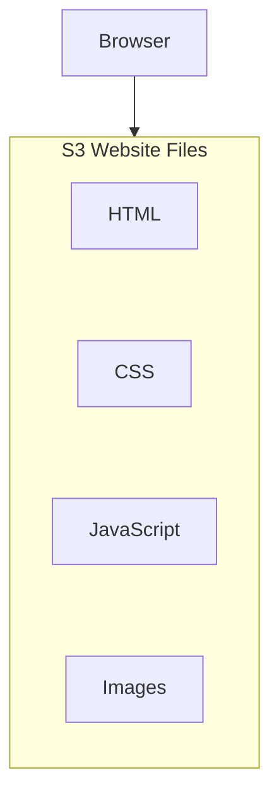

For a suitable static site, S3 can serve the files without an EC2 instance running a web server.

### What S3 static hosting does not do

S3 does not execute your server-side PHP, Node.js, Python, or database code as part of static website hosting.

If a site requires a backend API, that backend must be hosted separately—for example, on EC2, a container platform, or a serverless service.

A static frontend can call a separately deployed backend API.

---

## 17. S3 Website Hosting vs CloudFront

S3 can be configured for static website hosting. However, the native S3 website endpoint has important limitations, including not providing HTTPS directly from that endpoint.

For a more production-oriented public site, a common architecture is to use **Amazon CloudFront** as the delivery layer in front of an S3 origin.

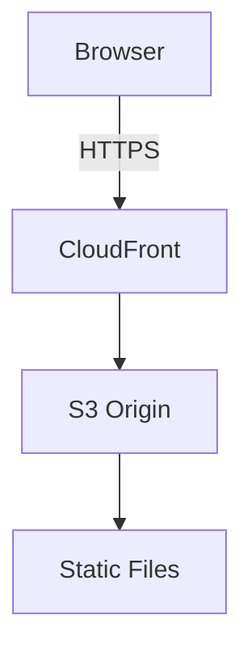

CloudFront can provide:

- HTTPS delivery.
- Edge caching.
- Custom domain integration.
- A delivery layer between users and S3.
- An origin access mechanism to help keep the S3 bucket private.

For a private S3 bucket, CloudFront can be configured with Origin Access Control (OAC) so that CloudFront is authorized to retrieve the intended objects.

This is different from making the bucket publicly readable.

### Choosing a delivery approach

| Requirement | Possible approach |
|---|---|
| Learning how S3 stores and serves website files | S3 static website hosting |
| Public production website with HTTPS and caching | CloudFront with an appropriately configured S3 origin |
| Static frontend plus dynamic backend | S3/CloudFront for frontend, separate service for the API |
| Private downloadable documents | Private S3 objects with application authorization and presigned URLs where suitable |

The right approach depends on the site's routing, access, domain, and security requirements.

---

## 18. Static Website Lab

This lab is intended to teach the deployment flow. Public S3 website hosting requires deliberate configuration and should not be used for private content.

### Step 1 — Create a local website

Create a file named `index.html`:

```html
<!doctype html>
<html lang="en">
<head>
  <meta charset="utf-8">
  <meta name="viewport" content="width=device-width, initial-scale=1">
  <title>Systemly S3 Lab</title>
</head>
<body>
  <h1>Hello from Systemly</h1>
  <p>This page is served as a static website.</p>
</body>
</html>
```

Open it locally in your browser to confirm that it works.

### Step 2 — Create an S3 bucket

In the AWS Console:

1. Open S3 in your chosen Region.
2. Create a bucket with an available, globally unique name.
3. Review the Block Public Access settings.
4. Keep the bucket private unless you deliberately choose a public website-hosting lab.
5. Upload `index.html`.

For production, do not turn off public access simply to make a website work. Prefer a private bucket with CloudFront and Origin Access Control when that architecture fits.

### Step 3 — Choose a delivery method

For learning, you can study the S3 static website hosting option and its access requirements.

For a production-oriented exercise, use CloudFront with a private S3 origin and the required access configuration.

The exact console workflow can change, so follow the current AWS instructions for the selected method.

### Step 4 — Test the site

Verify that:

- The correct index document is returned.
- The page loads over the intended protocol.
- Static assets resolve to the expected paths.
- The bucket does not expose unrelated private objects.
- The delivery configuration behaves as intended.

### Step 5 — Clean up

After testing:

- Remove temporary objects if no longer needed.
- Remove temporary CloudFront or other resources if you created them solely for the lab.
- Review bucket versioning and retained versions.
- Review any public-access changes.
- Check for ongoing charges from associated resources.

CloudFront distributions may take time to disable or delete, and related resources may remain. Follow the service's current cleanup workflow.

---

## 19. Common S3 Mistakes

| Mistake | Why it matters |
|---|---|
| Making an entire bucket public to display one image | Can expose unrelated objects |
| Assuming object keys are security boundaries | Key names do not enforce authorization |
| Treating S3 as a normal filesystem | Its object operations and semantics differ |
| Storing secrets in public website files | Browser users can retrieve those files |
| Assuming S3 runs backend code | Static hosting does not execute a server-side application |
| Ignoring versioning costs | Old object versions can continue consuming storage |
| Choosing archival storage for frequently accessed files | Retrieval behavior and cost may be unsuitable |
| Assuming high durability prevents accidental deletion | Durability is not the same as recovery from every unwanted change |
| Forgetting associated delivery resources | CloudFront and other resources may continue to incur charges |

---

## 20. System Design View

S3 changes how applications handle files.

Instead of keeping every upload on one EC2 instance, an application can use object storage as a separate service.

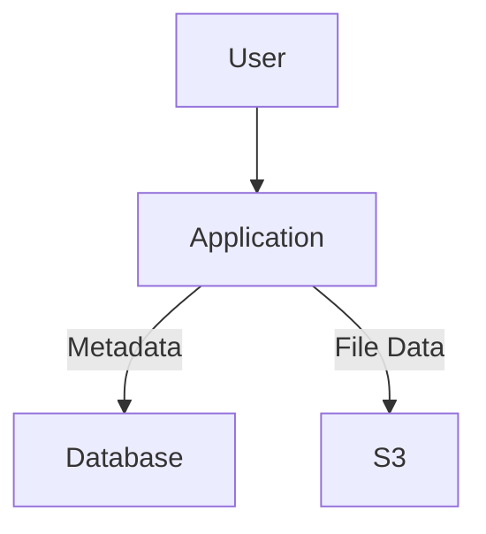

For example, the database might store:

```text
user_id
object_key
content_type
uploaded_at
```

while S3 stores the actual file bytes.

This separation can simplify application-server replacement and horizontal scaling.

But it introduces additional design questions:

- Who is allowed to upload or download each object?
- How are object keys generated?
- What happens if the upload succeeds but the database update fails?
- How are large files uploaded?
- How are old objects deleted?
- What retention and backup requirements apply?

The storage service is only one part of the workflow. The application still needs to coordinate permissions, metadata, errors, and cleanup.

---

## 21. Quick Reference

| Concept | Meaning |
|---|---|
| S3 | AWS object storage service |
| Bucket | Container for S3 objects |
| Object | Stored data plus associated metadata |
| Object key | Identifier for an object within a bucket |
| IAM policy | Grants permissions to an identity |
| Bucket policy | Resource-based policy attached to a bucket |
| Block Public Access | Controls intended to help prevent public exposure |
| Presigned URL | Time-limited URL for an authorized S3 operation |
| Versioning | Retains multiple versions of objects when enabled |
| Lifecycle policy | Automates transitions or expiration based on rules |
| Storage class | Defines a storage option with particular cost and access characteristics |
| Static website | Files delivered without server-side execution for each request |
| CloudFront | Content delivery service that can deliver S3 content over HTTPS |

---

## 22. Knowledge Check

1. What is the difference between an S3 bucket and an object?
2. Why is S3 not the same as EBS?
3. Does knowing an object's URL automatically grant permission to read it?
4. What is the purpose of Block Public Access?
5. How can an application provide temporary access to a private object?
6. What does S3 Versioning help protect against, and what does it not guarantee?
7. Can S3 static website hosting execute PHP or Node.js backend code?
8. Why might CloudFront be placed in front of a private S3 origin?
9. Why should you check retained versions and related resources during cleanup?
10. Why might an application store file metadata in a database while keeping file bytes in S3?

### Answers

1. A bucket contains objects; an object stores data under a key.
2. S3 stores objects, while EBS provides block storage volumes for supported compute workloads.
3. No. Authorization must permit the requested operation.
4. It helps prevent accidental public access through supported S3 public-access configurations.
5. Generate a presigned URL after authorization, with a suitable expiration and operation scope.
6. Versioning can help recover previous object versions, but it does not automatically prevent every deletion, compromise, or data-loss scenario.
7. No. Static hosting serves files; backend code needs a separate runtime or service.
8. CloudFront can provide HTTPS delivery and caching while accessing a private S3 origin through an appropriate origin-access configuration.
9. Retained versions and related resources can consume storage or incur ongoing charges.
10. The database can manage searchable metadata and relationships while S3 stores the actual file contents.

---

## Remember

S3 is not simply a folder in the cloud. It is an object storage service with its own access model, storage behavior, and cost considerations.

Use it to store and retrieve objects, keep private data private, and separate file storage from application compute when that improves the design.

**Next: 12.09 — Managed Databases: RDS, Backups & Connectivity**
