# 12.10 — Load Balancers, Auto Scaling & Health Checks

## Learning Objectives

By the end of this chapter, you should be able to:

- Explain why applications use load balancers.
- Understand how an Application Load Balancer (ALB) distributes HTTP/HTTPS traffic.
- Distinguish load-balancer health checks from application and instance health.
- Explain how EC2 Auto Scaling adjusts application capacity.
- Understand minimum, desired, and maximum capacity.
- Design a basic multi-instance application architecture.
- Recognize common scaling failures, deployment risks, and cost considerations.

---

## 1. The Problem: One Server Is a Limitation

In the previous chapter, we deployed an application on an EC2 instance.

That works well initially:

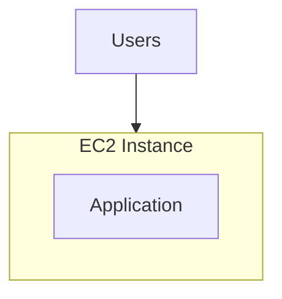

But what happens when:

- Traffic grows beyond the instance's capacity?
- The instance crashes?
- A deployment temporarily breaks the application?
- The server needs maintenance?
- Requests arrive faster than the application can process them?

One instance creates a single point of failure for that application.

A common next step is to run multiple instances and distribute requests between them.

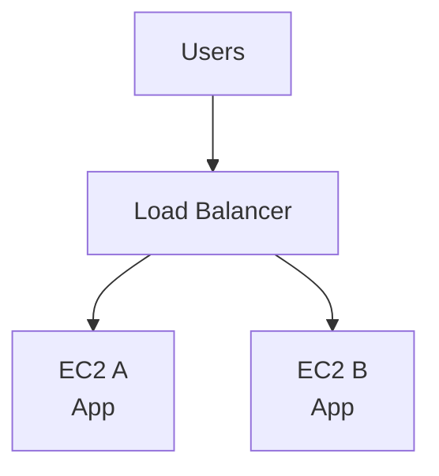

This introduces two complementary capabilities:

- **Load balancing:** distribute incoming requests across available instances.
- **Auto Scaling:** adjust the number of instances to match demand and maintain desired capacity.

They solve different problems, but work well together.

---

## 2. What Is a Load Balancer?

A **load balancer** receives traffic and forwards it to suitable backend targets.

For a web application, the flow may be:

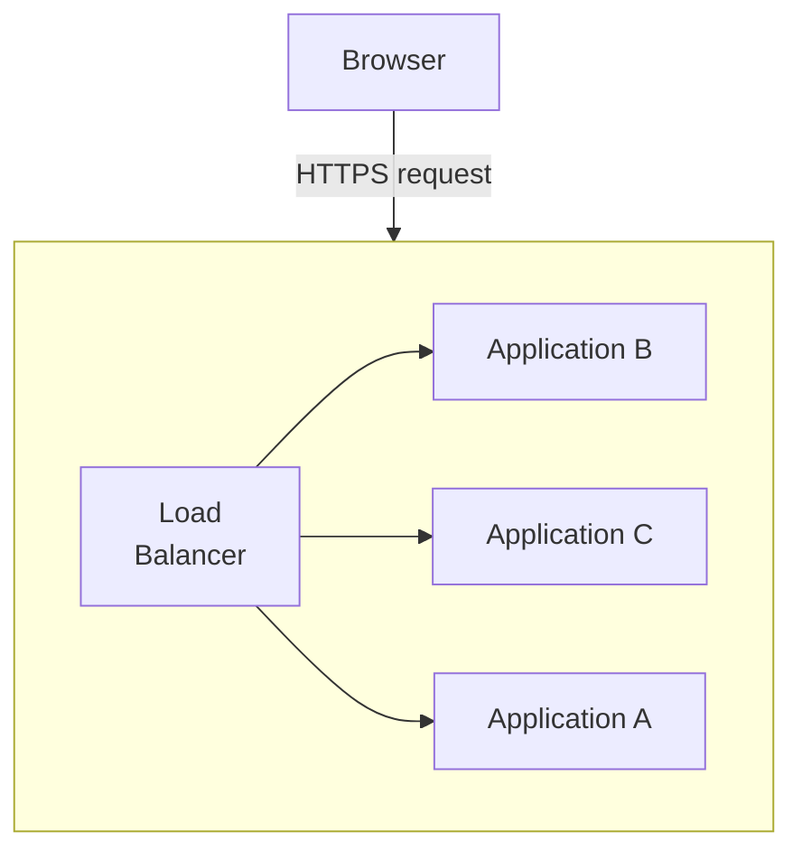

Instead of asking clients to know every application server, clients connect to the load balancer.

The load balancer decides which healthy target should receive a request.

Benefits include:

- Distributing traffic across instances.
- Avoiding targets that fail configured health checks.
- Providing a stable entry point.
- Supporting HTTPS termination.
- Helping applications scale horizontally.
- Supporting controlled traffic routing during deployments.

**Important:** A load balancer does not make an application infinitely scalable. It distributes work across the capacity that exists.

If all backend instances are overloaded, the load balancer cannot manufacture additional capacity.

---

## 3. AWS Elastic Load Balancing

AWS provides **Elastic Load Balancing (ELB)**, a family of managed load-balancing services.

Common types include:

| Type | Main use |
|---|---|
| Application Load Balancer (ALB) | HTTP/HTTPS applications and content-based routing |
| Network Load Balancer (NLB) | High-performance Layer 4 TCP/UDP and related network traffic |
| Gateway Load Balancer (GWLB) | Deploying and scaling network virtual appliances |

For a typical web application, start with an **Application Load Balancer**.

It can route traffic using rules such as:

```text
app.example.com/products/*  → Product target group
app.example.com/admin/*     → Admin target group
api.example.com/*           → API target group
```

These are illustrative routing rules. Your real configuration depends on your application.

For this chapter, we will focus on an ALB distributing HTTP/HTTPS requests to EC2 application instances.

---

## 4. Where the Load Balancer Fits

A basic AWS architecture looks like this:

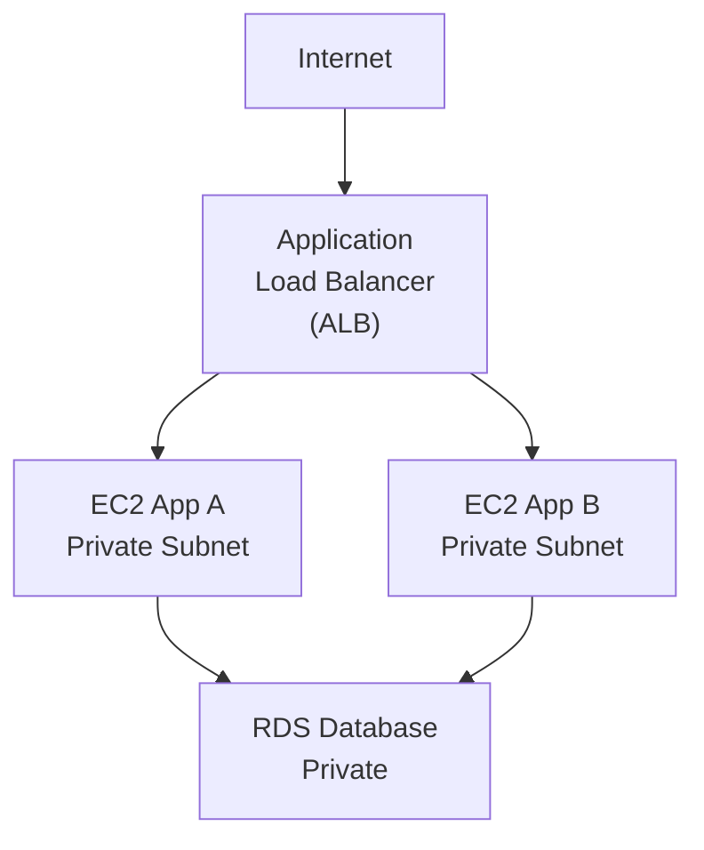

The ALB is reachable through its configured network scheme. In a typical public web architecture, it is internet-facing and deployed across multiple Availability Zones.

The application instances can remain in private subnets. The database should generally remain private and accept connections only from the required application security group.

This builds on **12.06 — VPC, Subnets, Routes & Network Security** and **12.07 — EC2: Virtual Machines & Application Deployment**.

---

## 5. What Is a Target Group?

A **target group** is a collection of registered destinations that a load balancer can send traffic to.

Targets may include EC2 instances, IP addresses, or other supported target types.

Conceptually:

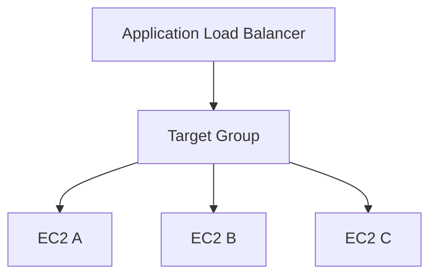

A target group defines details such as:

- Which targets receive traffic.
- The protocol and port used to reach them.
- The health-check configuration.
- How target health is evaluated.

For an EC2 web application, a target group might forward HTTP requests to port `80` on each instance.

The exact port depends on how the application is deployed.

---

## 6. How a Request Travels

Suppose a user opens:

```text
https://app.example.com/products
```

The flow may look like this:

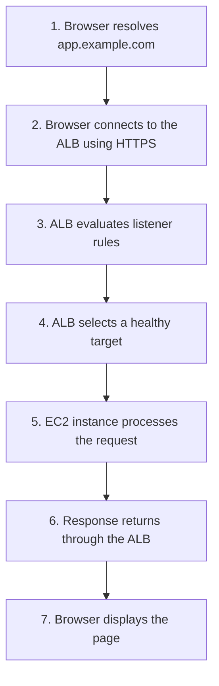

The ALB can terminate TLS using a configured certificate and forward traffic to backend targets according to its listener and target-group configuration.

HTTPS between the ALB and the backend is also possible when required.

The security design should consider both network restrictions and the sensitivity of data moving between components.

---

## 7. Listeners and Routing Rules

A **listener** checks for connection requests on a configured protocol and port.

For example:

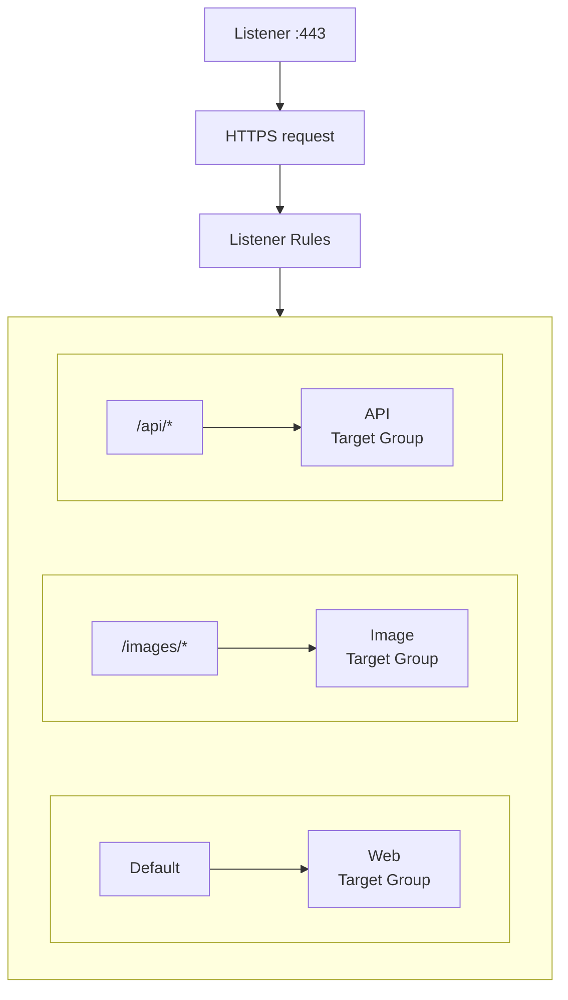

A typical public application might use:

- HTTP on port `80` to redirect users to HTTPS.
- HTTPS on port `443` to accept encrypted web traffic.
- A default action to forward requests to the main target group.

These are common patterns, not mandatory rules for every architecture.

---

## 8. Health Checks: Is the Target Ready?

A load balancer should not send ordinary application traffic to a target that it considers unhealthy.

It periodically checks registered targets.

For example:

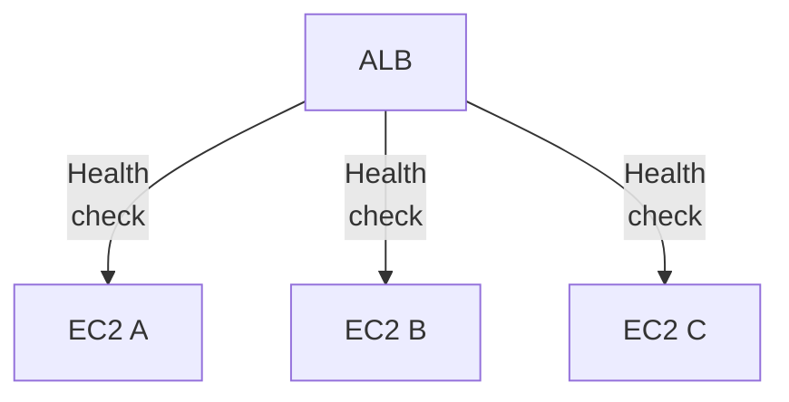

A basic HTTP health check might request:

```http
GET /health
```

A healthy application could return:

```http
HTTP/1.1 200 OK
```

If a target repeatedly fails the configured checks, the target group can mark it unhealthy and stop routing normal requests to it.

The ALB continues checking targets so that a recovered target can become healthy again.

The health-check path, expected response codes, timeout, interval, and healthy/unhealthy thresholds must match the application's behavior.

---

## 9. Design a Useful Health Endpoint

A simple endpoint might return:

```json
{
  "status": "ok"
}
```

But what should `/health` actually check?

A basic **liveness check** asks:

> Is the application process alive enough to respond?

A **readiness check** asks:

> Is the application ready to serve normal requests?

These are related but different questions.

For example:

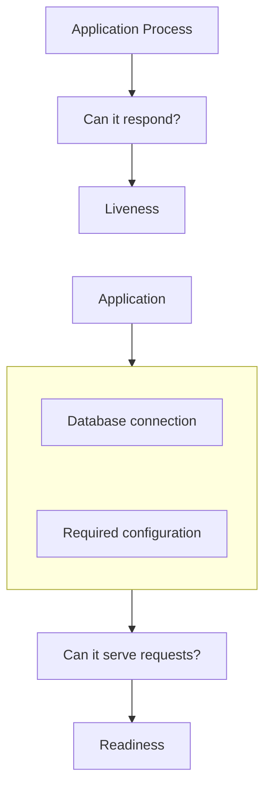

For a simple EC2 application, an ALB target health check often acts as a readiness signal for traffic routing.

Avoid making a health endpoint depend on every optional service. If an optional recommendation API fails, the main application might still be able to serve requests.

Also avoid expensive health checks that create significant load themselves.

---

## 10. Health Checks Have Limits

A successful health check does not prove that every application feature works correctly.

For example:

```text
/health → 200 OK
```

But:

```text
/checkout → fails
```

The process may be alive while one important feature is broken.

Likewise, a failed health check does not always mean the entire machine has crashed. It may indicate:

- A process failure.
- An incorrect health-check path.
- A blocked port.
- A Security Group problem.
- A slow or overloaded application.
- A dependency failure.
- A startup period that is too short.

Health checks provide useful signals, not perfect knowledge.

---

## 11. Instance Health vs Target Health

These are different concepts.

| Health signal | What it tells you |
|---|---|
| EC2 instance status checks | Whether the EC2 instance and its underlying environment pass AWS's instance/system checks |
| ALB target health checks | Whether a registered target satisfies the target group's configured health checks |
| Application monitoring | Whether application behavior and important user-facing operations are working |

Consider:

```text
EC2 Status: Healthy
ALB Target: Unhealthy
```

The virtual machine may be running, but the application might have crashed or be listening on the wrong port.

Or:

```text
EC2 Status: Healthy
ALB Target: Healthy
Checkout: Broken
```

Basic health checks may pass even though a business operation is failing.

A reliable design uses the appropriate health signal for each decision.

---

## 12. What Is Auto Scaling?

**Amazon EC2 Auto Scaling** manages a group of EC2 instances according to configured capacity and scaling policies.

Instead of manually launching and removing each instance, you define the desired behavior.

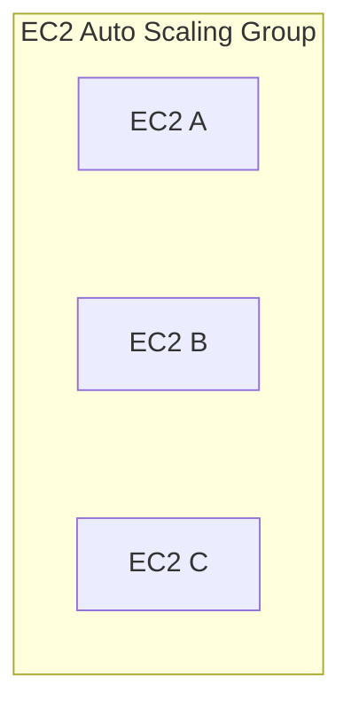

The group can launch instances when capacity needs to increase and terminate instances when capacity can safely decrease.

It can also replace instances that become unhealthy under its configured health-management rules.

The goal is not simply to run as many servers as possible.

It is to maintain enough suitable capacity for the workload while controlling cost and failure risk.

---

## 13. Minimum, Desired and Maximum Capacity

An Auto Scaling group has three important capacity settings.

| Setting | Meaning |
|---|---|
| Minimum capacity | The lowest number of instances the group should maintain |
| Desired capacity | The target number of instances the group should maintain |
| Maximum capacity | The upper limit the group is allowed to reach |

Suppose:

```text
Minimum  = 2
Desired  = 2
Maximum  = 6
```

Initially:

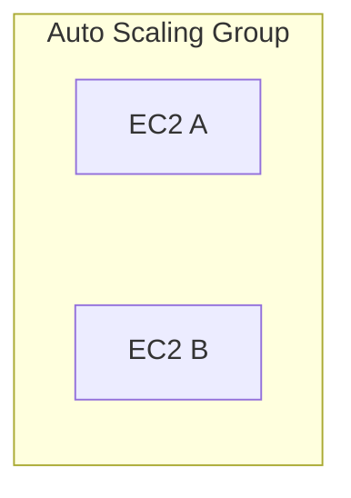

If a scaling policy increases desired capacity to `4`, the group attempts to maintain four instances.

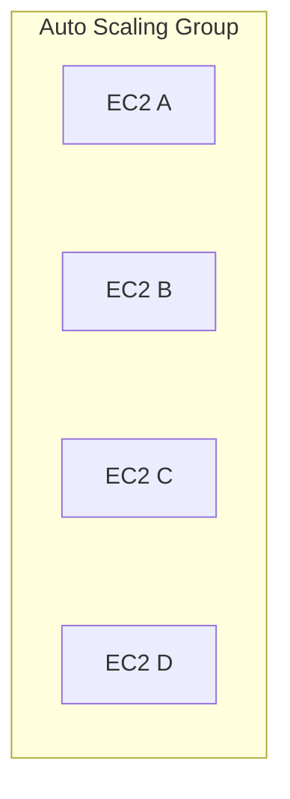

The group does not normally exceed the configured maximum through ordinary scaling actions.

These values describe instance count, not a guaranteed amount of request capacity. Instance size, application behavior, and dependencies still matter.

---

## 14. How Auto Scaling Decides to Scale

Auto Scaling can use policies based on metrics or scheduled changes.

Common strategies include:

### Target tracking

Try to maintain a metric near a target value.

For example:

```text
Average CPU target = 50%
```

If the relevant metric remains above the target, the policy can increase capacity. If it remains below the target, it can reduce capacity when safe and permitted by the policy.

### Step scaling

Adjust capacity by different amounts depending on the size of a metric alarm's breach.

### Scheduled scaling

Change desired capacity according to a known schedule, such as expected weekday traffic.

Target tracking is often a useful starting point for a workload whose demand correlates with a measurable metric.

However, CPU is not always the best signal. A workload may be constrained by request count, latency, queue depth, memory, or a downstream dependency.

---

## 15. Scaling Is Not Instantaneous

Suppose traffic increases suddenly:

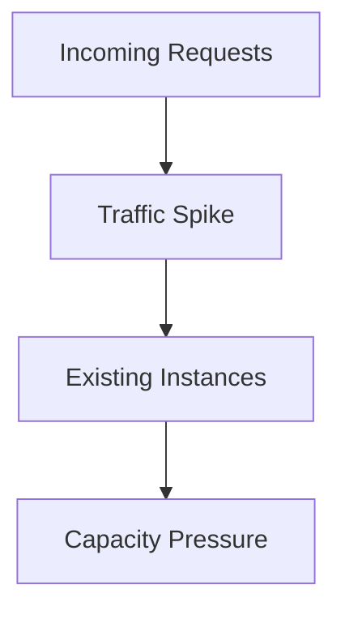

Auto Scaling may need time to:

1. Detect the metric change.
2. Evaluate the scaling policy.
3. Launch an EC2 instance.
4. Initialize the operating system.
5. Start the application.
6. Pass target health checks.

Only then can the new instance reliably receive application traffic.

Therefore, scaling cannot always react quickly enough to a sudden burst.

Possible strategies include:

- Keeping a suitable minimum capacity.
- Using sensible scaling thresholds.
- Choosing appropriate instance types.
- Preparing instances so startup is predictable.
- Using scheduled scaling for known demand.
- Using queues or other mechanisms to absorb bursts when the workload permits.

**Scaling policies should be designed around startup time and workload behavior, not just a CPU percentage.**

---

## 16. How Load Balancing and Auto Scaling Work Together

These components complement each other.

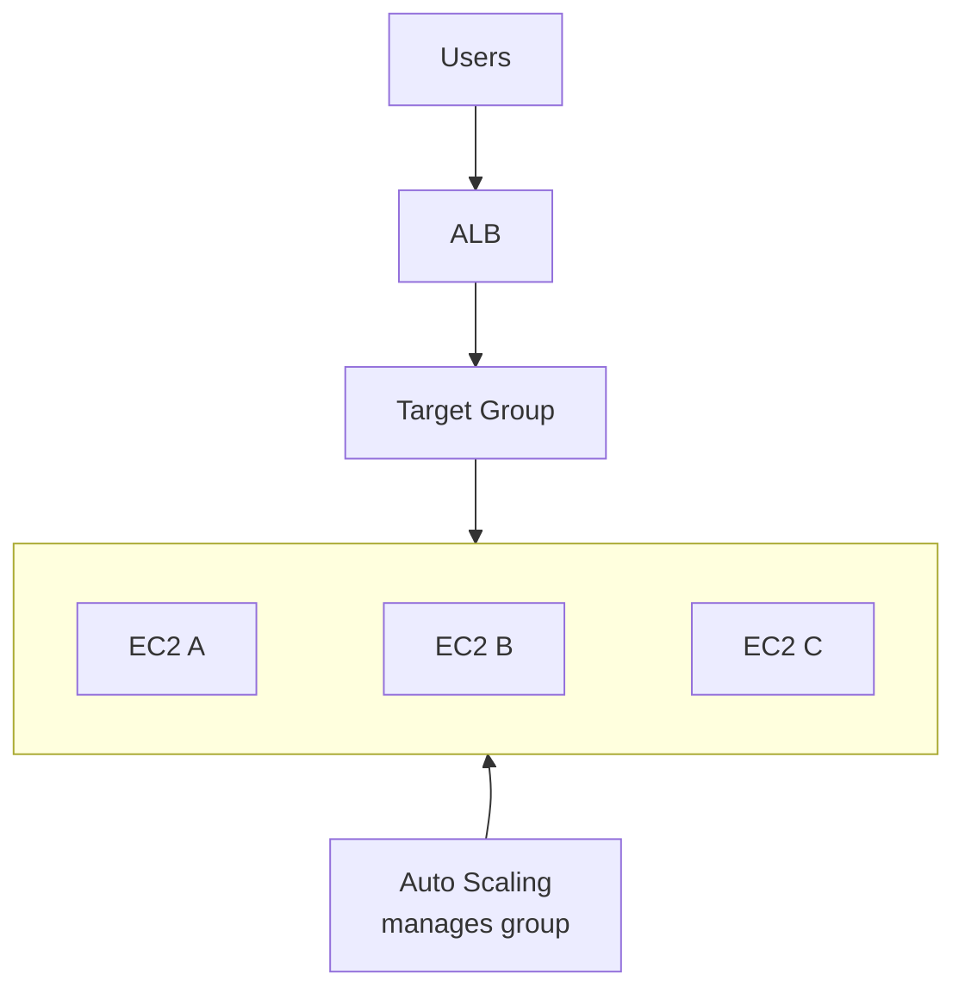

The ALB distributes traffic to eligible healthy targets.

The Auto Scaling group manages the number and lifecycle of EC2 instances.

When capacity increases, new instances can register with the target group and begin receiving traffic after they become healthy.

When instances are removed, the system should stop directing new requests to them and allow in-flight work to finish where the platform and application configuration support it.

Neither component replaces the other.

---

## 17. Multi-AZ Availability

Running two instances in the same Availability Zone does not protect the application from every Availability Zone failure.

A more resilient design distributes instances across multiple Availability Zones.

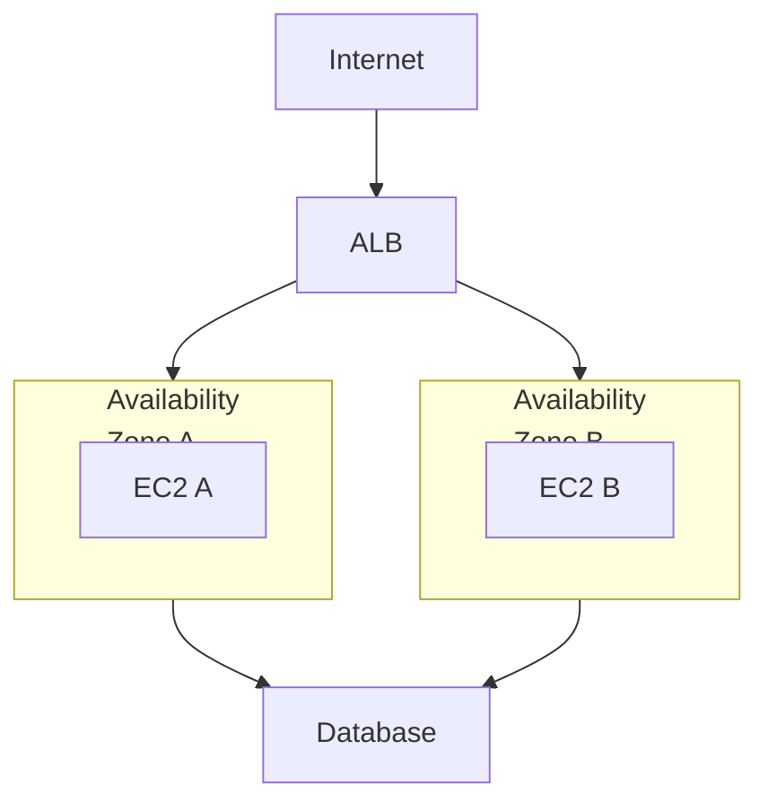

The ALB should be configured across multiple Availability Zones, and the Auto Scaling group should use suitable subnets in those zones.

This helps the application continue operating if one zone becomes unavailable, provided the remaining capacity and dependencies can handle the load.

Multi-AZ deployment increases resilience, but it does not guarantee uninterrupted service. Application bugs, regional failures, shared dependency failures, and capacity limits can still cause outages.

---

## 18. What Happens When an Instance Becomes Unhealthy?

Imagine three instances:

```text
ALB
 |
 +---- EC2 A → Healthy
 |
 +---- EC2 B → Unhealthy
 |
 +---- EC2 C → Healthy
```

The target group can stop sending normal traffic to EC2 B.

If the instance belongs to a correctly configured Auto Scaling group and the relevant health-management settings detect the failure, Auto Scaling can replace it.

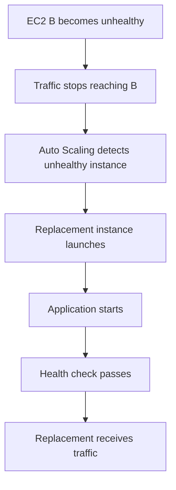

The exact detection and replacement behavior depends on the configured health checks and Auto Scaling settings.

There may be a period with reduced capacity while the replacement launches. That is why maintaining spare capacity matters.

---

## 19. Graceful Shutdown and Deployments

An instance should not be terminated in the middle of important work if that can be avoided.

During scale-in or deployment, a safe process may look like:

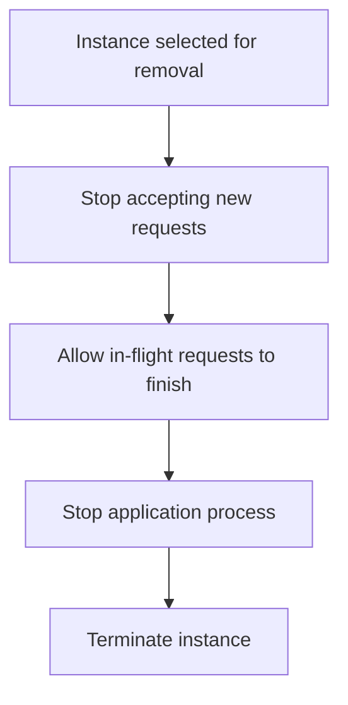

ALB target deregistration and connection-draining behavior can help, but the application must also handle shutdown signals and request completion correctly.

For example, a background worker should not abandon a job halfway through without a recovery mechanism.

Long-running operations may need queues, job leases, checkpointing, or other application-level safeguards.

---

## 20. Stateless Applications Make Scaling Easier

Suppose EC2 A stores a user's session only in its local memory.

```text
User request 1 → EC2 A
Session stored in A's memory
```

The next request may reach EC2 B:

```text
User request 2 → EC2 B
Session missing
```

This can break the user experience.

Applications are easier to scale when important shared state is stored in appropriate external systems.

For example:

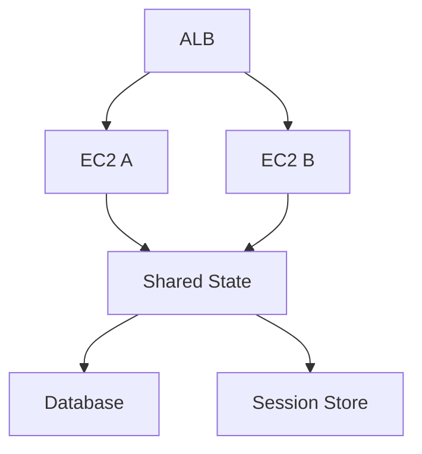

The exact storage choice depends on the type of state.

A database, cache, object store, or signed client-side token may be appropriate for different needs.

Sticky sessions can sometimes help route a client repeatedly to the same target, but they do not eliminate the risks of local-only state or guarantee that the target will remain available.

---

## 21. Scaling the Application Does Not Scale Every Dependency

Suppose you increase the application from two instances to ten.

```text
Before:
ALB → 2 EC2 instances → RDS

After:
ALB → 10 EC2 instances → RDS
```

The application tier now has more compute capacity.

But all ten instances may create additional database connections and queries.

If RDS is already the bottleneck, adding application instances can make the problem worse.

Before increasing the maximum capacity, consider:

- Database connection limits.
- Connection pooling.
- Query performance.
- Cache effectiveness.
- External API rate limits.
- Downstream service capacity.

**Horizontal scaling moves the bottleneck unless the constrained dependency is addressed too.**

This connects to **03.01 — Where Does Performance Go?**, **03.02 — Database Indexes**, and **03.03 — Query Optimization**.

---

## 22. Deployment Choices: Launch Templates and Images

Auto Scaling needs a repeatable way to create instances.

A **launch template** defines instance-launch configuration, such as:

- AMI.
- Instance type.
- Security Groups.
- IAM instance profile.
- Storage configuration.
- User data.

For example:

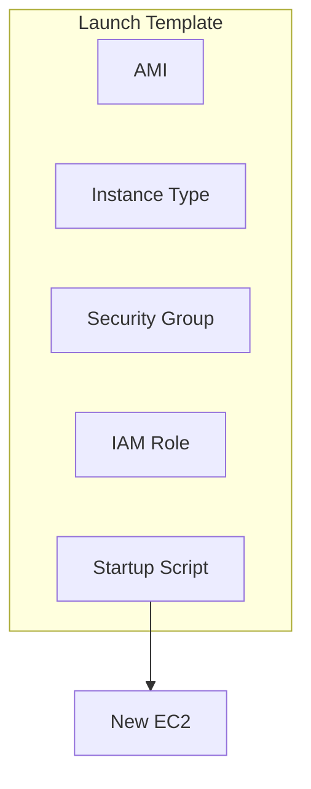

The AMI and startup process should create a predictable application environment.

For production systems, avoid relying on a fragile sequence of manual steps performed after every instance launch.

A controlled image-building or deployment process improves repeatability and makes scaling more reliable.

---

## 23. Common Failure Modes

| Problem | Likely effect | What to investigate |
|---|---|---|
| Wrong health-check path | Healthy app appears unhealthy | Path, port, status code |
| Security Group blocks ALB traffic | Targets cannot be reached | ALB-to-instance rules |
| Application starts slowly | Instances remain unhealthy during startup | Initialization and health-check timing |
| Scaling threshold is too high | Capacity increases too late | Metrics, thresholds, startup time |
| Maximum capacity is too low | Traffic exceeds available capacity | Workload and capacity limits |
| Database is overloaded | More instances increase database pressure | Queries, connections, RDS capacity |
| Session exists only in local memory | Requests fail when routed to another instance | Shared session/state design |
| Scale-in is too aggressive | Requests or jobs are interrupted | Graceful shutdown and draining |
| Instances use inconsistent configuration | Some targets behave differently | Launch template and deployment process |

---

## 24. A Practical AWS Architecture

For a small web application, a reasonable starting architecture is:

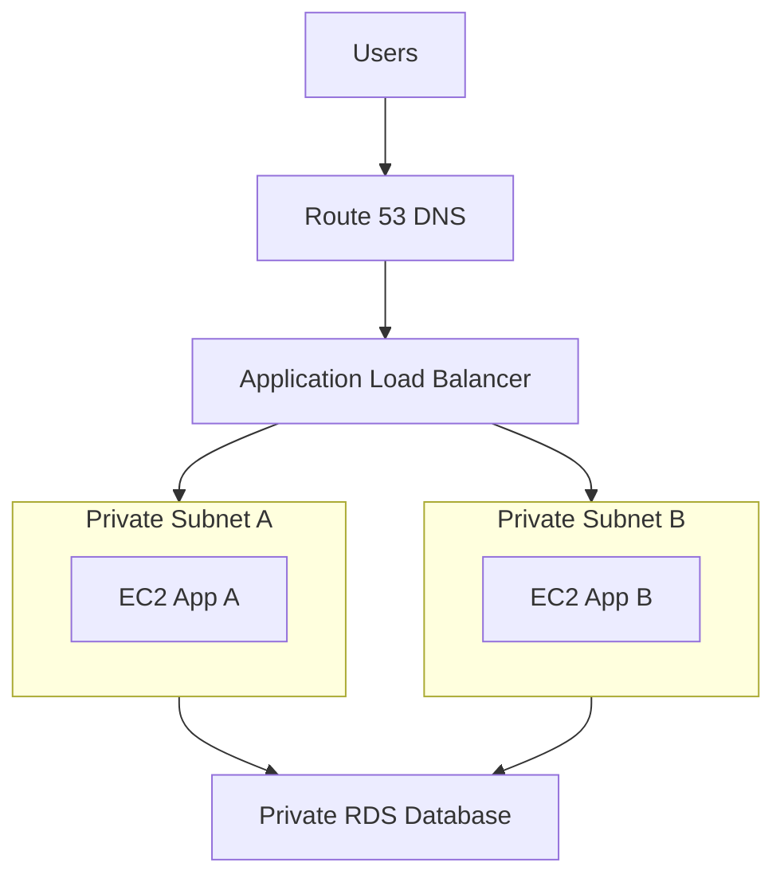

An Auto Scaling group manages the EC2 application instances.

The ALB distributes requests only to eligible healthy targets.

Security Groups restrict traffic:

- ALB: accepts public HTTP/HTTPS traffic as required.
- EC2: accepts application traffic only from the ALB's Security Group.
- RDS: accepts database traffic only from the application tier's Security Group.

This is an illustrative baseline, not a complete production design. A real deployment also needs appropriate IAM permissions, TLS configuration, monitoring, backup and recovery planning, deployment automation, and cost controls.

---

## 25. Cost Considerations

Load balancing and Auto Scaling improve flexibility, but they are not free.

Potential costs include:

- ALB usage and processed traffic.
- EC2 instance runtime.
- EBS storage.
- Data transfer.
- NAT Gateway usage where applicable.
- CloudWatch metrics, logs, and alarms.
- Additional database capacity required by increased traffic.

A configuration such as:

```text
Minimum = 2
Desired = 2
Maximum = 6
```

does not mean AWS always runs six instances. It means the group aims to maintain its desired capacity within the configured bounds, subject to scaling and health-management behavior.

However, even the minimum number of instances and the load balancer can incur charges.

Before experimenting:

1. Check current AWS pricing for the selected Region.
2. Set an appropriate budget and billing alerts.
3. Use small instance types only when suitable for the exercise.
4. Delete the load balancer, target group, Auto Scaling group, and related resources when finished.
5. Confirm that no instances, snapshots, volumes, or other billable resources remain.

A budget alert is not necessarily a hard spending cap.

---

## 26. Hands-On Exercise: Model the Architecture First

Before creating AWS resources, draw this architecture:

```mermaid
flowchart TD
  accTitle: The architecture to model
  accDescr: Users reach the ALB, then the target group, which sends traffic to EC2 A and EC2 B; both use RDS.
  U["Users"] --> L["ALB"] --> T["Target Group"] --> A["EC2 A"] & B["EC2 B"]
  A & B --> R["RDS"]
```

Label each component with its responsibility:

- ALB: receives and routes requests.
- Target group: identifies targets and checks their health.
- Auto Scaling group: manages EC2 instance capacity.
- EC2: runs application code.
- RDS: stores persistent relational data.

Then answer these questions:

1. Which component receives public traffic?
2. Which component determines whether an EC2 target is healthy?
3. Which component launches replacement EC2 instances?
4. Where should the database be placed?
5. What happens if one EC2 instance becomes unhealthy?
6. What happens if traffic doubles but the database is already overloaded?

Do not create AWS resources just to answer these questions. A diagram and a clear explanation are the first deliverable.

### Optional AWS lab

When you are ready to implement the design:

1. Prepare a repeatable EC2 launch configuration.
2. Create a target group with an appropriate health-check endpoint.
3. Create an ALB in suitable subnets across multiple Availability Zones.
4. Create an Auto Scaling group using a launch template and the target group.
5. Start with a small desired capacity.
6. Verify target health and request routing.
7. Test a controlled scaling change.
8. Observe how long a new instance takes to become healthy.
9. Delete all resources after testing.

This lab can incur charges. Check current pricing and configure billing alerts before proceeding.

---

## 27. System Design View

Think about these capabilities separately:

```mermaid
flowchart TD
  accTitle: Separate capabilities
  accDescr: The load balancer routes requests to eligible application instances, which process application requests; the Auto Scaling group maintains and adjusts instance capacity on compute resources.
  N0["Load Balancer"] -->|"Routes requests to<br/>eligible targets"| N1["Application Instances"] -->|"Process application<br/>requests"| N2["Auto Scaling Group"] -->|"Maintains and adjusts<br/>instance capacity"| N3["Compute Resources"]
```

Then consider the signals:

```mermaid
flowchart TD
  accTitle: Two kinds of signal
  accDescr: Health checks drive target eligibility and instance replacement; scaling metrics drive capacity adjustment.
  H["Health Checks"] --> E["Target Eligibility /<br/>Instance Replacement"]
  E ~~~ M
  M["Scaling Metrics"] --> C["Capacity Adjustment"]
```

Health checks answer whether a target should receive traffic or whether a managed instance needs replacement.

Scaling metrics help decide how much capacity the group should maintain.

Neither is a substitute for application-level observability.

### The key architectural question

> **Can the system keep serving useful requests when demand changes or an application instance fails?**

To answer that, consider:

- How much capacity remains after a failure?
- How quickly can a new instance become ready?
- Can the remaining instances handle the load?
- Can the database handle the additional work?
- Can users move between instances without losing important state?
- Can deployments remove instances without interrupting critical work?

These questions matter more than simply having an ALB and an Auto Scaling group.

---

## 28. Common Mistakes

1. **Assuming a load balancer provides unlimited capacity.** It can only distribute the capacity available behind it.
2. **Treating all health checks as equivalent.** Instance health, target health, and business-function health answer different questions.
3. **Scaling only on CPU.** CPU may not reveal database, queue, latency, or rate-limit constraints.
4. **Ignoring startup time.** New instances are not useful until they can serve requests reliably.
5. **Scaling the application without checking dependencies.** Additional instances can overload RDS or an external service.
6. **Keeping critical session state only in local memory.** Requests can reach another instance.
7. **Ignoring graceful shutdown.** Scale-in and deployments can interrupt active work.
8. **Leaving resources running after a lab.** Managed networking and compute services can continue to incur charges.

---

## 29. Quick Reference

| Concept | Meaning |
|---|---|
| Load balancer | Distributes incoming traffic across eligible targets |
| Elastic Load Balancing | AWS family of managed load-balancing services |
| ALB | HTTP/HTTPS load balancer with content-based routing |
| Target group | Registered targets plus routing and health-check configuration |
| Listener | Accepts connections on a configured protocol and port |
| Health check | Tests whether a target satisfies configured health criteria |
| Auto Scaling group | Manages a group of EC2 instances |
| Minimum capacity | Lowest configured group capacity |
| Desired capacity | Target number of instances to maintain |
| Maximum capacity | Upper bound for ordinary group scaling |
| Horizontal scaling | Adding or removing instances |
| Multi-AZ | Distributing resources across Availability Zones |
| Graceful shutdown | Stopping work safely before removing an instance |
| Launch template | Repeatable configuration for launching EC2 instances |

---

## 30. Knowledge Check

### 1. What problem does a load balancer solve?

It distributes incoming requests across eligible backend targets and provides a stable entry point for clients.

### 2. What is the difference between an ALB and an Auto Scaling group?

An ALB routes requests. An Auto Scaling group manages EC2 instance capacity and lifecycle.

### 3. Why does a target group need health checks?

To identify targets that should not receive normal traffic because they fail the configured health criteria.

### 4. What is the difference between minimum, desired, and maximum capacity?

Minimum is the lower bound, desired is the target capacity, and maximum is the upper bound for ordinary scaling.

### 5. Why use multiple Availability Zones?

To reduce dependence on a single zone and improve resilience when one zone becomes unavailable.

### 6. Why can scaling from two instances to ten make the system worse?

The additional instances may increase pressure on a shared bottleneck, such as the database or an external API.

### 7. Why should applications avoid depending on local-only session state?

A later request may reach a different instance that does not have that local state.

### 8. Does a healthy EC2 instance guarantee a healthy application?

No. The instance can pass infrastructure checks while the application is broken or unable to perform important operations.

---

## Remember

A load balancer distributes requests. Health checks help identify targets that should receive traffic. Auto Scaling adjusts compute capacity as demand and health conditions change.

```mermaid
flowchart TD
  accTitle: Healthy capacity behind the ALB
  accDescr: Incoming Traffic, then ALB, then Healthy Application Targets, then Auto Scaling Maintains Capacity.
  N0["Incoming Traffic"] --> N1["ALB"] --> N2["Healthy Application Targets"] --> N3["Auto Scaling Maintains Capacity"]
```

The deeper principle is:

> **Scaling is not just adding servers. It is maintaining enough healthy capacity to serve requests without overwhelming the rest of the system.**

**Next: 12.11 — Containers with Docker & Amazon ECS**
