# 12.11 — Containers with Docker & Amazon ECS

## Learning Objectives

By the end of this chapter, you should be able to:

- Explain what a container is and why containers are useful.
- Distinguish containers from virtual machines.
- Understand Docker images, containers, registries, and Dockerfiles.
- Package a simple web application into a Docker image.
- Explain how Amazon ECS runs and manages containers.
- Distinguish ECS tasks, task definitions, services, and clusters.
- Understand the difference between ECS on EC2 and AWS Fargate.
- Recognize common container deployment, networking, security, and cost mistakes.

---

## 1. The Problem: "It Works on My Machine"

Imagine building a web application on your development computer.

Your application depends on:

- A particular runtime version.
- Specific packages and libraries.
- Environment variables.
- System tools.
- Configuration files.

On your computer, everything works.

But on another server:

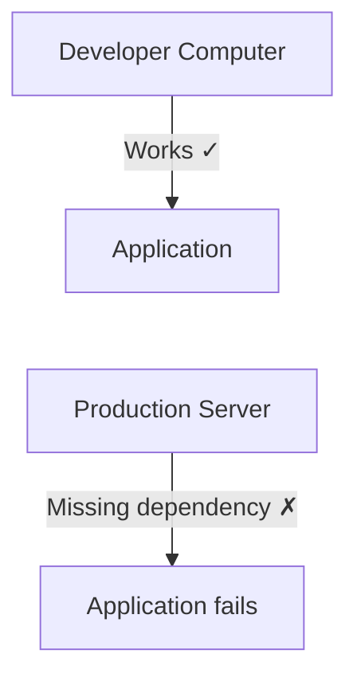

The server may have a different runtime version, missing libraries, or incompatible configuration.

Traditionally, developers had to configure each environment carefully.

Containers offer another approach:

> **Package the application and its required runtime dependencies into a consistent, deployable unit.**

The goal is to make the application behave more predictably across development, testing, and production.

Containers do not eliminate every environmental difference, but they reduce many common sources of inconsistency.

---

## 2. What Is a Container?

A **container** is an isolated environment for running a process and its associated application files and dependencies.

For example:

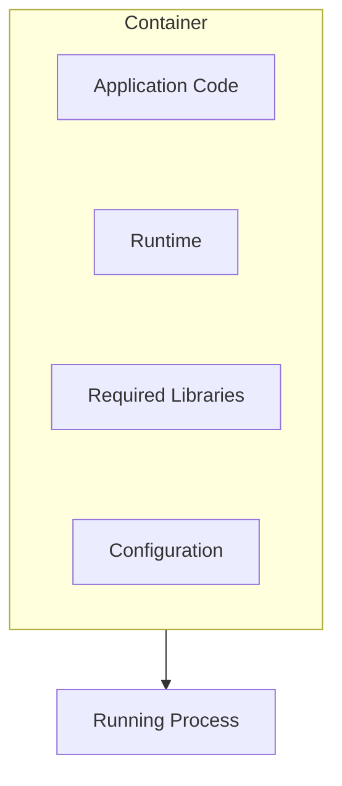

A container provides isolation, but it is not usually a complete virtual machine.

On Linux, containers commonly rely on operating-system kernel features such as namespaces and control groups (cgroups).

These help isolate processes and manage resource usage.

A container normally shares the host's kernel rather than booting its own full guest operating system.

This is one reason containers can be lighter and faster to start than traditional virtual machines.

---

## 3. Container vs Virtual Machine

You already learned about EC2 in **12.07 — EC2: Virtual Machines & Application Deployment**.

A virtual machine and a container provide different levels of isolation.

**Virtual machine architecture**

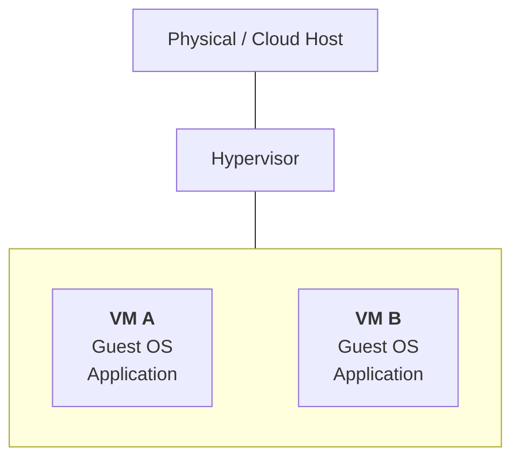

**Container architecture**

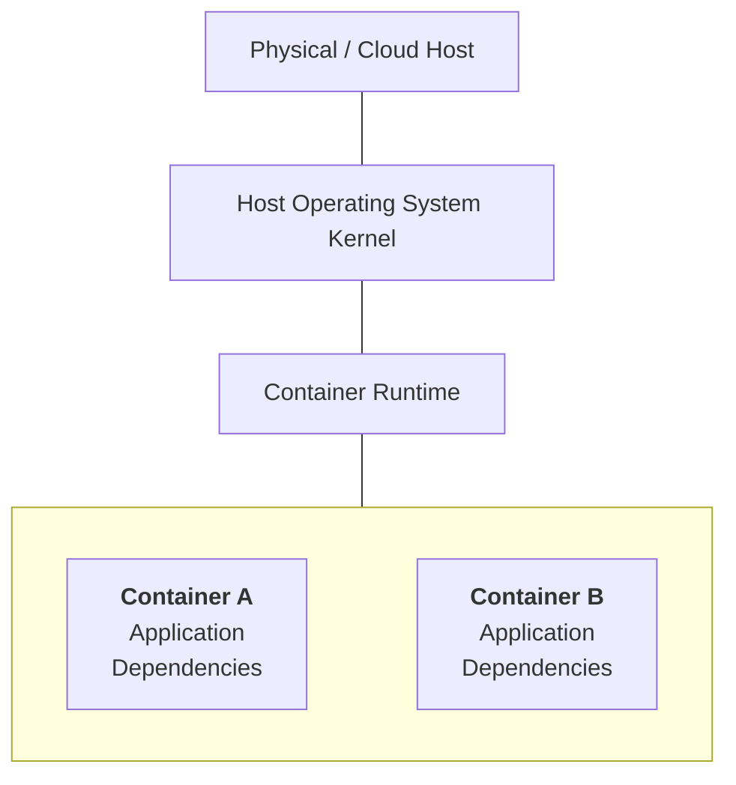

The diagrams are simplified. Cloud providers may use additional virtualization and isolation layers beneath their container services.

| Virtual machine | Container |
|---|---|
| Usually includes a guest operating system | Usually shares the host kernel |
| Typically consumes more resources | Often has lower overhead |
| Boots a guest OS | Starts container processes |
| Strong isolation boundary at the VM layer | Isolation depends on the runtime and configuration |
| Useful for many operating-system workloads | Useful for packaging and running applications consistently |

**Important:** Containers are not automatically secure simply because they are isolated. Host security, permissions, image contents, runtime configuration, and network controls still matter.

---

## 4. What Is Docker?

**Docker** is a platform and toolset for building, distributing, and running containers.

A typical Docker workflow is:

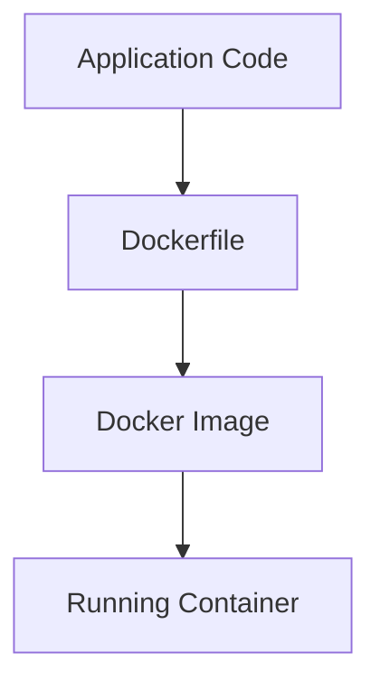

Docker provides a practical way to define the environment an application needs.

For example, a Node.js application can specify its runtime and dependencies in a Dockerfile instead of relying on manually configured software on every server.

Docker is commonly used to build container images, while other runtimes and orchestration platforms can run those images.

---

## 5. Four Important Docker Concepts

**Docker image**

An **image** is a packaged template containing the application and the files needed to run it.

Think of it as a blueprint.

**Container**

A **container** is a running instance created from an image.

Think of it as the application process running from that blueprint.

**Dockerfile**

A **Dockerfile** describes how to build an image.

It records instructions such as which base image to use, which files to copy, and what command to run.

**Container registry**

A **container registry** stores and distributes images.

Examples include Docker Hub, Amazon Elastic Container Registry (ECR), and private registries.

The relationship looks like this:

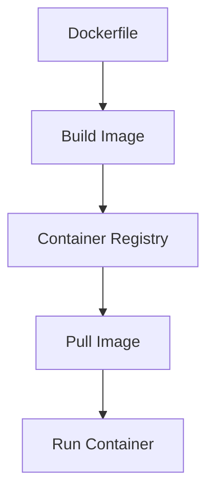

---

## 6. Create a Simple Docker Application

Let's use a small Node.js HTTP server.

Create a project directory:

```text
container-demo/
├── server.js
├── package.json
└── Dockerfile
```

### `server.js`

```javascript
const http = require("node:http");

const server = http.createServer((req, res) => {
  res.writeHead(200, {
    "Content-Type": "text/plain",
  });

  res.end("Hello from a Docker container!\n");
});

server.listen(3000, "0.0.0.0", () => {
  console.log("Server listening on port 3000");
});
```

The server listens on `0.0.0.0` so that traffic can reach it through the container's network interface.

Listening only on the container's loopback address, `127.0.0.1`, can prevent access through the container's network interface.

### `package.json`

```json
{
  "name": "container-demo",
  "version": "1.0.0",
  "private": true,
  "scripts": {
    "start": "node server.js"
  }
}
```

This example uses only Node.js built-in modules, so it does not require additional application packages.

---

## 7. Write the Dockerfile

Create a file named `Dockerfile`:

```dockerfile
FROM node:22-alpine

WORKDIR /app

COPY package.json ./
COPY server.js ./

EXPOSE 3000

CMD ["npm", "start"]
```

Let's understand the instructions.

| Instruction | Purpose |
|---|---|
| `FROM` | Selects a base image |
| `WORKDIR` | Sets the working directory inside the image |
| `COPY` | Copies files into the image |
| `EXPOSE` | Documents the intended container port |
| `CMD` | Specifies the default command when the container starts |

The Node.js version here is an example. For production, select a supported version and pin the image appropriately for your update and security requirements.

`EXPOSE 3000` does not itself publish the port to your computer or the internet.

---

## 8. Build and Run the Container Locally

Build the image:

```bash
docker build -t container-demo .
```

What happens?

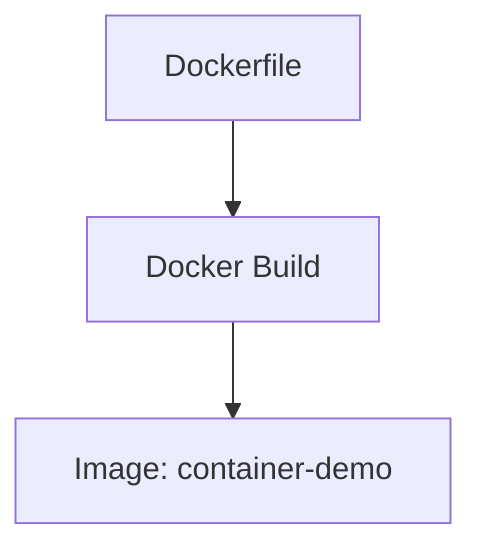

Now start a container:

```bash
docker run --name container-demo -p 3000:3000 container-demo
```

The port mapping means:

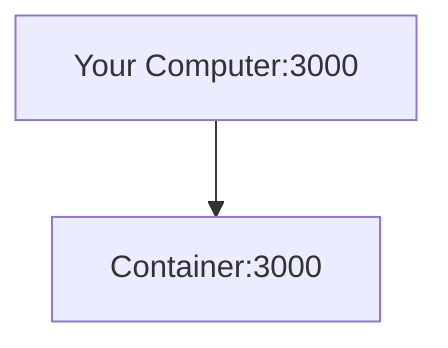

Open:

```text
http://localhost:3000
```

Expected response:

```text
Hello from a Docker container!
```

To stop the running container, press `Ctrl+C` in the terminal where it is running. If you started it in detached mode, use:

```bash
docker stop container-demo
docker rm container-demo
```

The `-p` mapping is a local Docker networking configuration. In a cloud deployment, network access is controlled by the container platform, load balancer, routing, and security rules.

---

## 9. Images Are Not Running Containers

This distinction is important.

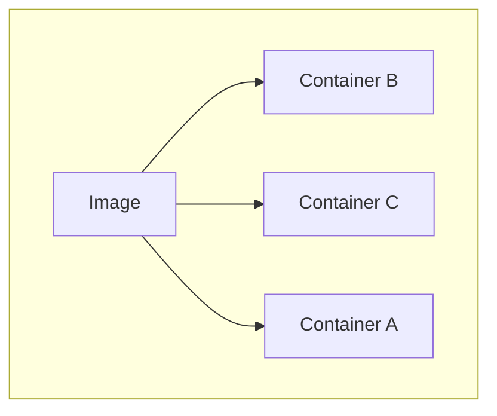

One image can be used to create multiple containers.

For example, you might run three instances of the same application image to handle more requests.

Each container has its own running process and writable container layer, while image layers can be shared efficiently by the container runtime.

However, do not treat the container's writable layer as durable application storage.

If a container is removed, data stored only in that writable layer may be lost.

Persistent data should live in an appropriate external system, such as a database, object store, or configured persistent volume.

---

## 10. What Is a Container Registry?

Building an image on your computer is only the first step.

A cloud environment needs a way to retrieve that image.

A registry provides that storage and distribution mechanism.

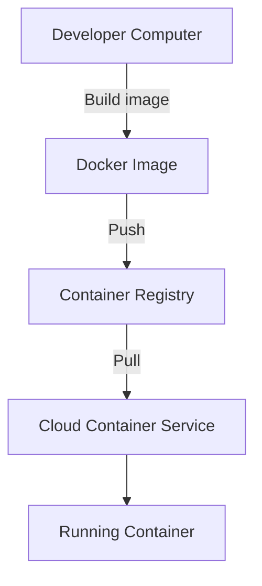

AWS provides **Amazon Elastic Container Registry (ECR)**.

A typical workflow is:

1. Build an image.
2. Authenticate to the registry.
3. Tag the image.
4. Push the image to ECR.
5. Configure the container service to use that image.

ECR stores the image. It does not, by itself, run the application.

That is the job of a container runtime or orchestration service.

For production, use controlled image versions or digests, scan images where appropriate, and avoid deploying an unreviewed mutable image tag.

---

## 11. What Is Container Orchestration?

Running one container locally is straightforward.

A production application may need:

- Multiple container instances.
- Automatic replacement of failed tasks.
- Load balancing.
- Network configuration.
- Resource limits.
- Deployment management.
- Scaling.
- Logging and monitoring.

Managing all of this manually becomes difficult.

**Container orchestration** automates many of these tasks.

Conceptually:

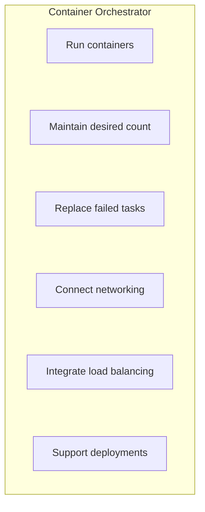

AWS provides Amazon ECS and Amazon EKS as managed container orchestration services.

This chapter focuses on ECS.

---

## 12. What Is Amazon ECS?

**Amazon Elastic Container Service (ECS)** is an AWS service for deploying and managing containerized applications.

You provide a container image and describe how it should run.

ECS helps schedule and manage the resulting tasks.

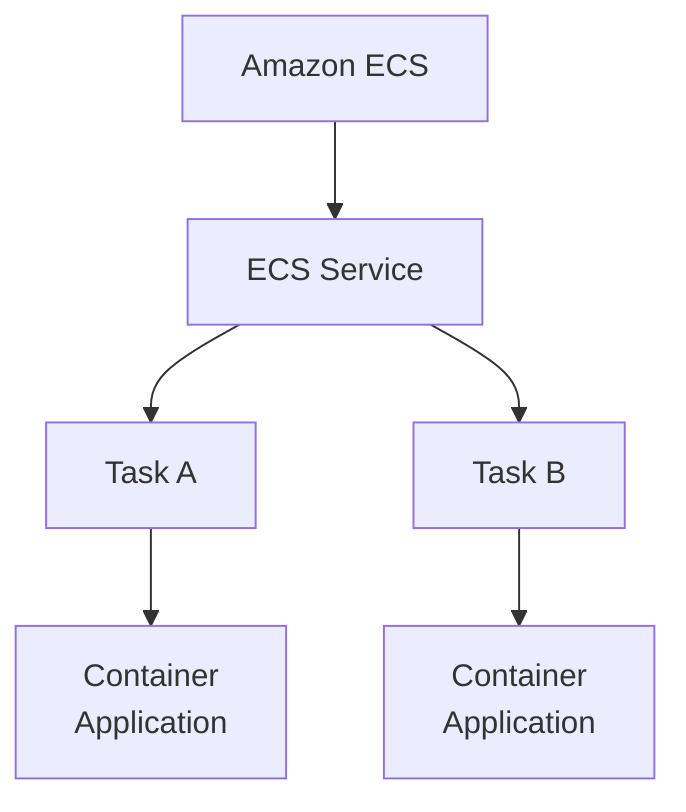

ECS can integrate with other AWS services, including:

- ECR for container images.
- Application Load Balancer for traffic routing.
- IAM for permissions.
- CloudWatch for logs and metrics.
- VPC networking for connectivity.
- EC2 or Fargate for compute capacity.

ECS is the orchestration layer. It works with compute resources to run the containers.

---

## 13. Four ECS Concepts

ECS uses several concepts that are easy to confuse.

### 1. Cluster

A **cluster** is a logical grouping used to organize ECS workloads and compute capacity.

### 2. Task definition

A **task definition** is a blueprint describing how a task should run.

It can specify:

- Container images.
- CPU and memory settings.
- Ports.
- Environment configuration.
- Logging.
- IAM roles.
- Secret references.
- Health-check settings.

### 3. Task

A **task** is a running instance of a task definition.

A task can contain one or more containers that are intended to work together.

### 4. Service

An **ECS service** maintains a desired number of tasks and manages task replacement and deployments according to its configuration.

A simplified relationship:

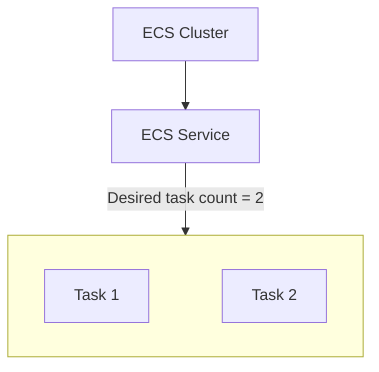

If one task fails, the service can attempt to start a replacement to restore the desired count.

**Remember:** A task is a running workload. A service manages the desired number of those workloads.

---

## 14. ECS on EC2 vs AWS Fargate

ECS supports different compute options.

The two common choices are ECS on EC2 and ECS on AWS Fargate.

### ECS on EC2

You manage the EC2 instances that provide compute capacity.

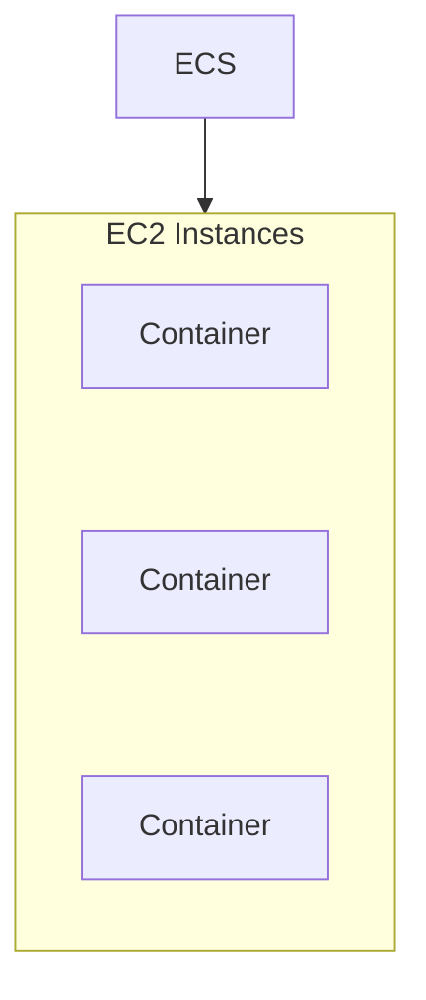

You have more control over the underlying instances, but also more responsibility for capacity, operating-system maintenance, and host configuration.

### ECS on Fargate

Fargate provides serverless compute for supported container workloads.

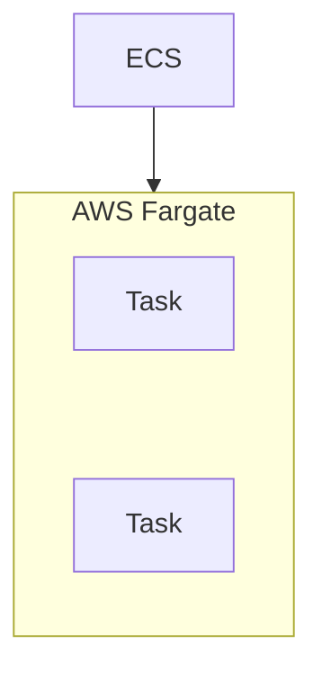

You specify task-level resource requirements without managing the underlying EC2 fleet.

AWS manages the underlying infrastructure for you, although you remain responsible for application configuration, security, networking, and task resource choices.

| ECS on EC2 | ECS on Fargate |
|---|---|
| You manage the EC2 capacity | AWS manages the underlying compute infrastructure |
| Greater host-level control | Less host-management work |
| May suit specialized host requirements or suitable steady workloads | Often convenient for simpler operational management |
| Instance capacity and utilization must be managed | Task resource allocation and runtime costs must be managed |

Neither option is always cheaper. Cost depends on workload utilization, task size, runtime duration, architecture, and other resources.

---

## 15. What Happens When ECS Starts a Task?

A simplified task-launch sequence is:

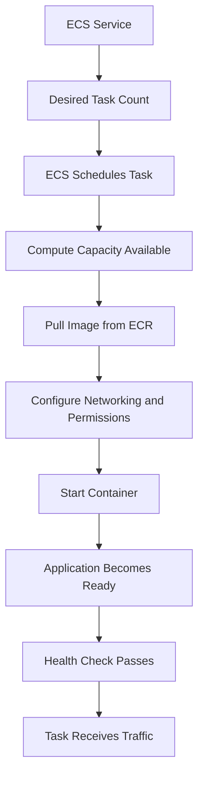

Some steps may happen in a different order or be handled by different platform components depending on the configuration.

A task being in a running state does not necessarily mean the application is ready to serve useful requests.

The application must start correctly, pass its health checks, and have access to the dependencies it needs.

---

## 16. ECS with an Application Load Balancer

ECS services can integrate with an ALB.

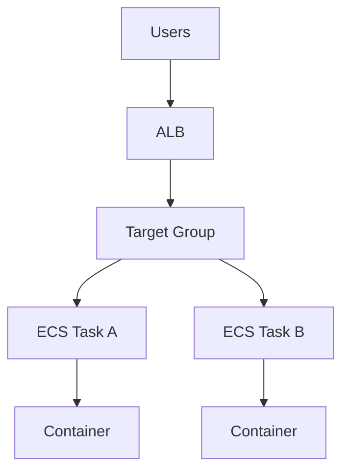

The ALB distributes requests to eligible healthy targets.

The ECS service maintains the desired task count and manages task deployments and replacement.

Together, these services support a common production architecture:

- ALB for HTTP/HTTPS traffic.
- ECS service for application task management.
- ECR for container images.
- Fargate or EC2 for compute.
- RDS for persistent relational data.
- CloudWatch for logs and metrics.

This is a natural next step from the EC2 architecture in **12.10 — Load Balancers, Auto Scaling & Health Checks**.

---

## 17. Environment Variables and Secrets

Containers need configuration.

For example:

```text
PORT=3000
APP_ENV=production
```

Environment variables can be appropriate for non-secret configuration.

But do not bake passwords, API keys, database credentials, or private tokens into the Dockerfile or image.

Bad pattern:

```dockerfile
ENV DATABASE_PASSWORD="my-secret-password"
```

Anyone with access to the image or its metadata may be able to recover that value.

A better pattern is to inject sensitive configuration through an appropriate secrets-management mechanism, with narrowly scoped permissions.

AWS workloads commonly use services such as AWS Secrets Manager or Systems Manager Parameter Store for this purpose.

The application should retrieve or receive secrets securely and avoid logging them.

Also remember that environment variables are not automatically secret just because they are configured by a cloud service. Access controls and application behavior still matter.

---

## 18. Container Networking

A container needs a way to communicate with other components.

For example:

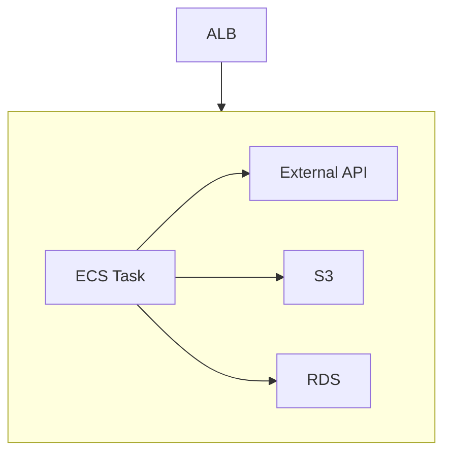

With ECS on Fargate, tasks commonly use the `awsvpc` network mode, giving each task an elastic network interface in the VPC.

Security Groups can control which traffic reaches those task interfaces.

A typical design might allow:

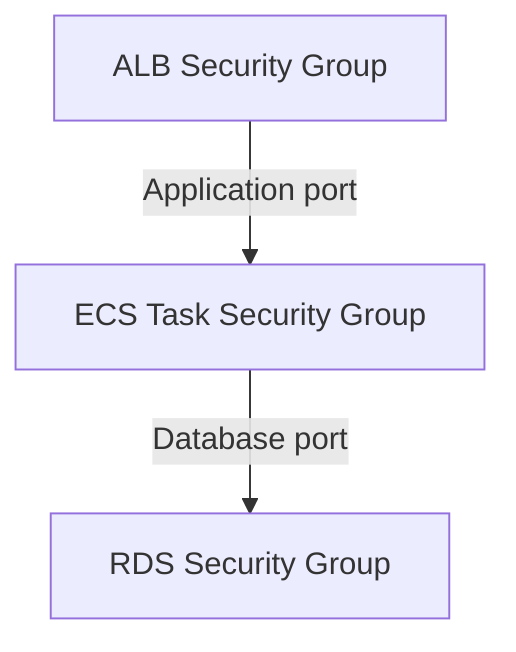

The application task should not be directly exposed to public traffic when the intended design is for the ALB to be the public entry point.

Restrict access to the application port so that only the ALB's Security Group can reach it.

The exact networking setup depends on the launch type, network mode, subnet arrangement, and service configuration.

---

## 19. Persistent Data Does Not Belong Only Inside a Container

A container may be stopped, replaced, or recreated during normal operations.

If important data exists only in its writable layer, that data can disappear when the container is removed.

For example, this is risky:

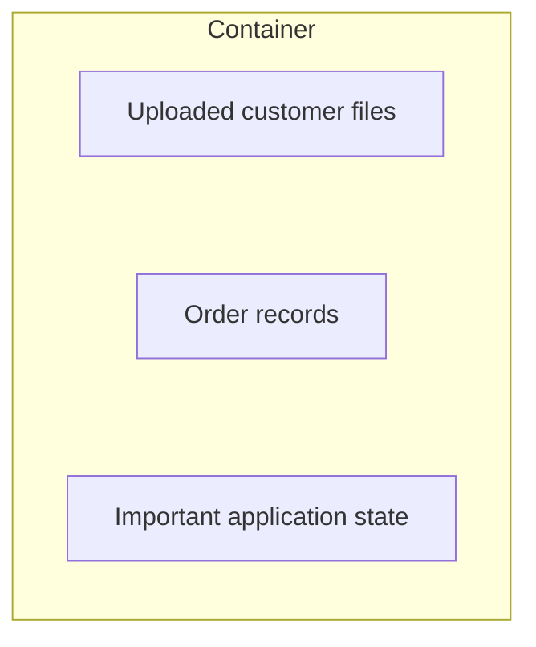

Prefer external storage appropriate to the data:

```mermaid
flowchart TD
  accTitle: Durable data in external storage
  accDescr: A containerized application uses RDS for relational data, S3 for uploaded objects and a cache for temporary shared data.
  A["Containerized Application"] --> G
  subgraph G[" "]
    direction TB
    R["RDS: relational data"] ~~~ S["S3: uploaded objects"] ~~~ C["Cache: temporary shared data"]
  end
```

A container should generally be treated as replaceable.

This does not mean containers cannot use persistent volumes. It means persistence should be designed explicitly instead of relying on an instance's disposable filesystem.

---

## 20. Container Health Checks and ECS Service Health

Container and service health are related, but not identical.

A container health check can test whether a process or application inside the container responds as expected.

An ALB health check tests whether the target responds to the configured network request.

An ECS service manages tasks according to its configured deployment and health behavior.

Conceptually:

```mermaid
flowchart TD
  accTitle: Three health questions
  accDescr: Container health asks whether the process or application is responsive. ALB target health asks whether traffic should be routed to this target. The ECS service asks whether the desired task capacity is maintained.
  C["Container Health"] --> Q1["Is the process/application responsive?"]
  Q1 ~~~ A
  A["ALB Target Health"] --> Q2["Should traffic be routed to this target?"]
  Q2 ~~~ S
  S["ECS Service"] --> Q3["Is the desired task capacity maintained?"]
```

Do not configure a health check that is too aggressive or expensive. A temporary slow startup or brief dependency issue should not automatically trigger a destructive replacement loop unless that is the intended policy.

For important applications, test health-check behavior under startup delays, dependency failures, and overload.

---

## 21. Scaling ECS Services

An ECS service can maintain a desired number of tasks and can be configured with service auto scaling.

For example:

```text
Minimum tasks = 2
Desired tasks = 2
Maximum tasks = 8
```

Under suitable scaling policies, the desired task count can increase as demand grows and decrease when capacity is no longer needed.

```mermaid
flowchart TD
  accTitle: Task count follows demand
  accDescr: Low demand runs 2 tasks; high demand runs 6 tasks.
  L["Low Demand"] --> T2["2 Tasks"]
  T2 ~~~ H
  H["High Demand"] --> T6["6 Tasks"]
```

Scaling signals may include CPU or memory utilization and other suitable metrics.

The best metric depends on the application.

For example, an API that waits on a database may have low CPU utilization even while users experience high latency. CPU alone may not reveal the real bottleneck.

Scaling also takes time. New tasks must start, initialize, connect to dependencies, and pass health checks before they can reliably serve traffic.

As with EC2 Auto Scaling, additional application tasks do not automatically increase the capacity of RDS or external services.

---

## 22. Container Image Size and Build Quality

Large images can slow down image transfer and task startup.

A Docker image may contain unnecessary files such as:

- Development dependencies.
- Build tools that are not needed at runtime.
- Temporary files.
- Test data.
- Local environment files.
- Credentials.

A `.dockerignore` file can prevent unnecessary files from being sent into the Docker build context.

Example:

```text
node_modules
.git
.env
npm-debug.log
```

Adjust this list to your project's actual build process. Do not exclude files the image genuinely needs.

Other useful practices include:

- Using an appropriate base image.
- Pinning and regularly updating dependencies.
- Using multi-stage builds when they reduce unnecessary runtime contents.
- Running as a non-root user where practical.
- Scanning images for known vulnerabilities.
- Keeping secrets outside the image.
- Using immutable image versions or digests for controlled releases.

A smaller image is useful, but **security, reproducibility, and correctness matter more than size alone**.

---

## 23. Common Failure Modes

| Problem | Possible effect | What to investigate |
|---|---|---|
| Image cannot be pulled | Task fails to start | Registry access, image reference, IAM permissions |
| Application listens on the wrong interface | Requests cannot reach the application | Binding address and port |
| Task has insufficient memory | Application may be terminated or fail | Memory usage and task limits |
| Missing environment variable | Application fails during startup | Task configuration and secrets |
| Task cannot reach RDS | Requests fail or time out | VPC, Security Groups, endpoint, credentials |
| Health check fails | Task may not receive traffic or may be replaced | Path, port, startup time, expected status |
| Container stores durable data locally | Data may be lost on replacement | External storage design |
| Image contains secrets | Credentials may be exposed | Build context, image layers, secret handling |
| Too many tasks hit the database | Database overload | Pooling, query efficiency, database capacity |
| Scaling policy reacts too slowly | Latency rises during bursts | Scaling signals and startup time |

---

## 24. Hands-On Exercise: Containerize Before Deploying

Start with the Node.js application from Section 6.

### Step 1 — Build locally

```bash
docker build -t container-demo .
```

### Step 2 — Run locally

```bash
docker run --rm -p 3000:3000 container-demo
```

Open:

```text
http://localhost:3000
```

Confirm that the response appears.

### Step 3 — Stop and recreate it

Stop the container and run it again.

Observe that the application can be recreated from the same image without manually reinstalling Node.js inside a server.

### Step 4 — Inspect the image and container

Useful commands:

```bash
docker images
docker ps
docker ps -a
docker inspect container-demo
```

If you used `--rm`, the container is removed automatically after it stops, so it may no longer appear in `docker ps -a`.

### Step 5 — Draw the AWS deployment

```mermaid
flowchart TD
  accTitle: The AWS deployment
  accDescr: The developer builds a Docker image and pushes it to Amazon ECR; the Amazon ECS service runs it as a Fargate task with a Node.js container.
  N0["Developer"] -->|"Build image"| N1["Docker Image"] -->|"Push"| N2["Amazon ECR"] --> N3["Amazon ECS Service"] --> N4["Fargate Task"] --> N5["Node.js Container"]
```

Add an ALB in front if the application needs public HTTP/HTTPS traffic.

### Step 6 — Decide whether to deploy

Do not deploy to AWS just to complete the learning objective. Local Docker is sufficient to understand image building and container execution.

If you choose to deploy, check current pricing, create a budget alert, use least-privilege IAM permissions, and remove the resources after testing. ECS, Fargate, ALB, ECR storage, networking, and logging may incur charges.

---

## 25. System Design View

The architecture has several distinct responsibilities:

```mermaid
flowchart TD
  accTitle: From source code to running application
  accDescr: Source Code, then Docker Build, then Container Image, then Amazon ECR, then Amazon ECS, then Fargate or EC2, then Running Application, then ALB / Other Clients.
  N0["Source Code"] --> N1["Docker Build"] --> N2["Container Image"] --> N3["Amazon ECR"] --> N4["Amazon ECS"] --> N5["Fargate or EC2"] --> N6["Running Application"] --> N7["ALB / Other Clients"]
```

Each component solves a different problem:

| Component | Responsibility |
|---|---|
| Docker | Builds and runs containers |
| Container image | Packages application files and runtime dependencies |
| ECR | Stores and distributes images |
| ECS | Schedules and manages container workloads |
| Fargate | Provides managed compute for supported tasks |
| EC2 | Provides virtual machines when you choose to manage the host capacity |
| ALB | Routes HTTP/HTTPS traffic to eligible targets |
| RDS | Stores persistent relational data |

The key architectural question is:

> **What should be packaged with the application, what should be managed by the platform, and what must remain external and persistent?**

A useful default is to package application code and its runtime dependencies, let the platform manage the container lifecycle, and keep durable data and secrets in appropriate external systems.

---

## 26. Common Mistakes

1. **Confusing an image with a container.** An image is a template; a container is a running instance.
2. **Thinking Docker automatically provides orchestration.** Docker can run containers, but production scheduling and lifecycle management require additional platform capabilities.
3. **Treating ECS and Docker as alternatives.** Docker builds images; ECS manages container workloads.
4. **Assuming Fargate means no infrastructure responsibilities.** AWS manages the underlying compute, but you still configure networking, IAM, task resources, application health, and deployment behavior.
5. **Putting credentials inside an image.** Images can be distributed and inspected; keep secrets out of them.
6. **Storing durable data in a disposable container layer.** Use appropriate persistent storage.
7. **Ignoring container resource limits.** Insufficient CPU or memory can make a task unstable.
8. **Scaling tasks without considering dependencies.** More tasks can overwhelm a database or external API.
9. **Using mutable image tags without deployment discipline.** You may not know exactly which artifact is running.
10. **Leaving AWS resources running after an experiment.** Clean up to avoid unexpected charges.

---

## 27. Quick Reference

| Concept | Meaning |
|---|---|
| Container | Isolated environment for running an application process |
| Dockerfile | Instructions used to build an image |
| Image | Packaged template used to create containers |
| Container registry | Stores and distributes container images |
| ECR | AWS managed container image registry |
| ECS | AWS service for orchestrating containers |
| Cluster | Logical grouping for ECS workloads and capacity |
| Task definition | Blueprint describing how an ECS task runs |
| Task | Running instance of an ECS task definition |
| Service | Maintains desired task count and manages deployments |
| Fargate | Managed compute option for supported container workloads |
| ECS on EC2 | ECS workloads running on EC2 capacity you manage |
| ALB | Routes HTTP/HTTPS traffic to eligible targets |
| Container health check | Tests the configured health of a container |
| Persistent storage | Storage designed to retain data beyond a container's lifecycle |

---

## 28. Knowledge Check

### 1. What problem do containers solve?

They package an application and its runtime dependencies into a consistent unit that can be deployed across environments.

### 2. What is the difference between a Docker image and a container?

An image is the packaged template. A container is a running instance created from that image.

### 3. Does `EXPOSE 3000` publish a port to the internet?

No. It documents the intended port. Actual network exposure requires appropriate port publishing or cloud networking configuration.

### 4. What is the difference between ECR and ECS?

ECR stores and distributes container images. ECS manages container workloads.

### 5. What is the difference between a task definition and a task?

A task definition describes how a workload should run. A task is a running instance of that definition.

### 6. What is the difference between ECS on EC2 and Fargate?

With ECS on EC2, you manage the EC2 compute capacity. Fargate manages the underlying compute infrastructure for supported tasks.

### 7. Why should durable application data not exist only inside a container?

Containers can be stopped, removed, or replaced. Data stored only in the disposable container layer may be lost.

### 8. Can adding more ECS tasks solve every performance problem?

No. More tasks may increase pressure on shared dependencies such as RDS, caches, or external APIs.

---

## Remember

Docker packages and runs containers. ECR stores container images. ECS manages container workloads. Fargate provides managed compute, while ECS on EC2 gives you more control over the host capacity.

```mermaid
flowchart TD
  accTitle: Docker, ECR and ECS together
  accDescr: Code, then Docker Image, then ECR, then ECS Service, then Fargate / EC2, then Running Containers.
  N0["Code"] --> N1["Docker Image"] --> N2["ECR"] --> N3["ECS Service"] --> N4["Fargate / EC2"] --> N5["Running Containers"]
```

The deeper principle is:

> **Package the application consistently, make its runtime replaceable, and keep orchestration, secrets, and persistent data responsibilities explicit.**

**Next: 12.12 — Serverless Computing with AWS Lambda & API Gateway**
