# 12.12 — Serverless Computing with AWS Lambda & API Gateway

## Learning Objectives

By the end of this chapter, you should be able to:

- Explain what serverless computing means.
- Understand how AWS Lambda executes code in response to events.
- Explain the role of Amazon API Gateway in exposing HTTP APIs.
- Distinguish Lambda functions, invocations, triggers, and execution environments.
- Understand cold starts, concurrency, timeouts, and execution limits.
- Connect Lambda to databases and other AWS services securely.
- Compare serverless with EC2 and ECS.
- Recognize common serverless failure modes and cost considerations.

---

## 1. The Problem: Do We Always Need to Manage Servers?

In previous chapters, we explored three ways to run an application.

**EC2:** You manage virtual machines and deploy your application onto them.

**ECS:** You package your application into containers and let a container platform manage their lifecycle.

**Serverless:** You provide code and configure when it should execute. AWS manages the underlying compute infrastructure for supported services.

Consider a simple API endpoint:

```http
GET /api/products/42
```

The application needs to:

1. Receive the request.
2. Validate the product ID.
3. Retrieve product data.
4. Return a response.

With EC2, you manage the virtual machine and application process.

With ECS, you manage the container configuration and service.

With Lambda, you can package the handler code and let AWS invoke it when an event arrives.

> **Serverless reduces infrastructure management; it does not eliminate infrastructure or operational responsibility.**

You still need to design security, networking, data access, error handling, monitoring, and cost controls.

---

## 2. What Is Serverless Computing?

**Serverless computing** is a cloud model in which the provider manages the underlying compute infrastructure and exposes a service that you configure and use.

For example:

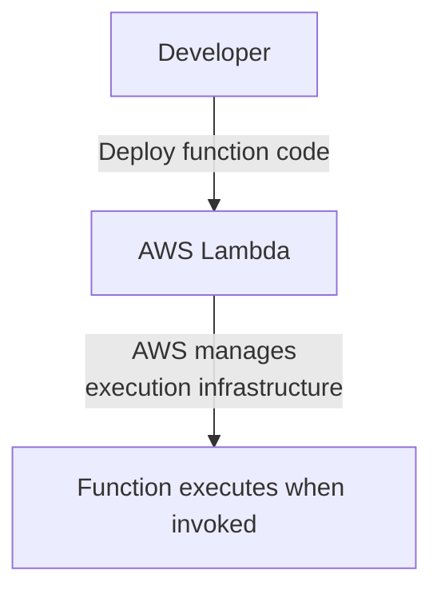

You generally do not manage the underlying server operating system, patch its host, or keep an application process running yourself.

Instead, you configure things such as:

- Function code and runtime.
- Memory and timeout.
- Permissions.
- Event sources.
- Networking, when needed.
- Monitoring and error handling.

Serverless does not mean that servers do not exist.

It means the cloud provider manages more of the underlying infrastructure for you.

---

## 3. What Is AWS Lambda?

**AWS Lambda** is a compute service that runs your code in response to configured events or direct invocations.

A Lambda function can be triggered by:

- An HTTP request routed through API Gateway.
- An object uploaded to S3.
- A message arriving in a queue.
- A scheduled event.
- An event from another AWS service.
- A direct invocation from another application.

The basic model is:

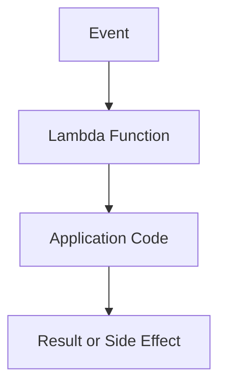

For example, when an image is uploaded to S3, a Lambda function could generate a thumbnail.

When an API request arrives, a Lambda function could retrieve a product and return JSON.

The same compute service can support many different event-driven workflows.

---

## 4. What Is Amazon API Gateway?

**Amazon API Gateway** is a managed service for creating and operating APIs.

It can receive HTTP requests, apply configured API behavior, and route requests to an integration such as Lambda.

A typical architecture is:

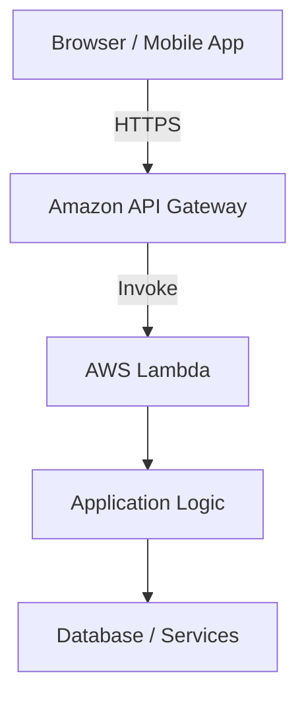

API Gateway can provide capabilities such as:

- HTTP API endpoints.
- Request routing.
- Authentication and authorization integration.
- Throttling and quotas.
- Request and response configuration.
- Logging and monitoring integration.

Its exact capabilities and pricing depend on the API type and configuration.

**API Gateway and Lambda solve different problems.**

- API Gateway handles the API entry point and related request-management features.
- Lambda executes the application code.

You can use Lambda without API Gateway, and API Gateway can integrate with backends other than Lambda.

---

## 5. Trace an API Request

Suppose a mobile application requests:

```http
GET /products/42
```

The architecture is:

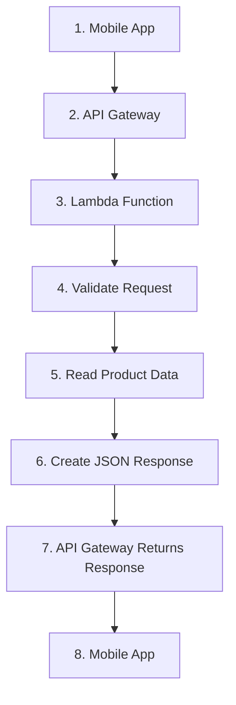

Each component has a clear responsibility.

| Component | Responsibility |
|---|---|
| Mobile app | Sends the request and displays the result |
| API Gateway | Accepts and routes the API request |
| Lambda | Executes backend application logic |
| Database | Stores persistent application data |
| IAM | Controls which AWS resources the function can access |
| CloudWatch | Helps collect logs, metrics, and operational signals |

A small API can use this architecture without requiring you to manage a continuously running web-server fleet.

---

## 6. Build a Simple Lambda Function

Let's create a basic Lambda handler using Node.js.

```javascript
export const handler = async (event) => {
  const productId = event.pathParameters?.id;

  if (!productId || !/^\d+$/.test(productId)) {
    return {
      statusCode: 400,
      headers: {
        "content-type": "application/json",
      },
      body: JSON.stringify({
        error: "A valid product ID is required",
      }),
    };
  }

  return {
    statusCode: 200,
    headers: {
      "content-type": "application/json",
    },
    body: JSON.stringify({
      id: Number(productId),
      name: "Mechanical Keyboard",
      price: 2499,
    }),
  };
};
```

This example returns sample data rather than connecting to a real database.

The function expects an API Gateway integration that provides the product ID through `event.pathParameters.id`.

The response contains:

- An HTTP status code.
- Response headers.
- A serialized JSON body.

This is a simple Lambda proxy-style response pattern. The event and response structure depends on the API Gateway integration type.

---

## 7. Configure the API Route

Conceptually, configure an API route such as:

```text
GET /products/{id}
```

Connect it to the Lambda function.

The flow becomes:

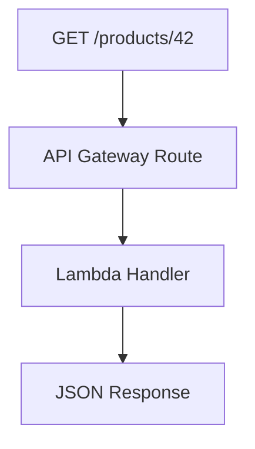

The client might receive:

```json
{
  "id": 42,
  "name": "Mechanical Keyboard",
  "price": 2499
}
```

The exact API setup steps vary depending on whether you use an API Gateway HTTP API or REST API, and whether you configure it through the console, CLI, SDK, or infrastructure as code.

For learning, understand the integration first; automate the deployment once the behavior is clear.

---

## 8. What Is a Lambda Invocation?

An **invocation** occurs when a caller or event source asks Lambda to execute a function.

For example:

```text
Request A ──> Invocation A
Request B ──> Invocation B
Request C ──> Invocation C
```

The function code processes the event it receives.

An invocation may produce:

- A response.
- A side effect, such as writing to a database.
- A message sent to another service.
- An error or timeout.

Not every invocation has an HTTP response. A function triggered by an S3 event, for example, may simply process an uploaded file.

---

## 9. Execution Environments and Reuse

Lambda runs functions inside managed execution environments.

An environment provides the runtime and resources needed to execute the function.

Conceptually:

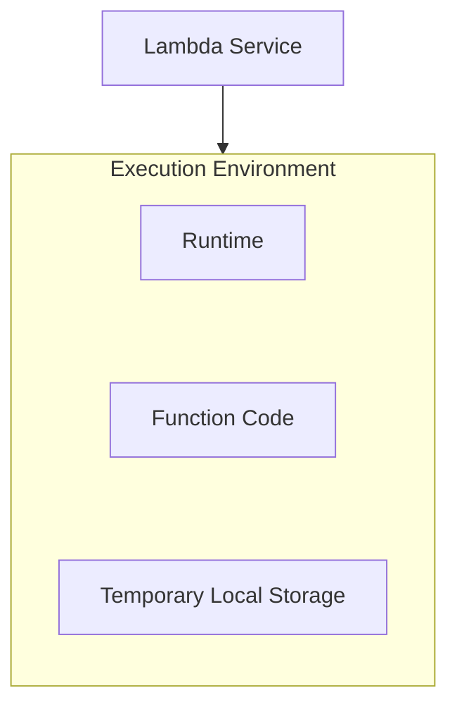

AWS may reuse an execution environment for subsequent invocations.

This means initialization performed outside the handler can sometimes be reused.

For example:

```javascript
const config = loadConfiguration();

export const handler = async (event) => {
  // Handle this invocation using the initialized configuration.
};
```

Reuse is an optimization, not a guarantee that the same environment will always serve a particular user or request.

Do not store critical application state only in function memory.

A later invocation may use a different environment, and an environment may eventually be discarded.

---

## 10. Cold Starts

A **cold start** occurs when Lambda must prepare an execution environment before it can run the handler.

A simplified lifecycle is:

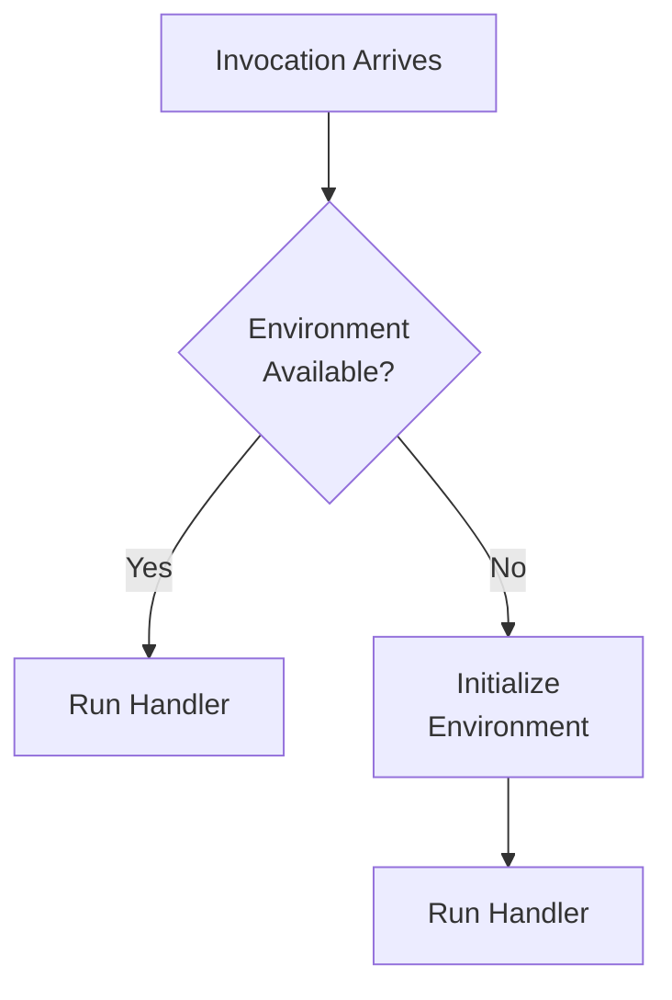

Initialization may include starting the runtime and loading application code or dependencies.

A warm environment may avoid some initialization work, but warm reuse is not guaranteed.

Cold-start impact depends on factors such as:

- Runtime and initialization work.
- Package and dependency size.
- Memory configuration.
- Networking configuration.
- Runtime features and deployment architecture.

For many applications, occasional initialization latency is acceptable.

For latency-sensitive workloads, measure real behavior and consider relevant optimizations rather than assuming cold starts will always be significant—or always be negligible.

---

## 11. Timeouts and Execution Limits

Lambda functions have a configured timeout.

If a function exceeds that limit, Lambda stops the invocation and reports a timeout.

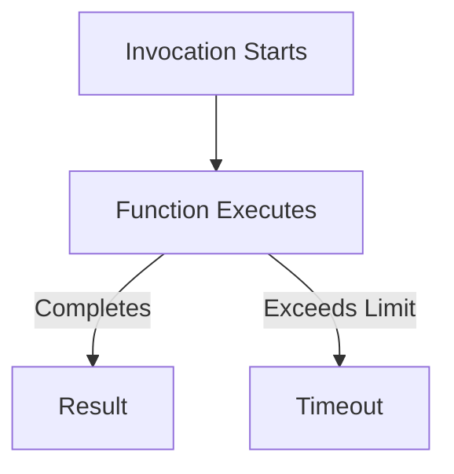

Choose the timeout according to the operation's expected duration and the user-facing request budget.

For example, an API request that calls a database should not wait indefinitely for that database.

Also remember that a timeout does not prove that a downstream operation failed. A database write or external API call might have completed even if the function did not receive the result in time.

This connects directly to **02.10 — Timeouts** and **02.11 — Retries**.

Lambda is designed for bounded function executions, not as a general-purpose way to keep an indefinitely running process alive. Long-running or continuous workloads may fit containers, queues, or other managed services better.

AWS changes service limits over time, so check current Lambda documentation when choosing runtime, timeout, memory, payload, or concurrency settings for a real deployment.

---

## 12. Concurrency

**Concurrency** is the number of function invocations executing at the same time.

Suppose requests arrive close together:

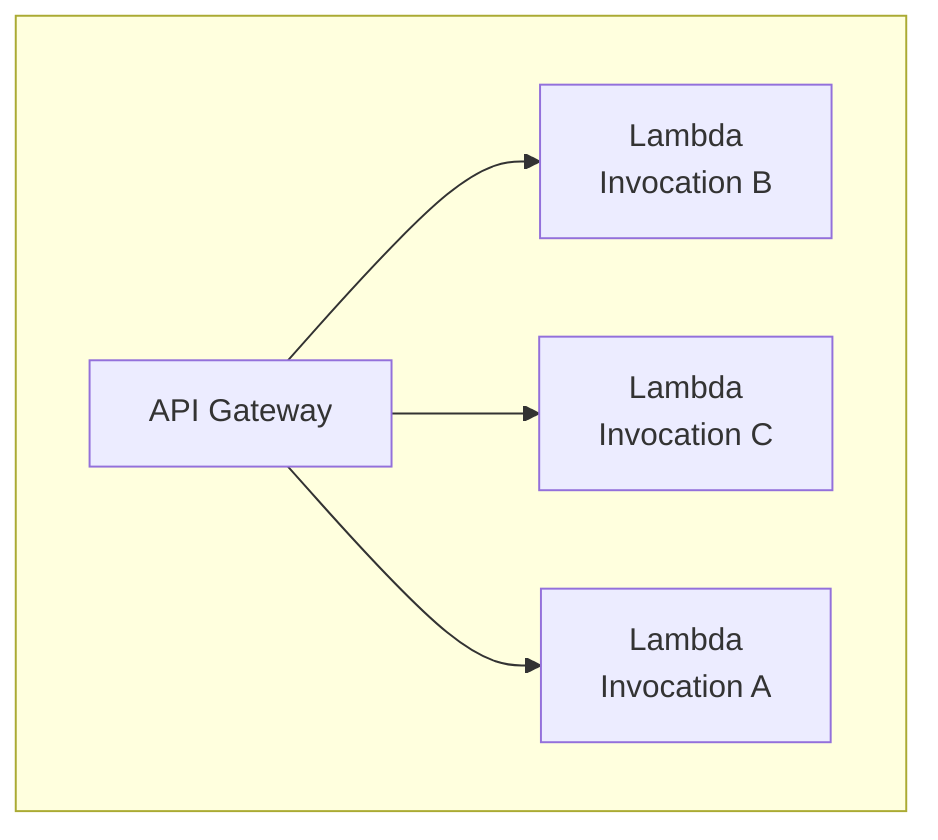

Lambda can run multiple invocations concurrently, subject to account, function, and service limits.

This is different from running one long-lived server process that handles many requests through its own thread or event-loop model.

A sudden increase in incoming requests can increase Lambda concurrency rapidly.

That can be useful for absorbing bursts, but it can also overwhelm a shared dependency.

For example:

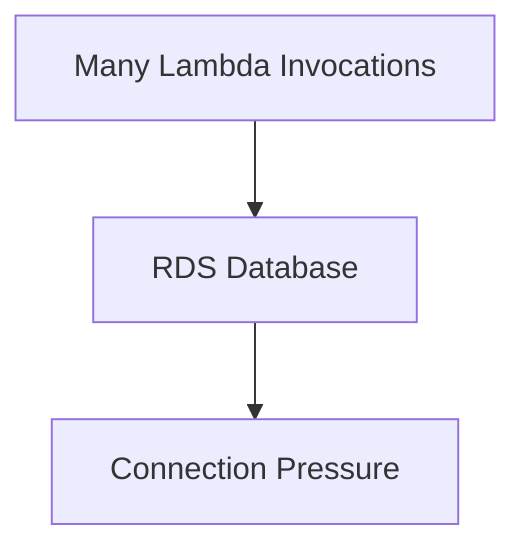

If every concurrent invocation opens a new database connection, the database may reach its connection limit.

Serverless compute can scale quickly; a relational database does not necessarily scale at the same rate.

---

## 13. Reserved and Provisioned Concurrency

Lambda provides concurrency controls for different purposes.

**Reserved concurrency** reserves capacity for a function and also establishes a concurrency limit for that function.

It can protect other functions from being crowded out, but setting the limit too low can cause requests to be throttled.

**Provisioned concurrency** prepares execution environments in advance for a configured amount of concurrency, helping reduce initialization latency for supported workloads.

Provisioned concurrency can incur additional charges and needs to be configured according to expected demand.

These controls address different problems:

| Control | Main purpose |
|---|---|
| Reserved concurrency | Reserve and limit concurrency for a function |
| Provisioned concurrency | Keep execution environments initialized in advance |

Neither one fixes slow application logic or an overloaded database.

---

## 14. Lambda and Databases

A Lambda function can communicate with a database, but the architecture needs careful connection management.

For example:

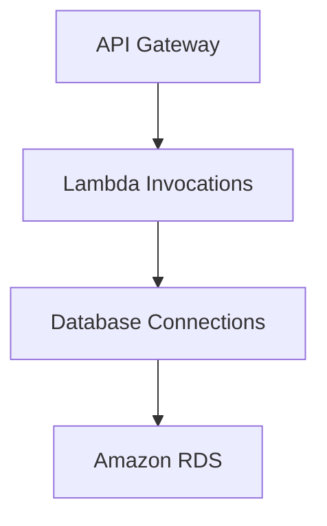

If concurrency rises sharply, the function fleet may create too many database connections.

Possible approaches include:

- Reusing database clients where appropriate within an execution environment.
- Keeping queries efficient.
- Limiting function concurrency when necessary.
- Using suitable connection-management strategies.
- Considering Amazon RDS Proxy for supported relational database workloads.
- Moving work to a queue when synchronous processing is unnecessary.

Reusing a client within an execution environment does not mean that all Lambda invocations share one global connection pool.

Each environment may have its own connections, and environments can be created or removed dynamically.

**The design must account for the aggregate connection demand across all environments.**

---

## 15. Synchronous vs Asynchronous Processing

Not every task needs to finish before the user receives a response.

Consider sending an order-confirmation email.

### Synchronous design

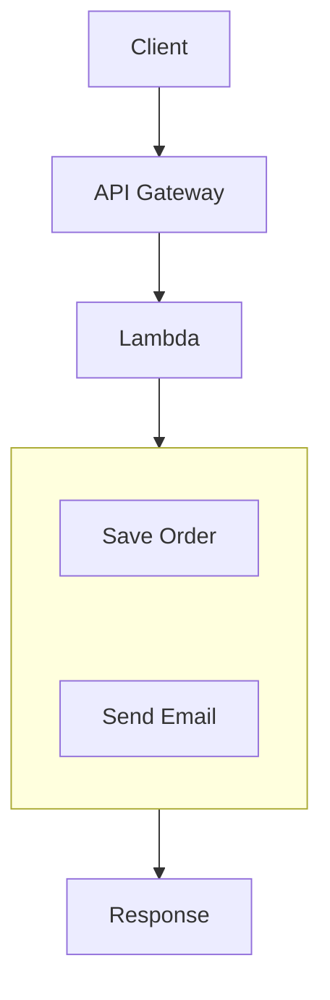

The request may wait for the email provider.

If the provider is slow, the user-facing request becomes slower too.

### Asynchronous design

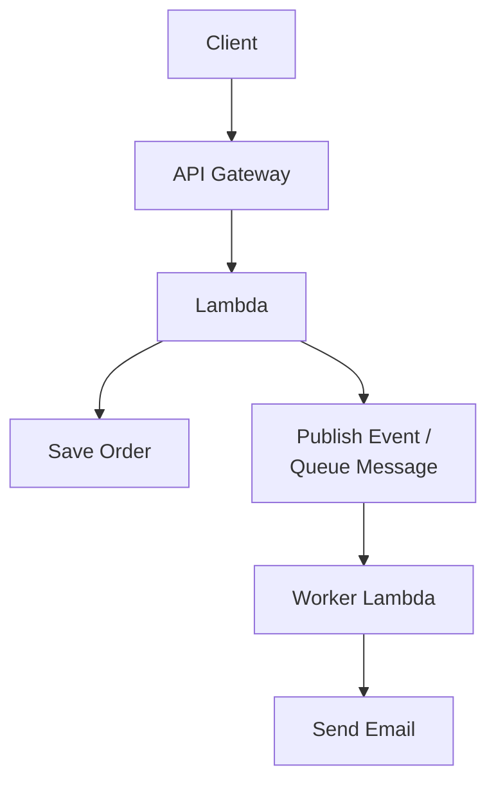

The API can return once the order has been safely saved and the required asynchronous work has been accepted.

The worker handles the email separately.

This improves decoupling, but introduces new requirements:

- Retry behavior.
- Duplicate processing protection.
- Failure monitoring.
- Dead-letter handling where appropriate.
- Clear status tracking.

A queue is not automatically necessary for every small operation. Use asynchronous processing when it provides a meaningful benefit.

---

## 16. Event-Driven Serverless Architecture

Lambda becomes particularly useful when connected to event-producing services.

For example, an image-processing workflow:

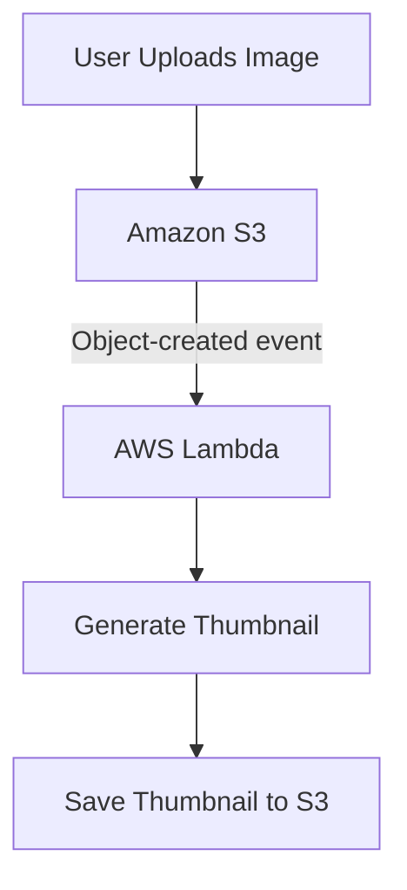

Another example is queue processing:

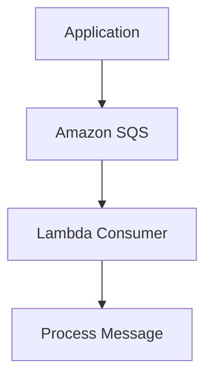

These designs let different components work independently.

However, event delivery and processing can produce duplicate attempts or retries, depending on the event source and integration. Design handlers to tolerate duplicate processing when necessary.

---

## 17. Retries and Idempotency

Imagine a Lambda function processes a payment request.

The payment provider completes the operation, but the function times out before it receives the result.

A retry may submit the same request again.

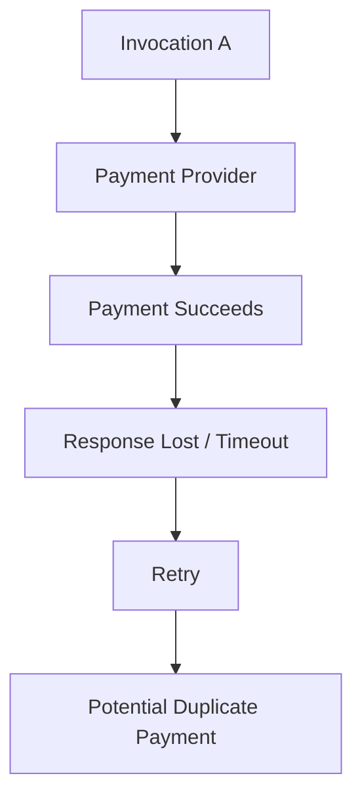

For side-effecting operations, use appropriate idempotency mechanisms.

For example, a payment provider may support an idempotency key that lets repeated submissions represent the same logical operation.

For event-driven processing, use a stable event or operation identifier and design the handler so that duplicate delivery does not accidentally duplicate the business effect.

Also configure retry behavior according to the event source and invocation mode. Lambda does not use one universal retry policy for every trigger.

---

## 18. Security and IAM

A Lambda function often needs permission to access other AWS resources.

For example:

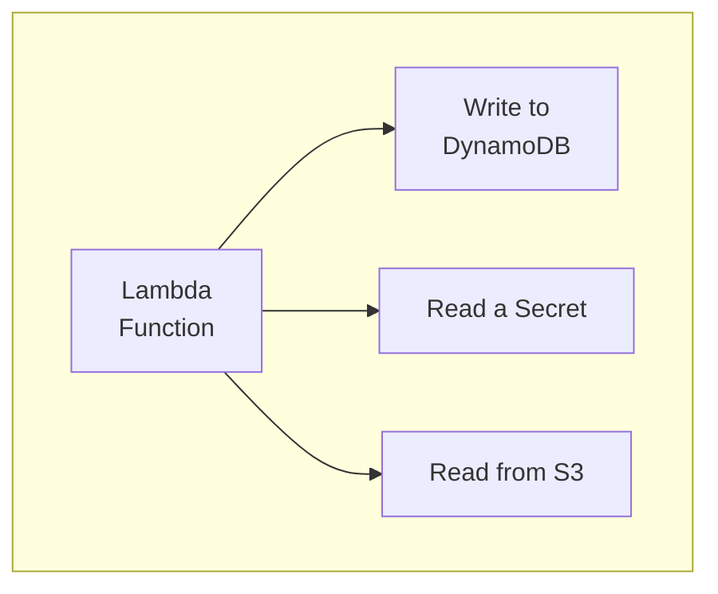

Use an appropriate **execution role**.

The role grants the function the AWS permissions it needs.

A function that only reads product data should not receive unrestricted write access to every database or S3 bucket.

Follow least privilege:

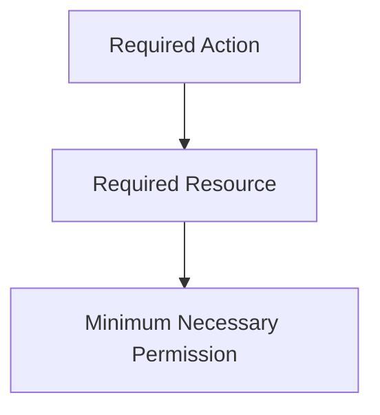

Also consider:

- API authentication and authorization.
- Input validation.
- Secret storage.
- Dependency vulnerabilities.
- Network access.
- Logging of sensitive information.
- Restricting access to administrative operations.

API Gateway can help enforce configured authentication and authorization mechanisms, but a public API is not secure merely because it uses API Gateway.

---

## 19. VPC Networking

A Lambda function can run without being attached to your VPC when it does not need private VPC resources.

If it needs to access a private RDS instance, you may configure VPC connectivity for the function.

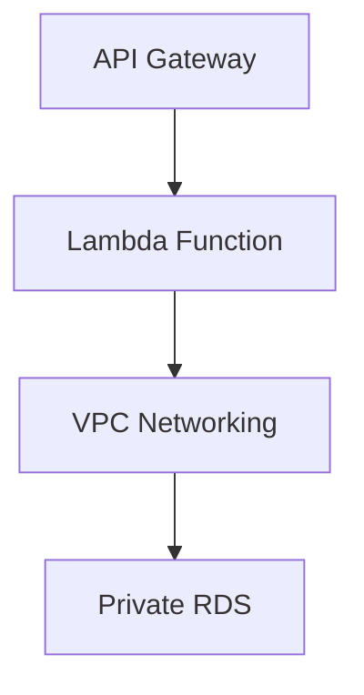

When configuring this architecture, consider:

- Subnet selection.
- Security Groups.
- Available IP addresses.
- Database connectivity.
- Outbound internet access where needed.
- NAT Gateway costs and routing.

A Lambda function attached to a VPC does not automatically receive unrestricted internet access.

Network routes and security controls still determine which destinations it can reach.

For a public API that accesses a private database, API Gateway can remain the public entry point while the database stays private.

---

## 20. Lambda vs EC2 vs ECS

You now have three important compute models.

| Consideration | EC2 | ECS | Lambda |
|---|---|---|---|
| Main unit | Virtual machine | Container task/service | Function invocation |
| Host management | You manage the VM | Depends on EC2 or Fargate | AWS manages the execution infrastructure |
| Execution model | Long-running processes are common | Container workloads can run continuously or for bounded tasks | Event-driven invocations |
| Scaling | EC2 Auto Scaling and related mechanisms | Task/service scaling | Managed invocation scaling with concurrency controls |
| Runtime control | High | Container-level control | Runtime and function configuration |
| Long-running process | Suitable | Suitable for many workloads | Subject to invocation limits |
| Operational responsibility | OS, app, and infrastructure configuration | Container, task, and platform configuration | Function code, permissions, dependencies, and service configuration |
| Cost model | Instance and associated resource costs | Compute capacity or task resource costs | Requests, duration, configured resources, and related service costs |

There is no universal winner.

Choose according to workload duration, traffic patterns, runtime requirements, operational capacity, dependency behavior, and cost.

---

## 21. When Serverless Is a Good Fit

Lambda is often a good fit for:

- Small HTTP API handlers.
- Event-driven processing.
- S3 object-processing workflows.
- Scheduled automation.
- Queue consumers.
- Webhooks.
- Lightweight background jobs.
- Workloads with variable or intermittent demand.

It may be less suitable when you need:

- A continuously running process.
- A long-lived connection model that exceeds the service's execution model.
- Specialized host-level control.
- Consistent low-latency initialization without the right configuration.
- Workloads that exceed Lambda's supported execution limits.
- A resource profile or pricing model better served by long-running compute.

These are starting points, not absolute rules. Measure the workload and evaluate the actual service limits and economics.

---

## 22. Common Failure Modes

| Problem | Effect | What to investigate |
|---|---|---|
| Incorrect handler or runtime configuration | Function fails to start | Handler name, runtime, package structure |
| Missing IAM permission | AWS API call is denied | Execution role and resource policy |
| Function timeout | Invocation fails before completion | Slow dependency, execution time, timeout |
| Cold-start latency | Some requests take longer | Initialization work and measured latency |
| Too much concurrency | Database or API becomes overloaded | Concurrency limits and dependency capacity |
| Missing environment configuration | Runtime error | Configuration and secret references |
| VPC routing problem | Private dependency is unreachable | Subnets, routes, Security Groups |
| Duplicate event processing | Side effects occur more than once | Idempotency and retry behavior |
| Oversized deployment package | Slower deployment or packaging difficulty | Dependencies and packaging approach |
| Poorly chosen memory | Slow execution or unnecessary cost | Benchmark memory and duration |
| Excessive logging | Higher cost and noisy diagnostics | Log volume and retention |

---

## 23. Cost Considerations

Lambda pricing commonly depends on request volume and execution characteristics, including configured memory and execution duration. API Gateway, CloudWatch, networking, data transfer, and downstream services can create additional costs.

The total system cost is more than the Lambda bill.

For example:

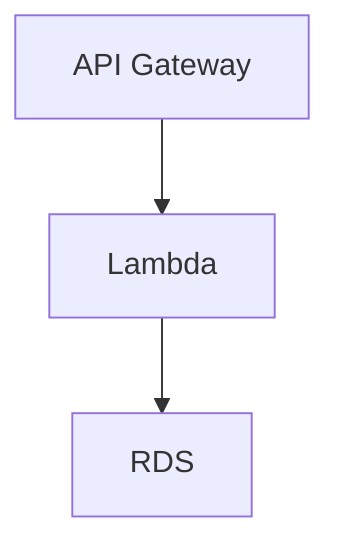

Even if Lambda execution is inexpensive, an oversized RDS instance, NAT Gateway, high logging volume, or excessive database connections can dominate the total cost.

Before deploying a lab:

1. Check current pricing for the selected Region and API type.
2. Set budget alerts.
3. Avoid unnecessary provisioned concurrency.
4. Keep logs at a sensible retention period.
5. Watch database and networking costs.
6. Remove test APIs, functions, log groups, and supporting resources when finished.

Budget alerts help you monitor spending; they are not necessarily hard spending limits.

---

## 24. Hands-On Exercise: Understand the Request Path

Use the sample Node.js handler from Section 6.

### Step 1 — Identify the input

For a request such as:

```http
GET /products/42
```

the handler reads:

```javascript
event.pathParameters?.id
```

This depends on the API Gateway integration passing the path parameter in that event field.

### Step 2 — Identify the validation

```javascript
if (!productId || !/^\d+$/.test(productId)) {
  // Return HTTP 400
}
```

This rejects missing or non-numeric product IDs.

### Step 3 — Identify the response

The handler returns a status code, headers, and a JSON body.

### Step 4 — Draw the architecture

```mermaid
flowchart TD
  accTitle: The request path to draw
  accDescr: The client calls API Gateway, which invokes the Lambda handler; the handler validates input, reads the product and returns JSON.
  N0["Client"] --> N1["API Gateway"] --> N2["Lambda Handler"] --> G
  subgraph G[" "]
    direction TB
    I0["Validate input"] ~~~ I1["Read product"] ~~~ I2["Return JSON"]
  end
```

### Step 5 — Consider the production changes

Before connecting a real database, decide:

- How will the function authenticate users?
- Which IAM permissions does it need?
- How will it obtain database credentials?
- What happens when RDS is slow?
- What is the request timeout budget?
- How will database connections be managed?
- How will retries avoid duplicate side effects?
- What metrics and logs will reveal errors?

The purpose is to understand the design before introducing additional infrastructure.

### Optional AWS lab

When you are ready:

1. Create a Lambda function using a supported Node.js runtime.
2. Deploy the handler.
3. Create an API Gateway route such as `GET /products/{id}`.
4. Configure the Lambda integration and permissions.
5. Test valid and invalid product IDs.
6. Inspect logs and metrics.
7. Remove the API and test resources when finished.

This can incur charges. Check current AWS pricing and configure billing alerts first.

---

## 25. System Design View

The architecture has three distinct layers:

```mermaid
flowchart TD
  accTitle: Three layers
  accDescr: The client calls API Gateway, the API entry point and request handling; it invokes Lambda, the application logic, which uses data and other services.
  N0["Client"] --> N1["API Gateway"] -->|"API entry point and<br/>request handling"| N2["Lambda"] -->|"Application logic"| N3["Data / Other Services"]
```

For event-driven work, the entry point can instead be a queue, S3 event, schedule, or another supported trigger.

The important design questions are:

- Is the work naturally event-driven?
- How long does each execution take?
- How much concurrency can the dependencies support?
- Does the operation have side effects?
- What happens if an event is retried?
- Does the function need private network access?
- What should be synchronous, and what should be asynchronous?
- Is the operational simplicity worth the service and execution trade-offs?

Serverless is an architectural choice, not a goal in itself.

---

## 26. Quick Reference

| Concept | Meaning |
|---|---|
| Serverless | Provider-managed execution infrastructure |
| AWS Lambda | Runs code in response to invocations and events |
| API Gateway | Managed API entry point and routing service |
| Invocation | An execution request sent to a Lambda function |
| Execution environment | Managed runtime environment used to execute a function |
| Cold start | Initialization work required before an invocation can run |
| Concurrency | Number of simultaneous function invocations |
| Reserved concurrency | Reserves and limits function concurrency |
| Provisioned concurrency | Keeps configured execution environments initialized in advance |
| Trigger | Event or caller that invokes a function |
| Execution role | IAM role defining a function's AWS permissions |
| Idempotency | Designing repeated operations to avoid unintended duplicate effects |
| Event-driven architecture | Components respond to events rather than relying only on direct synchronous calls |
| Timeout | Bound on how long an invocation is allowed to execute |

---

## 27. Knowledge Check

### 1. What does serverless mean?

The provider manages the underlying compute infrastructure, while the developer configures and operates the application code and its dependencies.

### 2. What is the difference between API Gateway and Lambda?

API Gateway manages the API entry point and request routing. Lambda executes the application code.

### 3. What is a cold start?

Initialization work needed when a suitable execution environment is not already available.

### 4. Why can Lambda concurrency overload RDS?

Many simultaneous invocations may create or use more database connections and queries than the database can support.

### 5. Does a timeout prove that a payment or database write failed?

No. The operation may have completed even though the caller did not receive the result in time.

### 6. Why is idempotency important?

Retries and duplicate events can repeat an operation. Idempotency helps prevent unintended duplicate business effects.

### 7. When might ECS be a better fit than Lambda?

For example, when an application needs a continuously running process, a different connection model, or execution behavior that does not fit Lambda's limits.

### 8. Does serverless remove the need for networking and IAM design?

No. Functions still need appropriately scoped permissions and correct network access to their dependencies.

---

## Remember

API Gateway exposes and routes API requests. Lambda executes code in response to requests and events. The surrounding AWS services provide permissions, networking, storage, and observability.

```mermaid
flowchart TD
  accTitle: Serverless in one line
  accDescr: HTTP Request / Event, then API Gateway / Trigger, then Lambda, then Database / AWS Services.
  N0["HTTP Request / Event"] --> N1["API Gateway / Trigger"] --> N2["Lambda"] --> N3["Database / AWS Services"]
```

The deeper principle is:

> **Choose serverless when its event-driven execution model and reduced infrastructure management fit the workload—not simply because it requires fewer servers for you to manage.**

**Next: 12.13 — DNS, Custom Domains & TLS Certificates**
