# 12.13 — DNS, Custom Domains & TLS Certificates

## Learning Objectives

By the end of this chapter, you should be able to:

- Explain how DNS maps domain names to network destinations.
- Understand domains, DNS records, nameservers, and hosted zones.
- Distinguish A, AAAA, CNAME, and alias records.
- Connect a custom domain to an AWS-hosted application.
- Understand TLS certificates and the HTTPS handshake.
- Explain how AWS Certificate Manager (ACM) and Route 53 fit into the architecture.
- Recognize common DNS and certificate failures.
- Configure a domain safely without exposing private infrastructure.

---

## 1. The Problem: Users Need a Stable Address

Suppose you've deployed an application on EC2.

The server has a public IP address:

```text
http://203.0.113.10
```

Users could access it through that address, but it isn't an ideal public identity.

You want users to visit:

```text
https://app.example.com
```

Three things must work together:

1. **DNS** — helps the browser find the destination.
2. **Routing** — directs traffic to the correct application endpoint.
3. **TLS** — protects the HTTPS connection and proves the server's identity.

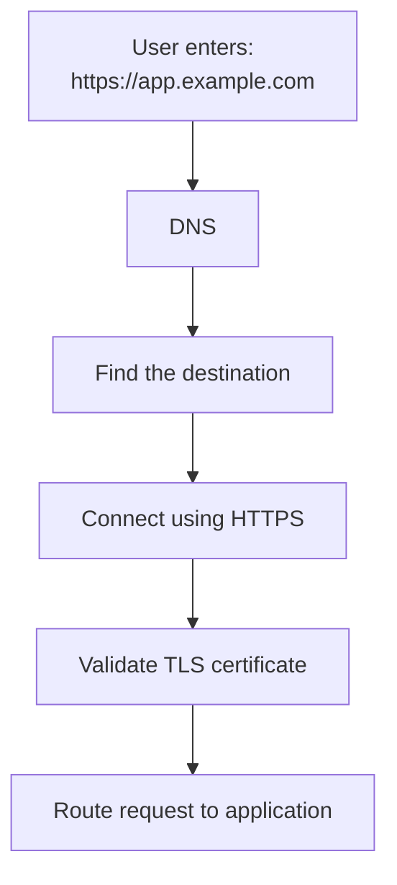

DNS and TLS solve different problems. DNS helps locate a destination; TLS protects and authenticates the connection.

---

## 2. Beginner Vocabulary

| Term | Simple meaning |
|---|---|
| Domain | A human-readable name such as `example.com` |
| Subdomain | A name beneath a domain, such as `app.example.com` |
| DNS | The system that resolves domain names into records containing destinations or other information |
| DNS resolver | A service that looks up DNS information for a client |
| Nameserver | A server responsible for answering DNS queries for a zone |
| DNS record | An instruction or data entry associated with a domain name |
| Hosted zone | A collection of DNS records managed for a domain |
| TLS | A protocol that protects network communication and authenticates the server |
| Certificate | A digitally signed statement binding a domain identity to a public key |
| HTTPS | HTTP carried over TLS |
| Certificate authority (CA) | An organization trusted to issue certificates |
| DNS propagation | The informal term for the time it takes DNS changes to become visible through caches and resolvers |

---

## 3. How DNS Works

Imagine a user opens:

```text
https://app.example.com
```

The browser needs to discover where `app.example.com` should connect.

A simplified lookup looks like this:

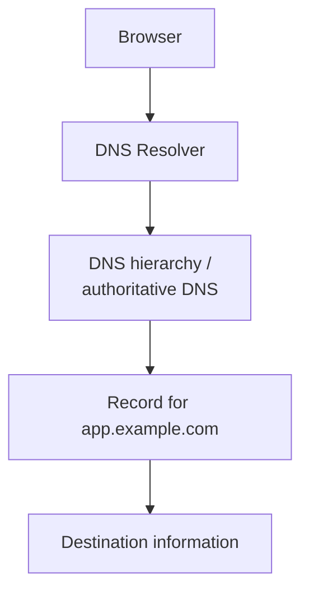

The resolver may already have a cached answer. If not, it performs the necessary lookups.

The real DNS hierarchy includes root servers, top-level domain servers, and authoritative nameservers. You don't normally query each layer manually.

### Important distinction

DNS does **not** normally send the HTTP request to your application. It supplies DNS information that helps the client find the destination. The browser then connects to that destination.

---

## 4. Domain Name Structure

Consider:

```text
app.example.com
```

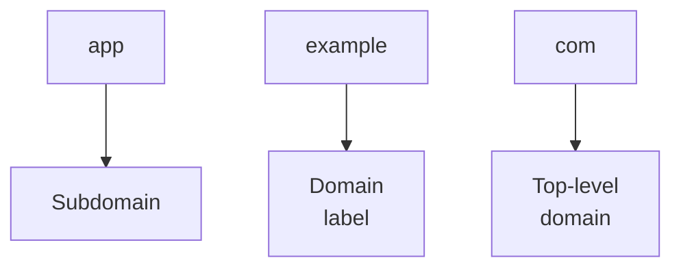

Common names might be:

```text
example.com             Main website
www.example.com         Public website
app.example.com         Web application
api.example.com         Backend API
admin.example.com       Administrative interface
```

These names can resolve to the same destination or to different destinations, depending on your architecture.

A subdomain does not automatically create a separate server. DNS configuration determines where it points.

---

## 5. Common DNS Record Types

DNS records express different kinds of information.

| Record | Purpose | Example |
|---|---|---|
| `A` | Maps a name to an IPv4 address | `app.example.com → 203.0.113.10` |
| `AAAA` | Maps a name to an IPv6 address | `app.example.com → IPv6 address` |
| `CNAME` | Aliases one DNS name to another DNS name | `www.example.com → app.example.com` |
| `MX` | Identifies mail servers for a domain | Mail delivery configuration |
| `TXT` | Stores text used for verification and policies | Domain ownership verification |
| `NS` | Identifies authoritative nameservers for a zone | Delegation information |
| `CAA` | Restricts which certificate authorities may issue certificates for a domain | Certificate issuance policy |

The examples are illustrative. Public IP addresses and targets must be replaced with real values from your hosting provider.

### A record

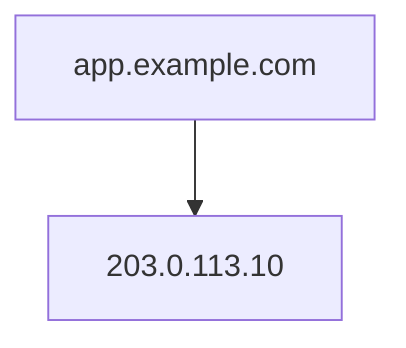

An A record contains an IPv4 address.

### AAAA record

An AAAA record provides an IPv6 address. Only publish IPv6 destinations that are correctly configured to serve the application.

### CNAME record

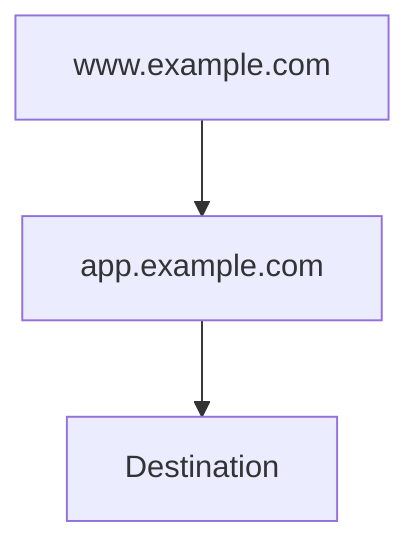

A CNAME points to another DNS name, not directly to an IP address.

A conventional CNAME generally cannot coexist with other record types at the same name. The zone apex, such as `example.com`, also has special restrictions because it must contain essential DNS records. Providers offer different ways to work around this.

---

## 6. What Is a DNS Hosted Zone?

In AWS Route 53, a **hosted zone** holds DNS records for a domain or subdomain.

For example:

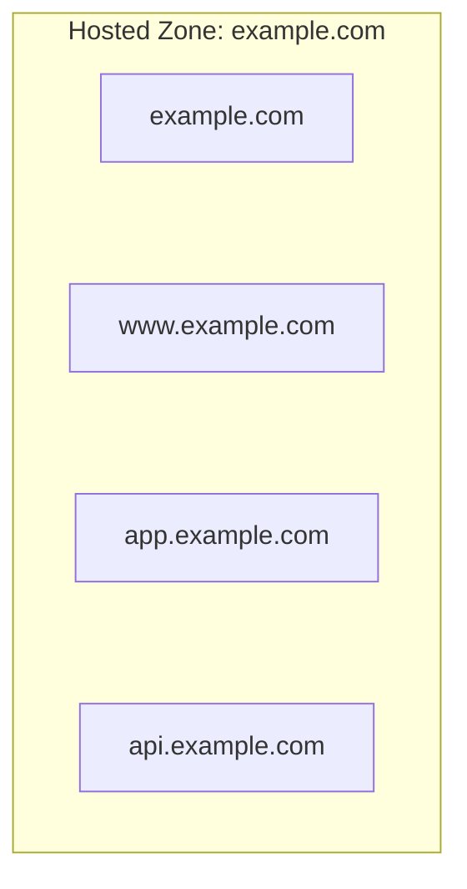

A hosted zone can be:

- **Public** — used to answer DNS queries from the public internet.
- **Private** — used for DNS resolution within associated VPCs.

For a publicly accessible website, you'll generally need a public DNS configuration.

A private hosted zone is useful for internal names such as:

```text
database.internal
```

It does not make a service publicly accessible.

### Route 53 responsibilities

Route 53 can provide:

- Domain registration, where supported.
- Public and private hosted zones.
- DNS record management.
- Routing policies such as weighted or failover routing.
- Health-check-related routing capabilities for supported configurations.

Registering a domain and managing its DNS are related but distinct operations. You can register a domain with one provider and host its DNS with another.

---

## 7. DNS Resolution vs Application Routing

These are different steps.

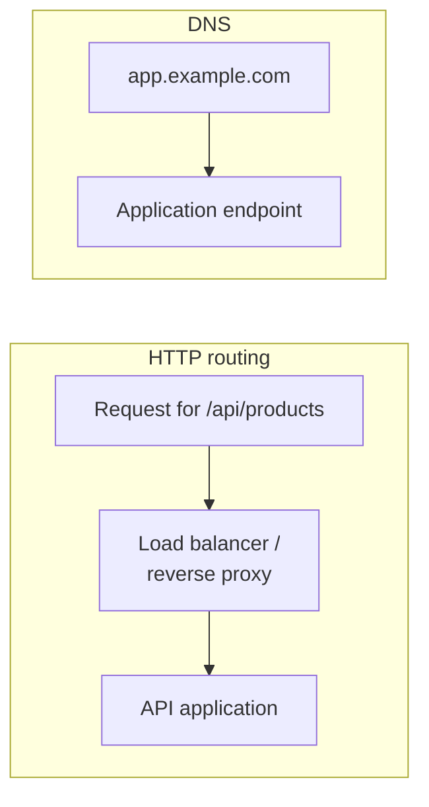

DNS usually directs the name to an endpoint. It does not decide which application function handles `/api/products`.

That decision belongs to HTTP routing, a reverse proxy, a load balancer, or the application itself.

For example, one load balancer may serve both:

```text
app.example.com
api.example.com
```

The load balancer can then use host-based or path-based listener rules to direct requests to different target groups.

---

## 8. A Custom Domain for an AWS Application

Let's connect the concepts from earlier chapters.

Suppose your application uses:

- Route 53 for public DNS.
- An Application Load Balancer (ALB) as the public entry point.
- EC2 or ECS tasks as application targets.
- ACM for the TLS certificate.

The architecture becomes:

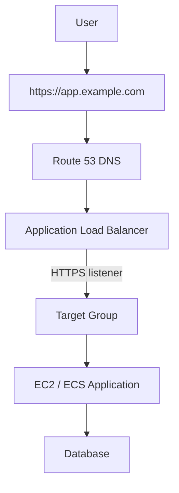

In this design:

- Route 53 resolves the domain to the ALB.
- The ALB terminates the public TLS connection.
- The target group routes the request to healthy application targets.
- The application communicates with the database through the appropriate network permissions.

The database should generally remain private. A public website does not require a publicly reachable database.

---

## 9. Why Use a Load Balancer as the Public Endpoint?

You could point a domain directly at a public EC2 IP address. That can be appropriate for a small lab, but it creates operational limitations.

For example:

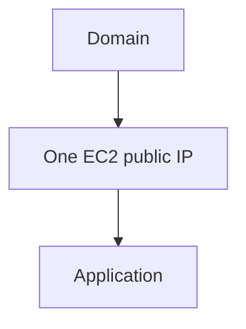

If the instance is replaced or its public address changes, DNS may need to change.

With an ALB:

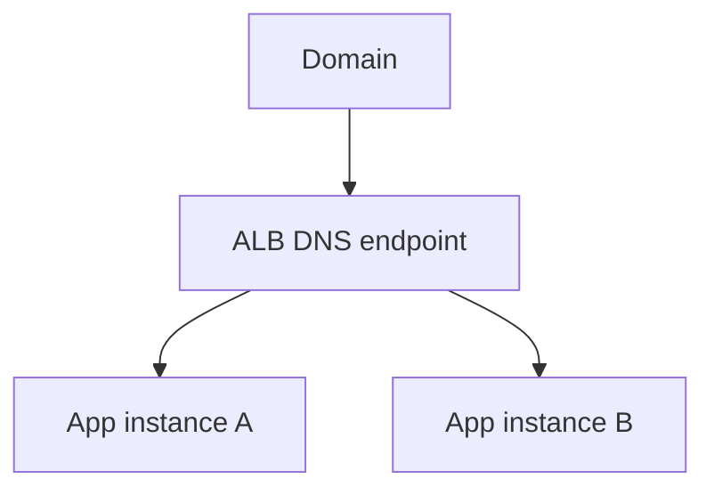

The ALB provides a stable managed entry point while its targets can change.

In Route 53, an **alias record** can point a domain to supported AWS resources such as an ALB.

This is particularly useful at the zone apex:

```text
example.com
```

where a conventional CNAME is not appropriate.

An alias record is an AWS Route 53 feature, not a standard DNS record type.

---

## 10. What Is TLS?

DNS helps find a destination, but it does not encrypt the connection.

Without HTTPS, HTTP traffic can be exposed or modified by an attacker with a suitable position on the network.

TLS provides:

- **Encryption** — protects data in transit.
- **Integrity** — helps detect unauthorized changes to protected traffic.
- **Server authentication** — allows the client to verify the server's identity through its certificate and the certificate trust chain.

For example, a login request may contain:

```text
Email
Password
Session information
```

HTTPS protects that traffic while it travels between the browser and the TLS endpoint.

TLS does not guarantee that the application itself is secure. An application can have vulnerabilities even when HTTPS is configured correctly.

---

## 11. What Happens During an HTTPS Connection?

A simplified TLS connection works like this:

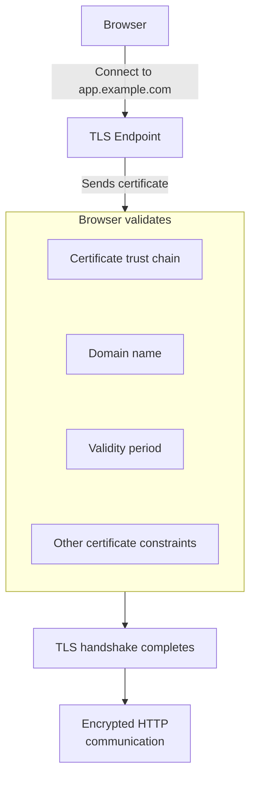

Modern TLS handshakes also negotiate cryptographic parameters and establish session keys. The exact handshake differs by TLS version and configuration.

### Important

A certificate is not simply an encryption password.

It binds an identity to a public key and is signed through a certificate trust chain. TLS uses cryptographic operations to establish a secure session.

---

## 12. What Is a TLS Certificate?

A TLS certificate contains information such as:

- The domain names it covers.
- The public key associated with the identity.
- The certificate issuer.
- The validity period.
- A digital signature from the issuer.

For example, a certificate might cover:

```text
app.example.com
```

A certificate for `app.example.com` does not automatically cover every other domain.

A certificate might also cover:

```text
example.com
www.example.com
app.example.com
```

depending on its Subject Alternative Names (SANs).

### Wildcard certificates

A wildcard certificate such as:

```text
*.example.com
```

can cover many single-level subdomains, such as:

```text
app.example.com
api.example.com
```

It does not automatically cover the apex:

```text
example.com
```

and it does not cover arbitrarily deep names such as:

```text
v2.api.example.com
```

unless those names are covered separately.

---

## 13. AWS Certificate Manager (ACM)

AWS Certificate Manager helps provision and manage TLS certificates for supported AWS services.

A common architecture is:

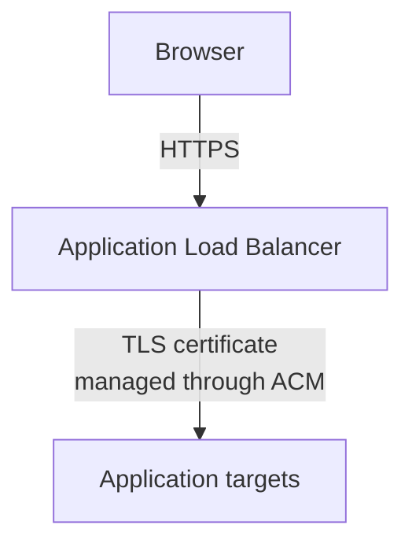

For a typical ALB HTTPS listener, the certificate is attached to the listener. ACM can handle certificate provisioning and renewal for eligible certificates.

### Important regional detail

For an ALB, the ACM certificate must be available in the **same AWS Region as that load balancer**.

CloudFront has a different certificate-region requirement: its ACM certificate must be in `us-east-1` (N. Virginia).

This is a practical deployment detail that can save significant debugging time.

---

## 14. Certificate Validation

Before issuing a certificate, the certificate authority needs to verify that you control the relevant domain.

ACM commonly supports:

- **DNS validation** — add a supplied DNS record proving domain control.
- **Email validation** — available for certain certificate workflows, but less convenient for automated management.

DNS validation is often preferred for AWS-managed certificates because the validation record can remain in DNS to support automatic renewal for eligible certificates.

A simplified process:

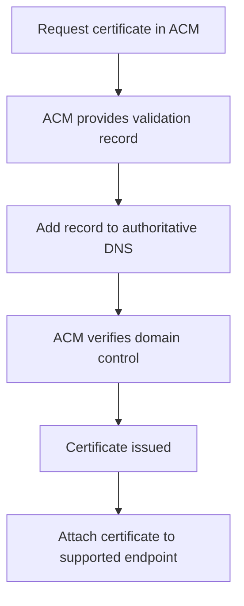

A certificate request being created does not mean the certificate is ready. Wait for its status to indicate successful issuance before configuring it for production traffic.

---

## 15. TLS Termination

TLS termination means decrypting the HTTPS connection at a designated endpoint.

For example:

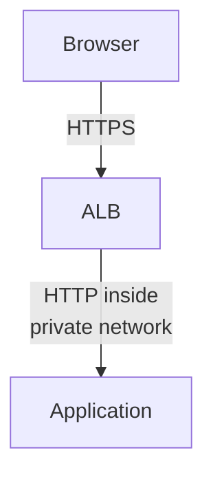

The ALB terminates the public TLS connection. The connection from the ALB to the target uses the protocol configured for that target group.

Another design is:

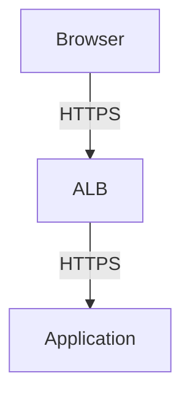

The second design encrypts traffic on both connections, but requires TLS configuration at the targets as well.

The correct choice depends on the threat model, compliance requirements, network boundaries, and operational complexity.

> **TLS termination does not automatically mean that every downstream connection is encrypted.**

---

## 16. DNS TTL and Caching

DNS answers can be cached.

A record may have a **Time to Live (TTL)** value indicating how long a resolver may cache the answer.

For example:

```text
app.example.com → endpoint
TTL = 300 seconds
```

A resolver may cache the answer for up to that period.

If you change the DNS record, clients may continue using a cached answer until it expires. Actual behavior can also be affected by resolver policies and other caches.

### Before a planned migration

A useful approach is:

1. Inspect the current TTL.
2. Reduce it in advance if the migration requires faster DNS changeover.
3. Wait for the old TTL to expire before switching.
4. Make the change.
5. Verify resolution and application health.
6. Restore a suitable TTL afterward.

Reducing TTL immediately before a change does not instantly remove old cached answers. Resolvers that already cached the previous value may retain it until their cache expires.

---

## 17. DNS Changes and "Propagation"

People often say:

> "DNS propagation is taking time."

Usually, the underlying issue is caching, delegation, or a record that has not been configured correctly.

Common causes include:

- Old records remaining cached.
- Incorrect nameservers at the domain registrar.
- Records added to the wrong hosted zone.
- Incorrect target values.
- A CNAME conflict.
- DNS validation records missing or malformed.

DNS changes do not always become visible everywhere at exactly the same time.

Do not assume every DNS problem is simply a matter of waiting.

---

## 18. Common Failure Modes

| Symptom | Possible cause | What to check |
|---|---|---|
| Domain does not resolve | Missing record or incorrect delegation | Authoritative nameservers and DNS records |
| Domain points to the old endpoint | Cached answer or incomplete migration | TTL and resolver results |
| Browser reports certificate mismatch | Certificate does not cover the hostname | Certificate names/SANs |
| Certificate remains pending | Validation record is missing or incorrect | ACM validation instructions and authoritative DNS |
| HTTPS connection fails | Listener or TLS configuration is wrong | ALB listener, certificate, supported configuration |
| ALB returns `503` | No healthy targets or routing issue | Target-group health and listener rules |
| One hostname works but another fails | Different records or missing certificate coverage | DNS records and certificate SANs |
| Website works, API fails | API DNS, routing, TLS, or application configuration differs | `api` record, listener rules, target health |

A DNS resolution success does not prove that the application is healthy. Likewise, a valid certificate does not prove that the backend can serve requests.

---

## 19. Domain, DNS, TLS, and Routing Are Separate Layers

When debugging, inspect each layer separately.

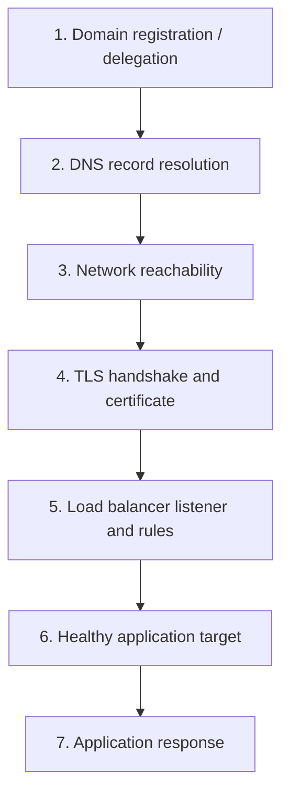

This order is useful because each step depends on earlier connectivity, but failures can occur at any layer.

For example, a valid DNS record may point to an ALB whose targets are all unhealthy.

---

## 20. Hands-On Exercise: Plan a Custom Domain

Use the architecture from Chapters 12.09 and 12.10.

### Scenario

You have:

- An application running on EC2 or ECS.
- An Application Load Balancer.
- A database in private subnets.
- A domain such as `example.com`.

Your goal is:

```text
https://app.example.com
```

to serve the application securely.

### Step 1 — Define the path

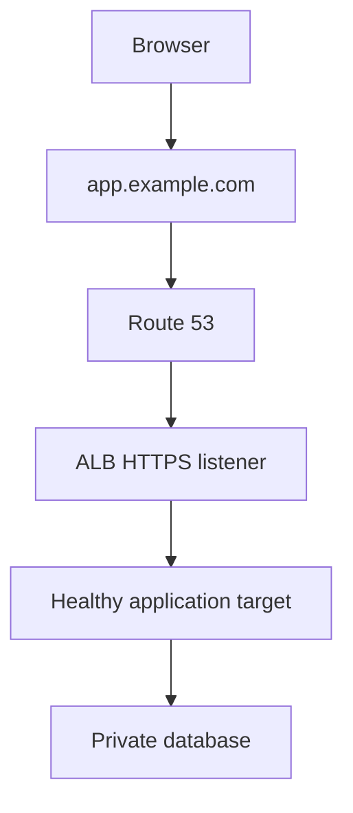

### Step 2 — Configure DNS

Create or use a public hosted zone for the domain.

For `app.example.com`, create an appropriate Route 53 alias record targeting the ALB.

Do not point the public record directly at the private IP address of an application target.

### Step 3 — Request the certificate

In ACM, request a certificate covering:

```text
app.example.com
```

Complete DNS validation using the record ACM provides.

Wait for the certificate to be issued.

### Step 4 — Configure the HTTPS listener

Configure the ALB's HTTPS listener to use the issued certificate and forward requests to the correct target group.

Ensure the target group has healthy targets.

### Step 5 — Redirect HTTP to HTTPS

If you want HTTP requests to use HTTPS, configure an HTTP listener to redirect to HTTPS.

Test the redirect and make sure the HTTPS endpoint serves the correct hostname.

### Step 6 — Verify the layers

Check:

- DNS resolves to the intended endpoint.
- The certificate covers the requested hostname.
- HTTPS works.
- HTTP redirects if configured.
- The load balancer has healthy targets.
- The application can reach its dependencies.

### Cost and safety note

This exercise is an architecture and configuration lab. Creating a Route 53 hosted zone, registering a domain, using an ALB, and running compute resources can incur charges. Prefer an existing test domain and infrastructure when possible. If you create resources for the exercise, remove unneeded resources afterward and preserve any DNS records or services that production systems depend on.

---

## 21. System Design View

DNS and TLS sit at the edge of your application architecture.

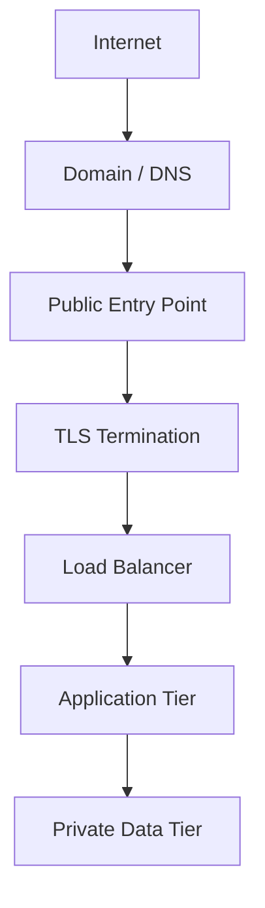

These components provide different guarantees:

- **DNS:** Helps clients discover the endpoint.
- **TLS:** Protects and authenticates the connection to the TLS endpoint.
- **Load balancer:** Routes requests to suitable targets.
- **Application:** Enforces authentication, authorization, and business rules.
- **Network controls:** Restrict which components can communicate.

A secure domain configuration does not replace application security or network isolation.

---

## 22. Common Mistakes

1. **Confusing DNS with HTTP routing.** DNS resolves names; the application or load balancer routes requests.
2. **Assuming DNS changes are instant.** Cached answers can remain visible until they expire.
3. **Using the wrong certificate region.** ACM certificates for an ALB must be in the ALB's Region.
4. **Forgetting hostname coverage.** A certificate must cover the hostname the client requests.
5. **Publishing private addresses publicly.** Public DNS should not expose private infrastructure as a public destination.
6. **Assuming HTTPS secures the entire application.** It protects the connection to the TLS endpoint, not application logic or every downstream connection.
7. **Ignoring target health.** DNS and TLS can work while the application remains unavailable.
8. **Forgetting cost cleanup.** Hosted zones, load balancers, domains, and compute resources may have ongoing costs.

---

## 23. Key Principle

> **DNS helps users find your service. TLS helps them connect to it securely. Routing delivers the request to the right application.**

These are separate responsibilities. Debug and design them as separate layers.

---

## 24. Quick Reference

| Component | Responsibility |
|---|---|
| Domain registrar | Registers the domain and manages its registration |
| DNS resolver | Looks up DNS answers for clients |
| Authoritative nameserver | Provides DNS answers for a zone |
| Route 53 hosted zone | Stores DNS records |
| A / AAAA record | Maps a name to an IPv4 / IPv6 address |
| CNAME record | Aliases one DNS name to another |
| Route 53 alias | AWS-specific record feature that can target supported AWS resources |
| TLS certificate | Binds a hostname identity to a public key through a trusted certificate chain |
| ACM | Manages supported TLS certificates |
| ALB HTTPS listener | Accepts HTTPS connections and uses a configured certificate |
| TTL | Controls how long a DNS answer may be cached |
| TLS termination | Ends a TLS connection at a designated endpoint |

---

## 25. Knowledge Check

1. What is the difference between DNS resolution and HTTP routing?
2. When would you use an A record instead of a CNAME?
3. What does a TLS certificate prove, and what does it not prove?
4. Why must an ACM certificate for an ALB be in the same Region as the load balancer?
5. Why might DNS still return an old destination after you update a record?
6. Can a domain resolve correctly while the website is unavailable? Explain.
7. What is the difference between TLS termination at an ALB and end-to-end TLS to the application?
8. Why should a production database generally not be a public DNS destination?

### Answers

1. DNS helps resolve a hostname to destination information; HTTP routing determines which service or application handler processes the request.
2. An A record maps a name to an IPv4 address. A CNAME aliases a name to another DNS name.
3. A certificate helps authenticate the covered domain and its public key through a trusted chain. It does not prove that the application is safe or functioning correctly.
4. The ALB uses a certificate available in its own AWS Region.
5. Resolvers may still have the previous answer cached until its TTL expires.
6. Yes. DNS can point to a reachable load balancer whose targets are unhealthy, or to an endpoint with other configuration problems.
7. TLS termination ends the public TLS connection at the ALB. End-to-end TLS also encrypts the connection from the ALB to the application.
8. Databases generally belong on private network paths accessible only to authorized application components, reducing public exposure.

---

## Remember

When a custom domain does not work, trace the request layer by layer:

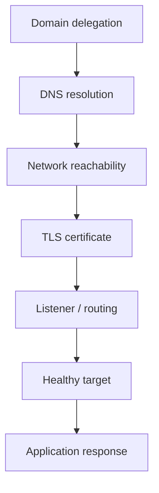

**Next: 12.14 — CI/CD: Automated Build, Test & Deployment**
