# 12.14 — CI/CD: Automated Build, Test & Deployment

## Learning Objectives

By the end of this chapter, you should be able to:

- Explain Continuous Integration (CI) and Continuous Delivery/Deployment (CD).
- Understand how a code change travels from Git to production.
- Build a basic CI/CD pipeline using GitHub Actions.
- Understand build, test, artifact, and deployment stages.
- Deploy applications without exposing credentials in source code.
- Recognize deployment failures, rollback strategies, and environment differences.
- Choose an appropriate deployment strategy for EC2, ECS, and serverless applications.

---

## 1. The Problem: Deployments Are Repetitive and Risky

Imagine you update a web application.

Without automation, you might manually:

1. Pull the latest code.
2. Install dependencies.
3. Run tests.
4. Build the application.
5. Copy files to the server.
6. Restart the service.
7. Check whether it works.

Every manual step introduces opportunities for mistakes.

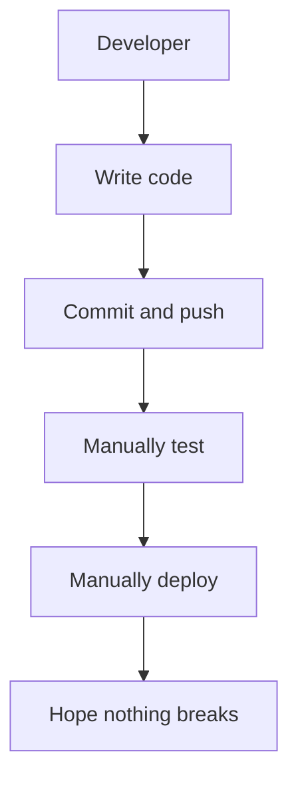

A CI/CD pipeline automates repeatable parts of this process.

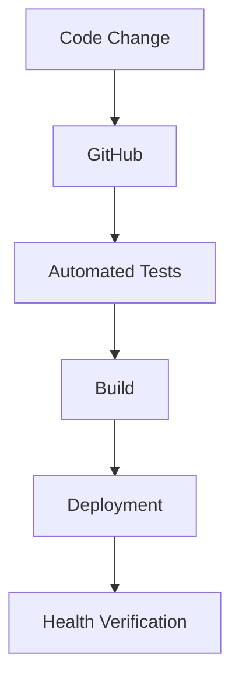

The goal is not merely to deploy faster.

The goal is to make changes **repeatable, testable, traceable, and safer to release**.

---

## 2. Beginner Vocabulary

| Term | Meaning |
|---|---|
| Pipeline | A sequence of automated steps |
| CI | Continuous Integration: regularly integrating changes and validating them automatically |
| Continuous Delivery | Keeping changes in a deployable state, with production release typically requiring approval or a separate trigger |
| Continuous Deployment | Automatically releasing every change that passes the required checks |
| Workflow | An automated process defined in a CI/CD platform |
| Job | A group of steps executed on a runner |
| Runner | The machine or environment that executes a job |
| Artifact | A build output preserved or passed between stages |
| Environment | A deployment target such as development, staging, or production |
| Rollback | Returning to a previously known-good version |
| Deployment | Releasing a version to a target environment |
| Release | Making a version available for users or consumers |

---

## 3. CI vs Continuous Delivery vs Continuous Deployment

These terms are related but different.

### Continuous Integration (CI)

Developers frequently integrate code changes into a shared repository. Automated checks help detect problems early.

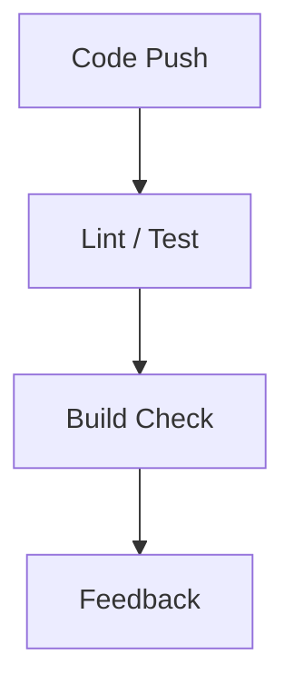

CI answers:

> Does this change integrate correctly with the existing code?

### Continuous Delivery

The pipeline validates and prepares a release so it can be deployed reliably. Production deployment may require a human approval or explicit release action.

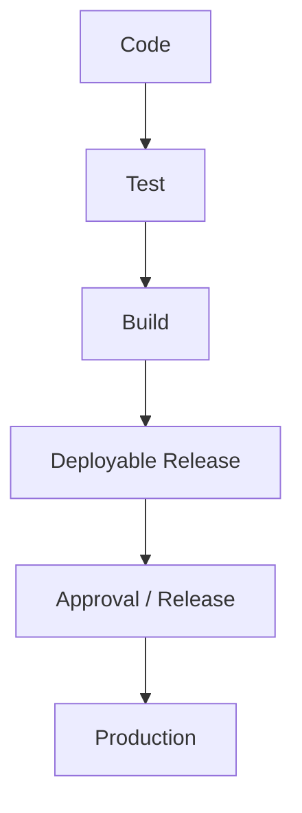

### Continuous Deployment

Every change that passes the required automated checks can be released automatically.

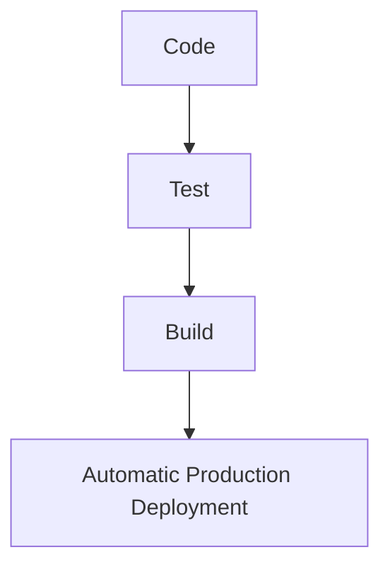

**Continuous Delivery does not necessarily mean automatic production deployment.** Continuous Deployment does.

For a small project, begin with CI and deploy to a test environment. Add production automation once the process is reliable.

---

## 4. The CI/CD Pipeline

A common pipeline contains these stages:

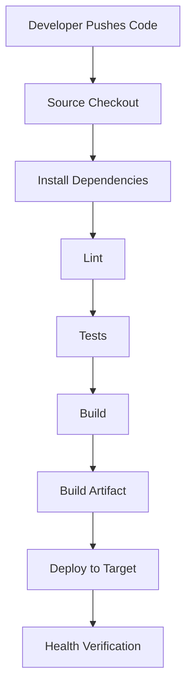

Not every project needs every stage. A static website may not require compilation, while a containerized API needs an image build.

The principle is to automate the checks and steps that are relevant to the application.

---

## 5. What Is a Runner?

A CI/CD platform needs somewhere to execute commands.

GitHub Actions uses **runners**.

A runner can be:

- A GitHub-hosted virtual machine.
- A self-hosted machine that you manage.

For example:

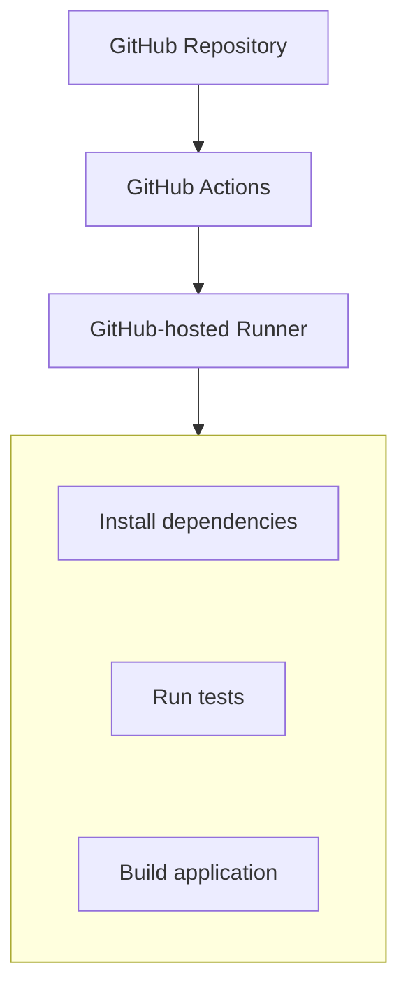

A runner is not necessarily your production server.

In fact, keeping the build environment separate from production is usually preferable.

### Important distinction

The runner executes the pipeline. The deployment target runs the application after deployment.

---

## 6. GitHub Actions Workflow Files

GitHub Actions workflows are commonly stored inside:

```text
.github/workflows/
```

For example:

```text
my-app/
├── src/
├── package.json
├── package-lock.json
└── .github/
    └── workflows/
        └── ci.yml
```

GitHub discovers supported workflow files in that directory.

A workflow defines:

- When it runs.
- Which runner it uses.
- Which jobs it contains.
- Which commands the jobs execute.
- What permissions and secrets are available.

---

## 7. A Basic CI Workflow

Let's start with a Node.js application.

Assume the project has these scripts in `package.json`:

```json
{
  "scripts": {
    "lint": "eslint .",
    "test": "node --test",
    "build": "node scripts/build.js"
  }
}
```

These are illustrative scripts. Your project must actually define them and include the required dependencies and files.

Create:

`.github/workflows/ci.yml`

```yaml
name: CI

on:
  pull_request:
  push:
    branches:
      - main

permissions:
  contents: read

jobs:
  validate:
    runs-on: ubuntu-latest

    steps:
      - name: Check out source
        uses: actions/checkout@v4

      - name: Set up Node.js
        uses: actions/setup-node@v4
        with:
          node-version: 22
          cache: npm

      - name: Install dependencies
        run: npm ci

      - name: Lint
        run: npm run lint

      - name: Run tests
        run: npm test

      - name: Build
        run: npm run build
```

This example uses pinned major versions for readability. In a production pipeline, review action versions and consider pinning third-party actions to full commit SHAs.

### What happens?

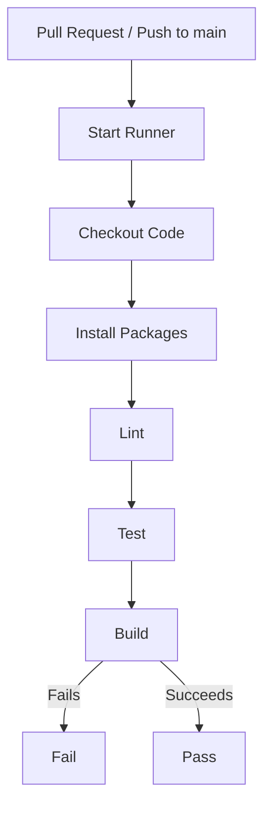

If a required step fails, subsequent steps normally do not run.

### Why `npm ci`?

For projects with a committed `package-lock.json`, `npm ci` installs dependencies from the lockfile and is suited to repeatable automated builds.

It expects the lockfile to match the project manifest. If they disagree, the installation fails rather than silently rewriting the lockfile.

---

## 8. Pull Requests as a Quality Gate

A useful workflow runs CI before changes are merged.

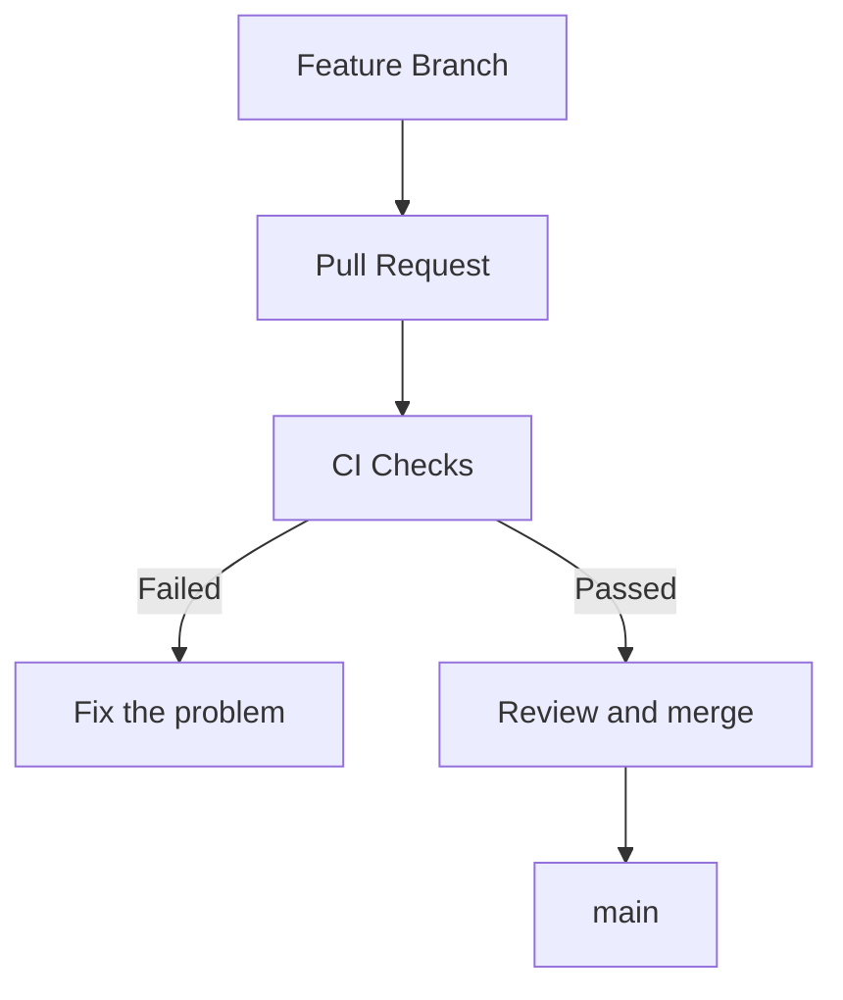

This helps prevent obvious problems from reaching the main branch.

You can configure repository rules to require selected checks before merging.

However, a passing pipeline does not prove that an application is completely correct. It proves only that the configured checks passed.

---

## 9. Build vs Deploy

These are separate operations.

### Build

Transforms source code into a deployable output.

Examples:

- Compiled JavaScript assets.
- A Docker image.
- A packaged application archive.
- A static website's generated files.

### Deploy

Moves or activates the output in a target environment.

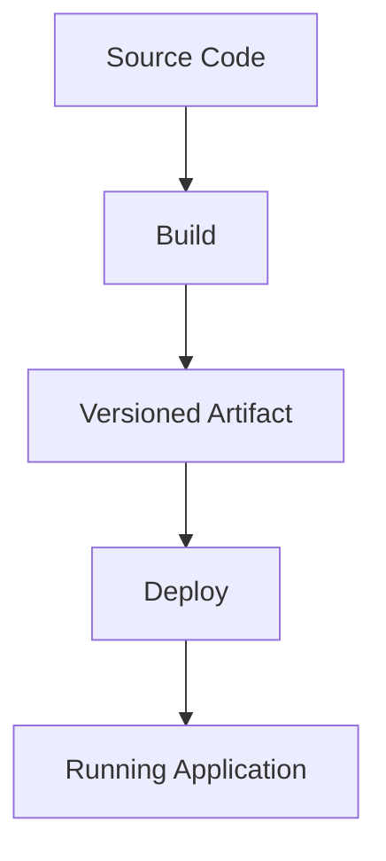

Separating build from deployment makes it easier to identify problems and preserve the exact version that was tested.

---

## 10. Why Build Artifacts Matter

Suppose you build an application for testing and then rebuild it separately for production.

The two outputs may differ if:

- Dependencies changed.
- A package version was not locked.
- Environment-specific values changed the output.
- The build process was nondeterministic.

A stronger approach is to promote the same tested artifact through environments when practical.

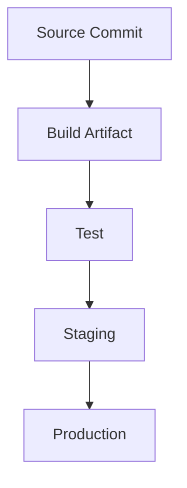

For a containerized application, the artifact can be a versioned image stored in Amazon ECR.

For a static website, it might be a generated directory uploaded to an appropriate hosting destination.

**An artifact should be identifiable by version**, such as a commit SHA or immutable image digest, rather than only a mutable label such as `latest`.

---

## 11. Environments: Development, Staging, Production

Applications commonly use multiple environments.

| Environment | Purpose |
|---|---|
| Development | Local coding and debugging |
| Test / CI | Automated validation |
| Staging | Production-like verification before release |
| Production | Serves real users |

The architecture might look like:

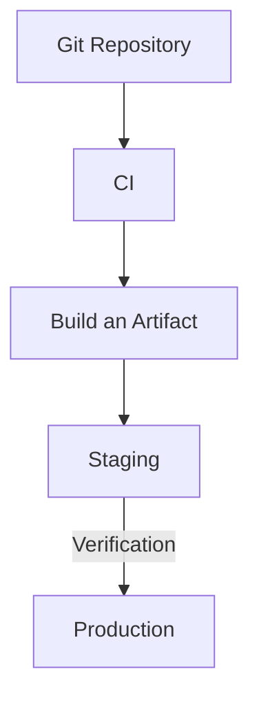

Environments should be isolated enough that a test deployment cannot accidentally modify production data.

They may have different:

- URLs and domains.
- Database instances.
- IAM roles.
- Network boundaries.
- Secrets.
- Resource sizes.
- Monitoring and alerts.

Avoid using a production database for ordinary automated tests.

---

## 12. Managing Secrets Safely

A pipeline may need credentials to deploy.

Examples include:

- AWS access.
- Registry authentication.
- API tokens.
- Deployment credentials.

Do not put secrets directly into workflow files:

```yaml
# Unsafe — never do this
env:
  AWS_SECRET_ACCESS_KEY: "hard-coded-secret"
```

Also avoid committing `.env` files containing real credentials.

Use an appropriate secret-management mechanism, such as:

- GitHub Actions secrets.
- GitHub environment secrets.
- AWS IAM roles and temporary credentials.
- AWS Secrets Manager or Systems Manager Parameter Store for application runtime secrets.

### Prefer short-lived AWS credentials

For GitHub Actions deploying to AWS, prefer **OpenID Connect (OIDC)** with an AWS IAM role when feasible.

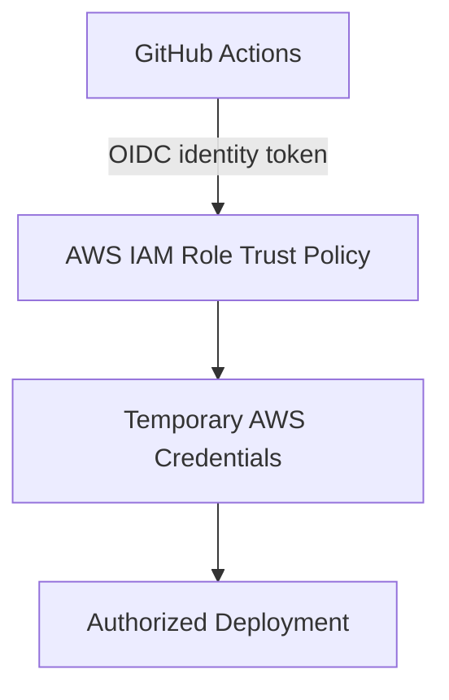

This avoids storing a long-lived AWS access key in GitHub.

The IAM trust policy should restrict which repository, branch, tag, or GitHub environment can assume the role. The role's permissions should be limited to the deployment tasks it needs.

> A secret store is not a substitute for least privilege. A pipeline that receives overly powerful credentials can still cause serious damage.

---

## 13. Deployment Strategy A: Static Website to S3

For a static site, the pipeline may:

1. Install dependencies.
2. Run tests.
3. Build the site.
4. Upload the generated output to S3.
5. Invalidate a CloudFront cache if required.

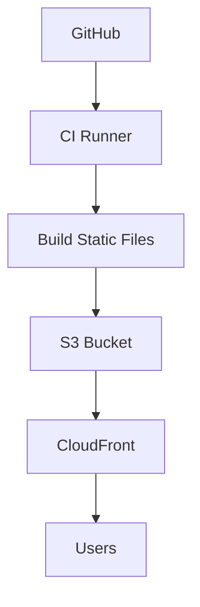

The exact deployment commands depend on the framework and bucket design.

For example, a build may produce:

```text
dist/
├── index.html
├── assets/
└── images/
```

The pipeline uploads the generated files, not necessarily the source repository itself.

### Security considerations

- Use a dedicated deployment role.
- Restrict writes to the intended bucket and path.
- Avoid making an S3 bucket public merely to simplify deployment.
- Use CloudFront with an appropriate origin access configuration when serving private S3 origins.
- Consider how deletions and cache invalidation should work.
- Test the deployment against a non-production destination first.

S3 and CloudFront can have different responsibilities: S3 stores objects, while CloudFront serves content through its distribution.

---

## 14. Deployment Strategy B: EC2

With EC2, the deployment process must account for the application process and server configuration.

A simplified model:

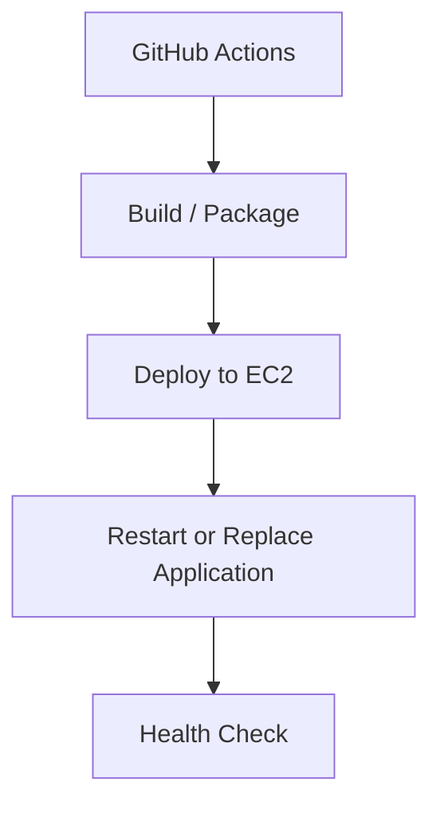

A basic deployment could copy a versioned package to the instance and activate it. However, directly copying files and restarting a live service can introduce downtime or leave a partially updated application.

### A safer deployment pattern

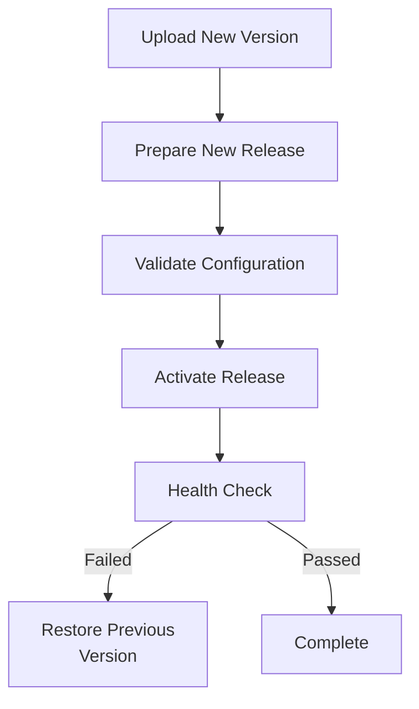

For production EC2 deployments, consider:

- AWS Systems Manager instead of opening SSH broadly.
- A dedicated deployment role.
- Versioned releases.
- A controlled service restart.
- Health checks and log inspection.
- A rollback procedure.
- A deployment mechanism such as AWS CodeDeploy when its capabilities fit the application.

Do not give a public CI runner unrestricted shell access to your production machine.

---

## 15. Deployment Strategy C: ECS with ECR

For a containerized application, a typical pipeline builds an image and pushes it to Amazon ECR.

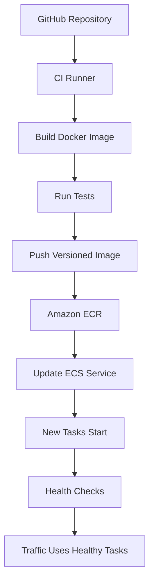

A useful image tag might include a commit identifier:

```text
my-app:8f31c2a
```

The image digest is an even stronger identifier of the exact image content.

Avoid depending exclusively on:

```text
my-app:latest
```

because that tag can point to different images over time.

### Why this fits ECS

ECS manages the deployment of tasks according to the service's configuration. Depending on the deployment configuration, ECS can replace tasks progressively and monitor health.

The pipeline should wait for the deployment to reach the expected stable state and verify application health rather than assuming that an accepted deployment command means the application is ready.

---

## 16. Deployment Strategy D: Lambda

For Lambda, CI/CD can package and deploy code or publish a new function version.

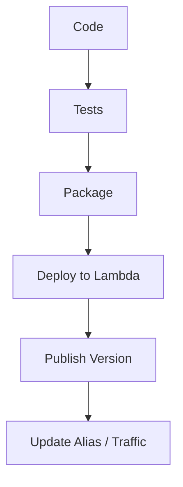

A Lambda version is an immutable snapshot of function code and certain configuration. An alias can point to a version and can be used to control which version receives invocations.

For a more controlled release, you can direct a small portion of traffic to a new version, monitor it, and then increase traffic if the release behaves correctly.

The precise rollout options depend on your deployment tooling and Lambda configuration.

---

## 17. Deployment Strategies: A Quick Comparison

| Strategy | How it works | Main consideration |
|---|---|---|
| In-place | Updates the existing running environment | Simple, but can cause downtime or partial updates |
| Rolling | Replaces instances or tasks gradually | Old and new versions may run simultaneously |
| Blue-green | Deploys a separate environment, then switches traffic | Easier environment-level rollback, but requires extra capacity |
| Canary | Sends a small portion of traffic to the new version first | Helps limit exposure while collecting evidence |

### Rolling deployment

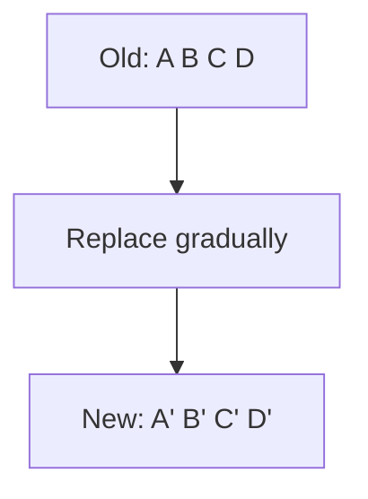

### Blue-green deployment

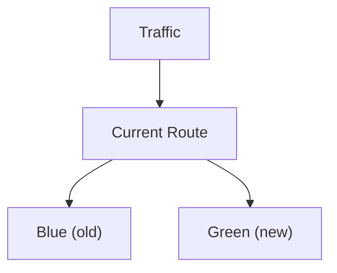

Switch traffic after verification

### Canary deployment

```mermaid
flowchart TD
  accTitle: Canary deployment
  accDescr: Traffic is split: 95% goes to the current version and 5% goes to the new version.
  T["Traffic"] -->|"95%"| C["Current version"]
  T -->|"5%"| N["New version"]
```

These diagrams are conceptual. Actual routing and replacement behavior depends on the deployment platform.

No strategy eliminates the need for monitoring, health checks, and a rollback plan.

---

## 18. Database Migrations During Deployment

Application code is not the only thing that changes.

A release may also change the database schema.

For example:

```text
Old schema:
users(id, name)

New requirement:
users(id, name, display_name)
```

If the new application expects `display_name` before the database has that column, deployment can fail.

A safer pattern for many rolling deployments is **expand and contract**:

1. Add the new schema in a backward-compatible way.
2. Deploy application code that supports both old and new forms.
3. Migrate or backfill data as needed.
4. Confirm the new version works.
5. Remove obsolete schema only after old application versions no longer need it.

```mermaid
flowchart TD
  accTitle: Expand and contract
  accDescr: Expand Schema, then Deploy Compatible Code, then Migrate Data, then Verify, then Contract Later.
  N0["Expand Schema"] --> N1["Deploy Compatible Code"] --> N2["Migrate Data"] --> N3["Verify"] --> N4["Contract Later"]
```

This is not required for every small application, but it is important when old and new application versions may run concurrently.

A database rollback is not always as simple as reverting application code. Schema and data changes may be difficult or impossible to reverse safely.

---

## 19. Health Checks After Deployment

A deployment command can succeed even when the application is not usable.

For example:

- The process starts but crashes shortly afterward.
- The app cannot connect to the database.
- A required environment variable is missing.
- The application responds with errors.
- The new container never becomes healthy.

A pipeline should verify the result.

```mermaid
flowchart TD
  accTitle: Verifying a deployment
  accDescr: Deploy, wait for the rollout and check the health endpoint; if it fails, stop, alert or roll back, otherwise mark the release successful.
  N0["Deploy"] --> N1["Wait for rollout"] --> N2["Check health endpoint"]
  N2 -->|"Failed"| O0["Stop / Alert /<br/>Roll Back"]
  N2 -->|"Passed"| O1["Mark release<br/>successful"]
```

A health endpoint should check the appropriate level of readiness. A lightweight process check is not necessarily enough to prove that the application can serve real requests.

Avoid making health checks depend on every optional service if that would mark an otherwise useful application unhealthy during a minor dependency outage.

---

## 20. Rollback and Recovery

Suppose version `v12` is healthy, but `v13` introduces a serious bug.

```mermaid
flowchart TD
  accTitle: Rolling back a bad release
  accDescr: v12 — Healthy, then Deploy v13, then Errors increase, then Rollback / Shift traffic, then v12 serves traffic again.
  N0["v12 — Healthy"] --> N1["Deploy v13"] --> N2["Errors increase"] --> N3["Rollback / Shift traffic"] --> N4["v12 serves traffic again"]
```

Rollback might involve:

- Redeploying a previous artifact.
- Reverting a container image tag or digest.
- Switching traffic to the previous environment.
- Updating a Lambda alias.
- Using the deployment platform's rollback capabilities.

The correct mechanism depends on the deployment strategy.

### Important limitation

Rolling back application code does not automatically reverse database changes, external side effects, or data corruption.

A release plan should consider these separately.

---

## 21. Pipeline Permissions and Supply-Chain Safety

CI/CD pipelines execute code and can deploy to production. They are therefore part of your security boundary.

Use these practices:

- Grant only the repository permissions required by the workflow.
- Avoid giving pull-request workflows deployment credentials.
- Restrict production deployment to approved branches, tags, or environments.
- Require review for sensitive workflow changes.
- Pin and review third-party actions.
- Use dependency lockfiles.
- Avoid printing secrets in logs.
- Prefer temporary AWS credentials through OIDC.
- Separate test and production deployment roles.
- Keep deployment permissions narrower than administrator access.

A workflow can be compromised through unsafe scripts, dependencies, or actions. Protecting the pipeline is part of protecting the application.

---

## 22. Common CI/CD Failure Modes

| Failure | Possible cause | Response |
|---|---|---|
| Dependency installation fails | Lockfile mismatch, registry outage, incompatible runtime | Inspect install logs and dependency versions |
| Tests fail | Regression or environment-specific assumption | Fix the code or make the test setup reliable |
| Build fails | Missing configuration or incompatible dependencies | Reproduce the build locally and inspect logs |
| AWS authorization denied | Incorrect role trust or insufficient permissions | Verify OIDC trust conditions and least-privilege policy |
| Deployment succeeds but site is down | Runtime configuration or target health problem | Check logs, health checks, and environment settings |
| Old assets remain visible | Browser or CDN cache | Check cache headers and invalidate the appropriate cache |
| Rollback fails | Previous artifact unavailable or database incompatible | Preserve artifacts and design backward-compatible migrations |
| Pipeline runs unexpectedly | Trigger or branch conditions are too broad | Review workflow events and environment protections |

The pipeline should provide enough logs to diagnose failures without exposing secrets.

---

## 23. Cost and Operational Considerations

CI/CD automation has costs beyond the pipeline runner.

Potential costs include:

- CI minutes and storage.
- Artifact storage.
- Container image storage in ECR.
- AWS compute used for deployment and application hosting.
- Load balancers and network resources.
- Logs and monitoring.
- Extra capacity used for blue-green deployments.

For a learning project, start with:

1. CI on GitHub-hosted runners.
2. Tests and builds without deployment credentials.
3. A test environment.
4. A narrowly scoped deployment role.
5. Production deployment only after the process is understood.

Clean up temporary AWS resources when they are no longer needed, but don't delete shared or production resources merely to reduce lab costs.

---

## 24. Hands-On Exercise: Create a CI Pipeline

This first exercise does not require AWS resources.

### Step 1 — Prepare a repository

Use a small Node.js application with:

```text
package.json
package-lock.json
src/
tests/
.github/workflows/ci.yml
```

Ensure `package.json` defines real scripts for linting, testing, and building.

### Step 2 — Add the workflow

Use the CI workflow from Section 7.

### Step 3 — Push the code

Commit and push the workflow to GitHub.

### Step 4 — Inspect the run

Open the repository's Actions tab.

Verify that:

- The workflow started.
- Dependencies installed.
- Linting completed.
- Tests ran.
- The build completed.

### Step 5 — Introduce a deliberate failure

For example, make a test assertion incorrect.

Push the change and verify that CI fails.

Then correct the test and confirm the pipeline passes.

### Step 6 — Protect the main branch

If available for your repository, configure a ruleset or branch protection requiring the CI check before merging.

### What you learned

You have established a repeatable quality gate before introducing AWS deployment permissions.

---

## 25. Hands-On Exercise: Plan an AWS Deployment

Use the application architecture from earlier chapters rather than creating an unrelated application.

Choose one deployment target:

- Static site on S3 and CloudFront.
- Application on EC2.
- Containerized service on ECS.
- Function-based API on Lambda.

Write down the following:

```text
Repository:
  Where is the source code?

CI:
  Which checks must pass?

Artifact:
  What exact output is deployed?

Identity:
  Which narrowly scoped IAM role can deploy it?

Environment:
  Where will the artifact run?

Health:
  How will you verify that it works?

Rollback:
  How will you restore the previous version?

Cost:
  Which resources incur charges?

Cleanup:
  Which temporary resources can be safely removed?
```

Do not grant deployment permissions until the workflow and target have been reviewed.

---

## 26. System Design View

CI/CD connects application development to production operations.

```mermaid
flowchart TD
  accTitle: CI/CD in the system
  accDescr: The developer pushes to the Git repository; CI tests and validates, a versioned artifact is built, CD deploys it to cloud infrastructure, and health checks and monitoring either trigger diagnosis and rollback or let it continue serving traffic.
  N0["Developer"] --> N1["Git Repository"] --> N2["CI: Test and Validate"] --> N3["Build Versioned Artifact"] --> N4["CD: Deploy"] --> N5["Cloud Infrastructure"] --> N6["Health Checks and Monitoring"]
  N6 -->|"Failure"| O0["Diagnose /<br/>Roll Back"]
  N6 -->|"Healthy"| O1["Continue Serving<br/>Traffic"]
```

This creates a feedback loop:

```mermaid
flowchart TD
  accTitle: The feedback loop
  accDescr: Build, then Test, then Deploy, then Measure, then Learn, then Improve.
  N0["Build"] --> N1["Test"] --> N2["Deploy"] --> N3["Measure"] --> N4["Learn"] --> N5["Improve"]
```

The important system-design insight is that deployment is not complete when a command finishes. It is complete when the intended version is running, behaving correctly, and can be operated safely.

---

## 27. Common Mistakes

1. **Deploying without automated tests.** A successful build does not prove that the application behaves correctly.
2. **Building different artifacts for staging and production.** Promote a tested, identifiable artifact where practical.
3. **Hard-coding AWS credentials.** Prefer OIDC and temporary credentials when supported.
4. **Using administrator permissions for deployment.** Scope the deployment role to the required resources and actions.
5. **Deploying every branch to production.** Separate validation triggers from production release rules.
6. **Assuming deployment success means application health.** Verify the actual service.
7. **Ignoring database compatibility.** Old and new application versions may overlap during rollout.
8. **Having no rollback plan.** Preserve known-good artifacts and know how to restore them.
9. **Using mutable tags as the only version identifier.** Track immutable artifacts or image digests.
10. **Ignoring pipeline security.** Workflow files, dependencies, actions, and deployment credentials are part of the production security boundary.

---

## 28. Key Principle

> **CI/CD turns deployment from a sequence of manual actions into a repeatable, testable process.**

Start with automated validation. Build a versioned artifact. Deploy with narrowly scoped credentials. Verify health. Preserve a practical recovery path.

Automation makes a process repeatable; it does not automatically make the process safe. Safety comes from the checks, permissions, release controls, and recovery mechanisms you design around it.

---

## 29. Quick Reference

| Concept | Meaning |
|---|---|
| CI | Automatically validates integrated code changes |
| Continuous Delivery | Keeps changes ready for release, often with an explicit production approval |
| Continuous Deployment | Automatically releases changes that pass required checks |
| Runner | Executes pipeline jobs |
| Workflow | Defines automated triggers and jobs |
| Artifact | Versioned output produced by a build |
| GitHub Actions | Platform for repository automation and CI/CD workflows |
| OIDC | Identity protocol that can provide short-lived credentials to a trusted workflow |
| ECR | AWS container image registry |
| ECS | AWS container orchestration service |
| Deployment strategy | Method used to replace or introduce application versions |
| Health check | Verifies whether a service is ready or healthy |
| Rollback | Restores a previous version or traffic configuration |
| Expand and contract | Database migration approach designed for compatibility across versions |

---

## 30. Knowledge Check

1. What is the difference between CI and Continuous Deployment?
2. Why should build and deployment be separate stages?
3. What does a CI runner do?
4. Why should a deployment use a versioned artifact?
5. Why is OIDC often preferable to storing long-lived AWS access keys?
6. Why can a deployment command succeed while the application remains unavailable?
7. What is the difference between rolling, blue-green, and canary deployment?
8. Why can reverting application code fail to reverse a database migration?
9. Why should pull-request workflows generally not receive production deployment credentials?
10. What should happen after the pipeline deploys a new version?

### Answers

1. CI validates integrated changes; Continuous Deployment automatically releases changes that pass the required checks.
2. It allows the tested output to be identified and promoted through environments, separating build failures from deployment failures.
3. It executes workflow steps such as dependency installation, tests, builds, and deployment commands.
4. It makes the released version identifiable and helps with repeatability, auditing, and rollback.
5. OIDC can provide temporary credentials without storing a long-lived AWS access key in the repository's secret store.
6. The process may fail at runtime, lack configuration, be unable to reach dependencies, or fail health checks.
7. Rolling replaces instances gradually; blue-green switches traffic between separate environments; canary sends a small portion of traffic to a new version first.
8. Schema or data changes may not be reversible, and the old application version may no longer be compatible.
9. Untrusted or unreviewed code could misuse credentials and modify production resources.
10. Verify rollout status and application health, inspect relevant signals, and use the recovery plan if the release fails.

---

## Remember

A reliable release process follows this pattern:

```mermaid
flowchart TD
  accTitle: A reliable release process
  accDescr: A code change passes automated checks, an identifiable artifact is built and deployed with least privilege, and application health is verified: unhealthy means recover or roll back, healthy means the release is complete.
  N0["Code Change"] --> N1["Automated Checks"] --> N2["Build Identifiable Artifact"] --> N3["Deploy with Least Privilege"] --> N4["Verify Application Health"]
  N4 -->|"Unhealthy"| O0["Recover /<br/>Roll Back"]
  N4 -->|"Healthy"| O1["Release<br/>Complete"]
```

**Next: 12.15 — Infrastructure as Code with Terraform**
