# 12.15 — Infrastructure as Code with Terraform

## Learning Objectives

By the end of this chapter, you should be able to:

- Explain Infrastructure as Code (IaC) and why it matters.
- Understand Terraform configuration, providers, resources, and variables.
- Use the `init`, `validate`, `plan`, and `apply` workflow.
- Understand Terraform state and why it must be protected.
- Recognize how Terraform detects infrastructure drift.
- Manage environments and reusable configuration safely.
- Avoid common risks involving secrets, destructive changes, and shared state.
- Decide when Infrastructure as Code is appropriate.

---

## 1. The Problem: Infrastructure Configured Manually

Imagine building an application using AWS.

You create:

- A VPC.
- Public and private subnets.
- Security Groups.
- An EC2 instance.
- An Application Load Balancer.
- An RDS database.
- DNS records.

You configure everything through the AWS Console.

Initially, this may feel straightforward. But later, questions appear:

- Which settings did you choose?
- Did you configure staging the same way?
- Which Security Group rule changed last week?
- Can you recreate the environment after an accidental deletion?
- Can another developer reproduce your setup?

Manual configuration makes infrastructure difficult to reproduce and review.

Infrastructure as Code addresses this problem.

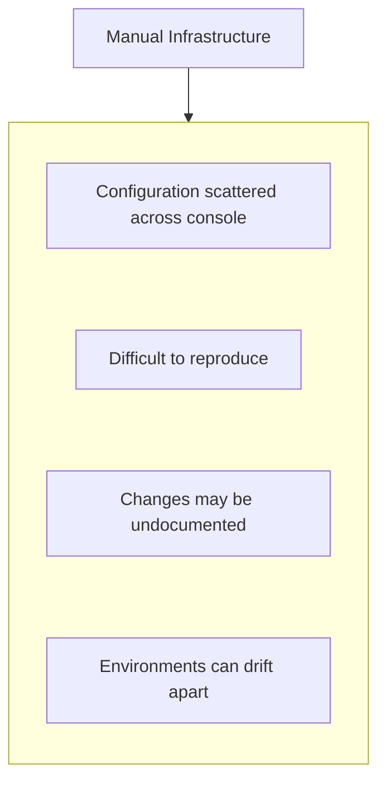

With Infrastructure as Code:

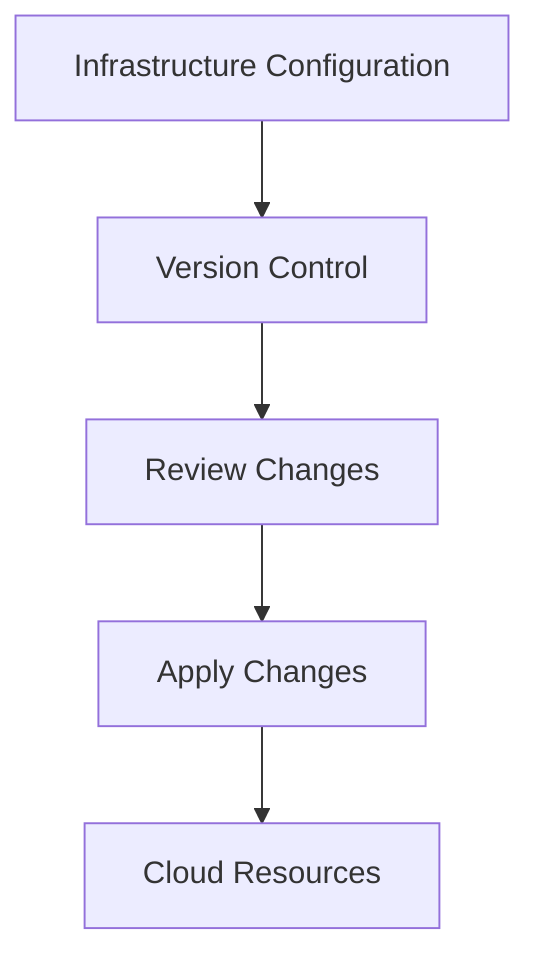

**Infrastructure as Code (IaC)** means defining and managing infrastructure through machine-readable configuration rather than relying entirely on manual setup.

---

## 2. Beginner Vocabulary

| Term | Simple meaning |
|---|---|
| IaC | Managing infrastructure through code |
| Terraform | A tool for declaring and managing infrastructure |
| Provider | A Terraform integration that communicates with a platform such as AWS |
| Resource | An infrastructure object Terraform manages |
| Data source | Information Terraform reads about an existing object |
| Variable | An input that makes configuration reusable |
| Output | A value Terraform displays or exposes after evaluation |
| State | Terraform's record of the resources it manages and their attributes |
| Plan | A preview of proposed infrastructure changes |
| Apply | Executes the changes in a Terraform plan |
| Drift | A difference between the configuration and the real infrastructure |
| Module | A reusable collection of Terraform configuration |
| Backend | Where Terraform stores and accesses its state |
| Dependency graph | Relationships Terraform uses to determine operation order |

---

## 3. What Is Terraform?

Terraform is an Infrastructure as Code tool developed by HashiCorp.

It uses declarative configuration to describe the desired infrastructure.

For example, instead of manually creating an S3 bucket through the AWS Console, you can describe it in a Terraform file.

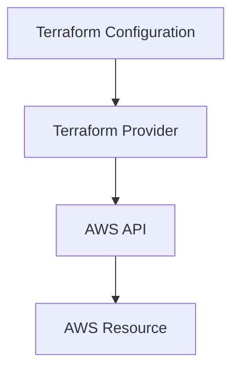

Terraform can then compare the configuration with its recorded state and the infrastructure it observes, calculate a plan, and apply approved changes.

Terraform supports many infrastructure platforms through providers. In this chapter, we use the AWS provider.

---

## 4. Declarative vs Imperative Infrastructure

There are two useful ways to think about automation.

### Imperative approach

You describe the sequence of actions:

```text
1. Create a network
2. Create a subnet
3. Create a Security Group
4. Create a server
5. Configure the server
```

### Declarative approach

You describe the desired result:

```text
I need:
- A network
- A subnet
- A Security Group
- A server
```

Terraform evaluates the relationships between these resources and determines the operations needed to reach the declared configuration.

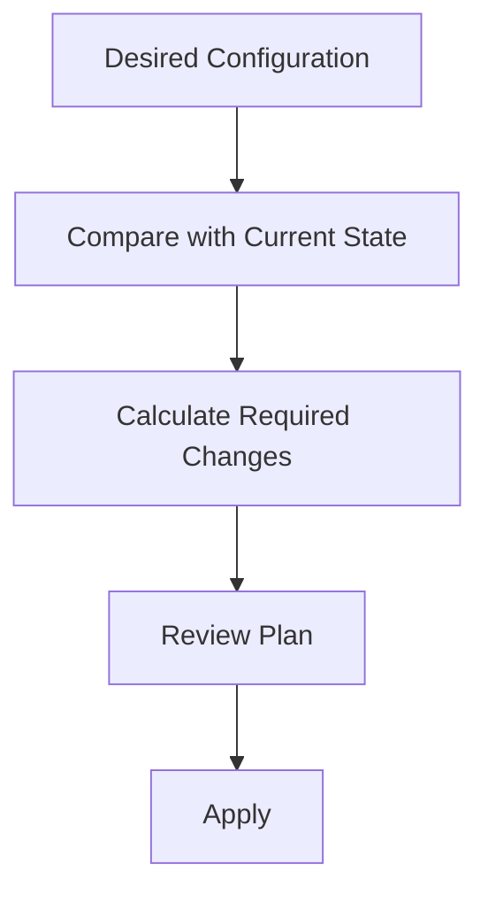

Declarative configuration does not mean Terraform can magically repair every problem. Some changes require replacement, some resources have limitations, and external changes can create conflicts.

---

## 5. Terraform's Core Workflow

The normal workflow is:

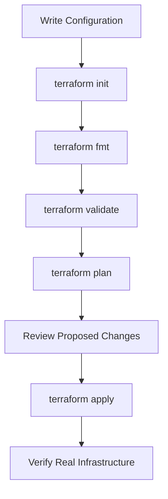

Each command serves a different purpose.

| Command | Purpose |
|---|---|
| `terraform init` | Initializes the working directory and installs required providers/modules |
| `terraform fmt` | Formats Terraform configuration consistently |
| `terraform validate` | Checks configuration syntax and internal consistency |
| `terraform plan` | Previews proposed changes |
| `terraform apply` | Applies the changes |
| `terraform destroy` | Proposes and executes removal of managed resources, subject to approval and lifecycle rules |
| `terraform output` | Displays configured outputs |

**The plan is a preview, not a guarantee that the apply will succeed.** Cloud conditions, permissions, quotas, and infrastructure changes can still affect the result.

---

## 6. Terraform Configuration Files

Terraform configuration commonly uses the HashiCorp Configuration Language (HCL).

A project might look like:

```text
terraform-project/
├── versions.tf
├── provider.tf
├── main.tf
├── variables.tf
├── outputs.tf
├── terraform.tfvars
└── .gitignore
```

For a small example, these files can be combined. As infrastructure grows, separating responsibilities can improve readability.

A common responsibility split:

| File | Purpose |
|---|---|
| `versions.tf` | Terraform and provider version requirements |
| `provider.tf` | Provider configuration |
| `main.tf` | Main resources |
| `variables.tf` | Input variable declarations |
| `outputs.tf` | Values worth exposing |
| `terraform.tfvars` | Environment-specific input values |
| `.gitignore` | Excludes local state and sensitive/generated files from Git |

These filenames are conventions, not mandatory Terraform rules.

---

## 7. Configure the AWS Provider

Terraform needs a provider to communicate with AWS.

Create `versions.tf`:

```hcl
terraform {
  required_version = ">= 1.6.0"

  required_providers {
    aws = {
      source  = "hashicorp/aws"
      version = "~> 5.0"
    }
  }
}
```

Create `provider.tf`:

```hcl
provider "aws" {
  region = var.aws_region
}
```

Create `variables.tf`:

```hcl
variable "aws_region" {
  description = "AWS Region for this environment"
  type        = string
  default     = "ap-south-1"
}
```

This example specifies a provider version constraint compatible with the AWS provider 5.x line. For a new project, choose and test a currently supported provider version, then commit the generated `.terraform.lock.hcl` file so provider selections are repeatable.

### Where do credentials come from?

Terraform's AWS provider can use standard AWS credential sources, such as:

- An AWS CLI profile.
- Environment credentials.
- An assumed IAM role.
- An attached workload role.
- Other supported AWS credential mechanisms.

For local development, use a named AWS CLI profile with limited permissions where appropriate.

For automated pipelines, prefer temporary credentials through GitHub Actions OIDC and an AWS IAM role.

**Do not hard-code AWS access keys in Terraform files.**

---

## 8. Your First Resource: An S3 Bucket

Let's describe an S3 bucket.

Create `main.tf`:

```hcl
resource "aws_s3_bucket" "assets" {
  bucket = var.bucket_name

  tags = {
    Name        = "systemly-assets"
    Environment = var.environment
    ManagedBy   = "Terraform"
  }
}
```

Add these variables to `variables.tf`:

```hcl
variable "bucket_name" {
  description = "Globally unique S3 bucket name"
  type        = string
}

variable "environment" {
  description = "Environment label"
  type        = string
  default     = "dev"
}
```

The resource declaration has this structure:

```text
resource "TYPE" "LOCAL_NAME"
```

For this example:

```hcl
resource "aws_s3_bucket" "assets"
```

- `aws_s3_bucket` is the resource type.
- `assets` is Terraform's local name for the resource.
- `bucket` is an argument that configures the AWS bucket.
- `tags` adds metadata.

The local name `assets` is not the actual S3 bucket name.

The actual bucket name is supplied through `var.bucket_name`.

### Important

S3 bucket names must meet AWS naming requirements and be unique within the applicable namespace. Use a name you control and are allowed to create.

---

## 9. Variables and Outputs

Variables make configuration reusable.

Without a variable, you might hard-code a bucket name and environment label in multiple places.

With variables:

```hcl
variable "environment" {
  type    = string
  default = "dev"
}
```

you can supply a different value for another environment.

Outputs expose useful information after deployment.

Create `outputs.tf`:

```hcl
output "bucket_name" {
  description = "Name of the managed S3 bucket"
  value       = aws_s3_bucket.assets.bucket
}
```

After a successful apply, you can inspect the output with:

```bash
terraform output bucket_name
```

An output does not automatically make a resource public or grant access. It simply exposes a configured value.

---

## 10. Initialize, Validate, Plan, Apply

Once the files are ready, run the workflow from the Terraform project directory.

### Step 1 — Initialize

```bash
terraform init
```

Terraform initializes the directory, downloads the required provider, and prepares the working environment.

### Step 2 — Format

```bash
terraform fmt
```

This formats Terraform files consistently.

### Step 3 — Validate

```bash
terraform validate
```

This checks the configuration's syntax and consistency. It does not prove that AWS permissions are sufficient or that every planned operation will succeed.

### Step 4 — Plan

Supply the required bucket name:

```bash
terraform plan \
  -var="bucket_name=systemly-assets-your-unique-suffix"
```

Terraform previews the proposed changes.

You should inspect what will be created, changed, or destroyed.

### Step 5 — Apply

```bash
terraform apply \
  -var="bucket_name=systemly-assets-your-unique-suffix"
```

Terraform shows the plan and asks for approval unless you use an automation option that changes that behavior.

For a learning environment, review the plan carefully and confirm only when the intended changes are clear.

### Step 6 — Verify

```bash
terraform output bucket_name
```

Then inspect the bucket in AWS.

A successful Terraform operation means the requested infrastructure change completed according to Terraform's result. It does not prove that a complete application is functioning correctly.

---

## 11. Understanding a Terraform Plan

Terraform plans commonly show symbols such as:

| Symbol | Meaning |
|---|---|
| `+` | Create a resource |
| `~` | Update a resource in place, where supported |
| `-` | Destroy a resource |
| `-/+` | Destroy and replace a resource |

For example:

```text
+ aws_s3_bucket.assets
```

means Terraform proposes creating the resource.

But a plan like:

```text
-/+ aws_example_resource.sample
```

indicates replacement, which may involve downtime or data loss depending on the resource.

Before applying a plan, ask:

- Which resources will be created?
- Which will change?
- Which will be replaced?
- Which will be destroyed?
- Could the changes affect production?
- Could the changes incur charges?

**Never treat `terraform apply` as a harmless save operation.** It can create expensive resources and destroy existing infrastructure.

---

## 12. Terraform State

Terraform needs to track the infrastructure it manages.

It does this through **state**.

Conceptually:

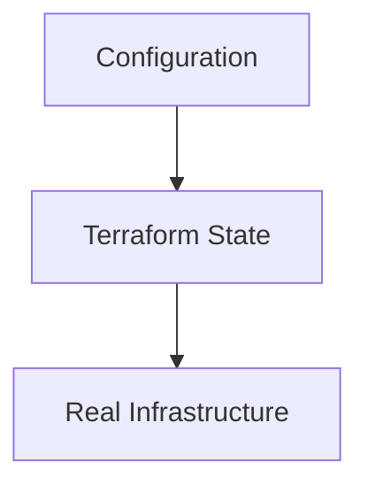

State maps Terraform resource addresses to real infrastructure objects and records attributes Terraform needs to manage them.

A simplified example:

```text
Terraform Address:
aws_s3_bucket.assets

Real Resource:
S3 bucket with the configured name
```

The state is not simply a log of commands. It is an important part of Terraform's management model.

### Why state matters

Terraform uses state to understand which real resources correspond to the resources declared in configuration.

If state is lost or corrupted, Terraform may no longer know how the configuration relates to existing infrastructure.

That can make future plans confusing or risky.

---

## 13. Local State vs Remote State

By default, a simple Terraform project commonly uses local state:

```text
terraform.tfstate
```

This can be acceptable for a small isolated learning exercise.

But local state creates problems when multiple developers or CI jobs need to manage the same environment.

Imagine:

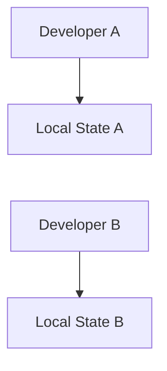

Both developers may have different state files describing the same infrastructure.

That creates risks of inconsistent management and conflicting operations.

For shared environments, use a properly configured **remote backend**.

For example:

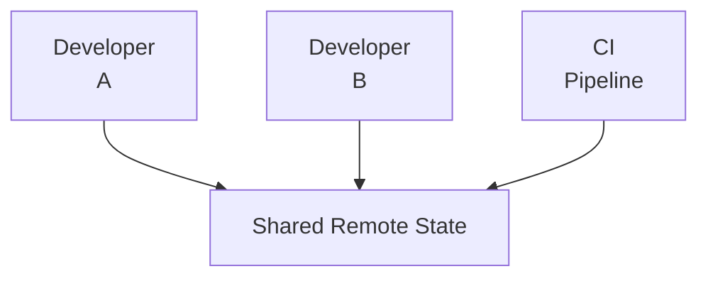

A remote backend centralizes access to state. A backend that supports locking can also coordinate operations so concurrent changes do not interfere with each other.

For AWS, an S3 backend is a common option. Configure the backend according to the current Terraform and AWS documentation, including appropriate encryption, access restrictions, and supported locking behavior.

Do not assume that simply storing a state file in S3 automatically configures locking.

---

## 14. Protect State Like Sensitive Data

Terraform state may contain sensitive values returned by providers, even when those values are not intended to be public.

Marking a Terraform value as `sensitive` primarily controls how Terraform displays it. It does **not** guarantee that the value is absent from state.

Protect state by:

- Restricting access to the state backend.
- Enabling appropriate encryption.
- Avoiding public access.
- Using least-privilege IAM permissions.
- Keeping state files out of ordinary source control.
- Protecting backups and downloaded copies.
- Avoiding state contents in logs or shared artifacts.

A basic `.gitignore` can include:

```gitignore
.terraform/
*.tfstate
*.tfstate.*
*.tfplan
terraform.tfvars
```

Review these patterns against your project's workflow. Do not accidentally ignore files that should be version-controlled, such as `.terraform.lock.hcl`.

State should be treated as a sensitive operational asset.

---

## 15. Terraform and Infrastructure Drift

**Drift** occurs when real infrastructure changes outside the expected Terraform workflow.

For example:

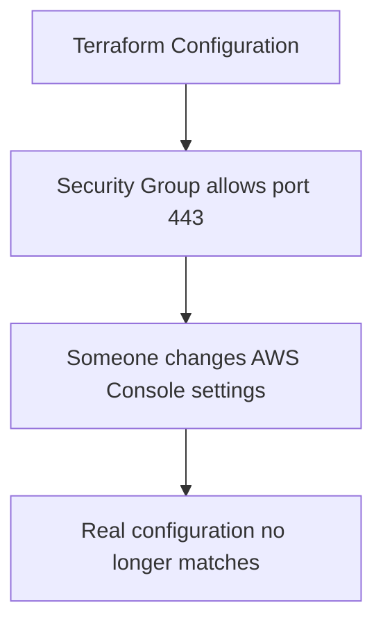

A Terraform plan can detect many differences between the configuration, recorded state, and observed infrastructure.

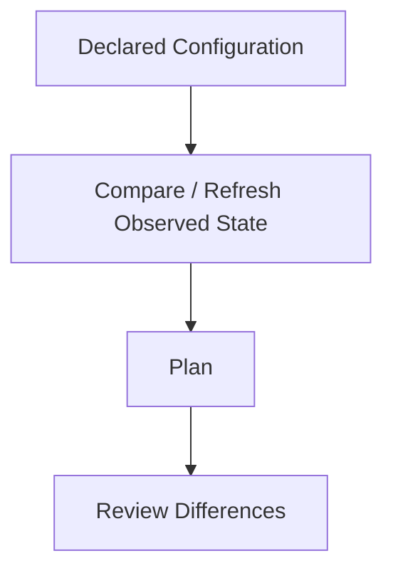

Drift can occur because of:

- Manual console changes.
- Changes made by another automation tool.
- Resource modifications outside Terraform.
- Differences in provider observations or resource behavior.

Terraform cannot necessarily detect every possible external change immediately or perfectly.

### What should you do?

If drift appears:

1. Identify what changed.
2. Determine whether the change was intentional.
3. Update the Terraform configuration if the new state is desired.
4. If the change was accidental, plan a safe correction.
5. Review the plan before applying it.

Do not blindly apply a plan just to make the difference disappear. It may undo a deliberate emergency fix or modify a resource unexpectedly.

---

## 16. Dependencies and Resource Ordering

Infrastructure resources depend on one another.

For example:

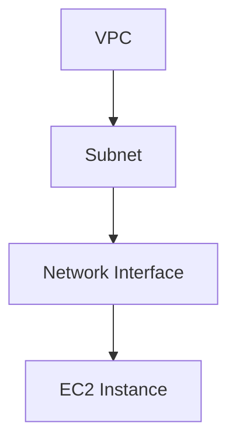

Terraform can infer many dependencies from resource references.

A simplified example:

```hcl
resource "aws_s3_bucket" "assets" {
  bucket = var.bucket_name
}

output "assets_bucket_arn" {
  value = aws_s3_bucket.assets.arn
}
```

The output references the resource's ARN. Terraform understands that it must know the resource's value before producing the final output.

For more complex infrastructure, references form a dependency graph.

Terraform uses that graph to determine which operations can occur first and which must wait.

Use explicit `depends_on` only when a dependency cannot be inferred from normal references and is genuinely required.

Overusing explicit dependencies can make configuration harder to understand and unnecessarily restrict execution.

---

## 17. Modules: Reusable Infrastructure

Suppose you repeatedly need:

- A VPC.
- Public and private subnets.
- Route tables.
- Security Groups.

Copying the same configuration into every project can create duplication.

A Terraform **module** groups related configuration into a reusable unit.

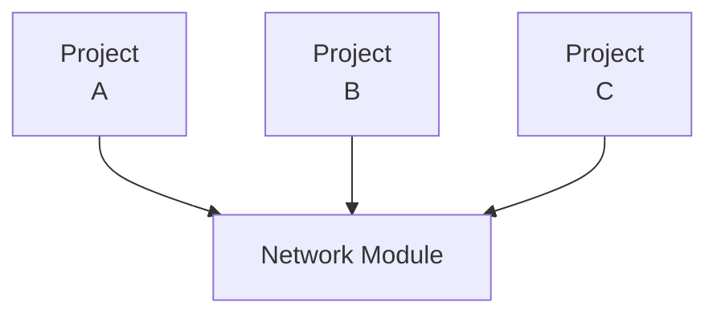

A module can expose variables such as:

```text
vpc_cidr
public_subnet_cidrs
private_subnet_cidrs
environment
```

It can also expose outputs such as:

```text
vpc_id
private_subnet_ids
public_subnet_ids
```

Modules help teams share patterns, but they do not automatically guarantee security or correctness.

A module should be reviewed for:

- Its resources and permissions.
- Input validation.
- Default values.
- Versioning.
- Outputs.
- Destructive changes.
- Cost implications.

Prefer small, purposeful modules over abstracting every resource immediately.

---

## 18. Environments: Development, Staging, Production

A common requirement is to deploy similar infrastructure to multiple environments.

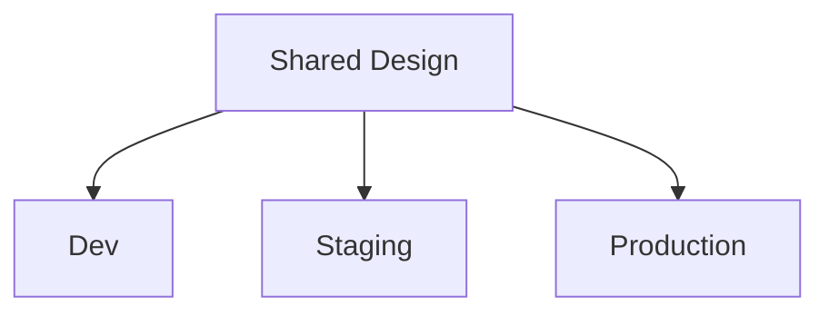

The environments may differ in:

- Resource sizes.
- Domain names.
- CIDR ranges.
- Database configuration.
- Availability requirements.
- Scaling limits.
- Permissions and secrets.

Terraform variables can supply these differences.

For example:

```hcl
variable "environment" {
  type = string
}

variable "instance_type" {
  type = string
}
```

The development environment might use a smaller resource than production.

### State isolation matters

Development and production should not accidentally share the same state scope.

Use a deliberate state separation strategy, such as separate root configurations and backend state keys or separate backend configurations, depending on the team's design.

For stronger isolation, teams may also use separate AWS accounts.

Separate state files alone do not prevent a developer from having permission to modify production. IAM boundaries and deployment controls remain essential.

---

## 19. Terraform and CI/CD

Terraform fits naturally into the pipeline from Chapter 12.14.

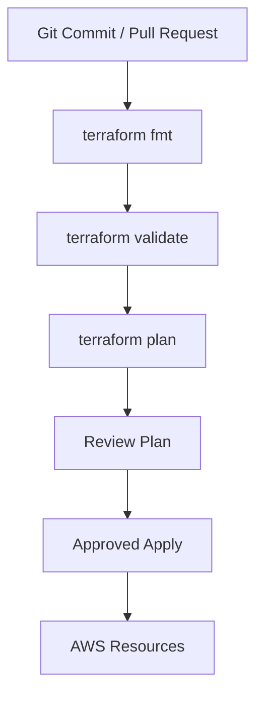

A safer production workflow separates planning from applying.

### Pull request

- Format and validate the configuration.
- Generate a plan using an appropriately restricted identity.
- Review the proposed infrastructure changes.
- Require approval for high-impact changes.

### Approved deployment

- Use an authorized identity.
- Apply the reviewed plan where practical and safe.
- Record the result.
- Verify the deployed resources.

A saved plan can help ensure that the reviewed proposal is the one applied, but plans may contain sensitive information and can become stale. Protect plan artifacts and regenerate them if the infrastructure changes invalidate the review.

Avoid allowing untrusted pull-request code to access production credentials or state.

---

## 20. Terraform vs AWS CloudFormation

Terraform is not the only Infrastructure as Code option.

AWS CloudFormation is AWS's native infrastructure provisioning service.

| Area | Terraform | AWS CloudFormation |
|---|---|---|
| Provider ecosystem | Multiple infrastructure platforms | AWS-focused |
| Configuration | HCL | YAML or JSON templates |
| State model | Terraform state | Managed by CloudFormation |
| AWS integration | Through AWS provider | Native AWS service integration |
| Typical use | Multi-platform IaC or Terraform-centered workflows | AWS-native infrastructure provisioning |

Neither tool is universally better.

Choose based on:

- Your team's experience.
- AWS integration requirements.
- Multi-cloud or multi-platform needs.
- Existing infrastructure and workflows.
- State and governance requirements.
- Operational capabilities.

For this learning path, Terraform is useful because the same core ideas apply across multiple providers.

---

## 21. Common Risks and Failure Modes

| Risk | Why it matters | Safer practice |
|---|---|---|
| Applying without reviewing | Can create, replace, or destroy resources | Inspect the plan first |
| Losing state | Terraform may lose its mapping to real resources | Protect state and maintain suitable recovery procedures |
| Shared local state | Different operators can have inconsistent views | Use an appropriate remote backend |
| Exposing state publicly | State can contain sensitive attributes | Restrict access and encrypt storage |
| Manual console changes | Can cause drift | Review and reconcile changes deliberately |
| Overpowered IAM role | Pipeline or developer can modify unrelated resources | Apply least privilege |
| Concurrent applies | Operations may conflict | Use backend locking where supported and coordinate changes |
| Unpinned provider behavior | Upgrades may change resource behavior | Review provider constraints and lockfile updates |
| Destructive replacement | A resource may be recreated instead of updated | Review replacement indicators and plan migration |
| Unreviewed module | Reusable code may create insecure or expensive resources | Inspect module versions, inputs, and behavior |

---

## 22. Hands-On Exercise: Terraform Without Creating AWS Resources

You can learn Terraform's workflow locally before provisioning cloud infrastructure.

### Step 1 — Install Terraform

Install Terraform using the official installation instructions for your operating system.

Verify:

```bash
terraform version
```

### Step 2 — Create a directory

```text
systemly-terraform-lab/
├── main.tf
└── variables.tf
```

### Step 3 — Use a local-only resource

Create `main.tf`:

```hcl
terraform {
  required_version = ">= 1.6.0"

  required_providers {
    local = {
      source  = "hashicorp/local"
      version = "~> 2.5"
    }
  }
}

resource "local_file" "lesson" {
  filename = "${path.module}/lesson.txt"

  content = <<-EOT
    Systemly Terraform Lab

    Infrastructure as Code describes
    resources through version-controlled configuration.
  EOT
}
```

This uses the local provider to manage a file on your computer. It does not create AWS resources.

### Step 4 — Initialize and validate

```bash
terraform init
terraform fmt
terraform validate
```

### Step 5 — Preview the change

```bash
terraform plan
```

Review the proposed file creation.

### Step 6 — Apply

```bash
terraform apply
```

Confirm the operation when prompted.

Verify that `lesson.txt` exists and contains the configured text.

### Step 7 — Change the configuration

Modify the content in `main.tf`, then run:

```bash
terraform plan
```

Notice that Terraform proposes an update because the desired content changed.

### Step 8 — Clean up

When finished:

```bash
terraform destroy
```

Review the plan and confirm. Terraform removes the managed file according to the local resource's behavior.

**Lab safety:** Run this in a dedicated directory. Do not point the example at an important existing file because Terraform may manage and overwrite that file.

---

## 23. Hands-On Exercise: Plan an AWS Deployment

After understanding the local workflow, reuse the AWS architecture from previous chapters.

Choose a small, clearly bounded resource, such as a test S3 bucket.

Before applying anything, document:

```text
Resource:
  What will Terraform create?

Identity:
  Which AWS identity will Terraform use?

Permissions:
  What is the minimum required access?

State:
  Where will the state be stored?

Cost:
  Can this resource or its related services incur charges?

Security:
  Is public access disabled unless explicitly required?

Change plan:
  What will be created, changed, or destroyed?

Cleanup:
  How will the test resource be removed safely?
```

For the first AWS lab, use a dedicated test account or isolated environment where possible.

Do not migrate existing production infrastructure into Terraform as a first exercise. Importing and managing existing resources requires careful planning so Terraform does not accidentally replace or destroy them.

---

## 24. System Design View

Infrastructure as Code changes how infrastructure is created, reviewed, and maintained.

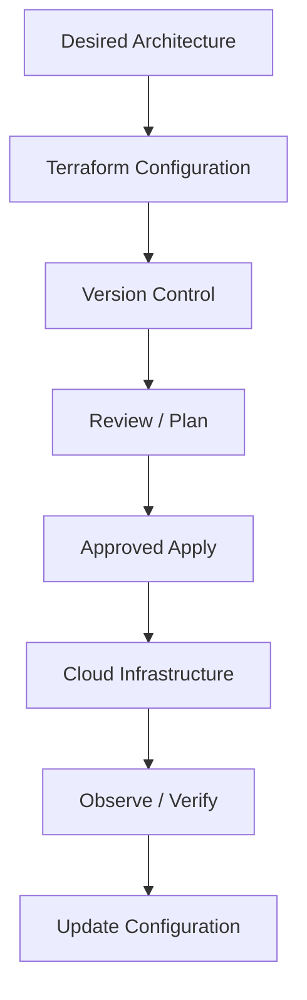

The benefits include:

- Reproducibility.
- Reviewable infrastructure changes.
- Consistent environments.
- Easier collaboration.
- A clearer audit trail.
- More predictable deployment automation.

But IaC also creates responsibilities:

- Protect state.
- Control who can apply changes.
- Review destructive plans.
- Manage secrets safely.
- Detect and reconcile drift.
- Preserve a recovery path.

**Infrastructure becomes code, but it remains real infrastructure with real costs and failure modes.**

---

## 25. Common Mistakes

1. **Treating Terraform as a configuration backup only.** State and real infrastructure must also be managed.
2. **Running `apply` without reviewing the plan.** A change can replace or destroy resources.
3. **Committing state or secrets to Git.** Keep sensitive operational data protected.
4. **Assuming `sensitive = true` removes a value from state.** It mainly controls display behavior.
5. **Sharing one local state file informally.** Use an appropriate shared backend for collaborative environments.
6. **Using one state scope for unrelated environments.** Separate environments deliberately.
7. **Making console changes without reconciliation.** Manual changes can create drift.
8. **Assuming Terraform validation proves the deployment will work.** Validation does not test real cloud permissions, quotas, or application health.
9. **Using broad administrator permissions.** Restrict infrastructure-management identities.
10. **Applying a module without reviewing it.** Modules can create resources, permissions, and costs you did not anticipate.

---

## 26. Key Principle

> **Terraform lets you describe infrastructure as code, review the intended changes, and manage the resulting resources consistently.**

The safe workflow is:

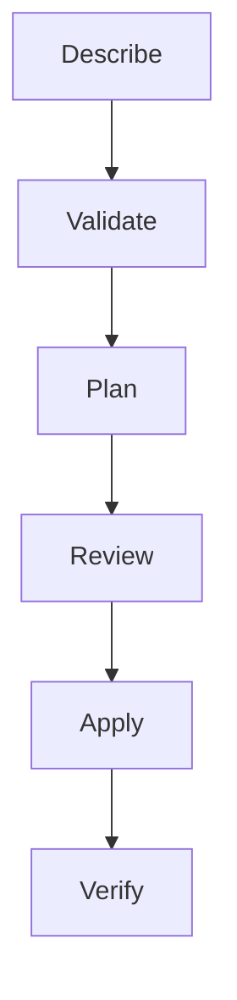

Infrastructure as Code improves reproducibility and control. It does not eliminate the need for architecture decisions, security review, cost awareness, or operational monitoring.

---

## 27. Quick Reference

| Concept | Meaning |
|---|---|
| Infrastructure as Code | Managing infrastructure through configuration |
| Terraform | Tool for declaring and managing infrastructure |
| Provider | Integration with an infrastructure platform |
| Resource | Object managed by Terraform |
| Variable | Input that makes configuration reusable |
| Output | Value exposed from configuration |
| State | Record mapping Terraform resources to real objects and attributes |
| Backend | Mechanism for storing and accessing state |
| Plan | Preview of proposed changes |
| Apply | Executes planned changes |
| Drift | Difference between declared and real infrastructure |
| Module | Reusable Terraform configuration |
| Lockfile | Records selected provider versions for repeatability |
| Remote state | State stored outside the local working directory |
| Dependency graph | Resource relationships used to determine operation order |

---

## 28. Knowledge Check

1. What problem does Infrastructure as Code solve?
2. What is the difference between `terraform plan` and `terraform apply`?
3. Why is Terraform state important?
4. Why should shared infrastructure generally use an appropriate remote state backend?
5. Does `sensitive = true` guarantee that a value is absent from state?
6. What is infrastructure drift?
7. Why should you inspect a plan containing `-/+`?
8. How does a Terraform module help a team?
9. Why is OIDC useful for CI/CD workflows that manage AWS infrastructure?
10. Why should development and production infrastructure have deliberate state and permission boundaries?

### Answers

1. It makes infrastructure repeatable, reviewable, and manageable through version-controlled configuration.
2. `plan` previews changes; `apply` executes them.
3. State maps Terraform's resource addresses to real infrastructure and stores attributes needed for management.
4. It provides shared access and can support coordination and locking, depending on the backend.
5. No. It primarily redacts values in normal output; sensitive values can still be stored in state.
6. Drift is a difference between the expected configuration and the real infrastructure.
7. It indicates resource replacement, which may cause downtime or data loss depending on the resource.
8. A module packages related resources and configuration into a reusable unit.
9. OIDC can provide temporary AWS credentials without storing long-lived access keys in the pipeline.
10. They reduce the risk of unintended cross-environment changes and limit the impact of mistakes.

---

## Remember

Terraform lets you move from manually configuring infrastructure to managing it through reviewed, version-controlled changes.

Start with a local-only exercise. Learn to inspect plans. Protect state. Use least-privilege credentials. Introduce AWS resources only when you understand their cost and cleanup path.

**Next: 12.16 — Cloud Monitoring, Logs & Alerting with CloudWatch**
