# 12.16 — Cloud Monitoring, Logs & Alerting with CloudWatch

## Learning Objectives

By the end of this chapter, you should be able to:

- Explain the difference between monitoring, logging, and alerting.
- Understand the role of Amazon CloudWatch in AWS.
- Distinguish metrics, logs, dashboards, alarms, and notifications.
- Monitor basic AWS resources and application behavior.
- Create useful alarms without generating excessive noise.
- Understand the difference between infrastructure health and user-facing health.
- Design a basic monitoring strategy for a web application.
- Practice observing a system and responding to a detected problem.

---

## 1. The Problem: Running a System You Cannot See

Imagine you deployed your web application using EC2, connected it to RDS, and placed an Application Load Balancer in front of it.

The application worked during testing.

A few days later, users report that the website is slow.

What happened?

- Is the EC2 instance running out of CPU?
- Is the application returning errors?
- Is the database responding slowly?
- Are requests reaching the load balancer?
- Did a deployment introduce a bug?
- Is the application healthy but a dependency unavailable?

Without monitoring, you may have to guess.

**Monitoring makes the system observable enough to investigate what is happening.**

In AWS, Amazon CloudWatch provides services for collecting and analyzing metrics, storing logs, creating alarms, and building dashboards.

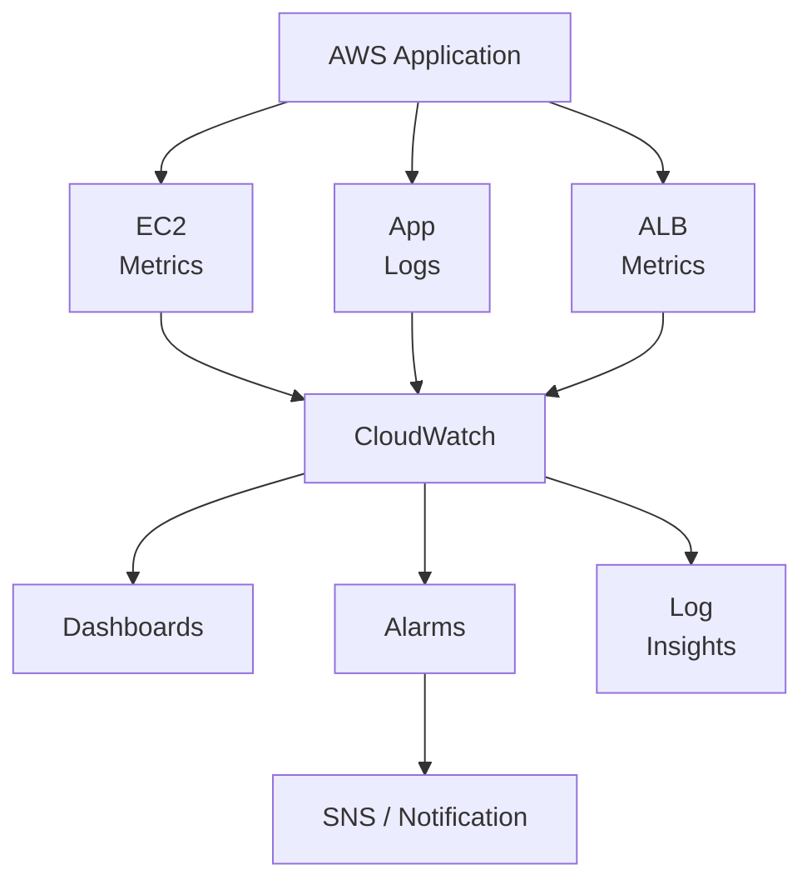

CloudWatch is not a replacement for good application design. It gives you evidence about how your system behaves.

---

## 2. Monitoring, Logging, and Alerting

These three concepts are related, but they solve different problems.

| Concept | Question it answers | Example |
|---|---|---|
| Monitoring | What is happening to the system? | EC2 CPU is consistently high. |
| Logging | What happened during a particular operation? | An order request failed because a database connection was refused. |
| Alerting | When should someone be notified? | The error rate has remained above an acceptable threshold. |

A useful mental model:

```text
Metrics tell you that something may be wrong.
Logs help you investigate what happened.
Alerts tell the right person when action may be needed.
```

You generally need all three.

A CPU metric alone may tell you that an instance is busy. Application logs may reveal that a request is repeatedly processing an unusually large file. An alarm can notify you when the CPU remains high long enough to require investigation.

---

## 3. What Is Amazon CloudWatch?

**Amazon CloudWatch** is an AWS monitoring and observability service.

It can collect and work with information from AWS resources and instrumented applications.

Its main capabilities include:

- **Metrics:** Numerical measurements over time.
- **Logs:** Timestamped records from applications and services.
- **Alarms:** Rules that evaluate metrics and change state when conditions are met.
- **Dashboards:** Visual displays of important measurements.
- **Logs Insights:** Tools for querying and analyzing log data.
- **Notifications and integrations:** Ways to route alerts to other services or operational workflows.

CloudWatch does not automatically understand every detail of your application. You may need to configure log collection, publish custom metrics, instrument code, or enable additional monitoring features.

---

## 4. Metrics: Measuring System Behavior

A **metric** is a numerical measurement recorded over time.

Examples include:

```text
EC2 CPU utilization
Load balancer request count
HTTP response errors
Database connections
Application request duration
Disk usage
```

A metric usually has a name, timestamps, values, and dimensions that identify the resource or category being measured.

For example:

```text
Metric: CPUUtilization

Time       Value
----------------
10:00      24%
10:01      31%
10:02      68%
10:03      92%
10:04      89%
```

The trend may be more useful than any single measurement.

One high CPU sample may be harmless. CPU that remains high while response latency increases deserves investigation.

### Metrics and dimensions

A dimension identifies a particular aspect of a metric, such as an EC2 instance ID or load balancer.

Conceptually:

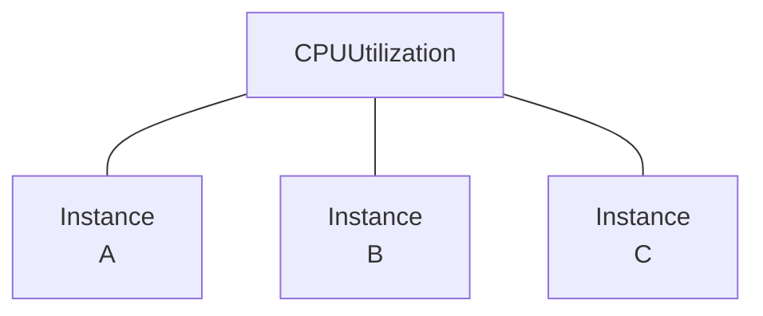

This helps you distinguish one unhealthy instance from a problem affecting the entire fleet.

### Standard and custom metrics

AWS services publish many metrics automatically. These are often called service metrics.

Applications can also publish **custom metrics**, such as:

- Orders successfully completed.
- Payment failures.
- Queue processing duration.
- Number of pending background jobs.

Custom metrics are useful when infrastructure measurements alone cannot describe application health.

---

## 5. Logs: Understanding Individual Events

A **log** is a record of an event that occurred.

An application might produce:

```text
2026-10-29T10:12:03Z INFO  Order 781 created
2026-10-29T10:12:04Z WARN  Payment provider response delayed
2026-10-29T10:12:09Z ERROR Order 782 payment request timed out
```

These records help explain what happened during a particular request or workflow.

In CloudWatch Logs, log data is organized into **log groups** and **log streams**.

- A **log group** commonly represents an application, service, or category of logs.
- A **log stream** is a sequence of log events from a particular source, such as one application instance or log file.

Conceptually:

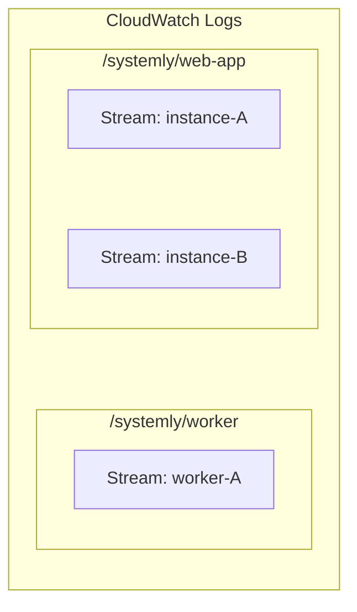

The exact organization is a design choice. Choose names that help people locate the right logs during an incident.

### What should application logs contain?

Useful fields often include:

- Timestamp.
- Log level: `INFO`, `WARN`, or `ERROR`.
- Request or correlation ID.
- Operation name.
- Outcome or error category.
- Duration, where useful.

For example:

```json
{
  "level": "ERROR",
  "request_id": "req-7f21",
  "operation": "create_order",
  "error": "database_timeout",
  "duration_ms": 3000
}
```

Structured logs are easier to search and analyze than inconsistent free-form messages.

**Security rule:** Never log passwords, access tokens, session secrets, full payment-card details, or other sensitive data unnecessarily.

---

## 6. Getting Application Logs into CloudWatch

CloudWatch cannot analyze application logs that never reach it.

The collection method depends on where the application runs.

| Environment | Common approach |
|---|---|
| EC2 virtual machine | CloudWatch Agent or an application logging integration |
| ECS containers | Configure the container logging driver, often using `awslogs` |
| AWS Lambda | Lambda sends function logs to CloudWatch Logs when the required permissions and logging configuration are in place |
| Custom application | Use supported logging integrations or publish log events through the relevant APIs |

For an EC2 application, a simplified path is:

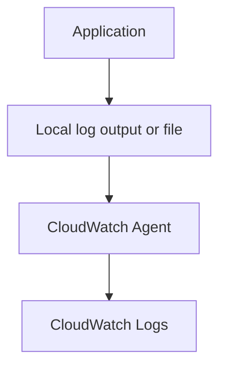

The agent needs suitable configuration and AWS permissions to send the data.

For an ECS application, the path may instead be:

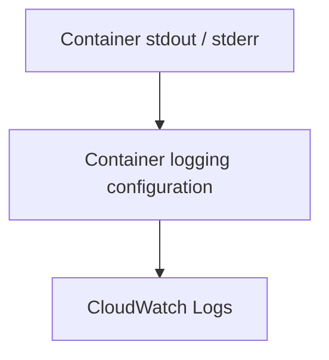

Do not assume that installing an application on EC2 automatically makes every local log file visible in CloudWatch.

---

## 7. Alarms: Turning Measurements into Decisions

An **alarm** evaluates a metric against a configured condition.

For example:

```text
Metric: EC2 CPU utilization

Condition:
CPU > 80%

Evaluation:
3 consecutive one-minute periods

Result:
Alarm enters ALARM state if the condition is met
```

This is an illustrative configuration, not a universal recommendation.

CloudWatch alarms commonly have three states:

| State | Meaning |
|---|---|
| `OK` | The evaluated condition is not currently breached. |
| `ALARM` | The condition has been breached according to the alarm's evaluation rules. |
| `INSUFFICIENT_DATA` | CloudWatch does not have enough data to determine the state. |

An alarm does not necessarily mean the whole system is down. It means a configured condition has been met.

That condition should be chosen to represent something worth investigating or acting on.

### The alarm path

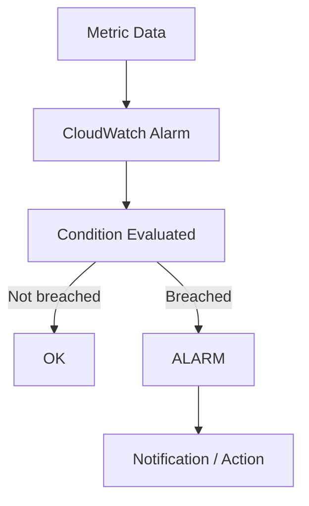

CloudWatch alarms can invoke supported actions. A common pattern is sending notifications through Amazon SNS, which can distribute alerts to configured subscribers or integrate with other workflows.

The alarm itself does not fix the underlying problem.

---

## 8. Dashboards: Seeing the System Together

A dashboard places important measurements in one view.

For a small web application, a useful dashboard might include:

```text
SYSTEMLY WEB APPLICATION
------------------------------------------------
Application Load Balancer
  - Request count
  - HTTP 5xx errors
  - Response time

EC2 / ECS
  - CPU utilization
  - Memory usage, if collected
  - Running task or instance health

RDS
  - CPU utilization
  - Database connections
  - Storage capacity
  - Database latency metrics

Application
  - Request errors
  - Request duration
  - Orders completed
------------------------------------------------
```

The exact metrics available depend on the AWS service and its configuration.

A dashboard should help answer important operational questions quickly. It should not be a wall of every metric that exists.

Start with a small number of measurements tied to user experience and system constraints.

---

## 9. Infrastructure Health vs Application Health

An important distinction: **a running server does not necessarily mean a healthy application.**

Consider:

```text
EC2 Instance: Running
CPU: 25%
Network: Active
```

Everything may look normal at the infrastructure level.

But the application could be returning `500 Internal Server Error` for every order request.

Conversely, an application may be healthy even when one noncritical metric briefly rises.

Think in layers:

```text
Infrastructure
  - Is the instance or task running?
  - Is capacity available?

Application
  - Are requests succeeding?
  - Are responses fast enough?
  - Are important workflows working?

Business
  - Are orders completing?
  - Are payments succeeding?
```

CloudWatch can collect measurements across these layers, but you must choose the right metrics and instrument the application where necessary.

---

## 10. Memory and Disk Monitoring Need Attention

Some metrics are not automatically available in the same way as basic EC2 CPU metrics.

For example, operating-system memory utilization and filesystem usage commonly require the **CloudWatch Agent** or another collection mechanism.

That means:

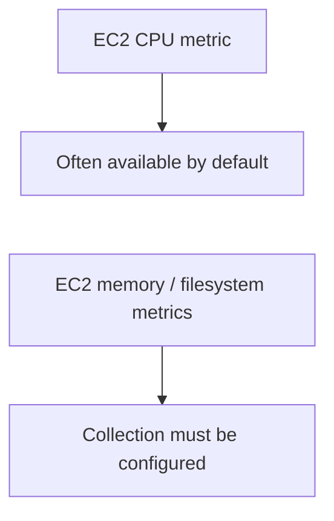

Before creating an alarm for memory or disk usage, verify that the relevant metric is actually being collected.

Otherwise, the alarm may remain in `INSUFFICIENT_DATA` or never evaluate the intended condition.

Also distinguish **disk space** from **disk I/O performance**. They describe different problems and need different measurements.

---

## 11. Metrics Are Not Logs

A metric aggregates a measurement. A log records an event or detailed context.

Imagine users report slow checkout.

A metric might show:

```text
Checkout p95 latency: 4.2 seconds
```

That tells you the checkout experience is slow for a significant portion of requests.

A log might show:

```text
request_id=req-7f21
operation=checkout
database_duration_ms=3200
payment_duration_ms=700
```

That provides clues about the cause.

The workflow is:

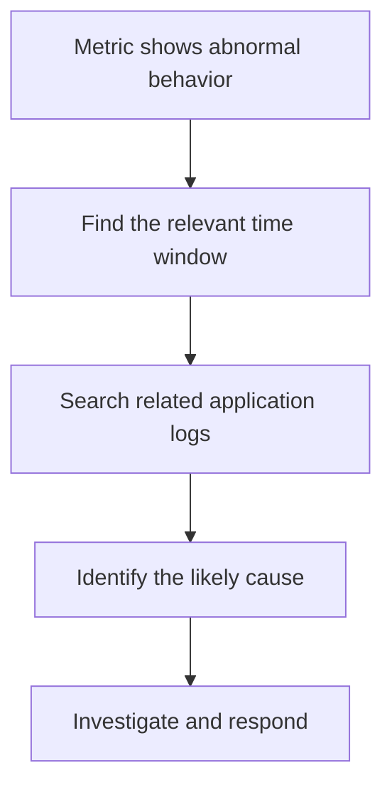

Metrics help you detect and narrow down a problem. Logs help you understand individual events. Neither guarantees the cause will be obvious.

---

## 12. Querying Logs with CloudWatch Logs Insights

CloudWatch Logs Insights lets you query supported log groups.

For example, if your application writes JSON logs with a `level` field, a query might be:

```sql
fields @timestamp, level, operation, error, request_id
| filter level = "ERROR"
| sort @timestamp desc
| limit 50
```

This asks CloudWatch to:

1. Select relevant fields.
2. Keep error-level events.
3. Sort newest events first.
4. Return up to 50 records.

The query assumes the logs contain those fields and that CloudWatch can parse them as expected. Adapt it to your actual log format.

A query can help you investigate:

- Which operations are failing?
- Did failures begin after a deployment?
- Are many errors associated with one dependency?
- Which request IDs should be traced further?

**Cost note:** Log ingestion, storage, and query scanning can incur charges. Use appropriate retention periods and avoid repeatedly scanning unnecessarily large time ranges.

---

## 13. Designing Useful Alarms

An alarm should correspond to a meaningful condition, not just a number that occasionally looks unusual.

Consider these examples:

| Signal | Possible reason to alert |
|---|---|
| Sustained high CPU | Capacity may be insufficient or workload may be abnormal. |
| Elevated load balancer 5xx responses | Requests may be failing. |
| Increased request latency | Users may be experiencing slow responses. |
| Low available database storage | The database may run out of space. |
| High database connection usage | The connection limit may be approaching. |
| No successful background jobs | A critical workflow may have stopped. |

Thresholds depend on workload, baseline behavior, service limits, and business requirements.

For example, CPU above 80% for a sustained period may warrant investigation, but a short CPU spike during a known batch job may be normal.

### Avoid noisy alarms

A noisy alarm repeatedly fires for conditions that do not require action.

To reduce noise:

- Use meaningful evaluation periods.
- Consider sustained breaches rather than single spikes.
- Set thresholds using measured behavior.
- Alert only when someone can take useful action.
- Review alarms that repeatedly fire without producing a useful response.

Do not suppress real failures merely to make dashboards look calm.

---

## 14. Missing Data and Monitoring Gaps

Monitoring systems cannot always tell the difference between a healthy resource and a resource that has stopped reporting.

For example:

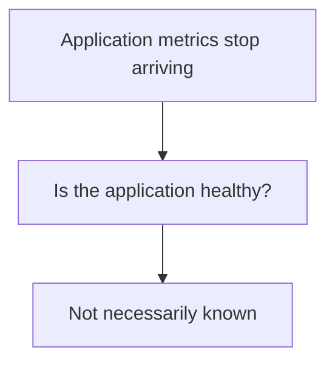

An alarm can enter `INSUFFICIENT_DATA` when there is not enough information to evaluate its condition.

For some alarms, missing data can be treated as good, bad, ignored, or as a separate gap depending on the configuration. Choose this behavior based on the metric and failure mode.

For a heartbeat metric from a critical worker, missing data may itself be a warning sign.

For an intermittent metric that is expected to report only occasionally, missing data may be normal.

**Monitoring has its own failure modes.** Verify that important metrics are being collected and that notifications can reach their destination.

---

## 15. Monitoring and Auto Scaling

CloudWatch metrics can also support scaling decisions.

For example:

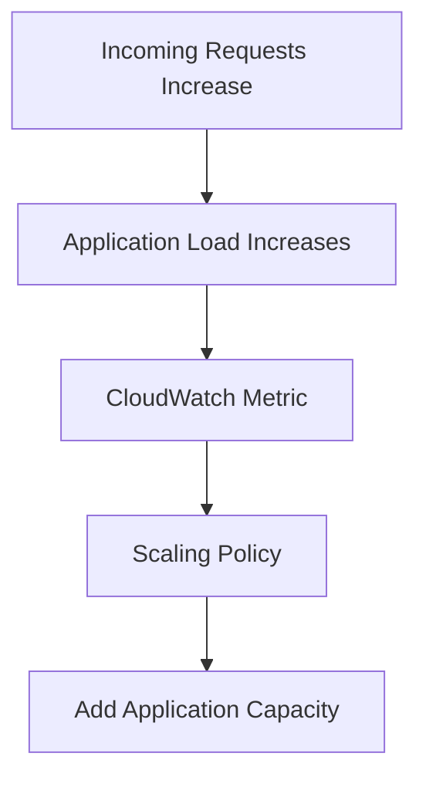

This connects with **12.10 — Load Balancers, Auto Scaling & Health Checks**.

However, scaling on one metric is not always sufficient. More application instances may not help when the database or an external service is the actual bottleneck.

Use monitoring to understand the constraint before choosing a scaling response.

---

## 16. A Practical Monitoring Strategy

For a production-oriented web application, begin with a few important questions.

### Availability

- Is the application reachable?
- Are load balancer health checks passing?
- Are application requests succeeding?

### Latency

- How long do requests take?
- Are response times increasing?
- Which operations are slow?

### Errors

- Are HTTP 5xx responses increasing?
- Are database or external-service errors rising?
- Are critical business operations failing?

### Capacity

- Is CPU saturated?
- Is memory usage increasing?
- Are database connections approaching limits?
- Is storage running low?

### Dependencies

- Is the database healthy?
- Are external APIs responding?
- Are background jobs progressing?

### Operations

- Did the problem begin after a deployment?
- Are alarms working?
- Can the team find the relevant logs quickly?

Start small. Add signals when they answer a real operational question.

---

## 17. Hands-On Lab: Observe an EC2 Instance

This lab uses an existing EC2 instance if you have one. If you do not, you can inspect the CloudWatch console and sample data instead of creating paid infrastructure.

### Step 1 — Open CloudWatch

In the AWS Management Console:

1. Open **CloudWatch**.
2. Navigate to **Metrics**.
3. Open the EC2 metric namespace.
4. Find the `CPUUtilization` metric for your instance.

Look at the time series rather than only the latest value.

### Step 2 — Create a dashboard

Create a small dashboard with a widget for the instance's CPU utilization.

Give the dashboard a clear name, such as:

```text
systemly-dev-observability
```

Do not add every available metric. Start with one that answers a specific question.

### Step 3 — Create a test alarm

Create an alarm for `CPUUtilization`.

For a disposable test, choose a threshold and evaluation period that are easy to observe. A high threshold such as 90% may not trigger unless the instance actually becomes busy, so **do not assume the alarm will fire**.

Review the alarm's configuration and states.

If you configure an SNS notification, make sure the destination is valid and, where required, confirmed.

### Step 4 — Review logs

If an application already sends logs to CloudWatch:

1. Open **Log groups**.
2. Select the relevant group.
3. Choose a suitable time range.
4. Search for errors or inspect a few events.

If logs are not being collected, configure the appropriate agent or logging integration before expecting them to appear.

### Step 5 — Verify and clean up

Confirm that:

- The metric belongs to the correct resource.
- The dashboard displays the intended measurement.
- The alarm evaluates the intended threshold.
- Notifications are configured correctly, if used.
- Logs contain no secrets or sensitive information.

Remove test alarms, dashboards, log groups, or other resources you no longer need. Be careful not to delete logs required for troubleshooting or retention obligations.

**Cost reminder:** CloudWatch dashboards, custom metrics, log ingestion/storage, queries, and alarm configurations can have charges depending on usage and current AWS pricing. Check pricing before enabling features or generating large volumes of logs. Avoid creating extra EC2 resources solely for this lab unless you understand their cost.

---

## 18. Trade-offs and Failure Modes

| Decision | Benefit | Risk or cost |
|---|---|---|
| Collect more logs | More diagnostic detail | Higher ingestion, storage, and query costs |
| Add more metrics | Better visibility | More complexity and possible custom-metric charges |
| Use very sensitive alarms | Earlier detection | False positives and alert fatigue |
| Use very relaxed alarms | Fewer interruptions | Problems may go unnoticed longer |
| Retain logs indefinitely | More historical evidence | Growing storage cost and data-retention risk |
| Rely only on infrastructure metrics | Simple initial setup | Application failures may remain invisible |
| Scale on CPU alone | Easy to configure | May not address the real bottleneck |

The goal is not maximum telemetry. The goal is enough reliable evidence to detect important problems, investigate them, and respond.

---

## 19. Common Mistakes

### Mistake 1 — Monitoring only CPU

An application can fail while CPU remains low. Monitor request success, latency, and critical dependencies too.

### Mistake 2 — Assuming all EC2 metrics are automatic

Memory and filesystem metrics commonly need additional collection configuration.

### Mistake 3 — Treating every alarm as an incident

An alarm is a signal that a condition has been met. Interpret it in context.

### Mistake 4 — Logging sensitive information

Logs must be designed with security and data-retention requirements in mind.

### Mistake 5 — Collecting logs without retention policies

Unbounded retention can increase costs and retain data longer than necessary.

### Mistake 6 — Creating alarms nobody acts on

Every important alert should have an understood owner and response.

### Mistake 7 — Assuming CloudWatch fixes the problem

CloudWatch provides visibility and supported actions. Engineers still need to diagnose the cause and choose a response.

---

## 20. The System Design View

Monitoring is part of the system's operational design, not an optional dashboard added at the end.

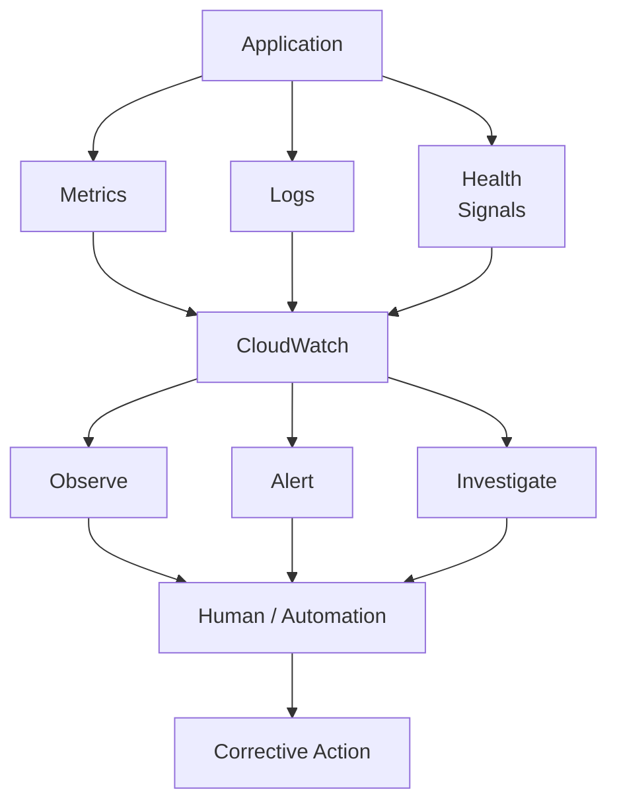

Good monitoring helps answer:

1. **What is happening?**
2. **How does it affect users?**
3. **Where should we investigate?**
4. **Who needs to respond?**
5. **Did the response improve the system?**

CloudWatch is one part of this loop. Logs, metrics, alarms, runbooks, deployment history, and human judgment work together.

---

## 21. Key Principle

> **Monitoring turns system behavior into evidence. Logs provide context, metrics reveal trends, and alarms bring important conditions to attention.**

Remember the operating loop:

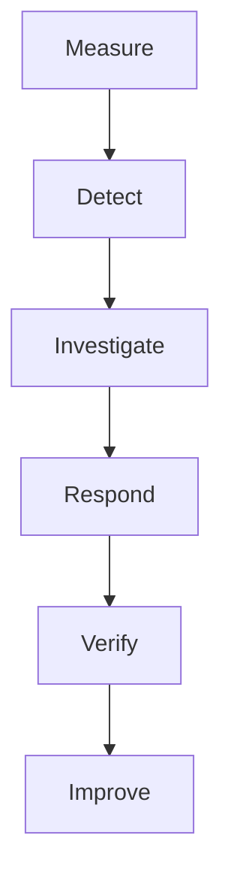

Do not wait until an outage to discover that you cannot see what your application is doing.

---

## 22. Quick Reference

| Term | Meaning |
|---|---|
| CloudWatch | AWS service for metrics, logs, alarms, dashboards, and related monitoring capabilities |
| Metric | Numerical measurement recorded over time |
| Dimension | Attribute used to identify or categorize a metric |
| Log event | Timestamped record of something that happened |
| Log group | Collection of related log streams |
| Log stream | Sequence of log events from a source |
| Alarm | Evaluates a condition and changes state when its rules are met |
| Dashboard | Visual view of selected metrics and monitoring information |
| Logs Insights | Query and analyze supported CloudWatch log data |
| SNS | AWS notification and messaging service that can distribute alarm notifications |
| Custom metric | Application-defined measurement published for monitoring |
| `INSUFFICIENT_DATA` | Alarm state indicating insufficient data to evaluate the condition |

---

## 23. Knowledge Check

1. What is the difference between monitoring, logging, and alerting?
2. Why might an EC2 instance look healthy while the application is failing?
3. What is the difference between a metric and a log event?
4. What are the three common CloudWatch alarm states?
5. Why might EC2 memory usage not appear until additional collection is configured?
6. Why can overly sensitive alarms cause operational problems?
7. What is the role of CloudWatch Logs Insights?
8. Why should logs avoid secrets and sensitive information?
9. Why might scaling more EC2 instances fail to solve high database latency?
10. What should you verify before relying on an alarm to notify someone?

### Answers

1. Monitoring measures system behavior, logging records events, and alerting notifies people or systems when configured conditions are met.
2. Infrastructure can be running normally while application logic, a dependency, or a critical workflow is failing.
3. A metric is a numerical measurement over time; a log event records a specific occurrence and its context.
4. `OK`, `ALARM`, and `INSUFFICIENT_DATA`.
5. Some operating-system metrics require the CloudWatch Agent or another collection mechanism.
6. They create false positives and alert fatigue, making important signals easier to miss.
7. It lets you query and analyze supported log groups to investigate errors and patterns.
8. Logs may be accessible to operators and retained or exported; exposing secrets creates security and privacy risks.
9. The database may be the bottleneck, and additional application instances can increase pressure on it.
10. Confirm that the metric is collected, the alarm condition is correct, and the notification destination and permissions are configured and tested.

---

## Remember

A system is not production-ready simply because it runs.

You also need to know when it becomes unhealthy, how to find evidence of what happened, and how to notify the right person.

**Next: 12.17 — Cloud Security Operations & Incident Response**
