# 12.17 — Cloud Security Operations & Incident Response

## Learning Objectives

By the end of this chapter, you should be able to:

- Understand cloud security operations and incident response.
- Recognize common AWS security signals and suspicious activity.
- Understand the roles of CloudTrail, CloudWatch, AWS Config, and GuardDuty.
- Follow a structured incident-response process.
- Respond safely to compromised credentials or an exposed resource.
- Preserve evidence while containing an incident.
- Understand least privilege, auditability, and recovery responsibilities.
- Design a basic incident-response workflow for an AWS application.

---

## 1. Security Does Not End at Deployment

Imagine you deployed a web application on AWS.

You configured:

- IAM roles and policies.
- A VPC and security groups.
- EC2 or ECS for application hosting.
- RDS for persistent data.
- CloudWatch for monitoring.

The application is running. But what happens if:

- An AWS access key is accidentally committed to GitHub?
- Someone changes a security group to expose a database?
- An unfamiliar identity starts creating resources?
- A server begins making unexpected outbound connections?
- A deployment introduces a vulnerable application version?
- Someone deletes an important resource?

Preventive controls reduce risk, but they cannot guarantee that every incident will be prevented.

**Cloud security operations** means continuously monitoring, investigating, and managing the security of cloud resources.

**Incident response** is the structured process of handling a suspected or confirmed security incident.


The objective is not merely to detect a problem. It is to limit its impact and restore a trustworthy system.

---

## 2. What Counts as a Cloud Security Incident?

A security incident is an event that threatens the confidentiality, integrity, or availability of a system or its data.

| Security objective | Meaning | Example |
|---|---|---|
| Confidentiality | Only authorized parties can access information. | Customer data is exposed publicly. |
| Integrity | Data and systems remain trustworthy. | An attacker modifies application code or database records. |
| Availability | Authorized users can access the service. | An attacker disrupts a production application. |

Common cloud incidents include:

- Compromised AWS credentials.
- Unauthorized IAM policy changes.
- Publicly exposed storage or network services.
- Suspicious API activity.
- Malware or unexpected processes on a virtual machine.
- Unauthorized resource creation.
- Data exfiltration.
- Accidental deletion or destructive changes.
- Exploitation of a vulnerable application.

Not every unusual event is malicious. A legitimate deployment may create new resources or change permissions.

The job of investigation is to establish what happened, whether it was authorized, and what risk remains.

---

## 3. The AWS Security Operations Toolkit

Different AWS services answer different questions.

| Service | Primary role |
|---|---|
| **AWS CloudTrail** | Records AWS API activity and identity-related actions. |
| **Amazon CloudWatch** | Collects metrics and logs, evaluates alarms, and supports operational monitoring. |
| **Amazon GuardDuty** | Detects potentially malicious activity using supported threat-detection signals. |
| **AWS Config** | Records resource configurations and evaluates them against rules. |
| **AWS IAM** | Controls who or what can perform actions on AWS resources. |
| **AWS Security Hub** | Aggregates and helps prioritize supported security findings across integrated sources. |

These services complement one another.

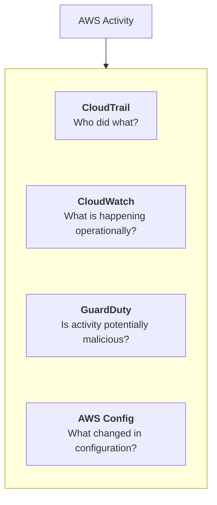

Availability, supported features, integrations, and pricing depend on the service and configuration. Do not assume that installing or enabling one service automatically configures every other service.

---

## 4. CloudTrail: Understanding AWS API Activity

AWS CloudTrail records AWS account activity, including supported API actions performed through the console, CLI, SDKs, and AWS services.

Suppose an S3 bucket unexpectedly becomes publicly accessible.

You need to investigate:

- Which identity changed the configuration?
- What API action occurred?
- When did it happen?
- Which resource was affected?
- Was the action expected?

CloudTrail can help answer these questions when the relevant event was recorded and retained.

Conceptually, an event contains information such as:

```json
{
  "eventSource": "s3.amazonaws.com",
  "eventName": "PutBucketPolicy",
  "eventTime": "2026-11-02T08:00:00Z",
  "userIdentity": {
    "type": "IAMUser"
  }
}
```

This is an illustrative, simplified example—not a complete real event.

A CloudTrail event can include details about the identity, action, time, source, and affected resources. The available fields depend on the event.

### Important distinction

CloudTrail helps you understand **AWS control-plane activity**—operations that create, change, or manage AWS resources.

It does not automatically provide a complete record of every HTTP request made by users to your application.

For application-level behavior, you may also need:

- Application logs.
- Load balancer access logs.
- Database audit logs where supported and configured.
- Other relevant service logs.

---

## 5. CloudWatch: Detecting Operational Symptoms

CloudWatch helps detect unusual system behavior.

Examples include:

- A sudden rise in HTTP 5xx responses.
- Unexpected CPU utilization.
- A growing number of failed application operations.
- A worker that stops reporting its heartbeat.
- A database approaching a resource limit.

For example:

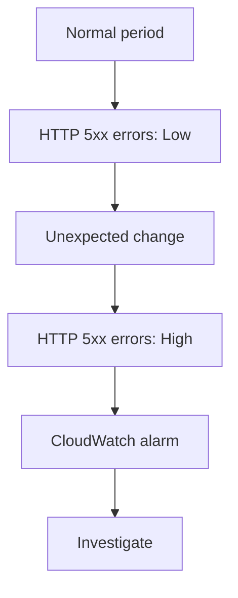

CloudWatch is not itself a complete security investigation system. A spike in errors might be caused by a bug, deployment, overload, or malicious activity.

Use operational metrics to detect symptoms, then investigate the underlying cause.

---

## 6. GuardDuty: Threat Detection

Amazon GuardDuty is a managed threat-detection service that analyzes supported data sources and signals to identify potentially suspicious activity.

Depending on enabled protections and supported sources, findings may indicate patterns such as:

- Suspicious credential usage.
- Unusual API activity.
- Potentially compromised compute resources.
- Possible reconnaissance or malicious network behavior.
- Other activity associated with known threat patterns.

A GuardDuty finding is a **signal that requires interpretation**, not automatic proof that a compromise occurred.

A simplified flow:

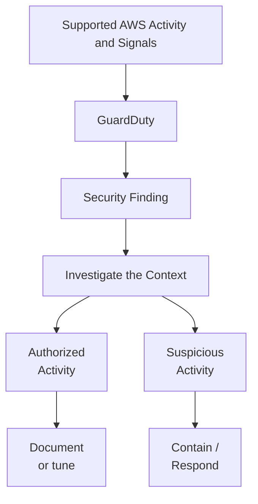

The precise detection capabilities depend on the GuardDuty features enabled in the account or organization.

---

## 7. AWS Config: Detecting Configuration Changes

A system can become insecure even when no attacker is present.

For example:

- A storage bucket becomes publicly accessible.
- A security group allows traffic from anywhere.
- Encryption is disabled on a resource.
- A resource drifts from its approved configuration.

AWS Config can record supported resource configuration changes and evaluate resources against configured rules.

Conceptually:

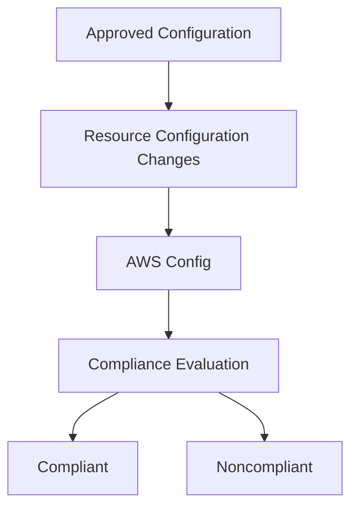

AWS Config does not automatically fix every noncompliant resource. Remediation may require a manual response or a deliberately configured automation.

**Key distinction:** CloudTrail helps explain an API action; AWS Config helps track and evaluate resource configuration.

---

## 8. A Security Finding Is Not the Same as an Incident

Suppose GuardDuty reports unusual activity.

Before making disruptive changes, determine:

1. What resource or identity is involved?
2. What behavior triggered the finding?
3. When did the activity occur?
4. Is it associated with an approved deployment or administrative action?
5. Is there evidence of unauthorized access?
6. What is the potential impact?

A useful progression is:

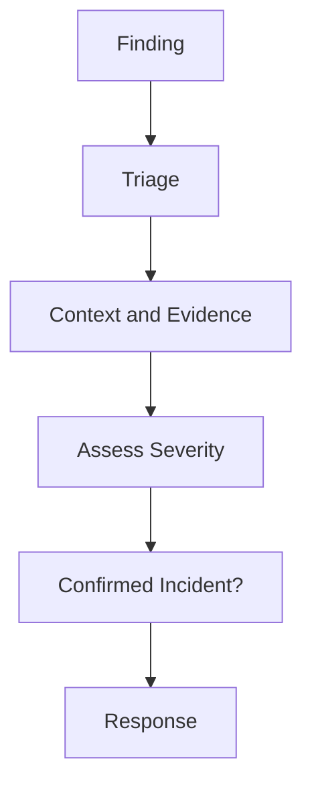

Some findings are false positives or expected behavior. Others require immediate containment.

Use the finding's severity, potential impact, evidence, and business context to prioritize the response.

Do not dismiss a serious finding merely because the application still appears to be working.

---

## 9. The Incident-Response Lifecycle

A practical incident-response process has six broad stages.

### 1. Prepare

Before an incident, establish:

- Account ownership and escalation contacts.
- Least-privilege access for responders.
- Logging and audit requirements.
- Backup and recovery procedures.
- Incident runbooks.
- Communication and decision-making responsibilities.

### 2. Detect

Identify suspicious activity through monitoring, security findings, reports, or unexpected system behavior.

### 3. Analyze

Determine what happened, which identities and resources were affected, the likely timeline, and the scope of the incident.

### 4. Contain

Limit the attacker's ability to continue causing harm.

Examples include revoking compromised credentials, restricting network access, or isolating an affected workload.

### 5. Eradicate and recover

Remove the cause, restore trusted configurations or workloads, rotate affected secrets, and validate the system before returning it to normal operation.

### 6. Learn

Document the incident, identify the control that failed, improve detection and prevention, and update runbooks.

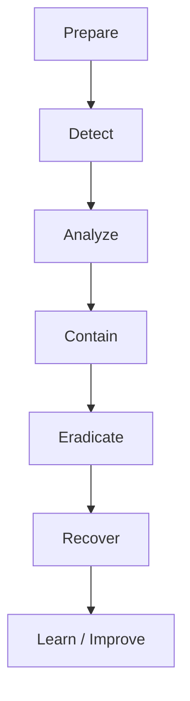

Real incidents are not always strictly linear. New evidence may require returning to analysis or containment.

---

## 10. Example: A Compromised AWS Access Key

Imagine an AWS access key was accidentally committed to a public repository.

An unfamiliar identity begins making AWS API calls.

### Step 1 — Treat the credential as compromised

Do not assume deleting the commit or making the repository private is enough. Someone may already have copied the key.

### Step 2 — Identify the affected identity

Use IAM and available CloudTrail records to establish which identity the credential belongs to and which actions may have been performed.

### Step 3 — Contain access

For a compromised long-lived access key, deactivate or otherwise disable the affected key promptly using an authorized administrative identity.

If a temporary credential or role session is involved, follow the appropriate AWS revocation and containment procedure for that credential type.

Avoid indiscriminately disabling unrelated production identities.

### Step 4 — Investigate activity

Review relevant CloudTrail events and other available evidence:

- Which API actions occurred?
- Were new users, keys, roles, or policies created?
- Were storage policies or security groups changed?
- Were resources created or deleted?
- Was data potentially accessed or exported?

### Step 5 — Remove persistence and restore trust

Inspect for unauthorized identities, credentials, permissions, resources, and configuration changes. Remove malicious changes after preserving necessary evidence and confirming the safe remediation.

Rotate any additional secrets that may have been exposed.

### Step 6 — Prevent recurrence

- Remove the secret from the repository's current content and address its historical exposure where possible.
- Add secret scanning and secure credential handling.
- Prefer IAM roles and short-lived credentials over long-lived access keys where appropriate.
- Review permissions and audit the affected account.
- Document the timeline and corrective actions.

**Critical principle:** Removing a secret from Git history does not make the exposed credential safe. Revoke or rotate the credential itself.

---

## 11. Example: A Publicly Exposed S3 Bucket

Suppose a storage bucket contains files that should not be public.

The response should address both the exposure and its consequences.

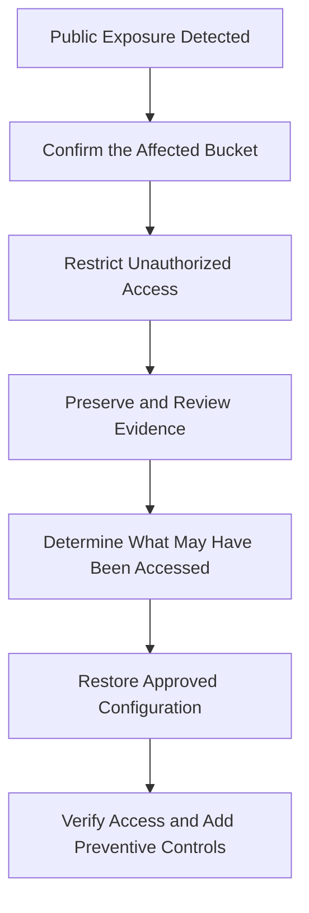

Possible actions include:

- Restricting the bucket policy or access configuration.
- Reviewing S3 Block Public Access settings.
- Reviewing relevant CloudTrail events and available access logs.
- Determining which objects may have been exposed.
- Checking whether unauthorized changes or copies are suspected.
- Verifying that legitimate application access still works.

Do not assume that making the bucket private proves that no one accessed the data while it was public.

If personal data or regulated information may be involved, follow the organization's legal, privacy, and notification procedures.

---

## 12. Containment: Stop Further Harm

Containment limits the damage while the investigation continues.

The correct action depends on the incident.

| Incident | Possible containment |
|---|---|
| Compromised access key | Disable or revoke the affected credential using the appropriate procedure. |
| Exposed S3 bucket | Restrict unauthorized access. |
| Suspicious EC2 instance | Isolate or restrict network access while preserving evidence. |
| Unauthorized IAM changes | Restrict the affected identity and restore safe access controls. |
| Malicious application deployment | Roll back or isolate the affected deployment when safe. |
| Excessive outbound traffic | Restrict the relevant egress path or workload after assessing operational impact. |

Containment must be deliberate.

For example, shutting down a production instance may stop malicious activity, but it can also destroy volatile evidence or disrupt users.

When possible, follow an approved incident runbook and preserve relevant evidence before destructive actions—unless immediate containment is necessary to prevent greater harm.

---

## 13. Evidence Preservation

Incident response is not just about fixing the visible symptom. You may need to understand the timeline, determine the scope, and demonstrate what happened.

Useful evidence can include:

- CloudTrail events.
- Relevant CloudWatch logs.
- GuardDuty findings.
- AWS Config history.
- Application and load balancer logs.
- IAM policy and credential changes.
- Deployment records.
- Relevant network and resource metadata.

Preserve evidence with appropriate timestamps, access controls, and retention.

For potentially compromised compute resources, avoid immediately rebuilding or deleting the resource if doing so would destroy evidence needed for investigation. Follow your incident-response procedure.

Do not assume all evidence is available by default. Logging may not have been enabled, retention may have expired, or some activity may not be captured by the selected source.

This is why preparation and retention decisions matter before an incident occurs.

---

## 14. Recovery: Restore a Trustworthy System

A service responding successfully does not automatically mean it is safe to return to production.

Before recovery, consider:

- Has the initial access path been removed?
- Have compromised credentials been revoked or rotated?
- Are unauthorized IAM changes removed?
- Are affected workloads running trusted software?
- Are storage and network permissions correct?
- Are application secrets still trustworthy?
- Are monitoring and alerts functioning?
- Can the system be restored from a known-good backup or image if necessary?

A recovery flow might be:

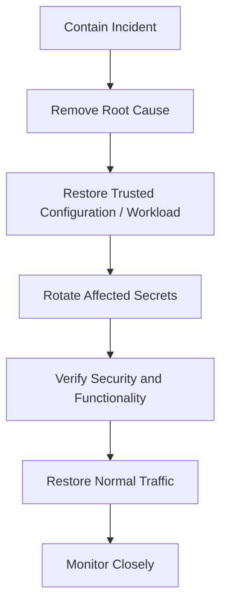

The exact sequence depends on the incident. Credential rotation, for example, must be coordinated with applications that depend on those credentials.

---

## 15. IAM and Incident Response

IAM is central to cloud security because it controls access to AWS resources.

During an incident, responders may need to:

- Identify which identity performed an action.
- Determine the permissions that identity possessed.
- Disable compromised credentials.
- Remove unauthorized permissions.
- Restore an approved policy.
- Verify that responders retain the access required to contain the incident.

Use a dedicated, controlled responder role where appropriate.

Avoid solving an incident by giving every administrator unrestricted access permanently. Emergency access should be controlled, auditable, and reviewed.

This connects directly to **12.04 — AWS IAM: Users, Roles, Policies & Workload Identity**.

---

## 16. Account Structure and Blast Radius

A compromised credential should not automatically provide access to every environment.

Separating production, development, and security responsibilities across appropriately governed AWS accounts can reduce blast radius.

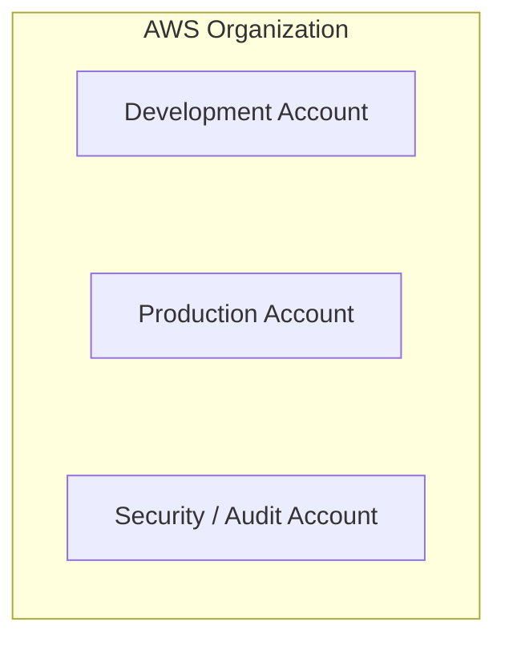

The exact structure depends on the organization's size and requirements.

Separate accounts are not a complete security boundary by themselves; permissions, trust relationships, networking, and organization-level controls still matter.

The goal is to avoid unnecessary shared access and limit how far an incident can spread.

For a small learning project, start with a clearly separated development environment and strict permissions. Do not create a complex multi-account structure merely for appearance.

---

## 17. Automation: Useful but Dangerous

Some security responses can be automated.

For example:

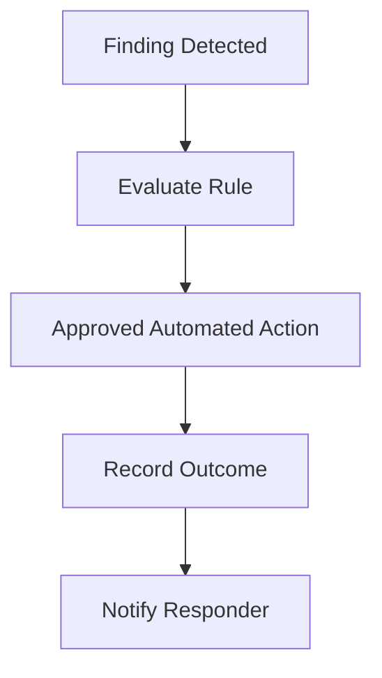

Automation may be appropriate for well-understood, low-risk actions.

But automatically terminating every resource associated with a suspicious signal can cause outages or destroy evidence.

Before automating remediation, define:

- Which finding or condition triggers it.
- Whether the signal is reliable enough.
- What the action changes or destroys.
- How false positives are handled.
- How the action is logged and audited.
- How a human can review or reverse the action.

Start with notifications and controlled runbooks before automating disruptive remediation.

---

## 18. Hands-On Lab: Investigate a Security Signal

This lab focuses on investigation and does not require creating a simulated attack.

### Step 1 — Review CloudTrail activity

In the AWS console, open CloudTrail event history if available for your account and region.

Inspect a recent event and identify:

- Event name.
- Event time.
- Identity information.
- AWS service.
- Affected resource, where recorded.
- Source information, where available.

Ask: *Was this action expected?*

Event history has scope and retention limitations. For longer-term investigation, verify the configured trail, destination, and retention.

### Step 2 — Review GuardDuty

If GuardDuty is already enabled, inspect its findings and their details.

Do not generate suspicious activity just to force a finding. If GuardDuty is not enabled, review its setup and pricing before enabling it.

### Step 3 — Inspect a resource's configuration

If AWS Config is enabled, review the configuration history or compliance status of an appropriate resource.

For example, check whether a security-related configuration matches your intended state.

### Step 4 — Write a mini incident report

Use this template:

```text
Incident / Finding:
When detected:
Affected identity or resource:
Evidence reviewed:
Expected or unexpected:
Potential impact:
Immediate containment:
Recovery / remediation:
Follow-up prevention:
```

If you do not have an actual finding, use a hypothetical scenario and label it clearly.

### Step 5 — Verify the operational controls

Check whether:

- Relevant audit events are available.
- The right people can access investigation data.
- Retention is appropriate.
- Security findings have a defined owner.
- Your response steps avoid unnecessary disruption.

### Cost and safety reminder

Some security services and data sources incur charges depending on usage and current pricing. Review costs before enabling new services or expanding log collection. Do not create public exposure, leak credentials, or run a real attack to complete this lab.

---

## 19. Trade-offs and Failure Modes

| Decision | Benefit | Risk |
|---|---|---|
| Disable a suspected credential immediately | Can stop further use | May disrupt legitimate workloads using it |
| Shut down a suspicious instance | Can stop activity quickly | May cause an outage or destroy volatile evidence |
| Automate containment | Faster response | False positives can disrupt production |
| Collect more audit data | Better investigation evidence | Additional cost and sensitive-data exposure |
| Grant broad responder permissions | May simplify emergency actions | Increases risk if the responder identity is compromised |
| Restore from backup | Can recover known-good data | May restore vulnerable software or reintroduce compromised secrets |
| Restrict network access | Limits communication | Can interrupt legitimate dependencies |

Security response requires balancing speed, evidence preservation, service availability, and risk.

---

## 20. Common Mistakes

### Mistake 1 — Assuming a finding proves compromise

Investigate the context and evidence before drawing a conclusion.

### Mistake 2 — Assuming no alert means no incident

Detection depends on the services enabled, data collected, retention, and rules in use.

### Mistake 3 — Deleting a leaked key from Git and doing nothing else

The credential may already have been copied. Revoke or rotate it.

### Mistake 4 — Fixing the resource without investigating the timeline

You may leave unauthorized credentials or related changes in place.

### Mistake 5 — Destroying evidence too early

Rebuilding or deleting a resource may remove information needed to understand the incident.

### Mistake 6 — Automating destructive actions too soon

A false positive can become a production outage.

### Mistake 7 — Treating recovery as merely restoring availability

A recovered service must also be trustworthy and properly secured.

### Mistake 8 — Ignoring prevention after an incident

If the underlying permission, secret-management, or monitoring weakness remains, the same incident may recur.

---

## 21. The System Design View

Cloud security operations connect identity, infrastructure, observability, and recovery.

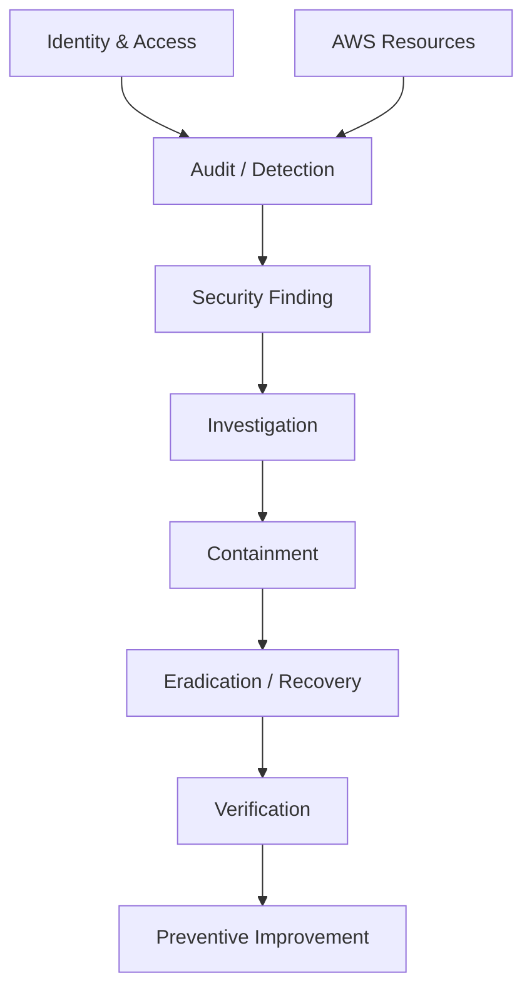

A well-designed system should make it possible to answer:

1. Which identity or resource was involved?
2. What changed and when?
3. What evidence is available?
4. How can further harm be limited?
5. How can the system be restored safely?
6. What control would reduce the likelihood or impact of recurrence?

Security operations are easier when auditability, least privilege, logging, backup, and recovery procedures are designed in advance.

---

## 22. Key Principle

> **Cloud security is not only about preventing unauthorized access. It is also about detecting suspicious activity, limiting its impact, preserving evidence, and restoring a trustworthy system.**

Remember the response loop:

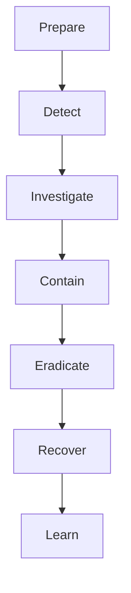

Do not wait for an incident to discover that credentials cannot be revoked safely, logs are missing, or recovery procedures are unknown.

---

## 23. Quick Reference

| Term | Meaning |
|---|---|
| Cloud security operations | Ongoing monitoring, investigation, and management of cloud security |
| Incident response | Structured handling of a suspected or confirmed security incident |
| CloudTrail | Records supported AWS account and API activity |
| CloudWatch | Operational metrics, logs, alarms, and dashboards |
| GuardDuty | Managed detection of potentially malicious activity |
| AWS Config | Resource configuration history and compliance evaluation |
| Security finding | A signal that may require investigation |
| Containment | Limiting further harm while the incident is handled |
| Eradication | Removing the cause or unauthorized access |
| Evidence preservation | Retaining information needed to investigate what happened |
| Blast radius | The scope of resources or systems an incident can affect |
| Recovery | Restoring a trustworthy and operational system |

---

## 24. Knowledge Check

1. What is the difference between a security finding and a confirmed incident?
2. What does CloudTrail help you investigate?
3. How is CloudWatch different from GuardDuty?
4. Why might AWS Config be useful after an unexpected security-group change?
5. What should you do when an AWS access key is exposed publicly?
6. Why can immediately terminating a suspicious instance be risky?
7. What does containment achieve?
8. Why is restoring application availability not sufficient by itself?
9. Why should disruptive security automation be tested carefully?
10. What is the purpose of preserving incident evidence?

### Answers

1. A finding is a signal requiring assessment; a confirmed incident is an event established to involve a security problem.
2. It helps establish which supported AWS API actions occurred, when they happened, and which identities or resources were involved.
3. CloudWatch focuses on monitoring and observability; GuardDuty analyzes supported signals to identify potentially malicious activity.
4. It can help show configuration history and whether the resource violates configured rules.
5. Treat it as compromised, disable or rotate it appropriately, investigate its use, and address the exposure and its cause.
6. It may disrupt production or destroy volatile evidence needed for investigation.
7. It limits the attacker's ability to continue causing harm.
8. The original access path or malicious changes may remain, allowing the incident to recur.
9. False positives can trigger destructive actions or interrupt legitimate workloads.
10. It supports understanding the timeline, scope, cause, and required corrective actions.

---

## Remember

A secure cloud system needs more than preventive controls.

It needs reliable evidence, a defined response process, controlled containment, and a way to verify that recovery has restored trust.

**Next: 12.18 — Cloud Cost Management & Resource Optimization**
