# 12.18 — Cloud Cost Management & Resource Optimization

## Learning Objectives

By the end of this chapter, you should be able to:

- Understand how AWS cloud costs accumulate.
- Distinguish fixed, usage-based, and request-based costs.
- Use budgets, billing data, and cost allocation tags to track spending.
- Identify common sources of cloud waste.
- Right-size compute, database, and storage resources.
- Understand the trade-offs between cost, performance, and reliability.
- Recognize how monitoring, automation, and cleanup prevent unexpected bills.
- Create a basic cost-management strategy for a cloud application.

---

## 1. The Problem: Cloud Resources Cost Money While They Exist

Imagine you deploy a small web application on AWS.

It uses:

- An EC2 instance for the application.
- An RDS database.
- An S3 bucket for uploaded files.
- An Application Load Balancer.
- CloudWatch for monitoring.

The application has almost no users during the first week.

But the infrastructure is still running.

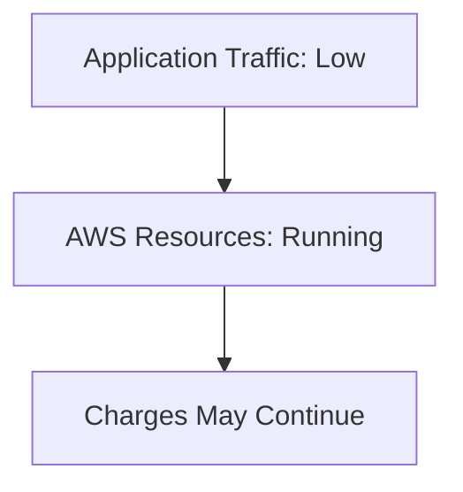

This is one of the biggest differences between cloud infrastructure and a purely local development environment.

**Cloud resources can continue generating charges even when nobody is using your application.**

The exact billing behavior depends on the service and resource configuration. Some resources charge while running, some charge according to usage, and others have a combination of charges.

The architectural lesson is simple:

> **Cloud cost is part of system design, not just an accounting problem.**

---

## 2. How AWS Costs Accumulate

A cloud bill is usually the sum of charges from multiple services.

For example:

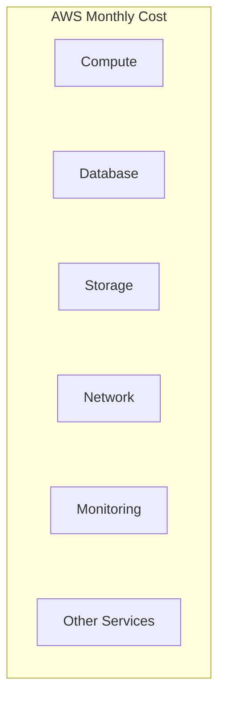

A web application might incur charges from:

| Component | Possible cost drivers |
|---|---|
| EC2 | Instance runtime, attached storage, data transfer |
| RDS | Database instance runtime, storage, backups, data transfer |
| Application Load Balancer | Time provisioned and usage-based capacity or traffic charges |
| S3 | Stored data, requests, retrieval, and data transfer |
| CloudWatch | Metrics, log ingestion, storage, queries, and alarms |
| NAT Gateway | Gateway runtime and processed data |
| Data transfer | Traffic moving through chargeable paths |
| Route 53 | Hosted zones, DNS queries, and related features |
| Lambda | Invocations, execution duration, and allocated resources |

This table describes common cost drivers, not a complete price list. AWS pricing varies by region, service configuration, usage, and current pricing rules.

### Important principle

A resource that looks small in the architecture diagram may still have a meaningful recurring cost.

For a low-traffic application, the surrounding infrastructure can cost more than the application code itself.

---

## 3. Fixed, Usage-Based, and Request-Based Costs

A useful way to reason about cloud spending is to classify the cost model.

### Provisioned or time-based costs

Some resources charge according to how long they are provisioned or running.

Examples may include:

- EC2 instances.
- RDS instances.
- Load balancers.
- NAT Gateways.

An idle resource may continue to incur charges.

### Usage-based costs

Other costs depend on the amount of a resource consumed.

Examples include:

- S3 storage.
- Data transfer.
- Log ingestion.
- Database storage.

### Request or execution-based costs

Some services charge based on operations performed.

Examples include:

- Lambda invocations and execution duration.
- S3 requests.
- API requests to supported services.

Many services combine several cost models.

```text
Total Cost
    =
Provisioned Resources
    +
Usage
    +
Requests / Operations
    +
Data Transfer
    +
Optional Features
```

Understanding the pricing model helps you predict how the bill changes when traffic, data, or infrastructure grows.

---

## 4. Cost Is a Function of Architecture

Consider two ways to run a small web application.

**Option A — Simple deployment**

One application instance and a managed database

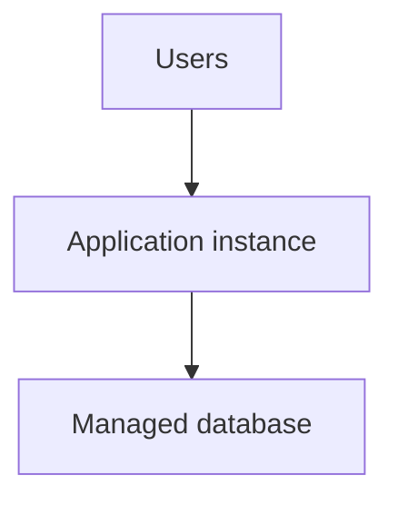

**Option B — More distributed deployment**

Multiple application instances and additional infrastructure

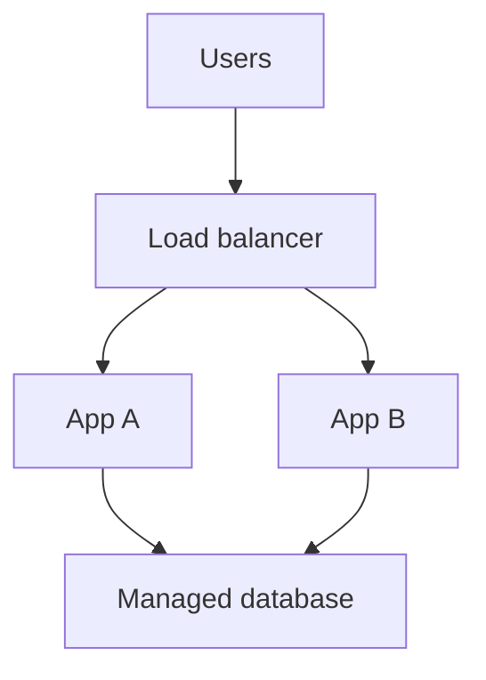

Option B may provide better availability and scaling, but it introduces additional infrastructure and operational costs.

That does not make Option A universally better.

If the application requires high availability, additional capacity may be justified.

The right question is:

> **What reliability, performance, and capacity does the application actually require?**

Do not pay for architectural complexity that provides no meaningful benefit. Equally, do not remove essential redundancy just to reduce a bill.

---

## 5. Cost Visibility Comes First

You cannot manage costs effectively if you cannot identify where the money goes.

AWS provides several billing and cost-management capabilities.

| Capability | Purpose |
|---|---|
| AWS Billing and Cost Management | View and manage billing information |
| AWS Cost Explorer | Analyze historical and forecasted spending |
| AWS Budgets | Define budget thresholds and configure notifications or supported actions |
| Cost allocation tags | Attribute supported costs to applications, environments, or teams |
| Cost and Usage Reports | Obtain detailed billing data for deeper analysis |
| AWS Pricing Calculator | Estimate costs before deploying a design |

Availability and features can depend on account configuration and billing setup.

Start by learning how to inspect spending before optimizing individual resources.

### A simple investigation

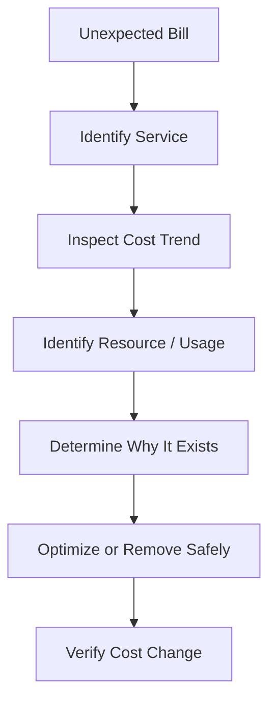

Do not immediately delete a resource just because its cost is high. First establish what depends on it.

---

## 6. AWS Budgets: Setting Spending Guardrails

An **AWS Budget** lets you define a spending threshold and configure notifications when actual or forecasted spending reaches specified conditions.

For example:

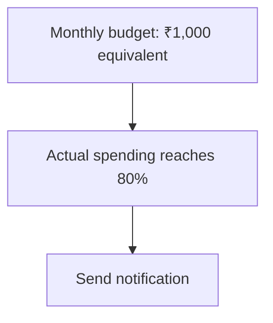

This is an illustrative policy, not an AWS price estimate.

You might define separate budgets for:

- A development environment.
- A production application.
- A learning project.
- An individual account or team.

### What a budget does not guarantee

A budget is not necessarily a hard spending cap.

Notifications may arrive after charges have already occurred. Billing data can have reporting delays, and supported budget actions have their own behavior and limitations.

Therefore:

> **A budget is a warning system and guardrail, not a guarantee that spending cannot exceed the configured amount.**

For stronger cost control, combine budgets with resource restrictions, automated cleanup, and regular billing reviews.

---

## 7. Cost Allocation Tags

As a project grows, the bill can become difficult to understand.

Imagine the account contains resources for:

```text
Systemly
GitBit
Development
Production
Experiments
```

Cost allocation tags help categorize supported resource costs.

Example tags:

```text
Project     = Systemly
Environment = Development
Owner       = Learning
```

Conceptually:

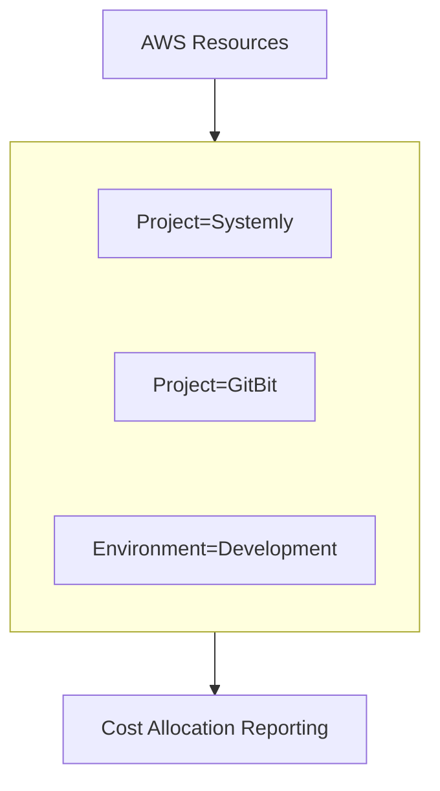

Tags do not automatically allocate every charge, and they must be applied and activated appropriately for billing reports to use them.

Some costs are shared or not directly attributable to a tagged resource. For example, shared networking or data-transfer costs may require additional analysis.

Use a consistent tagging convention rather than inventing a new tag name for every resource.

---

## 8. The Most Common Source of Waste: Idle Resources

A resource can remain allocated after its original purpose has disappeared.

Examples include:

- An EC2 instance created for a temporary experiment.
- A database left running after a lab.
- An unattached EBS volume.
- Old snapshots retained without a clear reason.
- Unused load balancers.
- NAT Gateways left behind by deleted workloads.
- Old container services or tasks.
- Log groups retaining unnecessary data.

A simple inventory helps:

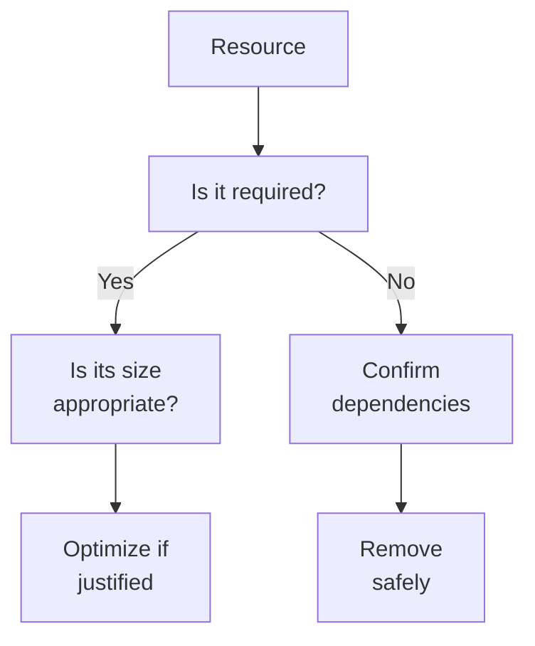

### Do not delete blindly

An apparently unused volume might contain important data. An idle load balancer may serve a rarely used but critical endpoint.

Before deleting a resource, verify ownership, dependencies, retention requirements, and recovery options.

---

## 9. Right-Sizing Compute

**Right-sizing** means choosing a resource size appropriate for the actual workload.

Suppose an EC2 instance is provisioned with substantial CPU and memory capacity, but measured usage remains consistently low.

You might be paying for capacity the application does not need.

```text
Provisioned Capacity
|--------------------------------|
Actual Sustained Usage
|-------|
```

Potential actions include:

- Selecting a smaller suitable instance.
- Choosing an appropriate instance family.
- Adjusting the number of running instances.
- Using a scaling policy when the workload varies.
- Moving suitable workloads to a different compute model.

However, do not right-size based on one quiet hour.

Measure representative peak periods, memory usage, request latency, and workload behavior.

**Cost optimization should preserve required capacity and performance.**

---

## 10. Scale Down Carefully

Suppose an application runs two instances continuously, but its workload is predictable and very low.

Reducing capacity may lower cost.

But the decision depends on the service requirements.

| Change | Potential benefit | Potential risk |
|---|---|---|
| Reduce instance size | Lower compute cost | Less capacity during spikes |
| Reduce instance count | Fewer running resources | Lower redundancy |
| Scale to zero where supported | Avoid idle compute usage | Cold starts or temporary unavailability |
| Schedule development resources | Avoid paying for unused periods | Work may fail if the schedule is wrong |

A production application with a strict availability requirement may need capacity running continuously.

A temporary development environment may be a better candidate for scheduled shutdown.

---

## 11. Managed Databases and Cost

RDS costs can include database instance runtime, storage, backups beyond applicable allowances, data transfer, and optional features.

Potential optimization opportunities include:

- Right-sizing the database instance.
- Removing unnecessary test databases.
- Reviewing storage allocation and growth.
- Reviewing backup retention against recovery requirements.
- Selecting an appropriate database deployment configuration.
- Investigating expensive queries that require unnecessary capacity.

### Avoid unsafe database cost cuts

Reducing database size can increase latency or cause resource exhaustion.

Reducing backups can weaken recovery capability.

Removing a standby or replica may reduce redundancy.

Before changing a database configuration, ask:

```text
What performance is required?
What recovery time is acceptable?
What data loss is acceptable?
What availability is required?
```

A low-cost database is not a good result if it cannot meet the application's requirements.

---

## 12. Storage Costs: Data, Requests, and Retention

Storage costs are not limited to the headline price per gigabyte.

Depending on the storage service and configuration, you may pay for:

- Stored data.
- Requests.
- Data retrieval.
- Data transfer.
- Replication.
- Snapshots or backups.
- Additional performance or availability features.

For S3, an old collection of files may accumulate storage costs even when the application no longer uses those files.

A sensible strategy includes:

1. Identifying what data must be retained.
2. Removing data that is safe to delete.
3. Applying lifecycle policies where appropriate.
4. Selecting storage classes based on access patterns.
5. Reviewing retrieval and transition charges before moving data.

### Lifecycle example

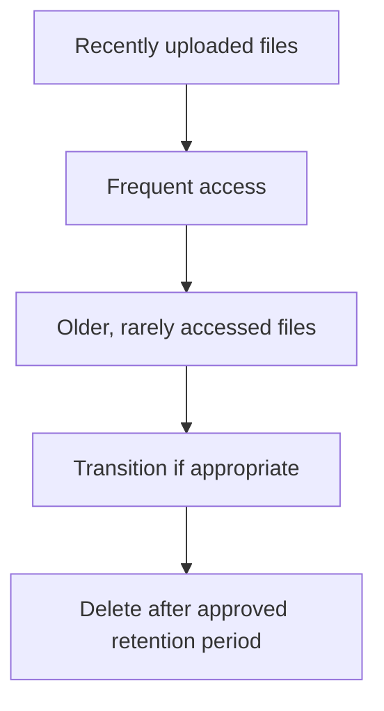

Do not apply automatic deletion or archival policies without understanding retention, legal, and recovery requirements.

---

## 13. Networking Can Be a Significant Cost

Networking is easy to overlook because it may not appear as an obvious application resource.

Potential cost drivers include:

- Data transfer across certain network boundaries.
- NAT Gateway runtime and processed data.
- Load balancer usage.
- Cross-region traffic.
- Traffic between availability zones, depending on the path and service.
- Public IPv4 addresses and other chargeable networking features.

Consider a private application subnet that sends all outbound traffic through a NAT Gateway.

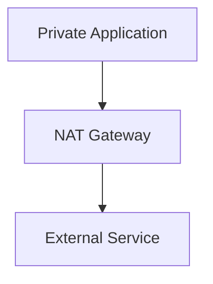

The architecture may be appropriate, but the gateway and traffic can create ongoing charges.

Possible optimization approaches include:

- Reviewing whether the network path is necessary.
- Reducing unnecessary data transfer.
- Keeping suitable services close to the data they use.
- Using appropriate private service connectivity where available.
- Avoiding accidental cross-region traffic.
- Removing unused networking resources after dependency checks.

Do not expose private resources publicly simply to avoid networking costs. Security requirements still apply.

---

## 14. CloudWatch and Logging Costs

CloudWatch can provide important operational visibility, but monitoring features may incur charges.

Cost drivers can include:

- Log ingestion.
- Log retention and storage.
- Custom metrics.
- Dashboards and alarms.
- Log query volume.
- Additional monitoring features.

A common mistake is sending verbose debug logs indefinitely.

A better approach is to define:

- Which events are important.
- Which log levels are appropriate in production.
- How long logs should be retained.
- Which logs need long-term archival.
- Who can access sensitive log data.

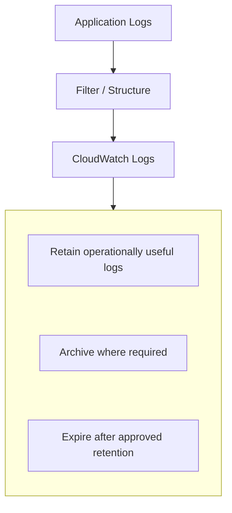

Do not reduce log retention so aggressively that you lose the evidence required for debugging or security investigations.

---

## 15. Cost Per Unit of Work

Total monthly spending alone does not tell you whether a system is becoming more efficient.

Suppose:

```text
Month A:
Cost = ₹10,000
Orders = 1,000

Cost per order = ₹10
```

Later:

```text
Month B:
Cost = ₹15,000
Orders = 5,000

Cost per order = ₹3
```

These are illustrative figures.

Total spending increased, but cost per order decreased.

The system may be operating more efficiently even though the bill is larger.

Useful unit-cost measures include:

- Cost per request.
- Cost per order.
- Cost per active customer.
- Cost per gigabyte stored.
- Cost per background job.
- Cost per successful workflow.

The right measure depends on the application.

> **A growing cloud bill is not automatically a problem. The question is whether the spending produces appropriate business or technical value.**

---

## 16. Forecasting and Cost Anomalies

A budget tells you whether spending is approaching a defined threshold. A forecast estimates where spending may go based on available data. An anomaly-detection capability can help identify unusual spending patterns.

For example:

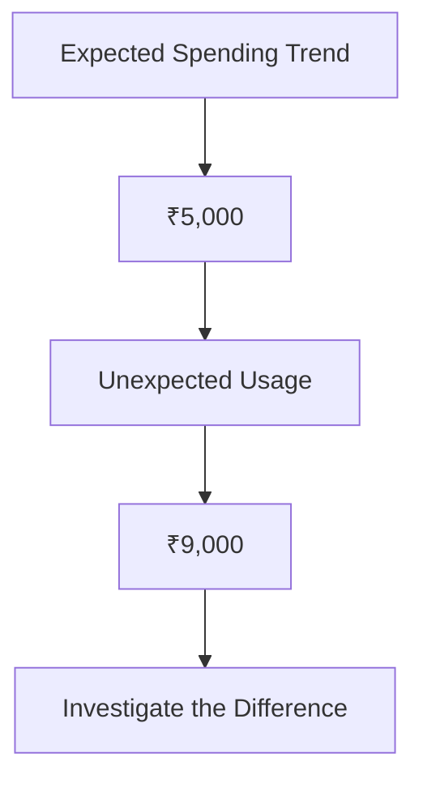

Possible causes include:

- An accidental resource left running.
- A traffic spike.
- A retry loop generating excessive requests.
- A log-ingestion increase.
- A data-transfer change.
- An unauthorized resource deployment.

Cost anomalies do not necessarily indicate a security incident. But unexpected spending can be a useful signal that something in the system has changed.

---

## 17. Cost Optimization Is a Continuous Loop

A one-time cleanup is not enough.

A resource that is appropriate today may become oversized, underused, or unnecessary later.

Use a continuous process:

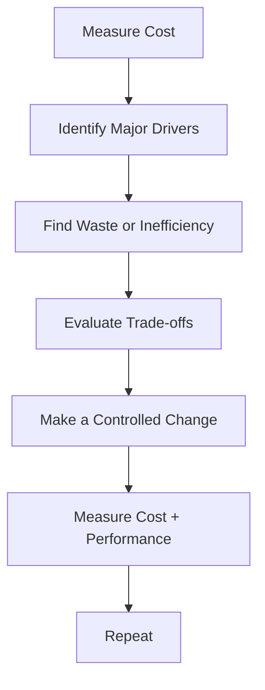

Track both spending and system behavior after every meaningful change.

A cheaper system that violates latency, availability, or recovery requirements is not necessarily an improvement.

---

## 18. Hands-On Lab: Build a Cost-Safety Checklist

This lab can be completed by reviewing your account without creating new infrastructure.

### Step 1 — Inspect current spending

Open AWS Billing and Cost Management and review the available cost breakdown.

Identify the largest service categories and compare spending across time periods where data is available.

### Step 2 — Review budgets

Check whether a budget exists for your development or learning environment.

If you create one, choose a threshold appropriate to your own spending tolerance and configure notifications.

Remember that a budget alert is not a guaranteed hard spending cap.

### Step 3 — Inventory resources

Review resources in the regions you have used.

Look for:

- Running EC2 instances.
- RDS databases.
- Load balancers.
- NAT Gateways.
- EBS volumes and snapshots.
- S3 storage.
- CloudWatch log groups and retention settings.
- Other resources created during previous labs.

A regional review is important because resources can exist outside the region you are currently viewing.

### Step 4 — Identify one candidate for optimization

For each candidate, record:

```text
Resource:
Purpose:
Current cost driver:
Usage evidence:
Dependencies:
Risk of changing it:
Proposed action:
Verification method:
```

### Step 5 — Make only a safe, justified change

Examples might include removing a confirmed unused test resource, scheduling development compute shutdown, or applying a suitable log-retention policy.

Do not delete a resource merely because you do not recognize its name.

### Step 6 — Verify the result

Check that:

- The application still works.
- Required backups and logs remain available.
- Security controls remain intact.
- The intended resource was changed.
- Cost data reflects the change when updated.

Billing data can take time to reflect changes. Do not assume that a resource change will immediately appear in cost reports.

---

## 19. Trade-offs and Failure Modes

| Decision | Potential benefit | Risk |
|---|---|---|
| Downsize compute | Lower runtime cost | Increased latency or capacity exhaustion |
| Reduce instance count | Lower spending | Reduced availability and redundancy |
| Reduce backup retention | Lower storage cost | Weaker recovery capability |
| Archive old data | Lower long-term storage cost | Retrieval delays and charges |
| Reduce logging | Lower ingestion and storage cost | Less evidence for debugging and incidents |
| Remove NAT Gateway | Lower network cost | Broken connectivity or insecure alternatives |
| Use fewer environments | Lower infrastructure cost | Testing and production changes may become entangled |
| Buy a commitment-based pricing option | Potential savings for predictable usage | Reduced flexibility and possible unused commitment |
| Scale to zero | Lower idle compute cost | Cold starts or temporary unavailability |

For commitment-based options, verify current eligibility, terms, flexibility, and pricing before purchasing. Do not make a long-term commitment based only on a short period of usage.

---

## 20. Common Mistakes

### Mistake 1 — Optimizing the bill without understanding the architecture

A resource may support availability, security, or recovery.

### Mistake 2 — Assuming low traffic means zero cost

Provisioned resources and other services may continue to incur charges.

### Mistake 3 — Treating budgets as hard spending limits

Budget notifications and supported actions have limitations and may not prevent charges.

### Mistake 4 — Ignoring networking and monitoring

NAT Gateways, data transfer, and log ingestion can contribute meaningfully to costs.

### Mistake 5 — Deleting resources without checking dependencies

You may cause an outage or lose important data.

### Mistake 6 — Using average CPU alone to right-size resources

Peak demand, memory, latency, and reliability requirements matter too.

### Mistake 7 — Cutting backups or logs indiscriminately

Short-term savings can increase recovery time, data loss risk, or investigation difficulty.

### Mistake 8 — Measuring only total spending

Cost per unit of work can reveal whether efficiency is improving or deteriorating.

---

## 21. The System Design View

Cloud cost optimization is a constrained engineering problem.

You are trying to reduce unnecessary spending while meeting the application's requirements.

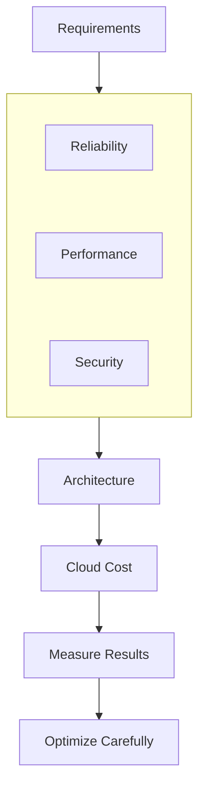

A sensible optimization process asks:

1. What does the resource do?
2. Is it necessary?
3. Is it appropriately sized?
4. What does it cost?
5. What happens if we change or remove it?
6. How will we verify the result?

The aim is not to make every service as cheap as possible. It is to spend intentionally on the capabilities the system actually needs.

---

## 22. Key Principle

> **Cloud cost optimization means removing waste while preserving the reliability, security, performance, and recovery capabilities the application requires.**

Remember:

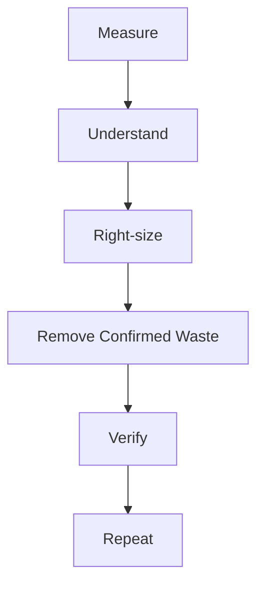

Start simple. Track spending. Understand resource purpose. Optimize with evidence rather than guesses.

---

## 23. Quick Reference

| Term | Meaning |
|---|---|
| Cost Explorer | Tool for analyzing historical and forecasted AWS spending |
| AWS Budgets | Spending thresholds with configurable notifications and supported actions |
| Cost allocation tags | Labels used to categorize supported costs |
| Right-sizing | Matching resource capacity to workload requirements |
| Idle resource | Resource that remains allocated but provides little or no current value |
| Unit cost | Cost per unit of work, such as an order or request |
| Cost anomaly | Spending behavior that differs from the expected pattern |
| Lifecycle policy | Rules for transitioning or expiring data according to defined conditions |
| Data transfer cost | Charges associated with supported data movement paths |
| Commitment-based pricing | Pricing arrangements that may offer savings in exchange for a usage commitment |
| Cost guardrail | Control or process designed to detect or limit unwanted spending |

---

## 24. Knowledge Check

1. Why can an idle EC2 instance continue to incur charges?
2. What is the difference between a budget notification and a hard spending cap?
3. Why should you inspect dependencies before deleting a resource?
4. What is right-sizing?
5. Why can networking create costs that are easy to overlook?
6. Why should log retention balance cost with operational and security needs?
7. Why might cost per order be more useful than total monthly spending?
8. What risks arise from reducing database backups to save money?
9. Why should you measure performance after a cost optimization?
10. How can an unexpected cost increase help identify a technical or security problem?

### Answers

1. Some resources charge while provisioned or running, regardless of whether users are actively using the application.
2. A budget notification warns about a spending condition; it does not necessarily prevent further charges.
3. The resource may support an application, contain important data, or be required for recovery.
4. Selecting a resource size that meets actual workload and reliability requirements without unnecessary excess capacity.
5. NAT Gateways, data transfer, load balancers, and cross-region or cross-zone traffic may incur charges.
6. Shorter retention may reduce costs but can remove evidence needed for troubleshooting, security investigations, or recovery.
7. Unit cost shows how spending changes relative to the amount of useful work completed.
8. It can weaken recovery options and increase potential data loss or recovery time.
9. A cheaper resource configuration may introduce latency, errors, or capacity problems.
10. It may reveal accidental resources, unexpected traffic, inefficient loops, configuration changes, or potentially unauthorized activity.

---

## Remember

A cloud architecture is not complete when it works. It also needs to be affordable to operate over time.

**Next: 12.19 — Cloud Backup, Disaster Recovery & Recovery Testing**
