# 12.19 — Cloud Backup, Disaster Recovery & Recovery Testing

## Learning Objectives

By the end of this chapter, you should be able to:

- Explain the difference between backups, high availability, and disaster recovery.
- Understand Recovery Point Objective (RPO) and Recovery Time Objective (RTO).
- Choose appropriate backup strategies for databases, files, and infrastructure.
- Understand AWS backup and recovery options.
- Design a basic disaster recovery plan for a web application.
- Recognize backup security risks, including accidental deletion and ransomware.
- Understand why backups must be tested through actual restoration.
- Practice creating a recovery plan with measurable targets.

---

## 1. The Problem: What Happens When Something Goes Wrong?

Imagine your application runs on AWS.

It uses:

- EC2 for application hosting.
- RDS for the database.
- S3 for uploaded files.
- CloudWatch for monitoring.

One morning, a deployment introduces a bug that corrupts customer records.

Or an administrator accidentally deletes important data.

Or an AWS region becomes unavailable.

Your application may have healthy servers, but the data or infrastructure it depends on is no longer usable.

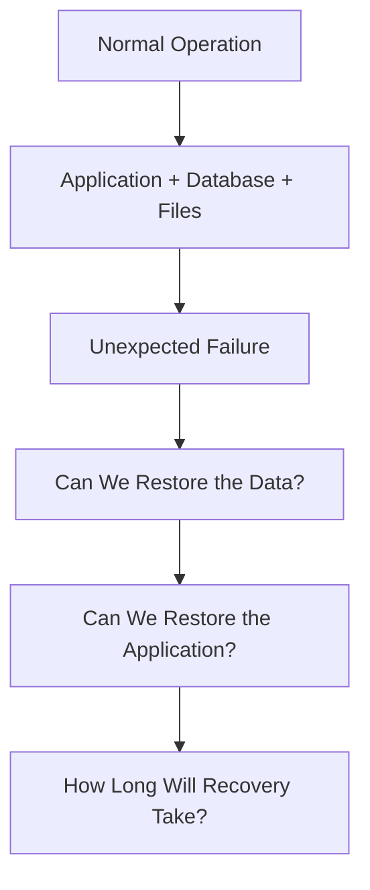

These are different questions.

A backup may help recover deleted data. A second application instance may help survive a server failure. A disaster recovery plan helps restore service after a major disruption.

**A system is not recoverable merely because someone configured backups. Recovery must be planned, achievable, and tested.**

---

## 2. Backup vs High Availability vs Disaster Recovery

These concepts are related, but they solve different problems.

| Concept | Main purpose | Example |
|---|---|---|
| Backup | Preserve recoverable copies of data or resources | RDS automated backups |
| High availability (HA) | Keep a service available despite certain component failures | RDS Multi-AZ deployment |
| Disaster recovery (DR) | Restore service after a major disruption | Recovering an application in another AWS region |

### Backup

A backup gives you a recovery source.

It may help when data is deleted, corrupted, or otherwise lost.

### High availability

High availability reduces interruption when a supported component fails.

For example, a Multi-AZ database deployment can support failover after certain infrastructure failures.

However, replication and failover do not protect against every logical error. If an application intentionally writes incorrect data, that change may also reach another copy.

### Disaster recovery

Disaster recovery addresses larger failures that may affect the primary environment.

It can involve restoring data, recreating infrastructure, deploying application code, restoring configuration, and redirecting traffic.

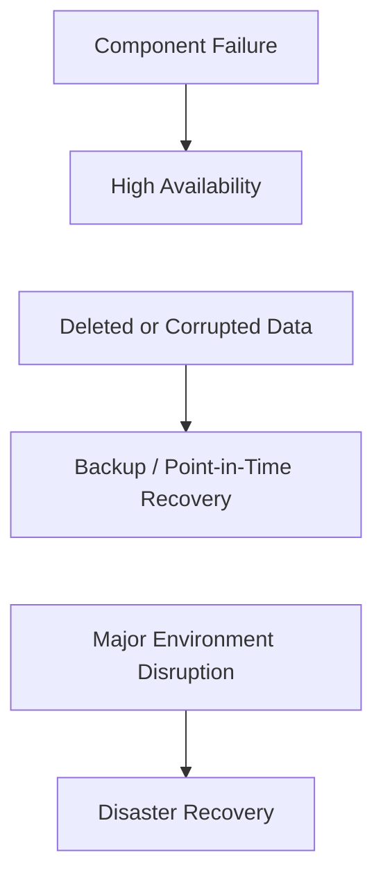

A robust architecture may need all three.

---

## 3. Two Questions Every Recovery Plan Must Answer

A recovery plan needs measurable objectives.

These are commonly expressed as RPO and RTO.

### Recovery Point Objective (RPO)

**RPO describes how much data loss, measured in time, the business can tolerate.**

RPO is about acceptable data loss—not the time needed to restore service.

### Recovery Time Objective (RTO)

**RTO describes the target time within which the service should be restored after a disruption.**

The precise start and end points must be defined by the organization. A server starting successfully is not necessarily the same as the business service being usable again.

### RPO vs RTO

For a payment system, acceptable data loss may be extremely low. For a personal learning project, a longer recovery time and some data loss might be acceptable.

Recovery objectives should follow business requirements, not arbitrary infrastructure preferences.

---

## 4. Why Backups Alone Are Not Enough

Imagine you have a daily database backup.

A failure occurs just before the next scheduled backup.

Depending on the backup and recovery features available, you might lose almost a full day's worth of changes.

Even if the backup is valid, you still need to:

- Provision or identify a recovery environment.
- Restore the database.
- Deploy a compatible application version.
- Restore required configuration and secrets.
- Reconnect application services.
- Validate data integrity.
- Test critical user workflows.
- Redirect traffic if necessary.

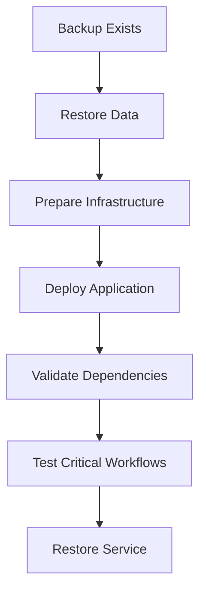

The backup is only one part of the recovery process.

**A backup that cannot be restored within the required time does not satisfy the recovery objective.**

---

## 5. What Should You Back Up?

A web application consists of more than its database.

| Asset | Possible recovery approach |
|---|---|
| Relational database | Automated backups, snapshots, point-in-time recovery where supported |
| User-uploaded files | S3 versioning, replication, backups, or protected copies |
| Application code | Version control and release artifacts |
| Infrastructure | Terraform code and state protection |
| Configuration | Versioned configuration with controlled access |
| Secrets | Managed secret storage and a controlled rotation/recovery process |
| Logs and audit evidence | Appropriate retention and protected destinations |
| Critical operational documentation | Versioned runbooks and recovery procedures |

Different assets require different strategies.

For example, application code in Git can often be redeployed. Customer transactions may require database-specific recovery mechanisms. Secrets should not be copied into an ordinary source-code repository just because other configuration is version-controlled.

### Important distinction

**Rebuilding infrastructure is not the same as recovering data.**

Terraform may recreate an RDS instance, but it cannot recreate the missing customer records unless an appropriate data-recovery source exists.

---

## 6. RDS Backups and Point-in-Time Recovery

Amazon RDS provides database backup capabilities, with specific options varying by database engine and configuration.

Common recovery mechanisms include:

- Automated backups.
- Manual snapshots.
- Point-in-time recovery (PITR), where supported.

### Automated backups

Automated backups help maintain recovery data according to the configured backup and retention settings.

### Manual snapshots

A manual snapshot is an explicitly created recovery point.

It can be useful before a risky migration or major change.

But manual snapshots need lifecycle management. Old snapshots can accumulate cost and may retain sensitive data longer than necessary.

### Point-in-time recovery

PITR can allow recovery to a supported point within the available recovery window.

For example:

```text
09:00         10:00         11:00         12:00
  |-------------|-------------|-------------|
         Database changes continue
                         |
                         v
                  Incorrect update
                         |
                         v
                Recover to a safe point
                before the bad change
```

PITR is particularly useful when data was accidentally changed or deleted.

The recovery process commonly creates a restored database resource rather than simply rewinding the active database in place. The exact process depends on the service and configuration.

Before using PITR, verify the available recovery window and choose a recovery time that avoids the damaging operation.

---

## 7. S3 Versioning and Object Recovery

S3 stores objects such as images, documents, exports, and backups.

With **S3 Versioning** enabled, supported object changes and deletions can preserve earlier versions rather than simply replacing the previous object state.

Conceptually:

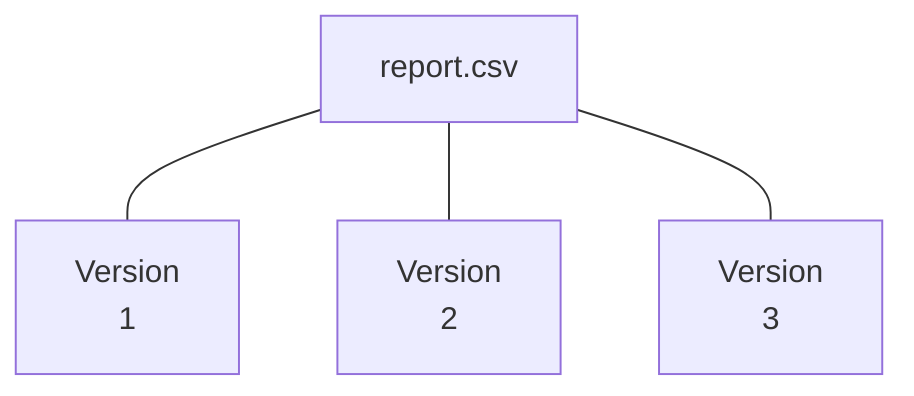

If a later version is incorrect, an earlier version may be recoverable.

However, versioning is not the same as a complete independent backup strategy.

Consider:

- A lifecycle rule that permanently expires old versions.
- An authorized user permanently deleting object versions.
- A compromised identity with broad permissions.
- A bucket or account-level incident.
- Replication of an unwanted change or deletion, depending on configuration.

For important data, evaluate additional protection such as restricted delete permissions, protected backup copies, or S3 Object Lock where appropriate.

Object Lock requires careful configuration and can prevent deletion or alteration for the configured retention period. That protection can also make cleanup more difficult.

---

## 8. Backup Security: Protect the Recovery Source

Backups can contain the same sensitive data as production systems.

If an attacker compromises the account and can delete both the live data and all backups, the recovery strategy may fail.

A secure backup design considers:

- Separate permissions for backup administration.
- Encryption in transit and at rest where supported.
- Restricted deletion permissions.
- Retention policies.
- Protected copies in separate accounts or regions where justified.
- Monitoring for unexpected backup deletion or configuration changes.
- Periodic restoration tests.

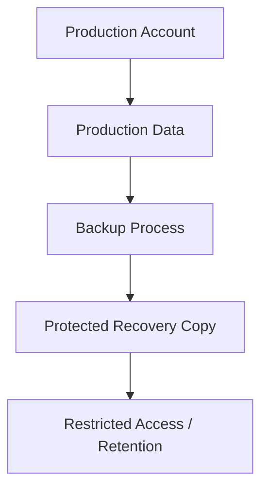

Separating backups from production can reduce shared risk, but it must be implemented carefully. Cross-account access, encryption keys, and restore permissions must all be planned.

A backup that exists but cannot be accessed during an emergency is not useful.

Likewise, a backup that an attacker can easily destroy alongside production data provides limited protection against a destructive compromise.

---

## 9. Disaster Recovery Strategies

Different systems require different recovery designs.

Four common strategy categories are:

### Backup and restore

Infrastructure is rebuilt and data is restored after a disruption.

### Pilot light

A minimal set of critical components is maintained in a recovery environment. Additional resources are created or scaled during recovery.

### Warm standby

A reduced-capacity version of the application runs in the recovery environment.

### Active-active

Multiple environments actively serve traffic.

These are broad architectural patterns. Actual recovery time depends on data replication, automation, dependencies, traffic routing, and the failure scenario.

### Strategy comparison

| Strategy | Typical readiness | Relative cost | Complexity |
|---|---|---|---|
| Backup and restore | Rebuild after failure | Lower | Lower |
| Pilot light | Core recovery components ready | Moderate | Moderate |
| Warm standby | Reduced-capacity environment running | Higher | Higher |
| Active-active | Multiple environments serving traffic | Highest in many designs | Highest |

These are relative comparisons, not guaranteed prices or recovery-time promises.

Choose the simplest strategy that meets the required RPO and RTO.

---

## 10. Same-Region Recovery vs Cross-Region Recovery

Not every incident requires a second AWS region.

### Same-region recovery

May be suitable for recovering from:

- Accidental data deletion.
- Corrupted application data.
- Some resource failures.
- Certain availability-zone disruptions, depending on the architecture.

### Cross-region recovery

May be needed when the primary region itself is unavailable or when business requirements demand geographic separation.

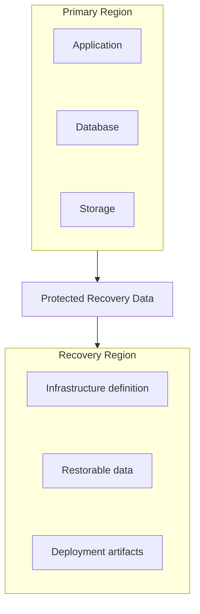

Cross-region recovery introduces additional considerations:

- Replication and transfer costs.
- Data residency and compliance.
- Encryption keys and permissions.
- DNS or traffic-routing changes.
- Configuration differences.
- Recovery testing.
- Regional service availability.

Do not create a second region by default for every small application. Determine whether regional failure is part of the threat model and whether the required recovery objective justifies the cost.

---

## 11. Terraform and Infrastructure Recovery

You learned Terraform in **12.15 — Infrastructure as Code**.

Infrastructure as Code can make disaster recovery more repeatable because infrastructure can be recreated from version-controlled definitions.

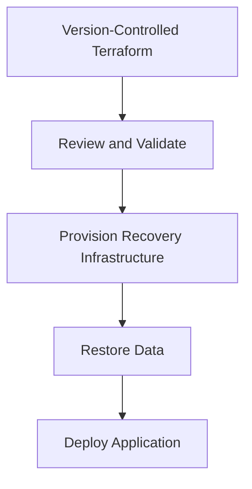

But Terraform is not a backup of all production data.

It also does not automatically preserve every secret, runtime state, external configuration, or resource attribute unless those concerns are addressed separately.

Protect the Terraform state file. It can contain sensitive information and is essential for managing the resources Terraform tracks.

A recovery plan should identify:

- Where the Terraform code lives.
- How the correct version is selected.
- Where state is stored and how it is protected.
- Which variables and secrets are required.
- Which dependencies must exist first.
- Who is authorized to provision the recovery environment.

If the only copy of the infrastructure definition or state is inaccessible during a disaster, recovery may be slower or more difficult.

---

## 12. Backups, Replication, and Logical Corruption

Replication copies changes to another location or system.

This can improve availability or reduce data loss under certain failure scenarios.

But replication may also copy unwanted changes.

Example:

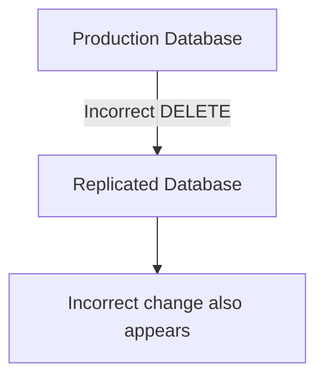

A replicated copy is not automatically a historical recovery point.

Backups and version history provide different recovery options.

| Protection | Helps with | Important limitation |
|---|---|---|
| Replication | Availability and some infrastructure failures | May reproduce logical corruption or deletion |
| Snapshot | Recovery from a captured state | Only contains data from its recovery point |
| Point-in-time recovery | Recovering to a supported time | Limited by the available recovery window |
| Versioning | Recovering earlier object versions | Versions may still be deleted or expire |
| Protected backup copy | Reducing risk from production-level deletion | Depends on access controls, retention, and recoverability |

A mature recovery design chooses protection based on the failure it must survive.

---

## 13. RPO and RTO Are Design Inputs

Recovery objectives should influence the architecture from the beginning.

Consider three hypothetical applications.

| Application | Example RPO target | Example RTO target |
|---|---:|---:|
| Personal learning project | 24 hours | 1 day |
| Small business storefront | 15 minutes | 1 hour |
| Critical transaction service | Near-zero data loss target | A few minutes |

These are illustrative targets, not recommendations for every application.

A near-zero RPO is difficult and may require more advanced data protection and operational design. It does not mean that data loss is mathematically impossible.

A stricter RTO often requires more automation, pre-provisioned capacity, faster failover, and more frequent testing.

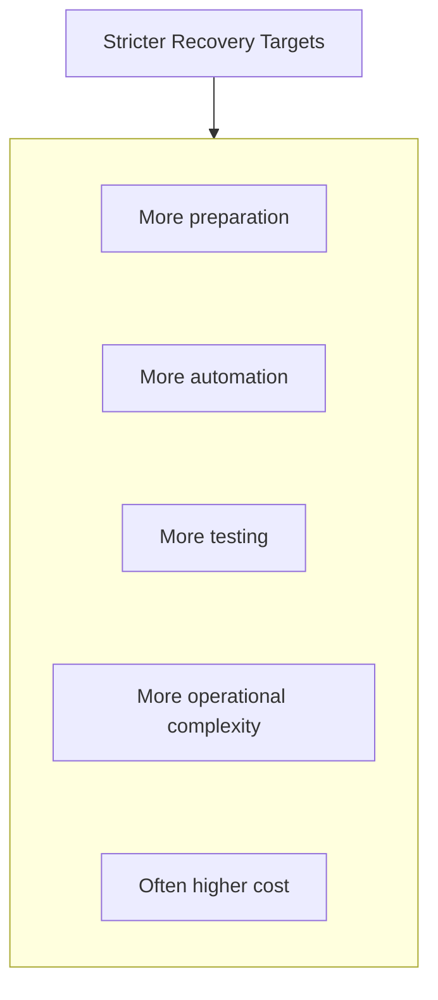

Do not promise a recovery target merely because an AWS service advertises a particular capability. Validate the entire application's recovery path.

---

## 14. Recovery Is More Than Starting a Server

A restored EC2 instance may be running while the application is still unavailable.

Recovery can depend on:

- Database restoration.
- S3 object access.
- IAM roles and permissions.
- DNS records and certificates.
- Network routes and security groups.
- Secrets and environment configuration.
- Application deployment artifacts.
- External services.
- Background workers and scheduled tasks.

A useful recovery checklist follows dependencies.

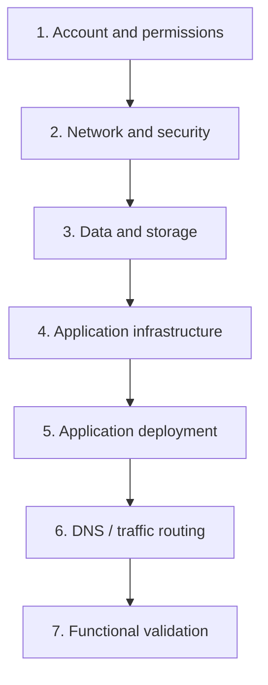

The exact order may vary. For example, an application environment may need to exist before data restoration can complete, or traffic may be routed only after validation.

The important idea is to document dependencies rather than assume every resource can be recovered independently.

---

## 15. Recovery Testing

A backup is only a claim until you test restoring it.

A recovery test should verify more than whether a resource can be created.

For a database, test that:

- The restored database starts successfully.
- Expected records exist.
- Data integrity checks pass.
- The application can connect.
- Important workflows succeed.
- The measured restoration time meets the target.

For an application environment, test that:

- Infrastructure can be recreated.
- Required permissions and secrets are available.
- The correct application version can be deployed.
- Dependencies can be reached.
- Health checks pass.
- Users can complete a representative workflow.

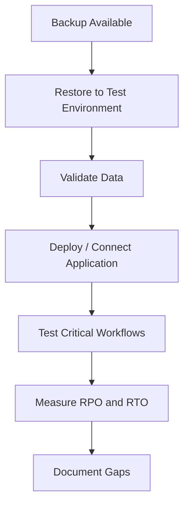

Testing should occur in an isolated or controlled environment to avoid overwriting production data or redirecting real users unexpectedly.

---

## 16. Types of Recovery Exercises

You can test recovery at different levels.

### Documentation review

Walk through the recovery instructions and identify missing steps, permissions, or dependencies.

### Tabletop exercise

The team discusses a hypothetical failure and explains who would do what.

### Component restore test

Restore a database, object, or snapshot into a safe test environment.

### Full recovery exercise

Recreate the required environment, restore data, deploy the application, and validate the complete service.

The appropriate test depends on the system's risk and recovery requirements.

A tabletop exercise can reveal process gaps, but it does not prove that a backup can actually be restored.

A full recovery test provides stronger evidence but usually requires more time and resources.

---

## 17. Hands-On Lab: Plan and Test a Recovery

This lab uses a safe, non-production environment. You do not need to create a second AWS region merely to learn the process.

### Step 1 — Define recovery objectives

Write down:

```text
Application:
Critical data:
Acceptable data loss (RPO):
Target recovery time (RTO):
Required dependencies:
```

Choose targets appropriate to a learning project rather than copying targets from another system.

### Step 2 — Identify recovery sources

List the recovery method for each component.

```text
Database:
User uploads:
Application code:
Infrastructure:
Configuration:
Secrets:
```

For example, application code may be recoverable from Git, while the database may require an RDS backup or point-in-time recovery.

### Step 3 — Inspect existing backup configuration

If you have an RDS instance, review its configured backup retention and available recovery options.

If you use S3, inspect whether versioning and suitable lifecycle rules are configured.

Do not change production retention settings just to complete the exercise.

### Step 4 — Perform a controlled restore

If you have a suitable test backup, restore it into an isolated test environment.

For RDS, a restore may create a new database instance and can incur additional charges while resources exist.

If you do not have an existing test backup, complete a tabletop exercise instead of creating paid resources.

### Step 5 — Validate

Record:

```text
Restore started:
Restore completed:
Data validation result:
Application validation result:
Estimated data loss:
Total recovery duration:
```

Compare the observed results with your objectives.

### Step 6 — Clean up

After validation, remove temporary resources only after confirming that they are not needed for further testing and do not contain the only useful recovery copy.

Check for temporary database instances, snapshots, storage, networking resources, and logs.

**Cost reminder:** Restored databases, cross-region replication, snapshots, storage, and data transfer may incur charges. Review current AWS pricing before running a restore or creating additional recovery infrastructure.

---

## 18. Trade-offs and Failure Modes

| Decision | Benefit | Risk or cost |
|---|---|---|
| Frequent backups | Smaller potential data-loss window | More storage and operational work |
| Long backup retention | More historical recovery choices | Higher storage cost and retention obligations |
| Cross-region recovery | Protection against some regional failures | Additional infrastructure, replication, and transfer costs |
| Warm standby | Faster recovery readiness | Ongoing cost for standby capacity |
| Active-active architecture | Can support rapid continuity | Complex data consistency and operational management |
| Strict backup deletion controls | Protects recovery copies | Cleanup and retention management become more complex |
| Frequent recovery tests | Greater confidence in recovery | Testing cost and temporary resource use |
| Automated restoration | More repeatable process | Automation errors can affect recovery if poorly tested |

The objective is not to maximize backup frequency or build the most complex DR architecture. It is to meet the recovery requirements reliably.

---

## 19. Common Mistakes

### Mistake 1 — Assuming replication replaces backups

Replication can reproduce unwanted changes. Preserve recoverable historical states where required.

### Mistake 2 — Assuming a backup is usable without testing

The backup may be incomplete, inaccessible, incompatible, or too slow to restore.

### Mistake 3 — Ignoring RPO

You may restore service but lose more recent data than the business can tolerate.

### Mistake 4 — Ignoring RTO

A valid backup may still take too long to restore and validate.

### Mistake 5 — Backing up only the database

Application code, configuration, uploaded files, secrets, and infrastructure may also be necessary.

### Mistake 6 — Storing all backups under the same unrestricted access

A compromised identity may be able to destroy production and recovery copies together.

### Mistake 7 — Restoring without validation

A server starting successfully does not prove that the data and application are correct.

### Mistake 8 — Forgetting recovery costs

A restored database or standby environment can continue generating charges after the exercise ends.

---

## 20. The System Design View

Backup and disaster recovery are architectural properties, not just service settings.

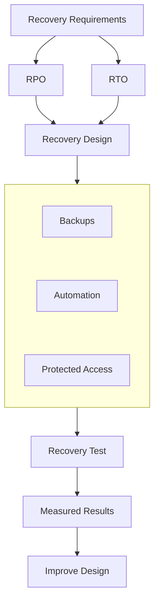

A recovery plan is credible only when you can demonstrate that the data, infrastructure, permissions, and procedures work together within the required limits.

---

## 21. Key Principle

> **Backups preserve recovery options. High availability reduces interruption from supported failures. Disaster recovery restores service after a larger disruption. Testing proves whether the plan works.**

Remember the sequence:

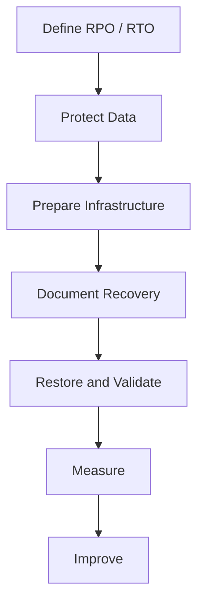

Do not measure recovery readiness by the number of backups you have. Measure it by whether you can restore a trustworthy service within the required time and data-loss limits.

---

## 22. Quick Reference

| Term | Meaning |
|---|---|
| Backup | Recoverable copy of data or resources |
| High availability | Design that maintains service through supported component failures |
| Disaster recovery | Process and architecture for restoring service after a major disruption |
| RPO | Maximum acceptable data-loss window, expressed in time |
| RTO | Target time for restoring service after disruption |
| Point-in-time recovery | Restoring data to a supported historical point |
| Snapshot | Captured state of a resource or data at a point in time |
| Replication | Copying changes or data to another location or system |
| Pilot light | Minimal recovery environment with critical components prepared |
| Warm standby | Reduced-capacity recovery environment already running |
| Active-active | Multiple environments actively serving traffic |
| Recovery test | Exercise that verifies restoration and validates the result |

---

## 23. Knowledge Check

1. What is the difference between a backup and high availability?
2. What does RPO measure?
3. What does RTO measure?
4. Why can replication reproduce logical corruption?
5. How does S3 Versioning help recover an overwritten object?
6. Why should backup copies have carefully restricted permissions?
7. What is the difference between backup-and-restore and warm standby?
8. Why is restoring a database not sufficient to recover a full web application?
9. What does a recovery test prove that a backup configuration alone cannot?
10. Why should recovery objectives be defined before choosing a DR architecture?

### Answers

1. A backup preserves a recovery source; high availability reduces interruption during supported component failures.
2. The maximum acceptable amount of data loss, expressed as a period of time.
3. The target time within which service should be restored after disruption.
4. Replication may copy the unwanted change or deletion to the replicated system.
5. It can preserve earlier object versions, subject to versioning and retention configuration.
6. A compromised identity should not be able to destroy both production data and its recovery sources easily.
7. Backup-and-restore rebuilds the environment after failure; warm standby maintains a reduced-capacity recovery environment in advance.
8. The application also needs infrastructure, configuration, permissions, secrets, dependencies, and validation.
9. It demonstrates whether restoration and validation can actually succeed, and how long they take.
10. RPO and RTO determine the necessary backup frequency, infrastructure readiness, automation, complexity, and cost.

---

## Remember

A backup is useful only if it can be restored. A recovery plan is useful only if it can restore the right data and service within acceptable limits.

**Next: 12.20 — Capstone: Deploy a Production-Oriented Full-Stack Application**
