# 12.20 — Capstone: Deploy a Production-Oriented Full-Stack Application

## Learning Objectives

By the end of this chapter, you should be able to:

- Design a complete cloud architecture for a full-stack application.
- Choose appropriate compute, networking, storage, and database services.
- Deploy an application using secure configuration and least-privilege access.
- Automate builds and deployments with CI/CD and Infrastructure as Code.
- Add health checks, logging, monitoring, and alerts.
- Apply cost controls, backup policies, and recovery procedures.
- Test failure scenarios and identify remaining production risks.
- Explain why a production-oriented deployment is not automatically production-ready.

---

# 1. The Mission

Throughout Level 12, you learned how individual cloud components work.

Now connect them.

Your task is to deploy a small full-stack application that has:

- A frontend for users.
- A backend API for application logic.
- A relational database for persistent data.
- Secure access between components.
- Automated deployment.
- Monitoring and alerting.
- Backup and recovery procedures.
- Cost controls and a cleanup plan.

We will use a simple **Task Tracker** application.

Users can:

1. Open the application.
2. View their tasks.
3. Create a task.
4. Mark a task as complete.
5. Delete a task.

The business logic is intentionally simple. The cloud architecture is the main learning objective.

> **The goal is not to build a complex product. It is to understand how the pieces of a real deployment fit together.**

---

# 2. Define the Requirements First

Before choosing services, define what the system needs.

| Requirement | Design decision |
|---|---|
| Frontend | Browser-accessible web application |
| Backend | HTTP API |
| Persistent data | Relational database |
| Public access | HTTPS |
| Database access | Private; no public database endpoint |
| Deployment | Automated through CI/CD |
| Infrastructure | Defined in Terraform |
| Monitoring | Application and infrastructure signals |
| Recovery | Database backup and tested restoration |
| Cost | Budget alerts, limited resources, cleanup |
| Security | Least privilege, protected secrets, restricted network access |

This step prevents a common mistake: selecting cloud services before understanding the application's requirements.

## Non-functional requirements

The application also needs reasonable operational properties.

- **Availability:** failures should be detected, and recovery should be possible.
- **Performance:** requests should complete within an acceptable latency.
- **Security:** users and services should receive only the access they need.
- **Recoverability:** persistent data should be recoverable after a failure.
- **Maintainability:** another developer should be able to understand and reproduce the deployment.
- **Cost control:** unused resources should not remain running indefinitely.

These are design goals, not guarantees. The implementation and tests must demonstrate how well each goal is met.

---

# 3. Choose the Architecture

For this capstone, use a conventional three-tier architecture with AWS-managed services.

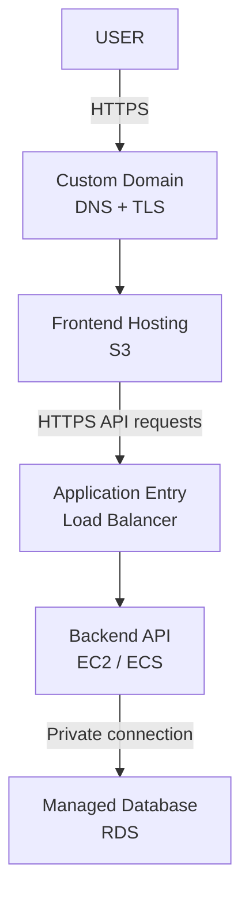

This is a conceptual architecture. The exact request routing depends on how the frontend and API are hosted.

For a more complete deployment:

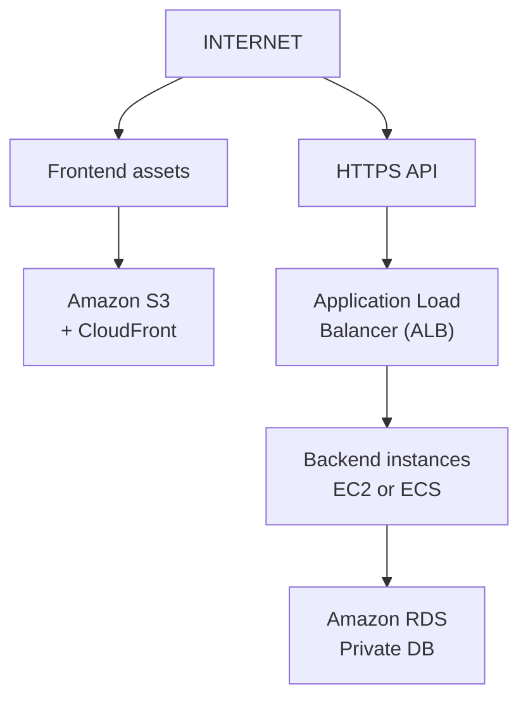

Supporting components include:

```text
IAM          → Identity and permissions
VPC          → Network boundaries
Terraform    → Infrastructure definition
CI/CD        → Automated build and deployment
CloudWatch   → Metrics, logs, and alarms
S3 / RDS     → Persistent storage and recovery
Billing      → Cost visibility and guardrails
```

The architecture is intentionally modular. Each component has a distinct responsibility.

---

# 4. Choose a Deployment Path

There is no single correct deployment for every application. Choose a path based on your learning goals, operational requirements, and budget.

| Path | Architecture | Best for |
|---|---|---|
| A — Learning | Static frontend on S3; API on one EC2 instance; RDS only when needed | Understanding the core deployment flow |
| B — Production-oriented | S3 + CloudFront; ALB; multiple backend instances or ECS; private RDS | Learning redundancy, health checks, and safer operations |
| C — Serverless | Static frontend; API Gateway + Lambda; managed database selected for the workload | Learning event-driven and managed compute |

For this capstone, use **Path B as the target architecture**, but implement it incrementally.

Start with the smallest useful deployment, verify each component, and then add redundancy and automation.

**Important cost note:** Application Load Balancers, EC2 instances, NAT gateways, RDS, CloudFront, public IPv4 addresses, logs, and data transfer may incur charges. Multiple instances and multi-AZ configurations increase costs. A budget alert is not a hard spending cap, and billing alerts may arrive after usage has occurred.

Do not create the full target architecture in one step without checking current pricing and your account's available free-tier or promotional benefits.

---

# 5. Design the Network

Use a VPC with public and private subnets across at least two Availability Zones for the production-oriented target.

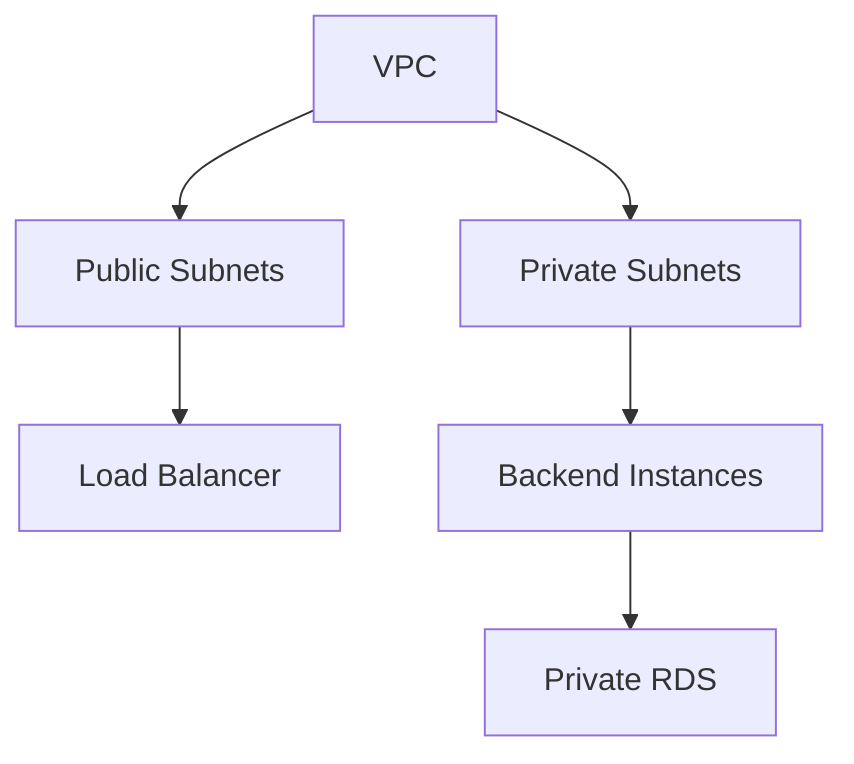

A practical placement model:

| Component | Placement | Reason |
|---|---|---|
| Application Load Balancer | Public subnets | Accepts internet traffic |
| Backend compute | Private subnets | Not directly reachable from the internet |
| RDS database | Private subnets | Database is not publicly exposed |
| Static frontend | S3 + CloudFront | Serves frontend assets without a public web server |

## Security group relationships

Think in terms of permitted communication, not just public and private labels.

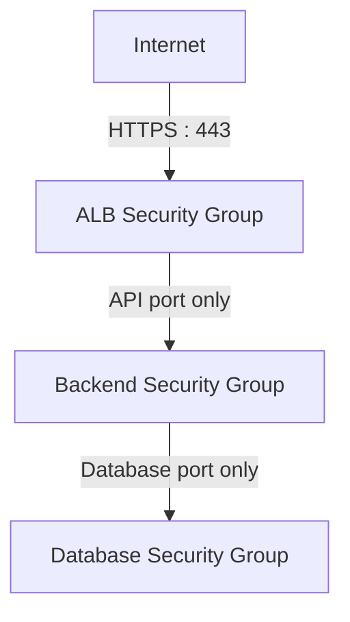

Example rules:

- The load balancer accepts HTTPS from the intended public sources.
- The backend accepts application traffic from the load balancer's security group.
- The database accepts its database port only from the backend security group.
- The database has no unrestricted inbound rule from the internet.

Use the actual database engine's port, such as 5432 for PostgreSQL or 3306 for MySQL.

**Do not open the database port to `0.0.0.0/0`.**

Private subnet placement alone is not sufficient. Routing, security groups, database settings, credentials, and identity permissions must all be correct.

---

# 6. Deploy the Frontend

The frontend is the part users see in their browser.

For a static single-page application, a common architecture is:

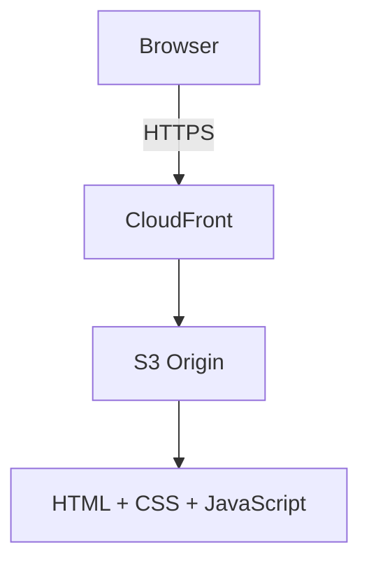

A typical deployment process:

1. Build the frontend locally or in CI.
2. Generate the static output.
3. Upload the output to an S3 bucket.
4. Serve it through CloudFront.
5. Configure a custom domain and TLS certificate if required.
6. Verify that the browser can load the application over HTTPS.

## Frontend configuration

The frontend needs to know where the backend API is located.

For example:

```text
https://api.example.com
```

Use an environment-specific build configuration or another deliberate configuration strategy.

Remember:

> **Anything included in browser-delivered JavaScript is visible to users.**

Never place database passwords, private API keys, AWS credentials, or other secrets in frontend environment variables that are compiled into the client bundle.

If you use a static S3 website endpoint, understand that it does not itself provide the same HTTPS and access-control properties as serving private S3 content through CloudFront. Prefer a private S3 origin with CloudFront Origin Access Control for a production-oriented design.

---

# 7. Deploy the Backend API

The backend receives API requests and executes application logic.

For this project, use a containerized API on ECS or an application running on EC2. The target architecture should keep application instances private behind an Application Load Balancer.

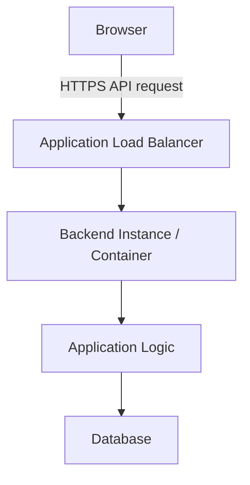

The backend should implement:

```text
GET    /api/tasks
POST   /api/tasks
PATCH  /api/tasks/{id}
DELETE /api/tasks/{id}
```

The exact endpoints are illustrative. Use consistent request validation, response formats, and error handling.

## Backend responsibilities

The API should:

- Validate request bodies and parameters.
- Authenticate users if the application supports accounts.
- Authorize operations against the relevant user or resource.
- Apply business rules.
- Communicate with the database.
- Return appropriate HTTP status codes.
- Log errors without exposing secrets or sensitive data.

For a learning prototype, you may omit full user authentication if clearly documented. Do not expose an unauthenticated task API as though it were a production-ready multi-user service.

## Health checks

Provide an endpoint such as:

```text
GET /health
```

A health check should be quick and should not unnecessarily perform expensive work.

Distinguish:

- **Liveness:** is the process running?
- **Readiness:** can the instance safely receive requests?

If readiness checks depend on the database, decide carefully how database unavailability should affect traffic routing. A transient dependency problem should not automatically cause every application instance to be removed from service in a way that worsens an outage.

---

# 8. Connect the Database Securely

Use Amazon RDS for the managed relational database.

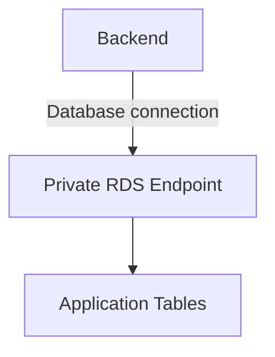

Create a table similar to:

```sql
CREATE TABLE tasks (
    id BIGINT GENERATED ALWAYS AS IDENTITY PRIMARY KEY,
    title VARCHAR(200) NOT NULL,
    completed BOOLEAN NOT NULL DEFAULT FALSE,
    created_at TIMESTAMP NOT NULL DEFAULT CURRENT_TIMESTAMP
);
```

This is PostgreSQL-style SQL. Adjust the syntax if using another database engine.

## Database configuration

The backend needs:

- Database endpoint.
- Database name.
- Username or authentication identity.
- Credential or secret reference.
- Connection and query timeouts.
- A controlled connection pool.

Store credentials in a suitable secret-management service such as AWS Secrets Manager or Systems Manager Parameter Store with appropriate access controls. Never commit secrets to Git.

## Database security checklist

- RDS is not publicly accessible.
- Its security group accepts traffic only from the backend.
- Credentials are not stored in source control.
- The application uses a restricted database account.
- Automated backups are configured.
- Connection limits are understood.
- TLS is used for database connections where supported and required by the configuration.
- The application handles connection failures and timeouts safely.

A private database is not automatically secure if the application credentials have excessive privileges or the network rules are too broad.

---

# 9. Identity and Permissions

Use IAM roles for AWS workloads instead of embedding long-lived AWS access keys in application code.

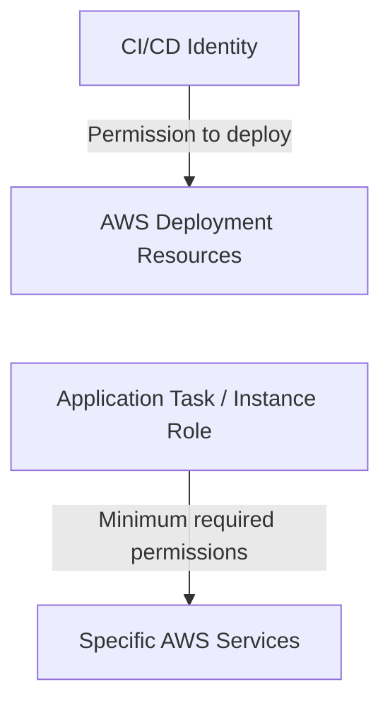

Keep identities separate.

| Identity | Responsibility |
|---|---|
| Developer identity | Local development and approved administration |
| CI/CD role | Build and deploy the application |
| Application role | Access only the AWS resources required at runtime |
| Database identity | Access the required database objects |

For example, if the backend only needs to retrieve one secret and write selected logs, its role should not have broad administrator permissions.

Use federation or short-lived credentials where possible. For local development, use a supported AWS CLI credential profile or another approved identity flow.

**Never use the root account's access keys for routine work.**

---

# 10. Automate Infrastructure with Terraform

The target architecture should be reproducible.

Terraform can define resources such as:

```text
VPC
Subnets
Route Tables
Security Groups
IAM Roles
Load Balancer
Compute Resources
RDS
S3
CloudFront
CloudWatch Alarms
```

A simplified project structure might be:

```text
task-tracker/
├── frontend/
├── backend/
├── infrastructure/
│   ├── main.tf
│   ├── variables.tf
│   ├── outputs.tf
│   └── environments/
├── tests/
└── README.md
```

Keep environment-specific values outside reusable infrastructure definitions. Protect Terraform state, restrict access to it, and avoid putting secret values directly into state unless the chosen design and controls explicitly account for that exposure.

## Terraform workflow

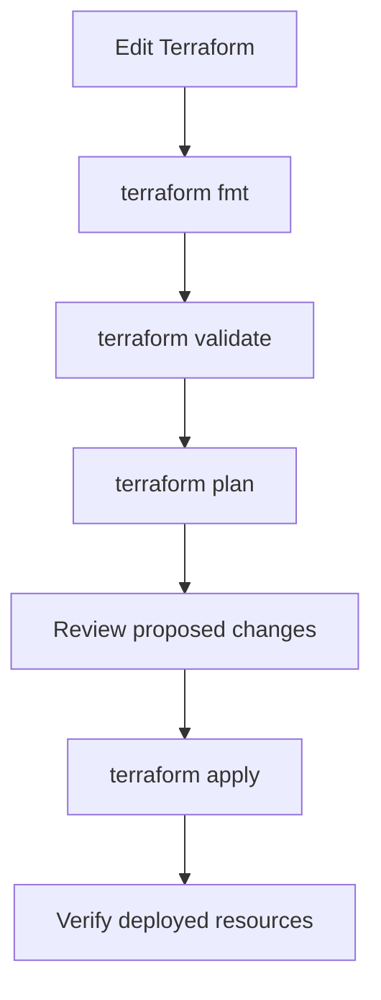

Do not blindly apply a plan. Review resource creation, replacement, deletion, permissions, network exposure, and estimated cost.

Use a remote state backend with appropriate access controls and locking when collaborating or managing persistent environments. Avoid concurrent modifications to the same state.

---

# 11. Build the CI/CD Pipeline

A deployment should be repeatable rather than depending on undocumented manual steps.

A basic pipeline:

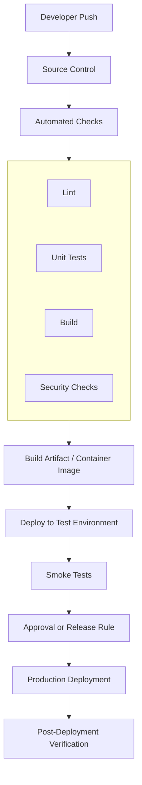

A GitHub Actions workflow, for example, can run tests and build the application. Deployment to AWS should use a secure federation mechanism such as OpenID Connect where supported, with a narrowly scoped role.

## Deployment safety

For each release, record:

- The source commit or release identifier.
- The artifact or image version.
- The environment receiving the release.
- Test results.
- Deployment status.
- The rollback procedure.

Avoid mutable deployment references such as relying only on a container tag that can be overwritten. Prefer traceable, immutable artifact identifiers where practical.

## Rollback

If the new release causes failures:

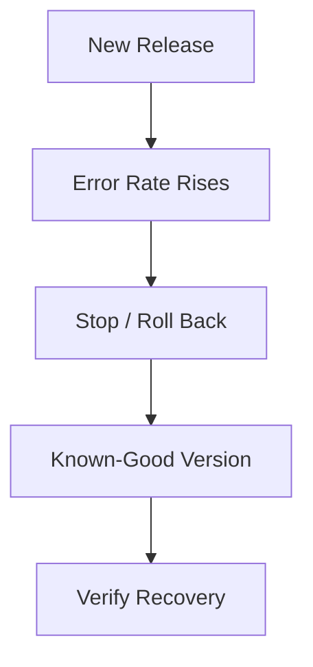

Rollback does not automatically reverse database schema changes or external side effects. Design database migrations to be compatible with the deployment sequence, and test the rollback strategy.

---

# 12. Add Monitoring and Alerting

A production-oriented deployment needs evidence that it is behaving correctly.

Monitor both infrastructure and application behavior.

| Area | Useful signals |
|---|---|
| Load balancer | Request count, latency, unhealthy targets, error responses |
| Compute | CPU, memory where available, restarts, capacity |
| Application | Request latency, error rate, dependency failures |
| Database | CPU, connections, storage, latency, failures |
| Deployment | Build status, release result, rollback events |
| Cost | Budget usage, unexpected resource growth |

Use CloudWatch metrics, logs, dashboards, and alarms where appropriate.

## Application logs

Useful log fields may include:

```text
timestamp
severity
service
environment
request_id
route
status_code
duration_ms
error_type
```

Do not log passwords, access tokens, full payment data, or other sensitive information.

A request or correlation ID helps connect logs across components. Avoid putting secrets or personal information into IDs.

## Example alerts

Consider alerts for:

- Elevated API error rate.
- High request latency.
- No healthy backend targets.
- Database storage approaching its configured limit.
- Unexpected database connection pressure.
- A failed deployment.
- Budget threshold notifications.

Choose thresholds based on the workload and service objectives. A threshold that is too sensitive creates alert fatigue; one that is too loose may miss real problems.

An alarm is useful only if someone knows what to do when it fires.

---

# 13. Define a Basic Service Objective

Before declaring the application healthy, define what acceptable behavior means.

For a learning capstone, you might set an illustrative objective such as:

```text
API availability target: 99.5% over a defined period
Typical API latency:    under 300 ms for simple operations
Error rate:             below 1% under the test workload
```

These are **example learning targets**, not promises or universal production standards. The database, workload, region, network path, and implementation all affect achievable results.

Measure the application under a realistic test workload before deciding whether the objective is met.

Also define what the objective excludes, how it is measured, and which errors count. A frontend that loads successfully while the API is unavailable is not a fully functioning application.

---

# 14. Test Failure Scenarios

A deployment is not production-oriented merely because every service was created successfully.

Test how the system behaves when components fail.

| Scenario | What to verify |
|---|---|
| Backend process stops | Health checks detect it and traffic avoids the unhealthy instance |
| One backend instance fails | Remaining capacity can serve requests if redundancy is configured |
| Database becomes unreachable | API fails safely, times out, and logs the problem |
| Invalid request arrives | API rejects it without corrupting data |
| New release is broken | Release verification detects the issue and rollback is possible |
| Frontend references the wrong API URL | Deployment checks detect the configuration problem |
| A secret is unavailable | The application fails safely without exposing credentials |
| Database backup is restored | Data and application behavior are verified after recovery |

Do not simulate destructive failures against a production system. Perform failure tests in a controlled environment with known recovery steps.

---

# 15. Backup and Disaster Recovery

A backup policy is incomplete until restoration has been tested.

For RDS:

1. Configure automated backups and retention.
2. Understand the recovery options supported by the selected engine and configuration.
3. Document the recovery process.
4. Restore to a separate test environment.
5. Verify the data.
6. Verify that the application can connect and operate.
7. Record how long recovery took.

## Define RPO and RTO

- **Recovery Point Objective (RPO):** how much data loss, measured in time, is acceptable?
- **Recovery Time Objective (RTO):** how long can the service remain unavailable?

Example:

```text
RPO = 15 minutes
RTO = 2 hours
```

These are example targets, not automatic properties of RDS. Your backup schedule, recovery method, database configuration, and operational readiness must support the targets.

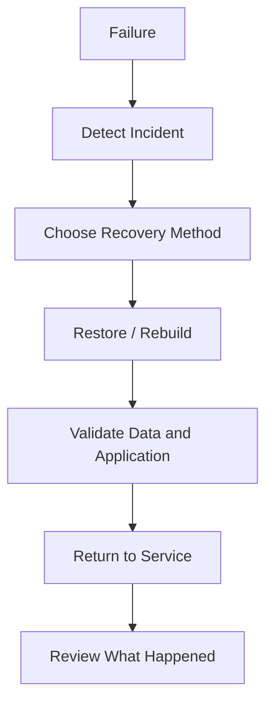

A multi-AZ database deployment can improve availability, but it is not a substitute for backups. Replication can also replicate accidental deletion or logical corruption.

---

# 16. Security Review Before Release

Before opening the application to users, complete a security review.

## Network

- Only required public endpoints are exposed.
- Backend instances are not directly accessible from the internet unless explicitly needed.
- The database remains private.
- Security group rules are narrow and understandable.

## Identity

- Workloads use IAM roles where appropriate.
- Deployment permissions are limited.
- No root access keys are used for routine deployment.
- Secrets are retrieved through approved mechanisms.

## Application

- Inputs are validated.
- Authentication and authorization are implemented for protected operations.
- Error responses do not expose internal details.
- Dependencies are checked and updated.
- Logs do not contain secrets.

## Delivery

- HTTPS is configured.
- Build and deployment identities are protected.
- Terraform plans are reviewed.
- Artifacts are traceable.
- Rollback is documented and tested.

## Data

- Backups are configured.
- Database access is restricted.
- Data retention and deletion requirements are documented.
- Restore procedures are tested.

Security is not a single AWS setting. It is the combined result of application behavior, identity, networking, deployment, and operational practices.

---

# 17. Control the Cost

A cloud deployment can continue generating charges even when nobody is using the application.

Before creating resources, estimate costs for:

- Compute instances or container capacity.
- Load balancers.
- RDS instance hours and storage.
- NAT gateways and data processing.
- Public IPv4 addresses.
- CloudFront requests and data transfer.
- CloudWatch log ingestion and retention.
- Backup storage.
- Data transfer between services and Availability Zones.

The exact cost depends on the region, resource configuration, usage, and current pricing.

## Cost guardrails

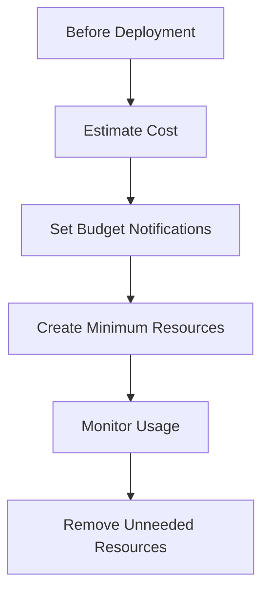

Use AWS Budgets and cost tools appropriate to the account. Remember that alerts are notifications, not guaranteed automatic spending limits.

## Cleanup checklist

When the learning environment is no longer needed:

- Remove temporary compute resources.
- Delete unused load balancers.
- Remove unused NAT gateways and public addresses.
- Delete test databases only after confirming that required data is preserved.
- Remove temporary snapshots and storage only when safe.
- Remove unused log groups or set appropriate retention.
- Empty and delete temporary S3 buckets when appropriate.
- Remove abandoned infrastructure through Terraform where possible.
- Verify the account for remaining billable resources.

Do not delete production data or recovery assets merely to reduce a lab bill. Confirm ownership, retention requirements, and recovery needs first.

---

# 18. Deployment Sequence

Build the capstone in stages. Verify each stage before adding the next.

## Phase 1 — Application locally

- Build the frontend and backend.
- Connect the backend to a local database.
- Validate task creation, listing, completion, and deletion.
- Add input validation and automated tests.

**Exit condition:** the application works locally, and core behavior is tested.

## Phase 2 — Minimum AWS deployment

- Create the required IAM roles.
- Create the network.
- Deploy the backend.
- Configure the private database.
- Deploy the frontend.
- Verify HTTPS and API communication.

**Exit condition:** a user can perform the core task workflow through the deployed application.

## Phase 3 — Secure and automate

- Move secrets into an approved secret store.
- Define infrastructure in Terraform.
- Add CI checks and automated deployment.
- Restrict permissions and network access.
- Document rollback.

**Exit condition:** another developer can reproduce the deployment from documented steps and approved credentials.

## Phase 4 — Reliability and observability

- Add health checks.
- Configure logs, dashboards, and alarms.
- Test instance failure.
- Measure latency and error rate.
- Validate database backup configuration.

**Exit condition:** failures are observable, and recovery steps are documented.

## Phase 5 — Recovery and cost validation

- Restore a database backup into a test environment.
- Verify application behavior against restored data.
- Record actual recovery time.
- Review estimated versus observed cost.
- Clean up temporary resources.

**Exit condition:** the recovery procedure works in practice, and the cost footprint is understood.

---

# 19. Production Readiness Is a Spectrum

There is a difference between a successful deployment and a production-ready service.

| Level | What it means |
|---|---|
| Runs locally | The application works on a developer machine |
| Deployed | The application is reachable in a cloud environment |
| Securely deployed | Identity, secrets, network, and application controls have been reviewed |
| Observable | Operators can detect errors and investigate behavior |
| Recoverable | Backups and recovery procedures have been tested |
| Production-oriented | Reliability, security, deployment, and cost controls are deliberately designed |
| Production-ready | The system meets its actual business, risk, compliance, and service requirements |

There is no universal checklist that makes every application production-ready.

A small internal tool and a financial transaction platform have different requirements.

The right standard depends on the consequences of failure, the data involved, the expected workload, and the service commitment.

---

# 20. Final Architecture Review

Before considering the capstone complete, explain the responsibility of every component.

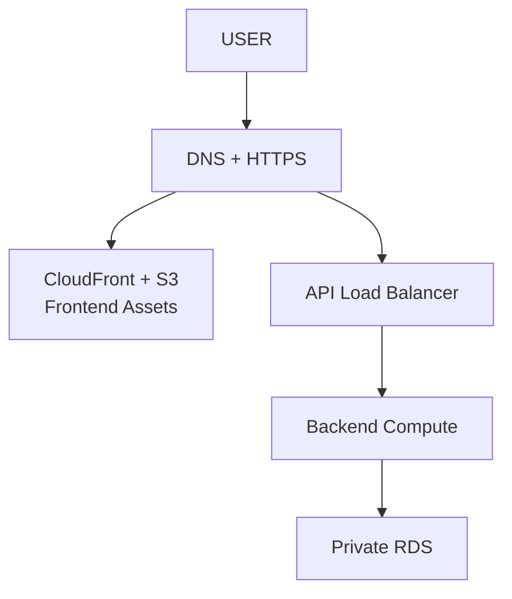

```text
IAM         → Who can access what
VPC         → Network isolation and routing
Terraform   → Reproducible infrastructure
CI/CD       → Tested application delivery
CloudWatch  → Logs, metrics, alarms
Backups     → Recovery capability
Budgets     → Cost visibility and notifications
```

The diagram is not the finish line. You must be able to explain:

- Which requests are public?
- Which components can communicate with the database?
- Where are secrets stored?
- How is a new version deployed?
- How is a failed version rolled back?
- How is an unhealthy instance detected?
- How is data restored?
- How are costs monitored?
- Which parts are single points of failure?
- What remains untested?

If you cannot answer these questions, the architecture is not yet fully understood.

---

# 21. Capstone Deliverables

Your final repository should contain:

```text
task-tracker/
├── frontend/
├── backend/
├── infrastructure/
│   └── Terraform files
├── .github/
│   └── workflows/
├── tests/
└── README.md
```

The README should document:

1. Architecture diagram.
2. Technology and service choices.
3. Local setup.
4. Required environment variables, without secret values.
5. Deployment steps.
6. IAM and network assumptions.
7. Test and verification steps.
8. Monitoring and alerting.
9. Rollback procedure.
10. Backup and restoration procedure.
11. Cost considerations.
12. Cleanup instructions.
13. Known limitations and remaining risks.

Also record evidence of the work:

- Successful build and test results.
- A verified deployed workflow.
- A reviewed Terraform plan.
- A successful health check.
- A monitoring dashboard or relevant metric output.
- A tested database restoration.
- A completed cleanup or a documented list of resources intentionally retained.

Do not include credentials, secret values, or sensitive production data in the repository or screenshots.

---

# 22. Common Mistakes

### Mistake 1 — Creating everything at once

Build incrementally. Isolate failures before adding more components.

### Mistake 2 — Publicly exposing the database

Keep it private and allow access only from approved application components.

### Mistake 3 — Putting secrets in frontend code or Git

Use appropriate secret-management and identity mechanisms.

### Mistake 4 — Treating a successful deployment as proof of reliability

Test failures, health checks, rollback, and restoration.

### Mistake 5 — Using Terraform without reviewing the plan

Infrastructure changes can replace resources, delete data, or expose services.

### Mistake 6 — Assuming a budget alert stops spending

Alerts notify you. They are not a hard cap on all charges.

### Mistake 7 — Skipping recovery testing

A backup that has never been restored is an unverified recovery assumption.

### Mistake 8 — Adding redundancy without understanding cost

Multiple instances, load balancers, NAT gateways, and multi-AZ services add cost and operational complexity.

### Mistake 9 — Ignoring application-level security

Secure networking does not replace validation, authentication, authorization, and safe error handling.

### Mistake 10 — Leaving lab resources running

Use a resource inventory and explicit cleanup procedure. Verify what remains after cleanup.

---

# 23. Key Principle

> **A cloud application is not just code running on AWS. It is an operating system of components, permissions, deployment processes, monitoring, recovery procedures, and cost decisions.**

A good deployment is one you can:

- explain,
- reproduce,
- secure,
- monitor,
- recover,
- and evolve.

The goal is not to use every AWS service.

The goal is to choose the smallest architecture that satisfies the requirements, verify that it works, and add complexity only when a real constraint justifies it.

---

# 24. Quick Reference

| Concern | Main question |
|---|---|
| Architecture | What components are required, and why? |
| Networking | Which components may communicate? |
| Identity | Which identity can perform each action? |
| Secrets | Where are sensitive values stored? |
| Deployment | Can a release be reproduced and verified? |
| Observability | Can operators detect and investigate failures? |
| Reliability | What happens when a component becomes unhealthy? |
| Recovery | Can data and service be restored within the required objectives? |
| Cost | What continues to generate charges? |
| Security | What is exposed, trusted, and permitted? |
| Documentation | Can another developer operate the system? |

---

# 25. Knowledge Check

### Question 1

Why should the frontend and backend be treated as separate deployment concerns?

They have different responsibilities, security requirements, deployment artifacts, and scaling characteristics.

### Question 2

Why should the database remain private?

It reduces direct exposure and allows database access to be restricted to approved application components.

### Question 3

Why use IAM roles instead of embedding AWS access keys in the application?

Roles provide controlled, renewable workload identity and avoid long-lived credentials embedded in code.

### Question 4

What does Terraform add to the deployment?

It makes infrastructure changes declarative, reviewable, and reproducible.

### Question 5

Why are health checks and monitoring different?

Health checks help determine whether an instance should receive work. Monitoring helps operators understand system behavior, detect trends, and investigate incidents.

### Question 6

Why is a backup not enough by itself?

The restoration process may fail, take too long, or produce unusable data. Recovery must be tested against the required RPO and RTO.

### Question 7

Does multi-AZ deployment eliminate the need for backups?

No. Availability and data recovery solve different problems.

### Question 8

Does an AWS budget alert guarantee that spending will stop at the threshold?

No. It is a notification mechanism, not a universal hard spending limit.

### Question 9

What makes an application production-oriented?

It deliberately addresses security, deployment safety, observability, reliability, recovery, and cost—not merely successful deployment.

### Question 10

What should guide the architecture?

The application requirements, workload, constraints, risks, and evidence—not the desire to use more cloud services.

---

# Remember

The capstone is complete when you can explain not only how the application was deployed, but also how it is secured, monitored, recovered, updated, and paid for.

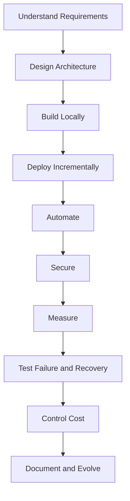

**The next step is to implement this capstone in your own repository, one verified phase at a time.**
