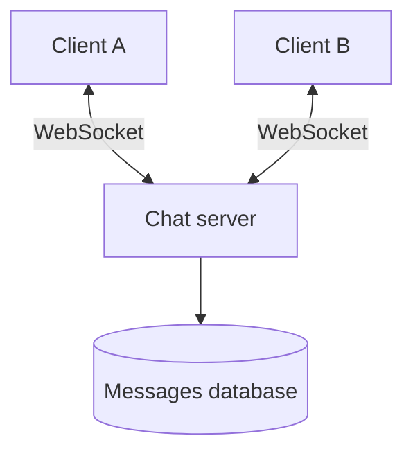
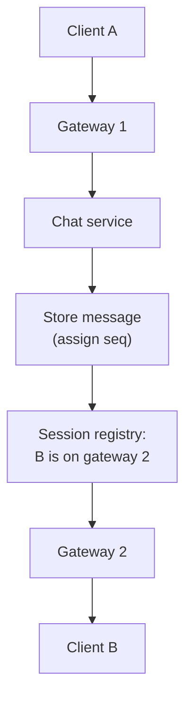
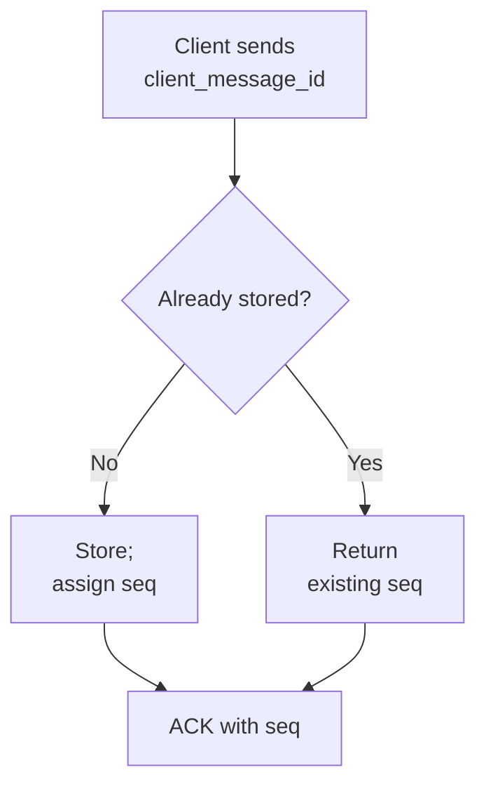
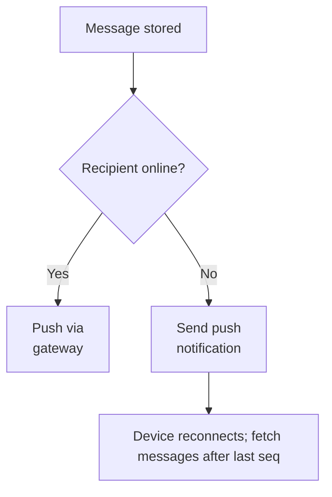
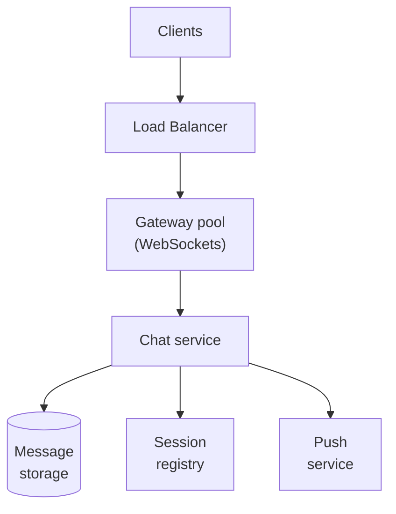
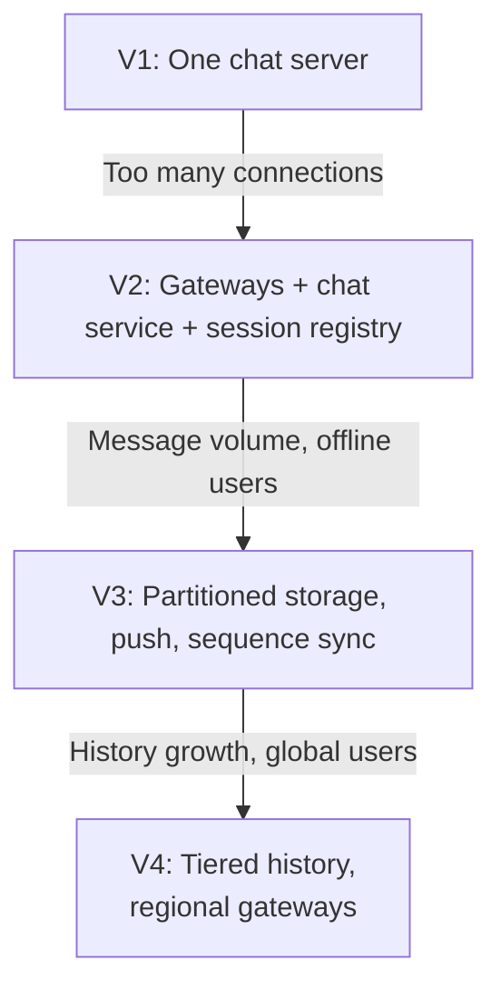

# 13.04 — Chat System

## Learning Objectives

By the end of this chapter, you should be able to:

- Explain why chat needs persistent connections and what that does to load balancing and scaling.
- Estimate message throughput, concurrent connections, and storage.
- Route a message to a recipient connected to a different server.
- Guarantee per-conversation ordering with sequence numbers.
- Deliver messages at least once and remove duplicates on the client.
- Handle offline users, multiple devices, group chats, and presence.

---

## 1. The Problem

A chat system delivers messages between users in real time:

- One-to-one conversations.
- Group conversations.
- Messages arrive within a fraction of a second when both people are online.
- Messages wait for people who are offline.
- History is available on every device a user owns.

The defining technical difference from the previous case studies is the direction of traffic. In a feed or a store, the client asks and the server answers. In chat, **the server must send data to a client that did not ask for it**, at the moment another user sends a message.

> [!MENTAL-MODEL]
> A chat system is a durable, ordered log per conversation, plus a set of open connections that push new log entries to whoever is online.

---

## 2. Requirements

### Functional requirements

1. Users can send text messages in one-to-one and group conversations (up to 500 members).
2. Online recipients receive messages in real time.
3. Offline recipients receive messages when they reconnect, and a push notification meanwhile.
4. Users see conversation history on all their devices.
5. Users see delivery and read status.
6. Users can see whether contacts are online (presence).

### Non-functional requirements

| Requirement | Target | Why it matters |
|---|---|---|
| Delivery latency | Under 500 ms between online users | Conversation feels live |
| Ordering | Messages appear in the same order for every participant | Out-of-order messages change meaning |
| Durability | An acknowledged message is never lost | Users rely on chat history |
| No duplicates visible | Retries must not show a message twice | Duplicates confuse users |
| Availability | 99.95% | Chat is used for urgent communication |

### Out of scope

- Voice and video calls.
- End-to-end encryption protocol details (discussed briefly in Section 15).
- Media processing (images and files go to object storage, as in Chapter 13.06).
- Search across message history.

---

## 3. Constraints and Assumptions

| Assumption | Value |
|---|---|
| Daily active users | 20 million |
| Messages sent per user per day | 40 |
| Peak concurrent connections | 25% of daily users |
| Average stored message | About 300 bytes including metadata and indexes |
| Peak factor | 3× the daily average |
| Connections per gateway server | About 50,000 (depends on hardware and runtime) |

---

## 4. Traffic Estimation

**Messages:**

$$
\frac{20{,}000{,}000 \times 40}{86{,}400} \approx 9{,}300 \text{ messages per second}
$$

At 3× peak, about **27,800 messages per second**.

```calculator
title: Peak Message Rate
description: Adjust the assumptions to estimate peak messages per second.
inputs:
  - id: dau
    label: Daily active users
    unit: million
    min: 0.1
    max: 200
    step: 0.1
    value: 20
    divisor: 0.0864
  - id: messages
    label: Messages per user per day
    unit: messages
    min: 1
    max: 200
    step: 1
    value: 40
  - id: peak
    label: Peak-to-average factor
    unit: ×
    min: 1
    max: 10
    step: 0.5
    value: 3
result:
  label: Peak messages per second
  operation: product
  digits: 0
formula: "{dau} million ÷ 86,400 seconds × {messages} × {peak}"
caption: Group messages multiply deliveries. A message to a 50-person group is one write and up to 49 deliveries.
```

**Concurrent connections:**

$$
20{,}000{,}000 \times 25\% = 5{,}000{,}000 \text{ open connections}
$$

At about 50,000 connections per server, that is roughly **100 connection servers** at peak.

**Heartbeats:** if each connection sends a heartbeat every 30 seconds, that alone is about 167,000 small messages per second. Connection management is a significant part of the load.

What these numbers tell us:

- Message throughput is high but manageable with partitioned storage.
- **Millions of long-lived connections** shape the architecture more than message volume does.

---

## 5. Data Estimation

$$
800 \text{ million messages/day} \times 300 \text{ bytes} = 240 \text{ GB per day}
$$

That is about **88 TB per year**. Message history grows without limit unless there is a retention policy.

Access is very uneven: recent messages are read constantly; messages from last year are rarely opened. That suggests keeping recent history on fast storage and moving older history to cheaper storage.

---

## 6. Data Model

| Table | Key | Purpose |
|---|---|---|
| `conversations` | `conversation_id` | Type (direct or group), metadata |
| `members` | `(conversation_id, user_id)` | Who belongs to a conversation |
| `messages` | `(conversation_id, seq)` | Messages, ordered within a conversation |
| `read_state` | `(user_id, conversation_id)` | Last sequence number read |
| `devices` | `(user_id, device_id)` | Push tokens and sync position |

**`messages` is partitioned by `conversation_id` and ordered by `seq`.** The most common query is "messages in this conversation after sequence number N". This key layout makes it one partition and one range scan.

A wide-column store (for example Cassandra or a managed equivalent) fits this pattern well at large scale. A relational database partitioned by conversation also works and is simpler at moderate scale.

---

## 7. Real-Time Delivery: Persistent Connections

With ordinary HTTP, the client must ask for new messages. Options:

| Approach | How it works | Cost |
|---|---|---|
| Short polling | Client asks every few seconds | Wasted requests; delay up to the interval |
| Long polling | Server holds the request until a message arrives or a timeout | Better latency; a new request after every message |
| WebSocket | One connection stays open in both directions | Lowest latency; server must manage many open connections |

Chat uses **WebSockets** (or a similar persistent protocol on mobile), with long polling as a fallback for networks that block them.

A persistent connection changes the server model:

- The server holding a user's connection is the only one that can push to that user.
- Connection servers are therefore **stateful**: they hold open sockets.
- A load balancer can choose a server when the connection opens, but the user then stays on that server until the connection closes.

---

## 8. Initial Architecture

With a few thousand users, one server can hold every connection.



When A sends a message, the server stores it, looks up B's connection in memory, and pushes it.

This stops working when a second server is added: A may be connected to server 1 and B to server 2. Server 1 does not hold B's socket.

---

## 9. Routing Between Connection Servers

Split the system into two roles:

- **Gateway servers** hold WebSocket connections. They contain no business logic.
- **Chat service** instances are stateless. They validate, store, and route messages.

A **session registry** records which gateway holds each connected device.



How the chat service reaches gateway 2 is a design choice:

- **Direct call:** the registry stores gateway addresses; the chat service calls the gateway.
- **Publish/subscribe:** each gateway subscribes to a channel for the users it holds; the chat service publishes to the recipient's channel.

Both work. Publish/subscribe decouples the chat service from gateway addresses, at the cost of another component.

> [!NOTE]
> The session registry is soft state. Entries expire unless the gateway refreshes them, so a crashed gateway's entries disappear on their own.

---

## 10. Ordering

Two people type at the same moment. Each sees their own message first unless something defines a single order.

Assign each message a **sequence number per conversation** when it is stored:

```text
conversation 812:  seq 41  "Are you free tomorrow?"
                   seq 42  "Yes, after 3"
                   seq 43  "Great"
```

- The server's order, not the clients' clocks, defines the conversation.
- Clients display messages by `seq`.
- A client that receives `seq 45` while it last saw `seq 43` knows it missed `seq 44` and fetches it.

Generating the next sequence number requires one writer per conversation at a time. Routing all writes for a conversation to the same partition (by `conversation_id`) makes this a local operation, such as an atomic increment on that partition.

> [!TRADE-OFF]
> A per-conversation sequence gives a single, consistent order, but all messages in one conversation pass through one partition. That is fine for conversations of any realistic size; it would not be fine for a single global order across all conversations.

---

## 11. Delivery Guarantees

Networks drop messages and connections break. The design uses **at-least-once delivery with deduplication**:

1. The client assigns a unique `client_message_id` and sends the message.
2. The server stores it and replies with an acknowledgement containing the `seq`.
3. If no acknowledgement arrives, the client resends with the same `client_message_id`.
4. The server recognizes the ID and returns the existing `seq` instead of storing a duplicate.



Delivery to recipients works the same way in reverse: the gateway pushes, the recipient's client acknowledges, and anything unacknowledged is fetched on reconnect by sequence number.

**Delivery status** follows from the acknowledgements:

| Status | Meaning |
|---|---|
| Sent | The server stored the message |
| Delivered | The recipient's device acknowledged it |
| Read | The recipient's `read_state` moved past its `seq` |

---

## 12. Offline Users and Multiple Devices

The message log makes offline delivery and multi-device sync the same problem.

Each device stores the last `seq` it has seen for each conversation. On reconnect, it asks: "Give me everything after these sequence numbers."



The push notification is a hint, not the delivery mechanism. If it is lost, the message still arrives when the app reconnects and syncs.

---

## 13. Group Chats

A message to a group is stored **once**, in the conversation's log. Delivery fans out to each member's online devices.

For a 500-member group, one message becomes up to 500 pushes. Like the feed in Chapter 13.03, this is fan-out on write for delivery, but storage is not duplicated: every member reads the same log.

Limits help:

- Cap group size for real-time chat. Very large audiences are better served by a broadcast or channel model with fan-out on read.
- Send read receipts in aggregate for large groups ("Read by 112") rather than one event per member.

---

## 14. Presence

Presence ("online", "last seen 5 minutes ago") is useful but expensive:

- Each status change could be broadcast to every contact.
- A user with 1,000 contacts going online and offline repeatedly creates a storm of updates.

Treat presence as approximate:

- Derive "online" from gateway heartbeats with a timeout (for example, offline after 60 seconds of silence).
- Send presence only to contacts who are currently looking at a screen that shows it.
- Batch and delay updates by a few seconds.

Presence can be wrong for short periods without harming the product. Message delivery cannot. Keep them in separate systems so that presence load never slows messages.

---

## 15. Architectural Decisions

| Decision | Problem it solves |
|---|---|
| WebSocket gateways separate from the chat service | Stateful connections scale independently of stateless logic |
| Session registry with expiring entries | Find which gateway holds a user's connection |
| Messages partitioned by conversation, ordered by `seq` | Per-conversation ordering and efficient history reads |
| Client message IDs | Retries do not create duplicates |
| Sync by sequence number | Offline delivery and multi-device history use one mechanism |
| Push notifications as hints | Offline users are alerted without relying on push for delivery |
| Approximate presence in a separate system | Presence load cannot affect messaging |

**End-to-end encryption** changes some of these decisions. If the server cannot read messages, it cannot search or filter them, and each device has its own keys. Storage, ordering, and delivery work the same way, but the server stores ciphertext.

---

## 16. Scaling



- **Gateways scale by connection count.** Add servers as concurrent users grow. Drain a gateway before maintenance so clients reconnect elsewhere gradually.
- **Chat service scales by message rate.** It is stateless.
- **Message storage scales by partitioning on `conversation_id`.** A very active group conversation can become a hot partition; that is a reason to cap real-time group size.
- **Tier old history.** Keep recent months on fast storage and move older messages to cheaper storage that is read on demand.

---

## 17. Failure Scenarios

| Failure | What users notice | Mitigation |
|---|---|---|
| A gateway crashes | Its users disconnect briefly | Clients reconnect with backoff to another gateway and sync from their last `seq` |
| Many gateways restart at once | Reconnection storm | Randomized backoff (jitter); connection rate limits |
| Chat service instance fails mid-send | Sender sees no acknowledgement | Client resends with the same `client_message_id` |
| Session registry is stale | Push goes to a dead gateway | Expiring entries; recipient syncs on reconnect |
| Message storage partition is slow | Sending in some conversations is delayed | Timeouts and retries; client shows "sending" state |
| Push provider is down | Offline users are not alerted | Messages still arrive on next app open |
| Network partition between regions | Users in different regions cannot exchange messages | Queue cross-region traffic; deliver after recovery |

> [!FAILURE] The reconnection storm
> A deployment restarts all gateways. Five million clients reconnect within seconds, each authenticating and requesting sync. Authentication and storage are overwhelmed, more clients time out, and they retry again. Roll out gateway restarts gradually, and have clients reconnect with exponential backoff and random jitter.

---

## 18. Recovery

- **The message log is the source of truth.** Replicate it across failure domains and back it up.
- **Connections, the session registry, and presence are disposable.** After any failure, clients reconnect and rebuild them.
- **Clients repair their own gaps.** Sequence numbers let every device detect and fetch what it missed.

Designing every client to recover by "fetch after my last `seq`" turns most server failures into short delays instead of lost messages.

---

## 19. Evolution



---

## 20. Trade-offs

| Decision | Benefit | Cost |
|---|---|---|
| WebSockets | Low latency, server push | Stateful servers; connection management |
| Separate gateways | Connections scale independently | More hops and components |
| Per-conversation sequence | Consistent order for all participants | One partition per conversation handles all its writes |
| At-least-once + dedupe | No lost messages, no visible duplicates | Client and server must track IDs |
| Store group messages once | Storage does not grow with group size | Delivery still fans out to every member |
| Approximate presence | Cheap and isolated | Status can be briefly wrong |
| Tiered history | Lower storage cost | Old messages load more slowly |

> [!LOCK-IN]
> The client protocol is hard to change: millions of installed apps speak it, and old versions stay in use for years. Version the protocol from the first release, and keep message identity (`conversation_id`, `seq`, `client_message_id`) stable. A storage engine behind the chat service can be migrated; a protocol in users' pockets cannot be changed overnight.

---

## 21. Common Mistakes

- **Polling for messages at scale:** Wasted requests and delayed delivery.
- **Putting business logic in connection servers:** Stateful and stateless concerns become hard to scale and deploy separately.
- **Ordering by client timestamps:** Device clocks disagree; use server-assigned sequence numbers.
- **Treating push notifications as delivery:** Push is best effort; sync is the guarantee.
- **Retrying without a client message ID:** Duplicates appear in the conversation.
- **Broadcasting every presence change:** Presence traffic overwhelms the system.
- **Reconnecting without backoff and jitter:** A restart becomes an outage.
- **Keeping all history on the fastest storage:** Cost grows without benefit.

---

## 22. Hands-On Exercise

Design a customer-support chat for a software company:

- Customers start conversations from a website widget; they are anonymous until they enter an email address.
- 200 support agents, each handling up to 5 conversations at once.
- Conversations are assigned to available agents automatically.
- Supervisors can watch any active conversation in real time.
- Transcripts are kept for two years.

Answer:

1. Estimate concurrent connections and message rate. Do you need separate gateways?
2. How do you route a customer's message to the assigned agent?
3. How does a supervisor receive messages from a conversation they did not join?
4. What happens when an agent's browser disconnects mid-conversation?
5. What would you keep from V3, and what would you leave out?

---

## 23. Quick Reference

| Topic | Decision in this design |
|---|---|
| Workload | About 27,800 messages/s at peak; 5 million concurrent connections |
| Storage | About 240 GB/day; tiered by age |
| Transport | WebSocket with fallback |
| Connection layer | Gateway pool + session registry |
| Ordering | Server-assigned sequence per conversation |
| Delivery | At least once; client message IDs remove duplicates |
| Offline and multi-device | Sync after last seen `seq`; push as a hint |
| Groups | Store once, deliver to each member; cap size |
| Presence | Heartbeat-based, approximate, separate system |
| Hardest to reverse | The client protocol and message identity |

---

## 24. Knowledge Check

**1. Why does chat need persistent connections?**

The server must send messages to clients the moment they are sent, without waiting for the client to ask.

**2. Why are gateway servers separated from the chat service?**

Gateways hold stateful connections; the chat service is stateless logic. Separating them lets each scale and deploy independently.

**3. How does a message reach a user connected to a different server?**

The chat service looks up the recipient's gateway in the session registry and forwards the message there.

**4. Why use per-conversation sequence numbers instead of timestamps?**

Device clocks disagree. A server-assigned sequence gives every participant the same order and lets clients detect gaps.

**5. How are duplicate messages prevented when clients retry?**

Each message carries a client-generated ID; the server returns the existing record if it sees the same ID again.

**6. Why is a push notification not enough to deliver a message?**

Push is best effort and may be lost. The message is delivered reliably when the device syncs after its last sequence number.

**7. Why should presence be approximate and separate?**

Exact presence would broadcast constant updates; a short delay is acceptable, and isolating it protects message delivery.

**8. What causes a reconnection storm, and how is it prevented?**

Many clients reconnecting at once after a restart; gradual rollouts and client backoff with jitter spread the load.

---

## Remember

**Store each message once, in order. Push it to whoever is online. Let everyone else catch up by sequence number.**

The hard part of chat is not sending a message; it is managing millions of open connections and recovering cleanly when they break. A durable, ordered log and clients that repair their own gaps make most failures invisible.

**Next: 13.05 — Notification System**
