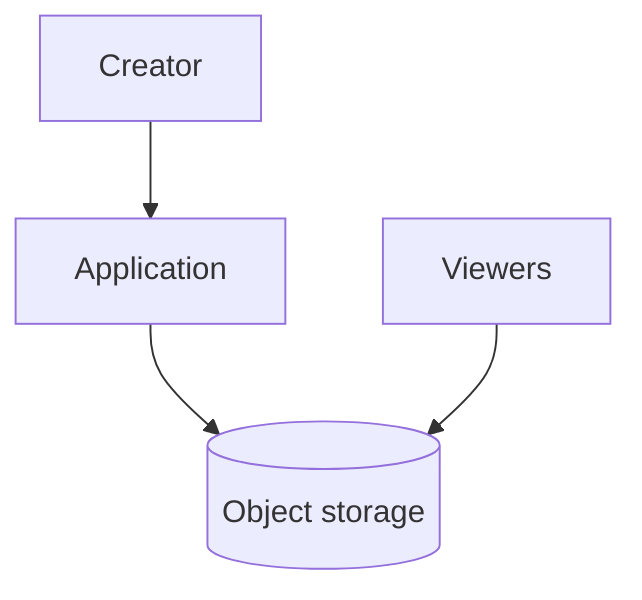
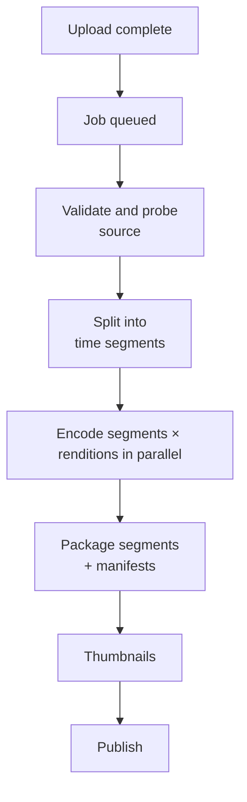
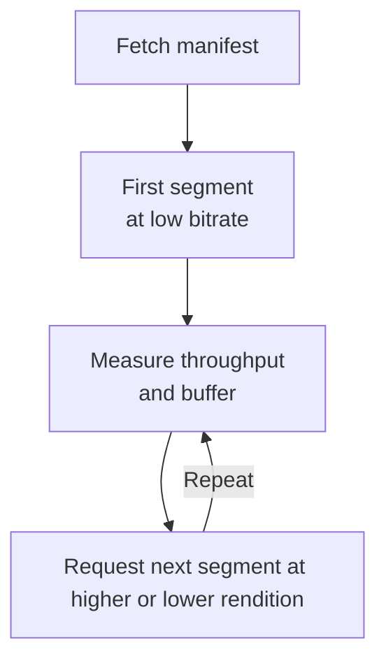
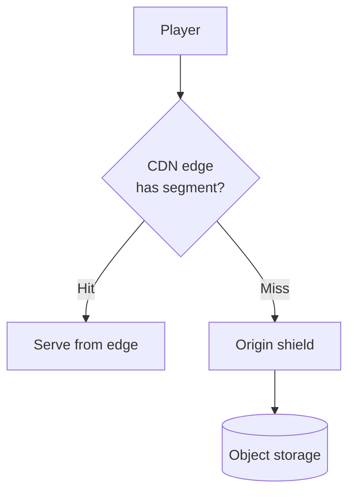
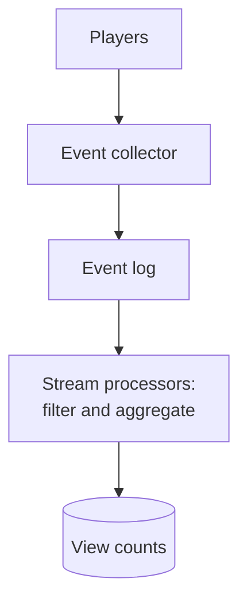
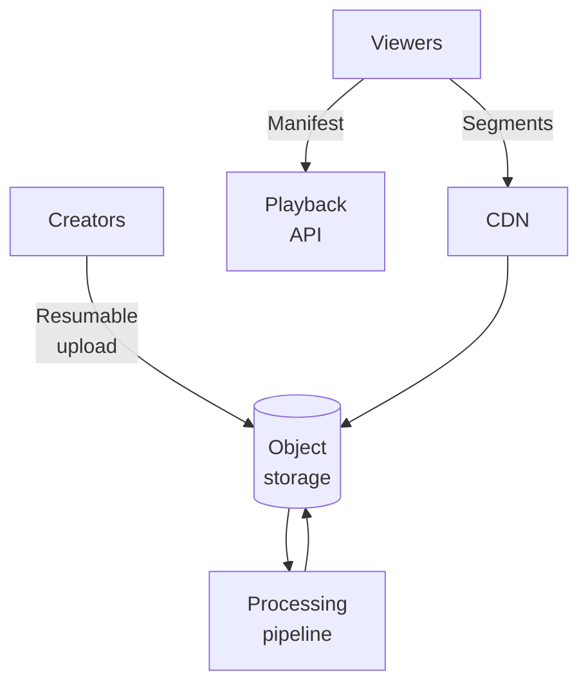
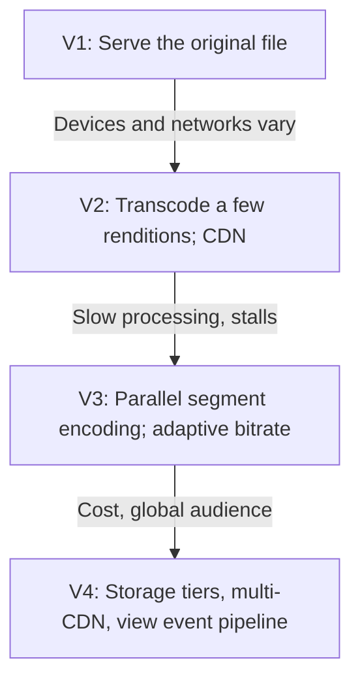

# 13.07 — Video Platform

## Learning Objectives

By the end of this chapter, you should be able to:

- Estimate concurrent viewers, delivery bandwidth, storage, and transcoding compute.
- Explain why video delivery is a bandwidth problem solved mainly by CDNs.
- Design an upload and processing pipeline that turns one file into many streamable renditions.
- Explain adaptive bitrate streaming with manifests and segments.
- Treat popular and rarely watched videos differently for caching and storage.
- Count views at scale without slowing playback.

---

## 1. The Problem

A video platform lets creators upload videos and viewers watch them on any device and network.

It combines two systems with very different shapes:

| Part | Work | Scale driver |
|---|---|---|
| Processing | Convert each upload into formats every device can play | CPU time per minute of video |
| Delivery | Stream video bytes to viewers | Network bandwidth |

Request rates matter less here than in the previous case studies. A single viewer watching for 30 minutes generates few API calls but transfers hundreds of megabytes.

> [!MENTAL-MODEL]
> A video platform is a batch processing pipeline that prepares files once, and a content delivery network that serves those files millions of times.

---

## 2. Requirements

### Functional requirements

1. Creators upload videos up to 4 hours long.
2. Uploaded videos become watchable on phones, browsers, and TVs.
3. Playback adapts to the viewer's network speed.
4. Viewers can seek to any point in a video.
5. Each video shows a view count.
6. Creators see the processing status of their uploads.

### Non-functional requirements

| Requirement | Target | Why it matters |
|---|---|---|
| Start-up time | Playback begins within 2 seconds | Viewers leave if video does not start |
| Rebuffering | Rare, even on variable mobile networks | Stalls are the main quality complaint |
| Processing time | A 10-minute video is watchable within about 10 minutes | Creators expect quick publishing |
| Durability | Source uploads are never lost | Re-encoding requires the original |
| Delivery cost | Minimized per hour watched | Bandwidth is the largest operating cost |

### Out of scope

- Live streaming.
- Recommendations and search (see Chapter 13.08).
- Comments, subscriptions, and monetization.
- Digital rights management (DRM) details.

---

## 3. Constraints and Assumptions

| Assumption | Value |
|---|---|
| Daily active viewers | 10 million |
| Average watch time | 30 minutes per viewer per day |
| Average delivered bitrate | 3 Mbit/s |
| Peak factor | 3× average concurrency (evenings) |
| Uploads | 100,000 videos per day, 10 minutes on average |
| Source file bitrate | About 8 Mbit/s (600 MB per 10 minutes) |
| Renditions | 240p, 360p, 480p, 720p, 1080p |
| Encoding cost | About 2 CPU-minutes per video-minute per rendition (illustrative) |

---

## 4. Traffic Estimation

**Concurrent viewers.** A day has 1,440 minutes:

$$
\frac{10{,}000{,}000 \times 30}{1{,}440} \approx 208{,}000 \text{ concurrent viewers on average}
$$

At 3× peak, about **625,000 concurrent viewers**.

**Delivery bandwidth at peak:**

$$
625{,}000 \times 3 \text{ Mbit/s} \approx 1.9 \text{ Tbit/s}
$$

```calculator
title: Peak Video Delivery Bandwidth
description: Estimate peak egress from viewing habits.
inputs:
  - id: dau
    label: Daily active viewers
    unit: million
    min: 0.1
    max: 500
    step: 0.1
    value: 10
  - id: minutes
    label: Minutes watched per viewer per day
    unit: min
    min: 1
    max: 240
    step: 1
    value: 30
    divisor: 1440
  - id: bitrate
    label: Average bitrate
    unit: Mbit/s
    min: 0.5
    max: 25
    step: 0.5
    value: 3
  - id: peak
    label: Peak-to-average factor
    unit: ×
    min: 1
    max: 10
    step: 0.5
    value: 3
result:
  label: Peak delivery bandwidth
  operation: product
  digits: 2
  unit: Tbit/s
formula: "{dau} million × {minutes} min ÷ 1,440 × {bitrate} Mbit/s × {peak}"
caption: Million viewers × Mbit/s gives Tbit/s. No single data centre link serves this; it must be spread across a CDN.
```

**Daily delivered data:**

$$
10{,}000{,}000 \times 1{,}800 \text{ s} \times 3 \text{ Mbit/s} \div 8 \approx 6.75 \text{ PB per day}
$$

**Transcoding compute:**

$$
100{,}000 \text{ videos} \times 10 \text{ min} \times 5 \text{ renditions} \times 2 \text{ CPU-min} = 10 \text{ million CPU-minutes per day}
$$

That is about **6,900 CPU cores** running continuously, more at upload peaks.

What these numbers tell us:

- **Delivery is the dominant cost and scaling problem**, and it is almost entirely file transfer.
- **Processing is a large, parallel batch workload** that can run on elastic compute.
- API and metadata traffic are small by comparison.

---

## 5. Data Estimation

| Data | Calculation | Size |
|---|---|---|
| Source uploads | 100,000 × 600 MB per day | 60 TB/day, about 22 PB/year |
| All renditions | 100,000 × about 880 MB per day | 88 TB/day, about 32 PB/year |
| Metadata | Titles, owners, status, rendition lists | Small (gigabytes) |

The rendition ladder adds up as 0.4 + 0.8 + 1.5 + 3 + 6 Mbit/s, about 11.7 Mbit/s in total, or roughly 880 MB for a 10-minute video.

Most of this storage is rarely read. Viewing is extremely skewed: a small fraction of videos receives most views, and many videos are watched a handful of times.

---

## 6. Initial Architecture

At small scale, upload a file and serve it as-is:



This fails quickly:

- The original format may not play on every device.
- A 1080p file at 8 Mbit/s stalls on a slow mobile connection.
- Viewers must download from the start; seeking is slow.
- Every view comes from one storage location, far from most viewers.

---

## 7. The Processing Pipeline

Uploads go directly to object storage using signed, resumable uploads (as in Chapter 13.06). Completing the upload triggers processing.



Key decisions:

- **Split, then encode in parallel.** A 60-minute video split into 2-minute pieces becomes 30 pieces × 5 renditions = 150 independent tasks. Processing time depends on the longest task, not the length of the video.
- **Each task is idempotent.** Its output location is determined by video, rendition, and segment. Running it twice overwrites the same object with the same result.
- **The pipeline is a workflow with recorded state.** The job record tracks which tasks finished, so a crashed worker loses one task, not the whole job.
- **Keep the source.** Better codecs appear over time. Re-encoding from the original is how the library improves.

Processing is a good fit for elastic compute: queues of independent tasks, bursty load, and no user waiting on a request. Spot or preemptible instances reduce cost because an interrupted task is simply retried.

---

## 8. Adaptive Bitrate Streaming

Instead of one large file, each rendition is cut into short **segments** (for example, 4–6 seconds each). A **manifest** lists the renditions and their segments.

```text
manifest.m3u8
├── 240p   → seg-0001.ts, seg-0002.ts, ...
├── 480p   → seg-0001.ts, seg-0002.ts, ...
├── 720p   → seg-0001.ts, seg-0002.ts, ...
└── 1080p  → seg-0001.ts, seg-0002.ts, ...
```

The player:

1. Downloads the manifest.
2. Starts with a low rendition so playback begins quickly.
3. Measures download speed and buffer level.
4. Switches renditions segment by segment as conditions change.
5. Seeks by requesting the segment that contains the target time.



Common formats are HLS and MPEG-DASH. Both deliver segments over ordinary HTTP, which is why standard CDNs can cache them.

> [!TRADE-OFF]
> Adaptive streaming makes playback robust on unreliable networks, but it multiplies storage (several renditions) and processing (encoding each one). The extra cost buys fewer stalls and faster start-up.

---

## 9. Delivery Through a CDN

At about 1.9 Tbit/s, delivery must be spread across many edge locations close to viewers.



- **Segments are immutable**, so they can be cached for a long time. A new encoding gets new file names.
- **An origin shield** is a mid-tier cache that collapses misses from many edges into one request to storage.
- **Hit ratio is the key metric.** At a 95% hit ratio, about 94 Gbit/s still reaches the origin at peak. Every point of hit ratio is a large amount of origin bandwidth and cost.

**Popular and long-tail videos behave differently.** Popular videos stay in edge caches. Rarely watched videos are cache misses almost every time. For them, it may be cheaper to keep fewer renditions, store them on a cheaper storage tier, and accept a slightly slower start.

Some platforms with very large traffic place caching servers inside internet service providers' networks to reduce transit costs further. That is a later optimization, justified only by very high delivery volume.

---

## 10. Metadata and Playback API

The application tier is small compared with delivery:

| Table | Purpose |
|---|---|
| `videos` | Title, owner, duration, status (`uploading`, `processing`, `ready`, `failed`) |
| `renditions` | Resolution, bitrate, manifest location |
| `processing_tasks` | Task state for each segment and rendition |
| `view_counts` | Aggregated counts per video |

The playback API checks that the video is `ready` and that the viewer may watch it, then returns a manifest URL, often signed with a short expiry so that private or paid videos cannot be shared freely.

---

## 11. Counting Views

Each play sends events: start, progress, and end. At hundreds of thousands of concurrent viewers, writing a counter row per event would create hot rows on popular videos.



- Count a view only after a minimum watch time, and filter repeated plays from the same session.
- Aggregate per video per minute, then update totals in batches.
- Displayed counts lag by seconds or minutes. That is acceptable and should be stated as a requirement.

Chapter 13.10 develops this kind of event pipeline in detail.

---

## 12. Bottlenecks

| Symptom | Likely bottleneck |
|---|---|
| Rebuffering and slow start-up in some regions | CDN capacity or coverage in those regions |
| Origin bandwidth and storage request costs rise | Low CDN hit ratio |
| Processing queue grows after popular creators upload | Not enough encoding workers; long videos encoded serially |
| One video's processing blocks others | Single queue without priority or per-creator limits |
| View counts update slowly or databases overheat | Counting each event individually |
| Storage cost grows faster than viewing | Every rendition of every video kept on hot storage |

---

## 13. Architectural Decisions and Scaling

| Decision | Problem it solves |
|---|---|
| Direct, resumable uploads to object storage | Large files without tying up application servers |
| Segmented, parallel encoding | Processing time independent of video length |
| Idempotent tasks with recorded state | Crashes and preemptions lose little work |
| Adaptive bitrate segments | Smooth playback on varying networks |
| CDN with origin shield | Delivery close to viewers; fewer origin requests |
| Popularity-based storage and rendition policy | Lower cost for the long tail |
| Event pipeline for views | No hot-row writes on popular videos |



---

## 14. Failure Scenarios

| Failure | What users notice | Mitigation |
|---|---|---|
| Encoding worker crashes or is preempted | Slightly slower processing | Retry the task; outputs are idempotent |
| Corrupt or unusual source file | Upload marked as failed | Validate early; dead-letter the job; tell the creator why |
| Processing backlog after a surge | Videos take longer to publish | Autoscale workers; prioritize short videos and premium creators |
| CDN edge outage in a region | Rebuffering, slow start | Multiple CDN providers or failover routing |
| Origin storage slow or unavailable | Cache misses fail; popular videos keep playing | Origin shield; multi-region storage for popular content |
| Viral video | Origin and edges see a spike | Immutable segments cache well; pre-warm edges for planned events |
| Event pipeline lags | View counts update late | Counts are eventually consistent; playback unaffected |

> [!FAILURE] The cold-cache surge
> A new episode is released to millions of viewers at the same minute. Every edge misses on the first segments at once, and the origin receives a burst it was never sized for. Pre-position the first segments in the CDN before release, and rely on the origin shield to collapse duplicate misses.

---

## 15. Recovery

- **Source files** are the only irreplaceable video data. Keep them durable, replicated, and on a cheaper tier after processing.
- **Renditions and segments** are derived. They can be regenerated from the source if lost or if a packaging bug is found.
- **Processing state** lets the pipeline resume: tasks marked complete are not repeated.
- **View events** retained in the log can be reprocessed to correct counts after a bug.

---

## 16. Evolution



---

## 17. Trade-offs

| Decision | Benefit | Cost |
|---|---|---|
| Multiple renditions | Playback on every device and network | More storage and encoding |
| Short segments | Fast start, quick adaptation, easy seeking | More files and requests; slightly less compression efficiency |
| Parallel encoding | Fast publishing | Orchestration and recorded task state |
| Keeping sources | Re-encode with better codecs later | Storage for files rarely read |
| CDN delivery | Scales bandwidth; low latency | Large bills; dependence on CDN behaviour |
| Fewer renditions for long-tail videos | Lower storage cost | Slightly lower quality for rarely watched videos |
| Aggregated view counts | No hot rows | Counts lag |

> [!LOCK-IN]
> Codecs and packaging formats are long-lived commitments: every stored rendition and every client player depends on them. Re-encoding a large library is a project measured in months of compute. Keep source files so a new format is possible, and keep CDN-specific features (signed URL formats, edge logic) behind your own playback API so delivery can move between providers.

---

## 18. Common Mistakes

- **Serving one original file to everyone:** Many devices cannot play it and slow networks stall.
- **Streaming video through application servers:** Bandwidth belongs on a CDN.
- **Encoding long videos as one task:** Processing time grows with length and one failure restarts everything.
- **Mutable segment URLs:** Caches serve stale or mixed content.
- **Treating every video the same:** The long tail drives storage cost; popular videos drive bandwidth.
- **Deleting source files after encoding:** Future re-encoding becomes impossible.
- **Writing a database row per view event:** Popular videos create hot rows.

---

## 19. Hands-On Exercise

Design video for an online course platform:

- 5,000 courses with 20 hours of lectures each.
- 200,000 students per day watching about 45 minutes each.
- Videos are paid content and must not be shareable by URL.
- Lectures are rarely updated, but slides sometimes need corrections.

Answer:

1. Estimate peak bandwidth and total storage for all renditions.
2. How many renditions do you need? Would you keep fewer for older courses?
3. How do you prevent unpaid access with signed URLs and short expiry?
4. How do you replace a few minutes in the middle of a lecture without re-encoding all of it?
5. Is a CDN still necessary at this scale? Justify with your estimate.

---

## 20. Quick Reference

| Topic | Decision in this design |
|---|---|
| Delivery | About 625,000 concurrent viewers; about 1.9 Tbit/s at peak |
| Daily egress | About 6.75 PB |
| Processing | About 10 million CPU-minutes/day; parallel segment encoding |
| Storage | About 22 PB/year source + 32 PB/year renditions |
| Playback | HLS/DASH manifests and short segments; adaptive bitrate |
| Caching | Immutable segments on a CDN with an origin shield |
| Long tail | Cheaper tiers; fewer renditions |
| Views | Event log + stream aggregation; eventually consistent |
| Hardest to reverse | Codec and packaging choices across the library |

---

## 21. Knowledge Check

**1. Why is video delivery mainly a bandwidth problem?**

Each viewer transfers hundreds of megabytes per session; peak delivery reaches terabits per second while API traffic stays small.

**2. Why split videos into segments before encoding?**

Segments encode in parallel, so processing time no longer grows with video length, and a failure repeats one segment.

**3. How does adaptive bitrate streaming work?**

The player reads a manifest of renditions and requests each short segment at the bitrate its current network can sustain.

**4. Why are segments easy to cache?**

They are immutable files served over HTTP; new encodings get new names.

**5. What does an origin shield do?**

It collapses misses from many CDN edges into a single request to origin storage.

**6. Why treat long-tail videos differently?**

They are rarely watched, so they miss caches and mostly cost storage; cheaper tiers and fewer renditions reduce cost.

**7. Why keep the source file after encoding?**

It allows re-encoding with better codecs or fixing packaging bugs later.

**8. How are views counted without overloading the database?**

Playback events go to a log; stream processors filter and aggregate them before updating counts in batches.

---

## Remember

**Prepare once, deliver many times, and put the bytes as close to the viewer as possible.**

Processing is an elastic batch pipeline of idempotent tasks. Delivery is immutable segments on a CDN. The rest of the platform is small, and most of the cost is in decisions about bandwidth and storage.

**Next: 13.08 — Search System**
